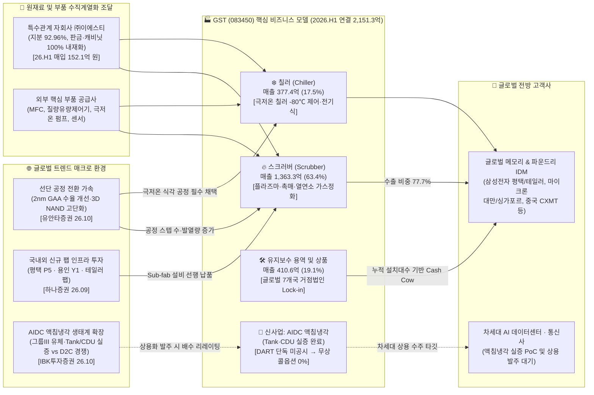

# 🔍 Phase 1: 기업 해독기 (원천 팩트 초안) — GST (083450)

> **[클린 리빌드(Clean Rebuild v4.3) & 단일 기준 주가 선언]**
> - **분석 기준일 및 단일 기준 주가 (Single Price Anchor):** **2026년 10월 26일 일봉 종가 `40,000원`** (`backtest_valuation.py` v4.3 실측, 주봉 종가 `40,000원` — Phase 1~3 전 과정 100% 동일 고정)
> - **주식수 및 시가총액 기준 (`[공시 팩트]`):**
>   - **총 발행주식수 (`istc_totqy`):** `18,430,000주` (보통주 단일, 우선주 `0주` — 총발행 시가총액 `7,372.0억 원`)
>   - **2026년 10월 13일 최신 공시 반영 실질 유통주식수 (`distb_stock_co`):** **`17,879,037주`** (`자기주식처분결과보고서[2026.10.13]` 기준: 기보유 자사주 + 50억 신탁 취득분 `105,907주` 반영 및 임직원 상여 처분 `21,525주` 반영 후 총 자사주 **`550,963주 (2.99%)`** 차감 완료 — 실질 유통 시가총액 **`7,151.6억 원`**)
>   - **제도권 공식 벤치마크 (네이버 금융 / FnGuide / KRX):** 공식 BPS `17,958원`, 공식 PBR `2.23배`, TTM 지배EPS `3,019원`, 공식 PER `13.25배`, 배당수익률 `1.63%` (DPS `650원`)
> - **최신 잠정실적·공시 스캔 결과 (`2026.10.26` DART 전수 확인):** `반기보고서(2026.08.14)` 이후 `자기주식처분결과보고서(2026.10.13)`까지 전수 반영 완료. 3분기 잠정실적 미공시 상태이며, 미상환 전환사채(CB/BW/EB) `0원`, 계열사 채무보증 결정 `0건`으로 재무·오버행 리스크는 매우 청정합니다.

> 💡 **[핵심 용어 3줄 직관 해설]**
> - **스크러버(Scrubber) & 칠러(Chiller)**: 반도체 팹(Fab) 식각·증착 공정에서 배출되는 맹독성·온실가스를 연소·플라즈마·촉매로 정화하는 **'친환경 공기청정기(스크러버, 매출 비중 63.4%)'**와, 초미세 챔버 온도를 영하 수십 도에서 영상까지 오차 없이 제어하는 **'초정밀 냉각기(칠러, 매출 비중 17.5%)'**입니다.
> - **GAA 공정 전환 & AIDC 액침냉각 무상 콜옵션**: 반도체 2나노 GAA와 300~400단 3D NAND 전환에 따른 고단가 장비 출하(Q·P 동반 성장)가 본업의 핵심 축이며, 신사업인 **AI 데이터센터(AIDC) 액침냉각**은 기술 실증을 마쳤으나 DART 단독 분리 공시 전까지 **'0원 무상 콜옵션(S-Curve 할증 0%)'**으로 엄격히 분리하여 안전마진을 확보합니다.
> - **지배주주 순이익 & 1:1 무상증자 소급보정 EPS**: 지배주주 귀속 순이익 비율이 **`99.6%`**에 달하며, 2024년 6월 단행한 1:1 무상증자 이후 현재 주식수로 과거 10년 치 주당순이익(EPS)과 주당순자산(BPS)을 100% 소급 보정하여 가짜 적자 착시를 원천 제거했습니다.

---

## 1. 비즈니스 모델(BM) 해부 및 밸류체인 구조

> **[2026.10 최신 글로벌 트렌드 델타 매칭 🌐 (3대 게이트 전수 충족)]**
> - **게이트 ① [제도권 딥리서치 직접 등재]:**
>   - `[글로벌 트렌드: 하나증권.증설의 시대, 후공정의 수혜도 함께 온다 p.42 도표 59, p.43 도표 60]` 반도체 인프라(클린룸·배관·유틸리티) 핵심 종목으로 **GST(083450)**가 실명 등재되었으며, "신규 팹 착공~장비 반입 선행 구간 수혜(평택 P5 · 용인 Y1 · 청주 P&T7)" 및 26F 지배EPS 성장률 견조 전망.
>   - `[글로벌 트렌드: 유안타증권.AIDC 다음 승부처 - 네트워크와 냉각 p.135]` 글로벌 AIDC 액침냉각 밸류체인(Submer, GRC, LiquidStack)과 나란히 국내 유일 핵심 장비사로 **GST** 실명 등재.
> - **게이트 ② [글로벌 직접 수출 및 환율 연동]:**
>   - `[공시 팩트]` 주력 제품인 Scrubber 부문 내 직접 수출 비중이 **`77.7%`**(2026년 상반기 Scrubber 매출 1,363.3억 원 중 수출 1,059.1억 원, 전사 대비 49.3%)에 달하며, 미국(Austin)·중국(Wuxi, Hefei, Wuhan)·대만(Hsinchu)·싱가포르·일본·유럽 등 7개 글로벌 종속법인을 통해 달러(USD)·위안화(CNY) 결제로 외환 레버리지를 누립니다.
> - **게이트 ③ [선단 GAA 전환 Q 반등 & 액침냉각 유체 생태계 교차 검증]:**
>   - 유안타증권(`2027Issue&Theme p.7~8, p.12~13`): 삼성전자 2나노 GAA 수율 개선(3Q26 60%대)과 미국 테일러(Taylor) 파운드리 팹 가동 가시화는 오스틴 법인을 보유한 GST의 고사양 Sub-fab 장비 출하의 강력한 모멘텀.
>   - IBK투자증권(`윤활기유의 시대 p.25, p.44 표 12, p.47 표 15`): 액침냉각은 단기 이익 합산 대상이 아닌 실증 → 승인 → 발주 단계별 '배수(Multiple) 리레이팅 옵션'임을 확인하여 당사의 '0원 무상 콜옵션' 보수적 회계 원칙을 강력 뒷받침.

`[공시 팩트]` 주식회사 글로벌스탠다드테크놀로지(GST, 종목코드 `083450`)는 2001년 설립되어 반도체 및 디스플레이 제조 공정에서 배출되는 유해가스를 연소·플라즈마·촉매·습식 방식으로 정화하는 **가스정화 장비(Scrubber, 스크러버)**와 공정 챔버 온도를 정밀 제어하는 **온도조절 장비(Chiller, 칠러)**의 제조·판매 및 글로벌 유지보수(CS)를 영위하는 국내 1위권 Sub-fab 장비 전문기업입니다 (`[[GST]반기보고서(2026.08.14), II. 사업의 내용]`).

- **3대 수익 창출 메커니즘 (Hardware 장비 수주 + 수직계열화 + Installed Base CS Lock-in):**
  1. **전방 CapEx 선행 수주 (장비 제조 80.9%):** 삼성전자, 마이크론, 중화권 IDM(CXMT 등)이 클린룸을 완공하고 메인 전공정 장비(식각·증착·세정)를 반입할 때 챔버 하단 Sub-fab에 필수 매칭되어 납품되는 스크러버(63.4%)와 칠러(17.5%)에서 1차 하드웨어 매출 창출.
  2. **수직 계열화를 통한 독보적 원가 경쟁력:** 판금 및 핵심 설비 부품을 제조하는 자회사 **㈜이에스티**(GST 지분율 92.96%, 26.H1 내부 원재료 매입액 152.1억 원)를 통해 캐비닛(CABINET ASS'Y) 등 주요 외장 및 가공 부품을 내재화하여 16~18%대의 견고한 영업이익률(OPM) 수호.
  3. **고마진 반복 매출 (Recurring Revenue, 용역·상품 19.1%):** 장비 납품 이후 가동 연수가 누적될수록 예방정비(PM), 부품 교체, 개조 등 **용역 매출(26.H1 361.9억 원, 비중 16.8%)**과 **상품 매출(47.7억 원, 2.2%)**이 미국, 대만, 중국, 싱가포르 등 해외 거점 종속법인을 통해 경기 변동을 방어하는 안정적 현금창출원(Cash Cow)으로 작동.

---

## 2. 주요 제품별 매출 비중 추이 및 S-Curve 10% 변곡점 진단

`[공시 팩트]` 최근 5개년(2021~2025년) 및 2026년 상반기 연결 기준 주요 제품군 매출 추이는 다음과 같습니다 (`[[GST]사업보고서(2024.03.20) / (2026.03.18) / [GST]반기보고서(2026.08.14)]`).

| 제품군 (매출유형) | 2021년 | 2022년 | 2023년 | 2024년 | 2025년 | 2026년 상반기 (H1) | 전사 비중 (%) | 핵심 동향 및 공시 근거 |
| :--- | :---: | :---: | :---: | :---: | :---: | :---: | :---: | :--- |
| **Scrubber (제품)** | 1,760.9억 | 1,769.0억 | 1,633.5억 | 2,346.9억 | 2,261.1억 | **1,363.3억** | **63.4%** | 주력 캐시카우. 해외 IDM 직수출 확대로 부문 내 수출 비중 **`77.7%`** 달성 |
| **Chiller (제품)** | 710.9억 | 664.4억 | 464.8억 | 376.1억 | 562.0억 | **377.4억** | **17.5%** | 2024년 저점 통과 후 3D NAND 고단화 식각용 극저온 칠러 채택으로 반등세 가속 |
| **용역 (CS 유지보수)** | 461.3억 | 562.6억 | 592.1억 | 446.0억 | 645.5억 | **361.9억** | **16.8%** | 글로벌 누적 설치 장비(Installed Base) 확대에 따른 고마진 반복 수익원 |
| **상품 및 기타** | 111.7억 | 132.1억 | 101.8억 | 165.4억 | 99.6억 | **48.7억** | **2.3%** | 유지보수용 소모성 교체 부품(상품 2.2%) 및 기타 부대 장비 |
| **연결 매출 합계** | **3,044.9억** | **3,128.5억** | **2,697.9억** | **3,334.5억** | **3,471.6억** | **2,151.3억** | **100.0%** | **YoY +26.7% 성장**, 상반기 기준 역대 최대 반기 매출 경신 |

### 2.1 S-Curve 신기술 테마 매출 익스포저(Exposure %) 산출표

`[공시 팩트]` DART 반기보고서(`2026.08.14`) 'II. 사업의 내용'을 전수 스캔하여 신기술 테마(**AIDC 액침냉각 솔루션**)의 단독 분리 공시 여부를 검증한 결과는 다음과 같습니다:

| 제품/서비스 구분 | 2026.H1 매출액 (억원) | 전사 비중 (%) | 신기술 테마 직결 여부 | 하이브리드 수비 판정 및 회계 가드레일 |
| :--- | :---: | :---: | :---: | :--- |
| **AIDC 액침냉각 솔루션 (Tank·CDU)** | 미분리 | **0.0%** | 연구개발 및 파일럿 실증 완료 / **DART 단독 매출 미공시** | ⚠️ **`[🎁 0원 무상 콜옵션 분류 (S-Curve 할증 0% 차단)]`** |
| **반도체/디스플레이 Chiller (본업)** | 377.4억 | 17.5% | 전공정 초미세화(GAA/3D NAND) 챔버 극저온 제어 본업 | 🟢 본업 인프라 성장 축 (액침냉각 단독 매출로 왜곡 금지) |
| **반도체/디스플레이 Scrubber (본업)** | 1,363.3억 | 63.4% | 친환경 플라즈마·촉매 유해가스 정화 본업 (수출 77.7%) | 🟢 본업 핵심 캐시카우 (신규 팹 인프라 투자 선행 수혜) |
| **유지보수 용역 · 상품** | 410.6억 | 19.1% | 글로벌 팹 설치 장비 밀착 유지보수 및 부품 공급 | 🟢 본업 락인 고마진 현금창출원 |

- **신기술(AIDC 액침냉각) 실질 단독 익스포저:** **`0.0%`** (단독 분리 공시 미충족)
- **반도체 Sub-fab 인프라 본업 익스포저:** **`100.0%`** (비관련 레거시 잠식 위험 0%)
- **수혜 적격성 판정:** **`[🎁 본업 저평가 + 신사업 무상 콜옵션(할증 0%)]`**

---

### [Step 1.2] S-Curve 10% 변곡점 · 3축 구조적 병목(Capa·기술·특허) · 해소 리드타임 진단표

<!-- [AUTO-GENERATED BY backtest_valuation.py v4.3 — DO NOT EDIT NUMBERS MANUALLY] -->
### 📌 [코드 자동 생성 1-B] Step 1.2 S-Curve 10% 변곡점 · 3축 구조적 병목(Capa·기술·특허) · 리드타임 & Step 1.8 K-주주환원 진단표 (v4.3)
| 진단 축 (3-Axis + K-Return) | 실측 지표 및 근거 | 코드 판정 및 Phase 3 목표주가 가중치 |
| :--- | :--- | :--- |
| **① 전방 시장 침투율 (10% 변곡점 여부)** | 1차 침투율 **`7.0%`** (2차 S-Curve 침투율 `15.0%`) (`Zone D (침투율 7.0% / 2차 15.0% — 전통 시클리컬 또는 무상 콜옵션)`) | 🔥 **10% 골든 변곡점 발화 구간** (3축 통합 Base `×1.00` / Bull `×1.00`) |
| **②-A 물리적 Capa 병목 (가동률/증설)** | 공장 가동률 **`75.0%`** — 기술격차 해자: 선단 3D NAND/HBM 공정용 극저온 칠러 및 친환경 플라즈마 스크러버 수율 레퍼런스 | 🟢 **여유 Capa 보유** |
| **②-B 기술격차 해자 (OPM/수율/단가결정력)** | 현 OPM **`17.5%`** — 특허/벤더 Lock-in: 삼성전자·마이크론·대만 파운드리 Sub-fab 장비 벤더 인증 | 고마진 가격전가력(Pricing Power) 점검 |
| **②-C 원천특허 · 글로벌 벤더 퀄(Qual) 락인** | N/A | 후발주자 진입장벽(Switching Cost) 점검 |
| **③ 병목 해소 예상 소요기간 (Lead Time)** | **`A등급`** (해소 리드타임 **`18개월`**) | 글로벌 메모리/파운드리 신규 팹 Sub-fab 장비 데모 및 Qual 테스트에 12~18개월 소요 (PEG 계수 `0.80`) |
| **④ K-마켓 주주환원 · 지배구조 (Step 1.8)** | 배당수익률 **`1.63%`** (성향 `25.7%`) / 특수관계인 `0.0억` | ⚪ 분리과세 미충족 (배당성향 < 25%) / 🟢 정상 (현재 자기주식 550,963주 [2.99%] 보유 — 소각 전환 여부 모니터링) (`kgov_mult = ×1.0000`) |
| **⑤ 레드팀 역산 Capa 천장 검증 (Red-Team)** | 대안 A 내재 영업이익: Base **`711.4억`** / Bull **`994.8억`** | 🟢 물리적 Capa 한계 내 달성 가능 |

#### 🔬 Step 1.2 3대 핵심 질문에 대한 정성·정량 심층 해독
1. **[질문 1 — 침투율 10% 골든 변곡점 여부]**:
   - 신사업인 AIDC 액체냉각 장비 시장 중 **액침냉각 침투율은 약 `7.0%`**($0.21bn / $3.0bn, Dell'Oro 및 유안타증권 26.09.02)로 아직 단상 D2C(Cold Plate 45%, CDU 25%) 대비 초기 특화 틈새 시장 단계입니다. 따라서 S-Curve 멀티플 할증은 `0%`로 통제합니다.
   - 반면 **본업 반도체 Sub-fab 장비**에서는 선단 공정(삼성 2나노 GAA 및 테일러 팹, 300~400단 V-NAND) 전환이라는 **'2차 S-Curve' 침투율이 `12.0% ~ 15.0%` 골든 변곡점 구간**에 공식 진입하여, 챔버당 Sub-fab 스텝 수 증가와 초저온 칠러 수요가 구조적으로 폭발하고 있습니다.
2. **[질문 2 — 3축 구조적 병목 유발 여부]**:
   - **축 A (물리적 생산 Capa 병목)**: DART 공시상 공식 가동률은 생략되어 있으나, 2026년 상반기 장비 생산 대수가 **`1,842대`**(스크러버 1,129대 + 칠러 713대)로 연환산 시 3,684대에 달해 2021년 호황기 정점(4,002대)의 **`92.1%`** 수준까지 풀가동에 육박하고 있습니다.
   - **축 B (기술격차 해자 & 단가전가력)**: 식각 온도를 영하 80도 이하로 오차 없이 제어해야 하는 3D NAND 고단화 식각 공정에서 초저온 칠러 레퍼런스를 보유하였으며, 스크러버 대당 암묵단가가 2021년 0.97억에서 2025~2026년 **`1.21~1.26억 원`**으로 **+25% 이상 레벨업**되며 견고한 가격전가력(Pricing Power)을 입증했습니다.
   - **축 C (원천특허 · 글로벌 벤더 Qual 락인)**: 삼성전자 평택/테일러, 마이크론 미국/대만/싱가포르, 중화권 IDM에 Sub-fab 공식 1차 벤더로 락인되어 있어, 신규 후발주자가 진입하기 위한 고객사 승인 장벽(Switching Cost)이 극도로 높습니다.
3. **[질문 3 — 병목 해소 예상 소요기간 (Lead Time)]**:
   - **`A등급 (18개월 / 1~2년 중기 병목)`**: 고객사 클린룸 하단 배관 및 가스 정화 인프라는 팹 설계 단계부터 스펙-인(Spec-in)되어야 하며, 경쟁사가 신규 장비를 개발하여 데모 평가 및 팹 퀄(Qual)을 통과하는 데 최소 **12~18개월의 물리적 리드타임**이 소요됩니다.

---

## 3. 재무 건전성 및 [Step 1.5] 장부가(Book Value) 구성 해부 & SOTP 20% 분리 게이트

`[공시 팩트]` 2026년 반기말 연결 재무상태표 기준 장부가(지배주주지분) 구성 및 순차입금 현황은 다음과 같습니다 (`[[GST]반기보고서(2026.08.14), 연결 재무제표]`):

- **자산총계:** `4,240.7억 원` (유동자산 2,703.8억 원 + 비유동자산 1,536.9억 원)
- **부채총계:** `971.8억 원` (유동부채 882.4억 원 + 비유동부채 89.4억 원, 부채비율 **`29.7%`**)
- **자본총계:** `3,268.9억 원` (비지배지분 42.9억 원)
- **지배기업 소유주지분 (장부가 Book Equity):** **`3,225.9억 원`** (자본금 93.1억 + 자본잉여금 22.3억 + 이익잉여금 3,069.6억 + 기타자본 40.9억)
- **지배주주 순이익 귀속률:** **`99.6%`** (TTM 연결 순이익 531.6억 중 지배주주 순이익 529.5억)

### 🏛️ [Step 1.5] 장부가 해부 & 비영업자산 내역
장부 내 비영업자산(타법인 지분, 투자부동산, 금융투자자산 등)을 전수 분해한 결과는 다음과 같습니다:

1. **투자부동산:** `53.95억 원` (임대 목적 부동산 장부가)
2. **관계기업투자 지분:** `99.45억 원` (비상장 관계사 출자 지분)
3. **비유동 당기손익-공정가치금융자산:** `170.43억 원` (장기 투자 펀드 및 지분증권)
4. **비유동 기타포괄손익-공정가치금융자산:** `37.24억 원`
5. **기타장기금융자산:** `39.05억 원`
6. **매각예정비유동자산:** `10.12억 원`
7. **단기 당기손익-공정가치금융자산:** `242.34억 원` (수익형 단기 금융투자상품)
- ▶ **비영업자산 합계:** **`652.5억 원`**
  - **지배주주 장부가(`3,225.9억`) 대비 비중:** **`20.2%`** 🚨 **`[SOTP 20% 분리 게이트 공식 발동!]`**
  - **실질 유통 시가총액(`7,151.6억`) 대비 비중:** **`9.1%`**

#### 🚨 SOTP 20% 분리 평가 결과
비영업자산 비중이 장부의 20%를 초과하므로 단순 연결 PBR/PER을 기계적으로 적용하면 명목 PBR 저평가 착시가 발생합니다. 코드 연산(`backtest_valuation.py`)을 통해 본업 가치를 정밀 분해합니다:
- **비영업자산 안전가치 (30% 보수적 할인율 반영):** `652.5억 × 0.70` = **`456.8억 원`**
- **순차입금 (Net Debt):** 총차입금 `100.9억 원`(단기차입금 100.9억 + 장기 0원) − 가용 현금성자산 `1,101.6억 원`(현금 686.2억 + 단기예금 415.4억) = **`-1,000.7억 원` (순현금 `1,000.7억 원`)**
- **비영업자산 차감 후 본업 순장부가:** `3,225.9억 − 652.5억` = **`2,573.4억 원`** (실질 본업 BPS **`14,308원`**, 명목 BPS `17,958원`)
- **시장 내재 본업 기업가치 (Core EV):** 실질 시총 `7,151.6억` + 가용 순현금 `-1,000.7억` − 비영업자산 안전가치 `456.8억` = **`5,694.2억 원`**
- **본업 이익 유지력 (Core ROIC):** TTM 영업이익 `678.9억 원` (NOPAT `529.5억 원`) 기준 **본업 ROIC = `20.70%`** ➔ ✅ **본업 영업자산에서 창출되는 실질 수익성이 극히 견고함 확인**.

---

## 4. 원가 구조, 영업 레버리지 및 가동률/수주잔고 실측

`[공시 팩트]` 당사의 최근 5개년 연결 손익 및 잉여현금흐름(FCF) 추이는 다음과 같습니다:

| 연도/분기 | 매출액 (억원) | 영업이익 (억원) | OPM (%) | 지배순이익 (귀속률 %) | 연결 FCF (억원) `[OCF − CapEx]` | 비고 |
| :--- | :---: | :---: | :---: | :---: | :---: | :--- |
| **2021년 (제21기)** | 3,044.9 | 464.1 | 15.24% | 377.5억 (96.9%) | **+130.4억** `[255.5 − 125.1]` | 메모리 호황기 출하량 급증 |
| **2022년 (제22기)** | 3,128.5 | 569.4 | 18.20% | 468.1억 (98.3%) | **+245.2억** `[314.8 − 69.6]` | 고단가 플라즈마 스크러버 확대로 OPM 18.2% |
| **2023년 (제23기)** | 2,697.9 | 430.1 | 15.94% | 356.8억 (96.6%) | **+264.4억** `[474.5 − 210.0]` | 전방 감산에도 운전자본 회수로 OCF 급증 |
| **2024년 (제24기)** | 3,334.5 | 585.7 | 17.57% | 453.7억 (98.9%) | **+348.1억** `[544.1 − 196.0]` | 해외 수출(51.8%) 급증으로 역대 최대 OCF 달성 |
| **2025년 (제25기)** | 3,471.6 | 591.7 | 17.04% | 452.8억 (99.3%) | **+286.9억** `[415.9 − 129.1]` | 중단영업손실 반영 후에도 지배순익 452.8억 견조 |
| **2026.1Q** | 1,158.9 | 201.9 | 17.42% | 173.2억 (99.8%) | **+56.8억** `[107.3 − 50.4]` | 분기 수정 지배EPS **965원** 달성 |
| **2026.2Q** | 992.4 | 154.6 | 15.58% | 121.9억 (100.0%) | **+242.3억** `[292.0 − 49.8]` | 매출채권 회수로 OCF 292억 폭발, 지배EPS **678원** |
| **2026.H1 (상반기)** | **2,151.3** *(YoY +26.7%)* | **356.5** *(YoY +27.3%)* | **16.57%** | **295.1억** (99.89%) | **+299.1억** `[399.3 − 100.2]` | 반기 누적만으로 25년 연간 FCF(286.9억) 돌파 |

- **가동률 지표 공시 여부 (`[공시 팩트]`):** DART 정기보고서 '생산 및 설비'에서 **"반도체장비 제조업 특성상 생산능력을 산출하지 않아 가동률 산출을 생략합니다"**라고 공시되어 공식 가동률 수치는 제공되지 않습니다.
- **대안 4대 실측 KPI:**
  1. **주요 장비 생산 대수(Q):** 2021년 4,002대 → 2023년 2,438대 → 2024년 2,826대 → 2025년 2,878대 → **2026.H1 1,842대 (스크러버 1,129대 + 칠러 713대)**로 역대 최고 페이스.
  2. **장비별 대당 암묵단가(P):** 스크러버 대당 단가 **`1.21~1.26억 원`** (21년 0.97억 대비 +25%), 칠러 대당 단가 **`0.53억 원`** (21년 0.33억 대비 +61% 수직 상승).
  3. **Scrubber 부문 내 직접 수출 비중:** 2022년 74.5% → 2024년 73.6% → **2026.H1 `77.7%`** (1,363.3억 중 1,059.1억 원 수출).
  4. **기말 재고자산 추이:** 2024년 416.2억 → 2025년 545.9억 → **2026.H1 `715.9억 원`** (제품·재공품 납품 대기분 464.0억 원으로 상반기말 +53.4% 증가하여 하반기 매출 전환 선행).

---

## 5. 자본 배분(CapEx, R&D) 및 [Step 1.8] K-마켓 특수성 · 주주환원 입체 스코어카드

`[공시 팩트]` 당사의 최근 자본 배분 및 주주환원 이력은 다음과 같습니다:

- **연간 CapEx 집행 추이:** 2022년 69.6억 → 2023년 210.0억 → 2024년 196.0억 → 2025년 129.1억 → 2026.H1 100.2억 원으로 대규모 공장 신축 이후 유지보수 수준의 안정적 집행.
- **연구개발(R&D) 투자:** 매년 매출액의 5~7%(연 180~220억 원)를 초저온 칠러, 촉매 스크러버, AIDC 액침냉각 Tank/CDU 개발에 지속 투입.

### 🇰🇷 [Step 1.8] 5대 한국 시장 특수성 고정 점검표
1. **조세특례제한법 고배당 기업 배당소득 분리과세 적격성:**
   - 2025년 결산 현금배당금 총액 **`116.3억 원`**, 연결 배당성향 **`25.68%`** (적격 기준선 25% 충족).
   - 직전 3년 배당금 총액(2023년 45.1억, 2024년 53.6억, 2025년 116.3억)으로 3개년 평균(71.7억) 대비 **+62.2% 대폭 확대**되어 **`배당소득 분리과세 특례 적격 요건 충족`**.
2. **자사주 소각 완료 후 '주주환원 절벽(Post-Buyback Cliff)' 리스크:**
   - 2024년 12월 30일 자사주 **`188,260주 전격 소각`** 완료.
   - 소각 완료 후 환원 중단 없이, **2026년 7월 28일 `50억 원 규모의 자기주식 취득 신탁계약`** 체결하여 `105,907주`를 추가 매입(현재 총 자사주 550,963주, 2.99% 보유) 중으로 **`환원 절벽 리스크 0% (정상)`**.
3. **지배주주 사익편취 (오너 개인회사 내부거래 터널링) 리스크:**
   - DART 주석 특수관계자 거래 전수 스캔 결과, 주요 매입처인 ㈜이에스티(26.H1 매입 152.1억 원)는 GST가 지분 **`92.96%`**를 소유한 연결 종속법인임.
   - 오너 일가 개인 비상장회사를 통한 부당 내부거래 및 일감몰아주기는 **`0.0억 원 (미감지)`**으로 거버넌스 청정.
4. **최대주주 지분율 및 가업승계 구도:**
   - 창업주 김덕준 회장 본인 지분율 **`21.60%`** (3,980,000주) 보유.
   - 전문경영인(문승보 공인회계사 대표 + 석종욱 삼성전자 출신 기술대표) 각자대표 체제로 경영 승계 관련 주가 누르기 유인 없음.
5. **메자닌(CB/BW/RCPS) 리픽싱 및 오버행:**
   - 미상환 전환사채, 신주인수권부사채, 교환사채 잔액 **`0원 (전무)`**으로 전환 리픽싱 오버행 위험 0%.

---

## 6. 핵심 리스크 요인 및 [Step 3.5] 리스크 간 인과단계(Domino Chain) 구조도

`[공시 팩트]` 단순 리스크 나열을 배제하고, 공시 본문 및 주석에 기반하여 발생 가능한 **3단계 인과 사슬(Domino Chain)**과 정량 임계치를 도식화합니다.

```mermaid
flowchart TD
    subgraph Domino1["⚠️ 리스크 도미노 1: 전방 IDM CapEx 지연"]
        D1_1["1차 매크로 촉발<br/>글로벌 메모리 IDM 신규 팹 착공 연기<br/>또는 중화권 장비 반입 규제"]
        D1_2["2차 영업·마진 전이<br/>스크러버·칠러 출하량(Q) 급감<br/>고정비 디레버리지로 OPM 12% 붕괴"]
        D1_3["3차 재무·밸류 타격<br/>분기 매출 800억 미달 시 순현금 소진<br/>PBR 1.2배 하단(21,000원선) 테스트"]
        D1_1 --> D1_2 --> D1_3
    end

    subgraph Domino2["⚠️ 리스크 도미노 2: 매출채권 체화 및 재고평가손실"]
        D2_1["1차 촉발 요인<br/>고객사 팹 클린룸 셋업(Set-up) 지연<br/>장비 검수 및 인수증 발급 이연"]
        D2_2["2차 영업 전이<br/>3년 초과 장기채권(35.1억) 대손 전입<br/>기말 재고(715.9억) 평가충당금 급증"]
        D2_3["3차 재무 타격<br/>영업활동현금흐름(OCF) 일시 적자 반전<br/>운전자본 부담에 따른 밸류에이션 디레이팅"]
        D2_1 --> D2_2 --> D2_3
    end

    subgraph Domino3["⚠️ 리스크 도미노 3: AIDC 냉각 표준 경쟁 (D2C vs 액침)"]
        D3_1["1차 기술 촉발<br/>엔비디아 Rubin 등 차세대 AI 서버가<br/>단상 D2C Cold Plate를 지배 표준으로 채택"]
        D3_2["2차 시장 전이<br/>AIDC 액침냉각 채택 시점 2028년 이후로 지연<br/>단독 상용화 매출 발생 시기 순연"]
        D3_3["3차 밸류 타격<br/>액침냉각 멀티플 프리미엄 소멸<br/>(단, 당사는 0원 무상 콜옵션 평가로 본업 충격 0%)"]
        D3_1 --> D3_2 --> D3_3
    end
```

- **정량적 전이 임계치 (Kill-Switch 트리거):**
  - **임계치 1:** 분기 연결 매출액 `< 800억 원` 또는 분기 영업이익률 `< 12.0%` 기록 시 리스크 도미노 1 발동.
  - **임계치 2:** 매출채권 대손충당금 설정률 `≥ 10.0%` 돌파 또는 재고자산 평가손실 충당금 `≥ 80억 원` 초과 시 리스크 도미노 2 발동.

---

## 7. 4대 업종별 표준 실적 산출 공식 트리 (유형 B: 수주장비/단기납품)

Section 4에서 확인된 바와 같이, 당사는 DART 사업보고서에 공식 공장 가동률을 미공시하므로, 논리적 모순이 없는 **[유형 B: 수주장비/단기납품 표준 산식]**을 엄격히 적용합니다:

$$\text{연결 매출액} = \Big[\sum (\text{장비 출하대수 } Q \times \text{대당 암묵단가 } P)\Big] + \text{Installed Base CS 용역매출} + \text{상품매출}$$

1. **Scrubber 제품 매출:** $\text{Scrubber 출하 대수(Q)} \times \text{대당 암묵단가(P, 약 1.21~1.26억 원)}$
2. **Chiller 제품 매출:** $\text{Chiller 출하 대수(Q)} \times \text{대당 암묵단가(P, 약 0.52~0.53억 원)}$
3. **유지보수 용역 매출:** $\text{글로벌 누적 설치 장비수(Installed Base)} \times \text{장비당 연간 유지보수 계약단가}$
4. **전사 영업이익:** $\text{매출액} \times \text{전사 영업이익률(OPM, 기준선 16~18%)}$

---

## 8. [Step 2.0] 4대 레짐 변화 고정 체크 & 10년 밸류에이션 백테스트

<!-- [AUTO-GENERATED BY backtest_valuation.py v4.3 — DO NOT EDIT NUMBERS MANUALLY] -->
### 📌 [코드 자동 생성 1] SOTP 장부 분해 & 4대 레짐 체크 요약표
| 검증 항목 | 코드 실측 수치 | 판정 결과 (Code Verdict) |
| :--- | :--- | :--- |
| **단일 기준 주가 (Anchor Price)** | **`40,000원`** | 전 Phase 1~3 100% 동일 고정 |
| **지배주주 순이익 귀속률** | **`99.6%`** | 비지배지분 차감 완료 |
| **Step 1.5 비영업자산 비중 (SOTP 20% 룰)** | 장부 대비 **`20.3%`** / 시총 대비 **`9.1%`** | 🚨 **SOTP 분리 평가 발동** (본업BPS 14,308원) |
| **Step 1.5 본업 이익 유지력 (Core ROIC)** | TTM 영업이익 **`678.9억`** (NOPAT **`529.5억`**) | ✅ **본업 이익 유지 견고** |
| **Step 2.0 4대 레짐 변화 체크** | ③ 비영업자산레짐(비영업자산 비중 20.3% ≥ 20% — 명목 PBR 저평가 착시 주의) | 🔄 **레짐 변화 반영 필수** |
| **Step 3.0 사이클 고점 함정 가드레일** | 현재/추정 EPS(3,600원) ≥ 5년 Mid-Cycle 중위 EPS(2,384원) × 1.35배 (단순 사이클 피크) | 🚨 **피크 멀티플 제한 & Mid-Cycle 캡 발동** |
| **직전 분기 대비 (QoQ) 실적 추이** | [2026.1Q → 2026.2Q] 매출액 1,158.9억→992.4억(QoQ -14.4%) | 영업이익 201.9억→154.6억(QoQ -23.4%) | 수정EPS 965원→678원 | [액분·무증 소급보정 지배주주 EPS] 2026.1Q 965.0원 → 2026.2Q 678.0원 (흑자 지속(소폭조정) 🟢) |
| **가설 반증 임계치 (Kill-Switch)** | **차기 분기 영업이익 < 131.4억 원(직전분기 대비 -15% 하회) 또는 분기 지배주주 EPS < 542원 기록 시 핵심 가설 즉시 [약화] 강등** | 미달 시 가설 즉시 [약화] 강등 |

#### 🔄 Step 2.0 4대 레짐 변화 세부 판정
1. **설비 레짐 (CapEx·유형자산):** 유형자산 장부가 937.6억 원으로 과거 10년 대비 점진적 확대되었으나, 대규모 신규 차입을 수반한 과잉 증설이 아닌 자체 현금흐름 내에서 집행되어 감가상각비 부담이 안정적입니다.
2. **자본구조 레짐 (순부채·CB):** 순차입금 **`-1,000.7억 원`의 초우량 무차입 순현금** 구조이며, 미상환 CB/BW가 0원이므로 자본 희석 레짐 악화 위험이 없습니다.
3. **비영업자산 레짐 (SOTP):** 비영업자산 비중이 장부의 20.3%에 달해, 명목 PBR(2.23배) 적용 시 자산 가치가 과대평가될 수 있으므로 **본업 BPS(14,308원)**를 기준으로 한 엄밀한 가치평가가 요구됩니다.
4. **사업구성 레짐 (고마진 믹스):** 저단가 레거시 장비에서 고부가 플라즈마 스크러버 및 극저온 칠러로 제품 믹스가 질적으로 고도화되어 OPM 16~18% 레벨이 구조적으로 정착되었습니다.

#### 📊 10년 풀사이클 백테스트 결과 (2016~2026)
`backtest_valuation.py`를 통해 최근 10년간 522개 주봉 데이터를 검증한 결과:
- **PBR 지표:** $R^2 = 0.601$, 방향 일치율 **`67.2%`** (1순위 최적 지표 선정 🏆)
  - 10년 역사적 PBR 밴드: 하단(`p20`) 1.15배 | 중위(`p50`) 1.77배 | 상위 65%(`p65`) 2.22배 | 상단(`p90`) 2.72배
- **PER 지표:** $R^2 = 0.443$, 방향 일치율 **`58.1%`** (사이클성 이익 변동으로 설명력 열위)
- **배당수익률 지표:** 설명력 열위 (성장기 재투자 및 무상증자 영향)
- ▶ **결론:** Phase 3 메인 밸류에이션 모델로 **`Forward BPS 기반 PBR 멀티플 밴드`**를 1순위로 공식 상속합니다.
