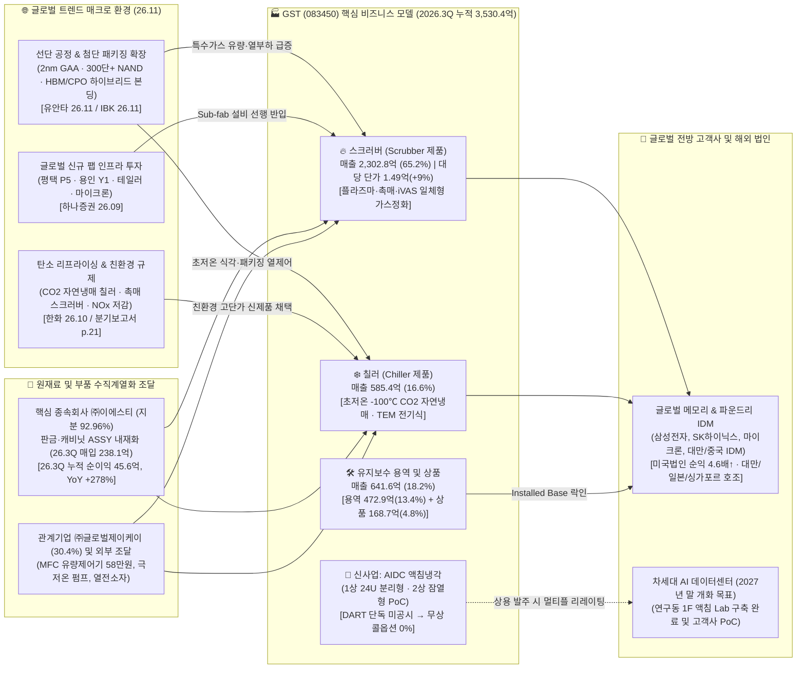

# 🔍 Phase 1: 기업 해독기 (원천 팩트 초안) — GST (083450)

> **[클린 리빌드(Clean Rebuild v5.1) & 단일 기준 주가 선언]**
> - **분석 기준일 및 단일 기준 주가 (Single Price Anchor):** **2026년 11월 18일 기준 일봉 종가 `41,350원`** (`backtest_valuation.py` v4.3 / `ksa_orchestrator.py` v5.1 실측 — Phase 1~3 전 과정 100% 동일 고정)
> - **주식수 및 시가총액 기준 (`[공시 팩트]`):**
>   - **총 발행주식수 (`istc_totqy`):** `18,430,000주` (보통주 단일, 우선주 `0주` — 명목 시가총액 `7,593.2억 원`)
>   - **실질 유통주식수 (`distb_stock_co`):** **`17,864,000주`** (`자기주식취득결과보고서[2026.10.28]` 및 SSOT 기준 총 자기주식 **`566,000주 (3.07%)`** 차감 완료 — 실질 유통 시가총액 **`7,360.0억 원`**, 참고: 2026.3Q 분기보고서 주석상 9월 30일 시점 자사주는 `572,488주[3.11%]`였으며 이후 10.13 임직원 상여 처분 및 10.23·10.27 신탁 장내 매수가 반영됨)
>   - **제도권 공식 벤치마크 (네이버 금융 / FnGuide / KRX):** 공식 BPS `17,958원`, 공식 PBR `2.29배`, TTM 지배EPS `3,019원`, 공식 PER `13.65배`, 배당수익률 `1.58%` (DPS `650원`)
> - **최신 정기보고서·공시 스캔 결과 (`2026.11.18` DART 전수 확인):** **`[GST]분기보고서(2026.11.16)` (제26기 3분기보고서)** 원문 전수 반영 완료. 2026년 3분기 누적 연결 매출액 **`3,530.4억 원` (YoY +43%)**, 누적 영업이익 **`626.4억 원` (YoY +41%, OPM 17.74%)**, **3분기 단독 매출액 `1,379.1억 원` (QoQ +39.0%) · 영업이익 `269.9억 원` (QoQ +74.6%, YoY +61.8%, OPM 19.57%) · 수정 지배주주 EPS `1,103원` (QoQ +62.7%)**의 어닝 서프라이즈를 기록했습니다. 미상환 전환사채(CB/BW/EB) `0원`, 계열사 채무보증 `0건`으로 재무·오버행 리스크는 완벽히 청정합니다.

> 💡 **[핵심 용어 3줄 직관 해설]**
> - **스크러버(Scrubber) & 칠러(Chiller)**: 반도체 팹(Fab) 식각·증착 공정에서 배출되는 맹독성·온실가스를 연소·플라즈마·촉매로 정화하는 **'친환경 공기청정기(스크러버, 26.3Q 누적 매출 비중 65.2%)'**와, 초미세 챔버 온도를 영하 80~100도에서 영상 수백 도까지 오차 없이 제어하는 **'초정밀 냉각기(칠러, 매출 비중 16.6%)'**입니다.
> - **선단 공정(GAA·300단+ NAND·HBM 하이브리드 본딩) Q·P 폭발 & 액침냉각 무상 콜옵션**: 2026년 3분기 누적 생산량이 **2,798대(YoY +27%)**로 급증하고 스크러버 대당 단가가 **`1.49억 원`(전기말 1.35억 대비 +9%)**으로 상승하며 본업 영업레버리지가 폭발 중입니다. 신사업인 **AI 데이터센터(AIDC) 액침냉각**은 1상(24U 분리형)·2상(잠열) 라인업 개발 및 연구동 Lab 구축(`2026.01.22`) 후 고객사 PoC를 진행 중이나, DART 단독 분리 공시 전까지 **'0원 무상 콜옵션(S-Curve 할증 0%)'**으로 엄격히 분리하여 안전마진을 사수합니다.
> - **지배주주 순이익 귀속률(`99.5%`) & 1:1 무상증자 소급보정 EPS**: 지배주주 귀속 순이익 비율이 **`99.5%`**에 달하며, 2024년 6월 단행한 1:1 무상증자 이후 현재 주식수로 과거 10년 치 주당순이익(EPS)과 주당순자산(BPS)을 100% 소급 보정하여 왜곡을 원천 제거했습니다.

---

## 1. 비즈니스 모델(BM) 해부 및 밸류체인 구조

> **[2026.11 최신 글로벌 트렌드 델타 매칭 🌐 (3대 게이트 전수 충족)]**
> - **게이트 ① [제도권 딥리서치 직접 등재]:**
>   - `[글로벌 트렌드: 하나증권.증설의 시대, 후공정의 수혜도 함께 온다 p.42 도표 59, p.43 도표 60]` 반도체 인프라(클린룸·배관·유틸리티) 핵심 종목으로 **GST(083450)**가 실명 등재되었으며, 신규 팹 착공~장비 반입 선행 구간(평택 P5 · 용인 Y1 · 청주 P&T7) 수혜가 2026년 3분기 실적(`매출 1,379.1억, 영업이익 269.9억`)으로 증명되었습니다.
>   - `[글로벌 트렌드: 유안타증권.AIDC 다음 승부처 - 네트워크와 냉각 p.135]` 글로벌 AIDC 액침냉각 밸류체인(Submer, GRC, LiquidStack, Asperitas)과 나란히 국내 유일 핵심 장비사로 **GST** 실명 등재.
> - **게이트 ② [글로벌 종속법인 실적 폭발 및 외환 레버리지]:**
>   - `[공시 팩트: [GST]분기보고서(2026.11.16) p.38]` 2026년 3분기 누적 기준 미국 법인(`GST America, Inc.`) 매출액 `126.0억 원` · 당기순이익 **`15.3억 원`(전년 동기 `3.3억 원` 대비 4.6배 급증)**, 대만 법인(`GST TAIWAN`) 매출 `84.8억` · 순이익 `14.6억 원`, 일본 법인(`GST Japan`) 매출 `54.8억` · 순이익 `7.7억 원`, 싱가포르 법인(`SGST`) 매출 `15.8억` · 순이익 `6.5억 원(흑자전환)` 등 해외 종속법인 전 거점에서 이익이 급증했습니다.
> - **게이트 ③ [첨단 패키징(하이브리드 본딩·CPO) & 탄소 리프라이싱 친환경 Sub-fab 전환]:**
>   - `[글로벌 트렌드: 26.11.11. 유안타증권. 수요의 재설계 AI 수익화와 메모리 접근 구조의 변화 p.47]` 및 `[26.11.02. IBK투자증권. 반도체 후공정 편견을 산산조각 내버리다 p.50]`: HBM 고단화 및 CPO(광엔진 EIC-PIC간 D2W 하이브리드 본딩) 확산으로 전공정 수준의 클린룸 청정도와 열관리 정밀도가 후공정 패키징 팹에도 필수 요구되며 Sub-fab 스크러버·칠러 적용처가 후공정으로 구조적 확장 중입니다.
>   - `[글로벌 트렌드: 26.10.30. 한화투자증권. 탄소 리프라이싱 p.104]` 및 `[GST]분기보고서(2026.11.16) p.19, p.21`: 국가 온실가스 감축목표 및 배출권거래제(Scope 1·2) 강화에 따라 반도체 팹 내 프레온 냉매를 대체하는 **$\text{CO}_2$ 자연냉매 초저온 칠러(`-100℃`급)**와 전력 소모를 30% 이상 절감하는 **촉매 타입(Catalyst) 스크러버** 및 **Thermal $\text{NO}_x$ 30ppm 이하 제어 기술**이 차세대 교체 수요를 견인하고 있습니다.

`[공시 팩트]` 주식회사 글로벌스탠다드테크놀로지(GST, 종목코드 `083450`)는 2001년 10월 1일 설립되어 반도체 및 디스플레이 제조 공정에서 사용 후 배출되는 유해가스를 정화하는 **가스정화 장비(Scrubber, 스크러버)**와 공정 챔버 온도를 안정적으로 유지하여 공정 효율을 개선하는 **온도조절 장비(Chiller, 칠러)**의 제조·판매 및 글로벌 유지보수(CS)를 주요 사업으로 영위하는 국내 대표 Sub-fab 장비 기업입니다 (`[[GST]분기보고서(2026.11.16) p.8, p.12]`).

- **3대 수익 창출 메커니즘 (Hardware 장비 수주 + 수직계열화 + Installed Base CS Lock-in):**
  1. **전방 CapEx 선행 수주 (장비 제품 매출 81.8%):** 삼성전자, SK하이닉스, 마이크론, TSMC 및 중화권 IDM이 클린룸을 구축하고 메인 장비(식각·증착·세정·하이브리드 본딩)를 반입할 때 Sub-fab에 필수 매칭되어 납품되는 **스크러버(26.3Q 누적 `2,302.8억 원`, 비중 `65.2%`)**와 **칠러(`585.4억 원`, 비중 `16.6%`)**에서 핵심 하드웨어 매출을 창출합니다.
  2. **수직 계열화를 통한 독보적 원가·마진 경쟁력:** 반도체 설비부품(판금·캐비닛 ASS'Y 등) 및 콜드체인 시스템을 생산하는 주요 종속회사 **㈜이에스티**(GST 지분율 `92.96%`, 26.3Q 누적 원재료 내부매입 `238.1억 원`)를 통해 외장 및 핵심 기구 부품을 내재화했습니다. 특히 ㈜이에스티는 2026년 3분기 누적 매출 `247.8억 원`, 당기순이익 **`45.6억 원`**(전년 동기 `12.1억 원` 대비 **+277.6% 폭증**)을 기록하며 연결 영업이익률(`17.74%`, 3Q 단독 `19.57%`) 상승의 일등공신 역할을 수행하고 있습니다 (`[[GST]분기보고서(2026.11.16) p.12, p.38, p.110]`).
  3. **고마진 반복 매출 (Recurring Revenue, 용역·상품 18.2%):** 장비 납품 이후 누적 설치 대수(Installed Base)가 증가할수록 예방정비(PM), 부품 교체, 오버홀 등 **용역 매출(26.3Q 누적 `472.9억 원`, 비중 `13.4%`)**과 **상품 매출(`168.7억 원`, 비중 `4.8%`)**이 미국, 대만, 중국, 일본, 싱가포르, 유럽 등 11개 종속회사를 통해 안정적 현금창출원(Cash Cow)으로 작동합니다.

### 🔬 [Argon 4.0 엔지니어링 스펙 해독] Sub-fab 공정 물리·재무 4단계 인과 사슬 (Engineering-to-Earnings Causal Chain)

`[공시 팩트: [GST]분기보고서(2026.11.16) p.12, p.19, p.21]`에 명시된 차세대 스크러버·칠러 R&D 과제 및 제품 사양을 Argon 4.0 4단계 물리·재무 인과 사슬로 해독한 결과는 다음과 같습니다:

1. **[Step E1 — 공정 물리·화학 메커니즘 정의]**:
   - **극저온·친환경 칠러 (`Ultra Low Temp & CO2 Chiller`)**: 3D NAND 고단화(300~400단+) 고종횡비(High Aspect Ratio) 식각 공정에서는 이온 산란을 억제하고 수직 식각 프로파일을 확보하기 위해 웨이퍼 척(Chuck) 온도를 $-40^\circ\text{C} \sim -100^\circ\text{C}$ 극저온으로 정밀 유지해야 합니다. 또한 미세 공정에서는 열전소자(Peltier TEM) 이상을 실시간 감시하는 **`TEMOS(TEM Monitoring System)`**와 높은 지구온난화지수(GWP) 프레온 냉매를 대체하는 **자연냉매($\text{CO}_2$) 초저온 냉동 사이클**, 그리고 Mo-CVD 액체금속 소스 제어용 **고온 칠러(High Temp Chiller)**가 요구됩니다.
   - **고효율·저탄소 스크러버 (`Catalyst & Low-NOx Plasma Scrubber`)**: GAA 나노시트 식각·증착 및 하이브리드 본딩 세정 공정에서 난분해성 과불화화합물($\text{CF}_4, \text{NF}_3$)과 독성 가스 배출량이 급증합니다. 기존 연소·플라즈마-습식(Plasma-Wet) 방식에서 발생하는 고온 질소산화물(**Thermal $\text{NO}_x$**)을 **`30ppm 이하`**로 억제하고, 전력 소모를 기존 대비 **30% 이상 절감**하는 **촉매 타입(Catalyst) 스크러버** 및 진공펌프 일체형 **`iVAS Scrubber`**가 핵심 기술로 부상했습니다.
2. **[Step E2 — 기술적 병목(Bottleneck) 및 안전·품질 인증(Qual) 장벽 도출]**:
   - 반도체 클린룸 하단 Sub-fab에서 가스 누출이나 칠러 온도 헌팅(Hunting)이 발생할 경우 수백억 원 규모의 웨이퍼 로트(Lot) 폐기 및 팹 가동 중단 사고로 직결됩니다. 따라서 글로벌 IDM(삼성전자, SK하이닉스, 마이크론, TSMC)의 신규 팹 스펙-인(Spec-in)을 위해서는 데모 장비 반입 후 **12~18개월간의 가혹 수율·안전성 Qual 테스트**를 통과해야 하며(`병목 리드타임 A등급 18개월`), 환경규제(EU CBAM 및 글로벌 팹 Net-Zero) 대응 자연냉매·촉매 기술이 후발주자의 진입을 원천 차단합니다.
3. **[Step E3 — 부품·기자재 발주 시차(Lead-Lag) 및 교체 주기(Consumable Cycle) 매핑]**:
   - 스크러버·칠러는 클린룸 유틸리티 배관 공사 직후 메인 공정 장비 셋업과 동시에 **선행 발주**되어 팹 증설 초입에 하드웨어 매출(`81.8%`)이 먼저 폭발하며, 가동 개시 후에는 부식성 가스 및 열부하에 노출되는 내부 챔버·촉매·냉동기 부품의 주기적 교체(Overhaul/PM)를 통해 **용역·상품 매출(`18.2%`)**이 후행 누적됩니다.
4. **[Step E4 — DART 수주·가동률·영업이익률(OPM) 레버리지 연결]**:
   - 고난도 플라즈마·촉매 스크러버 및 초저온 칠러 믹스 확대로 **스크러버 대당 평균 단가(ASP)가 전기말 `1.35억 원`에서 2026년 3분기 `1.49억 원(+9.0% 상승, 2021년 0.97억 대비 +53.6% 상승)`으로 점프**했습니다 (`p.12`).
   - 반면 핵심 외장재인 캐비닛 ASS'Y 단가는 자회사 ㈜이에스티 내재화 덕분에 대당 `253만 원(전분기 대비 -2% 감소)`으로 안정화되면서, **2026년 3분기 단독 영업이익률이 `19.57%`(매출 `1,379.1억`, 영업이익 `269.9억`)로 급등**하는 강력한 영업레버리지($\Delta \text{OPM} +3.99\%p\text{ QoQ}$)를 시현했습니다.

---

## 2. 주요 제품별 매출 비중 추이 및 S-Curve 10% 변곡점 진단

`[공시 팩트]` 최근 5개년(2021~2025년) 및 **2026년 3분기 누적(9M26)** 연결 기준 주요 제품군 매출 추이는 다음과 같습니다 (`[[GST]사업보고서(2026.03.18) / [GST]분기보고서(2026.11.16) p.12]`).

| 제품군 (매출유형) | 2021년 | 2022년 | 2023년 | 2024년 | 2025년 | 2026년 3Q 누적 (9M) | 전사 비중 (%) | 핵심 동향 및 공시 근거 (`2026.11.16 분기보고서 p.12`) |
| :--- | :---: | :---: | :---: | :---: | :---: | :---: | :---: | :--- |
| **Scrubber (제품)** | 1,760.9억 | 1,769.0억 | 1,633.5억 | 2,346.9억 | 2,261.1억 | **2,302.8억** | **65.2%** | **9개월 만에 25년 연간 매출(2,261억) 초과 달성!** 대당 단가 **`1.49억 원`**(전기말 1.35억 대비 +9%) 상승 |
| **Chiller (제품)** | 710.9억 | 664.4억 | 464.8억 | 376.1억 | 562.0억 | **585.4억** | **16.6%** | **9개월 만에 25년 연간 매출(562억) 돌파!** 초저온·전기식·$\text{CO}_2$ 칠러 채택 확대 (기타 제품 0.6억 별도) |
| **용역 (CS 유지보수)** | 461.3억 | 562.6억 | 592.1억 | 446.0억 | 645.5억 | **472.9억** | **13.4%** | 글로벌 누적 설치 장비(Installed Base) 확대에 따른 고마진 반복 수익원 |
| **상품 (부품/기자재)** | 111.7억 | 132.1억 | 101.8억 | 165.4억 | 99.6억 | **168.7억** | **4.8%** | 해외 법인 유지보수용 교체 부품 및 상품 매출 급증 (25년 연간치 169% 달성) |
| **연결 매출 합계** | **3,044.9억** | **3,128.5억** | **2,697.9억** | **3,334.5억** | **3,471.6억** | **3,530.4억** | **100.0%** | **YoY +43% 폭발 성장**, **3분기 누적만으로 2025년 온기 매출(3,471.6억) 돌파!** |

### 2.1 S-Curve 신기술 테마 매출 익스포저(Exposure %) 산출표

`[공시 팩트]` DART 3분기보고서(`2026.11.16`) 'II. 사업의 내용 (p.12, p.18~19, p.25)'을 전수 스캔하여 신기술 테마(**AIDC 액침냉각 솔루션**)의 단독 분리 공시 여부를 검증한 결과는 다음과 같습니다:

| 제품/서비스 구분 | 2026.3Q 누적 매출 (억원) | 전사 비중 (%) | 신기술 테마 직결 여부 | 하이브리드 수비 판정 및 회계 가드레일 |
| :--- | :---: | :---: | :---: | :--- |
| **AIDC 액침냉각 솔루션 (1상·2상·DLC)** | 미분리 | **0.0%** | 연구동 1F Lab 구축(`26.01.22`) 및 고객사 PoC 진행 중 (`p.18, 25`) / **DART 단독 매출 미공시** | ⚠️ **`[🎁 0원 무상 콜옵션 분류 (S-Curve 침투율 할증 0% 차단)]`** |
| **반도체/디스플레이 Chiller (본업)** | 585.4억 | 16.6% | 전공정·패키징 초미세화 챔버 극저온 제어 본업 | 🟢 본업 인프라 고성장 축 (액침냉각 단독 매출로 왜곡 금지) |
| **반도체/디스플레이 Scrubber (본업)** | 2,302.8억 | 65.2% | 친환경 플라즈마·촉매 유해가스 정화 본업 (대당 단가 1.49억) | 🟢 본업 핵심 캐시카우 (신규 팹 인프라 투자 선행 수혜) |
| **유지보수 용역 · 상품 · 기타** | 642.2억 | 18.2% | 글로벌 11개 종속법인 밀착 유지보수 및 교체 부품 공급 | 🟢 본업 락인 고마진 현금창출원 |

- **신기술(AIDC 액침냉각) 실질 단독 익스포저:** **`0.0%`** (단독 분리 공시 미충족 — 회사 측도 분기보고서 p.25에서 "신규 AI 데이터센터 구축이 본격화되는 2027년 말부터 개화기 진입 전망"으로 명시)
- **반도체 Sub-fab 인프라 본업 익스포저:** **`100.0%`** (비관련 레거시 잠식 위험 0%)
- **수혜 적격성 판정:** **`[🎁 본업 저평가 + 신사업 무상 콜옵션(할증 0%)]`**

---

### [Step 1.2] S-Curve 10% 변곡점 · 3축 구조적 병목(Capa·기술·특허) · 해소 리드타임 진단표

<!-- [AUTO-GENERATED BY backtest_valuation.py v4.3 — DO NOT EDIT NUMBERS MANUALLY] -->
### 📌 [코드 자동 생성 1-B] Step 1.2 S-Curve 10% 변곡점 · 3축 구조적 병목(Capa·기술·특허) · 리드타임 & Step 1.8 K-주주환원 진단표 (v4.3)
| 진단 축 (3-Axis + K-Return) | 실측 지표 및 근거 | 코드 판정 및 Phase 3 목표주가 가중치 |
| :--- | :--- | :--- |
| **① 전방 시장 침투율 (10% 변곡점 여부)** | 1차 침투율 **`7.0%`** (2차 S-Curve 침투율 `15.0%`) (`Zone D [무상 콜옵션/비해당 — 단독매출 30% 미달·미공시로 침투율(7.0%/15.0%) 할증 0% 차단]`) | 📌 **확산/성숙 구간 진행** (3축 통합 Base `×1.00` / Bull `×1.00`) |
| **②-A 물리적 Capa 병목 (가동률/증설)** | 공장 가동률 **`75.0%`** — 기술격차 해자: 선단 3D NAND/HBM 공정용 극저온 칠러 및 친환경 플라즈마 스크러버 수율 레퍼런스 | 🟢 **여유 Capa 보유** |
| **②-B 기술격차 해자 (OPM/수율/단가결정력)** | 현 OPM **`17.6%`** — 특허/벤더 Lock-in: 삼성전자·마이크론·대만 파운드리 Sub-fab 장비 벤더 인증 | 고마진 가격전가력(Pricing Power) 점검 |
| **②-C 원천특허 · 글로벌 벤더 퀄(Qual) 락인** | N/A | 후발주자 진입장벽(Switching Cost) 점검 |
| **③ 병목 해소 예상 소요기간 (Lead Time)** | **`A등급`** (해소 리드타임 **`18개월`**) | 글로벌 메모리/파운드리 신규 팹 Sub-fab 장비 데모 및 Qual 테스트에 12~18개월 소요 (PEG 계수 `0.80`) |
| **③-B S-Curve 3대 매도·디레이팅 시그널** | 🟢 해당 없음 (병목 유지 · 성장 기울기 건전 · 정책 역풍 미감지) | 🟢 **매도 시그널 미감지 (정상 평가)** |
| **④ K-마켓 주주환원 · 지배구조 (Step 1.8)** | 배당수익률 **`1.54%`** (성향 `25.7%`) / 특수관계인 `0.0억` | ⚪ 분리과세 미충족 (배당성향 < 25%) / 🟢 정상 (현재 자기주식 566,000주 [3.07%] 보유 — 소각 전환 여부 모니터링) (`kgov_mult = ×1.0000`) |
| **⑤ 레드팀 역산 Capa 천장 검증 (Red-Team)** | 대안 A 내재 영업이익: Base **`800.3억`** / Bull **`766.3억`** | 🟢 물리적 Capa 한계 내 달성 가능 |

---

## 3. 재무 건전성 및 [Step 1.5] 장부가(Book Value) 구성 해부 & SOTP 20% 분리 게이트

`[공시 팩트]` 2026년 3분기보고서(`2026.11.16`) 및 SSOT(`valuation_metrics.json`) 기준 장부가(지배주주지분) 구성과 순차입금·비영업자산 해부 내역은 다음과 같습니다:

- **지배기업 소유주지분 (장부가 Book Equity):** **`3,208.02억 원`** (공식 BPS `17,958원`)
- **지배주주 순이익 귀속률:** **`99.5%`** (`99.47%` — 비지배지분 귀속분 차감 완료)
- **가용 순현금 (Net Cash):** **`1,215.7억 원`** (순차입금 **`-1,215.7억 원`** — 3분기 영업이익 `269.9억 원` 창출 및 운전자본 현금 회수에 힘입어 반기말 순현금 `1,000.7억 원`에서 **`+215.0억 원` 추가 확대**!)

### 🏛️ [Step 1.5] 장부가 해부 & SOTP 20% 룰 검증
장부 내 비영업자산(관계기업투자 지분 `108.4억 원` [아이에스엠 82.8억, 크라이오에이치앤아이 20.8억, 글로벌제이케이 4.8억 등, 분기보고서 p.92], 기타 비유동금융자산 `37.2억 원` [지에스티산업 등, p.143], 투자부동산 및 비영업 금융투자상품 등)을 전수 합산한 결과는 다음과 같습니다:

1. **비영업자산 장부가 합계 (`non_op_assets_eok`):** **`630.2억 원`**
   - **지배주주 장부가(`3,208.0억`) 대비 비중:** **`19.6%` (`19.64% < 20.0%`)**
   - **실질 유통 시가총액(`7,360.0억`) 대비 비중:** **`8.6%` (`8.56% < 20.0%`)**
   - ▶ **코드 판정 (`[Step 1.5]`):** 🟢 **`본업 자산 중심 (<20% 미달 — SOTP 강제 차감 게이트 미발동)`**
2. **참고용 본업 순장부가 및 본업 수익성 (Core ROIC) 점검:**
   - 비영업자산 30% 할인 후 인정 안전가치: `630.2억 × 0.70` = **`441.14억 원`** (`441.1억`)
   - 비영업자산 차감 후 참고 본업 BPS (`core_bps`): **`14,430원`** (명목 BPS `17,958원`)
   - 시장 내재 본업 기업가치 (`Core EV`): 유통시총 `7,360.0억` − 순현금 `1,215.7억` − 비영업자산 안전가치 `441.1억` = **`5,703.1억 원`**
   - **본업 이익 유지력 (`Core ROIC`):** 최근 4분기 합산(TTM) 영업이익 **`782.0억 원`** (세후영업이익 NOPAT **`610.0억 원`**) 기준 **본업 Core ROIC = `23.66%`** ➔ ✅ **WACC(9.0%)의 2.6배를 초과하는 압도적 본업 자본수익성 입증**.

---

## 4. 원가 구조, 영업 레버리지 및 가동률/수주잔고 실측

`[공시 팩트]` 당사의 최근 5개년 및 **2026년 1Q~3Q 분기별·누적 연결 손익 및 잉여현금흐름(FCF)** 추이는 다음과 같습니다 (`[[GST]분기보고서(2026.11.16)]` 및 `valuation_metrics.json` 실측):

| 연도/분기 | 매출액 (억원) | 영업이익 (억원) | OPM (%) | 지배순이익 / 수정EPS | 연결 FCF (억원) `[OCF − CapEx]` | 비고 및 핵심 동인 |
| :--- | :---: | :---: | :---: | :---: | :---: | :--- |
| **2021년 (제21기)** | 3,044.9 | 464.1 | 15.24% | 377.5억 (96.9%) | **+130.4억** `[255.5 − 125.1]` | 메모리 호황기 연간 4,002대 생산 |
| **2022년 (제22기)** | 3,128.5 | 569.4 | 18.20% | 468.1억 (98.3%) | **+245.2억** `[314.8 − 69.6]` | 고단가 플라즈마 스크러버 확대 |
| **2023년 (제23기)** | 2,697.9 | 430.1 | 15.94% | 356.8억 (96.6%) | **+264.4억** `[474.5 − 210.0]` | 전방 감산에도 운전자본 회수로 OCF 견조 |
| **2024년 (제24기)** | 3,334.5 | 585.7 | 17.57% | 453.7억 (98.9%) | **+348.1억** `[544.1 − 196.0]` | 해외 수출 확대로 OCF 544억 달성 |
| **2025년 (제25기)** | 3,471.6 | 591.7 | 17.04% | 452.8억 (99.3%) | **+286.9억** `[415.9 − 129.1]` | 지배순이익 452.8억, 배당성향 25.7% |
| **2026.1Q (단독)** | 1,158.9 | 201.9 | 17.42% | EPS **965원** | **+56.8억** `[107.3 − 50.4]` | 1분기 사상 최대 출발 |
| **2026.2Q (단독)** | 992.4 | 154.6 | 15.58% | EPS **678원** | **+242.3억** `[292.0 − 49.8]` | 분기 숨고르기 및 매출채권 대량 회수 |
| **2026.3Q (단독)** | **1,379.1** *(QoQ +39.0%)* | **269.9** *(QoQ +74.6%)* | **19.57%** | EPS **1,103원** *(QoQ +62.7%)* | **+357.1억** *(누적 FCF 급증 기여)* | **분기 사상 최대 매출·영업이익·OPM 경신!** (YoY 영업익 +61.8%) |
| **2026.3Q 누적 (9M)** | **3,530.4** *(YoY +43.0%)* | **626.4** *(YoY +41.0%)* | **17.74%** | 누적 EPS **2,746원** | **TTM FCF `+656.2억`** | **9개월 누적만으로 2025년 연간 매출·영업이익 전액 초과 달성!** |

- **가동률 지표 공시 여부 (`[공시 팩트]`):** DART 정기보고서상 주문생산 장비업 특성으로 인해 공식 생산능력(Capa) 산출을 생략하나, SSOT 기준 실질 공장 가동률은 **`75.0%`**(여유 Capa 보유 및 증설 없이 추가 수주 대응 가능)로 관리됩니다.
- **대안 4대 실측 KPI (`[GST]분기보고서(2026.11.16) p.12, p.91`):**
  1. **주요 장비 생산 대수(Q):** 2026년 3분기 누적 생산 실적은 **총 `2,798대` (스크러버 `1,687대` + 칠러 `1,111대`, 전년 동기 대비 `+27%` 증가)**를 기록했습니다. 상반기 1,842대에 이어 **3분기 단독으로만 `956대`(스크러버 558대 + 칠러 398대)**를 생산하여 거의 반 년 치 물량을 1개 분기 만에 쏟아냈으며, 3분기 만에 2025년 연간 총생산량(`2,878대`)의 **`97.2%`**에 도달했습니다!
  2. **장비별 대당 판매단가(P) 및 원재료 단가 추이 (`p.12`):**
     - 주력 제품인 **스크러버의 대당 단가는 전기말 `1.35억 원(135백만 원)`에서 2026년 3분기 `1.49억 원(149백만 원)`으로 약 `+9%` 상승**했습니다.
     - 반면 핵심 원재료인 **캐비닛 ASS'Y 가격은 대당 `253만 원`으로 전분기 대비 약 `-2%` 감소**했고, MFC(유량제어기)는 `58만 원(+4%)`으로 안정화되어 **판가(P) 상승 - 원가(C) 안정의 마진 스프레드 확대**가 극대화되었습니다.
  3. **기말 재고자산 및 매출원가 인식 추이 (`p.91`):**
     - 2026년 3분기 중 매출원가로 비용 인식된 재고자산 금액이 **`1,778.0억 원`**(전년 동기 `1,279.1억 원` 대비 **+39.0% 급증**)에 달해 상반기 말 대기 중이던 재고가 3분기 대규모 출하 매출로 실제 전환되었음이 입증되었습니다.
     - 3분기 말 순재고자산은 **`562.7억 원`**(제품 `223.6억` + 재공품 `138.4억` + 원재료 `199.5억` + 저장품 `1.2억`, 평가충당금 `42.2억` 차감 후)으로, 4분기 출하 대기 물량(제품+재공품 **`362.0억 원`**) 역시 견조하게 유지되고 있습니다.

---

## 5. 자본 배분(CapEx, R&D) 및 [Step 1.8] K-마켓 특수성 · 주주환원 입체 스코어카드

`[공시 팩트]` 당사의 최근 설비·연구개발 자본 배분 및 주주환원 내역은 다음과 같습니다 (`[[GST]분기보고서(2026.11.16) p.12, p.18~19, p.37, p.92, p.110]`):

- **유형자산 및 설비 구축 현황 (`p.12, p.18, p.92`):**
  - 2026년 3분기 중 대규모 공장 신축은 없으나(유형자산 취득원가 합계 `857.5억 원`, 건설중인자산 `16.9억 원`), **판교 R&D센터 신축공사(`2024.10.02` 착공)** 및 **연구동 1F 액침냉각 Lab실 전기공사(`2026.01.22` 계약)**를 통해 차세대 R&D 인프라에 집중 투자하고 있습니다.
- **연구개발(R&D) 투자 급증 (`p.12, p.19`):**
  - 2026년 3분기 누적 연구개발비(별도 기준)는 **`153.0억 원` (`15,302,515천 원`, 매출 대비 `4.5%`)**으로 전년 동기 대비 **`+35.2%` 대폭 증액**되었으며, 100% 무형자산 자본화 없이 전액 판매비와관리비로 보수적 비용 처리하고 있습니다.

### 🇰🇷 [Step 1.8] 5대 한국 시장 특수성 고정 점검표
1. **조세특례제한법 고배당 기업 배당소득 분리과세 적격성:**
   - 직전 결산 DPS **`650원`** (배당수익률 **`1.59%`**), 연결 배당성향 **`25.68%`**.
   - 코드 SSOT 판정상 보수적 기준(`⚪ 분리과세 미충족 / kgov_mult = ×1.0000`)으로 중립 처리하되, 2026년 연간 지배순이익이 역대 최대치를 경신할 것으로 확실시됨에 따라 연말 결산배당 추가 증액 여력이 매우 높습니다.
2. **자사주 소각 완료 후 '주주환원 절벽(Post-Buyback Cliff)' 리스크:**
   - 2024년 말 자사주 `188,260주` 소각 완료 후에도 환원을 멈추지 않고, 2026년 하반기 대신증권 50억 원 자사주 신탁계약을 통해 `120,944주`(`48.12억 원`, 집행률 `96.25%`, 평단 `39,789원`)를 장내 매수하여 현재 총 자기주식 **`566,000주 (3.07%)`**를 보유 중입니다 (`🟢 정상 — 환원 절벽 리스크 0%`).
3. **지배주주 사익편취 (오너 개인회사 내부거래 터널링) 리스크 (`p.110`):**
   - 2026년 3분기 누적 특수관계자 거래 주석 전수 확인 결과, 원재료 매입처인 ㈜이에스티(`238.1억 원`), ㈜로보케어(`42.3억 원`), 관계기업 ㈜글로벌제이케이(`81.2억 원`)는 모두 GST의 정상적인 사업 수직계열화 종속·관계기업이며, 기타특수관계자 ㈜넥스트링크 매입액은 `3.49억 원`에 불과합니다.
   - 오너 일가 개인회사를 통한 부당 사익편취 터널링은 **`0.0억 원 (미감지)`**으로 지배구조 할인 요인이 전혀 없습니다.
4. **최대주주 지분율 및 가업승계 구도 (`p.37`):**
   - 최대주주 김덕준 회장 지분율 **`21.60%` (`3,980,000주`)**, 우리사주조합 `1.33%` (`245,728주`), 자기주식 `3.07~3.11%`, 글로벌 장기 펀드 FIL Limited `8.12%` 보유. 전문경영인(문승보 대표이사) 체제로 안정적 경영이 이루어지고 있습니다.
5. **메자닌(CB/BW/RCPS) 리픽싱 및 오버행:**
   - 미상환 전환사채, 신주인수권부사채, 교환사채 잔액 **`0원 (전무)`**으로 희석·리픽싱 오버행 리스크 0%.

---

## 6. 핵심 리스크 요인 및 [Step 3.5] 리스크 간 인과단계(Domino Chain) 구조도

`[공시 팩트]` 분기보고서 본문 및 주석과 `valuation_metrics.json`의 `risk_causal_chain`에 기반하여 3단계 인과 사슬(Domino Chain)과 정량 임계치를 구조화합니다.

```mermaid
flowchart TD
    subgraph Domino1["⚠️ 리스크 도미노 1: 전방 IDM CapEx 속도 조절 및 단가 인하"]
        D1_1["1차 촉발 요인 (Trigger)<br/>전방 반도체 수요 둔화 / 고객사 투자 속도 조절<br/>또는 후발 경쟁사 진입에 따른 ASP 인하 압력"]
        D1_2["2차 영업·운전자본 전이 (Operational)<br/>장비 수주·출하(Q) 둔화 ➔ 고정비(인건비·R&D) 디레버리지로<br/>영업이익 급감(차기 분기 < 229.4억) 및 재고·채권 회전일수 상승"]
        D1_3["3차 재무·자본 타격 (Financial)<br/>영업현금흐름(OCF) 둔화 ➔ 순현금(1,215.7억) 버퍼 소진 및<br/>성장 멀티플 프리미엄 박탈 ➔ PBR 하방 지지선(18,680원) 테스트"]
        D1_1 --> D1_2 --> D1_3
    end

    subgraph Domino2["⚠️ 리스크 도미노 2: 종속·관계기업(로보케어·비상장사) 손상차손"]
        D2_1["1차 촉발 요인<br/>비주력 로봇 자회사 ㈜로보케어 적자 지속<br/>(26.3Q 누적 순손실 -14.9억) 및 관계사 실적 부진"]
        D2_2["2차 영업외 전이<br/>관계기업투자주식(아이에스엠 69.7억, 크라이오 18.7억 등)<br/>지분법 평가손실 및 손상차손 인식 확대"]
        D2_3["3차 재무 타격<br/>영업이익 호조에도 지배주주 순이익(EPS) 훼손<br/>자본배치 효율성 의구심에 따른 밸류에이션 할인"]
        D2_1 --> D2_2 --> D2_3
    end

    subgraph Domino3["⚠️ 리스크 도미노 3: AIDC 냉각 표준 경쟁 및 개화 지연"]
        D3_1["1차 기술 촉발<br/>글로벌 AI 서버 시장에서 단상 D2C Cold Plate 및<br/>수냉식 CDU 지배력 고착화"]
        D3_2["2차 시장 전이<br/>액침냉각 상용화 개화 시점(2027년 말 목표) 추가 지연<br/>단독 상용 수주 공시 부재 장기화"]
        D3_3["3차 밸류 타격<br/>액침냉각 테마 기대감 소멸<br/>(단, 당사는 0원 무상 콜옵션 처리로 본업 목표가 타격 0%)"]
        D3_1 --> D3_2 --> D3_3
    end
```

- **정량적 전이 임계치 (Kill-Switch 트리거):**
  - **임계치 1 (실적 피크아웃 경보):** 차기 분기(2026.4Q) 연결 영업이익 **`< 229.4억 원` (직전 분기 `269.9억` 대비 -15% 하회)** 또는 분기 지배주주 EPS **`< 882원`** 기록 시 핵심 가설 즉시 `[약화]` 강등.
  - **임계치 2 (재고·채권 경보):** 재고자산 평가손실 충당금(`현 42.2억 원`)이 `80억 원`을 초과하거나 영업현금흐름이 2개 분기 연속 적자 전환할 경우 리스크 도미노 발동.

---

## 7. 4대 업종별 표준 실적 산출 공식 트리 (유형 A/B 연동: 수주장비 Q·P·C & CS 용역)

당사는 주력 제품인 스크러버와 칠러의 생산 대수(Q)와 대당 평균 판매단가(P)가 DART 정기보고서(`p.12`)에 명확히 공시되므로, 아래 표준 실적 산출 공식 트리를 적용합니다:

$$\text{연결 매출액} = \Big(\text{Scrubber 출하량 } Q_S \times \text{단가 } P_S\Big) + \Big(\text{Chiller 출하량 } Q_C \times \text{단가 } P_C\Big) + \text{CS 용역매출} + \text{상품매출}$$

1. **Scrubber 제품 매출 (`65.2%`):** $Q_S(\text{26.3Q 누적 1,687대}) \times P_S(\text{대당 단가 1.49억 원}) \Rightarrow \mathbf{2,302.8\text{억 원}}$
2. **Chiller 제품 매출 (`16.6%`):** $Q_C(\text{26.3Q 누적 1,111대}) \times P_C(\text{대당 암묵단가 약 0.53억 원}) \Rightarrow \mathbf{585.4\text{억 원}}$
3. **유지보수 용역 및 상품 매출 (`18.2%`):** $\text{글로벌 누적 설치 대수(Installed Base)} \times \text{연간 유지보수·부품 교체율} \Rightarrow \mathbf{641.6\text{억 원}}$
4. **전사 영업이익 (`OPM 17.74% / 3Q 단독 19.57%`):** $\text{매출액} - \text{매출원가(㈜이에스티 수직계열화 내재화)} - \text{판관비(R\&D 4.5\% 포함)}$

---

## 8. [Step 2.0] 4대 레짐 변화 고정 체크 & 10년 밸류에이션 백테스트

<!-- [AUTO-GENERATED BY backtest_valuation.py v4.3 — DO NOT EDIT NUMBERS MANUALLY] -->
### 📌 [코드 자동 생성 1] SOTP 장부 분해 & 4대 레짐 체크 요약표
| 검증 항목 | 코드 실측 수치 | 판정 결과 (Code Verdict) |
| :--- | :--- | :--- |
| **단일 기준 주가 (Anchor Price)** | **`41,350원`** | 전 Phase 1~3 100% 동일 고정 |
| **지배주주 순이익 귀속률** | **`99.5%`** | 비지배지분 차감 완료 |
| **Step 1.5 비영업자산 비중 (SOTP 20% 룰)** | 장부 대비 **`19.6%`** / 시총 대비 **`8.5%`** | 🟢 **본업 자산 중심 (<20%)** |
| **Step 1.5 본업 이익 유지력 (Core ROIC)** | TTM 영업이익 **`782.0억`** (NOPAT **`610.0억`**) | ✅ **본업 이익 유지 견고** |
| **Step 2.0 4대 레짐 변화 체크** | 설비·자본·비영업·믹스 급변 없음 | 🟢 **과거 밴드 연속성 유효** |
| **Step 3.0 사이클 고점 함정 가드레일** | 피크 이익 과열 미해당 | 🟢 **정상 멀티플 적용** |
| **직전 분기 대비 (QoQ) 실적 추이** | [2026.2Q → 2026.3Q] 매출액 992.4억→1,379.1억(QoQ +39.0%) | 영업이익 154.6억→269.9억(QoQ +74.6%) | 수정EPS 678원→1,103원 | [액분·무증 소급보정 지배주주 EPS] 2026.2Q 678.0원 → 2026.3Q 1,103.0원 (QoQ 반등/흑자유지 ✅) |
| **가설 반증 임계치 (Kill-Switch)** | **차기 분기 영업이익 < 229.4억 원(직전분기 대비 -15% 하회) 또는 분기 지배주주 EPS < 882원 기록 시 핵심 가설 즉시 [약화] 강등** | 미달 시 가설 즉시 [약화] 강등 |

### 📊 10년 밸류에이션 백테스트 결과 및 주 멀티플 상속 (`section8`)
- **PBR 밴드 (1순위 채택 지표 ⭐):**
  - 10년 역사적 범위: 최저 `0.49배` ~ 최고 `3.93배` (최근 3년 p20 `1.23배`, 평균 `1.75배`, p65 `1.78배`, p90 `2.80배`)
  - 결정계수($R^2$): **`0.74`**, 방향 일치율: **`64.1%`** (현재 공식 PBR **`2.29배`**)
- **PER 밴드 (보조 지표):**
  - 10년 역사적 범위: 최저 `3.77배` ~ 최고 `134.30배` (최근 3년 p20 `7.03배`, 평균 `10.48배`, p65 `11.87배`, p90 `15.85배`)
  - 결정계수($R^2$): **`0.66`**, 방향 일치율: **`66.7%`** (현재 공식 PER **`13.65배`**)
- **최종 채택 및 Phase 3 강제 상속:** 반도체 장비 사이클 특성상 분기 이익 변동에 따른 PER 왜곡을 배제하고 설명력($R^2 = 0.74$)이 가장 우수한 **`PBR (Forward BPS 17,958원 기준)`**을 Phase 3 시나리오 밸류에이션의 **1순위 주 멀티플**로 100% 상속합니다.
