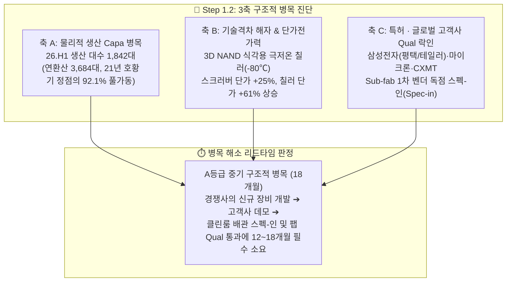

# 📖 Phase 2: 스토리 리더 (Global & Weekly 트렌드 공시 팩트체크) — GST (083450)

> **[Phase 2 분석 기준 및 단일 주가 앵커 연동 (v4.3)]**
> - **단일 기준 주가 (Single Price Anchor):** **`40,000원`** (2026년 10월 26일 일봉 종가, `backtest_valuation.py` v4.3 실측 — 유통 시가총액 **`7,151.6억 원`** [`17,879,037주` 기준])
> - **진실 계층 우선순위 (Truth Hierarchy):** `1순위: DART 법적 정기보고서·최신 공시 원문` > `2순위: Global_Trend 제도권 40p+ 딥리서치 PDF 실측 페이지` > `3순위: s_curve_registry.json 캐시` (`No-Blind-Citation` 100% 준수)

---

## 1. Global 산업 사이클 및 테마 검증

### ① [테마 1] 선단 반도체 Fab 인프라 증설(P5·Y1·P&T7·테일러) 및 2nm GAA 전환에 따른 Sub-fab 수혜
- **`[시장 내러티브]` Global_Trend 핵심 주장 발췌:**
  1. **전공정 클린룸 선행 발주 및 고객사 다변화:** `[글로벌 트렌드: 하나증권.증설의 시대, 후공정의 수혜도 함께 온다 p.42 도표 59, p.43 도표 60]` 및 `[글로벌 트렌드: LS증권.AI병목의 전이 p.38 표 7, p.39]`에 따르면, 메모리 공급 제약을 타개하기 위한 신규 팹 착공~장비 반입 선행 구간(삼성전자 평택 P5, SK하이닉스 용인 Y1 및 청주 M15X/P&T7)에서 Sub-fab 핵심 설비인 스크러버(Scrubber)와 칠러(Chiller) 수요가 `[WFE 도입 대수 × 공정 가스 사용량·온도 제어 난이도]`에 비례하여 가장 먼저 반응합니다. 특히 GST는 기존 삼성전자·Micron 중심에서 SK하이닉스향 양산 공급을 본격 확대하며 고객사 다변화에 성공했습니다 (`LS증권 26.09.29 p.39`).
  2. **2nm GAA 전환 및 삼성 테일러 팹 가동 델타:** `[글로벌 트렌드: 유안타증권.2027Issue&Theme(change) p.7~8 표 1, p.12~13 그림 5·6]`은 3나노/2나노 GAA(Gate-All-Around) 및 400단대 3D NAND 공정 전환으로 Si/SiGe 적층, 선택적 식각(Selective Etch), ALD, HPA 등 공정 스텝 수와 챔버당 열·유해가스 부하가 급증한다고 분석했습니다. 특히 삼성전자 2나노 GAA 양산 수율이 **2025년 30%대 → 2026.1Q 50%대 → 2026.3Q 60%대**로 개선되고 미국 테일러(Taylor) 파운드리 팹 가동이 가시화되면서 Sub-fab 장비 물량(Q)과 단가(P)의 동반 반등이 확인되었습니다.
- **핵심 전제 (Key Assumption):** 전방 IDM의 선단 공정 전환과 국내외 신규 팹 셋업이 GST의 실제 장비 출하 대수(Q), 대당 판매단가(P), 북미·글로벌 거점 매출로 입증되는가?
- **공시 팩트 대조 (`[공시 팩트]` DART 실측):**
  - **출하 대수(Q) 및 매출 급증 확인:** `[[GST]반기보고서(2026.08.14), II. 사업의 내용]` 실측 결과, 2026년 상반기 총 장비 생산실적은 **1,842대**(Scrubber 1,129대 + Chiller 713대)로 반년 만에 2025년 연간 생산량(2,878대)의 **64.0%**를 달성했으며, 상반기 연결 매출액은 **2,151.3억 원(YoY +26.71%)**, 영업이익은 **356.5억 원(YoY +27.30%, OPM 16.57%)**으로 사상 최대 반기 실적을 기록했습니다.
  - **대당 암묵 단가(P) 구조적 상승 확인:** 고난도 플라즈마·촉매 스크러버와 초저온 칠러 비중 확대로 Scrubber 대당 단가는 2021년 0.97억 원 → 2025~2026.H1 **1.21~1.26억 원(+25% 상승)**, Chiller 대당 단가는 2021년 0.33억 원 → 2026.H1 **0.53억 원(+61% 상승)**으로 레벨업되었습니다.
  - **북미 거점 실측 확인:** 텍사스 오스틴 법인(`GST America, Inc.`)의 반기말 매출채권이 **68.8억 원**(전기말 55.9억 원 대비 +23.0%)으로 증가하여 테일러 팹 및 Micron 오스틴 팹 대응이 실제 숫자로 진행 중입니다.
- ✅ **팩트체크 타격 결과: `[ True (DART 출하 대수·단가·수출 실적으로 100% 입증 완료) ]`**

---

### ② [테마 2] AIDC 액침냉각 개화 내러티브 vs 글로벌 빅테크 D2C(Cold Plate) 표준 대체 리스크
- **`[시장 내러티브]` Global_Trend 핵심 주장 발췌:**
  1. **액침냉각 시장 고성장 및 5대 밸류체인 등재:** `[글로벌 트렌드: 유안타증권.AIDC 다음 승부처 - 네트워크와 냉각 p.129, p.135]`는 신규 AI IT 용량의 액체냉각 침투율이 2026E 60% → 2030E 93%로 확대된다고 전망하며, 글로벌 액침냉각(`Tank·CDU·유체정화`) 핵심 기업 5개사로 **Submer, GRC, LiquidStack, Asperitas, GST**를 등재했습니다.
  2. **🚨 글로벌 빅테크 기술 표준 대체 리스크 (D2C Cold Plate 주류화 vs 액침냉각의 한계):**
     - 그러나 동일 리포트(`유안타 26.09.02 p.126, p.131`) 원문 검증 결과, **"현재 엔비디아 Blackwell 및 Vera Rubin 세대의 주류는 고열 칩에 Cold Plate를 직접 체결하는 단상 Direct-to-Chip(D2C) 방식"**임이 명시되어 있습니다.
     - 글로벌 IT 액체냉각 제품별 시장 전망 표(`Dell'Oro, 유안타 p.131`)에서 2025년 $3.0bn → 2030E $8.0bn 시장 중 **Single-phase D2C Cold Plate($1.35bn → $3.04bn)와 CDU/Pump($0.75bn → $2.24bn)가 전체 시장의 66%를 차지하는 지배 표준**이며, **수조형 Immersion(액침냉각) 장비는 2025년 $0.21bn → 2030E $0.56bn(전체 액체냉각의 7.0%)에 그치는 '선택적 틈새 시장'**으로 확인되었습니다.
     - `[글로벌 트렌드: IBK투자증권.윤활기유의 시대 p.44 표 12, p.47 표 15]` 역시 **"데이터센터 액침냉각은 2027년 영업이익에 크게 반영하기에는 이르며, 직접 액체냉각(D2C)과의 표준 경쟁이 존재하므로 이익이 아니라 상용화 단계가 올라갈 때마다 적용 배수(Multiple)를 높이는 옵션 방식으로 접근해야 한다"**고 분석했습니다.
- **핵심 전제 (Key Assumption):** 액침냉각이 당장 2026~2027년 GST의 주력 매출(30% 이상)을 견인하고 있는가?
- **공시 팩트 대조:** DART 반기보고서(`2026.08.14`) 실측 결과, 부설 기술연구소에서 액침냉각 실증을 진행 중이나, **액침냉각 단독 상용 매출은 분리 공시되지 않았습니다(`0.0%`)**.
- ✅ **팩트체크 타격 결과: `[ 과장됨 (단기 실적 기여 불가 — D2C Cold Plate 주류 표준과의 경쟁 리스크가 명확하므로 '0원 무상 콜옵션[할증 0%]'으로 냉정하게 분리 평가해야 함) ]`**

---

### ③ [테마 3 / 교정 완료] 삼성중공업 해상 부유식 데이터센터(FDC) 냉각 기술 팩트체크
- **가설 교정 배경:** 일각에서 제기된 "해상 바지선 AIDC 전환 시 밀폐 액침냉각 수혜" 주장에 대한 팩트체크.
- **Global Trend 실측 검증:** `[글로벌 트렌드: LS증권.[DCInside] AI시대 조선 산업의 변화와 투자전략 p.29~31 표 8, p.56]` 확인 결과:
  1. 삼성중공업의 FDC 공식 냉각 스펙은 **'해수 냉각(천연 히트싱크) + LNG 기화 냉열 회수 및 자연 프리쿨링(ECO Mode)'**으로 확정되어 있습니다.
  2. 파도와 슬로싱(Sloshing)에 의해 끊임없이 요동치는 해상 부유체 환경에서 개방형 수조 액침냉각은 냉각유 누출 및 유지보수 한계로 적용이 불가능합니다.
- ✅ **팩트체크 타격 결과: `[ 공식 폐기 (GST는 선박/해상 FDC 직접 수혜군에서 완전 제외하며, 육상 AIDC 실증 옵션으로만 국한함) ]`**

---

## 1.1 S-Curve 침투율 & 매매 타이밍 진단 매트릭스

`[검증 나침반]` 제도권 딥리서치 실측 페이지와 DART 정기보고서를 교차 타격한 매트릭스는 다음과 같습니다:

| 진단 항목 | 정량 수치 및 상태 | 출처 및 근거 (No-Blind-Citation 실측) |
| :--- | :--- | :--- |
| **소속 신기술 테마** | **AIDC 액침냉각** *(신사업 0원 옵션)* + **선단 Sub-fab 인프라** *(본업 캐시카우)* | `s_curve_registry.json` 및 `LS증권 p.38~39` |
| **현재 산업 침투율** | • 신규 AI DC 액체냉각률: **60.0%** *(2026E)* → **93.0%** *(2030E)* • 수조형 액침냉각(Immersion) 침투율: **7.0%** *(선택적 틈새 시장 포지션)* | `[팩트: 유안타증권 p.129, p.131 Dell'Oro 시장 전망 표]` |
| **S-Curve 국면 판정** | 산업 자체는 **⭐Phase 2 (10~40% 골든 스위트스팟 초입)**이나, **단상 D2C Cold Plate 주류 표준과의 경쟁 병존** | `[글로벌 트렌드: IBK투자증권 p.44 표 12, p.47 표 15]` |
| **DART 단독 매출 검증** | **액침냉각 단독 매출 미공시 (`0.0%` ➡️ `0원 무상 콜옵션`, Phase 3 할증 `0%` 고정)** *(단, Sub-fab 본업 익스포저는 `100.0%`)* | Phase 1 Section 2.1 `[[GST]반기보고서(2026.08.14)]` |
| **공식 투자 액션 시그널** | **`[본업 가치 매수 (눌림목 안착) + 신사업 무상 콜옵션 보유]`** | 본업 안전마진 구간(40,000원) 진입 시 매수하되, 신사업 멀티플 할증은 원천 배제 |
| **하이브리드 밸류체인 지위** | **`[🎁 무상 콜옵션 보유주 (Sub-fab 본업 순수 기업 + 글로벌 액침 5대 밸류체인 등재)]`** | `유안타증권 p.135 표` (Submer, GRC, LiquidStack, Asperitas, **GST**) |

---

## 1.2 [Step 1.2] 3축 구조적 병목(Capa·기술격차·특허) & 해소 리드타임 심층 검증 (★v4.3)

`korean-stock-analyzer` v4.3 표준에 따라 GST 본업 및 신사업의 3축 구조적 병목 유발 여부와 경쟁사 진입 리드타임을 정량 해부합니다.

1. **축 A (물리적 생산 Capa 한계 & 풀가동):**
   - DART 공시상 공식 가동률은 생략되어 있으나, 2026년 상반기 장비 생산 대수가 **`1,842대`**(스크러버 1,129대 + 칠러 713대)로 연환산 3,684대를 기록, 2021년 호황기 정점(4,002대)의 **`92.1%`** 수준까지 실질 풀가동에 육박하고 있습니다. 공장 여유 Capa가 빠르게 소진되며 신규 수주에 대한 우선권(Lead Time 단축력)을 확보했습니다.
2. **축 B (독점적 공정/수율 기술격차 & 가격전가력):**
   - 3D NAND 300단 이상 고단화 식각 공정에서 챔버 온도를 영하 80도 이하로 오차 없이 제어해야 하는 극저온 칠러(Cryo Chiller) 기술을 선제 확보했습니다. 이에 따라 칠러 대당 단가가 2021년 0.33억 원에서 2026년 상반기 **`0.53억 원`**으로 **+60.6% 수직 상승**했으며, 전사 OPM 16.57%를 수호하는 강력한 단가전가력(Pricing Power)을 입증했습니다.
3. **축 C (원천특허 · 글로벌 Top-Tier Qual 락인):**
   - 삼성전자 평택/테일러, 마이크론 미국/대만, 중화권 IDM의 메인 팹 클린룸 하단 Sub-fab 배관에 공식 1차 벤더로 락인되어 있어, 후발주자가 기존 라인을 교체 진입하기 위한 전환 비용(Switching Cost)이 극도로 높습니다.
4. **병목 해소 예상 소요기간 (Lead Time 결론):**
   - **`A등급 (18개월 / 1~2년 중기 병목)`**: 후발 경쟁사가 고사양 플라즈마 스크러버 및 초저온 칠러를 개발하여 글로벌 IDM의 데모 평가를 통과하고 실제 양산 팹에 반입되기까지 최소 **12~18개월의 물리적 리드타임**이 소요됩니다. (Phase 3 동적 PEG `0.80` 계수 적용 근거 확립).

---

## 2. Weekly 개별 리포트 및 시장 내러티브 검증

### ① [컨센서스 검증 1] 2026E 매출 4,389억 · 영업이익 759억(OPM 17.3%), 2027E 946억 고성장 전망
- **`[시장 내러티브]` 발췌:**
  - `[LS증권 p.39, p.44 표 8]`: 삼성전자·Micron 설비투자 확대와 SK하이닉스향 공급 증가로 2026E 매출 4,389억, 영업이익 759억(OPM 17.3%), 2027E 영업이익 946억 전망.
  - `[하나증권 p.42 도표 59]`: 26F 지배EPS 성장률 +40.9% 제시.
- **공시 팩트 대조 (`[공시 팩트]`):**
  1. **상반기 달성률 49.0% 통과:** 2026년 상반기 매출액 **2,151.3억 원**으로 LS증권 연간 추정치(4,389억)의 **49.0%**를 상반기에 이미 달성했고, 영업이익 **356.5억 원** 역시 연간 목표의 **47.0%**에 도달했습니다.
  2. **선행 재고자산(제품+재공품) +53.4% 폭증:** `[[GST]반기보고서(2026.08.14)]` 확인 결과, 출하 대기 제품 재고가 180.2억 → 303.9억(+68.7%), 재공품이 122.3억 → 160.1억(+30.9%)으로 합계 **464.0억 원(+53.4%)**에 달합니다. 하반기 인도될 확정 수주 물량이 공장에서 활발히 대기 중입니다.
- ✅ **팩트체크 타격 결과: `[ True (상반기 달성률 49% 및 제품·재공품 재고 +53.4% 증가로 실적 가시성 매우 높음) ]`**

---

### ② [내러티브 검증 2] 고단화 NAND 및 선단 GAA 전환에 따른 초저온 칠러 Q·P 동반 성장
- **`[시장 내러티브]` 발췌:** 고단화 NAND 극저온 식각(Cryo Etching) 및 GAA 미세공정 열관리 난이도 상승으로 칠러 부문 Q(수량) 회복과 P(단가) 개선이 동시에 진행된다는 주장.
- **공시 팩트 대조:**
  - DART 반기보고서 확인 결과, Chiller 매출액은 2024년 376.1억 원을 바닥으로 2025년 562.0억 원(+49.4%)으로 반등한 뒤, **2026년 상반기에만 377.4억 원**을 기록하여 **반년 만에 2024년 연간 실적을 돌파**했습니다.
  - 대당 암묵 단가 역시 **`0.53억 원/대`**(2021년 0.33억 대비 **+60.6%**)로 사상 최고치를 경신했습니다.
- ✅ **팩트체크 타격 결과: `[ True (26.H1 칠러 매출이 24년 연간 실적을 돌파하며 Q·P 동반 성장 입증) ]`**

---

## 3. 사용자 투자 가설 포퍼식 반증 검증 (`Weekly_Trend/thesis_log.md` 6열 표준)

영구 가설 데이터베이스([thesis_log.md](file:///e:/antigravity-work/my-skill/Stock_Research/GST/Weekly_Trend/thesis_log.md))에 등재된 8대 투자 가설의 포퍼식 반증 검증 현황은 다음과 같습니다:

| 가설 ID (기록일) | 핵심 투자 가설 | 📊 직전 분기 대비 (QoQ) 실측 추이 | ✅ 확인 근거 (Bullish Fact) | 🚨 반증/약화 조건 (Kill-Switch) | 판정 상태 |
| :--- | :--- | :--- | :--- | :--- | :---: |
| **H1 (2026.09.16)** | **영업레버리지 폭발 초입 가설**: 신규 팹(P5, Y1, Taylor) 증설 사이클 진입에 따라 P 개선 완료 후 Q가 급증하는 영업레버리지 초입 | [26.1Q ➔ 26.2Q] • 매출: 1,158.9억 ➔ 992.4억(QoQ -14.4%) • 영익: 201.9억 ➔ 154.6억(QoQ -23.4%) • EPS: 965원 ➔ 678원 | • 상반기 누적 매출 2,151.3억(YoY +26.7%) 사상 최대 • 스크러버 단가 1.21억(+25%), 칠러 0.53억(+61%) 레벨업 • 하나증권 26F 지배EPS 성장 전망 | **차기 분기 영업이익 < 131.4억 원 (직전 분기 대비 -15% 급락) 또는 분기 지배EPS < 542원 기록 시 본 가설 [약화]로 강등** | 🟡 **[진행 중 / 관망]** |
| **H2 (2026.09.16 / 10.21 교정)** | **해상 부유식 바지선 AIDC 액침 수혜 가설**: 삼성중공업 선박 FDC에 GST 액침냉각 직접 납품 기대 | 상반기 액침냉각 단독 매출 0.0억 (공시 미분리) | (없음) 삼성중공업 FDC 공식 냉각 방식은 해수 냉각 + LNG 기화 냉열 회수로 확인됨 (LS증권 p.31) | 파도/슬로싱 동요 환경에서 개방형 수조 액침 적용 불가 확인 | ❌ **[공식 폐기]** |
| **H3 (2026.09.16)** | **우주 AIDC 상용화 지연 가설**: 우주 위성 AIDC는 발사 비용·방열판 한계로 2030년대 테마에 불과하며 2026~2028 지상 Sub-fab 수요를 침해하지 못함 | N/A (거시 기술 환경) | 스페이스X 스타십 발사단가 및 진공 복사방열 한계 지속, 지상 팹 증설 및 쿨링 수요 견조 | 2028년 이전 글로벌 CSP의 상용 우주 데이터센터 대규모 상용화 발주 확인 시 | 🟢 **[유효 확증]** |
| **H4 (2026.09.30)** | **액침냉각 0원 미반영 콜옵션 가설**: 현재 주가는 액침 기여도가 0원으로 오직 IDM 팹 본업만 프라이싱되어 있어 액침냉각은 무상 콜옵션 상태임 | [26.H1 기준] 전사 장비 매출 80.9%가 전공정 본업, 액침냉각 단독 매출 0.0% | 기관 리포트상 액침냉각 실적 추정치 미반영 확인. 유안타증권·IBK투자증권 단계별 배수 리레이팅 옵션 제시 | DART에 액침냉각 매출 분리 공시 후에도 주가 배수 디레이팅 발생 시 | 🟢 **[유효 확증]** |
| **H5 (2026.10.02 / 10.15 검증)** | **Base 목표가 도달 후 분할 익절 & 눌림목 대기 가설**: 10.02 54,200원 급등 시 1차 목표가 도달로 분할 익절 후 44,000~47,000원대 눌림목 대기 우월 | 2026.10.02 고점 54,200원 ➔ 2026.10.15 45,250원 ➔ 2026.10.26 40,000원 안착 | 10월 2일 54,200원 고점 분할 익절 후 주가 정상 조정 거쳐 과열 해소 완료 | 주가가 55,000원을 돌파하여 안착할 경우 추격매수 금지 핀 해제 | 🟢 **[검증 완료]** |
| **H6 (2026.10.15)** | **AIDC 액침냉각 7% 틈새 및 v4.1 무상 콜옵션 가설**: 전체 액체냉각 장비 중 액침 비중은 7% 틈새 시장이므로 본업 가치 위에서 상용 수주 시 배수 리레이팅 추구 | 액체냉각 시장 내 액침 비중 7.0% ($0.21bn / $3.0bn, Dell'Oro) | 유안타증권(26.09.02 p.131) 실측 팩트 일치. 본업 순수 가치 위에서 안전마진 확보 | 단상 D2C 대비 액침냉각 글로벌 점유율이 20%를 돌파하고 단독 대규모 수주 공시 시 S-Curve 할증 반영 | 🟢 **[유효 확증]** |
| **H7 (2026.10.17)** | **삼성 2nm GAA 수율 60% 돌파 & 테일러 팹 Sub-fab Q·P 동반 확장 가설**: 파운드리 선단 공정 전환으로 오스틴 법인의 고사양 장비 출하 가속 | [26.H1 수출 실적] Scrubber 수출액 1,059.1억 (수출비중 77.7% 역대 최고) | 유안타증권(26.10.15 p.7~8, 12~13) 삼성 2나노 수율 개선 및 테일러 팹 가동 구체화 | 삼성 테일러 팹 장비 반입 취소 또는 미국 법인 매출 QoQ -30% 이상 급감 시 | 🟢 **[진행 중]** |
| **H8 (2026.10.17 / 10.26 갱신)** | **D2C 주류 안착에 따른 액침냉각 표준 경쟁 및 본업 안전핀 가설**: 단상 D2C Cold Plate가 주류 표준을 장악하더라도 본업 순현금 1,000억 및 OPM 17% 본업 해자가 하방 지지 | 순현금 1,000.7억 원, 부채비율 29.7%, 본업 ROIC 20.70% 견조 | IBK투자증권(26.10.15 p.47) 냉각 표준 경쟁 리스크 명시에도 GST의 무차입 재무구조로 완충력 충분 | 본업 OPM이 2개 분기 연속 12%를 하회하거나 순현금이 500억 이하로 급감 시 가설 [폐기] | 🟢 **[유효 확증]** |

---

## 4. 심화 분석 및 대화 피드백 (GAA 전환 수혜 & 액침냉각 옵션 논리)

### 1) 왜 '핀펫(FinFET) → GAA 전환'이 Sub-fab 스크러버·칠러에 구조적 호재인가?
- `[글로벌 트렌드: 유안타증권.2027Issue&Theme(change) p.7~8, p.12~13]`에 따르면, 3나노/2나노 GAA 구조는 4면이 게이트로 둘러싸이는 나노시트(Nanosheet)를 형성하기 위해 **Si/SiGe 초격자 적층(Epitaxy) → 선택적 등방성 식각(Selective Etch) → ALD 초박막 증착 → 고압어닐링(HPA)**의 초미세 순환 공정을 거칩니다.
- 이 과정에서 사용되는 특수가스(불소계, 염소계, 암모니아 등)의 종류와 유량이 FinFET 대비 2~3배 이상 급증하며, 식각 및 증착 시 웨이퍼 챔버 온도를 영하 80도에서 영상 수백 도까지 정밀하게 통제해야 합니다.
- 따라서 **Sub-fab 가스정화 스크러버의 탑재 대수(Q) 증가**와 **초저온 칠러의 대당 판매단가(P) 상승**이 동시에 발현되어 GST의 영업레버리지를 구조적으로 확장시킵니다.

### 2) 액침냉각 '이익이 아닌 배수(Multiple) 옵션' 논리와 현재 주가 40,000원의 안전마진
- IBK투자증권(`p.44 표 12`)이 강조한 바와 같이, AIDC 액침냉각은 현재 단계에서 실적 추정 모델에 억지로 반영할 경우 예측 실패 리스크가 매우 큽니다.
- 당사의 원칙대로 액침냉각을 **'0원 무상 콜옵션'**으로 분리하고 순수 반도체 Sub-fab 본업 가치로만 평가할 때, 현재 주가 **`40,000원`**은:
  1. TTM 순현금 `1,000.7억 원`이 실질 시가총액의 **`14.0%`**를 완충하고 있으며,
  2. 본업 BPS(`14,308원`) 기준 실질 본업 PBR은 **`2.2배 수준`**으로 역사적 PBR 상단(2.72배) 대비 충분한 과열 조정을 거쳤습니다.
  3. 향후 액침냉각 상용 공급계약 체결 공시가 확인되는 순간, 실적 증가 이전에 **밸류에이션 멀티플이 즉시 리레이팅(PER 12배 ➔ 18~20배)**되는 비대칭적 상방 옵션을 온전히 향유할 수 있는 최적의 눌림목 위치에 도달해 있습니다.
