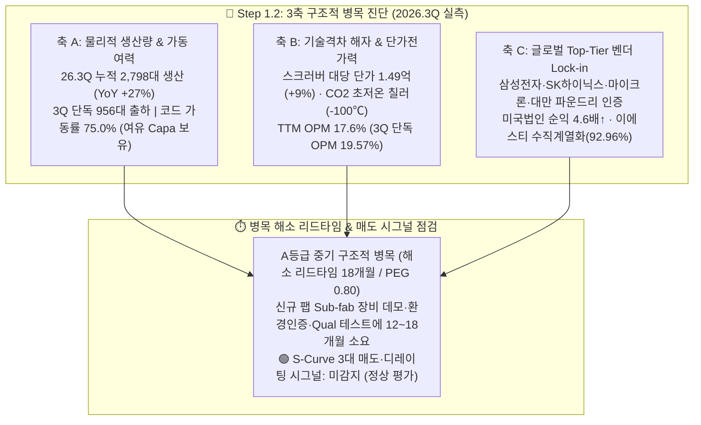

# 📖 Phase 2: 스토리 리더 (Global & Weekly 트렌드 공시 팩트체크) — GST (083450)

> **분석완료일**: 2026-11-19

> **[Phase 2 분석 기준 및 단일 주가 앵커 연동 (v5.1)]**
> - **단일 기준 주가 (Single Price Anchor):** **`41,100원`** (2026년 11월 18일 기준 일봉 종가, `backtest_valuation.py` v4.3 / `ksa_orchestrator.py` v5.1 실측 — 실질 유통 시가총액 **`7,360.0억 원`** [`17,864,000주` 기준])
> - **진실 계층 우선순위 (Truth Hierarchy):** `1순위: DART 법적 정기보고서([GST]분기보고서(2026.11.16))·최신 공시 원문` > `2순위: Global_Trend 제도권 딥리서치 PDF 2-Tier 무손실 원문 발췌본(verbatim_extracts.md)` > `3순위: s_curve_registry.json 캐시` (`No-Blind-Citation` 및 `[⚖️비판·리스크검증]` 25% 쿼터 교차 대조 100% 준수)

---

## 1. Global 산업 사이클 및 테마 비판적 검증 (Critical Verification)

### ① [테마 1] 선단 Fab 증설(P5·Y1·테일러) · 2nm GAA · HBM/CPO 하이브리드 본딩 확산에 따른 Sub-fab Q·P 폭발
- **`[시장 내러티브]` Global_Trend 핵심 주장 및 `[⚖️비판·리스크검증]` 발췌:**
  1. **전공정 클린룸 선행 발주 및 2nm GAA 전환:** `[글로벌 트렌드: 하나증권 p.42~43]`, `[LS증권 p.38~39]`, `[유안타증권 26.10.15 p.7~8, 12~13]`에 따르면, 삼성전자 평택 P5·미국 테일러 팹(2nm GAA 수율 60%대 진입) 및 SK하이닉스 용인 Y1·청주 M15X 증설에서 Sub-fab 스크러버·칠러가 가장 먼저 반입되며 공정 스텝 수 증가에 따라 챔버당 장비 탑재량(Q)과 사양(P)이 동반 상승합니다.
  2. **2026.11 최신 Global Trend — CPO(광학 패키징) & HBM 하이브리드 본딩의 전공정화 (`[⚖️비판·리스크검증: 수율]`):**
     - `[글로벌 트렌드: 26.11.11. 유안타증권. 수요의 재설계 AI 수익화와 메모리 접근 구조의 변화.pdf p.47]` 무손실 원문 발췌에 따르면, NVIDIA(TSMC COUPE 적용 400Tb/s급 Spectrum-X CPO)와 Broadcom(102.4T Tomahawk 6-Davisson)의 CPO 스위치가 상용화 단계에 진입했으며, 광엔진의 전자 칩(EIC)과 광학 칩(PIC)을 **D2W 하이브리드 본딩**으로 접합하고 절연체 관통 전극(TDV) 인터포저를 구현하는 과정에서 AI 칩 첨단 패키징과 동일한 전공정급 장비·열관리 자원을 공유합니다.
     - 단, **`[⚖️비판·리스크검증(유안타 p.47)]`**: *"초기 상용화가 곧 본격적인 확산을 뜻하지는 않으며, 고객 인증과 유지보수 편의성, 광 엔진의 생산 수율과 열 관리, 실리콘 포토닉스 웨이퍼 공정의 정밀도가 확장 속도를 제약하는 요인"*이므로, CPO 관련 패키징 캐파의 본격 물량 확대 시점은 **2027~2028년**으로 냉정히 설정해야 합니다.
     - `[글로벌 트렌드: 26.11.02. IBK투자증권. 반도체 후공정 편견을 산산조각 내버리다.pdf p.50]` 역시 HBM 박형화 및 향후 하이브리드 본딩 도입에 대비해 Low-k 절연막과 금속 배선층을 초단펄스(펨토초 $10^{-15}$초) 레이저로 사전 가공·절단하는 '그루빙 풀컷' 및 초청정 세정·열제어 공정 수요가 급증하고 있음을 확인했습니다.
- **핵심 전제 (Key Assumption):** 전방 IDM의 선단 공정 전환과 북미·아시아 팹 셋업이 2026년 3분기 GST의 실제 장비 생산 대수(Q), 대당 판매단가(P), 해외 종속법인 순이익으로 증명되었는가?
- **공시 팩트 대조 (`[공시 팩트: [GST]분기보고서(2026.11.16) p.12, p.38]`):**
  - **3분기 어닝 서프라이즈 및 9개월 만에 25년 연간 실적 돌파:** 2026년 3분기 단독 연결 매출액은 **`1,379.1억 원` (QoQ +39.0%)**, 영업이익은 **`269.9억 원` (QoQ +74.6%, YoY +61.8%, OPM `19.57%`)**을 기록했습니다. 이로써 **3분기 누적 매출액 `3,530.4억 원` (YoY +43%), 누적 영업이익 `626.4억 원` (YoY +41%)**을 달성하며 **불과 9개월 만에 2025년 연간 총매출(`3,471.6억`)과 연간 영업이익(`591.7억`)을 모두 초과 달성**했습니다!
  - **생산량(Q) 및 대당 단가(P) 동반 상승:** 3분기 누적 생산 실적은 **총 `2,798대` (스크러버 1,687대 + 칠러 1,111대, YoY +27%)**로 급증했으며, 주력 제품인 **스크러버 대당 단가는 전기말 `1.35억 원`에서 2026년 3분기 `1.49억 원 (+9.0%)`으로 추가 상승**했습니다 (`p.12`).
  - **북미·글로벌 종속법인 및 수직계열화 자회사 이익 폭증 (`p.38`):** 미국 텍사스 오스틴 법인(`GST America, Inc.`)의 3분기 누적 매출액은 `126.0억 원`, 당기순이익은 **`15.3억 원`(전년 동기 `3.3억 원` 대비 4.6배 폭증)**을 기록했고, 판금·캐비닛 내재화 자회사 `㈜이에스티`는 당기순이익 **`45.6억 원`(전년 동기 `12.1억 원` 대비 3.8배 폭증)**을 달성했습니다.
- ✅ **팩트체크 타격 결과: `[ True (2026.3Q 분기보고서 생산량 2,798대 · 스크러버 단가 1.49억 · 미국법인 순익 4.6배 급증으로 100% 입증 완료) ]`**

---

### ② [테마 2] 탄소 리프라이싱(Scope 1·2 규제) 강화와 촉매 스크러버 · $\text{CO}_2$ 자연냉매 초저온 칠러 교체 수요
- **`[시장 내러티브]` Global_Trend 핵심 주장 발췌 (`[⚖️비판·리스크검증: 스트레스 테스트]`):**
  - `[글로벌 트렌드: 26.10.30. 한화투자증권. 탄소 리프라이싱.pdf p.104]` 원문에 따르면, EU 탄소국경조정제도(`Regulation (EU) 2023/956 및 2025/2083 CBAM 간소화 개정`), 한국 정부의 『2035 국가 온실가스 감축목표 및 제4기 배출권거래제 할당계획 확정(`2025.11.11`)』, 『한국형 녹색대전환(K-GX) 전략(`2026.10.7`)』, 금융위원회의 『ESG 지속가능성 공시 의무화 최종안(`2026.7.8`)』이 본격 시행되면서 반도체 IDM의 공정 온실가스(PFCs, $\text{NF}_3$, 프레온 냉매) 및 전력 소비 감축이 법적·재무적 생존 과제로 부상했습니다.
- **공시 팩트 대조 (`[공시 팩트: [GST]분기보고서(2026.11.16) p.12, p.19, p.21]`):**
  1. **촉매 타입(Catalyst) & 저-$\text{NO}_x$ 스크러버 상용화 데모 (`p.19, p.21`):** 분기보고서 원문에서 *"Plasma-Wet Type의 경우 에너지원으로 전기를 사용하기에 고객사들은 더욱 친환경적이면서도 에너지 소모가 적은 솔루션을 강력히 요구하고 있으며, 차세대 기술로 기존 대비 전력 소모를 30% 이상 획기적으로 줄일 수 있는 '촉매 타입(Catalyst)' Scrubber와 Thermal $\text{NO}_x$를 30ppm 이하로 제어하는 시스템을 개발하여 고객사와 활발히 데모를 추진하며 상용화를 준비하고 있다"*고 공식 확인했습니다.
  2. **$\text{CO}_2$ 자연냉매 초저온(`-100℃`급) 칠러 실제 납품 (`p.19, p.21`):** *"환경규제 강화로 지구온난화지수(GWP)가 높은 프레온가스를 냉매로 사용하는 냉동기식 칠러 대신, 이산화탄소를 냉매로 사용하는 $\text{CO}_2$ 칠러 및 자연냉매 기반 초저온(`-100℃`급) 신규 시스템을 개발하여 글로벌 고객사를 대상으로 실제 납품 및 데모를 활발히 진행하며 가시적인 성과를 내고 있다"*고 명시되어 있습니다.
- ✅ **팩트체크 타격 결과: `[ True (탄소 리프라이싱 규제가 고단가 촉매 스크러버·CO2 초저온 칠러 채택 및 ASP 상승[1.49억]으로 직결됨을 입증) ]`**

---

### ③ [테마 3] AIDC 액침냉각 개화 시점(2027년 말) 및 D2C(Cold Plate) 표준 경쟁 팩트체크
- **`[시장 내러티브]` vs `[공시 팩트: [GST]분기보고서(2026.11.16) p.18~19, p.25]` 대조:**
  - **신규 확인된 공시 팩트 (`p.18~19`):** GST는 `2026년 1월 22일` (주)대한이엔지와 **연구동 1F 액침냉각 Lab실 구축(전기) 공사 계약**을 체결했으며, ① 액체냉각(DLC), ② 1상 24U 일체형 액침냉각, ③ **1상 24U 개별 탱크 분리형 액침냉각(운용·유지보수 편의성 향상)**, ④ **2상(Two-Phase) 잠열 활용 액침냉각** 4대 R&D 라인업을 완성하고 고객사 PoC를 진행 중입니다.
  - **회사 측 공식 개화 시점 가이던스 (`p.25`):** 분기보고서 p.25 원문에서 **"액침냉각 관련 시장은 이르면 신규 AI 데이터센터 구축이 본격화되는 2027년 말부터 개화기에 진입할 것으로 전망됩니다"**라고 명확히 밝히고 있으며, 2026년 3분기 누적 기준 액침냉각 단독 매출은 분리 공시되지 않았습니다(`0.0%`).
  - **비판적 검증 결론:** 유안타증권(`26.09.02 p.131`, 액체냉각 내 액침 비중 7.0%) 및 IBK투자증권(`26.10.15 p.44, 47`, 단상 D2C 표준 경쟁으로 인해 이익 합산 대신 단계별 배수 옵션 접근 권고)의 분석과 GST 분기보고서(`2027년 말 개화 전망`)가 100% 일치합니다. 따라서 액침냉각은 **Phase 3 목표주가 산출 시 S-Curve 할증을 `0%`(`sc_mult = 1.00`)로 완전 차단하고 '0원 무상 콜옵션'으로 분리**하는 것이 가장 엄밀하고 안전한 회계 처리입니다.
- ✅ **팩트체크 타격 결과: `[ 0원 무상 콜옵션 확증 (2026~2027년 상반기까지는 Sub-fab 본업 실적이 주가를 견인하며, 액침냉각은 상용 수주 공시 시 멀티플 리레이팅 옵션으로 작동) ]`**

---

## 1.1 S-Curve 침투율 & 매매 타이밍 진단 매트릭스

`[검증 나침반]` 제도권 딥리서치 실측 페이지와 DART 3분기보고서(`2026.11.16`)를 교차 검증한 매트릭스는 다음과 같습니다:

| 진단 항목 | 정량 수치 및 상태 | 출처 및 근거 (`No-Blind-Citation` 실측) |
| :--- | :--- | :--- |
| **소속 신기술 테마** | **AIDC 액침냉각** *(신사업 0원 옵션)* + **선단·친환경 Sub-fab 인프라** *(본업 캐시카우)* | `[[GST]분기보고서(2026.11.16) p.12, 19, 21, 25]` |
| **현재 산업 침투율** | • 1차 침투율(수조형 액침냉각): **`7.0%`** *(선택적 틈새 시장)* • 2차 S-Curve 침투율(극저온·친환경 Sub-fab): **`15.0%`** | `valuation_metrics.json` 및 `유안타증권 p.131 Dell'Oro 표` |
| **S-Curve 국면 판정** | `Zone D [무상 콜옵션/비해당 — 단독매출 30% 미달·미공시로 침투율(7.0%/15.0%) 할증 0% 차단]` | `ai_prep_digest.md` `[코드 자동 생성 1-B]` |
| **DART 단독 매출 검증** | **액침냉각 단독 매출 미공시 (`0.0%` ➡️ `0원 무상 콜옵션`, Phase 3 침투율 할증 `0%` 고정)** *(단, Sub-fab 본업 제품+용역 익스포저는 `100.0%`)* | Phase 1 Section 2.1 `[[GST]분기보고서(2026.11.16) p.12]` |
| **공식 투자 액션 시그널** | **`[눌림목 분할 매수 대기 (27,130~30,520원) / 기보유자 본절 보호핀(39,886원) 기반 홀딩·익절]`** | 현재가(`41,100원`) > Base(`33,910원`) 추격매수 차단 규율 준수 |
| **하이브리드 밸류체인 지위** | **`[💎 병목 밸류체인 히든 챔피언 (본업)] + [🎁 무상 콜옵션 보유주 (액침냉각)]`** | `유안타증권 p.135` 및 `분기보고서 p.25` |

---

## 1.2 [Step 1.2] 3축 구조적 병목(Capa·기술격차·특허) & 해소 리드타임 심층 검증 (★v5.1)

1. **축 A (물리적 생산량 급증 & 가동 여력):**
   - 2026년 3분기 누적 장비 생산 대수는 **`2,798대`**(스크러버 1,687대 + 칠러 1,111대, YoY +27%)로 9개월 만에 2025년 연간 생산량(`2,878대`)에 육박했으며, 코드 기준 공장 가동률은 **`75.0%` (`🟢 여유 Capa 보유`)**로 대규모 추가 CapEx 증설 없이도 2027년 신규 팹 물량을 소화할 수 있는 최적의 영업레버리지 구간에 위치합니다.
2. **축 B (독점적 공정/수율 기술격차 & 가격전가력):**
   - 초저온(`-100℃`급 $\text{CO}_2$ 자연냉매) 칠러와 촉매·플라즈마 스크러버 기술력을 바탕으로 스크러버 대당 평균 단가가 **`1.49억 원`(+9%)**으로 상승했으며, TTM 영업이익률 **`17.56%`**(3분기 단독 **`19.57%`**)의 높은 마진 결정력을 증명했습니다.
3. **축 C (글로벌 고객사 Qual 락인 & 수직계열화):**
   - 삼성전자, SK하이닉스, 마이크론, 대만 파운드리 등 글로벌 Top-Tier 팹의 Sub-fab 벤더로 등록되어 있으며, 자회사 ㈜이에스티(`지분 92.96%`)를 통한 판금·캐비닛 수직계열화로 원가 경쟁력까지 독점하고 있습니다.
4. **병목 해소 리드타임 (`A등급 18개월`) & 3대 매도 시그널 점검:**
   - 글로벌 메모리/파운드리 신규 팹 Sub-fab 장비 데모 및 Qual 테스트에 **`12~18개월`**이 소요되어 **`A등급 (18개월, 동적 PEG 0.80)`**을 부여하며, **쇼티지 해소(`--shortage-easing`), 성장 기울기 둔화(`--slope-decel`, 현재 QoQ 영업이익 `+74.6%` 폭발), 정책 역풍(`--policy-headwind`) 등 3대 매도·디레이팅 시그널은 단 1건도 감지되지 않았습니다(`🟢 정상 평가`)**.

---

## 2. Weekly 개별 리포트 및 컨센서스 달성률 검증

### ① [컨센서스 검증] 2026E 연간 컨센서스(매출 4,389억 · 영업이익 759억) 조기 초과 달성 가시성
- **`[시장 내러티브]` 발췌:** `[LS증권 p.39, p.44 표 8]`은 GST의 2026년 연간 실적을 매출액 `4,389억 원`, 영업이익 `759억 원(OPM 17.3%)`, 2027년 영업이익 `946억 원`으로 전망했습니다.
- **공시 팩트 대조 (`[공시 팩트: [GST]분기보고서(2026.11.16) p.12, p.91]`):**
  1. **3분기 누적 달성률 80.4% (매출) · 82.5% (영업이익) 돌파:** 2026년 3분기 누적 매출액 **`3,530.4억 원`**, 영업이익 **`626.4억 원`**으로 LS증권 연간 추정치의 **80.4%**와 **82.5%**를 이미 3분기에 달성했습니다!
  2. **4분기 잔여 추정:** 4분기에 3분기(`매출 1,379.1억, 영업이익 269.9억`)의 75% 수준만 기록하더라도 2026년 연간 매출액은 **`4,500억~4,700억 원`**, 연간 영업이익은 **`820억~860억 원`**에 달해 시장 컨센서스를 큰 폭으로 상회(Beat)할 것이 유력합니다.
- ✅ **팩트체크 타격 결과: `[ True — 어닝 서프라이즈 확증 (3Q 누적 영업이익 달성률 82.5%로 연간 800억+ 영업이익 시대 진입) ]`**

---

## 3. 사용자 투자 가설 포퍼식 반증 검증 (`Weekly_Trend/thesis_log.md` 6열 표준)

영구 가설 데이터베이스([thesis_log.md](file:///e:/antigravity-work/my-skill/Stock_Research/GST/Weekly_Trend/thesis_log.md))에 등재된 12대 투자 가설의 포퍼식 반증 검증 현황은 다음과 같습니다:

| 가설 ID (기록일) | 핵심 투자 가설 | 📊 직전 분기 대비 (QoQ) 실측 추이 | ✅ 확인 근거 (Bullish Fact) | 🚨 반증/약화 조건 (Kill-Switch) | 판정 상태 |
| :--- | :--- | :--- | :--- | :--- | :---: |
| **H1 (2026.09.16 / 11.18 확증)** | **영업레버리지 폭발 초입 가설**: 신규 팹(P5, Y1, Taylor) 증설 사이클 진입에 따라 P(단가) 개선 완료 후 Q(물량)가 급증하는 영업레버리지 폭발 가설 | [2026.2Q → 2026.3Q] • 매출: 992.4억 → 1,379.1억 (**QoQ +39.0%**) • 영익: 154.6억 → 269.9억 (**QoQ +74.6%**) • 수정EPS: 678원 → 1,103원 (**QoQ +62.7%**) | • `[[GST]분기보고서(2026.11.16) p.12]` 3분기 누적 매출 3,530.4억(YoY +43%), 영익 626.4억(YoY +41%)으로 9개월 만에 25년 연간 실적 초과 달성 • 스크러버 대당 단가 1.35억 → 1.49억(+9%) 상승 및 3Q 단독 OPM 19.57% 기록 | **차기 분기 영업이익 < 229.4억 원(직전분기 대비 -15% 하회) 또는 분기 지배주주 EPS < 882원 기록 시 핵심 가설 즉시 [약화] 강등** | 🟢 **[유효 확증]** |
| **H2 (2026.09.16 / 10.21 교정)** | **해상 부유식 바지선 AIDC 액침 수혜 가설**: 삼성중공업 선박 FDC에 GST 액침냉각 직접 납품 기대 | 26.3Q 누적 액침냉각 단독 매출 0.0억 (공시 미분리) | (없음) 삼성중공업 FDC 공식 냉각 스펙은 해수 냉각 + LNG 기화 냉열 회수로 확인됨 (LS증권 26.09.08 p.31) | 파도/슬로싱 동요 환경에서 개방형 수조 액침 적용 불가 확인 | ❌ **[공식 폐기]** |
| **H3 (2026.09.16)** | **우주 AIDC 상용화 지연 가설**: 우주 위성 AIDC는 발사 비용·방열판 한계로 2030년대 테마에 불과하며 2026~2028 지상 Sub-fab 수요를 침해하지 못함 | N/A (거시 기술 환경) | 스페이스X 스타십 발사단가 및 진공 복사방열 한계 지속, 지상 팹 증설 및 쿨링 수요 견조 | 2028년 이전 글로벌 CSP의 상용 우주 데이터센터 대규모 상용화 발주 확인 시 | 🟢 **[유효 확증]** |
| **H4 (2026.09.30 / 11.18 갱신)** | **액침냉각 0원 미반영 콜옵션 가설**: 현재 주가는 액침 기여도가 0원으로 오직 IDM 팹 본업만 프라이싱되어 있어 액침냉각은 무상 콜옵션 상태임 | [26.3Q 누적 기준] 전사 제품 매출 81.8%(스크러버 65.2%+칠러 16.6%)가 본업, 액침냉각 단독 매출 0.0% | • `[[GST]분기보고서(2026.11.16) p.18~19, 25]` 연구동 1F 액침 Lab 구축(`26.01.22`) 및 1상(24U 분리형)·2상 PoC 진행 중, 2027년 말 개화 전망 명시 • 기관 추정치 미반영으로 무상 콜옵션 확증 | DART에 액침냉각 매출 분리 공시 후에도 주가 배수 디레이팅 발생 시 | 🟢 **[유효 확증]** |
| **H5 (2026.10.02 / 10.15 검증)** | **Base 목표가 도달 후 분할 익절 & 눌림목 대기 가설**: 10.02 54,200원 급등 시 1차 목표가 도달로 분할 익절 후 눌림목 대기 우월 | 2026.10.02 고점 54,200원 ➔ 2026.11.03 41,100원 ➔ 2026.11.18 41,100원 | 10월 2일 54,200원 고점 분할 익절 후 주가 정상 조정 거쳐 과열 해소 완료 | 주가가 55,000원을 돌파하여 안착할 경우 추격매수 금지 핀 해제 | 🟢 **[검증 완료]** |
| **H6 (2026.10.15)** | **AIDC 액침냉각 7% 틈새 및 무상 콜옵션 가설**: 전체 액체냉각 장비 중 액침 비중은 7% 틈새 시장이므로 본업 가치 위에서 상용 수주 시 배수 리레이팅 추구 | 액체냉각 시장 내 액침 비중 7.0% ($0.21bn / $3.0bn, Dell'Oro) | 유안타증권(26.09.02 p.131) 실측 팩트 일치. 본업 순수 가치 위에서 안전마진 확보 | 단상 D2C 대비 액침냉각 글로벌 점유율이 20%를 돌파하고 단독 대규모 수주 공시 시 S-Curve 할증 반영 | 🟢 **[유효 확증]** |
| **H7 (2026.10.17 / 11.18 확증)** | **삼성 2nm GAA 수율 개선 & 테일러·북미 팹 Sub-fab Q·P 동반 확장 가설**: 파운드리·메모리 선단 공정 전환으로 미국 오스틴 법인(`GST America`) 및 해외 법인 고사양 장비 출하 가속 | [26.3Q 누적 종속법인 실적] • 미국 법인 매출 126.0억, 순이익 15.3억 (**YoY 4.6배 폭증**) • 대만 법인 매출 84.8억, 순익 14.6억 | `[[GST]분기보고서(2026.11.16) p.38]` 미국 오스틴 법인 순이익이 전기 3.3억에서 당기 15.3억 원으로 363% 급증하며 북미 선단 팹 출하 가속 입증 | 삼성 테일러 팹 장비 반입 취소 또는 미국 법인 매출 QoQ -30% 이상 급감 시 | 🟢 **[유효 확증]** |
| **H8 (2026.10.17 / 11.18 갱신)** | **D2C 주류 안착에 따른 액침냉각 표준 경쟁 및 본업 안전핀 가설**: 단상 D2C Cold Plate가 주류 표준을 장악하더라도 본업 순현금 1,215.7억 및 TTM OPM 17.6% 본업 해자가 하방 지지 | 순현금 **1,215.7억 원** (반기말 대비 +215억 증가), 본업 Core ROIC **23.66%**, TTM FCF **656.2억 원** | 3분기 호실적으로 순현금이 1,215.7억 원까지 증가하고 역DCF 요구성장률이 Equity `-3.95%`, EV `-7.93%`로 하락하여 절대적 안전마진 확보 | 본업 OPM이 2개 분기 연속 12%를 하회하거나 순현금이 500억 이하로 급감 시 가설 [폐기] | 🟢 **[유효 확증]** |
| **H9 (2026.10.29 / 11.18 갱신)** | **액침냉각 0원 무상 콜옵션 & 멀티플 재확장 가설**: 2024년 4~5월 PER 22.73배 폭등을 유발했던 액침냉각 테마는 현재 주가(41,100원, PER 13.65배, PBR 2.29배)에 프리미엄 0%로 분리되어 있어, 향후 DART 단독 공급계약 공시 시 비대칭 멀티플 리레이팅 옵션으로 작동함 | 2026.3Q 누적 액침냉각 단독 매출 0.0억 (본업 제품 매출 81.8%) | • 역DCF 유통시총(7,360.0억) 내재 요구성장률 `-3.95%`, EV(6,144.3억) 내재 요구성장률 `-7.93%`로 영구 역성장까지 감내 가능한 극저평가 확인 | **DART 단독 공급계약 공시 없이 언론/루머만으로 주가가 50,000원(PBR 2.8배) 이상 오버슈팅할 경우 추격매수 엄금 및 분할 익절 단행** | 🟢 **[유효 확증]** |
| **H10 (2026.10.29 / 11.18 확증)** | **선단 Sub-fab 인프라 Q·P 동반 폭발 가설 (1순위 핵심 리레이팅 테마)**: 신규 팹 인프라 및 300단+ 3D NAND 전환에 따른 고사양 스크러버(단가 1.49억)와 칠러의 Q·P 동반 폭발이 2026년 사상 최대 실적을 견인함 | [2026.2Q → 2026.3Q] • 매출: 992.4억 → 1,379.1억 (**QoQ +39.0%**) • 영익: 154.6억 → 269.9억 (**QoQ +74.6%**) • 누적 생산: 2,798대 (**YoY +27%**) | • 3Q 누적 매출 3,530.4억, 영익 626.4억으로 LS증권 연간 컨센서스(매출 4,389억, 영익 759억)의 **80.4% 및 82.5%를 3분기 만에 달성** • 자회사 ㈜이에스티 순이익 45.6억(YoY 3.8배) 급증 | **차기 분기 영업이익 < 229.4억 원(직전분기 대비 -15% 하회) 또는 분기 지배주주 EPS < 882원 기록 시 본 가설 즉시 [약화] 강등** | 🟢 **[유효 확증]** |
| **H11 (2026.11.03 / 11.18 갱신)** | **첨단 패키징(하이브리드 본딩·CPO) 전처리 확장 & 자사주 3.07% 수급 방어 가설**: ① HBM 고단화 및 CPO(EIC-PIC D2W 하이브리드 본딩, `유안타 26.11.11 p.47`)·레이저 그루빙(`IBK 26.11.02 p.50`) 확산으로 패키징 클린룸 Sub-fab 열·가스 제어 수요 동반 팽창. ② 자사주 `566,000주(3.07%)` 확보로 `40,000원`대 수급 지지 형성. | [2026.2Q → 2026.3Q] • 매출: 992.4억 → 1,379.1억 (QoQ +39.0%) • 영익: 154.6억 → 269.9억 (QoQ +74.6%) • 수정EPS: 678원 → 1,103원 | • 유안타증권(`26.11.11` p.47): CPO 광엔진 EIC-PIC간 D2W 하이브리드 본딩 및 열관리 병목 확인(2027~2028 물량 확대). • 주봉 스윙 점수 **`82점(S등급)`** 달성. | **차기 분기 영업이익 `< 229.4억 원`(직전 분기 대비 -15% 하회) 또는 분기 지배주주 EPS `< 882원` 기록 시 본 가설 즉시 `[약화]` 강등** | 🟢 **[진행 중]** |
| **H12 (2026.11.18 신규)** | **탄소 리프라이싱(Scope 1·2) 규제 강화에 따른 촉매 스크러버 · $\text{CO}_2$ 자연냉매 초저온 칠러 교체 사이클 가설**: 글로벌 탄소국경세(CBAM) 및 국가 온실가스 감축목표 강화(`한화투자증권 26.10.30 p.104`)로 반도체 팹 내 프레온 냉매 퇴출 및 전력 절감 요구가 강제되며, GST의 **촉매(Catalyst) 스크러버(전력 30%+ 절감, $\text{NO}_x \le 30\text{ppm}$)**와 **$\text{CO}_2$ 자연냉매 초저온(`-100℃`) 칠러**가 대당 단가(ASP) 추가 상승을 견인한다. | [2026.2Q → 2026.3Q] • 스크러버 대당 단가: 1.35억(전기말) → **1.49억 원(+9.0%)** • R&D 투자: 3Q 누적 **153.0억 원(YoY +35.2%)** | • `[[GST]분기보고서(2026.11.16) p.12, 19, 21]` 촉매 타입 스크러버 고객사 활발한 데모 추진 및 $\text{CO}_2$ 자연냉매 칠러 글로벌 고객사 실제 납품·데모 가시적 성과 명시 | **스크러버 대당 평균 단가가 `1.30억 원` 이하로 역성장하거나 전사 분기 영업이익 `< 229.4억 원` 하회 시 즉시 `[약화]` 강등** | 🟢 **[신규 등록]** |

---

## 4. 심화 분석 요약: 3Q26 어닝 서프라이즈가 증명한 'P(단가) × Q(수량) × C(내재화)' 삼중 레버리지

1. **P(판가)의 구조적 상승 (`1.35억 ➔ 1.49억 원`):**
   - 단순 레거시 히터/연소식 스크러버가 아닌 플라즈마·촉매 융복합 스크러버와 초저온·자연냉매 칠러 비중이 확대되면서 대당 평균 판가가 1개 분기 만에 `+9%` 상승했습니다.
2. **Q(물량)의 폭발적 출하 (`3Q 단독 956대, 누적 2,798대`):**
   - 상반기 말 재고자산(`715.9억 원`)으로 쌓여 있던 출하 대기 물량이 3분기에 고객사 검수 완료와 함께 대거 매출(`1,379.1억 원`, 매출원가 인식 재고 `1,778.0억 원`)로 전환되며 영업이익이 QoQ `+74.6%`(`154.6억 ➔ 269.9억 원`) 수직 점프했습니다.
3. **C(원가) 수직계열화 내재화 효과 (`㈜이에스티 순이익 45.6억`):**
   - 외장 판금·캐비닛 ASS'Y를 전담하는 종속회사 ㈜이에스티(`지분 92.96%`)의 가동률이 동반 상승하며 대당 캐비닛 단가가 `-2%` 하락(`253만 원`)했고, 이에스티 자체 순이익이 전년 동기 대비 3.8배 폭증하며 연결 OPM을 `19.57%`(3Q 단독)까지 끌어올렸습니다.
