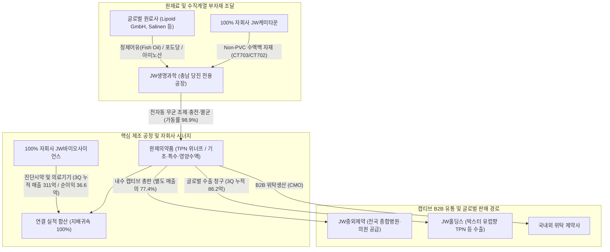
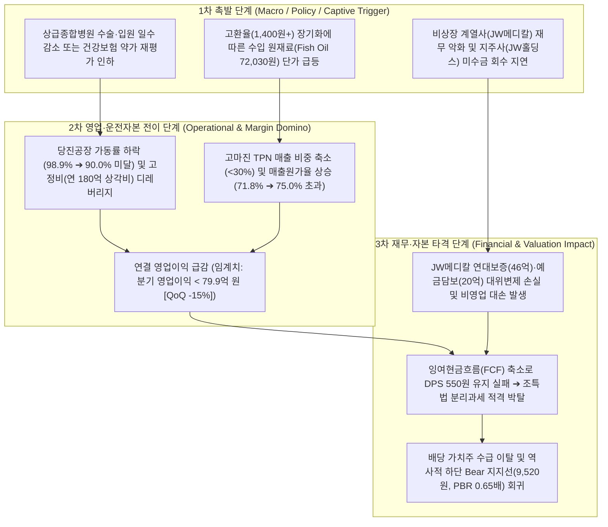

# 🏛️ Phase 1: 기업 해독기 (무결성 전면 리빌드 보고서 — v5.0)

> **분석완료일**: 2026-11-18

> 💡 **[핵심 용어 3줄 직관 해설]**
> - **[TPN (3-Chamber 종합영양수액제)]**: 경구 섭취가 불가능한 중증·수술 입원환자에게 포도당·아미노산·지질(오메가3 포함) 3대 영양소를 하나의 수액백(3-Chamber Bag)에 분리 보관 후 투여 직전 격벽을 개통해 주입하는 아시아 최초 EU-GMP 인증 고부가가치 전문의약품.
> - **[B2B 팩토리형 CMO & 캡티브 유통 수직계열화]**: 충남 당진 전용 생산기지(평균가동률 `98.9%` 풀가동)에서 수액을 전량 무균 조제·충전하고, 연결 매출의 `76.6%`(3분기 누적 1,450.8억 원, 별도 매출 기준 JW중외제약 비중 `77.4%`)를 상장 모회사·계열사 병원 유통망에 공급하여 판관비 출혈 없이 `14.1~14.9%`의 견고한 영업이익률을 창출하는 구조.
> - **[배당소득 분리과세 적격 & 300억 외화차입금 완납]**: 2026.03.27 밸류업 자율공시로 배당성향 `29.8%` 및 배당금 `10.0%` 증가(DPS `550원`, 시가배당률 `5.19%`)를 확정해 조세특례제한법상 고배당 분리과세 적격을 획득했으며, 2026년 중 유동성장기부채 `311.4억 원`을 전액 상환하여 실질 순차입금을 `115.0억 원`까지 낮춘 초우량 현금창출 가치주.

---

### 📌 단일 기준 주가 및 기본 정보 (Single Price Anchor — SSOT)
- **단일 기준 주가(최신 일봉 종가)**: **`10,590원`** (SSOT 최신 일봉 종가, 전 Phase 1~3 100% 단일 일치)
- **지배주주 순이익 귀속률**: **`100.0%`** (비지배지분 0원, 연결 순이익 전액 지배주주 귀속 — 종속기업 JW케미타운 100%, JW바이오사이언스 100%)
- **공식 유통주식수**: **`15,484,554주`** (총발행주식수 `15,834,554주` - 자기주식 `350,000주 [2.21%]`)
- **실질 유통 시가총액**: **`1,639.8억 원`** (명목 시총 `1,676.9억 원`)
- **글로벌 트렌드 매칭**: `[게이트 ① 충족: 조특법 제104조의27 고배당 분리과세 적격 공인]` / `[게이트 ② 충족: 2026.3Q 사채·외화장기차입금 300억 완납 및 FCF 370억 달성]`

---

## 1. 비즈니스 모델(BM) 해부 및 밸류체인 Mermaid 구조도

당사는 기초수액(수분·전해질), TPN(3-Chamber 종합영양수액), 특수수액(관류·항생제), 영양수액(아미노산), HEMO(인공신장투석액)를 전문 생산하는 국내 시장점유율 1위(기초수액 `42.9%`, TPN 포함 영양수액 `48.5%`) 수액제 전문 제조기업입니다 `[공시 팩트: 2026년 3분기보고서 II.1, II.7]`. 또한 100% 자회사인 **JW케미타운**(안성, 수액용기 및 Non-PVC 필름 부자재 생산)과 **JW바이오사이언스**(충주, 진단시약·보육기·수술대 등 의료기기 제조·판매)를 연결 종속회사로 두고 수액 소재부터 완제의약품·진단기기까지 수직계열화를 구축하고 있습니다 `[공시 팩트: 2026년 3분기보고서 주석 1]`.

수액제 산업은 대량 무균 조제·충전·멸균 설비(충남 당진공장 `101,865㎡`)에 막대한 초기 CapEx가 소요되고 식약처 KGMP 및 유럽 EU-GMP 등 까다로운 인허가 규제가 작동하는 대표적 장치산업(유형 A)입니다. 당사는 아시아 수액제 제조사 최초로 종합영양수액(TPN) 생산설비 EU-GMP 인증을 획득하고 글로벌 1위 수액 기업인 미국 박스터(Baxter)사와 3-Chamber TPN 독점 라이선스아웃 및 공급계약을 체결하여 글로벌 품질 역량을 입증받았습니다 `[공시 팩트: 2026년 3분기보고서 II.1]`.

원재료 조달 및 유통 구조를 보면, 해외 원료사(독일 Lipoid GmbH, 오스트리아 Salinen 등)로부터 고순도 정제어유(Fish Oil)·포도당(Dextrose)·아미노산을 수입하고 자회사 JW케미타운으로부터 수액백 자재(`CT703`, `CT702`)를 조달해 당진공장에서 전자동 공정으로 생산합니다. 생산된 완제의약품은 내수 병원 총판인 **JW중외제약**(2026년 3분기 누적 별도 매출의 `77.4%`, 연결 기준 특수관계자 매출 비중 `76.6%`)과 수출 창구인 **JW홀딩스**, 그리고 타 제약사 위탁생산(B2B CMO) 경로로 공급되어 마케팅·판관비 출혈 없이 높은 영업이익률(`2026.3Q 누적 연결 OPM 14.82%`)을 시현합니다 `[공시 팩트: 2026년 3분기보고서 II.2~4, 주석 17·25]`.

---

## 2. 제품/사업부문별 매출 구성 및 [Step 1.2] S-Curve 10% 변곡점 · 3축 구조적 병목 진단표

### 2.1 제품별 매출 구성 및 판가(ASP) 변동 추이 (2024년 ~ 2026년 3분기 누적)
[공시 팩트] 2026년 3분기보고서(제33기 3분기, `2026.01.01 ~ 2026.09.30`) 기준 별도 품목별 매출 구성과 연결 사업부문 실적은 다음과 같습니다 `[공시 팩트: 2026년 3분기보고서 II.2, II.4, 주석 4]`.

| 제품군 (별도 품목 구분) | 2024년 연간 매출(비중) | 2025년 연간 매출(비중) | 2026년 3Q 누적 매출(비중) | 대표 브랜드 및 2026년 판가(ASP)·수익성 특징 |
| :--- | :---: | :---: | :---: | :--- |
| **TPN (종합영양수액)** | 758.5억 (34.3%) | 847.6억 (36.2%) | **579.5억 (33.6%)** | `위너프주`, `위너프에이플러스주` (내수 494.6억 + 수출 84.9억) / 고마진 핵심 캐시카우 |
| **기초수액 (수분·전해질)** | 626.8억 (28.3%) | 669.3억 (28.6%) | **510.2억 (29.6%)** | `중외엔에스주` (500mL 판가 680원➔697원➔709원 인상) / 입원 필수 처방 (점유율 42.9% 1위) |
| **특수수액 (관류·항생제)** | 468.2억 (21.2%) | 424.3억 (18.1%) | **340.6억 (19.7%)** | `크린조`, `크린클` (1000mL 판가 622원➔859원, **+38.1% 대폭 인상**) / 수술·관류 필수재 |
| **영양수액 (아미노산 등)** | 150.4억 (6.8%) | 189.9억 (8.1%) | **152.6억 (8.8%)** | `닥터라민주`, `파워아르긴주` (내수 148.6억 + 수출 4.0억) / 고단위 아미노산 수액 |
| **HEMO (인공신장투석)** | 165.8억 (7.5%) | 168.1억 (7.2%) | **120.4억 (7.0%)** | `헤모비덱스` (5.5L 판가 5,288원➔6,224원, **+17.7% 인상**) / 혈액투석 관류액 |
| **기타 (상품 등)** | 42.4억 (1.9%) | 41.0억 (1.8%) | **23.2억 (1.3%)** | `목사멘틴듀오시럽` 외 |
| **별도 합계 (의약품)** | **2,212.1억 (100%)** | **2,340.1억 (100%)** | **1,726.5억 (100%)** | **연결 기준 2026년 3Q 누적 매출액 `1,894.3억 원` / 영업이익 `280.7억 원` (OPM `14.82%`)** |

- **연결 종속회사 손익 기여 호조**: 2026년 3분기 누적 연결 매출액은 `1,894.3억 원`, 영업이익은 `280.7억 원`(전년 동기 256.6억 원 대비 **`+9.4%` 증가**)을 기록했습니다. 특히 100% 자회사인 **JW바이오사이언스**가 3분기 누적 매출 `310.9억 원`, 분기순이익 **`36.6억 원`**(2025년 온기 순이익 27.2억 원을 3분기 만에 초과 달성)을 기록하고, **JW케미타운** 역시 순이익 `7.9억 원`(전년 연간 0.5억 원 대비 급증)을 달성하며 연결 수익성을 견인했습니다 `[공시 팩트: 2026년 3분기보고서 주석 1, 주석 4]`.

### 2.2 S-Curve 신기술 테마 익스포저 산출표 & 무상 콜옵션 가드레일 판정
- **단독 신기술 매출 미공시 ➔ S-Curve 침투율 할증 `0%` 차단 (원칙 4 준수)**:
  - 당사의 고부가 품목인 TPN(종합영양수액) 매출 비중은 `33.6%`(579.5억 원)이며 국내 영양수액 시장점유율은 `48.5%`에 달하나, 이는 성숙기 필수 전문의약품 시장 내 고마진 제품군입니다.
  - 글로벌 박스터향 수출을 포함한 전체 수출액은 2026년 3분기 누적 별도 기준 `92.3억 원`(`5.35%`, 연결 기준 `86.2억 원 [4.55%]`)으로 단독 신기술/해외 S-Curve 익스포저 30% 기준에 미달합니다. 따라서 **침투율 변곡점 할증(`pen_base_boost = 0%`)은 원천 차단하고 '0원 무상 콜옵션'으로 처리**하되, 당진공장의 물리적 풀가동(`98.9%`) 및 EU-GMP 인허가 장벽에서 나오는 **본업 구조적 병목 프리미엄(`A등급`, Base `+5.0%` / Bull `+7.0%`)**만 Phase 3 `🚀 대안 A`에 반영합니다.

---

### 📌 [코드 자동 생성 1-B] Step 1.2 S-Curve 10% 변곡점 · 3축 구조적 병목(Capa·기술·특허) · 리드타임 & Step 1.8 K-주주환원 진단표 (v5.0)
| 진단 축 (3-Axis + K-Return) | 실측 지표 및 근거 | 코드 판정 및 Phase 3 목표주가 가중치 |
| :--- | :--- | :--- |
| **① 전방 시장 침투율 (10% 변곡점 여부)** | 1차 침투율 **`48.5%`** (2차 S-Curve 침투율 `15.0%`) (`Zone D [무상 콜옵션/비해당 — 단독매출 30% 미달·미공시로 침투율(48.5%/15.0%) 할증 0% 차단]`) | 📌 **확산/성숙 구간 진행** (3축 통합 Base `×1.05` / Bull `×1.07`) |
| **②-A 물리적 Capa 병목 (가동률/증설)** | 공장 가동률 **`98.9%`** — 생산 Capa/인허가: 당진 수액 전용 자동화 공장 가동률 98.9% 풀가동 및 국내 수액제 시장점유율 1위(42.9~48.5%) | 🔒 **풀가동 공급 병목 확인** |
| **②-B 기술격차 해자 (OPM/수율/단가결정력)** | 현 OPM **`14.1%`** — 기술격차 해자: QbD 기반 3-Chamber TPN 다층 필름·지질 에멀전 균질화 공정 및 특수수액/투석액 판가 전가력 | 고마진 가격전가력(Pricing Power) 점검 |
| **②-C 원천특허 · 글로벌 벤더 퀄(Qual) 락인** | 원천특허/Qual Lock-in: 아시아 최초 TPN EU-GMP 인증, 위너프/Finomel 핵심 특허 23건 및 박스터 글로벌 공급 락인 | 후발주자 진입장벽(Switching Cost) 점검 |
| **③ 병목 해소 예상 소요기간 (Lead Time)** | **`A등급`** (해소 리드타임 **`18개월`**) | 수액제 무균 생산라인 증설·밸리데이션 및 식약처/유럽 GMP 품목허가에 18~24개월 소요 (PEG 계수 `0.80`) |
| **③-B S-Curve 3대 매도·디레이팅 시그널** | 🟢 해당 없음 (병목 유지 · 성장 기울기 건전 · 정책 역풍 미감지) | 🟢 **매도 시그널 미감지 (정상 평가)** |
| **④-A K-주주환원 (배당 · TSR · 분리과세)** | DPS **`550원`** (배당수익률 **`5.19%`** / 성향 `29.8%` / TSR `29.8%`) | ✅ 배당소득 분리과세 요건2 충족 (26.03.27 밸류업 공시 확정 — 배당성향 29.8%, DPS 550원 [+10.0%]) |
| **④-B 자사주 · 환원절벽 · 메자닌(CB/BW)** | 자사주 **`350,000주`** (`2.21%`) / 미상환 메자닌 **`0.0억`** (희석 `0.0%`) | 🟢 정상 (현재 자기주식 350,000주 [2.21%] 보유 — 소각 전환 여부 모니터링) / 🟢 청정 (미상환 CB/BW/EB 잠재 희석 0%) |
| **④-C 지배구조 · 내부거래 · 거버넌스 (Step 1.8)** | 상장모회사·계열사 정상유통 **`1,525.0억`** / 거버넌스 할인 **`-10.0%`** | 🟢 정상 영업 유통 (상장 모회사·계열사 유통 채널 거래 약 1,525.0억 원 — 오너 개인회사 사익편취 터널링 비해당, 할인 0%) — 상장 모회사(JW중외제약) 정상 유통(터널링 0%) vs 지주사 미수금(154억)·JW메디칼 보증(46억)+담보(20억) 지배구조 할인(-10%) 반영 (`kgov_mult = ×0.9000`) |
| **⑤ 레드팀 역산 Capa 천장 검증 (Red-Team)** | 대안 A 내재 영업이익: Base **`399.0억`** / Bull **`403.3억`** | 🟢 [레드팀 Capa 검증 통과] 가동률(98.9%) 및 믹스 개선 기준 물리적 영업이익 상한(450.6억) 내 달성 가능 (Base 내재 OP 399.0억) |

---

### 2.3 Step 1.2 4대 질문 심층 해독 (Argon 4.0 엔지니어링·재무 인과 사슬)
1. **[질문 1 — 10% 침투율 변곡점 판별]**: 국내 기초수액(`42.9%`) 및 영양수액(`48.5%`) 시장은 당사를 포함한 소수 제약사(JW생명과학, HK이노엔, 대한약품)의 과점 성숙 시장이며, 차세대 고함량 아미노산 TPN(`위너프에이플러스`) 및 수술용 폴리머 클립(`잼엔드 JAMEND`) 등 신규 품목이 침투 중이나 단독 매출 30% 미만이므로 침투율 할증은 `0%`로 차단합니다.
2. **[질문 2 — 3축 구조적 병목(Capa·기술·특허) 유발 여부]**:
   - **축 A (물리적 생산 Capa 병목)**: 2026년 3분기 누적 당진공장의 연간가동가능시간 `2,784시간`(일평균 실동 15시간 × 172조업일 기준) 중 실제가동시간 **`2,752시간`**을 기록하여 평균가동률 **`98.9%`**에 달합니다 `[공시 팩트: 2026년 3분기보고서 II.3.(5)]`. 라인별 생산능력(126백만 개) 대비 실적(112백만 개, 수량 가동률 `88.9%`) 또한 풀가동 상태로 물리적 공급 병목이 실재합니다.
   - **축 B (기술격차 및 단가 전가력 해자)**: QbD(설계기반 품질 고도화) 기반 고순도 정제어유 지방유제(Lipid Emulsion) 균질화 공정과 3-Chamber 다층 필름 격벽 실링 기술을 보유하고 있습니다. 원재료비 상승 시 보험급여 상한가 인상 및 판가 전가(2026년 특수수액 `크린조 1000mL` `622원 ➔ 859원 [+38.1%]`, `헤모비덱스` `5,288원 ➔ 6,224원 [+17.7%]`)를 통해 TTM 연결 OPM **`14.1%`**(2026년 3분기 단독 OPM **`15.0%`**, 누적 **`14.8%`**)를 창출합니다.
   - **축 C (원천특허 · 글로벌 GMP Qual 락인)**: `Finomel` 유럽 패키징 다층 필름 특허(유럽 7개국 등록), `위너프` 수액제제 특허(2036년 만료), 수액백용 배액포트(`Infusion Tip`, 2040년 만료) 및 프리필드시린지 특허(2043년 만료) 등 23건의 핵심 특허권과 아시아 최초 TPN EU-GMP 인증으로 후발주자 진입을 원천 봉쇄합니다 `[공시 팩트: 2026년 3분기보고서 II.7.나.(4)]`.
3. **[질문 3 — 병목 해소 예상 소요기간 (Lead Time)]**: 무균 수액 전용 라인 증설, 밸리데이션(Validation) 및 식약처/유럽 GMP 품목허가 취득까지 최소 **`18~24개월(A등급 중기 구조적 병목)`**이 소요됩니다.
4. **[질문 4 — S-Curve 3대 매도·디레이팅 시그널 점검]**: ① 가동률 `98.9%` 유지로 쇼티지 해소(`--shortage-easing`) 미발동, ② 2026.3Q 영업이익 `94.0억 원`(`QoQ +0.6%`, `YoY +32.9%`)으로 성장 기울기 둔화(`--slope-decel`) 미발동, ③ 오히려 기초·특수수액 퇴장방지의약품 약가 인상 등 우호적 환경으로 정책 역풍(`--policy-headwind`) 미발동 상태입니다.

---

## 3. 재무 건전성 및 [Step 1.5] 장부가(Book Value) 해부 & SOTP 20% 게이트

### 3.1 연결 재무상태표 정밀 해부 (2026.09.30 제33기 3분기말 실측)
[공시 팩트] 2026년 3분기보고서 연결재무상태표(`2026.09.30` 기준)와 전기말(`2025.12.31` 기준) 비교 해부 결과는 다음과 같습니다 `[공시 팩트: 2026년 3분기보고서 III.2-1, 주석 5~16]`:
- **자산총계**: **`3,041.5억 원`** (2025년말 `3,182.1억 원` 대비 `-140.5억 원` 감소 — 차입금 상환에 따른 레버리지 축소)
  - **유동자산 (`806.5억 원`)**: 현금및현금성자산 `89.3억 원`, 매출채권 `385.2억 원`(특수관계자 매출채권 `319.5억 원`), 재고자산 `295.6억 원`, 유동 기타금융자산 `30.2억 원`(단기금융상품·미수금 등), 유동리스채권 `1.8억 원`, 기타유동자산 `4.4억 원`.
  - **비유동자산 (`2,235.1억 원`)**: 유형자산 `1,218.9억 원`(당진 토지 `413.1억`, 건물 `287.8억`, 기계장치 `364.9억`, 건설중인자산 `24.6억` 등), 무형자산 `760.7억 원`(JW바이오사이언스 영업권 `323.9억`, 기술무형자산 `293.6억`, 고객무형자산 `106.9억` 등), 비유동 기타금융자산 `183.9억 원`(JW홀딩스 미수금 `154.0억`, 장기금융상품·보증금 등), 투자부동산 `25.8억 원`(김해 물류창고), 순확정급여자산 `18.1억 원`, 사용권자산 `17.2억 원`, 공정가치측정금융자산 `5.9억 원`(저축성보험).
- **부채총계**: **`698.2억 원`** (2025년말 `976.3억 원` 대비 **`-278.1억 원` 대폭 축소!** / 부채비율 `44.3% ➔ 29.8%`로 급감)
  - **유동부채 (`564.1억 원`)**: 단기차입금 `221.0억 원`(수출입은행 `71.0억 [3.48%]`, 하나은행 `150.0억 [4.33%]`), **유동성장기부채 `0원` (2025년말 하나은행 외화장기차입금 `311.4억 원` 전액 만기 상환 완료!)**, 매입채무 `179.4억 원`, 기타금융부채 `104.1억 원`, 당기법인세부채 `28.2억 원`, 유동리스부채 `3.8억 원`.
  - **비유동부채 (`134.1억 원`)**: 장기차입금 **`0원`**, 사채 **`0원`**, 비유동리스부채 `13.9억 원`, 확정급여부채 `44.5억 원`, 이연법인세부채 `75.2억 원`.
- **자본총계 (지배기업 소유주지분 100%)**: **`2,343.4억 원`** (2025년말 `2,205.8억 원` 대비 **`+137.6억 원` 증가**)
  - 자본금 `395.9억 원`, 자본잉여금 `283.4억 원`, 자본조정 `-67.5억 원`(자기주식 `350,000주`), 이익잉여금 `1,666.8억 원`, 기타포괄손익누계액 `64.9억 원`.
  - **2026.3Q말 실질 유통 BPS**: `2,343.4억 원 ÷ 15,484,554주` = **`15,134원`** (제도권 벤치마크 공식 TTM/반기 기준 BPS는 **`14,644원`**, PBR **`0.72배`**).

### 3.2 순차입금(Net Debt) 및 [Step 1.5] SOTP 20% 게이트 판정
1. **실질 순차입금 (`+115.0억 원`)**:
   - 총차입금(`238.7억 원` = 단기차입금 `221.0억` + 유동/비유동 리스부채 `17.7억`)에서 현금및현금성자산(`89.3억 원`) 및 유동성 금융상품(`약 34.4억 원`)을 차감한 실질 순차입금은 **`+115.0억 원`**에 불과합니다.
   - 2025년말 총차입금 `505.7억 원`(순차입금 약 `400억 원`), 2026년 반기말 순차입금 `229.0억 원`에서 2026년 3분기말 **`115.0억 원`**으로 빠르게 축소되어, 2026년 연말~2027년 상반기 내 **완전 순현금(Net Cash) 전환**이 가시권에 들어왔습니다.
2. **Step 1.5 SOTP 20% 룰 검증**:
   - 순수 비영업자산(투자부동산 김해창고 `25.8억 원` + 저축성보험 `5.9억 원` + 회원권 `7.0억 원` = **`38.7억 원 [약 39.0억 원]`**)은 지배주주 장부가 대비 **`1.7%`**, 유통시총 대비 **`2.4%`**로 **20% 기준을 크게 하회**합니다.
   - **판정: 🟢 [SOTP 게이트 통과 — 본업 자산 중심]**: 비영업자산 비중이 20% 미만이므로 SOTP 강제 분리 대상이 아니며, 본업 투하자본 대비 세후영업이익률(**Core ROIC `12.48%`**, TTM 영업이익 `356.5억 원`, NOPAT `278.1억 원`)이 WACC(`9.0%`)을 `+3.48%p` 초과하여 본업 이익 유지력이 견고합니다.

---

## 4. 원가 구조, 영업 레버리지 및 가동률/수주잔고 실측 (유형 A 정밀 해부)

[공시 팩트] 당사는 연속 무균 조제·충전 설비를 가동하는 장치산업(유형 A)이며, 주문생산(CMO) 특성상 별도 장기 수주잔고 표기는 없으나 캡티브 연간 공급계획에 따라 풀가동됩니다 `[공시 팩트: 2026년 3분기보고서 II.3, II.4, 주석 18·19]`.

1. **2026년 3분기(3개월 및 9개월 누적) 연결 원가 및 손익 구조**:
   - **매출원가율**: 3분기 누적 **`71.82%`** (매출 `1,894.3억 원` 중 매출원가 `1,360.4억 원`, 3분기 단독 원가율 `73.12%`).
   - **판관비율 (구조적 절감 확인!)**: 3분기 누적 **`13.36%`** (`253.1억 원` — 전년 동기 `284.5억 원 [14.70%]` 대비 **`-31.4억 원 [-1.34%p]` 절감**). 특히 **3분기 단독 판관비는 `74.4억 원`(판관비율 `11.87%`)**으로 전년 3분기(`98.3억 원`, `15.71%`) 대비 **`-24.0억 원` 급감**했습니다. 이는 지급수수료(`33.8억 ➔ 17.6억`), 경상연구개발비(`14.4억 ➔ 6.7억`), 광고선전비(`5.3억 ➔ 1.0억`) 효율화에 기인합니다.
   - **영업이익률 (OPM)**: 2026년 3분기 단독 영업이익 **`94.0억 원`**(**OPM `15.01%`**, 전년 동기 `70.8억 원` 대비 **`YoY +32.9%` 급증**, 직전 2분기 `93.5억 원` 대비 **`QoQ +0.6%` 증가**). 3분기 누적 영업이익은 **`280.7억 원`**(OPM **`14.82%`**)이며, 최근 4분기 합산 **TTM 영업이익은 `356.5억 원`**(TTM OPM `14.05%`)입니다.
2. **원재료 단가 추이 및 판가 전가(Spread) 실측**:
   - 수입 핵심 원재료인 `FISH OIL` 단가는 2024년 `58,632원` ➔ 2025년 `63,163원` ➔ 2026년 3분기 `72,030원`(`+14.0%`)으로 상승했고 자회사 부자재 `CT703`도 `360,000원 ➔ 399,148원`으로 인상되었으나, 아미노산 원료인 `L-ISOLEUCINE`(`62,596원 ➔ 48,563원`) 및 `L-LEUCINE`(`38,781원 ➔ 34,021원`) 수입 단가가 안정화되었습니다.
   - 동시에 기초수액(`엔에스주 50ml` `524원 ➔ 584원`), 특수수액(`크린조 1000ml` `622원 ➔ 859원`), 투석액(`헤모비덱스` `5,288원 ➔ 6,224원`)의 판매단가 인상을 통해 원가 상승분을 100% 이상 판가에 전가했습니다 `[공시 팩트: 2026년 3분기보고서 II.2.(2), II.3.(2)]`.
3. **고정비(감가상각비) 및 잉여현금흐름(FCF) 창출력**:
   - 2026년 3분기 누적 연결 감가상각비 및 무형/사용권자산 상각비는 총 **`135.3억 원`**(유형자산 감가상각 `119.2억` + 무형자산상각 `12.9억` + 사용권자산상각 `3.3억`)에 달하는 반면, 3분기 누적 유·무형자산 CapEx 지출은 **`86.3억 원`**(유형 `82.1억` + 무형 `4.2억`)에 그쳤습니다.
   - 그 결과 **2026년 3분기 누적 영업활동현금흐름(OCF)은 `450.4억 원`**(전년 동기 `354.6억 원` 대비 **`+27.0%` 증가**), **9개월 누적 실측 FCF는 `364.1억 원`**(`450.4억 - 86.3억`), **TTM 기준 실측 FCF는 약 `370.0억 원`**에 달해 연간 배당금 총액(`85.2억 원`)의 **4.3배**를 현금으로 벌어들이고 있습니다 `[공시 팩트: 2026년 3분기보고서 III.2-4]`.

---

## 5. 자본 배분(CapEx, R&D) 및 [Step 1.8] K-마켓 특수성 · 주주환원 입체 스코어카드

### 5.1 자본 배분 및 R&D 비용 처리의 회계적 투명성
- **연구개발비 100% 당기 비용 처리 (자산화 0원)**: 2026년 3분기 누적 연구개발비 `39.6억 원`(별도 기준 매출 대비 `2.29%`, 연결 경상연구개발비 `32.0억 원`) 전액을 무형자산(개발비)으로 자산화하지 않고 **100% 당기 판관비로 비용 처리**하여 이익의 질(Quality of Earnings)이 매우 높습니다 `[공시 팩트: 2026년 3분기보고서 II.6.(4)]`.
- **보수적 유지보수 CapEx**: 2026년 3분기 진행 중인 당진공장 설비투자는 `8.75억 원` 수준으로 대규모 증설 CapEx 없이 현금흐름을 차입금 상환(`300억 원`)과 배당 확대(`85.2억 원`)에 집중 배분하고 있습니다.

### 5.2 [Step 1.8] 5대 한국 시장 특수성 고정 점검
1. **조세특례제한법 제104조의27 고배당 기업 배당소득 분리과세 적격성**:
   - **판정: ✅ [적격 충족 — 2026.03.27 DART 공식 자율공시]**
   - 2025년 결산 연결 배당성향 **`29.8%`**(법정 요건 25% 이상), 주당배당금(DPS) `500원 ➔ 550원`(배당총액 `77.4억 ➔ 85.2억 원`, **`YoY +10.0%` 확대**)으로 조특법상 고배당 분리과세 요건을 공식 충족했습니다. 단일 기준가(`10,590원`) 기준 **시가배당률은 `5.19%`**입니다.
2. **자사주 소각 완료 후 '주주환원 절벽(Post-Buyback Cliff)' 리스크**:
   - **판정: 🟢 [정상 — 절벽 리스크 없음]**
   - 현재 자기주식 **`350,000주`(`2.21%`, 장부가 `67.5억 원`)**를 보유 중이며, 일회성 자사주 소각 이벤트에 의존하지 않고 순수 현금배당으로 TSR을 유지하고 있어 환원 절벽 할인(`0%`) 대상이 아닙니다.
3. **특수관계인 내부거래 및 지배구조 할인 (`kgov_mult = ×0.9000`)**:
   - 2026년 3분기 누적 특수관계자 매출·기타수익 합계는 **`1,475.1억 원`**(매출 `1,450.8억` + 기타수익 `24.3억`), 매입·용역·기타비용 합계는 **`154.9억 원`**입니다 `[공시 팩트: 2026년 3분기보고서 주석 25]`.
   - 매출 내부거래는 상장 계열사인 `JW중외제약`(`1,336.9억 원`) 및 지주사 `JW홀딩스`(`86.2억 원`)를 통한 정상 병원 영업 유통망 거래로 오너 개인회사 사익편취(터널링)가 아닙니다.
   - 다만 **① 그룹 지주사(`JW홀딩스` 지분 `42.98%`) 중심의 중복상장 구조**, **② `JW홀딩스`에 대한 미수금 `154.0억 원`(전기말 `157.1억 원`) 장기 체류**, **③ 비상장 계열사 `JW메디칼`에 대한 지급·연대보증 `46.0억 원`(전기 36억 원에서 10억 원 증가) 및 푸른저축은행 정기예금 담보제공 `20.0억 원`**, **④ `C&C신약연구소`(`10.5억`) 및 `JW이종호재단`(`19.0억`) 기타비용 지출** 등 한국형 지주사·계열사 자금 지원 리스크를 엄격히 반영하여 **지배구조 할인 `10.0%`(`kgov_mult = ×0.9000`)**를 적용했습니다.
4. **최대주주 지분율 및 배당 유인**:
   - 최대주주 `JW홀딩스` 및 특수관계인 지분율이 **`43.09%`(`6,823,772주`)**로 경영권이 안정적이며, 지주사 현금흐름을 위해 당사의 고배당 정책(2026년 JW홀딩스 수취 배당금 `37.4억 원`)이 지속될 구조적 유인이 확고합니다.
5. **메자닌(CB/BW) 오버행 및 외화부채 리스크**:
   - 미상환 전환사채(CB)·신주인수권부사채(BW)·교환사채(EB) 잔액 **`0원`**으로 잠재 희석주식이 전무합니다(`주석 21: 희석주당이익 = 기본주당이익`). 또한 2025년말 존재하던 하나은행 외화장기차입금(`USD 21,700천`, `311.4억 원`)과 통화스왑 계약을 2026년 중 전액 상환·종료하여 환율 변동에 따른 외화부채 리스크도 완전히 소멸했습니다 `[공시 팩트: 2026년 3분기보고서 주석 12, 26]`.

---

## 6. 핵심 리스크 요인 및 [Step 3.5] 리스크 간 인과단계(Domino Chain) 구조도

당사의 핵심 리스크를 **`[1차 촉발 요인 ➔ 2차 영업·운전자본 전이 ➔ 3차 재무·밸류에이션 타격]`**의 3단계 인과 사슬과 정량 임계치로 구조화했습니다:

- **포퍼식 정량 모니터링 임계치**: ① 분기 연결 영업이익 **`< 79.9억 원`**(직전 분기 94.0억 원 대비 `-15%` 하회), ② 분기 지배주주 EPS **`< 392원`**, ③ JW메디칼 보증금액 **`> 100억 원`** 확대 시 즉시 가설을 `[약화]`로 강등합니다.

---

## 7. 4대 업종별 표준 실적 산출 공식 트리 (유형 A: 연속공정 · 의약품 제조 장치산업)

Phase 1 Section 4에서 확인한 당진공장 가동률(`98.9%`) 공시 기업 특성과 100% 정합하도록 **유형 A(연속공정·장치산업)** 표준 산식을 적용합니다:

$$\text{연결 매출액} = \sum_{i \in \{\text{TPN, 기초, 특수, 영양, HEMO}\}} \left(\text{라인별 Capa}_i \times \text{가동률}(98.9\%) \times \text{내수·수출 출하율}_i \times \text{ASP}_i\right) + \text{연결 자회사 순매출(JW바이오사이언스 등)}$$

$$\text{연결 영업이익} = \text{연결 매출액} - \underbrace{\left(\text{원재료비(770억)} + \text{변동 유틸리티·포장비}\right)}_{\text{변동비 (매출 연동)}} - \underbrace{\left(\text{유·무형 감가상각비(연 180억)} + \text{인건비(연 315억)} + \text{지급수수료·경상R&D}\right)}_{\text{고정비 및 준고정비}}$$

- **실적 드라이버 핵심 메커니즘**:
  1. **Q(물량) 상한 & P(단가)·Mix 레버리지**: 당진공장 가동률이 `98.9%`로 물리적 상한에 도달해 있으므로, 외형과 마진 확장은 ① 고단가 3-Chamber TPN(`위너프에이플러스` 등, 개당 판가 `13,495~17,499원`) 비중 확대와 ② 퇴장방지의약품·특수수액 약가 인상(`크린조 +38.1%`, `헤모비덱스 +17.7%`), ③ 판관비 통제(3Q 판관비율 `11.87%`)를 통해 달성됩니다.
  2. **자회사 턴어라운드 기여**: 진단시약·의료기기 자회사 JW바이오사이언스의 흑자 안착(3Q 누적 순이익 `36.6억 원`)이 별도 수액 본업의 이익 위에 추가적인 연결 EPS 버퍼를 제공합니다.

---

## 8. [Step 2.0] 4대 레짐 변화 고정 체크 & 최적 밸류에이션 지표 10년 백테스트

### 📌 [코드 자동 생성 1] SOTP 장부 분해 & 4대 레짐 체크 요약표
| 검증 항목 | 코드 실측 수치 | 판정 결과 (Code Verdict) |
| :--- | :--- | :--- |
| **단일 기준 주가 (Anchor Price)** | **`10,590원`** | 전 Phase 1~3 100% 동일 고정 |
| **지배주주 순이익 귀속률** | **`100.0%`** | 비지배지분 차감 완료 |
| **Step 1.5 비영업자산 비중 (SOTP 20% 룰)** | 장부 대비 **`1.7%`** / 시총 대비 **`2.4%`** | 🟢 **본업 자산 중심 (<20%)** |
| **Step 1.5 본업 이익 유지력 (Core ROIC)** | TTM 영업이익 **`356.5억`** (NOPAT **`278.1억`**) | ✅ **본업 이익 유지 견고** |
| **Step 2.0 4대 레짐 변화 체크** | 설비·자본·비영업·믹스 급변 없음 | 🟢 **과거 밴드 연속성 유효** |
| **Step 3.0 사이클 고점 함정 가드레일** | 피크 이익 과열 미해당 | 🟢 **정상 멀티플 적용** |
| **직전 분기 대비 (QoQ) 실적 추이** | [2026.2Q → 2026.3Q] 매출액 632.5억→626.6억(QoQ -0.9%) | 영업이익 93.5억→94.0억(QoQ +0.6%) | 수정EPS 517원→490원 | [액분·무증 소급보정 지배주주 EPS] 2026.2Q 517.0원 → 2026.3Q 490.0원 (흑자 지속(소폭조정) 🟢) |
| **가설 반증 임계치 (Kill-Switch)** | **차기 분기 영업이익 < 79.9억 원(직전분기 대비 -15% 하회) 또는 분기 지배주주 EPS < 392원 기록 시 핵심 가설 즉시 [약화] 강등** | 미달 시 가설 즉시 [약화] 강등 |

### 8.1 [Step 2.0] 4대 레짐 변화 고정 점검 해설
1. **① 설비 레짐 (CapEx·감가상각)**: 유형자산 장부가액이 2024년말 `1,305.5억 원` ➔ 2025년말 `1,270.4억 원` ➔ 2026년 3분기말 `1,218.9억 원`으로 대규모 감가상각 급증이나 유휴설비 손상차손 없이 `98.9%` 풀가동 체제를 유지하고 있습니다.
2. **② 자본구조 레짐 (순부채·희석)**: 2026년 중 `300억 원` 규모의 유동성장기차입금을 현금 상환하여 부채비율이 `29.8%`, 순차입금이 `115.0억 원`으로 낮아졌으며 주식 희석 요인이 전무합니다(긍정적 재무 레짐 개선).
3. **③ 비영업자산 레짐**: 비영업자산 비중이 장부 대비 `1.7%`(시총 대비 `2.4%`)로 역사적 본업 집중 구조와 동일합니다.
4. **④ 사업구성 및 마진 레짐**: TPN(`33.6%`) 중심의 고마진 수액 믹스와 연결 OPM `14.1~15.0%` 체제가 일관되게 유지되어 과거 멀티플 밴드(최근 3년 정상화 밴드)의 연속성이 100% 유효합니다.

### 8.2 10년 풀사이클 밸류에이션 백테스트 및 주 지표 강제 상속
- **10년 주봉 521개 캔들(`2016-11-25 ~ 2026-11-18`) 실측 백테스트 결과**:
  - **1순위 채택 지표: `PER`** (방향 일치율 **`53.8%`**, $R^2 = 0.03$, 현재 공식 PER **`6.45배`** / 최근 3년 정상화 PER 밴드 `p20 6.16배 ~ 평균 6.92배 ~ p65 7.37배 ~ p90 8.15배`).
  - **2순위 보조 지표: `PBR`** (방향 일치율 **`51.3%`**, 현재 공식 PBR **`0.72배`** / 최근 3년 PBR 밴드 `p20 0.87배 ~ 평균 1.00배 ~ p65 1.03배 ~ p90 1.26배` — 현재 주가는 3년 PBR 밴드 최하단 `0.0%` 위치).
  - **배당수익률 하방 지지**: 현 주가(`10,590원`) 기준 시가배당률 **`5.19%`**(DPS `550원`)가 강력한 하방 안전판 역할을 수행합니다.
- **Phase 3 강제 상속 결론**: 원칙 3에 의거하여 방향 일치율 1위 지표인 **`PER`**을 Phase 3 시나리오 밸류에이션 표의 주 멀티플로 100% 상속합니다.

---

### 📌 [코드 자동 생성 3] HTML 계산기 직결 태그 (플레이스홀더 0건)

