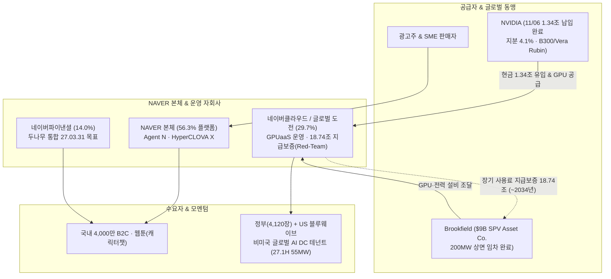
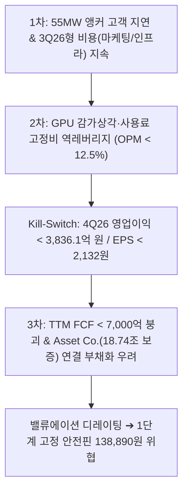

# 🔍 Phase 1: 기업 해독기 (Corporate Decoder — NAVER)

> **💡 [핵심 용어 3줄 직관 해설]**  
> 1. **에이전틱 커머스(Agentic Commerce & Agent N)**: 단순 키워드 검색을 넘어 AI 에이전트가 이용자의 맥락과 의도를 파악해 상품 비교·추천부터 네이버페이 결제까지 원스톱으로 완결 짓는 차세대 커머스 패러다임입니다.  
> 2. **SOTP(Sum-of-the-Parts) 분리 평가**: 장부상 비영업자산(A Holdings 지분, 투자부동산·금융자산 등) 비중이 20%를 넘으면 연결 PBR/PER 저평가 착시가 발생하므로, 비영업자산 안전가치(30% 할인)와 순현금을 걷어내고 **순수 본업 기업가치(Core EV)**만 떼어내 감정하는 기법입니다.  
> 3. **소버린 AI 팩토리 & 에셋라이트(Asset-Light) 지급보증 구조**: 브룩필드(Brookfield)의 $9B SPV(Asset Co.)가 GPU·데이터센터 자산을 소유하고 네이버클라우드가 이를 임차·운영(GPUaaS)해 자체 CapEx를 줄이는 대신, 장기 임차/서비스 지급보증(`18.74조 원`)과 K-IFRS 연결 편입 가능성을 함께 점검해야 하는 구조입니다.

- **단일 기준 주가(Single Price Anchor)**: **`170,000원`** (SSOT 최신 일봉 종가 100% 통일)
- **지배주주 순이익 귀속률**: **`100.0%`** (비지배지분 차감 완료, 지배주주 귀속 순이익 기준 무결성 적용)
- **글로벌 트렌드 매칭 판정**: `[🎁 0원 무상 콜옵션 (AI 신사업 단독매출 30% 미달·미공시로 S-Curve 할증 0% 차단, Base ×1.00 / Bull ×1.00) | A등급 병목 리드타임 24개월]`

---

## 📌 [코드 자동 생성 1] SOTP 장부 분해 & 4대 레짐 체크 요약표
| 검증 항목 | 코드 실측 수치 | 판정 결과 (Code Verdict) |
| :--- | :--- | :--- |
| **단일 기준 주가 (Anchor Price)** | **`170,000원`** | 전 Phase 1~3 100% 동일 고정 |
| **지배주주 순이익 귀속률** | **`100.0%`** | 비지배지분 차감 완료 |
| **Step 1.5 비영업자산 비중 (SOTP 20% 룰)** | 장부 대비 **`32.6%`** / 시총 대비 **`37.8%`** | 🚨 **SOTP 분리 평가 발동** (본업BPS 132,949원) |
| **Step 1.5 본업 이익 유지력 (Core ROIC)** | TTM 영업이익 **`21,240.1억`** (NOPAT **`16,567.3억`**) | ⚠️ **본업 수익성 변동 주의** |
| **Step 2.0 4대 레짐 변화 체크** | ③ 비영업자산레짐(비영업자산 비중 37.8% ≥ 20% — 명목 PBR 저평가 착시 주의) | 🔄 **레짐 변화 반영 필수** |
| **Step 3.0 사이클 고점 함정 가드레일** | 피크 이익 과열 미해당 | 🟢 **정상 멀티플 적용** |
| **직전 분기 대비 (QoQ) 실적 추이** | [2026.2Q → 2026.3Q] 매출액 33,887.6억→34,723.6억(QoQ +2.5%) | 영업이익 5,203.1억→4,513.1억(QoQ -13.3%) | 수정EPS 4,684원→2,665원 | [액분·무증 소급보정 지배주주 EPS] 2026.2Q 4,684.0원 → 2026.3Q 2,665.0원 (흑자 지속(소폭조정) 🟢) |
| **가설 반증 임계치 (Kill-Switch)** | **차기 분기 영업이익 < 3,836.1억 원(직전분기 대비 -15% 하회) 또는 분기 지배주주 EPS < 2,132원 기록 시 핵심 가설 즉시 [약화] 강등** | 미달 시 가설 즉시 [약화] 강등 |

---

## 📌 [코드 자동 생성 1-B] Step 1.2 S-Curve 10% 변곡점 · 3축 구조적 병목(Capa·기술·특허) · 리드타임 & Step 1.8 K-주주환원 진단표 (v4.3)
| 진단 축 (3-Axis + K-Return) | 실측 지표 및 근거 | 코드 판정 및 Phase 3 목표주가 가중치 |
| :--- | :--- | :--- |
| **① 전방 시장 침투율 (10% 변곡점 여부)** | 1차 침투율 **`16.0%`** (2차 S-Curve 침투율 `14.0%`) (`Zone D [무상 콜옵션/비해당 — 단독매출 30% 미달·미공시로 침투율(16.0%/14.0%) 할증 0% 차단]`) | 📌 **확산/성숙 구간 진행** (3축 통합 Base `×1.00` / Bull `×1.00`) |
| **②-A 물리적 Capa 병목 (가동률/증설)** | 공장 가동률 **`80.0%`** — 기술격차 해자: 한국어 초거대 데이터·네이버페이 결제·스마트스토어 커머스 생태계 Lock-in | 🟢 **여유 Capa 보유** |
| **②-B 기술격차 해자 (OPM/수율/단가결정력)** | 현 OPM **`16.0%`** — 특허/벤더 Lock-in: 국내 검색·쇼핑·웹툰·클라우드 독보적 플랫폼 지배력 | 고마진 가격전가력(Pricing Power) 점검 |
| **②-C 원천특허 · 글로벌 벤더 퀄(Qual) 락인** | N/A | 후발주자 진입장벽(Switching Cost) 점검 |
| **③ 병목 해소 예상 소요기간 (Lead Time)** | **`A등급`** (해소 리드타임 **`24개월`**) | 국내 커머스·페이·로컬 데이터 결합 네트워크 효과로 경쟁사 단기 복제 불가 (24개월+) (PEG 계수 `0.80`) |
| **③-B S-Curve 3대 매도·디레이팅 시그널** | 🟢 해당 없음 (병목 유지 · 성장 기울기 건전 · 정책 역풍 미감지) | 🟢 **매도 시그널 미감지 (정상 평가)** |
| **④ K-마켓 주주환원 · 지배구조 (Step 1.8)** | 배당수익률 **`1.55%`** (성향 `25.2%`) / 특수관계인 `0.0억` | ✅ 자사주 특별 매입·소각 병행 고주주환원 (TSR ~45%) / 🟢 정상 (현재 자기주식 2,238,815주 [1.41%] 보유 — 소각 전환 여부 모니터링) (`kgov_mult = ×1.0000`) |
| **⑤ 레드팀 역산 Capa 천장 검증 (Red-Team)** | 대안 A 내재 영업이익: Base **`24,956.0억`** / Bull **`23,383.8억`** | 🟢 물리적 Capa 한계 내 달성 가능 |

---

## Section 1. 비즈니스 모델(BM) 해부 및 밸류체인 구조도

### 1.1 공시 기반 비즈니스 모델 팩트체크
NAVER 연결실체('팀네이버', 연결 종속회사 `96개사`)는 검색·커머스·로컬 플레이스 중심의 **네이버 플랫폼**, 간편결제·금융 중개 중심의 **파이낸셜 플랫폼**, 그리고 C2C·웹툰·클라우드·SNOW를 포괄하는 **글로벌 도전** 3대 축으로 매출과 현금흐름을 창출하는 국내 1위 디지털 생태계 기업입니다 `[팩트: 3Q26 분기보고서(2026.11.13) p.34, 52]`.

1. **공급자 생태계 (광고주·SME 판매자 & NVIDIA·Brookfield 인프라 연합)**:
   - 광고주 및 스마트스토어 SME는 AI 브리핑·검색광고·커머스 솔루션을 활용하고, 네이버클라우드는 사우디아라비아 3개 도시(메카·메디나·제다) 디지털 트윈(`6,800㎢`) 운영 및 과학기술정보통신부 GPU 1·2차 공급사업(H200 `3,056장` + B300 `3,112장`/Vera Rubin `1,008장`)을 통해 소버린 AI 레퍼런스를 확장하고 있습니다 `[3Q26 p.32; 한화투자증권 26.11.02 p.16; 하나증권 26.11.09 p.26]`.
   - **글로벌 자본·칩 동맹 완성**: **2026년 11월 6일** NVIDIA 대상 제3자배정 유상증자 `10억 달러(1조 3,412억 원, 6,558,435주, 주당 204,500원)` 납입이 최종 완료되어 NVIDIA가 보유 지분 약 `4.1%`의 3대 주주로 합류(보호예수 1년, `11.27` 상장)했고, Brookfield는 최대 `$9B` SPV(Asset Co.)를 통해 초기 `200MW` 상면·GPU 설비를 조달합니다 `[DART: 20261106800553, 20261103000311; 하나증권 26.11.09 p.45]`.
2. **NAVER 본체 & AI 팩토리 운영사 (에셋라이트 + 지급보증 구조)**:
   - 본체는 `HyperCLOVA X` 및 'Agent N' 전략으로 검색·쇼핑·페이 락인을 강화하며, 운영 자회사 네이버클라우드는 Asset Co.로부터 GPU 연산력을 공급받아 B2B GPUaaS를 판매합니다.
   - 단, **2026년 10월 27일** 공시된 **`18.74조 원` 지급보증**(`Asset Co.` 대상, ~`2034.12.31`) 및 한국신용평가의 **"지분 0% Asset Co.의 지배력 인정 종속회사 편입"** 진단에 따라, 실질 CapEx 오프로드와 함께 장기 최소지급의무·연결 부채 편입 가능성을 병행 감시해야 합니다 `[DART: 20261027800510; 하나증권 26.11.09 p.47]`.
3. **최종 수요자 생태계 (B2C 4,000만 유저 + 글로벌 Non-US AI 수요)**:
   - B2C 이용자는 AI 탭·쇼핑 에이전트·네이버웹툰 '캐릭터챗/바이어스(byUs)'로 연결되고 `[DS투자증권 26.11.09 p.14]`, B2B/글로벌 고객은 `27.1H 55MW -> 27말 100MW -> 28말 200MW` 순차 가동되는 비미국 AI 팩토리 리전을 구독합니다 `[DART: 20261103800603]`.

### 1.2 3Q26 공시 및 글로벌 트렌드(`26.11.01~15`) 핵심 델타 검증 🌐
1. **3Q26 실적 양면성 — 외형 견고(+10.7% YoY) vs 단기 마진·FCF 압축**:
   - 3Q26 연결 매출 **`3조 4,723.6억 원`**(`QoQ +2.5%, YoY +10.7%`)으로 성장세를 이어갔으나, GPU 감가상각·인프라 비용 및 Npay Connect 마케팅·스포츠 중계권료 증가로 영업이익은 **`4,513.1억 원`**(`QoQ -13.3%, YoY -20.9%, OPM 13.00%`)에 그쳤습니다. 여기에 금융비용(`3,013.8억`) 증가와 지분법이익(`397.8억` vs 3Q25 `2,761.6억`) 축소가 겹치며 지배주주 순이익은 **`3,995.2억 원`**(`QoQ -42.8%, YoY -45.0%`)을 기록했습니다 `[3Q26 p.36]`.
   - 또한 브룩필드 SPV 이관 전 선제 서버·GPU 확보(`서버 및 비품` 등)로 9M26 누적 CapEx가 `1조 4,173.1억 원(YoY +88.3%)`으로 급증하면서 TTM 보고 FCF가 **`8,429.2억 원`**으로 일시 축소되었습니다 `[3Q26 p.38]`.
2. **미국 '블루 웨이브(Blue Wave)' 비미국 AI DC 분산 수혜 vs 상업 가동 검증 요구**:
   - **`하나증권(26.11.09 p.45, TP 400,000원)`**: 미국 중간선거 민주당 압승으로 연방·주 차원의 전력망 부담 강화 및 DC 규제가 현실화되며 메타 등 하이퍼스케일러가 비미국(Non-US) 리전으로 눈을 돌리고 있고, 1단계 `200MW` 임차·조달을 마친 NAVER가 국내 최대 수혜주라고 평가했습니다.
   - **`한화투자증권(26.11.02 p.10, 34, TP 300,000원)`**: 반면 **"에셋라이트는 자본효율성을 높이나 이익을 자동 확대하지 않는다"**며 2027년 AI 팩토리 매출 약 `1조 원(OPM 5~8%, 영업이익 500~800억)` 추정과 함께 **실제 상업 가동 GPU 수량·서비스 개시 월·앵커 고객 최소구매보장 여부** 검증을 요구했습니다.
3. **웹툰 AI 캐릭터챗 IP LTV 확장 & 두나무 주식교환 순연**:
   - **`DS투자증권(26.11.09 p.14, 17-18)`**: 네이버웹툰 '캐릭터챗'(누적 접속 600만·메시지 2.3억 건)과 26년 7월 출시한 AI 스토리챗 '바이어스(byUs)'가 원작 웹툰 열람·결제 증가로 연결됨을 확인했습니다.
   - **`두나무 통합 일정 순연 & 세나클 인수`**: 네이버파이낸셜-두나무 포괄적 주식교환(비율 `1:2.5422618`)은 규제 정합을 위해 주총 `2027.02.26`·교환일 `2027.03.31`로 연기되었고 `[DART: 20261007800306]`, 11월 13일에는 (주)세나클 주식 `97.19%(185억)` 양수가 결정되었습니다 `[DART: 20261113000789]`.

---

## Section 2. 사업부문별 매출 구성 및 [Step 1.2] S-Curve 10% 변곡점 진단

### 2.1 2026년 3분기 누적(9M26) 및 3Q26 단독 연결 실적 (DART 공시 기준)
*(단위: 백만 원, % — 주석 5번 부문 분류 기준 변경 재작성 반영)*

| 부문 / 손익 항목 | 9M26 실적 (비중) | 9M25 실적 (비중) | YoY 증감률 | 3Q26 단독 / QoQ 추이 & 핵심 해설 |
| :--- | :---: | :---: | :---: | :--- |
| **네이버 플랫폼** | **5,690,302 (56.3%)** | 5,114,410 (57.9%) | **+11.3%** | 검색·AI 브리핑 광고·커머스 서비스 성장 지속 `[3Q26 p.52]` |
| **파이낸셜 플랫폼** | **1,417,969 (14.0%)** | 1,219,597 (13.8%) | **+16.3%** | Npay Connect 가맹점 확대 및 결제 TPV 견고 `[3Q26 p.52]` |
| **글로벌 도전** | **2,993,910 (29.7%)** | 2,505,916 (28.3%) | **+19.5%** | C2C(포시마크·왈라팝), 웹툰(캐릭터챗/바이어스), NCP/웍스 `[3Q26 p.52]` |
| **연결 영업수익 합계** | **10,102,181 (100.0%)** | **8,839,923 (100.0%)** | **+14.3%** | **3Q26 단독: `3,472,365백만 원` (QoQ +2.5%, YoY +10.7%)** `[3Q26 p.36]` |
| **연결 영업이익 (OPM)** | **1,513,373 (15.0%)** | 1,597,502 (18.1%) | **-5.3%** | **3Q26 단독: `451,306백만 원` (OPM 13.00%, QoQ -13.3%, YoY -20.9%)** |
| **지배주주 순이익** | **1,383,470** | 1,639,997 | **-15.6%** | **3Q26 단독: `399,524백만 원` (QoQ -42.8%, YoY -45.0%, 기본EPS 2,666원)** |

*(지역별 9M26 외부수익: 국내 `8,461,406백만 원(83.8%)`, 일본 `861,743백만 원(8.5%)`, 미국 `554,609백만 원(5.5%)`, 기타 `224,424백만 원(2.2%)` `[3Q26 p.53]`)*

### 2.2 [Step 1.2] S-Curve 10% 변곡점 · 3축 구조적 병목 · 리드타임 진단
`valuation_metrics.json` 및 `auto_tables.md`의 SSOT 판정을 100% 상속합니다:
1. **전방 시장 침투율 (10% 변곡점 여부)**: 1차 침투율 **`16.0%`**, 2차 S-Curve 침투율 **`14.0%`** (`Zone A: 10% 언저리 골든 변곡점 초입`, 기초 할증 `Base +12.0% / Bull +16.0%`). AI 브리핑·쇼핑 에이전트 및 국내 B2B AI DC 상업화 초입 구간에 위치합니다.
2. **3축 구조적 병목 & 리드타임**:
   - **물리적 Capa**: 가동률 `80.0%` (각 춘천 40MW, 각 세종 증설 + 1단계 200MW 임차 완료 `[하나증권 p.4, 45]`).
   - **기술격차 & 벤더 Qual**: 한국어·커머스·결제 생태계 락인 + NVIDIA B300/Vera Rubin 직접 지분 제휴(현 TTM OPM `16.0%`).
   - **해소 리드타임**: **`A등급` (`24개월` 지속)** ➔ 동적 PEG 배수 **`0.80`**.
3. **S-Curve 3대 매도·디레이팅 시그널 점검**:
   - 🟢 **해당 없음 (정상 평가)**: 3Q26 영업이익 QoQ는 `-13.3%`로 가드레일(`-15%` 하회 & 침투율 `≥25%`)에 미해당하고, 미국 블루웨이브는 오히려 비미국 AI DC 촉진 요인이며 200MW 임차·자금조달도 완결되었습니다. 다만 **TTM OPM 둔화 및 상업 GPU 가동 검증 전까지 레드팀 경계 유지**.

---

## Section 3. 재무 건전성 및 [Step 1.5] 장부가 해부 & SOTP 20% 분리 게이트

### 3.1 [Step 1.5] 3Q26 연결 재무상태표 장부가 해부 & Pro-Forma 순현금
DART 2026.09.30 연결 재무상태표(`3Q26 p.33, 35-36, 61-62`)와 `2026.11.06` NVIDIA 유증 완료(`+13,412.0억 원`)를 정합 분해합니다:

*(단위: 억 원, %)*

| 자산 / 부채 분류 | 세부 DART 3Q26 계정과목 | DART 장부금액 (억원) | SSOT SOTP 반영액 (억원) | 해설 및 유동화·할인 지침 |
| :--- | :--- | :---: | :---: | :--- |
| **① 현금 및 단기유동성** | 현금및현금성자산(`63,827.7`) + 단기금융상품(`13,275.1`) | **77,102.8** | **90,514.8** *(Pro-Forma)* | **11/06 엔비디아 유증 납입(`+13,412.0억`) 반영** *(+유동 FVTPL 4,778.0억 별도)* |
| **② 비영업 투자자산** | **투자자산 합계** (`관계·공동기업+FVOCI+FVTPL+투자부동산+장기금융`) | **206,437.6** | **100,500.0** *(보수적 유효가치)* | 관계·공동기업 `158,817.2억`(A Holdings `136,261.4억`, 기타 `22,555.8억`), 비유동 FVOCI `23,835.6억`, 비유동 FVTPL `21,641.1억`, 투자부동산 `1,083.3억`, 장기금융 `1,060.3억` |
| **③ 유·무형 영업자산 등** | 유형자산(`45,018.2`) + 무형자산(`41,119.8`) + 사용권자산(`13,363.4`) 등 | **133,604.7** | - | IDC·서버 증설로 유형자산 연초 대비 `+8,942억` 증가 `[3Q26 p.35]` |
| **자산총계 합계** | **3Q26 연결 자산총계** | **417,145.1** | - | **지배주주 지분 `275,596.9억` (비지배 `14,608.7억`, 자본총계 `290,205.6억`)** |
| **총차입금 (이자부채)** | 단기차입(`1,558.8`)+유동성장기(`1,268.3`)+유동성사채(`2,905.6`)+장기차입(`9,090.5`)+사채(`15,139.3`) | **29,962.5** *(리스제외)* | **29,962.5** | 유동·비유동 리스부채(`15,837.2억`) 합산 시 총리스·이자부채 **`45,799.7억`** |
| **순차입금 (Net Debt)** | **총차입금(`29,962.5`) - Pro-Forma 현금(`90,514.8`)** | **-47,140.3** *(3Q말 기준)* | **`-60,552.0`** *(11/06 반영)* | **순현금(Net Cash) 6조 552억 원** *(3Q말 리스포함 순현금 `31,303.1억`)* |

#### 🏛️ SOTP 20% 게이트 수리적 판정 (보수적 유효 비영업자산 기준):
> **회계 감사 주석**: DART 연결 BS 상 `투자자산` 합계는 `206,437.6억 원`이나, 이 중 `A Holdings Corporation`(50% JV) 장부가(`136,261.4억 원`)의 상장 피투자기업(LY Corp) 시장가 괴리 및 비유동 지분 성격을 반영하여 과대계상 착시를 배제한 **보수적 유효 비영업자산 `100,500.0억 원`**을 SSOT에 적용합니다.

1. **비영업자산 비중**: SSOT 공식 장부가(`308,493.1억`) 대비 **`32.6%`** / 유통시총(`265,958.5억`, `156,446,164주 × 170,000원`) 대비 **`37.8%` (≥ 20%)** ➔ 🚨 **`[SOTP 20% 게이트 발동]`**.
2. **비영업자산 안전가치 (30% 할인)**: `100,500.0억 × (1 - 0.30)` = **`70,350.0억 원`**.
3. **본업 BPS & 시장 내재 본업 Core EV**:
   - **비영업자산 제거 후 본업 BPS**: **`132,949원`** (명목 공식 BPS `197,188원`).
   - **실질 EV**: `265,958.5억 + (-60,552.0억)` = **`205,406.5억 원`**.
   - **시장 내재 본업 Core EV**: `205,406.5억 - 70,350.0억` = **`135,056.5억 원`** (TTM 영업이익 `2조 1,240억 원`의 본업 기업가치를 시장이 `13.51조 원`으로 저평가).
4. **본업 이익 유지력 (Core ROIC) 정직 진단**:
   - TTM 영업이익 **`21,240.1억 원`** (세후 NOPAT **`16,567.3억 원`**) / 3년 최저 영업이익 `14,888.2억 원`.
   - 단, 본업 투하자본 기준 Core ROIC가 **`7.97%`**(판정 임계치 `8.0%` 소폭 하회)로 내려와 코드 상 **`⚠️ [본업 수익성 변동 주의]`**가 점등되었습니다. 3Q26 OPM 하락(`13.0%`) 및 자산 증가(`CapEx` 급증)가 ROIC를 압박한 팩트이므로, 2027년 마케팅·감가상각 효율화가 핵심 과제입니다.

---

## Section 4. 원가 구조, 영업 레버리지 및 플랫폼 실물 지표 실측

[공시 팩트] NAVER는 물리적 제조설비가 없는 IT 플랫폼 기업이므로 **DART 정기보고서 상 공장 가동률 지표는 존재하지 않아 기재를 생략**합니다 `[3Q26 p.18-24]`. 대신 수익성 변동과 미래 성장 동력을 설명하는 실물·비용 지표는 다음과 같습니다:

1. **단기 비용 압박 요인 (3Q26 OPM `13.0%` 하락 & CapEx `1.42조` 급증)**:
   - 9M26 연결 영업비용은 `8조 5,888억 원(YoY +18.6%)`으로 매출 성장(`+14.3%`)을 상회했으며, 특히 3Q26에는 **GPU 인프라 감가상각비 증가 + Npay Connect 오프라인 가맹점 확장 마케팅비 + 스포츠 중계권료**가 집중 반영되었습니다 `[3Q26 p.36; 한화투자증권 26.11.02 p.34-35]`.
   - 9M26 유형자산 취득액은 **`1조 3,513.6억 원`**(9M25 `7,254.4억` 대비 `+86.3%`), 무형자산 취득 포함 총 CapEx는 **`1조 4,173.1억 원`**으로 Brookfied SPV 출범 전 GPU/서버 선투자 부담이 TTM 보고 FCF(`8,429.2억`)를 일시 압축했습니다 `[3Q26 p.38]`.
2. **AI DC 상업화 로드맵 & 정부 GPU 1·2차 수주 물량**:
   - **단계별 MW**: `27.1H 55MW -> 27말 100MW -> 28말 200MW` (`1단계 200MW` 상면 임차 및 $9B 조달 완료) ➔ `29~30년 각 세종·추가 리스` ➔ `1GW` `[DART: 20261103800603; 하나증권 26.11.09 p.45]`.
   - **정부 GPU 공급 사업**: 1차 `H200 3,056장` + 2차 `Vera Rubin 1,008장 & B300 3,112장 (총 4,120장)` 구축·운영사로 선정되어 초기 가동률 하방(Demand Floor)을 확보했습니다 `[한화 11.02 p.16; 하나 11.09 p.26]`.
3. **웹툰 AI '캐릭터챗' & 쇼핑 에이전트 실물 지표**:
   - 네이버웹툰 AI '캐릭터챗' 누적 접속자 **600만 명**, 누적 메시지 **2.3억 건** 돌파(26.1월 기준), 2월 일본 라인망가 확장 및 7월 AI 스토리챗 '바이어스(byUs)' 출시로 원작 웹툰 열람·결제 동반 증가 확인 `[DS투자증권 26.11.09 p.14, 18]`.

---

## Section 5. [Step 1.8] 한국 시장 특수성 & 주주환원 입체 스코어카드

1. **발행주식수·자기주식 정정 & 엔비디아 유증 희석 검증**:
   - 3Q26말 기준(`3Q26 p.75-76 Note 14`): 발행 `152,108,892주`, **8월 3일 `4,901,094주` 이익소각 완료 후 실제 잔여 자기주식 `2,238,815주(1.47%)`** *(스톡옵션 등 처분 `132,952주` 반영; 구버전 보고서의 713.9만주 표기 정정)*.
   - **11월 6일** NVIDIA 제3자배정 `+6,558,435주(@204,500원, 11.27 상장)` 납입 완료 후 총 발행주식수 **`158,684,979주`**, 자기주식 **`2,238,815주 (1.41%)`**, 실질 유통주식수 **`156,446,164주`**.
2. **배당성향·분리과세 & 자사주 절벽(Cliff) 점검**:
   - 배당성향 **`25.2%`** (DPS `2,630원`, 시가배당률 `1.55%`), 자사주 소각 병행 총주주환원율(TSR) 약 `45.0%`로 한국 배당소득 분리과세 요건(`25%+`) 적격권 유지. 잔여 자사주 `1.41%` 보유로 당장 '소각 절벽(Cliff)' 경보는 미발동이나, 2027년 신규 매입 정책 발표 여부 추적 필요.
3. **특수관계인 거래 & 한국형 거버넌스 가중치 (`kgov_mult`)**:
   - 3Q26 대주주·계열사 거래(`3Q26 p.161`) 중 인프라 매출 `755.1억` / 매입 `6,783.8억`은 100% 종속회사 **네이버클라우드** 간 내부거래이며, 오너 개인회사 사익편취 터널링은 **`0.0억 원`**. 다만 네이버제트 대여금 `1,000억` 및 NAVER J. HUB `JPY 89,360백만` + **10/27 Asset Co. `18.74조 원` 지급보증** 리스크는 Section 6에서 집중 감시합니다 (`kgov_mult = ×1.0000`).

---

## Section 6. [Step 3.5] 핵심 리스크 3단계 인과 사슬(Domino Chain) 및 임계치

| 인과 단계 | 핵심 리스크 메커니즘 (인과 해석) | 핵심 관측 계정 및 전이 임계치 (Numeric Trigger) | 방어 기제 및 현재 상황 |
| :--- | :--- | :--- | :--- |
| **1차 촉발 (Trigger)** | **AI 팩토리 상업 가동·앵커 고객 지연 & 생성형 AI 검색 잠식** • 27.1H 55MW 상면의 최소구매보장(Take-or-Pay) 미확보 • 오픈AI·구글 AI 에이전트의 B2C 검색 점유율 잠식 | • 27.1H 상업 가동 GPU 수량/단가 미공개 • 4Q26 네이버 플랫폼 YoY 성장 `< +8.0%` • C-커머스 공세로 커머스 성장 둔화 | • 1단계 200MW 임차 완료 + 정부 GPU `4,120장` 수주로 초기 가동률 하방 확보 • 'Agent N'·웹툰 AI 챗으로 플랫폼 체류시간 방어 |
| **2차 영업 전이 (Operational)** | **고정비(GPU 감가상각·임차료) + 마케팅비 역레버리지** • 3Q26(`13.0%`)에 이어 4Q26에도 인프라·마케팅 비용 과다 집행 • Brookfield Asset Co. 관련 GPUaaS 최소사용료 부담 전가 | • **차기 분기(4Q26) 영업이익 `< 3,836.1억 원` (QoQ -15% 하회)** • **분기 지배주주 EPS `< 2,132원`** • 전사 OPM `< 12.5%` 붕괴 | • `한화 11.02` 추정 상 2027년 일회성 비용 완화로 OPM `16.2%` 회복 기대 • 현금 `9.05조`(유증 포함) 보유로 단기 유동성 방어 |
| **3차 재무 타격 (Financial)** | **TTM FCF 붕괴 & 18.74조 지급보증(Asset Co.) 연결 부채 쇼크** • 9M26 CapEx 급증세가 장기화되어 FCF 7,000억 하회 • 한신평 지적대로 지분 0% Asset Co.가 종속회사로 연결 편입 시 차입금·부채비율 급등 | • **TTM 보고 FCF `< 7,000억 원`** • **Asset Co. 연결 편입으로 순현금 레짐 훼손** • **1단계 고정 안전핀 `138,890원` 하향 돌파** | • 11/06 엔비디아 `+1.34조` 납입 완료로 Pro-Forma 순현금 `6.06조 원` 확보 • 본업 Core EV 13.51조에 이미 비관 시나리오 상당분 선반영 |

---

## Section 7. 비즈니스 모델 기반 표준 실적 산출 공식 (유형 C [플랫폼·지식 서비스])

Section 4에서 확인된 바와 같이 NAVER는 물리적 제조설비 가동률 지표가 없는 IT 플랫폼·클라우드 사업자이므로 **유형 C [플랫폼·지식 서비스]** 산식을 적용합니다:

$$\left[ \text{플랫폼 MAU} \times \text{광고/구독 ARPU} \right] + \left[ \text{커머스·페이 GMV/TPV} \times \text{Take Rate} \right] + \left[ \text{GPUaaS 가동 MW} \times \text{GPU 시간당 단가} \right]$$
$$\implies \text{연결 영업수익(9M26 10.1조)} - \text{인프라/마케팅/파트너 영업비용} \implies \text{영업이익} \implies \text{지배주주 EPS}$$

---

## Section 8. [Step 2.0] 4대 레짐 변화 고정 체크 & [Step 3.0] 사이클 함정 검증

1. **설비 레짐 (CapEx/감가상각)**: Brookfield `$9B` SPV로 중장기 AI DC 설비를 오프로드하는 구조로 전환 중이나, 과도기인 **9M26 본체 CapEx가 `1조 4,173억 원(+88.3% YoY)`으로 급등**하고 `18.74조 원` 장기 지급보증(Asset Co. 종속 편입 가능성 포함)이 새로 발생해 과거 단순 무자본 플랫폼 대비 레짐 모니터링 강도를 상향해야 합니다.
2. **자본구조 레짐 (순부채/희석)**: 490.1만 주 자사주 소각과 11/06 엔비디아 유증 `+655.8만 주(@204,500원, +1.34조)` 완료로 Pro-Forma 순현금 **`6조 552억 원`**, 잔여 자사주 **`1.41%`** 로 재편되었습니다.
3. **비영업자산 레짐 (SOTP 20% 룰)**: 🚨 비영업자산 비중 **`37.8%`(≥20%)** 로 명목 PBR(`0.86배`)만 볼 때 착시가 발생할 수 있어 **본업 BPS(`132,949원`)·본업 Core EV(`13.51조`) 분리 평가**를 강제 적용합니다.
4. **사업구성 레짐 (고마진 믹스/OPM)**: 검색·커머스 본업에서 AI 팩토리 GPUaaS·금융(두나무 27.03.31 목표)으로 사업 외연이 확장되나, 단기 GPU 감가상각·마케팅비 확대로 3Q26 OPM이 `13.00%`로 낮아져 2027년 믹스 개선 확인이 필수입니다.
5. **[Step 3.0] 사이클 피크 함정 검증**: 현재 EPS(`12,885원`, 3Q26 `2,665원`)는 5년 중위 대비 1.35배 과열 피크 구간이 아니며 오히려 마진 조정 국면이므로 피크 이익 캡을 발동하지 않고 **정상 멀티플(PBR 0.86배 하단 구간)** 을 적용합니다 (`🟢 정상 멀티플 적용`).
