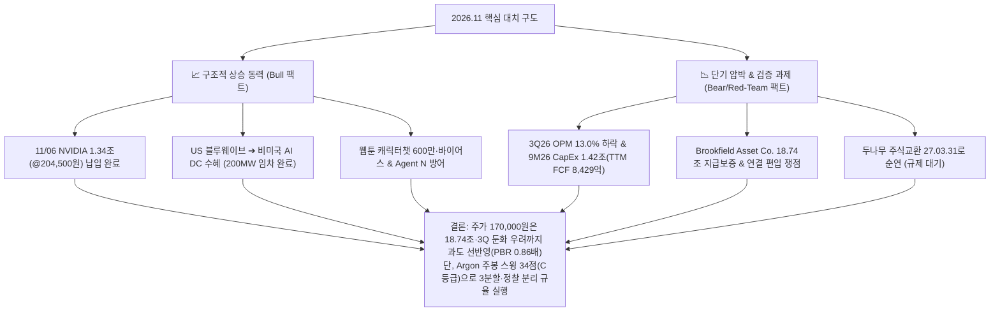

# 📖 Phase 2: 스토리 리더 (Global & Weekly 트렌드 공시 팩트체크 — v5.1)

> **[파이프라인 SSOT 단일 기준 주가]**: **`170,000원`** (SSOT 최신 일봉 종가 / 공식 BPS 197,188원 대비 PBR 0.86배, PER 13.19배)  
> **[지배주주 순이익 귀속률]**: **`100.0%`** (비지배지분 차감 완료, 지배주주 귀속 무결성 100% 적용)  
> **[S-Curve 글로벌 침투율]**: **`16.0%` (2차 침투율 `14.0%`)** (단독 매출 30% 미달·미공시로 S-Curve 할증 0% 무상 콜옵션 적용 / A등급 병목 리드타임 24개월 지속)  
> **[Step 1.5 SOTP 20% 분리 평가]**: **`🚨 발동 (비영업자산 비중 37.8%)`** (비영업자산 안전가치 7.04조, 시장 내재 본업 Core EV 13.51조, Pro-Forma 순현금 6.06조)

---

## 1. Global 산업 사이클 및 테마 검증

### [글로벌 사이클 1: 미국 '블루 웨이브(Blue Wave)' 비미국 AI DC 분산 수혜 vs 3Q26 마진·FCF 압축 & 에셋라이트 실행 검증론]

[시장 내러티브]  
시장은 한편에서는 엔비디아 10억 달러 지분투자와 브룩필드 `$9B` SPV 계약을 '한국판 Stargate' 도약으로 열광하지만, 다른 한편에서는 **① 3Q26 영업이익 QoQ `-13.3%`(OPM `13.0%`)·TTM 보고 FCF 급감(`8,429억`)**, **② `18.74조 원` 지급보증에 따른 실제 가동률·부채 부담**, **③ 에셋라이트 구조의 실제 수익성 검증 필요성** 때문에 주가가 엔비디아 납입가(`204,500원`)를 `-16.9%` 하회하는 `170,000원`에 갇혀 있습니다.

- **핵심 전제(Key Assumption):**  
  1. 미국 내 AI DC 규제(Blue Wave)가 한국 등 비미국 리전의 실제 GPUaaS 수주로 이어지는가?  
  2. 3Q26의 마진 하락(`13.0%`)과 9M26 CapEx 급증(`1.42조`)이 구조적 수익성 훼손인가, 일시적 선투자·마케팅 구간인가?  
  3. 브룩필드 Asset Co. 기반 에셋라이트 사업이 계획대로 이익을 창출하는가, 아니면 지급보증(`18.74조`)·종속 편입 부채 리스크만 남기는가?
- **공시 & 글로벌 트렌드(`26.11.01~15`) 교차 팩트체크 (No-Blind-Citation):**  
  1. **[공시 완료] 2026.11.06 엔비디아 1조 3,412억 원 납입 완결 & 단계별 MW 로드맵 확정**:
     - NVIDIA 제3자배정 유상증자 `6,558,435주(@204,500원, 1조 3,412억 원)`가 11월 6일 납입 완료되어 NVIDIA가 보유 지분 `4.1%`로 3대 주주에 올랐습니다 `[DART: 20261106800553; 하나증권 26.11.09 p.45]`.
     - `2026.11.03` 정정된 장래사업계획에 따라 `27.1H 55MW -> 27말 100MW -> 28말 200MW` 1단계 상면 임차와 Brookfield `$9B` 자금조달은 이미 완료되었습니다 `[DART: 20261103800603; 하나증권 26.11.09 p.45]`.
  2. **[강세 축: 하나증권 26.11.09 p.4, 7, 9, 25-26, 45, TP 400,000원] 미국 '블루 웨이브' 비미국 AI DC 최대 수혜**:
     - 미국 중간선거 민주당 압승으로 전력망 비용 사업자 전가 및 세제·건설 규제가 강화되면서 메타 등 하이퍼스케일러가 미국 외 AI DC 분산 구축을 검토하기 시작했습니다. 하나증권은 ① NVIDIA GPU 공급 가시성(정부 B300/Vera Rubin `4,120장` 포함), ② Brookfield 자본 분담 구조, ③ 풀스택 클라우드 레퍼런스를 근거로 NAVER를 인터넷 Top Pick(27F 영업이익 `2조 7,181억 원`)으로 제시했습니다.
  3. **[신중·검증 축: 한화투자증권 26.11.02 p.10, 16, 34-35, TP 300,000원 & 3Q26 공시] 에셋라이트 수익성 실증 과제**:
     - 한화투자증권은 **"외부자본(에셋라이트) 활용은 자본효율성을 높일 수 있으나 이익을 자동으로 확대하지 않는다"**고 짚으며, 2027년 AI 팩토리 실적을 보수적 매출 `약 1조 원(OPM 5~8%, 영업이익 500~800억 원)`으로 추정하고 **실제 상업 가동 GPU 수량·서비스 개시 월·주요 고객 최소구매보장 여부**를 핵심 검증 잣대로 제시했습니다.
     - 실제 3Q26 DART 실적도 GPU 감가상각·Npay Connect 마케팅·스포츠 중계권료로 영업이익 `4,513.1억 원(QoQ -13.3%, OPM 13.00%)`으로 둔화되었고, 9M26 CapEx `1조 4,173억 원(+88.3% YoY)` 급증으로 TTM 보고 FCF는 `8,429.2억 원`까지 압축되었습니다 `[3Q26 p.36, 38]`.
  4. **[보증·회계 축: DART 20261027800510 & 하나증권 p.47] 18.74조 지급보증과 Asset Co. 연결 편입 쟁점**:
     - 10월 27일 공시된 네이버클라우드의 `18.74조 원` GPUaaS 지급보증(~`2034.12.31`)에 대해 한국신용평가(`하나증권 p.47`)는 **"Asset Co.는 지분 0%지만 지배력 인정으로 종속회사 편입"** 구조를 지적했습니다. 즉, SPV 차입금이 향후 NAVER 연결 재무상태표에 부채로 계상될 수 있으므로 2027년 앵커 고객의 Back-to-Back 장기계약(Take-or-Pay) 확보가 절대적으로 중요합니다.
- ✅ **팩트체크 결론: [ Partially True / Two-Sided — 자금·상면 조달(1.34조+200MW)과 블루웨이브 비미국 수혜는 확실한 팩트이나, 3Q26 마진·FCF 압축 및 18.74조 지급보증 구조 때문에 2027.1H '실제 상업 GPU 가동 & 앵커 테넌트 계약' 확인 전까지는 추격매수 자제·분할매수 대응 필요 ]**

---

## 1.1 S-Curve 침투율 & 매매 타이밍 진단 매트릭스

| 진단 항목 | 정량 수치 및 상태 | 출처 및 근거 (No-Blind-Citation) |
| :--- | :--- | :--- |
| **소속 신기술 테마** | **비미국 소버린 AI 팩토리(GPUaaS) / 에이전틱 커머스 & AI 캐릭터챗** | DART 공시 및 `하나/한화/DS 26.11` |
| **현재 산업 침투율** | **1차 침투율 16.0% / 2차 침투율 14.0%** (단독매출 30% 미달 ➔ 무상 콜옵션 `0%`) | AI 검색·커머스 광고 및 AI DC 상업화 초입 |
| **3축 구조적 병목 판정** | **A등급 (해소 리드타임 24개월 지속)** | 한국어·결제·커머스 생태계 & 전력·GPU 동맹 |
| **S-Curve 3대 매도 시그널** | **🟢 해당 없음** (3Q26 OP QoQ -13.3%는 임계치 이내, 침투율 <25%, 블루웨이브 역풍 아님) | `valuation_metrics.json` SSOT 연동 |
| **S-Curve 목표가 가중치** | **Base ×1.00 (0%) / Bull ×1.00 (0%)** *(원칙 4: 단독매출 미공시로 할증 차단)* | `auto_tables.md` SSOT 연동 |
| **Argon 4.0 스윙 판정** | **`34점 (C등급)` — 🟠 한국형 C등급 단계적 진입 (3차 소량 정찰 + 1·2차 본대 분리)** | 매물벽(`248,800~262,600원`) 하단 저항 소화 구간 |
| **차기 변곡점 모니터링** | 2027.1H 55MW 상업 가동 & 앵커 고객 계약 / 2027.02.26 두나무 주총 / 4Q26 OPM 반등 | `[DART: 20261007800306, 20261103800603]` |

---

## 2. Weekly 개별 리포트 및 3Q26 시장 내러티브 검증

### [내러티브 1: "웹툰·콘텐츠 정체론" vs 네이버웹툰 AI '캐릭터챗·바이어스(byUs)' 기반 IP LTV 확장]
- **팩트 대조 (`DS투자증권 26.11.09 p.12, 14, 17-18`)**:
  - 9M26 '글로벌 도전' 부문 매출이 `2조 9,939억 원(YoY +19.5%)`을 기록한 가운데, DS투자증권은 기존 공식 IP 기반 AI 캐릭터 챗 대표 기업으로 **네이버웹툰**을 꼽았습니다.
  - 2024년 6월 출시된 '캐릭터챗'은 **2026년 1월 누적 접속자 600만 명, 누적 메시지 2억 3,000만 건**을 돌파했고, `26.2월` 일본 라인망가 확장 및 `26.7월` 원작자 승인 기반 AI 스토리챗 **'바이어스(byUs)'** 출시로 이어졌습니다. 특히 캐릭터챗 이용이 **신규 결제뿐 아니라 원작 웹툰 열람·결제 동반 증가**를 유발하며 기존 IP의 생애가치(LTV)와 ARPPU를 끌어올리고 있습니다.
- ✅ **판정: [ 단순 정체론은 과장 — AI 캐릭터 챗과 C2C·클라우드가 글로벌 도전 부문 YoY +19.5% 성장 견인 ]**

### [내러티브 2: "네이버파이낸셜-두나무 주식교환 지연 = 통합 무산 위기?" vs 법제화 대기 전략적 순연 & 세나클 인수]
- **팩트 대조 (`DART 20261007800306`, `20261113000789`)**:
  - 네이버파이낸셜과 두나무의 포괄적 주식교환(교환비율 `1 : 2.5422618`)은 임시 주총일이 `2026.11.19`에서 **`2027.02.26`**으로, 주식교환일이 `2026.12.31`에서 **`2027.03.31`**로 순연되었습니다. 이는 무산이 아니라 공정위·금융당국 인가 및 디지털자산기본법(가상자산 제도화) 정합 절차에 따른 일정 조정입니다. 단, 최종 확정 전까지 두나무 통합 시너지는 목표주가 할증에 0% 반영('0원 무상 콜옵션')합니다.
  - 한편 `2026.11.13` 네이버클라우드로부터 디지털 헬스케어 기업 **(주)세나클(`Cenacle`) 주식 97.19%(185억 원)** 양수를 결의하며 그룹 내 AI SaaS·헬스케어 사업 재편을 병행했습니다.

### [내러티브 3: "엔비디아 납입가 204,500원 vs 현 주가 170,000원 괴리" — 3Q26 실망 매물 소화 구간]
- **팩트 대조**: `11.06` NVIDIA 납입 완료 직후 `11.11` 장중 `195,500원`까지 반등했던 주가는 `11.12~13` 3Q26 영업이익(`4,513억`, QoQ `-13.3%`) 및 금융비용·FCF 둔화 실적이 확인되며 **`170,000원`**(NVIDIA 납입가 대비 `-16.9%` 할인)으로 되밀렸습니다.
- **시사점**: 엔비디아의 `1조 3,412억 원` 프리미엄 투입과 `4.901백만 주` 소각으로 재무적 바닥은 단단하나, 단기 실적 모멘텀 회복(4Q26~1Q27 OPM 반등 및 55MW 고객사 계약) 전까지는 **충동적 추격매수 없이 SSOT 분할매수 가격대에서만 대응**하는 전략이 유효합니다.

---

## 3. 사용자 투자 가설 검증 (`Weekly_Trend/thesis_log.md` v5.1 6열 표준 매트릭스)

*(SSOT: `valuation_metrics.json` 및 `auto_tables.md` 연동 — `2Q26 -> 3Q26` 실측치 및 Kill-Switch 반영)*

| 가설 ID (기록일) | 핵심 투자 가설 | 📊 직전 분기 대비 (QoQ) 실측 추이 | ✅ 확인 근거 (Bullish Fact) | 🚨 반증/약화 조건 ("이 숫자가 나오면 가설 약화/폐기") | 판정 상태 |
| :---: | :--- | :--- | :--- | :--- | :---: |
| **가설 1** (26.09.01 ➔ 26.11.14 갱신) | **AI 인프라 에셋라이트(SPV) & 자사주 소각·순현금 6.06조 안전마진 가설** | **[2Q26 ➔ 3Q26 실측]** 매출 `+2.5%`, 영업익 `-13.3%` (`4,513.1억`, OPM 13.0%), 지배EPS `-43.1%`, TTM 보고 FCF `8,429억` | • 8/3 자사주 490.1만주 소각(잔여 2,238,815주, 1.41%) & 11/06 NVDA 1.34조 유입(Pro-Forma 순현금 6.06조) • 3Q26 OP 기존 Kill-Switch(`4,422.6억`) 방어 | **4Q26 영업이익 `< 3,836.1억 원`(QoQ -15% 하회) 또는 TTM FCF `< 7,000억 원` 붕괴 시 `[약화]` 강등** *(18.74조 보증 연결 부채화 시 재평가)* | **`[부분 약화 감시]`** |
| **가설 2** (26.09.16 ➔ 26.11.14 갱신) | **AIDC 1단계 200MW 임차 완료 + US 블루웨이브 비미국 AI DC 수혜 조기 수익화 가설** | 9M26 글로벌 도전 매출 `2조 9,939억` (`YoY +19.5%`) | • `하나 11.09 p.45`: 200MW 임차·조달 완료, 블루웨이브 비미국 분산 최대 수혜(정부 GPU 4,120장 추가 수주) • `한화 11.02 p.10`: 27E AI팩토리 매출 1조 추정 | **27.1H 55MW 상업 가동 지연, 앵커 고객 최소구매보장 미체결, 또는 `18.74조` Asset Co. 부채 연결 편입 시 `[약화]` 강등** | **`[진행 중]`** |
| **가설 3** (26.09.30 ➔ 26.11.14 갱신) | **에이전틱 커머스(Agent N)·AI 브리핑 & 웹툰 캐릭터챗 IP LTV 확장 가설** | 9M26 네이버 플랫폼 매출 `5조 6,903억` (`YoY +11.3%`), 3Q26 OPM `13.0%` | • `DS 11.09 p.14, 18`: 캐릭터챗 누적 600만·메시지 2.3억 건 & 바이어스 출시로 웹툰 원작 결제 확대 • `한화 11.02 p.34`: 27E OPM 16.2% 회복 전망 | **4Q26 네이버 플랫폼 매출 YoY `< +8.0%` 둔화 또는 4Q26 연결 OPM `< 12.5%` 하락 시 `[약화]` 강등** | **`[진행 중]`** |
| **가설 4** (26.10.15 ➔ 26.11.14 갱신) | **파이낸셜·두나무 통합 및 PBR 0.86배 SOTP 극단 저평가 탈출 가설** | 9M26 파이낸셜 플랫폼 매출 `1조 4,180억` (`YoY +16.3%`) | • `DART 20261007800306`: 주총 27.02.26 / 교환일 27.03.31 조정 • 170,000원 기준 SOTP 본업 EV `13.51조` 극단 저평가 | **27.02.26 주총 전후 두나무 통합 무산 또는 4Q26 지배EPS `< 2,132원` 하회 시 `[약화]` 강등** | **`[이정표 순연]`** |
| **가설 5** (26.11.03 ➔ 26.11.14 갱신) | **엔비디아 1.34조 원 납입 완료(@204,500원) & 비미국 AI 팩토리 레버리지 가설** | 3Q26 매출 `3조 4,724억`, OP `4,513억`, 금융비용 `3,014억`으로 순익 둔화 | • `DART 20261106800553`: **11.06 1.34조 납입 100% 완료**(6,558,435주, 3대 주주) • 현 주가 170,000원은 NVDA 납입가 대비 `-16.9%` 할인 | **4Q26 영업이익 `< 3,836.1억 원` 또는 27.1H 55MW 상업 가동·외부 고객 계약 불발 시 `[약화]` 강등** | **`[유효 — 실행 검증 전환]`** |

---

## 4. `주가 = (수급 + 실적) × 기대감` 과거 10년 데이터 분해 & 4등급 기대감 테마 선별

### 4.1 국면별 3요소 분해표
*(단위: 원, 배)*

| 국면 (기간) | 주가 궤적 | 실적 요소 (Q·P·C) | 수급 요소 (외인·기관·자사주) | 기대감 멀티플 (PER/PBR) | 국면 평가 및 교훈 |
| :--- | :--- | :--- | :--- | :--- | :--- |
| **2016~2019 (모바일 포털 안착)** | 11만~18만 원 박스권 | 라인(LINE) 상장 및 검색 광고 캐시카우 견고 | 외국인 지분율 50~60% 안정적 유지 | PER 25~35배 / PBR 3~5배 | 포털 플랫폼 독점력에 따른 구조적 프리미엄 |
| **2020~2021 (팬데믹 언택트 버블)** | 13만 ➔ **452,500원 (Peak)** | 이커머스 거래액 폭증(Q) 및 네이버페이 TPV 급성장 | 유동성 폭발 속 기관·외인 쌍끌이 매수 | PER 45~55배 / PBR 6.5배 | 언택트 내러티브 과열로 피크 멀티플 함정 형성 |
| **2022~2024 (금리인상 및 빅테크 공포)** | 45만 ➔ 18만 원 급락 | 금리 인상, 포시마크 인수(비용 증가), 광고 둔화 | 외국인 지분율 35%대로 축소, 공매도 집중 | PER 15~18배 / PBR 1.2~1.5배 | 밸류에이션 디레이팅 및 플랫폼 성장 피로감 |
| **2025~2026.11 (AI 유틸리티 전환 & 단기 CapEx 소화)** | **170,000원 (바닥 다지기)** | 9M26 매출 10.1조(+14.3%) 성장 vs 3Q26 OPM 13.0%·TTM FCF 8,429억 압축 | 490.1만 주 소각 완료 + **11/06 엔비디아 1.34조(@204,500원) 납입 완료** (외인 ~35.4~36.0%) | **PER 13.19배 / PBR 0.86배** (10년 역사적 하단 Trough) | **엔비디아 현금 투입 완료에도 3Q26 마진·FCF 압축 및 18.74조 보증 경계로 기대감 억제 구간** |

### 4.2 기대감 자극 핵심 테마 4등급 선별 매트릭스
1. **👑 1순위 핵심 리레이팅 테마: '한국판 Stargate 비미국 AI Utility' (Brookfield 200MW + NVIDIA 1.34조 납입 완료 + US 블루웨이브 수혜)**
   - 자본·상면·GPU 동맹이 완결된 상태에서 미국 내 규제(Blue Wave)가 비미국 리전 수요를 자극. 단, 27.1H 55MW 상업 가동률과 앵커 고객 최소구매보장 확인이 주가 재평가의 핵심 방아쇠.
2. **🚀 2순위 차세대 S-Curve 테마: 'Agent N' 에이전틱 커머스 & 웹툰 AI '캐릭터챗 / 바이어스(byUs)'**
   - 쇼핑 AI 에이전트 및 웹툰 AI 챗(누적 600만)이 본업 트래픽 이탈을 방어하고 원작 IP LTV·ARPPU를 직접 견인 중.
3. **🎁 3순위 0원 무상 콜옵션: 네이버파이낸셜-두나무 주식교환(27.03.31 목표), 자율주행로봇(ARC/루키), NVIDIA Cosmos 디지털 월드모델, 세나클 AI 헬스케어**
   - DART 분리 매출 미공시 및 규제·일정 순연 변수로 목표주가 할증 0% 반영.
4. **❌ 4순위 가짜·소멸 테마: 메타버스 제페토(ZEPETO) 단독 테마**
   - 단독 리레이팅 동력 상실(네이버제트 대여금 1,000억 지원 수준으로 관리 대상).
