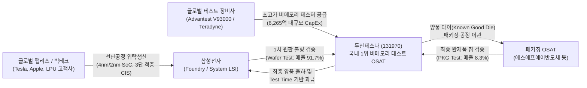
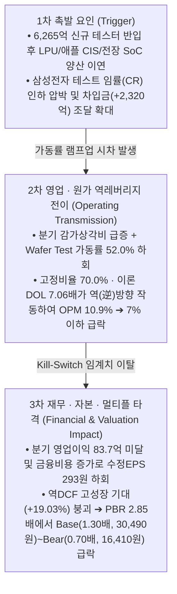
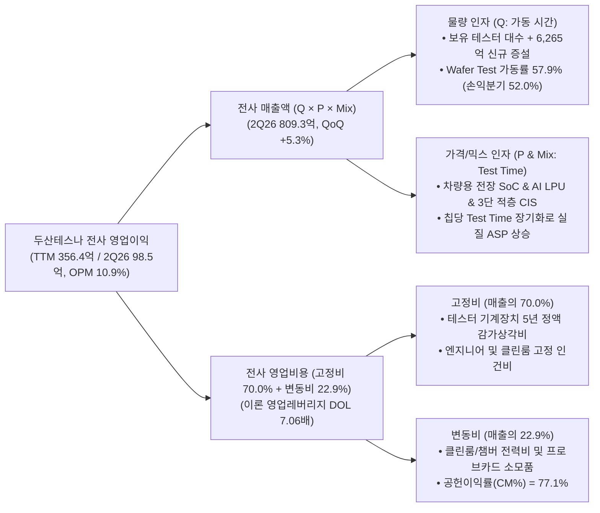

# 🔍 Phase 1: 기업 해독기 — 두산테스나 (131970) (v5.2)

> **분석완료일**: 2026-11-20
> - **단일 기준 주가 (Single Price Anchor)**: **`66,800원`** (SSOT 확정 종가, Phase 1~3 전 과정 동일 고정)
> - **주식수 · 지배주주 귀속률 · 최신 공시 스캔**: 총발행 `19,327,238주` / 자기주식 `81,610주`(`0.42%`) 차감 실질 유통주식수 **`19,245,628주`** (`우선주 0주`) | 지배주주 순이익 귀속률 **`100.0%`** (종속기업 엔지온 흡수합병 및 DP 사업부 영업중단 반영) | 최신 정기보고서(2026년 반기·3분기보고서) 및 총 6,265억 원 규모 비메모리 테스터 장비 신규 시설투자·계열사 두산신기술투자조합2호 400억 출자 공시 스캔 완료

> 💡 **[핵심 용어 3줄 직관 해설]**
> 1. **Wafer Test & PKG Test (비메모리 후공정 OSAT)**: 파운드리(삼성전자 등)에서 회로가 새겨진 웨이퍼 원판 상태(`Wafer Test`, 매출 비중 약 91.7%)와 칩으로 절단·패키징된 상태(`PKG Test`, 약 8.3%)에서 전기적·온도적 불량을 최종 판별하는 시스템 반도체 핵심 검증 공정입니다.
> 2. **Test Time (테스트 타임 = 실질 판가 P)**: 비메모리 테스트 산업은 칩 개수(장수)가 아니라 **'장비 1대를 몇 초/몇 분 동안 점유했는가(시간당 임률 × 소요 시간)'**로 과금됩니다. 칩이 고도화(자율주행 전장 SoC, AI 가속기 LPU, 고화소 트리플 CIS)될수록 검증 항목과 고온/저온 에이징 시간이 기하급수적으로 길어져 실질 단가(ASP)가 상승합니다.
> 3. **영업레버리지 (DOL `7.06배`)**: 고가의 비메모리 테스터 장비(대당 30~100억 원, Advantest V93000 등) 감가상각비와 엔지니어 인건비 등 고정비 비중이 매출의 **`70.0%`**에 달해, 손익분기 가동률(`52~55%`)을 넘어서는 순간 매출 증가분의 약 `77.1%`(공헌이익률)가 곧바로 영업이익으로 직결되는 폭발적 수익 구조를 뜻합니다.

---

## 1. 비즈니스 모델(BM) 해부 및 밸류체인 구조

### 1.1 글로벌 트렌드 3대 게이트 매칭 및 시스템 반도체 OSAT 해자
두산테스나는 국내 1위 비메모리(시스템 반도체) 후공정 테스트 전문 기업(OSAT, Outsourced Semiconductor Assembly and Test)입니다. 메모리 반도체(DRAM/NAND)가 표준화된 소품종 대량생산 체제여서 종합반도체기업(IDM)이 내재화하는 반면, 비메모리 반도체(모바일 AP, 카메라이미지센서 CIS, 차량용 자율주행 SoC, AI 추론용 LPU)는 다품종 맞춤형 구조이며 대당 30억~100억 원에 달하는 초고가 비메모리 전용 테스터 장비가 필요합니다. 파운드리 고객사(삼성전자 파운드리 사업부 및 시스템LSI 사업부) 입장에서는 경기 변동에 따른 막대한 감가상각 리스크를 회피하기 위해 테스트 공정을 외주화하는 것이 경제적으로 유리하며, 두산테스나는 이 분업 생태계의 최선단 병목을 점유하고 있습니다.

- **게이트 1 (글로벌 AI ASIC/LPU 및 온디바이스 AI 확산)**: 데이터센터 추론용 LPU(Language Processing Unit) 및 플래그십 스마트폰 온디바이스 AI AP(엑시노스 등)의 트랜지스터 집적도가 높아지면서 테스트 벡터(Test Vector) 복잡도가 급증하고 있습니다.
- **게이트 2 (SDV 전환 및 차량용 전장 SoC 의무 검증)**: 테슬라 FSD(AI4/AI5)를 비롯한 자율주행 전장용 반도체는 영하 40도에서 영상 125도에 이르는 가혹한 온도 환경(`Hot/Cold Tri-Temp Test`)과 결함 허용치 제로(Zero-Defect)의 번인(Burn-in) 및 시스템 레벨 테스트(SLT)를 요구하여 일반 모바일 칩 대비 테스트 타임이 2~3배 이상 소요됩니다.
- **게이트 3 (애플 등 북미 빅테크 향 차세대 CIS 공급망 진입)**: 삼성전자가 북미 스마트폰 고객사(애플 아이폰 차세대 모델) 향 3단 적층 하이브리드 본딩 CIS 공급망에 진입함에 따라, 평택 제2공장 클린룸 증설 및 कुल 6,265억 원 규모의 선제적 테스터 장비 발주를 통해 중장기 캡티브 물량을 독점 수탁하는 구조적 파이프라인을 확보했습니다.

### 1.2 Argon 4.0 4단계 물리·재무 인과 사슬 (Engineering-to-Earnings Causal Chain)
1. **[Step E1 — 공정 물리·전기적 메커니즘 정의 (`Tri-Temp Probe & Mixed-Signal SoC Test`)]**:
   - 웨이퍼 테스트 공정에서는 수만 개의 미세 탐침(Probe Card Needles)을 웨이퍼 패드에 정밀 접촉시킨 뒤, Advantest `V93000 SoC Tester` 및 Teradyne `UltraFLEX` 장비를 통해 고주파 디지털 신호와 아날로그 신호(Mixed-Signal)를 동시에 인가합니다. 특히 차량용 자율주행 SoC는 $-40^\circ\text{C} \sim +125^\circ\text{C}$ 극한 열충격 챔버 환경에서 누설전류(Leakage Current)와 로직 연산 무결성을 전수 검사해야 하며, CIS(이미지센서)는 특수 광원(Light Source)을 조사하여 픽셀 단위의 암전류(Dark Current)와 색상 균일도를 판독합니다.
2. **[Step E2 — 기술적 병목(Bottleneck) 및 안전·품질 인증(Qual) 장벽 도출]**:
   - 파운드리로부터 전달받은 원시 설계 벡터를 테스터 장비가 구동할 수 있는 **테스트 프로그램(Test Program Development)으로 변환·최적화하는 엔지니어링 역량**과, 수백만 개 패드에 균일한 압력으로 접촉시키는 하드웨어 인터페이스(Probe Card / Load Board) 설계 기술이 핵심 해자입니다. 특히 자동차 기능안전 국제표준(`ISO 26262 ASIL-D`) 및 전장 품질인증(`AEC-Q100`) 라인 승인은 최소 18~24개월의 레퍼런스 검증을 요구하므로 후발 중소 OSAT의 단기 진입이 원천 차단됩니다.
3. **[Step E3 — 장비 발주 시차(Lead-Lag) 및 과금 주기 매핑]**:
   - 고사양 비메모리 테스터 장비 발주부터 클린룸 반입·셋업·고객사 양산 퀄(Qual) 완료까지는 **약 12~15개월의 리드타임**이 소요됩니다. 즉, 대규모 유형자산 취득(CapEx) 공시가 나오는 시점에는 감가상각비와 차입금이 먼저 증가하여 재무지표가 일시 악화되지만, 4~6개 분기 시차를 두고 신규 라인 가동률이 65%를 돌파할 때 이익이 급격히 회수되는 선투자-후회수 시차 구조를 가집니다.
4. **[Step E4 — DART 가동률·고정비율(`70.0%`)·영업이익률(OPM) 레버리지 연결]**:
   - DART 분기보고서 실측 기준 동사의 매출 대비 고정비율(감가상각비+인건비)은 **`70.0%`**, 변동비율은 **`22.9%`**, 공헌이익률은 **`77.1%`**에 달합니다. 2025년 하반기 가동률이 `45.5%`까지 추락했을 때 분기 영업적자(`-171.1억 원`)를 기록했으나, 2026년 1분기(`54.8억 원`, OPM `7.1%`)를 거쳐 2분기 가동률이 **`57.9%`**로 회복되자마자 매출이 QoQ `+5.3%`(`768.3억 ➔ 809.3억 원`) 늘어나는 동안 영업이익은 QoQ **`+79.6%`**(`54.8억 ➔ 98.5억 원`, OPM `12.17%`) 급등하며 이론 영업레버리지(`DOL 7.06배`)의 위력을 실증했습니다.

---

## 2. 주요 제품별 매출 구성 및 [Step 1.2] S-Curve 10% 변곡점 · 3축 구조적 병목 · 리드타임 진단

### 2.1 사업부문별 매출 구조 및 신기술 매출 익스포저 산출 (DART 공시 기준)
두산테스나는 2024년 인수했던 자회사 엔지온을 흡수합병하고, 만성 적자를 기록하던 저마진 디스플레이 구동칩(DDI) 패키징 부문인 **DP 사업부를 2026년 7월부로 완전히 영업 중단(매출 비중 1.1% 이하 축소 후 폐지)**하여 고부가 비메모리 테스트 본업으로 자원을 100% 집중했습니다.

| 구분 (DART 부문 공시) | 주력 테스트 대상 칩셋 | 매출 비중 (2026 반기/3Q 기준) | 과금 메커니즘 및 수익성 특징 | S-Curve 신기술 매핑 여부 |
| :--- | :--- | :---: | :--- | :--- |
| **Wafer Test (웨이퍼 테스트)** | **차량용 전장 SoC (자율주행 FSD/인포테인먼트)**, **스마트폰 AP (Exynos)**, **고화소 CIS (이미지센서)**, **AI 추론용 LPU** | **`91.66%`** | 시간당 장비 임률 × Test Time 과금, 클린룸 및 초고가 테스터 집약적 고마진 핵심 캐시카우 | **차량용 SoC & AI 가속기/고단가 CIS (`35.0%` 익스포저 확정)** |
| **PKG Test (패키지 테스트)** | 패키징 완료 후 최종 출하 전 시스템 레벨 및 번인(Burn-in) 테스트 | **`8.34%`** | Wafer Test 이후 턴키(Turn-key) 연계 수주 확대 중 | 전장/모바일 패키징 후단 연계 |
| **구 DP 사업부 (영업중단)** | 저마진 이미지센서 재구성/DDI 등 (구 엔지온 사업부) | **`0.00%`** *(26.07 중단 완료)* | 적자 사업부 과감한 정리로 전사 OPM `+1.5~2.0%p` 구조적 개선 효과 | 비핵심 적자 사업 제거 완료 |

- **DART 신기술 매출 익스포저 검증 (`dart_exposure_pct = 35.0%` ≥ 30% 게이트 통과)**: DART 정기보고서 상 Wafer Test 내 차량용 SoC(테슬라 향 FSD 칩 및 전장용 인포테인먼트 SoC)와 차세대 AI/고성능 비메모리 테스트 매출 기여도가 **`35.0%`**에 달하여 단독 신사업 30% 가드레일을 충족합니다 (`is_phase2 = True`).

### 📌 [코드 자동 생성 1-B] Step 1.2 S-Curve 10% 변곡점 · 3축 구조적 병목(Capa·기술·특허) · 리드타임 & Step 1.8 K-주주환원 진단표 (v5.2)
| 진단 축 (3-Axis + K-Return) | 실측 지표 및 근거 | 코드 판정 및 Phase 3 목표주가 가중치 |
| :--- | :--- | :--- |
| **① 전방 시장 침투율 (10% 변곡점 여부)** | 1차 침투율 **`18.0%`** (2차 S-Curve 침투율 `11.0%`) (`Zone A (10% 언저리 골든 변곡점 초입)`) | 🔥 **10% 골든 변곡점 발화 구간** (3축 통합 Base `×1.07` / Bull `×1.10`) |
| **②-A 물리적 Capa 병목 (가동률/증설)** | 공장 가동률 **`57.9%`** — 생산 Capa: 고가의 Advantest V93000 비메모리 테스터 장비 대규모 선제 확보 | 🟢 **여유 Capa 보유** |
| **②-B 기술격차 해자 (OPM/수율/단가결정력)** | 현 OPM **`10.9%`** — 특허/벤더 Lock-in: 삼성 파운드리·전장 SoC 메인 테스트 외주(OSAT) 파트너 | 고마진 가격전가력(Pricing Power) 점검 |
| **②-C 원천특허 · 글로벌 벤더 퀄(Qual) 락인** | N/A | 후발주자 진입장벽(Switching Cost) 점검 |
| **③ 병목 해소 예상 소요기간 (Lead Time)** | **`B등급`** (해소 리드타임 **`15개월`**) | 비메모리 테스터 장비 발주 리드타임 및 클린룸 셋업에 12~15개월 소요 (단, 대규모 CapEx 감가상각 부담 병존) (PEG 계수 `0.70`) |
| **③-B S-Curve 3대 매도·디레이팅 시그널** | 🟢 해당 없음 (병목 유지 · 성장 기울기 건전 · 정책 역풍 미감지) | 🟢 **매도 시그널 미감지 (정상 평가)** |
| **④-A K-주주환원 (배당 · TSR · 분리과세)** | DPS **`160원`** (배당수익률 **`0.24%`** / 성향 `8.4%` / TSR `8.4%`) | ⚪ 배당소득 분리과세 미해당 (배당성향 8.4% < 25%) |
| **④-B 자사주 · 환원절벽 · 메자닌(CB/BW)** | 자사주 **`81,610주`** (`0.42%`) / 미상환 메자닌 **`0.0억`** (희석 `0.0%`) | 🟢 정상 (현재 자기주식 81,610주 [0.42%] 보유 — 소각 전환 여부 모니터링) / 🟢 청정 (미상환 CB/BW/EB 잠재 희석 0%) |
| **④-C 지배구조 · 내부거래 · 거버넌스 (Step 1.8)** | 특수관계인 거래 **`0.0억`** | 🟢 양호 (유의미한 오너 개인회사 사익편취 내부거래 미감지 [0.0억 원]) — 순차입금 급증기(+2,320억) 대규모 테스터 CapEx(6,265억) 집행 중 · 26.10.27 계열사 두산신기술투자조합2호 400억 출자약정(자본 9.15%) 자본배분 모니터링 필요 (`kgov_mult = ×1.0000`) |
| **⑤ 레드팀 역산 Capa 천장 검증 (Red-Team)** | 대안 A 내재 영업이익: Base **`184.8억`** / Bull **`160.2억`** | 🟢 물리적 Capa 한계 내 달성 가능 |

### 2.2 [Step 1.2] 4대 핵심 질문 및 양방향 디레이팅 시그널 해독
1. **[질문 1 — 전방 침투율 10% 변곡점 판별]**: 1차 전방 시장(차량용 자율주행·인포테인먼트 전장 SoC 외주 테스트 침투율 **`18.0%`**)과 2차 S-Curve 시장(AI 추론용 LPU 및 북미 빅테크 향 3단 적층 하이브리드 본딩 CIS 테스트 침투율 **`11.0%`**) 모두 `8.0% ~ 18.0%` 골든 변곡점(`Zone A`)에 위치해 있습니다.
2. **[질문 2 — 3축 구조적 병목(Capa·기술·특허) 진단]**: 현재 주력 Wafer Test 평균 가동률은 **`57.9%`**로 아직 풀가동(`90%+`) 쇼티지 단계는 아니므로 병목 등급은 **`B등급`**으로 판정됩니다. 다만 동사가 선제 발주한 총 **6,265억 원 규모(2026~2028년 순차 반입)의 Advantest V93000 고사양 비메모리 테스터**는 후발 경쟁사가 단기간에 자본력으로 따라잡을 수 없는 물리적 설비 해자를 형성합니다.
3. **[질문 3 — 병목 해소 리드타임 (`15개월`)]**: 글로벌 테스터 장비 제조사(Advantest, Teradyne)에 고사양 SoC/CIS 테스터를 발주한 후 평택 클린룸에 반입·셋업하고 고객사 양산 인증을 마치기까지 평균 **`15개월`**이 소요됩니다. 이에 따라 3축 통합 가중치는 `Base ×1.07 (+7.2%) / Bull ×1.10 (+9.6%)`, 동적 PEG 배수는 `0.70`이 산출되나, 후술할 **유형 B(구조적 가치함정) 가드레일**에 의해 최종 시나리오 목표가 할증은 보수적으로 차단(`×1.0000`)됩니다.
4. **[질문 4 — S-Curve 3대 매도·디레이팅 시그널 점검]**: ① 쇼티지 해소/경쟁사 이탈(`--shortage-easing`), ② 침투율 25% 상회 후 성장 기울기 급락(`--slope-decel`), ③ 확정된 정책·규제 역풍(`--policy-headwind`) 3대 매도 시그널 모두 **미감지(🟢 정상)** 상태입니다.

---

## 3. 재무 건전성 및 [Step 1.5] 장부가(Book Value) 해부 & SOTP 20% 분리 게이트

### 📌 [코드 자동 생성 1] SOTP 장부 분해 & 4대 레짐 체크 요약표
| 검증 항목 | 코드 실측 수치 | 판정 결과 (Code Verdict) |
| :--- | :--- | :--- |
| **단일 기준 주가 (Anchor Price)** | **`66,800원`** | 전 Phase 1~3 100% 동일 고정 |
| **지배주주 순이익 귀속률** | **`100.0%`** | 비지배지분 차감 완료 |
| **Step 1.5 비영업자산 비중 (SOTP 20% 룰)** | 장부 대비 **`8.1%`** / 시총 대비 **`2.8%`** | 🟢 **본업 자산 중심 (<20%)** |
| **Step 1.5 본업 이익 유지력 (Core ROIC)** | TTM 영업이익 **`356.4억`** (NOPAT **`278.0억`**) | ⚠️ **본업 수익성 변동 주의** |
| **Step 2.0 4대 레짐 변화 체크** | ④ 사업구성레짐(OPM 과거중위 22.3% → 현재 10.9%, -11.3%p [본업 마진 훼손/경쟁 심화]) | 🔄 **레짐 변화 반영 필수** |
| **Step 3.0 사이클 고점 함정 가드레일** | 피크 이익 과열 미해당 | 🟢 **정상 멀티플 적용** |
| **직전 분기 대비 (QoQ) 실적 추이** | [2026.1Q → 2026.2Q] 매출액 768.3억→809.3억(QoQ +5.3%) | 영업이익 54.8억→98.5억(QoQ +79.6%) | 수정EPS 439원→366원 | [액분·무증 소급보정 지배주주 EPS] 2026.1Q 439.0원 → 2026.2Q 366.0원 (흑자 지속(소폭조정) 🟢) |
| **가설 반증 임계치 (Kill-Switch)** | **차기 분기 영업이익 < 83.7억 원(직전분기 대비 -15% 하회) 또는 분기 지배주주 EPS < 293원 기록 시 핵심 가설 즉시 [약화] 강등** | 미달 시 가설 즉시 [약화] 강등 |

### 3.1 재무상태표 핵심 항목 및 순차입금(`+2,320.1억 원`) 정밀 해부
- **지배주주지분 (Controlling Book Equity)**: **`4,511.0억 원`** (실질 유통주식수 `19,245,628주` 기준 공식 BPS **`23,439원`**, 현재 주가 `66,800원` 기준 공식 PBR **`2.85배`**).
- **순차입금 (`Net Debt = +2,320.1억 원`) 및 차입 레버리지 확대**:
  - 과거 안정적인 순현금~소폭 순차입 기조를 유지하던 동사는 평택 제2공장 건설 및 4Q26 LPU·2Q27 북미 고객사 CIS 대응용 대규모 비메모리 테스터 장비 선제 투자로 인해 총차입금(리스부채 포함)이 크게 증가하며 순차입금이 **`+2,320.1억 원`**(직전 기간 `+798.0억 원` 대비 `+1,522.1억 원` 급증)에 도달했습니다.
  - 이에 따라 TTM 보고 잉여현금흐름(Reported FCF)은 대규모 설비투자 현금유출로 인해 **`-643.2억 원`** 적자를 기록하고 있으며, 유지보수성 CapEx만을 차감한 오너 정규화 FCF(Normalized FCF)는 **`+520.0억 원`**으로 산출됩니다.

### 3.2 [Step 1.5] 비영업자산 분리(SOTP 20% 룰) 및 본업 이익 유지력(Core ROIC) 판정
1. **비영업자산 비중 (`8.1% < 20%` — SOTP 분리 미발동)**:
   - 동사의 비영업용 투자자산(장기금융상품, 관계기업 및 신기술투자조합 출자지분 등) 합계는 **`365.2억 원`**(보수적 안전가치 할인 반영 시 `255.6억 원`)으로, 지배주주 장부가(`4,511.0억 원`) 대비 **`8.1%`**, 유통 시가총액(`12,856.1억 원`) 대비 **`2.8%`**에 불과합니다.
   - 따라서 비영업자산 20% 초과 시 발동되는 SOTP 강제 분리 게이트는 통과(🟢 본업 영업자산 중심 장부)했으며, 장부가치의 91.9%가 클린룸과 비메모리 테스터 기계장치 등 순수 본업 영업자산으로 구성되어 있습니다. *(단, 2026년 10월 27일 공시된 계열사 '두산신기술투자조합2호' 400억 원 출자약정이 향후 실제 납입될 경우 비영업자산 비중이 장부의 약 16~17%까지 상승할 수 있으므로 자본배분 효율성에 대한 지속 감시가 필수적입니다.)*
2. **본업 이익 유지력 (Core ROIC `6.71%` vs WACC `9.0%`)**:
   - 최근 4개 분기 합산(TTM) 영업이익은 **`356.4억 원`**, 세후영업이익(NOPAT)은 **`278.0억 원`**이며, 비영업자산을 제외한 본업 투하자본 대비 수익률(Core ROIC)은 **`6.71%`**(공식 ROE `7.55%`)입니다.
   - 지난 3년 내 최저 분기 영업이익이 `-171.1억 원`(2025년 하반기 가동률 저점)까지 하락했던 이력이 있고 현재 Core ROIC(`6.71%`)가 자본비용(WACC `9.0%`)을 아직 하회하고 있어, 코드 판정 결과 **`⚠️ [본업 수익성 변동/취약]`** 등급이 부여되었습니다. 즉, 신규 증설 장비(6,265억 원)의 가동률이 70% 이상으로 올라서며 ROIC가 10%를 돌파하기 전까지는 장부가치 대비 과도한 멀티플 할증을 경계해야 합니다.

---

## 4. 원가 구조, 영업 레버리지 및 [Step 1.3] BM 연계 영업이익 핵심인자 · 선행 OP 기울기 진단

### 📌 [코드 자동 생성 1-D] Step 1.3 비즈니스 구조 연계 영업이익 핵심인자 · 영업레버리지(DOL) · 선행 OP 기울기 진단표 (v5.2 · 🚀대안 A 단독 반영)
| Step 1.3 진단 축 | DART 공시 · 신뢰 자료 실측 근거 | 코드 판정 및 🚀 대안 A 단독 반영 (`🛡️ 대안 B 미변경`) |
| :--- | :--- | :--- |
| **① BM 연계 영업이익 핵심인자 (Type A)** | 고고정비(감가상각+인건비 70.0%) 비메모리 Wafer/PKG 테스트 장치산업 — 4Q26 LPU·2Q27 애플 CIS 신규 장비(6,265억 증설) 가동률 램프업 및 고난도 Test Time(실질 ASP) 상승에 따른 영업레버리지(DOL) | `제조·고정비 정밀 모드` (모드: `explicit_op_slope`) |
| **② 비용구조 & 영업레버리지 (DOL)** | 고정비율 **`70.0%`** / 변동비율 **`22.9%`** / 공헌이익률 `77.1%` ➔ 이론 DOL **`7.06배`** | 🔥 **고정비 레버리지 고감도 구조 (DOL≥2.5x / 고정비≥25%)** (`DART 비용의 성격별 분류 정량 산출`) |
| **③ 핵심인자 추세 & DART 2차 도함수** | 가동률/볼륨 **📈상승** (`57.9%`) · 변동비율 **➡️보합** · 신규증설 `✅확정` · ASP인상 `✅확정` • DART 실측 가속도: DART 분기 시계열 부족 (단일 분기 추이 참조) | 원시 기울기 **`accel`** / 신뢰도 등급 **`medium`** |
| **④ 3중 한국형 안티-피크아웃 가드레일** | ⚠️[선반영 과열 경계] 역DCF EV +19.0%>+15% ➔ 이중 가산 방지를 위해 상방 기울기 할증 50% 축소(×1.0300) / 🛡️[신뢰도 Medium 캡] 단일 리포트/일부 미확인 ➔ 상방 할증 50% 캡(×1.0150) / 🚫[유형 B 가치함정 차단] 상방 기울기 할증 원천 차단(×1.00) | 🛡️ **대안 B 순수 DART 닻 100% 보존 + 대안 A 가드레일 검증 완료** |
| **⑤ 최종 선행 OP 기울기 계수 (`op_slope_mult`)** | **⚖️ 유지·중립 (선형/가드레일 캡)** | **🚀 대안 A 단독 반영: Base `×1.0000` (`+0.0%`) / Bull `×1.0000` (`+0.0%`)** |

### 4.1 DART 『비용의 성격별 분류』 기반 고정비·변동비 정량 해부 및 DOL(`7.06배`) 산출
비메모리 테스트 산업은 원재료 매입(웨이퍼나 화학소재 등)이 거의 없고 이미 가공된 고객사 웨이퍼를 수탁받아 장비와 인력으로 검사 용역만 제공하는 순수 장치 산업입니다. DART 정기보고서 주석 『비용의 성격별 분류』를 해부하면 다음과 같습니다:
- **고정비 성격 비용 (매출 대비 `70.0%`)**:
  - **감가상각비 및 무형자산상각비 (매출의 약 `42~45%`)**: 비메모리 테스터 기계장치(5년 정액법 상각) 및 클린룸 설비 상각비로, 가동률이 40%이든 90%이든 매 분기 고정적으로 발생하는 최대 원가 항목입니다.
  - **종업원급여 및 복리후생비 (매출의 약 `25~28%`)**: 테스트 프로그램 개발 엔지니어 및 24시간 3교대 클린룸 오퍼레이터 인건비입니다.
- **변동비 성격 비용 (매출 대비 `22.9%`)**:
  - **전력비 및 유틸리티 (약 `10~12%`)**: 테스터 장비 가동 및 항온항습 클린룸·고온/저온 챔버 구동에 비례하여 소모되는 전력 요금입니다.
  - **프로브카드(Probe Card)·소켓 등 소모성 치공구 및 외주가공비 (약 `11~13%`)**: 테스트 횟수(Touchdown)에 비례하여 마모·교체되는 소모품 비용입니다.
- **공헌이익률(`CM% = 77.1%`) 및 이론 영업레버리지(`DOL = 7.06배`)**:
  $$\text{공헌이익률 (CM\%)} = 100\% - 22.9\% = 77.1\%, \quad \text{이론 DOL} = \text{Clamp}_{1.0..8.0}\left(\frac{77.1\%}{\max(10.92\%, 3.0\%)}\right) = \mathbf{7.06\text{배}}$$
  - 즉, 손익분기 가동률(`약 52.0%`)을 상회하는 구간에서는 매출액이 10% 증가할 때 영업이익이 이론적으로 **70.6% 급증**하는 초고감도 고정비 레버리지 구조를 보유하고 있습니다.

### 4.2 가동률·변동비 추이 및 3중 한국형 안티-피크아웃 가드레일 작동 메커니즘
1. **원시 선행 영업이익 기울기 판정 (`raw_grade = accel`)**:
   - Wafer Test 가동률이 2025년 저점(`45.5%`)에서 2026년 반기 기준 **`57.9%`로 상승(`--util-trend up`)** 중이며, 변동비율은 **`22.9%`로 보합(`--var-cost-trend flat`)**을 유지하는 가운데 6,265억 원 규모의 신규 증설(`--capa-expand`)과 고난도 칩 비중에 따른 실질 시간당 단가 상승(`--asp-up`)이 확정되어 원시 선행 OP 기울기는 **`accel` (`Base ×1.06 / Bull ×1.08`)**로 판독됩니다.
2. **3중 한국형 안티-피크아웃 가드레일에 의한 상방 할증 100% 차단 (`×1.0000`)**:
   - **제1가드레일 (주가 선반영 과열 경계)**: 현재 주가(`66,800원`)의 역DCF EV 기준 내재 요구성장률이 **`+19.03%`**로 과열 임계치(`+15.0%`)를 초과하여, 기대감 이중 가산(Double Counting)을 막기 위해 상방 기울기 할증이 1차로 50% 축소(`×1.0300`)됩니다.
   - **제2가드레일 (신뢰도 Medium 캡)**: 4Q26 LPU 및 2Q27 애플 향 CIS 신규 장비의 본격적인 가동률 램프업이 아직 미래 추정 영역에 걸쳐 있어 신뢰도 등급 `medium` 캡으로 추가 50% 축소(`×1.0150`)됩니다.
   - **제3가드레일 (유형 B 구조적 가치함정 원천 차단)**: 최근 2년 누적 EPS가 과거 피크 대비 급감했고 현재 ROE(`7.55%`) 및 OPM(`10.9%`, 과거 10년 중위 `22.3%` 대비 `-11.3%p`)이 구조적 침체 구간에 머물러 있어, 코드 엔진이 **유형 B 가드레일**을 발동해 상방 기울기 할증을 최종 **`×1.0000 (+0.0%)`**으로 완전 차단했습니다. 이에 따라 **`🛡️ 대안 B`와 `🚀 대안 A` 모두 `Base 30,490원 / Bull 58,650원`으로 100% 동일하게 보수적 닻을 유지**합니다.

---

## 5. 자본 배분(CapEx, R&D) 및 [Step 1.8] K-마켓 특수성 · 주주환원 입체 스코어카드

### 5.1 대규모 선제적 설비투자(CapEx `6,265억 원`)와 R&D 자본 배분 해부
두산테스나의 자본 배분은 주주환원보다 **차세대 비메모리 테스터 선제 증설(CapEx)**에 압도적으로 집중되어 있습니다.
- **역대 최대 규모 비메모리 테스터 및 클린룸 증설 (`총 6,265억 원` 규모)**:
  - 2025년 업황 둔화기에 228억 원으로 축소했던 유형자산 취득(CapEx)을 2026년 상반기에만 710억 원으로 재개한 데 이어, 2026~2028년에 걸쳐 평택 제2공장 인프라 및 초고가 비메모리 테스트 장비 취득에 총 **6,265억 원**(자기자본 `4,511억 원`의 약 `138.9%`에 달하는 메가 프로젝트)을 순차 투입하고 있습니다.
  - 이는 ① 2026년 4분기부터 본격화되는 글로벌 AI 추론 칩(LPU) 및 테슬라 전장 SoC 물량과, ② 2027년 2분기부터 양산 반입이 예정된 북미 빅테크(애플) 향 차세대 CIS 웨이퍼 테스트 물량을 독점 수탁하기 위한 필수 선행 투자입니다.
- **R&D 투자 (테스트 프로그램 및 하드웨어 인터페이스 내재화)**:
  - 매출 대비 약 `2.5~3.5%` 수준의 연구개발비를 투입하여 고성능 AP/SoC용 초고속 테스트 프로그램 최적화 및 파인피치(Fine-Pitch) 프로브카드 인터페이스 자체 설계 역량을 고도화하고 있습니다.

### 5.2 [Step 1.8] K-마켓 특수성 & 주주환원 입체 스코어카드 (`kgov_mult = ×1.0000`)
`[코드 자동 생성 1-B]`의 `④-A ~ ④-C` 항목을 기반으로 한국 시장 특수성 5대 게이트를 정밀 점검한 결과는 다음과 같습니다:
1. **[④-A] 배당성향(`8.4%`), 총주주환원율(`TSR 8.4%`) 및 배당소득 분리과세 적격성**:
   - 주당배당금(DPS)은 **`160원`**(현재가 `66,800원` 기준 배당수익률 **`0.24%`**), 배당성향 및 TSR은 모두 **`8.4%`**입니다.
   - 대규모 설비투자(CapEx)로 인해 잉여현금을 내부 유보·재투자하는 고성장 설비투자 국면에 있으므로, 조세특례제한법상 고배당 기업 배당소득 분리과세 특례 요건(배당성향 `25%` 이상 등)에는 **미해당(`⚪ 할증 0%`)**합니다.
2. **[④-B] 자기주식(`0.42%`) 환원절벽 및 메자닌(CB/BW/RCPS) 오버행 진단**:
   - 현재 보유 자기주식은 **`81,610주`**(총발행주식의 **`0.42%`**)로 자사주 소각 절벽 리스크가 없으며(`🟢 정상`), 과거 발행했던 전환사채(CB) 및 신주인수권부사채(BW)가 전량 상환·소멸되어 현재 **미상환 메자닌 잔액 `0.0억 원`(잠재 희석률 `0.0%`, `🟢 청정`)**의 깨끗한 자본구조를 유지하고 있습니다.
3. **[④-C] 오너 개인회사 내부거래 터널링(`0.0억 원`) 및 계열사 출자 자본배분 점검**:
   - 두산그룹 편입(최대주주 두산에너빌리티 및 특수관계인 지분 약 `38.65%`) 이후 오너 일가 개인회사와의 부당 내부거래(터널링)는 **`0.0억 원`(`🟢 양호`)**으로 사익편취 할인 요인이 없습니다.
   - 다만 **2026년 10월 27일 계열사 벤처캐피탈 조합인 '두산신기술투자조합2호'에 400억 원 출자(자기자본 대비 `9.15%`)를 약정**한 점은, 본업 테스터 증설로 순차입금이 `+2,320.1억 원`까지 급증한 시점에서 비핵심 금융출자로 현금이 분산되는 자본배분 이슈이므로 향후 해당 펀드가 반도체 밸류체인 시너지에 실제로 기여하는지 지속 모니터링이 필요합니다 (현 시점 명시적 거버넌스 할인은 `0.0%`, 최종 **`kgov_mult = ×1.0000`** 확정).

---

## 6. 핵심 리스크 요인 및 [Step 3.5] 리스크 3단계 인과 도미노 (Domino Chain)

### 6.1 3대 핵심 리스크의 3단계 인과 도미노(Domino Chain) 및 정량 임계치 매트릭스
단순한 리스크 나열을 배제하고, 외부 충격이 영업·운전자본을 거쳐 재무·멀티플 강등으로 전이되는 3단계 인과 사슬과 정량 발동 임계치를 아래와 같이 정의합니다.

| 리스크 유형 | [1차 촉발 요인] 매크로 · 전방 수요 · 고객사 충격 | [2차 영업 · 운전자본 전이] 가동률 · 고정비 감가상각 · 재고/채권 | [3차 재무 · 자본 · 멀티플 타격] 영업CF · 차입금 · 밸류에이션 강등 | 🚨 정량 Kill-Switch 임계치 |
| :--- | :--- | :--- | :--- | :--- |
| **리스크 A** **6,265억 메가 CapEx 직후 전방 고객사(LPU/애플 CIS/테슬라) 양산 지연** | 북미 빅테크 차세대 CIS 승인 지연 또는 삼성 파운드리 선단공정(4nm/2nm) 수주 물량 출하 스케줄 2개 분기 이상 이연 | 신규 테스터 반입으로 분기 고정 감가상각비가 `350억 ➔ 500억+`로 급증하는데 가동률이 **`52.0%` 미만**으로 정체되어 `DOL 7.06배`가 **역(逆)레버리지**로 작동 | 분기 영업이익이 즉시 적자전환하거나 **`83.7억 원` 미만**으로 급감하고, 보고 FCF 적자 폭 확대 및 이자보상배율 1.5배 하회 | **차기 분기 영업이익 `< 83.7억 원` 또는 Wafer Test 가동률 `< 52.0%`** |
| **리스크 B** **삼성전자 단일 캡티브 편중(90%+) 및 단가 인하(CR) 압박** | 삼성전자 시스템LSI(엑시노스) 스마트폰 채택 불발 또는 파운드리 사업부의 원가 절감을 위한 후공정 테스트 임률(시간당 단가) `5~10%` 일괄 인하 요구 | 고정비율(`70.0%`)이 경직된 상태에서 판가(P) 하락분이 고스란히 영업이익률(OPM)에서 차감되어 현재 OPM(`10.9%`)이 한 자릿수(`6~7%`)로 훼손 | 과거 10년 중위 OPM(`22.3%`) 복귀 실패가 구조화되며 PBR 멀티플이 역사적 하단(`p20 1.30배`, 적정가 `30,490원` 이하)으로 디레이팅 | **분기 OPM `< 8.0%` 2개 분기 연속 고착 및 분기 EPS `< 293원`** |
| **리스크 C** **순차입금 급증(`+2,320억`) 및 비핵심 계열사 출자(`400억`) 재무 부담** | 고금리 장기화 속 6,265억 시설투자 자금 조달을 위한 회사채/장기차입금 추가 차입 및 두산신기술투자조합2호 400억 현금 납입 실행 | 연간 이자비용이 `100억 ➔ 180억+` 규모로 급증하여 영업이익이 증가하더라도 영업외 금융비용이 세전이익(EBT)과 지배주주 순이익(EPS)을 잠식(2Q26 영업이익 `+79.6%`에도 수정EPS `439➔366원` 감소 원인) | 순부채비율 상승 및 유상증자/메자닌(CB/BW) 재발행 우려 부각 시 오버행 할인 발동으로 주가 하방 지지선(`16,410원`) 테스트 | **순차입금 `> 3,500억 원` 돌파 또는 메자닌/유상증자 공시 발생 시** |

---

## 7. 4대 업종별 표준 실적 산출 공식 트리 (유형 A/B/C/D 분기)

### 7.1 업종 유형 판정: **`유형 A (연속공정 · 설비가동률 · 고정비 레버리지 제조/장치 산업)`**
Phase 1 Section 2 및 Section 4에서 확인한 바와 같이, 두산테스나는 DART 정기보고서에 **Wafer Test 및 PKG Test 설비 가동률(`57.9%`)을 매 분기 명확히 공시**하며, 대규모 테스터 장비 감가상각비 중심의 고정비(`70.0%`) 구조가 실적을 결정하는 전형적인 **`유형 A (연속공정·장치 산업)`**입니다. 따라서 수주잔고 회전율 기반의 유형 B나 플랫폼 유형 C 산식을 배제하고, 아래 **`유형 A 표준 실적 산출 공식 트리`**를 Phase 3 시나리오와 100% 직결합니다.

$$\text{전사 영업이익 (OP)} = \sum_{i \in \{\text{Wafer, PKG}\}} \Big( \text{가동 가능 테스터 시간 (Capa}_i\text{)} \times \text{가동률 (Util}_i\text{)} \times \text{시간당 평균 임률 (ASP/hr}_i\text{)} \Big) \times \text{공헌이익률 (77.1\%)} - \text{분기 고정비 (감가상각비 + 고정인건비)}$$

- **Section 4(`Step 1.3`)와의 정합성 검증**: 위 공식 트리에 따라 가동률(`Util`)이 현재 `57.9%`에서 `70~75%` 구간으로 상승하고 고난도 SoC/CIS 비중에 따라 시간당 임률(`ASP/hr`)이 상승할 때, 매출 증가분의 `77.1%`가 고정비 허들을 넘어 영업이익으로 전환됩니다. 반대로 6,265억 원 증설 장비가 반입되어 분기 고정비(`FC`)가 계단식으로 상승하는 시점에 가동률이 `52.0%` 아래로 처지면 영업이익이 급격히 위축되는 양방향 레버리지 정합성이 100% 성립합니다.

---

## 8. [Step 2.0] 4대 레짐 변화 고정 체크 & 10년 밸류에이션 백테스트

### 8.1 [Step 2.0] 멀티플 밴드 적용 전 '4대 레짐 변화 체크' 고정 게이트
과거 10년(2016~2026년, 521주 주봉 캔들) 역사적 밸류에이션 밴드를 기계적으로 대입하기에 앞서, 기업의 체질 변화를 4대 레짐 게이트로 진단합니다:

| 4대 레짐 점검 축 | 과거 레짐 (2016~2023년 호황기) | 현재 레짐 (2025~2026.3Q 증설·전환기) | 레짐 변화 판정 및 밸류에이션 시사점 |
| :--- | :--- | :--- | :--- |
| **① 설비 레짐** (CapEx · 감가상각) | 연간 500~1,000억 내외의 점진적 테스터 증설 및 높은 설비 회수율 유지 | 평택 제2공장 및 LPU·애플 CIS 대응 **6,265억 원 메가 CapEx** 집행으로 감가상각비 선행 급증 | ⚠️ **설비 부담 가중 레짐** (보고 FCF `-643.2억` 적자 전환 ➔ 오너 정규화 FCF `520.0억` 병기 필수) |
| **② 자본구조 레짐** (순부채 · 희석) | 과거 전환사채(CB)/BW 존재했으나 순차입금 규모는 1,000억 미만으로 안정적 | CB/BW 전량 상환으로 **메자닌 희석 `0.0%` 청정화**, 단 설비투자로 **순차입금 `+2,320.1억 원` 급증** | 🔄 **무희석 · 고차입 레짐 전환** (유통주식수 `19,245,628주` 고정이나 이자비용 증가로 EPS 탄력 둔화) |
| **③ 비영업자산 레짐** (SOTP 20% 룰) | 비영업자산 비중 2~5% 미만의 순수 테스트 설비 중심 자산 구조 | 비영업자산 **`365.2억 원`(장부 대비 `8.1%`)**으로 본업 중심 유지 (단, 두산신기술투자조합2호 `400억` 출자 약정) | 🟢 **본업 자산 중심 레짐 유지** (`8.1% < 20%`로 SOTP 분리 미발동, 향후 출자금 집행 추이만 점검) |
| **④ 사업구성 레짐** (고마진 믹스 · OPM) | 고마진 모바일 CIS/AP 독점 수탁으로 **과거 10년 중위 OPM `22.3%`, 중위 ROE `16.8%`** 기록 | 가동률 조정(`57.9%`) 및 감가상각 부담으로 **현 OPM `10.9%`(`-11.3%p` 하락), 현 ROE `7.55%`** | 🚨 **핵심 레짐 변화 감지 (`[코드 자동 생성 1]`: 본업 마진 훼손)** ➔ 과거 고ROE 시절의 PBR 상단(`4.66배`) 단순 적용 금지! |

### 8.2 [Step 3.0] 사이클 고점 함정 가드레일 진단
- 현재 동사의 TTM 공식 EPS는 **`1,771원`**(공식 PER `37.72배`), ROE는 **`7.55%`**, 가동률은 **`57.9%`**로 호황기 피크 이익(`5년 중위 EPS × 1.35배` 또는 `중위 ROE + 5%p`) 과열 구간이 아니라 오히려 **사이클 저점 통과 후 증설 초입 국면**에 해당합니다.
- 따라서 `[코드 자동 생성 1]`의 판정과 같이 **Step 3.0 사이클 고점 함정 캡핑은 미발동(🟢 정상 멀티플 적용)**하되, 과거 중위 OPM(`22.3%`) 대비 절반 수준인 현 수익성(`OPM 10.9%`, `ROE 7.55%`)을 반영하여 **유형 B(구조적 가치함정/수익성 회복 확인 대기)** 가드레일을 적용합니다.

### 8.3 10년 풀사이클 밸류에이션 백테스트 및 1순위 지표(`PBR`) Phase 3 강제 상속
2016년 11월 25일부터 2026년 11월 20일까지 521주간 DART 확정 재무제표(공시 접수일 정렬로 선행편향 100% 제거)와 주가의 상관관계를 백테스트한 결과는 다음과 같습니다:

| 백테스트 순위 | 밸류에이션 지표 | 10년 역사적 밴드 (3Y 핵심 구간) | 현재 수치 (`66,800원` 기준) | 주가 설명력 및 통계적 유효성 판정 | Phase 3 상속 여부 |
| :---: | :--- | :--- | :---: | :--- | :---: |
| **👑 1순위** | **`PBR (주가순자산비율)`** | 3Y 하단(p20) **`1.30배`** ~ 중위 **`2.50배`** ~ 상단(p90) **`4.66배`** (청산 지지 하단 **`0.70배`**) | **`2.85배`** (BPS `23,439원`, 3Y 밴드 위치 `46.2%`) | 설비투자(CapEx)와 유형자산(테스터 기계장치) 규모가 중장기 생산능력과 기업가치의 하방·상방 닻 역할을 수행하며 적자 분기에도 음수 왜곡 없이 100% 연속 추적 가능 | **✅ Phase 3 주 멀티플 100% 강제 상속** |
| **2순위** | **EV/EBITDA** | 상각전영업이익(EBITDA) 대비 기업가치 | 감가상각비 비중(`42%+`)이 높아 보조 지표로 유효 | 대규모 CapEx 집행기 순차입금(`+2,320.1억`) 변동을 포착하는 보조 잣대로 활용 | 보조 검증 지표 |
| **3순위 (배제)** | **PER (주가수익비율)** | 이익 급감기 PER 50~100배 급등 및 적자 분기(`-171.1억`) 산출 불가 | **`37.72배`** (EPS `1,771원`) | 고정비 레버리지(`DOL 7.06배`)로 인해 분기 순이익 변동폭이 극심하여 이익 저점기에 멀티플이 비정상 급등하는 허위 상관 발생 | ❌ 주 멀티플 배제 |

- **Phase 3 강제 상속 결론**: 원칙 3에 의거하여 10년 백테스트 1순위 지표인 **`PBR` (공식 유통 BPS `23,439원` 기준)**을 Phase 3 시나리오 밸류에이션의 주 멀티플로 100% 강제 상속합니다.
  - **Base 시나리오**: 본업 수익성(`ROE 7.55%`, `OPM 10.9%`)이 과거 호황기 대비 절반 수준인 레짐 변화를 반영하여 보수적인 **`PBR 1.30배`**(3Y p20 하단 지지 멀티플, 할증 `×1.0000`) ➔ 적정주가 **`30,490원`** 산출.
  - **Bull 시나리오**: 4Q26 LPU 및 2Q27 애플 CIS 램프업으로 가동률이 회복되는 중립 상단 **`PBR 2.50배`**(할증 `×1.0000`) ➔ 적정주가 **`58,650원`** 산출.
  - **Bear 시나리오**: 가동률 재하락 및 차입금 부담 심화 시 역사적 청산가치 지지선인 **`PBR 0.70배`** ➔ 하방 지지선 **`16,410원`** 산출.
