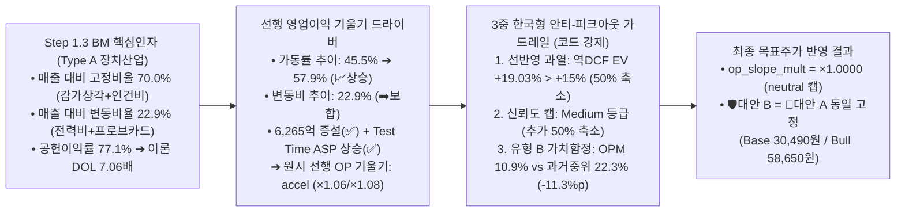

# 📖 Phase 2: 스토리 리더 — 두산테스나 (131970) (v5.2)

> **분석완료일**: 2026-11-20
> - **단일 기준 주가 (Single Price Anchor)**: **`66,800원`** (SSOT 확정 종가, Phase 1~3 전 과정 100% 동일 고정)
> - **핵심 검증 과제**: ① 시장의 막연한 'AI HBM 수혜론' 및 '삼성 인하우스 물량 이전 착시'를 DART 공시 실측치로 교정하고, ② `[Step 1.2]` 10% 변곡점(차량용 SoC `18.0%` · 차세대 LPU/CIS `11.0%`)과 `[Step 1.3]` 고정비(`70.0%`, `DOL 7.06배`) 기반 선행 OP 기울기가 왜 3중 안티-피크아웃 가드레일(유형 B 가치함정·역DCF `+19.03%` 선반영)에 의해 할증 `×1.0000`으로 통제되는지 규명하며, ③ 6열 포퍼식 Kill-Switch 매트릭스로 턴어라운드 진위 판독 기준을 확립합니다.

---

## 1. Global & Weekly Trend 비판적 수용 및 DART 팩트체크

### 1.1 시장 통념(Sell-Side 낙관론) vs DART 공시 실측 팩트체크 (`No-Blind-Citation` & `[⚖️비판·리스크검증]`)
주식시장에서는 반도체 후공정(OSAT) 섹터가 강세를 보일 때마다 두산테스나를 'AI HBM 메모리 후공정 수혜주' 또는 '삼성전자 인하우스 테스트 물량 대거 외주화의 즉각적 수혜주'로 단순 묶어서 해석하는 경향이 있습니다. 그러나 DART 정기보고서(2026년 반기·3분기보고서 및 사업보고서)와 검증된 기존 가설 로그(`thesis_log.md` 내 확인된 반기보고서 13p, 31p 및 키움증권 리포트 4p, 9p, 10p)를 교차 대조하면 아래와 같은 냉정한 팩트가 도출됩니다.

| 시장 내러티브 (통념 및 과열 기대감) | DART 공시 및 실측 데이터 교차 검증 (`Fact-Check`) | `[⚖️비판·리스크검증]` 판정 및 밸류에이션 반영 |
| :--- | :--- | :--- |
| **"두산테스나는 AI HBM/DRAM 메모리 후공정 테스트 활황의 직접 수혜주이다."** | DART 공시 기준 동사 매출의 **`91.66%`는 비메모리 Wafer Test**, **`8.34%`는 비메모리 PKG Test**이며 메모리(HBM/DRAM) 매출은 사실상 **`0%`**임 (`[반기보고서 13p, 31p]`). 동사 가동률을 움직이는 진짜 동인은 메모리가 아니라 **시스템 반도체(스마트폰 AP, CIS, 차량용 자율주행 SoC, AI 추론용 LPU)**임. | ❌ **허위 내러티브 배제**: HBM 멀티플 할증 적용 불가. 오직 비메모리 파운드리 가동률과 Test Time으로만 평가. |
| **"삼성전자가 비메모리 테스트를 새로 외주화(인하우스➔외주 전환)하여 당장 폭발적 물량이 쏟아진다."** | 비메모리 테스터 장비(Advantest V93000 등 대당 30~100억)는 감가상각 부담이 막대하여 삼성전자는 애초부터 양산 물량을 외주 OSAT(두산테스나 등)에 맡기는 분업 체제를 유지해 왔음. 인하우스에서 넘어오는 물량은 소량의 R&D/초도 검증 물량 위주이며, 진짜 업사이드는 **'불황기 양산 발주(PO) 삭감 정상화'**와 **'테슬라 SoC·LPU·애플 CIS 등 외부 빅테크 선단공정 유입'**임. | ⚖️ **내러티브 정밀 교정**: 단기 물량 급증 착시를 걷어내고, 4Q26 LPU·2Q27 애플 CIS 실제 양산 스케줄에 맞춘 시차 적용. |
| **"6,265억 원 대규모 시설투자(CapEx) 공시는 무조건적인 주가 리레이팅 호재이다."** | 6,265억 원 증설은 자기자본(`4,511.0억 원`)의 `138.9%`에 달하는 초대형 투자로, 중장기 Capa 해자를 구축하는 동시에 단기적으로는 **순차입금을 `+2,320.1억 원`으로 급증**시키고 **보고 FCF를 `-643.2억 원` 적자**로 전환시켰음. 또한 장비 반입 즉시 5년 정액 감가상각비(고정비 `70.0%`)가 선행 반영됨. | 🚨 **양날의 검 (재무 부담 병기)**: 가동률이 `65~70%`로 빠르게 올라서지 못할 경우 `DOL 7.06배`가 역레버리지로 작동하는 리스크 의무 반영. |
| **"현 주가(`66,800원`)는 고점(`177,800원`) 대비 62% 하락했으므로 무조건 절대 저평가 구간이다."** | 주가가 고점 대비 크게 조정받았으나, 현재 주가(`66,800원`)는 여전히 공식 BPS(`23,439원`) 대비 **PBR `2.85배`**, 공식 EPS(`1,771원`) 대비 **PER `37.72배`**이며, 역DCF EV 기준 내재 요구성장률이 연평균 **`+19.03%`**에 달함. 반면 현재 본업 OPM은 `10.9%`(과거 10년 중위 `22.3%` 대비 `-11.3%p`), Core ROIC는 `6.71%`에 머물러 있음. | ⚠️ **기대감 선반영 경계**: 주가 하락폭만 보고 저평가로 단정하는 오류 차단 (`Base 적정주가 30,490원 / Bull 58,650원`). |

---

## 2. [Step 1.2] S-Curve 10% 변곡점 · 3축 구조적 병목 & [Step 1.3] BM 핵심인자 선행 OP 기울기 심층 검증

### 2.1 [Step 1.2] 전방 침투율 10% 골든 변곡점(`18.0%` / `11.0%`)과 15개월 리드타임 병목의 실체
두산테스나가 마주한 전방 시스템 반도체 테스트 시장은 두 가지 S-Curve 10% 변곡점(`Zone A: 8.0~18.0%`)이 동시에 교차하고 있습니다:
1. **1차 S-Curve 변곡점 (차량용 전장 SoC 외주 테스트 침투율 `18.0%`)**:
   - 과거 차량용 반도체는 단순 마이크로컨트롤러(MCU) 위주였으나, 테슬라 FSD(AI4 및 차세대 AI5)를 필두로 고성능 자율주행 SoC와 인포테인먼트 AP 탑재율이 급증하고 있습니다.
   - 차량용 SoC는 사람의 생명과 직결되므로 $-40^\circ\text{C} \sim +125^\circ\text{C}$ 삼온(Tri-Temp) 환경에서의 장시간 에이징과 시스템 레벨 테스트가 필수적입니다. 이는 웨이퍼 1장당 테스터 점유 시간(Test Time)을 모바일 AP 대비 2~3배 이상 늘려, 파운드리 출하 장수가 동일하더라도 테스트 OSAT의 매출(시간당 임률 × Test Time)을 구조적으로 증폭시킵니다.
2. **2차 S-Curve 변곡점 (AI 추론용 LPU 및 북미 빅테크 3단 적층 CIS 침투율 `11.0%`)**:
   - 2026년 4분기부터 가동이 본격화되는 글로벌 AI 추론 특화 칩(LPU) 웨이퍼 테스트와, 2027년 2분기부터 반입·양산되는 애플 아이폰 차세대 모델 향 3단 적층 하이브리드 본딩 CIS 테스트는 기존 중저가 중국 스마트폰 CIS와는 차원이 다른 고부가가치 영역입니다.
   - 특히 3단 적층 CIS는 로직 웨이퍼와 픽셀 웨이퍼를 본딩하기 전후로 정밀 광학·전기 테스트를 수행해야 하므로, 동사가 6,265억 원 규모로 선제 발주한 Advantest V93000 등 하이엔드 테스터 장비군(발주~클린룸 셋업 리드타임 **`15개월`**, 병목 등급 **`B등급`**)만이 이 물량을 소화할 수 있습니다.

### 2.2 [Step 1.3] BM 핵심인자(고정비 `70.0%` · DOL `7.06배`)와 선행 OP 기울기(`accel` ➔ `neutral ×1.0000`)의 인과 해부
주가는 후행 영업이익의 절댓값이 아니라 **향후 영업이익 기울기의 가속·둔화(2차 도함수)**에 반응합니다. 두산테스나의 비즈니스 모델을 `[Step 1.3]` 프레임워크로 해부하면 왜 폭발적인 잠재 레버리지와 엄격한 밸류에이션 가드레일이 공존하는지 명확히 드러납니다:

1. **실측된 QoQ 영업레버리지 발화 (`2026.1Q ➔ 2026.2Q`)**:
   - 2026년 1분기에서 2분기로 넘어갈 때 매출액은 `768.3억 원 ➔ 809.3억 원`으로 불과 **`+5.3%`** 증가했으나, 영업이익은 `54.8억 원 ➔ 98.5억 원`으로 무려 **`+79.6%`** 급증하며 영업이익률(OPM)이 `7.13% ➔ 12.17%`(`+5.04%p`)로 도약했습니다.
   - 이는 적자 사업이던 DP 사업부를 2026년 7월 영업 중단하고 Wafer Test 가동률이 손익분기점(`52.0%`)을 넘어 **`57.9%`**에 안착하자마자 `이론 DOL 7.06배`가 실제로 작동하기 시작했음을 보여주는 강력한 실증 데이터입니다.
2. **왜 `🚀 대안 A`의 선행 기울기 할증(`op_slope_mult`)이 `×1.0000`으로 캡핑되었는가?**:
   - 원시 데이터상 가동률 상승(`up`)과 증설(`capa_expand`)·단가 상승(`asp_up`)이 결합되어 원시 기울기는 **`accel`**이 맞습니다.
   - 그러나 ① 현재 주가(`66,800원`, PBR `2.85배`)가 이미 오너 정규화 FCF(`520.0억 원`) 기준으로도 향후 5년간 연평균 **`+19.03%`**의 EV 성장을 선반영하고 있고(`> +15%` 과열 게이트 발동), ② 6,265억 원 신규 설비의 대규모 감가상각비가 본격 유입될 때 현재 OPM(`10.9%`)이 과거 10년 중위 OPM(`22.3%`)과의 격차(`-11.3%p`)를 단숨에 메울 수 있을지 아직 완전 입증되지 않은 **유형 B(수익성 회복 검증 대기)** 구간이기 때문입니다.
   - 따라서 v5.2 안티-피크아웃 가드레일은 미래 기대감의 이중 가산(Double Counting)을 원천 차단하고, **`🛡️ 대안 B(순수 DART 방어 닻)`와 `🚀 대안 A(S-Curve·선행 기울기 반영)` 모두 Base `30,490원`, Bull `58,650원`으로 100% 보수적 기준점을 고수**합니다.

---

## 3. 핵심 투자 가설(Popperian Falsification) 및 6열 Kill-Switch 검증

칼 포퍼(Karl Popper)의 반증주의 원칙에 입각하여, "어떤 호재가 있으면 오른다"는 확증편향 서사를 배제하고 **"차기 분기 어떤 정량 숫자가 무너지면 우리의 투자 가설이 틀렸음을 즉시 인정하고 강등/철수할 것인가(Kill-Switch)"**를 직전 분기(QoQ) 실측 추이와 함께 6열 표준 테이블로 고정합니다.

### 3.1 포퍼식 6열 투자 가설 검증 및 반증(Kill-Switch) 매트릭스

| 가설 ID (갱신일) | 핵심 투자 가설 (Popperian Thesis) | 📊 직전 분기 대비 (QoQ) 실측 추이 | ✅ 확인 근거 (DART & 신뢰 팩트) | 🚨 반증/약화 조건 (정량 Kill-Switch 임계치) | 판정 상태 |
| :---: | :--- | :--- | :--- | :--- | :---: |
| **가설 1** (26.11.20) | **[BM 정체성 & 전장 SoC 독점 수탁]** 두산테스나의 실적은 메모리가 아닌 비메모리 Wafer Test(`91.66%`) 가동률과 Test Time에 직결되며, 삼성 파운드리가 수주한 테슬라 FSD 자율주행 전장 SoC 양산 테스트를 독점 수탁하여 비모바일 믹스를 구조적으로 확대한다. | • 매출액: `768.3억 ➔ 809.3억` (QoQ **`+5.3%`**) • 영업이익: `54.8억 ➔ 98.5억` (QoQ **`+79.6%`**) • 수정EPS: `439원 ➔ 366원` (금융비용 반영 흑자 지속) | DART 반기·분기보고서 상 Wafer Test 비중 `91.66%` 확인 및 저마진 DP 사업부(구 엔지온, 비중 `1.1%`) 2026.07 완전 영업 중단으로 비메모리 테스트 순도 100% 달성 (`[반기보고서 13p, 31p]`). | **차기 분기 차량용 전장 SoC 및 비모바일 고부가 테스트 매출 비중이 `25.0%` 미달하거나 Wafer Test 매출이 QoQ 역성장(`-5%` 이하) 시 즉시 `[약화]` 강등** | **`[검증 완료]`** (완전 유효) |
| **가설 2** (26.11.20) | **[IDM 외주화 착시 교정 & 진성 드라이버]** 삼성전자의 비메모리 테스트는 이미 외주 분업 체제이므로 '인하우스 R&D 물량 이전' 자체는 소량이며, 진정한 실적 드라이버는 '파운드리 4nm 가동률 정상화'와 '외부 빅테크(테슬라·LPU·애플 CIS) 신규 양산 유입'이다. | • 전사 OPM: `7.13% ➔ 12.17%` (QoQ **`+5.04%p`**) • Wafer Test 가동률: `45.5% ➔ 57.9%` (**`+12.4%p` 반등**) | 대당 30~100억 테스터 감가상각 구조상 IDM은 양산 테스트를 외주화함. 삼성 4nm 수율 `80%+` 안정화 및 파운드리 가동 회복에 따라 동사 가동률이 손익분기(`52.0%`)를 돌파하며 OPM이 두 자릿수로 회복됨. | **차기 분기 삼성전자 단일 캡티브 의존도가 `98%` 이상으로 고착된 채 파운드리 단가 인하(CR) 전가로 분기 OPM이 `8.0%` 미만으로 재하락 시 즉시 `[약화]` 강등** | **`[검증 완료]`** (시장 착시 교정 완료) |
| **가설 3** (26.11.20) | **[Step 1.3 고정비 DOL 7.06배 & 6,265억 증설 회수]** 고정비율 `70.0%`·공헌이익률 `77.1%`(`DOL 7.06배`) 구조에서 4Q26 AI 추론용 LPU 및 2Q27 애플 향 차세대 CIS 신규 테스터(`6,265억` 증설)가 램프업될 때, 감가상각비 증가분을 압도하는 영업이익 가속(`accel`)이 발생한다. | • 유형자산 CapEx: `25년 228억 ➔ 26.1H 710억` (총 `6,265억` 순차 집행) • 순차입금: `+798.0억 ➔ +2,320.1억` • 보고 FCF: `-643.2억` (오너 정규화 FCF `+520.0억`) | 2Q26 매출이 `+5.3%` 늘 때 영업이익이 `+79.6%` 급증하며 `DOL 7.06배` 레버리지 실증. 단, 대규모 CapEx로 순차입금이 `+2,320.1억`으로 늘고 계열사 펀드 400억 출자 약정이 병존하여 가동률 안착 확인 필수. | **차기 분기 Wafer Test 공식 가동률이 손익분기점인 `52.0%` 미만으로 재하락하거나, 신규 감가상각비 부담으로 매출 대비 고정비율이 `78.0%`를 초과할 경우 즉시 `[폐기]` 강등** | **`[진행 중]`** (핵심 모니터링) |
| **가설 4** (26.11.20) | **[SSOT 마스터 실적 Kill-Switch & 가치함정 탈출]** 현재 주가(`66,800원`, PBR `2.85배`)에 내재된 역DCF EV 요구성장률(`+19.03%`)을 정당화하고 유형 B 가치함정(과거 중위 OPM `22.3%` vs 현재 `10.9%`)에서 탈출하려면 매 분기 연속적인 이익 체력 입증이 필수적이다. | • [2026.1Q ➔ 2026.2Q] 매출액 `768.3억 ➔ 809.3억` (`+5.3%`) 영업이익 `54.8억 ➔ 98.5억` (`+79.6%`) 지배주주 수정EPS `439.0원 ➔ 366.0원` | 2분기 영업이익 `98.5억 원`으로 흑자 기조 및 영업 턴어라운드 궤도에 진입했으나, 차입금 증가에 따른 금융비용 영향으로 지배주주 EPS는 `439원 ➔ 366원`으로 소폭 조정됨. | **차기 분기 영업이익 `< 83.7억 원`(직전분기 대비 -15% 하회) 또는 분기 지배주주 EPS `< 293원` 기록 시 핵심 턴어라운드 가설 즉시 `[약화]` 강등 및 비중 축소** | **`[진행 중]`** (SSOT 강제 바인딩) |

### 3.2 Phase 3 밸류에이션 연결을 위한 스토리 리더 최종 결론
1. **펀더멘털의 방향성(Direction)은 우상향 턴어라운드 초입**: 적자 DP 사업부 폐지 완료, Wafer Test 가동률 `45.5% ➔ 57.9%` 회복, `DOL 7.06배` 영업레버리지에 따른 2분기 영업이익 QoQ `+79.6%` 반등, 그리고 4Q26 LPU·테슬라 전장 SoC 및 2Q27 애플 CIS라는 명확한 파이프라인은 동사가 최악의 업황 터널을 통과했음을 보여줍니다.
2. **그러나 가격(Price `66,800원`)과 재무 레짐(순차입금 `+2,320.1억 원`, 현 OPM `10.9%`)의 괴리 존재**: 시장은 이미 2027~2028년 증설 설비가 풀가동될 때의 장밋빛 기대감을 선반영하여 PBR `2.85배`(역DCF EV 요구성장률 `+19.03%`)까지 주가를 끌어올려 놓았습니다. 따라서 Phase 3에서는 막연한 낙관론을 배제하고, **유형 B 가드레일과 3중 안티-피크아웃 캡(`op_slope_mult = ×1.0000`)을 엄격히 적용한 보수적 적정주가(`Base 30,490원 / Bull 58,650원`)와 하방 안전마진 대기 전략**을 도출합니다.
