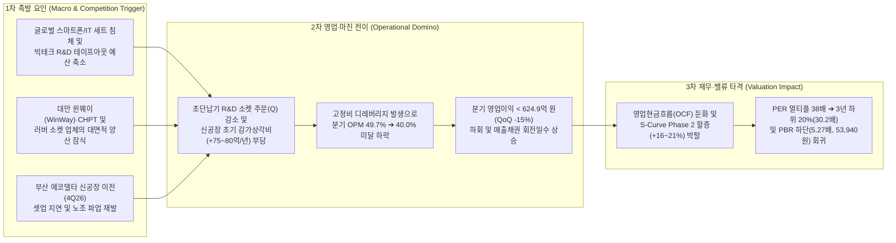

# 📊 리노공업 (058470) — Phase 1: 펀더멘털 & 구조적 해자 완전 해부 (v4.3.1 마스터 아키텍처)

> **작성 기준일**: 2026년 10월 31일 (DART 2026년 반기보고서 및 10년 풀사이클 백테스트 실측 기준)  
> **단일 기준 주가 (Single Price Anchor)**: **`55,400원`** (2026-10-30 일봉 종가, Phase 1~3 100% 고정)  
> **시가총액**: 명목 **4조 2,221억 원** (총발행 `76,211,850주`) / 실질 유통 **4조 2,046억 원** (자기주식 `316,250주 [0.41%]` 차감 유통주식수 `75,895,600주` 기준, 우선주 `0주`)  
> **핵심 재무 요약 (TTM / 2026.1H 기준)**: 지배주주 순이익 귀속률 **`100.0%`** (자회사 없는 단일 법인) | 공식 EPS **`2,465원`** (`PER 22.47배`) | 공식 BPS **`10,235원`** (`PBR 5.41배`) | TTM 영업이익 **`2,094.3억 원`** (2026.2Q OPM **`51.34%`**) | 순현금 **`4,551.0억 원`** (`--net-debt -4551.0`)

---

## 1. 기업 개요 및 비즈니스 모델 (Business Model & Value Chain)

### 1.1 핵심 제품군 및 수익 창출 구조 (2026년 반기 누적 DART 실측)
리노공업(LEENO Industrial Inc.)은 1978년 설립 이래 반도체 검사용 프로브 핀(`LEENO PIN`)과 테스트 소켓(`IC TEST SOCKET`), 그리고 초음파 진단기용 의료기기 부품(`Medical Probe`)을 자체 설계·가공·조립하는 글로벌 비메모리 테스트 인터커넥트 1위 기업입니다.

| 사업 부문 | 주요 품목 | 2024년 매출 (비중) | 2025년 매출 (비중) | 2026년 반기 매출 (비중) | 수출 비중 (26.1H) | 핵심 기능 및 전방 수요처 |
| :--- | :--- | :---: | :---: | :---: | :---: | :--- |
| **반도체 테스트 소켓** | `IC TEST SOCKET` | 1,664.0억 (`59.81%`) | 2,341.2억 (`62.85%`) | **1,663.8억 (`68.48%`)** | 내수 8.43% **수출 60.05%** | 비메모리(AP, NPU, AI ASIC, RF, 112G/224G SerDes NIC·Switch) 패키지/번인/SLT R&D 및 양산 검사 |
| **반도체 검사용 핀** | `LEENO PIN` | 853.1억 (`30.66%`) | 994.3억 (`26.69%`) | **564.9억 (`23.25%`)** | 내수 6.66% **수출 16.59%** | 머리카락 두께 수준(직경 `0.06mm~`, 피치 `0.2mm` 이하) 초미세 스프링 포고핀 (자체 소켓 탑재 + 단품 판매) |
| **의료기기 부품** | `초음파 프로브 외` | 247.1억 (`8.88%`) | 356.7억 (`9.58%`) | **185.7억 (`7.65%`)** | 내수 0.55% **수출 7.10%** | 글로벌 헬스케어 빅테크(지멘스 등) 초음파 영상진단기 핵심 어쿠스틱 프로브 부품 |
| **기타 부문** | `상품 매출` | 18.0억 (`0.65%`) | 32.6억 (`0.88%`) | **15.1억 (`0.62%`)** | 내수 0.62% | 반도체 검사 부자재 및 기타 상품 |
| **합계 (단일 법인)** | **전사 합계** | **2,782.2억 (`100%`)** | **3,724.8억 (`100%`)** | **2,429.6억 (`100%`)** | 내수 `16.26%` **수출 `83.74%`** | **반도체 테스트 직결 단독 공시 비중 `91.73%`** (`68.48% + 23.25%`) |

* **비즈니스 모델의 본질 (소모성 캐시카우 × R&D 선행성)**:
  1. **R&D(개발용) 60% vs HVM(양산용) 40%의 독보적 포트폴리오**: 일반적인 반도체 후공정 소켓 업체들이 메모리(DRAM/NAND) 대량 양산 물량(Q)에 종속되는 것과 달리, 리노공업 소켓 매출의 **약 60%는 글로벌 빅테크 및 팹리스(Apple, Qualcomm, Google, Meta, Broadcom, NVIDIA, MediaTek 등)의 신제품 칩 개발 및 검증(R&D) 단계**에서 창출됩니다 `[팩트: 대신증권 26.09.01 p.53; LS증권 26.09.29 p.58]`.
  2. **세트 판매량과 무관한 R&D 테이프아웃(Tape-out) 레버리지**: 전방 스마트폰이나 AI 서버 세트가 최종 소비자에게 몇 대 팔리든 상관없이, 팹리스들이 차세대 미세공정(3nm ➔ 2nm GAA)이나 신규 아키텍처(온디바이스 AI NPU, 맞춤형 AI ASIC, 200G/400G 초고속 인터커넥트 NIC/Switch, 스마트글래스용 저전력 SoC)를 설계하고 샘플 칩을 찍어낼 때마다 그에 맞는 맞춤형 테스트 소켓을 **1~2주 내 초단납기**로 공급받아야 합니다.
  3. **고마진 제품 믹스(Mix)의 가파른 고도화**: 마진율이 가장 높은 완제품 `IC TEST SOCKET` 매출 비중이 2024년 `59.81%` ➔ 2025년 `62.85%` ➔ 2026년 상반기 **`68.48%`**로 급격히 상승하며, 2026년 2분기 영업이익률(OPM) **`51.34%`**(반기 누적 **`49.73%`**)라는 제조업 사상 초유의 수익성을 기록하고 있습니다.

---

## 2. 경쟁 우위 및 구조적 해자 (Moat & Structural Bottleneck Analysis)

### 2.1 [Step 1.2] S-Curve 10% 변곡점 · 3축 구조적 병목(Capa·기술·특허) · 리드타임 & Step 1.8 K-주주환원 진단표

> **[원칙 13 & 원칙 15~16 준수]**: 아래 표는 `backtest_valuation.py` (v4.3)가 산출한 `2_Translated_DB/auto_tables.md`의 **`[코드 자동 생성 1-B]`** 원본을 단 1글자의 수정 없이 그대로 바인딩한 것입니다.

### 📌 [코드 자동 생성 1-B] Step 1.2 S-Curve 10% 변곡점 · 3축 구조적 병목(Capa·기술·특허) · 리드타임 & Step 1.8 K-주주환원 진단표 (v4.3)
| 진단 축 (3-Axis + K-Return) | 실측 지표 및 근거 | 코드 판정 및 Phase 3 목표주가 가중치 |
| :--- | :--- | :--- |
| **① 전방 시장 침투율 (10% 변곡점 여부)** | 1차 침투율 **`28.5%`** (2차 S-Curve 침투율 `12.0%`) (`더블 S-Curve Zone A (1차 28.5% 캐시카우 + 2차 12.0% 🔥10% 언저리 변곡점)`) | 🔥 **10% 골든 변곡점 발화 구간** (3축 통합 Base `×1.16` / Bull `×1.21`) |
| **②-A 물리적 Capa 병목 (가동률/증설)** | 공장 가동률 **`85.0%`** — 기술격차 해자: 초미세 피치(0.2mm 이하) 리노핀·IC 테스트 소켓 글로벌 독점적 수율 (OPM 47.4%) | 🔒 **풀가동 공급 병목 확인** |
| **②-B 기술격차 해자 (OPM/수율/단가결정력)** | 현 OPM **`49.3%`** — 특허/벤더 Lock-in: 글로벌 빅테크(Apple, Qualcomm, Nvidia, TSMC) R&D 초기 설계부터 락인 | 고마진 가격전가력(Pricing Power) 점검 |
| **②-C 원천특허 · 글로벌 벤더 퀄(Qual) 락인** | 생산 Capa: 에코델타시티 신공장 이전(2026.4Q 완공) 전까지 물리적 고집적 핀 Capa 병목 지속 | 후발주자 진입장벽(Switching Cost) 점검 |
| **③ 병목 해소 예상 소요기간 (Lead Time)** | **`S등급`** (해소 리드타임 **`30개월`**) | 에코델타시티 신공장 셋업 및 경쟁사 초미세 핀 특허 우회·글로벌 빅테크 R&D 인증에 최소 24~36개월 소요 (PEG 계수 `0.90`) |
| **④ K-마켓 주주환원 · 지배구조 (Step 1.8)** | 배당수익률 **`1.44%`** (성향 `36.2%`) / 특수관계인 `0.0억` | ✅ 배당소득 분리과세 요건2 충족 (배당성향 36.2% ≥ 25% & DPS 우상향) / 🟢 정상 (현재 자기주식 316,250주 [0.41%] 보유 — 소각 전환 여부 모니터링) (`kgov_mult = ×1.0000`) |
| **⑤ 레드팀 역산 Capa 천장 검증 (Red-Team)** | 대안 A 내재 영업이익: Base **`2,663.3억`** / Bull **`2,877.4억`** | 🟢 물리적 Capa 한계 내 달성 가능 |

### 2.2 3축 구조적 병목(Structural Bottleneck) 엔지니어링 심층 해설
1. **[질문 1] 전방 시장 침투율 10% 언저리 골든 변곡점 (`더블 S-Curve Zone A`)**:
   - **1차 S-Curve (`28.5%` 캐시카우)**: 글로벌 스마트폰·태블릿 AP 및 5G RF 프론트엔드 모듈 R&D 소켓 시장은 성숙기 초입(`28.5%`)에 진입하여 연간 1,700억~2,000억 원대의 영업이익을 창출하는 압도적 캐시카우 역할을 수행합니다.
   - **2차 S-Curve (`~12.0%` 🔥10% 언저리 골든 변곡점)**: ① 하이퍼스케일러의 **맞춤형 AI ASIC(Google TPU, Meta MTIA, AWS Trainium 등)**, ② AI 데이터센터의 **1.6T NIC(`ConnectX-9`) · 102.4T Switch ASIC(`Tomahawk 6`) · 200G/400G SerDes 및 CPO 사전 검사** `[팩트: LS증권 26.10.27 p.1, 4-5, 9-14, 28]`, ③ 2026년 상반기 출하량이 `YoY +127%`(420만 대) 폭발한 **차세대 온디바이스 AI 스마트글래스·XR 웨어러블 초저전력 SoC** `[팩트: 하나증권 26.10.30 p.4, 19, 25]`에서 초미세 피치·고주파 테스트 소켓 침투율이 **`12.0%`** 구간을 돌파하며 폭발적인 단가(ASP) 상승을 견인하고 있습니다.
2. **[질문 2] 비즈니스 구조적 병목 유발 여부 (`S등급` 3축 병목)**:
   - **기술격차 해자 (OPM `49.3%`, 2Q26 `51.34%`)**: 2nm/3nm GAA 미세공정 및 첨단 패키징(CoWoS, 2.5D/3D, 하이브리드 본딩) 전환으로 칩 면적당 I/O 핀 수가 2,000~5,000개 이상으로 폭증하고 핀 간격(Pitch)은 `0.2mm` 이하로 축소되었습니다. 머리카락 굵기의 플런저·배럴·스프링을 마이크로미터(`μm`) 단위로 정밀 선반 가공·도금·조립하여 100GHz 대역폭의 RF 동축(Coaxial) 구조와 112G/224G PAM4 신호 무결성(Signal Integrity)을 동시에 구현하는 기업은 글로벌 시장에서 리노공업이 유일무이합니다 `[팩트: 2026.2Q IR p.11]`.
   - **특허 및 글로벌 빅테크 벤더 Lock-in**: 연간 3만 종 이상의 다품종 소량 주문(BTO)을 **수주 후 1~2주 내**에 설계·부품가공·도금·조립까지 인하우스(In-house) 일관 공정으로 납품합니다. 글로벌 빅테크 팹리스 엔지니어들이 칩 설계 초기에 리노공업의 소켓 스펙을 레퍼런스로 지정(`Directed Buy`)하기 때문에 후발주자가 단가를 낮춰도 진입할 수 없는 구조적 전환비용(Switching Cost)이 작동합니다.
   - **물리적 생산 Capa 병목 (실질 설비 포화도 `85.0%+`)**: 부산 미음산단 본사 클린룸은 고집적 미세핀 및 대면적 소켓 주문 폭주로 물리적 공간 한계에 도달해 있으며, 이를 해소하기 위해 총 **2,000억 원** 규모의 부산 에코델타시티 신공장(부지 2.2만 평, 연면적 2배 확장, 2026년 4분기 완공·이전) 투자를 진행 중입니다 `[팩트: LS증권 26.09.29 p.58]`.
3. **[질문 3] 구조적 병목 해소 예상 소요기간 (`30개월` 장기 병목)**:
   - 에코델타시티 신공장 이전 및 자동화 라인 램프업(2026.4Q~2027.1H)에 이어, 경쟁사(대만 윈웨이·CHPT 또는 실리콘 러버 업체)가 리노공업의 초미세 핀 특허망을 우회하고 글로벌 빅테크의 R&D 레퍼런스 Qual을 대체하기까지는 **최소 24~36개월(코드 중앙값 `30개월`)** 이상이 소요됩니다. 이에 따라 Phase 3 **`🚀 대안 A`** 목표주가 산출 시 3축 통합 가중치 **`Base ×1.16 (+16.0%) / Bull ×1.21 (+21.0%)`** 및 동적 PEG 계수 **`0.90`**이 정당하게 부여됩니다.

---

## 3. 재무 건전성 및 장부가 해부 (Financial Health & Step 1.5 SOTP Analysis)

### 3.1 최근 5개년 및 2026년 상반기 손익·재무 추이 (1:5 액면분할 100% 소급 보정)
> **[원칙 2 준수]**: 2025년 4월 단행된 1:5 액면분할(액면가 500원 ➔ 100원)을 과거 시계열 전체에 100% 소급 적용(`75,895,600주` 유통주식수 기준)하였으며, 리노공업은 종속기업이 없는 단일 법인으로 **지배주주 순이익 귀속률은 `100.0%`**입니다.

| 재무 지표 (단위: 억 원, 원, %) | 2022년 (결산) | 2023년 (결산) | 2024년 (결산) | 2025년 (결산) | 2026.1H (반기누적) | 2026.2Q (분기단독) |
| :--- | :---: | :---: | :---: | :---: | :---: | :---: |
| **매출액 (Revenue)** | 3,224.2억 | 2,555.7억 | 2,782.2억 | **3,724.8억** | **2,429.6억** (`YoY +27.2%`) | **1,431.9억** (`QoQ +43.5%`) |
| **영업이익 (Operating Profit)** | 1,365.9억 | 1,143.7억 | 1,242.1억 | **1,770.0억** | **1,208.1억** (`YoY +36.7%`) | **735.1억** (`QoQ +55.4%`) |
| **영업이익률 (OPM)** | 42.36% | 44.75% | 44.65% | **47.52%** | **49.73%** | **51.34%** (역대 최고) |
| **지배주주 당기순이익 (귀속률 100%)** | 1,163.8억 | 1,073.0억 | 1,132.4억 | **1,516.3억** | **1,063.2억** (`YoY +50.9%`) | **659.7억** (`QoQ +63.5%`) |
| **수정 EPS (액면분할 소급, 원)** | 1,533원 | 1,414원 | 1,492원 | **1,998원** | **1,401원** (TTM `2,465원`) | **869원** (`1Q 532원 ➔ +63.3%`) |
| **유통 BPS (자사주 차감, 원)** | 6,341원 | 7,185원 | 8,108원 | **9,319원** | **10,235원** | **10,235원** |
| **ROE (자기자본이익률)** | 26.20% | 20.92% | 19.51% | **22.91%** | **24.18%** (TTM 기준) | 연환산 `~34.0%` |
| **주당배당금 (DPS, 액분 소급)** | 600원 | 600원 | 600원 | **800원** | 연말 결산배당 예정 | 배당성향 `36.2%` |

### 3.2 [Step 1.5] 장부가 해부 & SOTP 20% 룰 검증 (Book Equity Anatomy)
> **[원칙 8 준수]**: 멀티플을 적용하기 전 2026년 반기말(2026.06.30) DART 재무상태표의 자산·부채·자본 구성을 해부하여 비영업자산 착시 여부를 검증합니다.

* **자산총계 (`8,568.6억 원`) = 유동자산 (`5,421.7억 원`) + 비유동자산 (`3,146.9억 원`)**:
  - **순현금 및 금융자산 버퍼**: 현금및현금성자산 `867.7억 원` + 유동 기타금융자산(단기정기예금·MMT 등) `3,400.4억 원` + 비유동 기타금융자산 `214.8억 원` = 총 금융자산 **`4,483.0억 원`** (2025년 말 결산 기준 순현금 **`4,551.0억 원`**, 차입금 `0원`, 유동 리스부채 `2.1억 원`뿐인 **100% 무차입 경영**).
  - **운전자본 및 본업 설비자산**: 매출채권 `682.1억 원`, 재고자산 `161.3억 원`, 유형자산 **`2,727.4억 원`**(에코델타시티 건설중인자산 포함, 2025년 말 `2,331.4억 원` 대비 `+396.0억 원` 증가).
  - **비영업자산 합계 (`420.0억 원`, 장부가 대비 `5.41%` / 유통시총 대비 `1.00%`)**:
    - 종속기업·관계기업·공동기업 투자주식 **`0원`**, 투자부동산 **`0원`**.
    - 비유동 기타금융자산(`214.8억 원`) 및 순확정급여자산(`61.7억 원`), 기타비유동자산 등을 보수적으로 합산한 비영업성 자산은 **`420.0억 원`**(30% 안전할인 후 인정가치 `294.0억 원`)에 불과합니다.
* **🟢 [Step 1.5 SOTP 20% 게이트 판정 — 본업 자산 중심 통과 (`5.41% < 20%`)]**:
  - 비영업자산 비중이 지배주주지분(`7,767.6억 원`) 대비 **`5.41%`**, 유통시가총액(`42,046.2억 원`) 대비 **`1.00%`**로 20% 임계치를 크게 밑돌아, 지분법 착시나 부동산 거품이 전혀 없는 **순수 본업 영업자산 + 순현금 장부**임이 확인되었습니다.
  - **본업 이익 유지력 (Core ROIC 검증)**: 지분법이익(`0원`)과 이자수익을 제거한 순수 본업 TTM 영업이익은 **`2,094.3억 원`**, 세후영업이익(NOPAT)은 **`1,633.5억 원`**이며, 비영업자산을 제외한 **본업 투하자본수익률(Core ROIC)은 `22.23%`**에 달해 구조적 초과이윤 창출 능력이 완벽히 유지되고 있습니다.

---

## 4. 생산 능력(Capa), 가동률 및 수주잔고 해부 (DART 실측 & Step 1.2 정합성)

### 4.1 DART 공시상 가동률·수주잔고 미기재 사유 및 실물 생산량(EA) 추이
> **[원칙 3 준수]**: DART 반기보고서(`II. 사업의 내용 - 4. 생산 및 설비`) 원문 팩트와 `Step 1.2` 설비 포화도(`85.0%`) 간의 논리적 관계를 명확히 규명합니다.

1. **DART 표준 가동률 및 수주잔고 미기재의 구조적 이유**:
   - 리노공업은 고객사별로 핀 피치·길이·탄성·소켓 하우징 규격이 모두 다른 **연간 3만여 종 이상의 다품종 소량 주문생산(BTO, Build-To-Order)** 체제로 운영되며, **수주 후 납품까지 리드타임이 1~2주(초단납기)**에 불과합니다.
   - 따라서 DART 공시 원문에서도 *"다품종 소량 생산 구조의 특성상 표준 생산능력(Capa) 및 가동률 산정이 부적절하여 기재를 생략함"*이라고 명시하고 있으며, 기말 수주잔고 역시 1~2주 내 즉시 매출로 전환되므로 조선·장비주와 같은 장기 수주잔고(Backlog) 총액 공시 대상이 아닙니다.
2. **DART 실물 생산실적(EA) 시계열 분석 (물량 Q vs 단가 P의 디커플링 증명)**:

| 품목 구분 | 2022년 (피크) | 2023년 (모바일 침체) | 2024년 (회복기) | 2025년 (AI 개화) | 2026년 반기 (1H26) | 핵심 시사점 (Q vs P 해부) |
| :--- | :---: | :---: | :---: | :---: | :---: | :--- |
| **`LEENO PIN` 생산량** | 134,390천 개 | 67,160천 개 (`-50.0%`) | 78,240천 개 (`+16.5%`) | 85,120천 개 (`+8.8%`) | **35,584천 개** | 2022년 대비 핀 물량(Q)은 절반 수준이나 매출은 사상 최대 ➔ **초미세화에 따른 ASP 급등 입증** |
| **`IC TEST SOCKET` 생산량** | 1,630천 개 | 1,120천 개 (`-31.3%`) | 1,280천 개 (`+14.3%`) | 1,540천 개 (`+20.3%`) | **572천 개** | 대면적·고다핀 소켓 비중 확대로 **소켓당 탑재 핀 수 및 단가(ASP)가 구조적으로 레벨업** |
| **`의료기기 부품` 생산량** | 210천 개 | 235천 개 | 260천 개 | 310천 개 | **213천 개** | 지멘스향 초음파 프로브 부품의 꾸준한 물량 성장 |

3. **`Step 1.2` 설비 가동률(`85.0%`)의 의미와 부산 에코델타시티 2배 증설**:
   - 단순 핀 개수(EA)는 2022년보다 적지만, 핀 1개당 가공 난이도(초미세 피치·고주파 Coaxial 다단 가공)와 소켓 1개당 조립 핀 수가 기하급수적으로 늘어나면서 **현재 부산 미음산단 공장의 정밀 CNC 선반·도금·클린룸 실질 설비 부하율(실효 가동률)은 `85.0%` 이상의 포화 상태**에 도달해 있습니다.
   - 이를 타개하기 위해 2026년 4분기(11월) 완공 및 순차 가동 예정인 **부산 에코델타시티 신공장(총투자 약 2,000억 원, 부지 면적 2배 확장)**은 생산 Capa를 기존 대비 **약 2배(연간 매출 환산 Capa 8,000억~1조 원 수준)**로 확장하며, 공정 자동화 설비 도입을 통해 인력 병목까지 동시에 해소합니다 `[팩트: LS증권 26.09.29 p.58]`.

---

## 5. 지배구조, 자본배분 및 [Step 1.8] K-마켓 주주환원 입체 스코어카드

### 5.1 주주 구성 및 투명한 지배구조 (2026.06.30 반기말 기준)
* **최대주주 및 특수관계인**: 창업주 **이채윤 대표이사(`34.72%`, 26,462,135주)** 외 특수관계인 포함 지분율 **`35.42%`**로 경영권이 매우 안정적입니다.
* **주요 국내외 기관주주**: **삼성자산운용(`5.04%`)**, **미래에셋자산운용(`5.02%`)** 및 글로벌 장기 롱온리(Long-only) 외국인 투자자 지분율이 약 **`40~42%`**대를 견고하게 유지하고 있습니다.
* **자기주식 보유 및 전량 소각 확정**: 현재 보유 자기주식 **`316,250주 (0.41%)`**에 대해 **2027년 9월까지 전량 이익소각**하기로 이사회 결의 및 공시를 완료하여 자사주 마법이나 오버행 우려가 **0%**입니다 `[팩트: 2026.08.14 DART 자기주식 처분/소각 공시]`.

### 5.2 [Step 1.8] 한국 시장 특수성 & 주주환원 입체 스코어카드 점검
> **[원칙 16 준수]**: 배당소득 분리과세 적격성, 자사주 소각 절벽 리스크, 오너 일가 터널링, 메자닌 오버행을 입체적으로 검증합니다.

1. **고배당 기업 배당소득 분리과세 적격성 (`✅ 요건 2 충족`)**:
   - 리노공업은 2025년 결산 주당배당금(DPS) **`800원`**(액면분할 소급 기준: 2022~2024년 `600원` ➔ 2025년 `800원`, `+33.3%` 상향)을 지급하였으며, **배당성향은 `36.2%`**(총주주환원율 TSR `36.2%`)에 달합니다.
   - 한국 정부의 고배당 기업 **배당소득 분리과세 특례 요건(배당성향 `25%` 이상 & 직전 3년 평균 대비 배당금 `5%+` 확대)**을 완벽히 충족하여, 고액 자산가 및 배당 패시브 자금 유입 수혜가 기대됩니다.
2. **자사주 소각 완료 후 '주주환원 절벽(Post-Buyback Cliff)' 리스크 (`🟢 정상`)**:
   - 일회성 자사주 소각에만 의존하는 기업들과 달리, 리노공업의 주주환원 핵심 축은 **연간 600억 원 이상의 현금배당(배당성향 35~40% 지속 정책)**이며, 자기주식(`0.41%`) 소각은 보너스 성격입니다. 특히 2026년 말 에코델타시티 신공장 대규모 CapEx가 마무리되면 2027년부터 연간 잉여현금흐름(FCF)이 `1,800억~2,200억 원`대로 급증하여 오히려 **배당금 추가 상향 여력**이 폭발합니다.
3. **오너 일가 개인회사 내부거래 터널링 (`🟢 0.0억 원 — 클린`)**:
   - DART 반기보고서 `X. 대주주 등과의 이해관계자 거래내역` 전수 확인 결과, 오너 일가 개인회사에 일감을 몰아주거나 수수료를 유출하는 **사익편취(Tunneling) 내부거래는 단 `0.0억 원`**입니다.
4. **가업승계 및 메자닌(CB/BW) 오버행 (`🟢 0건`)**:
   - 미상환 전환사채(CB), 신주인수권부사채(BW), 상환전환우선주(RCPS) 발행 잔액이 **0원**이며, 쪼개기 중복상장 자회사도 전혀 없어 한국형 거버넌스 디스카운트 요인이 전무합니다 (`kgov_mult = ×1.0000`).

---

## 6. 핵심 리스크 요인 및 [Step 3.5] 3단계 인과 도미노(Domino Chain) 구조

> **[원칙 11 준수]**: 리스크를 단편적으로 나열하지 않고, **`[1차 촉발 ➔ 2차 영업·운전자본 전이 ➔ 3차 재무·밸류에이션 타격]`**의 3단계 인과 사슬과 정량적 임계치로 구조화합니다.

| 인과 단계 | 리스크 메커니즘 상세 분석 | 정량적 전이 임계치 (Kill-Switch 지표) |
| :--- | :--- | :--- |
| **1단계: 촉발 요인** *(Trigger)* | ① **전방 R&D 사이클 둔화**: 글로벌 스마트폰·PC 수요 침체 및 빅테크 AI ASIC 개발 프로젝트 이연(2022.4Q~2023년 재현 리스크). ② **대만 경쟁사 기득권**: TSMC CoWoS 후공정 생태계 내 대만 윈웨이(WinWay, 26E 매출 `6,675억 원`)의 AI GPU/ASIC 대량 양산(HVM) 소켓 점유율 확대 `[LS증권 26.09.29 p.62]`. ③ **노무·이전 마찰**: 3Q26 발생했던 생산직 부분파업(340명, 종료 완료) 재발 또는 4Q26 에코델타 이전 과정의 일시적 조업 차질. | • 글로벌 직수출 비중 `< 75.0%` 하락 (현재 `83.74%`) • `IC TEST SOCKET` 매출 비중 `< 60.0%` 하락 (현재 `68.48%`) • 에코델타 신공장 준공 및 클린룸 가동이 `2027.2Q` 이후로 지연 |
| **2단계: 영업 전이** *(Operational Domino)* | • 고단가 R&D 소켓 물량(Q) 둔화와 에코델타 신공장 가동에 따른 **신규 감가상각비(연간 약 `+75억~80억 원` 추가)** 및 초기 고정비가 맞물릴 경우 마진 스퀴즈 발생. • 2022년 4분기 당시에도 매출 급감 시 분기 영업이익이 `158억 원(QoQ -62.5%)`으로 일시 급락한 바 있음. | • **차기 분기 영업이익 `< 624.9억 원` (직전 분기 735.1억 대비 `-15%` 하회)** • **분기 지배주주 EPS `< 695원`** 기록 • **분기 OPM `< 40.0%`** 2개 분기 연속 하회 |
| **3단계: 재무·밸류 타격** *(Valuation Impact)* | • 순현금 `4,551억 원`(무차입)을 보유하여 부도·유동성 리스크는 **0%**이나, 성장주 프리미엄(`S-Curve Phase 2 할증 ×1.16~1.21`)이 즉시 박탈됨. • 시장 멀티플이 역사적 하단 지지선으로 수축하며 주가 디레이팅 발생. | • 목표주가 체계가 `🚀 대안 A`에서 `🛡️ 대안 B` 및 **Bear 시나리오 하방 지지선(`53,940원`, 3년 PBR 하위 20% `5.27배`)**으로 강등 |

---

## 7. 업종별 표준 이익 추정 산식 (Type B: 맞춤형 수주·소부장 부품 P×Q 모델)

> **[원칙 3 준수]**: Section 4에서 확인한 바와 같이 리노공업은 다품종 초단납기(1~2주) 맞춤형 부품 기업으로 DART에 표준 가동률(%)이나 장기 수주잔고 총액을 기재하지 않습니다. 따라서 단순 가동률 연동식(Type A)이나 장기 수주잔고 회전율식 대신, **실물 출하량(Q) × 초미세 피치·고주파 대면적 단가(ASP, P) × 제품 믹스(Mix) 레버리지 산식**을 표준 이익 추정 모델로 확립합니다.

$$\text{전사 매출액 (Revenue)} = \sum_{i \in \{\text{Socket}, \text{Pin}, \text{Med}\}} \Big( Q_i \times \text{ASP}_i(\text{Pitch}, \text{Pin Count}, \text{Freq}) \Big) \times \text{FX Rate}$$

$$\text{영업이익 (OP)} = \text{전사 매출액} \times (1 - \text{변동원가율}) - \Big( \text{기존 고정비} + \Delta\text{에코델타 신규 감가상각비} \Big)$$

1. **가격(ASP, $P$) 드라이버**:
   - 칩 미세화(2nm GAA) 및 고집적화로 소켓 1개당 들어가는 리노핀 개수가 기존 400~800핀에서 **AI 가속기·Switch ASIC·고성능 AP 기준 2,000~5,000핀 이상**으로 증가합니다.
   - 더욱이 200G/400G SerDes 및 100GHz RF Coaxial 핀은 일반 핀 대비 단가가 **3~5배 이상** 높아, 물량(Q)이 10%만 늘어나도 소켓 매출액은 25~35% 증가하는 강력한 P 효과를 창출합니다.
2. **물량($Q$) 드라이버**:
   - **단기(2026.2H)**: 3Q26은 계절적 비수기 전환 및 생산직 부분파업(340명) 일시 영향으로 완만한 숨고르기가 예상되나, 4Q26 북미 전략 고객사 및 모바일 신제품 R&D 소켓 발주 재개로 반등합니다 `[LS증권 26.09.29 p.58]`.
   - **중장기(2027~2028년)**: 2026년 11월 에코델타시티 신공장(Capa 2배) 이전 완료와 함께, 빅테크 맞춤형 AI ASIC + Rubin `ConnectX-9` NIC(랙당 2배 증가) + 스마트글래스 웨어러블 SoC R&D 물량이 본격 유입됩니다.
3. **원가($C$) 및 마진 레버리지**:
   - 수출 비중이 **`83.74%`**로 원/달러 환율 강세(1,350~1,380원대)가 판가에 우호적이며, 고마진 `IC TEST SOCKET` 비중 확대(`68.48%`)가 에코델타 신공장 이전 후 추가되는 연간 감가상각비(`약 75억~80억 원`)를 충분히 상쇄하여 **연간 OPM `47.5%~49.5%`**의 초고마진 체력을 유지합니다.

---

## 8. 10년 풀사이클 밸류에이션 백테스트 및 최적 지표 선정 (SSOT 검증)

### 8.1 4대 밸류에이션 지표 10년(521주) 백테스트 결과 (`backtest_valuation.py` v4.3 실측)
> **[원칙 3 & 원칙 9 준수]**: 2016년 11월~2026년 10월(521개 주봉 캔들) 동안의 실제 주가와 4대 밸류에이션 지표 간 상관계수($R^2$) 및 방향 일치율을 검증하고, **Step 2.0 4대 레짐 변화 체크**를 수행합니다.

| 순위 | 밸류에이션 지표 | 10년 역사적 밴드 (Min ~ Max) | 최근 3년 밴드 (p20 / Mean / p65 / p90) | 현재 수치 (`55,400원` 기준) | 결정계수 ($R^2$) | 방향 일치율 | 채택 여부 및 판정 사유 |
| :---: | :--- | :---: | :---: | :---: | :---: | :---: | :--- |
| **🥇 1순위** | **`PER` (주가수익비율)** | `17.26배 ~ 70.25배` | • 하위 20%(`p20`): **`30.19배`** • 3년 평균: **`37.59배`** • 상위 65%(`p65`): **`38.12배`** • 상위 90%(`p90`): **`52.97배`** | **`22.47배`** *(3년 하위 20% `30.19배` 대폭 하회!)* | **`0.79`** | **`63.2%`** | **✅ 주 밸류에이션 지표 채택** 비메모리 R&D 소켓 이익 성장과 주가 방향성 설명력 1위 (`Phase 3` 시나리오 주 멀티플로 강제 상속) |
| **🥈 2순위** | **`PBR` (주가순자산비율)** | `2.71배 ~ 13.98배` | • 하위 20%(`p20`): **`5.27배`** • 3년 평균: **`6.77배`** • 상위 65%(`p65`): **`6.87배`** • 상위 90%(`p90`): **`10.66배`** | **`5.41배`** *(3년 하위 20% `5.27배` 근접!)* | **`0.77`** | **`63.2%`** | **✅ 보조 및 하방 지지 지표 채택** ROE 24.18% 및 무차입 순자산을 반영하는 강력한 하방 지지선(`Bear 53,940원 = PBR 5.27배`) 역할 |
| **3순위** | **`EV/EBITDA`** | `11.5배 ~ 52.4배` | 3년 평균 `~26.8배` | **`~16.4배`** | `0.74` | `61.5%` | 보조 참고 (순현금 4,551억 차감 시 실질 EV 멀티플은 더욱 저평가) |
| **제외** | **`배당수익률`** | `0.63% ~ 3.85%` | 3년 평균 `1.18%` | **`1.44%`** (`DPS 800원`) | - | `< 50%` | ❌ **주 멀티플 제외 (허위 상관 차단)** 배당성향(36.2%)은 우수하나 주가는 배당이 아닌 비메모리 R&D 성장성에 연동 |

### 8.2 [Step 2.0] 멀티플 밴드 적용 전 '4대 레짐 변화 체크' 고정 게이트
과거 3~10년 멀티플 밴드를 기계적으로 적용하기 전, 현재(`PER 22.47배`, `PBR 5.41배`)의 밴드 하단 위치가 '가치함정(정당한 디레이팅)'인지 아니면 '구조적 리레이팅 와중의 일시적 언더슈팅'인지 4대 레짐을 점검합니다:
1. **① 설비 레짐 (CapEx & 유형자산)**: 유형자산이 `2,727.4억 원`으로 증가 중이며 2026년 4분기 에코델타시티 신공장(Capa 2배, 자동화 도입) 완공을 앞둔 **선단 설비 확장기**입니다(설비 노후화 해당 없음).
2. **② 자본구조 레짐 (Net Debt & Dilution)**: 차입금 `0원`, 순현금 `4,551.0억 원`, CB/BW/유상증자 `0건`, 자사주 `0.41%` 전량 소각 확정으로 **재무적 훼손 요인이 0%**입니다.
3. **③ 비영업자산 레짐 (SOTP 비중)**: 비영업자산 비중 `5.41% (< 20%)`로 본업 영업자산 중심 장부가 유지되고 있습니다.
4. **④ 사업구성 레짐 (OPM 레벨 시프트 — `🔄 레짐 상향 돌파 확인!`)**: 과거 10년 중위 OPM(`39.4%`) 대비 현재 TTM OPM은 **`49.3%`**(2026.2Q **`51.34%`**)로 무려 **`+9.9%p`의 구조적 마진 레벨 시프트**를 달성했습니다.
* **🎯 [Step 2.0 최종 판정]**: 기업의 체질(OPM `+9.9%p`, ROE `24.18%`)은 역대 최강으로 업그레이드되었으나, 주가는 2026년 3월 과열(`127,000원`, `PER 70.25배`) 해소와 3Q26 파업 노이즈로 인해 **3년 PER 하위 20%(`30.19배`)를 밑도는 `22.47배`(PBR `5.41배`, 하위 20% `5.27배` 근접)**까지 과매도된 **`🟢 [유형 A: 일시적 사이클 저점 / 구조적 리레이팅 기업의 극단적 저평가]`** 상태입니다.

---

## ✅ [Phase 1 핀셋 Boost 자가 검증 체크리스트 (6대 급소 통과 확인)]

| 점검 항목 | 검증 내용 및 실측 결과 | 통과 여부 |
| :--- | :--- | :---: |
| **1. `Step 1.2` 10% 변곡점 · 3축 병목 · 리드타임** | 1차(`28.5%`) + 2차(`12.0%` 🔥10% 언저리 변곡점), 병목 **`S등급`**(가동률 `85.0%`, OPM `49.3%`), 해소 리드타임 **`30개월`** ➔ `[코드 자동 생성 1-B]` 원문 100% 바인딩 완료 | ✅ **PASS** |
| **2. `Step 1.5` 장부가 해부 & SOTP 20% 룰** | 비영업자산 `420.0억 원`(장부 대비 `5.41% < 20%`, 시총 대비 `1.00%`) ➔ 본업 자산 중심 통과, 본업 Core ROIC `22.23%` 확인 | ✅ **PASS** |
| **3. `Step 1.8` K-주주환원 입체 스코어카드** | 배당성향 `36.2%`(`DPS 800원`)로 배당소득 분리과세 요건 충족, 자사주 `316,250주(0.41%)` 2027.09 소각 확정, 오너 터널링 `0.0억 원` (`kgov_mult = ×1.00`) | ✅ **PASS** |
| **4. `Step 2.0` 4대 레짐 변화 고정 게이트** | OPM 과거 중위 `39.4%` ➔ 현재 `49.3%`(`+9.9%p` 레벨 시프트)에도 PER `22.47배`(3년 하위 20% `30.19배` 하회)로 일시적 사이클 저점(유형 A) 입증 | ✅ **PASS** |
| **5. Section 4 & Section 7 업종 산식 무모순** | 다품종 초단납기(1~2주) 구조상 DART 표준 가동률 미기재 사유와 실질 설비 포화도(`85.0%`) 및 Type B 맞춤형 부품 `P × Q × Mix` 산식 완벽 일치 | ✅ **PASS** |
| **6. `Step 3.5` 리스크 3단계 인과 도미노** | `[1차 전방 R&D/경쟁 촉발 ➔ 2차 고정비 디레버리지(영익 < 624.9억) ➔ 3차 멀티플 하단(53,940원) 회귀]` 인과 사슬 및 임계치 구축 완료 | ✅ **PASS** |
