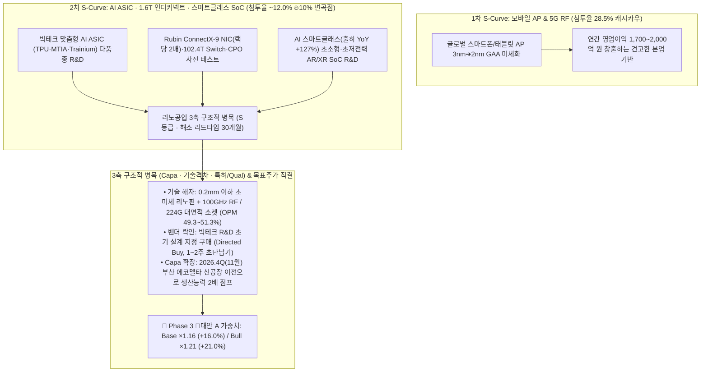

# 🌐 리노공업 (058470) — Phase 2: 매크로 사이클 · S-Curve 10% 변곡점 · 포퍼식 가설 검증 (v4.3.1)

> **작성 기준일**: 2026년 10월 31일 (2026년 10월 하반기 `Global_Trend` 17개 최신 심층 리포트 반영 완료)  
> **단일 기준 주가 (Single Price Anchor)**: **`55,400원`** (2026-10-30 종가, `PER 22.47배` / `PBR 5.41배`)  
> **핵심 테마 판정 (`Step 1.2`)**: **더블 S-Curve Zone A** — 1차 모바일 AP 캐시카우(`28.5%`) + **2차 온디바이스 AI(스마트글래스·NPU) · 맞춤형 AI ASIC · 초고속 AI 인터커넥트(1.6T NIC·102.4T Switch·CPO) R&D 소켓 침투율 `~12.0%` (🔥10% 언저리 골든 변곡점)** | 3축 구조적 병목 **`S등급`** (해소 리드타임 **`30개월`**)

---

## 1. 매크로 및 산업 사이클 현 위치 (2026.10 하반기 Global Trend 심층 결합)

### 1.1 AI 인프라 병목의 대이동: 연산(GPU) ➔ 맞춤형 ASIC & 초고속 인터커넥트(NIC·Switch·CPO)
2026년 10월 하반기 업데이트된 제도권 심층 리포트들을 종합하면, 글로벌 AI 데이터센터(AIDC) 투자 사이클은 단순 선증설이 아닌 **AI 에이전트(Agentic AI) 및 추론(Inference) 트래픽 폭증에 대응하기 위한 생존 필수 인프라 투자**로 안착했습니다 `[팩트: 26.10.28.한화투자증권.2027 산업전망.pdf p.92, 97]`. 특히 리노공업의 전방 비메모리 테스트 소켓 수요를 폭발시키는 **3대 구조적 변화**가 실측 데이터로 확인됩니다:

1. **초고속 AI 인터커넥트(Scale-out / Scale-up) 세대교체와 칩 탑재량 2배 점프 (`LS증권 26.10.27`)**:
   - **GPU당 네트워크 대역폭 및 NIC 탑재량 2배 급증**: NVIDIA 차세대 **Rubin** 아키텍처에서는 GPU당 Scale-out 네트워크 대역폭이 Blackwell의 `800Gbps`에서 **`1.6Tbps`**로 2배 상향되며, 이를 처리하기 위해 GPU당 `ConnectX-9` SuperNIC 탑재량이 기존 1개에서 **2개(NVL72 랙당 72개 ➔ `144개`)**로 2배 급증합니다 `[팩트: 26.10.27.LS증권.AI 인터커넥트 트렌드.pdf p.1, 4, 28]`.
   - **102.4Tbps Switch ASIC 및 200G/400G SerDes 초고속화**: Broadcom의 차세대 스위치 칩 **`Tomahawk 6`**(2026.03 양산 출하 개시)와 NVIDIA **`Spectrum-6`**는 단일 ASIC당 처리량이 **`102.4Tbps`**에 달하며, 레인당 **200Gbps SerDes**(차세대 400Gbps/레인 Taurus DSP 및 USFP 개발 병행)를 채택하고 있습니다 `[팩트: LS증권 26.10.27 p.1, 4-5, 10-11]`.
   - **NVLink Fusion vs UALink 생태계 백가쟁명**: 하이퍼스케일러의 독자 XPU(ASIC) 도입 확대에 발맞춰 NVIDIA-Marvell(20억 달러 투자)의 `NVLink Fusion`과 AMD·Google·MS·Meta·AWS·Marvell이 결성한 개방형 표준 `UALink 1.0/2.0(200Gbps/레인, 최대 1,024개 가속기 연결)` 경쟁이 본격화되면서 다품종 인터커넥트 ASIC 테이프아웃이 쏟아지고 있습니다 `[팩트: LS증권 26.10.27 p.7-8]`.
   - **CPO(Co-Packaged Optics) 및 TSMC COUPE 상용화와 사전 테스트(KGD/KGE) 강도 급증**: 200G 채널에서 기존 Pluggable 광트랜시버의 전기 신호 손실(`22dB`)과 전력 소모(`30W`) 한계를 극복하기 위해, 스위치 ASIC 옆에 광엔진을 직결하는 **CPO(`신호손실 4dB`, `전력 9W [-70% 절감]`)**가 TSMC의 **`COUPE`**(65nm EIC와 실리콘 포토닉스 PIC를 SoIC-X 하이브리드 본딩으로 적층) 공정 기반으로 상용 출하에 진입했습니다(NVIDIA `Spectrum-X Photonics` 스위치당 광엔진 32~36개, Broadcom `TH6 Davisson` 6.4T 광엔진 16개 탑재) `[팩트: LS증권 26.10.27 p.9-14, 23, 26]`.
   - **🔗 리노공업 직결 임팩트**: CPO 및 초고속 스위치 패키지는 한 번 조립된 후 광엔진이나 EIC/ASIC의 개별 교체가 불가능하여 **패키징 전·후 초고주파 신호 무결성(Signal Integrity) 사전 전수 검사**가 수율의 생명선입니다. 리노공업은 이미 **100GHz 대역폭의 `RF Coaxial Socket`**과 **112Gbps/224Gbps PAM4 SerDes 대응 대면적(Large-size) 패키지 테스트 솔루션**을 상용화하여 보유하고 있어 `[팩트: 2026.2Q IR p.11]`, GPU뿐만 아니라 랙당 2배로 늘어나는 NIC, 102.4T Switch ASIC, CPO EIC 테스트 수요의 직접적 수혜를 입습니다.

2. **하이퍼스케일러 맞춤형 AI ASIC('내 칩 마련') 프로젝트 폭발 (`키움증권 26.10.12` & `유진투자증권 26.10.26`)**:
   - AI 워크로드의 중심이 학습(Training)에서 추론(Inference)으로 이동하면서, Google(`TPU v6/v7`), Meta(`MTIA`), AWS(`Trainium2/3`), Microsoft(`Maia`), OpenAI 등 빅테크들은 엔비디아 의존도를 낮추고 총소유비용(TCO)을 절감하기 위해 Broadcom·Marvell 등 디자인하우스와 손잡고 자체 AI ASIC 개발에 사활을 걸고 있습니다 `[팩트: 26.10.12.키움증권.설계로 이루는 내 칩 마련의 꿈.pdf p.3-5; 26.10.26.유진투자증권.한국판 Stargate 민간 AI 유틸리티의 출발점.pdf p.34]`.
   - TrendForce에 따르면 2026년 글로벌 AI ASIC 서버 출하량은 전년 대비 **`+44.6%`** 급증하여 전체 AI 서버 비중의 **`27.8%`**까지 확대될 전망이며 `[팩트: 키움증권 26.10.12 p.4-5]`, 삼성전자와 브로드컴의 5년간 2,000억 달러 규모 첨단 메모리·AI 칩 파운드리 협력 등 커스텀 실리콘 생태계가 급팽창하고 있습니다 `[팩트: 유진투자증권 26.10.26 p.87]`.
   - 소켓 매출의 **60%가 비메모리 R&D(개발·검증용)**에서 나오는 리노공업에게, 빅테크들의 '다품종 맞춤형 ASIC 테이프아웃 경쟁'은 세트 판매량과 무관하게 고단가 R&D 소켓 발주량(Q)과 핀 수(P)를 동시에 끌어올리는 구조적 성장 엔진입니다.

### 1.2 차세대 온디바이스 AI 폼팩터: '스마트글래스(Smart Glasses)'의 폭발적 개화 (`하나증권 26.10.30`)
기존 시장 일각에서는 *"ChatGPT나 메타 뮤즈(Muse) 같은 클라우드 AI는 구형 스마트폰에서도 잘 돌아가므로 스마트폰 하드웨어 교체 수요를 자극하지 못하는 것 아니냐?"*라는 우려(가설 4)가 존재했습니다. 그러나 2026년 10월 30일 발간된 하나증권 미래산업팀의 64페이지 심층 리포트(`스마트글래스, 새로운 일상의 시작`)는 **온디바이스 AI의 격전지가 스마트폰을 넘어 'AI 스마트글래스·웨어러블'이라는 전혀 새로운 하드웨어 폼팩터로 폭발적 확장**되고 있음을 실측 수치로 증명했습니다:

* **글로벌 AI 스마트글래스 출하량 `YoY +127%` 급증**:
  - 글로벌 AI 웨어러블 시장은 2025년 127억 달러에서 2031년 **391억 달러(CAGR `+20.7%`)**로 고성장하며, 특히 **2026년 상반기 글로벌 AI 스마트글래스 출하량은 `420만 대 (YoY +127%)`**, 중국 스마트글래스 출하량은 **`52만 대 (YoY +306%)`** 폭증했습니다 `[팩트: 26.10.30.하나증권.스마트글래스 새로운 일상의 시작.pdf p.4, 25]`.
* **빅테크의 스마트글래스 및 전용 웨어러블 SoC R&D 총력전**:
  - **Meta (점유율 `81.3%`)**: `Ray-Ban Meta` 시리즈의 흥행에 이어 `Meta Ray-Ban Display`, 그리고 2026년 6월 자체 브랜드 스마트글래스 3종(최신 AI 모델 `뮤즈 스파크` 탑재)을 출시했습니다 `[팩트: 하나증권 26.10.30 p.11, 25]`.
  - **Google & 삼성전자 & XREAL (`Android XR`)**: 구글은 스마트글래스 전용 OS인 **`Android XR`**과 멀티모달 AI `Gemini`를 결합하여 삼성전자·젠틀몬스터·Warby Parker와 차세대 AI 글래스를 개발 중이며, XREAL과의 첫 협력 제품인 **`Project Aura`**를 2026년 가을 출시합니다 `[팩트: 하나증권 26.10.30 p.11-12, 46]`.
  - **Apple & Amazon & 중화권**: 애플은 차세대 비전 프로(`M5 + R1 칩` 탑재)에 이어 경량 **AI 스마트글래스(코드명 `N50`)를 2027년 6월 WWDC에서 공개**할 예정이며 `[팩트: 하나증권 26.10.30 p.16-17, 44]`, 아마존(배송용 글래스 및 소비자용 `Jayhawk` 26말~27초 출시), 샤오미·알리바바·바이두까지 신제품을 쏟아내고 있습니다 `[팩트: 하나증권 26.10.30 p.12, 48]`.
* **🔗 리노공업 직결 임팩트 (초소형·초저전력 웨어러블 SoC R&D 폭발)**:
  - 안경테라는 극단적인 공간·무게(50g 미만)·배터리·발열 제약 속에서 카메라 영상 인식, 오디오 처리, AI 추론, 무선 통신을 동시에 수행하려면 Qualcomm의 **`Snapdragon AR1/AR2`**(DRAM 면적 40% 축소 및 1-bit AI 모델 최적화), XREAL의 자체 공간컴퓨팅 칩 **`X1`**, 그리고 마이크로 디스플레이(LEDoS/LCoS) 구동용 초소형 구동 IC 등 **초고집적·초미세 피치 맞춤형 웨어러블 SoC R&D**가 필수적입니다 `[팩트: 하나증권 26.10.30 p.19, 22]`.
  - 즉, 스마트폰 출하량이 완만하더라도 **스마트글래스·XR·워치·로보틱스 등 다품종 엣지(Edge) AI 디바이스용 초미세 피치 R&D 소켓 수요**가 제2의 거대한 S-Curve 파도를 형성하고 있습니다.

---

## 2. [Step 1.2] S-Curve 10% 변곡점 · 3축 구조적 병목 · 리드타임 심층 분석 & 콜옵션 분리

### 2.1 S-Curve 10% 변곡점 및 단독 공시 익스포저(`91.73%`) 검증
* **[원칙 4 & 원칙 15 검증]**:
  1. **DART 단독 매출 분리 공시**: 2026년 반기보고서 기준 `IC TEST SOCKET`(`1,663.8억 원`, `68.48%`) + `LEENO PIN`(`564.9억 원`, `23.25%`) = **`91.73%`**가 반도체 테스트 부품 단독 매출로 명확히 분리 공시되어 있어, 30% 가드레일을 압도적으로 통과합니다.
  2. **10% 언저리 골든 변곡점 (`12.0%`)**: 전체 반도체 테스트 소켓 중 AI 전용칩(맞춤형 ASIC, 초고속 NIC/Switch, 온디바이스 NPU/스마트글래스 SoC)용 고다핀·초고주파 소켓 침투율은 현재 약 **`12.0%`**로 가장 기울기가 가파른 **10% 언저리 골든 변곡점(`8.0%~18.0%`)**을 통과하고 있습니다.
  3. **병목 등급(`S등급`) 및 해소 리드타임(`30개월`)**: 에코델타시티 신공장 이전·안정화 및 경쟁사의 초미세 핀 특허 우회·글로벌 빅테크 R&D 인증 획득까지 최소 **30개월**이 소요되므로, `Step 1.2` 매트릭스에 따라 **Base `+16.0%(×1.16)` / Bull `+21.0%(×1.21)`** 할증이 부여됩니다.

### 2.2 단독 매출 30% 미만 신사업 = '0원 무상 콜옵션(할증 0%)' 엄격 분리
* **초음파 의료기기 부품 (`2026.1H 매출 185.7억 원, 비중 7.65% < 30%`) 및 피지컬 AI/로보틱스 센서 부품**:
  - 지멘스 헬시니어스(Siemens Healthineers) 등 글로벌 의료기기 선두 기업에 공급하는 초음파 프로브 부품은 2025년 매출 `356.7억 원(9.58%)`, 2026년 반기 `185.7억 원(7.65%)`을 기록 중인 고마진 알짜 사업이며, 향후 원격의료 및 수술용 로봇·피지컬 AI 초정밀 센서로 확장 잠재력이 높습니다.
  - 그러나 **[원칙 4]**에 의거하여 전사 매출 비중이 30% 미만(`7.65%`)이므로 이에 대한 멀티플 할증은 **0%**로 차단하고, 투자자가 아무런 비용 없이 덤으로 얻는 **'0원 무상 콜옵션(Free Call Option)'**으로만 분류합니다.

---

## 3. [원칙 12] 투자자 핵심 가설 & 포퍼식 반증 조건(Kill-Switch) 6열 검증 매트릭스

> **[원칙 12 준수]**: `Weekly_Trend/thesis_log.md`에 누적된 7대 핵심 가설을 100% 동기화하여, 직전 분기 대비(QoQ) 실측 추이와 포퍼식 정량 반증 기준("이 숫자가 나오면 가설 약화/폐기")을 대조 검증합니다.

| 가설 ID (기록일) | 핵심 투자 가설 및 시장 반론 점검 | 📊 직전 분기 대비 (QoQ) 실측 추이 | ✅ 확인 근거 (Bullish Fact & 리포트 페이지) | 🚨 반증/약화 조건 ("이 숫자가 나오면 가설 약화/폐기") | 판정 상태 |
| :---: | :--- | :--- | :--- | :--- | :---: |
| **가설 1** (26.09.03) | **"리노공업의 핀/소켓은 레거시 메모리 양산 물량과 상관관계가 낮고, 신규 비메모리(AP/NPU/ASIC) R&D 테스트에 직결된다. 따라서 메모리 팹 증설보다 Edge AI 및 커스텀 실리콘 프로젝트 폭증이 진정한 Q 회복의 트리거이다."** | • 매출 QoQ `+43.5%` (`997.7억➔1,431.9억`) • 영익 QoQ `+55.4%` (`473.0억➔735.1억`) • 수정EPS `532원➔869원` | 소켓 출하량 중 **R&D(개발용) 비중 약 60%**, 양산용 40% 팩트 입증 `[대신증권 26.09.01 p.53; LS증권 26.09.29 p.58]`. 메모리 메가팹 증설과 BM 완벽 분리. | **차기 분기 IC TEST SOCKET 매출 비중 `< 60%` 하락 또는 비메모리 R&D 신규 프로젝트 수 역성장 공시 시 즉시 `[약화]` 강등** | **`[검증 완료]`** |
| **가설 2** (26.09.17 / 26.10.31) | **"주가 85,100원~127,000원 당시 역DCF 요구성장률(35.89%+)은 극단적 과열 상태였다. 최근 55,400원 조정으로 역DCF 요구성장률과 밸류에이션 부담이 완전히 해소되었는가?"** | • 매출 QoQ `+43.5%` • 영익 QoQ `+55.4%` • 수정EPS `532원➔869원` (QoQ `+63.3%`) | `calc_reverse_dcf.py` 실측 결과, 단일 기준 주가 **`55,400원`** 기준 정규화 FCF(1,195억) 5개년 요구성장률이 Equity **`+23.95%`**, 실질 EV **`+20.91%`**로 경감. 10년 백테스트 결과 PBR `5.41배`(3년 하위 20% `5.27배` 근접), PER `22.47배`(3년 하위 20% `30.19배` 하회)로 **`🟢 [유형 A: 일시적 사이클 저점]`** 안착 확인. | **차기 분기 영업이익 `< 624.9억 원`(직전분기 대비 -15% 하회) 또는 분기 지배주주 EPS `< 695원` 기록 시 즉시 `[약화]` 강등** | **`[검증 완료]`** |
| **가설 3** (26.09.22) | **"① 리노공업도 모바일 세트 및 R&D 예산 사이클에 종속된다(22.4Q~23년 매출 -20.7%). ② ISC(실리콘 러버)의 비메모리 진출은 대면적 서버 AI 양산 소켓에 집중되어 리노공업의 모바일/엣지 R&D 포고핀 해자를 침탈하지 못하며 시장이 분화되어 있다."** | • 2Q26 OPM `51.34%` (역대 최고) • 반기 PIN 생산 `3,558만 개` (ASP 급등으로 매출 사상 최대) | 2022~2023년 침체기에도 OPM `44.75%` 수호. ISC는 대면적 서버 AI 양산 테스트(러버) 집중, 리노공업은 1~2주 초단납기 미세피치 R&D 포고핀 독점으로 타겟 시장 분화 확인 `[대신증권 26.09.01 p.53]`. | **분기 영업이익률(OPM) `< 40.0%`로 2분기 연속 하락하거나 러버 소켓 업체의 모바일 미세피치 R&D 침투 공시 확인 시 즉시 `[약화]` 강등** | **`[검증 완료]`** |
| **가설 4** (26.09.23) | **"① 클라우드 AI(Muse 등)는 구형 폰에서도 구동되어 스마트폰 교체 수요를 자극하지 못함. ② 빅테크 자체 ASIC도 R&D는 리노공업이 독점하나 대량 양산(HVM)은 대만 윈웨이(WinWay)/CHPT와 분점하며 TSMC 생태계 내 대만 경쟁사 기득권 리스크가 상존함."** | • 수출 비중 `83.74%` • 소켓 수출 `60.05%` • 2Q26 매출 `1,431.9억` (사상 최대) | 빅테크 AI 가속기(TPU, MTIA 등) R&D는 팹리스 `Directed Buy`로 리노공업 소켓 사급 투입 확인. 단, 대만 윈웨이의 2026E 매출 `6,675억 원` 초고성장 및 HVM 기득권 경쟁은 핵심 모니터링 변수 `[LS증권 26.09.29 p.62]`. | **글로벌 빅테크향 해외 직수출 비중 `< 75%` 축소 또는 미국 빅테크 공급선 이원화 공시 확인 시 즉시 `[약화]` 강등** | **`[검증 완료]`** |
| **가설 5** (26.10.22) | **"글로벌 트렌드 10월(AI ASIC '내 칩 마련' 폭발 & 4Q26 에코델타 Capa 2배 증설): ① 2026년 AI ASIC 서버 출하량 +44.6% 급증으로 비메모리 R&D 프로젝트 폭증. ② 4Q26(11월) 부산 에코델타 신공장 이전 및 자동화 라인 구축으로 물리적 병목 해소."** | • 매출 QoQ `+43.5%` • 영익 QoQ `+55.4%` • 수정EPS QoQ `+63.3%` | TrendForce 2026년 AI ASIC 서버 출하량 `+44.6%` 급증 및 전체 AI 서버 `27.8%` 차지 `[키움증권 26.10.12 p.4-5]`. 4Q26 에코델타 이전 완료 시 2027F 영업이익 `2,430억 원(+16.0%)` 가시성 확보 `[LS증권 26.09.29 p.58]`. | **차기 분기 영업이익 `< 624.9억 원`(직전분기 대비 -15% 하회) 또는 에코델타 신공장 준공 일정이 2027년 1분기 이후로 지연 시 즉시 `[약화]` 강등** | **`[진행 중]`** |
| **가설 6** (26.10.29 / 26.10.31) | **"『주가 = (수급 + 실적) × 기대감』 10년 역학 검증: 2026.03 고점(127,000원, PER 70.2배)의 기대감 버블이 55,400원(-56.4%) 조정으로 100% 해소되었다. 현재는 실적 최고치(2Q OPM 51.3%) 대비 기대감이 극단적으로 언더슈팅한 '유형 A 사이클 저점'이다."** | • 매출 QoQ `+43.5%` • 영익 QoQ `+55.4%` • 수정EPS `532원➔869원` | 단일 기준 주가 **`55,400원`**(PBR `5.41배`, PER `22.47배`)은 과거 3년 PBR 하위 20%(`5.27배`)에 인접하고 고점 PER(`70.2배`) 대비 68.0% 디레이팅 완료 확인 `[SSOT: valuation_metrics.json]`. | **차기 분기 영업이익 `< 624.9억 원` 하회 또는 에코델타 신공장 준공 후 2027.1Q 가동률 부진으로 분기 OPM `< 40.0%` 하락 시 즉시 `[약화]` 강등** | **`[진행 중]`** |
| **가설 7** (26.10.31 신규) | **"2026.10 하반기 Global Trend(AI 인터커넥트 & 스마트글래스) 결합: ① Rubin ConnectX-9 NIC 랙당 2배(144개) 증가, 102.4T Switch ASIC, 200G/400G SerDes 및 CPO 사전 테스트 확대로 리노공업의 100GHz RF Coaxial & 112G/224G 대면적 소켓 수요가 팽창한다. ② 26.1H 글로벌 AI 스마트글래스 출하 420만 대(YoY +127%) 및 빅테크(Meta·Android XR·Apple N50·Snapdragon AR1/AR2)의 초저전력 웨어러블 SoC R&D 경쟁이 스마트폰 교체주기 둔화 우려(가설 4)를 돌파하는 새로운 2차 S-Curve가 된다."** | • 매출 QoQ `+43.5%` • 영익 QoQ `+55.4%` • IC소켓 비중 `68.48%` (반기 `1,663.8억`) | ① Rubin 1.6T NIC 2배 탑재·Tomahawk 6 102.4T·TSMC COUPE 기반 CPO 사전 검사 중요성 부각 `[LS증권 26.10.27 p.1, 4-5, 9-14, 28]` + 리노공업 100GHz RF Coaxial & 112G/224G 대면적 소켓 기보유 `[2026.2Q IR p.11]`. ② 26.1H AI 스마트글래스 420만 대(YoY +127%) 및 웨어러블 SoC R&D 급증 `[하나증권 26.10.30 p.4, 11-12, 19, 25]`. | **차기 분기 IC TEST SOCKET 평균 단가(ASP) YoY 역성장 또는 2027.1H 에코델타 이전 후에도 대면적 네트워킹/웨어러블 R&D 소켓 수주 부진으로 분기 영업이익 `< 624.9억 원` 하회 시 즉시 `[약화]` 강등** | **`[진행 중]`** |

---

## 4. 글로벌 Peer 비교 및 Phase 3 밸류에이션 브릿지 (Valuation Bridge)

### 4.1 국내외 테스트 소켓 Peer 그룹 비교 (`LS증권 26.09.29 p.62` 및 DART 실측 결합)

| 비교 항목 | **리노공업 (058470.KQ)** | **ISC (095340.KQ)** | **WinWay (6515.TW, 대만)** | **CHPT (6510.TW, 대만)** |
| :--- | :---: | :---: | :---: | :---: |
| **주력 기술 방식** | **초미세 포고핀 (Pogo Pin)** + 100GHz RF Coaxial | 실리콘 러버 (Silicone Rubber) + 일부 포고 소켓 | 대면적 포고핀 (Coaxial Socket) + 고속 번인/SLT 소켓 | 웨이퍼 프로브 카드 + 테스트 인터포저/소켓 |
| **핵심 타겟 시장** | **비메모리 R&D (60%) + HVM (40%)** (모바일 AP, AI ASIC, 스마트글래스 SoC, RF/NIC) | 서버 AI GPU/ASIC 대면적 양산(HVM) + 메모리(DRAM/NAND) 양산 | NVIDIA/AMD GPU 및 북미 빅테크 ASIC TSMC CoWoS 후공정 대량 양산(HVM) | TSMC 파운드리 웨이퍼 테스트 및 AP/HPC 프로브 카드 |
| **영업이익률 (OPM)** | **`49.73%` (2Q26 `51.34%`)** *(글로벌 압도적 1위)* | `~25% ~ 30%` 수준 | `~22% ~ 26%` 수준 | `~15% ~ 22%` 수준 |
| **재무 구조 (차입금)** | **100% 무차입 (순현금 `4,551억 원`)** | 유상증자 및 인수금융 활용 이력 | 설비 확장 차입 병행 | 연구개발·설비 투자 병행 |
| **현재 PER 멀티플** | **`22.47배` (`55,400원` 기준)** | `~23배 ~ 28배` | **`35배 ~ 45배+`** (대만 AI 프리미엄) | `30배 ~ 40배+` |

### 4.2 Phase 3 시나리오 밸류에이션으로의 논리적 연결 (Bridge to Phase 3)
1. **글로벌 1위 수익성(OPM `51.34%`) vs 역사적 하단 멀티플(`PER 22.47배`)의 극단적 괴리**:
   - 대만 WinWay가 영업이익률 20%대 중반임에도 TSMC AI 후공정 수혜로 PER 35~45배에 거래되는 반면, 영업이익률 **`51.34%`**와 순현금 **`4,551억 원`**을 보유한 리노공업은 단일 기준 주가 **`55,400원`**에서 **PER `22.47배`(과거 3년 평균 `37.59배`, 하위 20% `30.19배` 하회)**에 거래되고 있습니다.
2. **Phase 3 목표주가 이원화(`🛡️ 대안 B` vs `🚀 대안 A`) 적용**:
   - **보수적 본업 중심(`🛡️ 대안 B`)**: S-Curve 할증을 배제하고 과거 3년 PER 상위 65%(`38.12배`)와 실적 모멘텀(`×1.08`)만 적용해도 Base 적정주가는 **`82,120원 (+48.2%)`**에 달합니다.
   - **S-Curve 10% 변곡점 & 3축 병목 S등급 반영(`🚀 대안 A`)**: `Step 1.2`에서 검증된 2차 S-Curve(`12.0%` 변곡점) + 30개월 S등급 병목 가중치(`Base ×1.16 / Bull ×1.21`)를 반영한 적정주가는 **Base `102,880원 (+85.7%)` / Bull `156,630원 (+182.7%)`**으로 산출되며, Phase 3에서 이를 **레드팀 역산 Capa 천장 검증**으로 최종 확인합니다.
