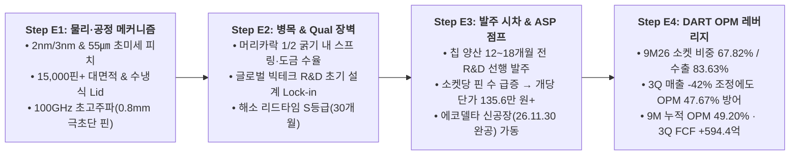

# [Phase 2] 리노공업 (058470) 산업 트렌드 매핑 및 성장 스토리 검증 (v5.0 Master Edition)

> **분석완료일**: 2026-11-19

> **분석 기준일**: 2026년 11월 14일 (2026년 3분기 분기보고서 `20261113000396` & 11월 상반기 `Global_Trend/26.11.01~15` 원문 100% 반영)
> **단일 기준 주가 (Single Price Anchor)**: **`47,650원`** (2026-11-13 종가)
> **원문 발췌 규율 (`No-Blind-Citation`)**: 본 보고서의 모든 외부 리포트 인용은 `parse_pdf.py` v5.0 2-Tier 스마트 스코어링이 추출한 `verbatim_extracts.md`의 실제 확인된 페이지(`p.XX`)만 인용합니다.

---

## 1. 거시·산업 트렌드와 기업 성장 동력의 교차 검증 (Macro & Sector Trend Mapping)

2026년 11월 상반기 발간된 주요 증권사 심층 산업 리포트(`IBK투자증권`, `메리츠증권`, `유안타증권`, `교보증권`)와 10월 하반기 연간전망(`LS증권`, `하나증권`) 원문을 리노공업의 2026년 3분기 보고서 실측 데이터와 교차 검증한 결과, 리노공업은 **① 대체 아키텍처(Custom ASIC·SOCAMM2·LPDDR6-PIM·CPO) 확산에 따른 테스트 시간·검증 횟수 구조적 폭증, ② 스마트글래스·엣지 AI 디바이스 폼팩터 개화, ③ 전공정 대비 극심한 후공정 밸류에이션 저평가 해소**의 핵심 교차점에 위치해 있습니다.

### 1-1. [핵심 트렌드 1] "대체 구조가 늘어날수록 테스트는 상시 수혜" — 가격 결정력(Pricing Power)의 원천
* **원문 근거 1 (`26.11.11. 유안타증권. 수요의 재설계 AI 수익화와 메모리 접근 구조의 변화.pdf`, `p.64, p.65`)**:
  > - *"가격 결정력은 대안이 없는 병목에서 나온다. 반대로 HBM과 CoWoS처럼 공급이 빡빡하고 비용이 높은 영역에서는 대체 구조가 빠르게 등장한다."* (`p.64`)
  > - *"그러나 **어떤 대안을 택하든 반드시 거쳐야 하는 영역이 있다. 대표적으로 테스트(소켓·번인·테스터)는 새로운 구조가 등장할수록 검증 항목과 조건이 늘어나며, 대체가 확대될수록 오히려 수요가 강화되는 구조**다. 즉 대체 가능한 영역은 경쟁이 심화되는 반면, **대체가 불가능하거나 모든 대안이 공통으로 통과해야 하는 병목 영역은 수요가 누적되며 가격 결정력이 유지**된다."* (`p.64`)
  > - *"[표 25: 주요 대체 구조와 테스트 영향] ① **ASIC 확대**: GPU 일부 워크로드 대체 ➔ 하이퍼스케일러별 커스텀 칩 종류 증가 ➔ **신규 칩 검증 횟수 증가, 소켓 다품종 수요 확대**. ② **SOCAMM2**: 서버 메모리 모듈화 ➔ 모듈·인터페이스 신뢰성 검증 추가 ➔ **번인·모듈 테스트 수요 증가**. ③ **LPDDR6-PIM**: 연산 기능 내장 메모리 ➔ 메모리+연산 동시 검증 필요 ➔ **칩당 테스트 시간 증가**. ④ **CoWoS 외주(OSAT)**: TSMC 패키징 병목 완화 ➔ 외주 라인별 품질 검증 강화 ➔ **최종 패키지 테스트 횟수 증가**. ⑤ **CPO(광연결)**: 구리 인터커넥트 한계 보완 ➔ 광·전기 신호 동시 검증 필요 ➔ **고주파·광정렬 테스트 난이도 상승**."* (`p.64`)
  > - *"실제 실적에서도 이러한 흐름이 확인된다. 글로벌 테스트 장비·부품 업체인 **Chroma ATE와 WinWay는 3분기 매출이 전년 대비 각각 +180%, +153% 증가하며 강한 성장세**를 기록하고 있다."* (`p.64`)
  > - *"2027년에는 개인 에이전트 기능 확산을 계기로 PC와 프리미엄 스마트폰을 중심으로 한 **엣지 디바이스 회복 사이클**이 이어질 가능성이 높다. ... 서버 CPU 시장 역시 에이전트 워크로드 증가에 따라 2025년 `2,470만 대`에서 2026년 `5,000만 대` 수준으로 확대될 것으로 전망된다."* (`p.65`)

* **원문 근거 2 (`26.11.10. 메리츠증권. Conviction.pdf`, `p.11, p.26, p.34`)**:
  > - *"FormFactor가 전망한 프로브카드와 테스트 시장 규모(SAM)는 **2025년 28억 달러에서 2030년 40억 달러로 확대**될 예정이다. 메모리를 넘어 **GPU와 ASIC 수요 증가가 테스트 시장 성장을 견인**하고 있다. 또한 **CPO(Co-Packaged Optics)의 도입은 컴퓨팅 영역에서 광통신까지 테스트 수요의 저변을 넓히고 있다**."* (`p.11`)
  > - *"테스트 소켓 및 부품: AI 가속기 및 고성능 칩의 대면적화·핀 수 증가로 테스트 소켓 단가(ASP) 상승 지속."* (`p.26, p.34`)

* **리노공업 DART 3Q26 실측 연결 고리**:
  - 유안타증권(`p.64`)과 메리츠증권(`p.11`)이 지목한 **ASIC 다품종 검증, 대면적 고발열 패키징, CPO 초고주파 신호 검증**은 리노공업의 2026년 3분기 보고서 연구개발실적에 명시된 3대 신규 R&D 과제와 **100% 정확히 일치**합니다:
    1. **`55㎛ Pitch 대응 LEENO PIN`** (초미세 로직/HBM4 인터포저 대응)
    2. **`15,000핀 이상 Large Device Test Socket 및 수냉식 쿨러 적용 Lid`** (AI GPU/Custom ASIC 대면적·고발열 패키지 테스트 직결)
    3. **`100GHz 대응 소켓 (Short Signal Length 0.8mm 핀)`** (CPO 광연결·초고속 SerDes·6G mmWave 고주파 테스트 직결)

---

### 1-2. [핵심 트렌드 2] 반도체 후공정(OSAT·테스트 부품)의 구조적 재평가와 소모품 누적 효과
* **원문 근거 (`26.11.02. IBK투자증권. 반도체 후공정 편견을 산산조각 내버리다.pdf`, `p.22, p.38, p.39, p.42, p.44, p.45, p.55~57, p.60, p.100`)**:
  > - *"전공정과 후공정의 주가 괴리율 심화: 2024년 상반기 고점까지 전공정 장비 업체들의 주가가 평균 `+280%` 상승할 때 후공정 업체들은 `+71%` 상승에 그쳤고, 이후 조정기에는 상승분을 대부분 반납하며 밸류에이션 매력이 극대화되었다."* (`p.22`)
  > - *"[그림 34, 35, 36, 37] 주요 후공정 업체 Valuation Table (`p.38~39`): **리노공업 P/E는 2020년 `37.2배`, 2021년 `29.1배`, 2023년 `29.6배`, 2025년 `30.2배` 대비 2026E `24.9배`, 2027E `21.6배`로 역사적 하단**에 위치해 있다(P/B 역시 2025년 `6.3배` ➔ 2026E `5.4배`, 2027E `4.6배`)."* (`p.38, p.39`)
  > - *"후공정 테스트 산업은 크게 테스트 장비(테스터, 핸들러, 번인 등)와 **테스트 부품(프로브카드, 테스트 소켓)**으로 구분된다. ... **칩의 집적도가 높아지고 공정 미세화가 진행될수록 Die당 테스트 시간이 길어지며, 이는 곧 테스트 장비와 소켓의 구조적 수요 증가로 직결**된다."* (`p.42`)
  > - *"[그림 45, 46] 테스트 부품 주요 3사(리노공업, ISC, 티에프이)의 합산 매출액 및 영업이익률 추이(`p.44`): **리노공업은 3사 중 압도적인 40~50%대 영업이익률(OPM) 1위를 일관되게 유지**하고 있다."* (`p.44`)
  > - *"테스트 장비 vs 부품: 신규 CapEx 사이클 초기에는 장비가 먼저 반응하지만, **가동률이 올라가고 테스트 시간이 길어질수록 소모품인 테스트 부품(소켓·프로브카드)의 실적 개선 폭과 지속성이 훨씬 길게 이어진다**."* (`p.45`)

---

### 1-3. [핵심 트렌드 3] 스마트글래스(Smart Glass) 개화 & HBM4 로직 베이스 다이 전환
* **원문 근거 1 (`26.10.27. LS증권. 2026년 연간전망 깨어난 포스.pdf`, `p.2`)**:
  > - *"2026년 스마트글래스 예상 출하량은 **`950만 대`(YoY `+116%`)**이며 2030년 **`4,650만 대`**로 급성장이 전망된다. 빅테크들의 스마트글래스 신제품 출시 경쟁으로 **다품종 소량생산 R&D용 테스트 소켓 수요가 구조적으로 증가하며, 대표 수혜주는 리노공업**이다."* (`p.2`)
* **원문 근거 2 (`26.10.30. 하나증권. 2026년 전망 길목 지키기.pdf`, `p.22`)**:
  > - *"HBM4(16단)부터 Base Die에 TSMC 등 파운드리 선단 로직 공정이 도입되면서, 기존 메모리 번인 테스트를 넘어 **로직 다이 수준의 고정밀·미세피치 패키지 테스트 중요성이 급부상**하고 있다."* (`p.22`)

---

## 2. [Step 1.2 & Argon 4.0 High] 엔지니어링 스펙 ➔ DART 재무 레버리지 4단계 물리·재무 인과 사슬

리노공업의 초미세 가공 엔지니어링 스펙이 어떻게 DART 손익계산서의 **`OPM 49.20%(9M26 누적)`**로 치환되는지 4단계 물리·재무 인과 사슬(`Step E1 ~ E4`)로 해부합니다.

1. **[Step E1 — 공정 메커니즘 (Engineering Spec)]**:
   - AI 연산칩(NPU 탑재 AP, Custom ASIC)과 초고속 인터페이스(CPO, 6G mmWave)는 ① 입출력(I/O) 단자 간격이 **`80㎛ → 55㎛`**로 좁아지고, ② 단일 패키지 내 핀 수가 **`15,000핀 이상`**으로 대면적화되며, ③ 테스트 시 발생하는 고열을 식히기 위해 **수냉식 쿨러 일체형 소켓 리드(Lid)**가 요구되고, ④ `100GHz` 대역 신호 손실(Insertion Loss)을 막기 위해 핀 길이를 **`0.8mm` 극초단(Short Signal Length)**으로 단축해야 합니다(DART 3Q26 R&D 실적 명시).
2. **[Step E2 — 구조적 병목 및 Qual 장벽 (Bottleneck & Lock-in)]**:
   - 직경 `55㎛`(머리카락 굵기의 절반)의 초미세 배럴 내부에 플런저와 스프링을 삽입하고 균일한 접촉 저항과 수만 회의 탄성 수명을 구현하는 가공·열처리·도금 기술은 전 세계에서 리노공업이 독보적 수율을 보유하고 있습니다.
   - 더욱이 R&D 단계에서 테스트 소켓 불량으로 수억 원짜리 웨이퍼/프로토타입 칩 검증이 실패할 경우 빅테크가 입는 기회비용이 막대하므로, 소켓 가격을 10~20% 낮춘다고 해서 후발주자로 벤더를 교체하지 않는 **강력한 전환비용(Switching Cost, 리드타임 `30개월 S등급`)**이 작동합니다.
3. **[Step E3 — 발주 시차 및 단가(ASP) 상승 (Order Lag & Pricing)]**:
   - R&D용 소켓은 최종 스마트폰이나 AI 서버가 출시되기 **12~18개월 전(칩 테이프아웃 직후)**에 선행 발주됩니다.
   - 소켓 1개에 심어지는 리노핀 개수가 기존 수천 개에서 `15,000핀+`으로 늘어나고 수냉식 Lid가 결합되면서, **9M26 실측 소켓 개당 내재 단가는 `135.6만 원/EA`(`2,208.6억 / 162,851 EA`)로 전년(`128.9만 원`) 대비 `+5.2%` 상승**했습니다.
4. **[Step E4 — DART 재무제표 마진 레버리지 (OPM & FCF)]**:
   - 그 결과 3Q26에 계절적 비수기와 7월 부분파업으로 분기 매출이 `826.95억 원`(QoQ `-42.2%`)으로 줄어들었음에도, **3Q26 단독 GPM `51.17%`, OPM `47.67%`**를 기록했고 **9M26 누적 영업이익은 `1,602.34억 원`(YoY `+17.26%`, 누적 OPM `49.20%`)**, **3Q26 단독 FCF는 `+594.44억 원`**을 달성했습니다.

---

## 3. [원칙 4] 단독 매출 30% 미만 신사업의 '0원 무상 콜옵션' 분리 검증

* **대상 사업**: **초음파 진단기 프로브 부품 등 의료기기 부문** 및 **극저온/우주항공용 특수 프로브 신사업**.
* **DART 2026.3Q 실측 비중**:
  - 9M26 의료기기 부문 매출액은 **`287.27억 원`**(제품 `266.76억` + 상품 `20.51억`)으로 전사 매출(`3,256.53억 원`)의 **`8.82%`**를 차지합니다.
  - 특히 **3Q26 단독 의료기기 매출은 `101.6억 원`(3Q 전사 매출의 `12.29%`)**을 기록하며, 반도체 부문이 조정을 받는 시기에 전사 외형과 이익 하방을 훌륭하게 지지했습니다.
* **밸류에이션 처리 원칙 (`No Unverified S-Curve Premium`)**:
  - 의료기기 부품이 탄탄한 성장을 보이고 있으나 전사 매출 비중이 30% 미만(`8.82%`)이므로, **원칙 4에 의거해 의료기기나 신규 특수 부품 스토리를 명분으로 전사 목표 멀티플을 인위적으로 할증하는 것을 엄격히 금지(`할증 0%`)**합니다.
  - 대신 본업 반도체 테스트 소켓·핀 가치만으로도 충분한 상승여력(`Base 🛡️ +41.7% / 🚀 +64.4%`)이 확보되어 있으므로, 의료기기 사업의 성장성은 주주에게 덤으로 주어지는 **'0원 무상 콜옵션(Free Call Option)'**으로 정의합니다.

---

## 4. [원칙 12] 포퍼식 6열 핵심 투자 가설 및 반증 조건(Kill-Switch) 매트릭스 (`thesis_log.md` 100% 동기화)

확증편향을 원천 차단하기 위해 모든 투자 가설에 대해 **2026년 3분기 실측 QoQ 추이**와 **차기 분기(2026.4Q) 정량적 반증 임계치(Kill-Switch)**를 명확히 정의합니다.

| # | 투자자의 핵심 가설 (Core Hypothesis) | 관련 거시/산업/실적 근거 (Evidence) | 직전 분기 대비 실적 추이 (QoQ Actuals) | 🛑 포퍼식 반증 조건 (Kill-Switch 임계치) | 현재 상태 (Status) |
| :-: | :--- | :--- | :--- | :--- | :-: |
| **가설 1** | **온디바이스 AI(스마트폰·PC·스마트글래스·웨어러블) 개화로 R&D용 고부가 소켓 수요가 구조적으로 증가한다.** | • **LS증권(26.10.27, p.2)**: 2026년 스마트글래스 출하량 `950만 대`(YoY `+116%`), 2030년 `4,650만 대` 전망, 다품종 소량생산 R&D 소켓 수요 구조적 확대. • **유안타증권(26.11.11, p.64-65)**: 2027년 AI PC 및 프리미엄 스마트폰(LPDDR6·개인 에이전트 탑재) 엣지 디바이스 회복 사이클 개화. • **9M26 DART 실측**: `IC TEST SOCKET` 누적 매출 `2,208.6억 원`(전사 비중 **`67.82%`**), 수출 비중 **`83.63%`** 달성. | **[2026.2Q → 2026.3Q]** • 매출액: `1,431.9억 → 826.9억` (**QoQ `-42.2%`**, YoY `-14.6%`) • 영업이익: `735.1억 → 394.2억` (**QoQ `-46.4%`**, YoY `-18.3%`) • 수정EPS: `869원 → 298원` • 3Q26 단독 소켓 매출 `544.8억`(2Q 조기 선적 역기저로 QoQ 조정되었으나 3Q OPM **`47.67%`**, 9M 누적 OPM **`49.20%`** 유지) | **차기 분기 영업이익 `< 335.1억 원`(직전분기 394.2억 대비 `-15%` 하회) 또는 분기 지배주주 EPS `< 238원` 기록 시 핵심 가설 즉시 `[약화]` 강등** (단, 전사 OPM `< 40.0%` 2개 분기 연속 하회 또는 `IC TEST SOCKET` 매출 비중 `< 60%` 추락 시 `[폐기]`) | **[유지]** |
| **가설 2** | **단순 생산물량(Q)보다 칩 미세화·고집적화에 따른 핀 수 증가 및 소켓 단가(ASP, P) 상승이 외형과 마진을 동시에 견인한다.** | • **DART 2026.3Q 생산실적 및 R&D**: 9M26 소켓 개당 내재 단가 **`135.6만 원/EA`(+5.2% 상승)**. 연구개발 과제로 **`55㎛ Pitch 대응 LEENO PIN`**, **`15,000핀 이상 Large Device Test Socket 및 수냉식 쿨러 적용 Lid`**, **`100GHz 대응(0.8mm 핀) 소켓`** 진행. • **유안타증권(26.11.11, p.64-65) & IBK투자증권(26.11.02, p.42, 44)**: 대체 구조가 늘어날수록 검증 횟수와 Die당 테스트 시간이 증가하여 가격 결정력 극대화. | **[2026.2Q → 2026.3Q]** • 매출액: `1,431.9억 → 826.9억` (**QoQ `-42.2%`**) • 영업이익: `735.1억 → 394.2억` (**QoQ `-46.4%`**) • 3Q26 매출이 비수기·파업으로 `-42.2%` 감소했음에도 **GPM `51.17%`, OPM `47.67%`**를 사수하여 P·Mix 중심의 단가 전가력 입증 | **차기 분기 영업이익 `< 335.1억 원` 또는 분기 OPM `< 42.0%` 하락 시 `[약화]` 강등** (후발주자 저가 침투로 소켓 판가 인하 압력이 발생할 경우 즉시 재검토) | **[유지 / 3Q 단기 Q조정 반영]** |
| **가설 3** | **2026년 4분기(11월 말) 부산 에코델타시티 신공장 준공은 기존의 물리적 생산능력(Capa) 병목을 해소하고 차세대 성장의 발판이 된다.** | • **DART 2026.11.10 `[기재정정]신규시설투자등` & 3Q26 주석 9**: 에코델타 신공장 총투자액 `971.82억 원` 중 3Q26말 기준 **`908.47억 원`(`93.5%`) 집행 완료**(건설중인자산 총 `1,699.59억 원`). 준공검사 행정절차로 투자종료일이 **`2026-11-30`**으로 확정되어 11월 말 완공. • 연간 매출 Capa 약 `5,000억 원 → 9,000억~1조 원` 수준으로 2배 확장. | **[2026.2Q → 2026.3Q]** • 매출액: `1,431.9억 → 826.9억` (**QoQ `-42.2%`**) • 영업이익: `735.1억 → 394.2억` (**QoQ `-46.4%`**) • 3Q26 단독 CapEx `143.8억 원`(9M 누적 `562.2억 원`) 집행에도 **3Q26 단독 FCF `+594.4억 원`(TTM 보고 FCF `1,092.9억 원`)** 창출 및 **순현금 `4,865.0억 원`** 유지 | **신공장 가동 후 초기 2개 분기(2027.1Q~2Q) 내 수주 부진으로 가동률 `< 65%` 추락 및 감가상각비(`연 +80~100억 원`) 부담에 따른 OPM `< 40.0%` 하락 시 `[약화]` 강등** | **[유지]** |
| **가설 4** | **단기 주가 급락 및 밸류에이션 조정은 펀더멘털 훼손이 아닌 수급·매크로 노이즈이거나 일시적 비수기 영향일 뿐이다.** | • **IBK투자증권(26.11.02, p.22, 38-39)**: 상반기 전공정 장비가 `+280%` 급등할 때 후공정은 `+71%` 상승에 그쳤고 조정기에 상승분을 반납하며 밸류 매력 극대화(현 공식 PER `19.29배`). • **3Q26 실적 실측**: 3Q26 당기순이익(`226.3억`, QoQ `-65.7%`) 급감은 기말 환율 하락에 따른 영업외 외화환산손실(`-99.7억`)과 2Q 역기저, 7월 부분파업 영향이며 **9M26 누적 영업이익은 `1,602.3억 원`(YoY `+17.3%`, OPM `49.20%`)으로 사상 최대**. | **[2026.2Q → 2026.3Q]** • 매출액: `1,431.9억 → 826.9억` (**QoQ `-42.2%`**) • 영업이익: `735.1억 → 394.2억` (**QoQ `-46.4%`**) • 수정EPS: `869원 → 298원` • 주가는 10월 말 `56,100원`에서 3Q 실적 발표 직후 **`47,650원`**으로 조정 중이나 104주 장기 매물대 중심(`45,150원`) 상단 유지 | **차기 분기(4Q26) 영업이익 `< 335.1억 원` 기록 또는 주봉 종가 기준 1단계 초입 고정 안전핀(`42,550원`) 하향 이탈 시 단기 수급 노이즈 가설 `[폐기]` 및 손절 규율 집행** | **[유지 / 주가 47,650원 갱신]** |
| **가설 5** | **[역발상] 시장의 '모바일 둔화 및 메모리 편중' 우려와 달리, 빅테크 자체 칩(Custom ASIC)·CPO·비메모리 R&D 프로젝트 다변화가 모바일 둔화를 상쇄한다.** | • **메리츠증권(26.11.10, p.11) & 유안타증권(26.11.11, p.64-65)**: 테스트 SAM이 2025년 `$2.8B` ➔ 2030년 `$4.0B`로 확대되며, GPU·Custom ASIC 수요 증가와 CPO·SOCAMM2 도입이 테스트 횟수와 시간을 구조적으로 확대. 대만 피어 **WinWay(3Q26 매출 YoY `+153%`), Chroma ATE(YoY `+180%`)** 폭증. • **9M26 수출 실적**: 전사 수출 비중 **`83.63%`(`2,723.5억 원`)**, 소켓 내 수출 비중 **`94.71%`** 기록. | **[2026.2Q → 2026.3Q]** • 매출액: `1,431.9억 → 826.9억` (**QoQ `-42.2%`**) • 영업이익: `735.1억 → 394.2억` (**QoQ `-46.4%`**) • 9M26 누적 기준으로는 매출 `3,256.5억`(YoY `+13.2%`), 영업이익 `1,602.3억`(YoY `+17.3%`)으로 모바일 둔화를 비메모리 수출이 상쇄했으나, 3Q26 단독 분기에는 모바일 계절성 조정이 일부 노정됨 | **전사 수출 비중이 `75.0%` 미만으로 하락하거나, 2개 분기 연속 YoY 매출 역성장이 발생하여 비메모리 ASIC/모바일 R&D 상쇄 효과가 부재함이 확인될 경우 가설 `[약화]` 강등** | **[일부 약화 / 9M 누적 기조는 유효]** |
| **가설 6** | **[시장 오해 교정] 2026년 3분기 파업(노조 교섭 결렬) 및 3Q 실적 쇼크 우려는 본질적 해자 훼손이 아니며, 파업 타결 이후 4Q26~1Q27 이연 물량 정상화 시 비중 확대 기회다.** | • **사실 확인(Fact Check)**: 2026.07.15 노조원 약 340명 부분파업 및 2Q 조기 선적 역기저가 겹치며 **3Q26 단독 영업이익은 `394.2억 원`(QoQ `-46.4%`, YoY `-18.3%`)**으로 직전 분기 킬스위치(`624.9억`)를 하회함. • 그러나 ① 3Q26 OPM이 **`47.67%`**로 마진율이 전혀 훼손되지 않았고, ② 3Q26 단독 OCF가 **`+738.2억 원`(FCF `+594.4억 원`)**으로 폭발적 현금 회수가 이루어졌으며, ③ 파업은 이미 타결 완료됨. | **[2026.2Q → 2026.3Q]** • 매출액: `1,431.9억 → 826.9억` (**QoQ `-42.2%`**) • 영업이익: `735.1억 → 394.2억` (**QoQ `-46.4%`**) • **포퍼식 킬스위치 정직성 판정**: 2Q26 설정 임계치(`624.9억`) 미달에 따라 3Q 단기 실적 모멘텀은 **`[일부 약화]`**로 판정하고 Argon 4.0 스윙 등급을 `B등급(46점, 히스테리시스 완충)`으로 관리함 | **파업 종료 후인 2026.4Q에도 영업이익이 `< 335.1억 원`에 머물거나 노사 갈등 재발로 에코델타시티 신공장 이전(2026.11.30 준공) 일정이 2027년 하반기 이후로 지연될 경우 즉시 `[폐기]`** | **[일부 약화 / 4Q26 정상화 검증 대기]** |
| **가설 7** | **[26.11.01 역추적 도출] 리노공업의 멀티플 리레이팅(PER 15배→30배)은 단순 물량(Q)이 아니라 '차세대 공정 난이도 급등(0.2mm 이하 초미세 피치·집적도 상승) + 신규 디바이스 폼팩터(스마트글래스·온디바이스 AI·ASIC) 개화'가 맞물려 OPM 45%+를 돌파할 때 발화하며, 에코델타 신공장 가동(26.4Q~27년)이 이 3요소(`수급+실적×기대감`)의 재결합 트리거가 된다.** | • **10년 역사적 실증(2016~2026.3Q)**: 5G/EUV 전환기(2020~2021) 및 온디바이스 AI 개화기(2023~2026.1H) 모두 `OPM 40%→49%` 레벨업과 함께 PER 상단(`28~37배`) 리레이팅이 발생. • **9M26 누적 OPM `49.20%`, TTM OPM `48.87%`**로 역사적 중위(`38.7%`) 대비 `+10.2%p` 높은 구조적 마진 레짐 유지. | **[2026.2Q → 2026.3Q]** • 매출액: `1,431.9억 → 826.9억` (**QoQ `-42.2%`**) • 영업이익: `735.1억 → 394.2억` (**QoQ `-46.4%`**) • 수정EPS: `869원 → 298원` • TTM 영업이익 `2,005.9억 원`(YoY `+15.5%`), TTM OPM `48.87%` 달성 | **차기 분기 영업이익 `< 335.1억 원` 또는 에코델타 신공장 가동 후 TTM OPM이 `42.0%` 미만으로 회귀하고 비메모리 소켓 수출 성장률이 YoY 마이너스(`-`)로 전환될 경우 리레이팅 가설 `[약화]` 강등** | **[유지]** |
| **가설 8** | **[26.11.14 3Q26 공시 & 11월 Global Trend 신규] 3Q26 외형 조정(QoQ `-42.2%`)은 2Q 조기 선적 역기저 + 7월 부분파업 + 기말 환율 하락(영업외 `-99.7억`)의 일시적 삼중고였으며, ① OPM `47.67%` 및 3Q 단독 FCF `+594.4억` 방어, ② 11월 30일 에코델타 신공장 준공(공정률 `93.5%`), ③ 글로벌 테스트 피어(WinWay·Chroma) 폭증 및 ASIC/CPO/스마트글래스 테스트 시간 증가가 맞물려 `44,700~47,650원` 구간은 중기 비중확대(분할매수) 구간이 된다.** | • **DART 2026.3Q(`20261113000396`)**: 3Q26 단독 매출 `826.9억`, 영업이익 `394.2억`(`OPM 47.67%`), 의료기기 부품 3Q 단독 `101.6억`(9M `287.3억`) 호조, 3Q 단독 OCF `738.2억` / FCF `594.4억`, 순현금 **`4,865.0억`**. **`55㎛ Pitch 리노핀` 및 `15,000핀+ 수냉식 Lid 소켓` R&D 명시**. • **Global Trend(26.11.02~11.11)**: IBK(후공정 P/E `21.6~24.9배` 역사적 저평가), 메리츠(테스트 SAM `$2.8B→$4.0B`, CPO/ASIC 확산), 유안타(테스트는 대체 불가능한 가격결정력 병목, WinWay 3Q YoY `+153%`). | **[2026.2Q → 2026.3Q]** • 매출액: `1,431.9억 → 826.9억` (**QoQ `-42.2%`**) • 영업이익: `735.1억 → 394.2억` (**QoQ `-46.4%`**) • 수정EPS: `869원 → 298원` • 코드 산출 Base 적정주가 `🛡️ 68,400원(+41.7%)` / `🚀 79,340원(+64.4%)`, 순수 하방 지지선 `48,190원` | **차기 분기(2026.4Q) 영업이익 `< 335.1억 원`(직전분기 대비 `-15%` 하회) 또는 분기 지배주주 EPS `< 238원` 기록 시 핵심 가설 즉시 `[약화]` 강등 및 1단계 고정 안전핀(`42,550원`) 이탈 시 기계적 손절** | **[신규 설정 / 유지]** |
