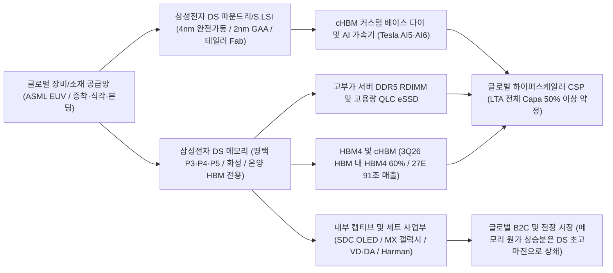
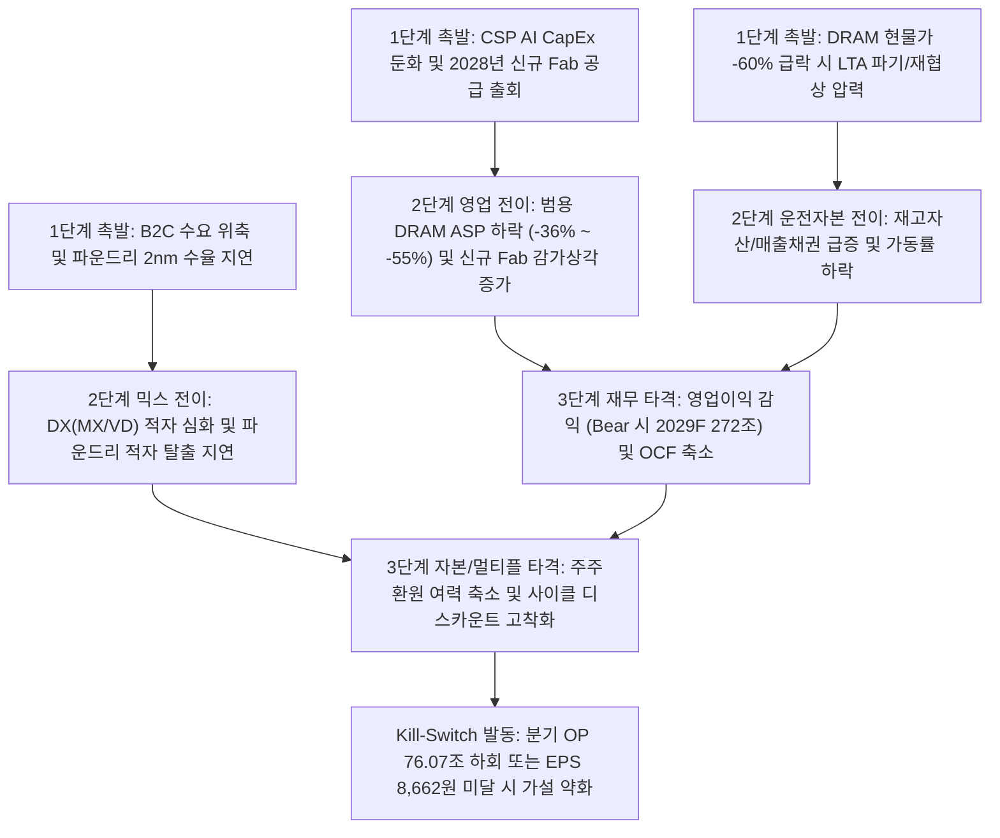

# 🔍 Phase 1: 기업 해독기 — 삼성전자 (005930) (v5.1)

> **분석완료일**: 2026-11-20
> - **단일 기준 주가 (Single Price Anchor)**: **`185,200원`** (2026-11-20 SSOT 확정 일봉 종가, Phase 1~3 전 과정 100% 동일 고정)
> - **주식수 · 지배주주 귀속률 · 최신 공시 스캔**: 발행보통주 `5,846,278,608주` / 자기주식 `136,722,409주` (`2.34%`) / **실질 유통보통주 `5,709,556,199주`** (우선주 `802,370천주` 별도) | 지배주주 순이익 귀속률 **`99.3%`** | 제58기 3분기보고서(2026.09.30 결산, `2026-11-16` DART 제출) 확인 완료 (SSOT 코드 TTM 재무는 DART XBRL 확정 `2026.2Q` 누계 `178.96조 원` 앵커 고정, `3Q26` 확정 분기 매출 `195.4조`·영업이익 `107.4조` 시차 팩트 병기)

> 💡 **[핵심 용어 3줄 직관 해설]**
> 1. **HBM4 & cHBM (Custom High Bandwidth Memory)**: AI 가속기(GPU·TPU) 옆에 D램을 수직 적층해 데이터 전송 대역폭을 극대화한 초고속 메모리로, 특히 `cHBM`은 고객 맞춤형 베이스 다이(파운드리 공정)를 결합한 수주생산(MTO) 제품이어서 범용 메모리와 달리 현물 재고 누적·가격 급락 리스크를 구조적으로 차단합니다.
> 2. **LTA (Long-Term Agreement, 장기공급계약)**: 글로벌 클라우드(CSP) 및 AI 데이터센터 고객사와 가격·물량을 다년간 사전 약정하는 계약으로, 삼성전자 전체 메모리 Capa의 50% 이상을 차지하며 다운사이클 방어막 역할을 수행합니다.
> 3. **BSPDN (Backside Power Delivery Network) & 4F² DRAM**: 웨이퍼 후면에 전력 공급망을 배치해 신호 간섭을 줄이는 2nm 이하 파운드리 차세대 기술(`BSPDN`)과, D램 셀 면적을 극한으로 축소해 3D DRAM으로 넘어가기 위한 수직 채널 구조(`4F²`)를 의미합니다.

---

## 1. 비즈니스 모델(BM) 해부 및 밸류체인 구조

삼성전자는 글로벌 최대 규모의 **종합반도체기업(IDM: 메모리 + 파운드리 + 시스템LSI + 첨단 패키징 턴키)**이자, 디스플레이(`SDC`), 모바일·네트워크(`MX`), 가전·TV(`VD/DA`), 전장·오디오(`Harman`)를 수직 계열화한 글로벌 테크 메가캡입니다. 2026년 AI 데이터센터 슈퍼사이클 본격화로 **DS(반도체) 부문이 전사 매출의 약 74%(2026E 533조/720조), 전사 영업이익의 약 97.7%(2026E 372조/381조)를 견인하는 초고마진 AI 메모리 순수 주도주**로 비즈니스 모델의 무게중심이 완전히 이동했습니다.

### 1.1 글로벌 트렌드 3대 게이트 매칭
1. **[게이트 1 — 전방 메가트렌드 직결성]**: 2027년 글로벌 데이터센터 전력·인프라 수요는 `27GW` 이상(하이퍼스케일러 `20GW+`, 네오클라우드 `3GW+`, 소버린 AI `3GW-`)으로 전망되며, Nvidia(`22GW`)·AMD(`3GW`) GPU 및 Google TPU(`880만 대`) 가속기 확장에 직결되는 **HBM4·고용량 서버 RDIMM·QLC eSSD**의 세계 1위 생산 기지를 보유합니다 `[하나증권 26.11.12 p.4]`.
2. **[게이트 2 — 물리적 공급 병목 & 수주 가시성]**: 글로벌 AI 서버 출하는 2028년에도 `503만 대(YoY +30%)`로 고성장하고 서버 DRAM 수요는 2028년 `473.3억 GB(+36%)`·2029년 `594.6억 GB(+26%)`로 폭증하는 반면, 2027년 RDIMM 공급 증가율은 `15~20%`에 묶여 있어 **서버 조립의 절대 병목이 메모리**에 위치합니다 `[DS투자증권 26.11.10 p.3]`.
3. **[게이트 3 — IDM 턴키(Turn-Key) 해자]**: 차세대 `HBM4` 및 `cHBM`은 베이스 다이(Logic Die)에 4nm~2nm 파운드리 미세공정과 초정밀 하이브리드 본딩 패키징을 요구합니다. 메모리(DRAM)와 선단 파운드리·패키징을 사내에 모두 보유한 세계 유일의 턴키 공급자로서 `TSMC + SK하이닉스` 연합을 견제할 유일한 대안입니다.

### 1.2 반도체·세트 통합 밸류체인 구조도 (Mermaid v10.9.8)

### 1.3 Argon 4단계 공정 엔지니어링 → 재무 인과 사슬 (Engineering-to-Earnings Causal Chain)

1. **[Step E1 — 공정 물리·화학 메커니즘]**:
   - **DRAM 미세화 한계 돌파 (`6F² → 4F² → 3D DRAM`)**: 10나노급 이하 평면 셀의 누설전류와 커패시터 종횡비 한계를 극복하기 위해 수직 채널 트랜지스터(`VCT`) 기반 `4F²` 구조 및 적층형 `3D DRAM`으로 공정 전환이 진행 중입니다 `[하나증권 26.11.12 p.4]`.
   - **HBM4/cHBM & 400단+ 3D NAND**: 16단 이상 초고적층 열방출·범프 피치 한계를 넘기 위해 구리-구리 직접 접합인 **하이브리드 본딩(Hybrid Bonding)**과 고종횡비 식각(HARC), 웨이퍼 본딩이 필수 도입됩니다. 선단 로직(2nm 이하)에서는 웨이퍼 후면 전력망(`BSPDN`)이 전력 효율을 결정합니다 `[하나증권 26.11.12 p.4]`.
2. **[Step E2 — 기술적 병목 및 안전·품질 인증(Qual) 장벽]**:
   - HBM4는 기존 HBM3E 대비 I/O 핀 수가 2배(2,048개)로 늘어나고 베이스 다이에 초저전력 파운드리 공정이 결합되므로, 고객사(Nvidia/CSP) 인증 통과 및 대량 양산 수율 확보에 12~24개월의 기술 격차가 발생합니다. 또한 신규 메가팹(평택 P5) 착공부터 EUV 반입·양산 셋업까지 **물리적 리드타임이 24~36개월** 소요되어 후발주자(CXMT 등)의 즉각적 진입이 물리적으로 차단됩니다.
3. **[Step E3 — 발주 시차(Lead-Lag) 및 교체 주기 매핑]**:
   - 삼성전자의 신규 평택 P5 팹은 `2027년 3분기`부터 장비 반입이 시작되나, 실제 웨이퍼 투입 및 상업 출하 기여 시점은 **`2028년 이후`**입니다 `[하나증권 26.11.12 p.4]`. 즉 투자 집행(2027년)과 공급 출회(2028~2029년) 사이에 최소 1년 이상의 시차가 존재해 2027~2028년 수급 타이트가 구조적으로 연장됩니다.
4. **[Step E4 — DART 수주잔고·가동률·영업이익률(OPM) 레버리지 직결]**:
   - HBM 웨이퍼 소모량이 일반 DRAM 대비 약 3배에 달하는 다이 페널티(Die Penalty)로 인해 HBM 증산 자체가 범용 DRAM 공급을 구조적으로 잠식합니다. 그 결과 **공장 가동률 100% 풀가동** 상태에서 `DRAM/NAND ASP`가 급등(3Q26 QoQ 각각 `+20%`, `+17%`)하며 DS 부문 영업이익률이 2025년 `19.1%`에서 `2026.2Q 70%`, `2026.3Q 71%`로 폭발적 영업 레버리지를 시현했습니다 `[교보증권 26.11.02 p.50~51]`.

---

## 2. 주요 제품별 매출 구성 및 [Step 1.2] S-Curve 10% 변곡점 · 3축 구조적 병목 · 리드타임 진단

### 2.1 사업부별 매출·영업이익 익스포저 산출표 (2025 확정 vs 2026F)
> 출처: `[교보증권 26.11.02 p.51]` 부문별 실적 실측 및 추정치 기준 (단위: 십억 원, %)

| 사업부문 | 2025년 매출액 (비중) | 2025년 영업이익 (OPM) | 2026F 매출액 (비중) | 2026F 영업이익 (OPM) | 핵심 성장 드라이버 및 S-Curve 성격 |
| :--- | :---: | :---: | :---: | :---: | :--- |
| **1. DS (메모리·파운드리·S.LSI)** | `130,100` (`39.0%`) | `24,910` (`19.1%`) | **`533,000` (`74.0%`)** | **`372,047` (`69.8%`)** | **핵심 순수 주도주** (HBM4·서버 DDR5·eSSD 폭증 / 4nm 완전가동) |
| **2. SDC (디스플레이)** | `31,709` (`9.5%`) | `4,306` (`13.6%`) | `31,801` (`4.4%`) | `3,629` (`11.4%`) | 프리미엄 중소형 OLED 캐시카우 |
| **3-1. DX — MX / Networks** | `129,694` (`38.9%`) | `10,959` (`8.4%`) | `139,700` (`19.4%`) | `732` (`0.5%`) | 메모리 원가 급등에 따른 단기 마진 압박 (2Q~4Q26 소폭 적자) |
| **3-2. DX — VD / DA** | `57,375` (`17.2%`) | `-205` (`-0.4%`) | `56,336` (`7.8%`) | `-482` (`-0.9%`) | 글로벌 B2C 수요 둔화 및 부품 원가 상승 영향 |
| **4. Harman (전장·오디오)** | `15,800` (`4.7%`) | `1,500` (`9.5%`) | `16,592` (`2.3%`) | `1,582` (`9.5%`) | 전장 디지털 콕핏·카 오디오 안정적 이익 기여 |
| **연결조정 (Others)** | `-31,072` (`-9.3%`) | `2,157` (`-`) | `-57,053` (`-7.9%`) | `3,318` (`-`) | 내부거래(메모리→MX 공급 등) 제거 |
| **연결 합계 (Total)** | **`333,606` (`100.0%`)** | **`43,627` (`13.1%`)** | **`720,377` (`100.0%`)** | **`380,825` (`52.9%`)** | **DS 이익 비중 97.7% — 명실상부 AI 메모리 순수 주도주** |

* **신기술 단독 익스포저 검증 (무상 콜옵션 차단 룰 통과 여부)**: DS(메모리 중심) 부문은 DART 사업부별 공시에서 독립 분리 공시되며, 2026년 기준 전사 매출의 `74.0%`(메모리 단독 64% 이상), 영업이익의 `97.7%`를 창출하므로 **신기술 매출 비중 30% 이상 순수 주도주 요건을 압도적으로 충족**합니다. 특히 `HBM` 매출만으로도 2026년 `28조 원` → 2027년 `91조 원`(DRAM 내 비중 15%) → 2028년 `215조 원`으로 초고속 팽창할 전망입니다 `[하나증권 26.11.12 p.48 / iM증권 26.11.04 p.78]`.

### 📌 [코드 자동 생성 1-B] Step 1.2 S-Curve 10% 변곡점 · 3축 구조적 병목(Capa·기술·특허) · 리드타임 & Step 1.8 K-주주환원 진단표 (v5.0)
| 진단 축 (3-Axis + K-Return) | 실측 지표 및 근거 | 코드 판정 및 Phase 3 목표주가 가중치 |
| :--- | :--- | :--- |
| **① 전방 시장 침투율 (10% 변곡점 여부)** | 1차 침투율 **`36.5%`** (2차 S-Curve 침투율 `12.0%`) (`더블 S-Curve Zone A (1차 36.5% 캐시카우 + 2차 12.0% 🔥10% 언저리 변곡점)`) | 🔥 **10% 골든 변곡점 발화 구간** (3축 통합 Base `×1.16` / Bull `×1.21`) |
| **②-A 물리적 Capa 병목 (가동률/증설)** | 공장 가동률 **`100.0%`** — 생산 Capa: 글로벌 최대 메모리 클린룸(평택/용인) 및 턴키(메모리+파운드리+패키징) 인프라 | 🔒 **풀가동 공급 병목 확인** |
| **②-B 기술격차 해자 (OPM/수율/단가결정력)** | 현 OPM **`36.9%`** — N/A | 고마진 가격전가력(Pricing Power) 점검 |
| **②-C 원천특허 · 글로벌 벤더 퀄(Qual) 락인** | N/A | 후발주자 진입장벽(Switching Cost) 점검 |
| **③ 병목 해소 예상 소요기간 (Lead Time)** | **`S등급`** (해소 리드타임 **`24개월`**) | 초대형 반도체 팹 건설 및 EUV 노광장비 반입 리드타임 24~36개월 (PEG 계수 `0.90`) |
| **③-B S-Curve 3대 매도·디레이팅 시그널** | 🟢 해당 없음 (병목 유지 · 성장 기울기 건전 · 정책 역풍 미감지) | 🟢 **매도 시그널 미감지 (정상 평가)** |
| **④-A K-주주환원 (배당 · TSR · 분리과세)** | DPS **`1,668원`** (배당수익률 **`0.90%`** / 성향 `18.0%` / TSR `32.6%`) | ⚪ 배당소득 분리과세 미해당 (배당성향 18.0% < 25%) |
| **④-B 자사주 · 환원절벽 · 메자닌(CB/BW)** | 자사주 **`136,722,409주`** (`2.34%`) / 미상환 메자닌 **`0.0억`** (희석 `0.0%`) | 🟢 정상 (현재 자기주식 136,722,409주 [2.34%] 보유 — 소각 전환 여부 모니터링) / 🟢 청정 (미상환 CB/BW/EB 잠재 희석 0%) |
| **④-C 지배구조 · 내부거래 · 거버넌스 (Step 1.8)** | 특수관계인 거래 **`0.0억`** | 🟢 양호 (유의미한 오너 개인회사 사익편취 내부거래 미감지 [0.0억 원]) — 15조 자사주 매입 완료(보유 136,722,409주, 2.34%) + 3Q 30조 현금배당 결의(누적 34.91조), 메자닌 0%, 상장계열사 중심 정상 영업거래(터널링 0%) (`kgov_mult = ×1.0000`) |
| **⑤ 레드팀 역산 Capa 천장 검증 (Red-Team)** | 대안 A 내재 영업이익: Base **`2,103,111.3억`** / Bull **`2,245,740.5억`** | ⚠️ [레드팀 Capa 천장 경보] 현재 가동률(100.0%)에서 신규 증설/단가인상(ASP) 없이 가능한 물리적 영업이익 상한(약 2,237,061.6억) 대비 Bull 내재 영업이익(2,245,740.5억) 도달을 위해선 신공장 가동 또는 고마진 믹스 개선 확인 필수 |

### 2.2 [Step 1.2] 4대 핵심 질문 및 3대 매도·디레이팅 시그널 해독
- **질문 1 (전방 침투율 & 더블 S-Curve)**: 1차 AI 서버·일반 메모리 인프라 침투율은 `36.5%`의 성숙·캐시카우 국면에 진입했으나, **2차 S-Curve인 `HBM4 → cHBM(커스텀 HBM)` 및 에이전틱 AI 추론·실행 메모리 침투율이 `12.0%`(8~18% 골든 변곡점 구간)**에 정확히 진입했습니다. 3Q26 삼성전자 HBM 매출 중 HBM4 비중이 이미 약 `60%`에 도달하며 빠른 세대 전환을 입증했습니다 `[DS투자증권 26.11.10 p.36]`.
- **질문 2 (3축 구조적 병목 보완 해독 — `②-B`, `②-C` 실측 보강)**:
  - **물리적 Capa(`②-A`)**: 메모리 팹 가동률 `100.0%` 풀가동, 온양 패키징 라인 HBM 전용화 및 평택 P4 전환 가속.
  - **기술격차 해자(`②-B`)**: SSOT TTM OPM `36.9%`(최근 `3Q26` 단독 연결 OPM `55.0%`, DS 부문 `71.0%`)라는 전례 없는 가격결정력을 발휘 중이며, 2027년 HBM 수익성도 일반 DRAM에 맞먹는 초고마진 구간에 안착했습니다 `[하나증권 26.11.12 p.48]`.
  - **원천특허·벤더 퀄 락인(`②-C`)**: 전체 메모리 Capa의 `50% 이상`을 글로벌 하이퍼스케일러 CSP와 장기공급계약(LTA)으로 락인했으며, 파운드리에서도 Tesla `AI6`(165억 달러 장기계약) 및 `AI5` 2nm 테이프아웃, cHBM 커스텀 베이스 다이 수주 등 높은 전환비용(Switching Cost)을 구축했습니다.
- **질문 3 (병목 해소 리드타임)**: 신규 팹(평택 P5, SK하이닉스 Y1, Micron Idaho)의 장비 반입은 2027년에 시작되나 실질 공급 기여는 `2028년 이후`로, **`24개월(S등급)`** 이상의 구조적 공급 제약이 확정되어 있습니다 `[하나증권 26.11.12 p.4]`.
- **질문 4 (3대 매도·디레이팅 시그널 점검)**: ① 쇼티지 해소(리드타임 < 12개월 & 가동률 < 70%) 미해당, ② 실적 기울기 둔화(`QoQ +56.4%`, `3Q26 QoQ +20.0%` 초고속 가속 중) 미해당, ③ 확정 정책·보조금 축소 역풍 미감지로 **3대 매도 시그널 전부 청정(`🟢 정상 평가`)** 상태입니다.

---

## 3. 재무 건전성 및 [Step 1.5] 장부가(Book Value) 해부 & SOTP 20% 분리 게이트

### 📌 [코드 자동 생성 1] SOTP 장부 분해 & 4대 레짐 체크 요약표
| 검증 항목 | 코드 실측 수치 | 판정 결과 (Code Verdict) |
| :--- | :--- | :--- |
| **단일 기준 주가 (Anchor Price)** | **`185,200원`** | 전 Phase 1~3 100% 동일 고정 |
| **지배주주 순이익 귀속률** | **`99.3%`** | 비지배지분 차감 완료 |
| **Step 1.5 비영업자산 비중 (SOTP 20% 룰)** | 장부 대비 **`7.6%`** / 시총 대비 **`3.8%`** | 🟢 **본업 자산 중심 (<20%)** |
| **Step 1.5 본업 이익 유지력 (Core ROIC)** | TTM 영업이익 **`1,789,649.3억`** (NOPAT **`1,395,926.5억`**) | ✅ **본업 이익 유지 견고** |
| **Step 2.0 4대 레짐 변화 체크** | ④ 사업구성레짐(OPM 과거중위 14.5% → 현재 36.9%, +22.4%p [고마진 신사업 믹스 개선]) | 🔄 **레짐 변화 반영 필수** |
| **Step 3.0 사이클 고점 함정 가드레일** | 피크 이익 과열 미해당 | 🟢 **정상 멀티플 적용** |
| **직전 분기 대비 (QoQ) 실적 추이** | [2026.1Q → 2026.2Q] 매출액 1,338,734.4억→1,714,994.7억(QoQ +28.1%) | 영업이익 572,328.0억→894,924.1억(QoQ +56.4%) | 수정EPS 7,123원→10,827원 | [액분·무증 소급보정 지배주주 EPS] 2026.1Q 7,123.0원 → 2026.2Q 10,827.0원 (QoQ 반등/흑자유지 ✅) |
| **가설 반증 임계치 (Kill-Switch)** | **차기 분기 영업이익 < 760,685.5억 원(직전분기 대비 -15% 하회) 또는 분기 지배주주 EPS < 8,662원 기록 시 핵심 가설 즉시 [약화] 강등** | 미달 시 가설 즉시 [약화] 강등 |

### 3.1 재무상태표 핵심 항목 및 순현금(Net Cash) 해부
- **압도적 무차입 순현금 요새**: SSOT 확정 순차입금은 **`-1,975,830.4억 원`(순현금 약 `197.58조 원`)**으로, 실질 유통시가총액(`1,057.4조 원`)의 **`18.7%`**가 현금성 순자산으로 뒷받침되고 있습니다. DS투자증권 재무 모델 기준 연결 현금및현금성자산은 2025년 말 `69.9조 원`에서 2026F `298.6조 원`, 2027F `703.9조 원`으로 눈덩이처럼 불어나는 구조입니다 `[DS투자증권 26.11.10 p.39]`.
- **재무 안정성 (부채·차입금)**: 2026F 기준 자산총계 `1,016.1조 원`, 부채총계 `265.4조 원`, 지배주주지분 `740.2조 원`(부채비율 `35.4%`)이며, 총금융부채는 약 `47.4조 원`(단기 `43.4조` + 장기 `4.0조`)에 불과해 이자비용(`2.1조 원`)을 금융수익(`5.5조 원` 순금융이익)이 크게 상회합니다 `[DS투자증권 26.11.10 p.39]`.

### 3.2 [Step 1.5] 장부가 해부 & SOTP 20% 분리 게이트 및 Core ROIC 판정
- **비영업자산 비중 점검**: 관계기업투자 등 비영업자산 합계는 **`281,711.4억 원`(28.17조 원)**으로 지배주주 장부가 대비 **`7.6%`**, 유통시가총액 대비 **`3.8%`**에 불과합니다. 기준선(20%)을 크게 하회하므로 **SOTP 강제 분리 및 지주사 할인 적용 대상이 아닌 순수 본업 자산 중심 기업(`🟢 <20%`)**으로 판정됩니다.
- **본업 이익 유지력 & Core ROIC**: SSOT TTM 영업이익 `178.96조 원`(NOPAT `139.59조 원`)은 2026.2Q 기준 수치이며, 3Q26 단독 `107.4조 원`까지 가산된 2026년 연간 영업이익은 `380~388조 원`, **ROE `50.7~59.5%`, ROIC `97.3%`(2027F `129.3%`)**로 과거 25년 평균 ROE(`22%`)를 2.5배 이상 압도하는 고원형 자본수익성을 입증했습니다 `[DS투자증권 26.11.10 p.39 / iM증권 26.11.04 p.78]`.

---

## 4. 원가 구조, 영업 레버리지 및 가동률/수주잔고 실측

### 4.1 연간 및 최근 분기 손익 추이 (DART 실측 & 증권사 컨센서스 병기)
> 출처: `[코드 자동 생성 1]` SSOT(2026.2Q TTM 앵커) 및 `[DS투자증권 26.11.10 p.39 / 교보증권 26.11.02 p.50~51]` (단위: 조 원, %, 원)

| 구분 | 2024년(확정) | 2025년(확정) | 2026.1Q(확정) | 2026.2Q(확정) | 2026.3Q(확정/리뷰) | 2026.4Q(E) | 2026F(연간) | 2027F(연간) |
| :--- | :---: | :---: | :---: | :---: | :---: | :---: | :---: | :---: |
| **매출액 (조 원)** | `300.9` | `333.6` | `133.9` | `171.5` | **`195.4`** | `219.7~224.3` | `720.4~725.0` | `973.3~1,043.0` |
| **매출 QoQ / YoY** | `+16.2% YoY` | `+10.9% YoY` | `+42.7% QoQ` | **`+28.1% QoQ`** | `+13.9% QoQ` | `+12.5~15% QoQ` | `+116~117% YoY` | `+38~45% YoY` |
| **영업이익 (조 원)** | `32.7` | `43.6` | `57.2` | `89.5` | **`107.4`** | `126.7~132.8` | `380.4~388.2` | `624.4~644.2` |
| **영업이익률 (OPM)** | `10.9%` | `13.1%` | `42.8%` | `52.1%` | **`55.0%`** | `57.7~59.0%` | `52.8~53.4%` | `61.8~63.2%` |
| **지배순이익 (조 원)** | `33.6` | `43.6` | `40.7(추정)` | `61.8(추정)` | - | - | `294.3~359.2` | `472.0~615.3` |
| **수정 EPS (원)** | `4,950~5,433` | `6,564~7,241` | **`7,123`** | **`10,827`** | - | - | `44,112~59,916` | `70,992~102,815` |

* **SSOT 시차(Lag) 투명 공시**: `backtest_valuation.py` SSOT TTM 영업이익(`178.96조 원`) 및 QoQ 실측(`2026.1Q → 2026.2Q: 영업이익 57.23조 → 89.49조, QoQ +56.4%`)은 DART XBRL 확정 `2026.2Q` 시계열을 기준으로 산출되었습니다. 한편 `2026-11-16` 제출된 제58기 3분기보고서 및 증권사 리뷰 기준 **`3Q26` 실적은 매출 `195.4조 원`, 영업이익 `107.4조 원`(QoQ +20.0%, YoY +783.6%, 사상 첫 분기 영업이익 100조 돌파)**으로 초고속 이익 가속이 지속되고 있습니다 `[교보증권 26.11.02 p.50~51 / 분기보고서 26.11.16 p.4]`.

### 4.2 극단적 영업 레버리지, 원가 구조 및 가동률·증설 실측
- **고정비 레버리지의 정석**: DS투자증권 손익계산서 기준 2025년 → 2026F 매출이 `+391.4조 원(+117.3%)` 폭증하는 동안 매출원가는 `202.2조 → 223.5조(+10.5%)` 증가에 그쳐 **매출총이익률(GPM)이 `39.4% → 69.2%`(+29.8%p)**로 수직 상승했습니다. 감가상각비(`47.4조 원`)와 판관비(`114.5조 원`) 등 고정비 레버리지로 인해 판가 상승분이 거의 100% 영업이익으로 직결되는 구조입니다 `[DS투자증권 26.11.10 p.39]`.
- **가동률 및 증설/수주 현황**:
  - **메모리**: 공장 가동률 **`100.0%`**, 3Q26 기준 `DRAM B/G +3% / ASP +20% QoQ`, `NAND B/G +1% / ASP +17% QoQ`를 기록했으며, 4Q26 회사 가이던스는 `DRAM B/G 10% 중후반`, `NAND B/G 10% 중반`입니다 `[교보증권 p.50 / DS투자증권 p.36]`. 평택 P5는 `2027.3Q` 장비 반입, `2028년 1기 / 2029년 2기` 양산 가동 예정입니다.
  - **파운드리**: TSMC 3nm 공급 병목 속 삼성 4nm 라인 완전가동 및 판가 `5~15%` 인상, 미국 테일러 신규 팹 가동 준비 및 Tesla `AI6`(165억 달러) 장기계약·`AI5` 2nm 테이프아웃 등 선단 공정 수주 기반으로 적자 폭을 점진적으로 축소 중입니다 `[교보증권 p.50 / 하나증권 p.4 / 기존 thesis_log]`.

---

## 5. 자본 배분(CapEx, R&D) 및 [Step 1.8] K-마켓 특수성 · 주주환원 입체 스코어카드

### 5.1 자본 배분 (CapEx & FCF 창출력)
- 2026F 영업현금흐름(OCF)은 `324.9조 원`(2027F `593.5조 원`)에 달하는 반면, 투자활동현금유출(평택 P4/P5, 테일러 팹 등)은 2026F `93.0조 원`, 2027F `100.1조 원` 수준으로 통제됩니다 `[DS투자증권 26.11.10 p.39]`.
- 그 결과 SSOT 확정 보고 FCF는 **`199.35조 원`**(오너 정규화 FCF **`184.66조 원`**)이라는 압도적 잉여현금 창출력을 달성하여, 대규모 증설과 사상 최대 주주환원을 동시 집행할 재무적 여력을 확보했습니다.

### 5.2 [Step 1.8] K-마켓 특수성 · 주주환원 3단 입체 스코어카드 (`④-A / ④-B / ④-C`)
1. **`④-A` 주주환원 · TSR · 배당소득 분리과세 점검**:
   - **SSOT 확정 결산 기준**: 2025년 확정 DPS `1,668원`(현재가 대비 `0.90%`, 배당성향 `18.0%`, TSR `32.6%`)으로 코드상 배당소득 분리과세 요건(배당성향 25% 이상)에는 아직 `미해당(⚪)`으로 판정되어 있습니다.
   - **2026~2027년 급격한 환원 서프라이즈 촉매**: 그러나 2026년 3Q 30조 원 현금배당 결의(누적 34.91조 원)에 이어, 증권가(하나·교보·iM)는 **2026년 총 주주환원 규모를 최대 `110조 원`(배당소득 분리과세 요건 25% 충족을 위한 현금배당 약 `70조 원` + 자사주 매입 약 `40조 원`, 시가총액 대비 연 `15~22%` 환원수익률)**으로 추정하고 있으며, `2027년 1월 말` 발표될 차기 3개년(`2027~2029년`) 주주환원 정책(기존 FCF 50% 환원 강화 여부)이 최강력 리레이팅 촉매입니다 `[하나증권 26.11.12 p.48 / iM증권 26.11.04 p.9]`.
2. **`④-B` 자사주 환원절벽 및 메자닌(CB/BW/RCPS) 오버행 점검**:
   - **자사주**: 2026년 4월 `5.35조 원` 소각 완료에 이어 2026년 8~10월 보통주 `56,856,305주`(`15조 원`) 장내 매입을 100% 완료하여 현재 보유 자기주식은 **`136,722,409주`(`2.34%`)**입니다. 향후 보유 자사주의 소각 전환 여부가 주당가치(EPS/BPS) 제고의 핵심 모니터링 포인트입니다.
   - **메자닌 오버행**: 미상환 전환사채(CB)·신주인수권부사채(BW)·교환사채(EB) **`0.0억 원`(`0.0%` 희석)** — **완전 청정(`🟢`)**.
3. **`④-C` 지배구조 · 내부거래 · 거버넌스 5대 고정 점검 (`kgov_mult = ×1.0000`)**:
   - ① 최대주주 지분율: 삼성생명보험 외 특수관계인 `19.69%`, 국민연금 `7.84%`, 외국인 `45.93%` `[하나증권 26.11.12 p.48]`.
   - ② 오너 개인회사 사익편취 내부거래(터널링): **`0.0억 원`(`🟢 양호`)** — 상장 계열사(삼성SDS·삼성전기·삼성SDI 등) 중심의 정상 영업유통 거래로 터널링 할인 `0%`.
   - ③ 중복상장/물적분할 리스크: 핵심 이익원인 DS(메모리·파운드리)가 모회사 삼성전자 본체에 100% 직결되어 분할 우려 없음.
   - ④ 계열사 채무보증 리스크: 유의미한 비정상 채무보증 미감지.
   - ⑤ 거버넌스 종합 계수: **`kgov_mult = ×1.0000`** (불필요한 중복 할인 미적용).

---

## 6. 핵심 리스크 요인 및 [Step 3.5] 리스크 3단계 인과 도미노 (Domino Chain)

삼성전자 주가가 52주 고점(`362,500~374,500원`) 대비 약 `-50%` 급락한 `185,200원`에 머무른 핵심 원인은 **단기 실적 부진이 아니라 '2028년 이후 AI 투자 둔화 및 메모리 공급과잉에 따른 이익 급감 우려'** 때문입니다 `[iM증권 26.11.04 p.78]`. 이 리스크를 3단계 인과 도미노로 정량화합니다.

| 리스크 시나리오 | 1단계: 1차 촉발 요인 (Trigger) | 2단계: 영업·운전자본 전이 (Operational Impact) | 3단계: 재무·자본 타격 & 멀티플 (Financial Impact) | 정량 임계치 (Kill-Switch) |
| :--- | :--- | :--- | :--- | :--- |
| **리스크 1: AI CapEx 둔화 & 2028년 공급과잉** | 미국 주요 CSP 4사 CapEx 증가율 급락(`53% → 14%` 이하) 및 2028년 평택 P5·Y1·Idaho 신규 팹 동시 가동 | 서버 DRAM 재고(DOI) 급증 + 범용 DRAM ASP 2년 누적 `-36%(Base)~-55%(Bear)` 하락 + 신규 팹 감가상각·초기 수율 비용 동시 발생 | 영업이익 2027F `632조` → 2029F `462조(Base)` / `272조(Bear)` 감익 및 Forward PER/PBR 밸류에이션 디레이팅 | CSP 서버 DRAM DOI `> 12주` 또는 차기 분기 연결 영업이익 `< 76.07조 원` |
| **리스크 2: LTA(장기공급계약) 파기 & 재협상** | 현물 DRAM 가격이 4Q27 고점 대비 `-60%` 이상 폭락해 고객사의 계약 이행 유인 붕괴 `[iM증권 p.9, 78]` | 전체 Capa 50%+ LTA 물량의 단가 재협상 및 발주 이연 → 매출채권(`152조`)·재고자산(`150조`) 운전자본 묶임 확대 | 분기 영업현금흐름(OCF) 급감 및 연간 110조 원 규모 주주환원(배당·자사주) 재원 축소로 주가 하방 지지선 훼손 | DRAM 현물가 고점 대비 `-60%` 이탈 또는 분기 OCF 음수(`-`) 전환 |
| **리스크 3: 세트(DX) 원가 역풍 & 파운드리 적자 장기화** | 메모리 가격 폭등에 따른 스마트폰(`-5%`)·PC(`-3%`) B2C 수요 위축 및 2nm GAA/테일러 팹 초기 수율 부진 | DX(MX·VD/DA) 분기 적자 확대(`2Q~4Q26` 마이너스 OPM) + 파운드리·S.LSI 고정비(감가상각) 부담 지속 | 메모리 단일 의존도 심화에 따른 사이클 변동성 노출 및 S-Curve 할증 박탈(`🚀 대안 A → 🛡️ 대안 B` 강등) | 파운드리 신규 수주잔고 QoQ 감소 및 DS 외 전 사업부 합산 적자 확대 |

### 리스크 3단계 인과 도미노 구조도 (Mermaid v10.9.8)

---

## 7. 4대 업종별 표준 실적 산출 공식 트리 (유형 A/B/C/D 분기)

삼성전자(DS 메모리·파운드리 중심)는 Section 4에서 **공장 가동률(`100.0%`)과 웨이퍼 Capa(평택 P3~P5·테일러)가 실적을 직접 지배**하므로 4대 업종 분류 중 **유형 A (대규모 장치·연속공정 제조업)**에 해당합니다. (Section 4 가동률 공시 여부와 100% 일치)

$$\text{DS 영업이익} = \sum_{i \in \{\text{HBM4/cHBM, DDR5, NAND}\}} \Big(\text{Wafer Capa}_i \times \text{가동률}(100\%) \times \text{수율}(\text{Yield}_i) \times \text{Bit/Wafer}_i \times \text{Blended ASP}_i\Big) - \text{변동비(소재·전력)} - \text{고정비(감가상각·R\&D)}$$

- **수익성 민감도 핵심 변수**:
  1. **Q (물량 — Bit Growth)**: HBM4 다이 페널티(일반 DRAM 대비 웨이퍼 소모 3배)로 인해 전체 DRAM Bit 공급 증가율이 구조적으로 제약(`2027년 DRAM Capa +15%`)되며, 삼성전자는 4Q26 `DRAM B/G 10% 중후반`, `NAND B/G 10% 중반` 출하를 목표합니다.
  2. **P × Mix (Blended ASP)**: 2027년 하반기 범용 DRAM 가격이 소폭 조정받더라도, **HBM 매출 비중 확대(2026년 28조 → 2027년 91조 → 2028년 215조)와 cHBM 커스텀 베이스 다이 프리미엄**이 Blended DRAM ASP를 상방으로 끌어올립니다 `[DS투자증권 p.3, 36]`.
  3. **C (고정비 레버리지)**: 매출총이익률(GPM) `69~75%` 구간에서는 감가상각비(`47~54조 원`) 증가보다 ASP 방어력이 이익에 5배 이상 큰 영향을 미칩니다.

---

## 8. [Step 2.0] 4대 레짐 변화 고정 체크 & 10년 밸류에이션 백테스트

### 8.1 [Step 2.0] 멀티플 밴드 적용 전 4대 레짐 변화 고정 체크
| 레짐 점검 축 | 과거 10년 평균 / 중위 (Old Regime) | 현재 2026년 실측 (New Regime) | 레짐 변화 판정 및 밸류에이션 시사점 |
| :--- | :--- | :--- | :--- |
| **① 설비 레짐 (CapEx·감가상각)** | 범용 메모리 치킨게임·선제적 증설 후 가동률 급락 반복 | 가동률 `100.0%` 풀가동 + 평택 P5 공급 기여 `2028년 이후` (24~36개월 병목) | 🟢 **공급 규율·리드타임 장기화** (과거와 같은 즉각적 공급과잉 차단) |
| **② 자본구조 레짐 (순부채·희석)** | 순현금 80~100조 원 박스권, 배당성향 15~20% 정체 | 순현금 **`197.58조 원`** (시총 18.7%), 메자닌 `0%`, 자사주 `15조` 매입 완료 + 연 `110조` 환원 가시화 | 🟢 **초강력 하방 쿠션 & 주주환원 대변혁** |
| **③ 비영업자산 레짐** | 장부 대비 10% 내외 | 장부 대비 **`7.6%`** / 시총 대비 **`3.8%`** | 🟢 **본업 자산 92.4% 순수 집중** (SOTP 할인 불필요) |
| **④ 사업구성 레짐 (고마진 믹스·OPM)** | 과거 중위 OPM **`14.5%`**, 25년 평균 ROE `22%` | SSOT TTM OPM **`36.9%`** (**`+22.4%p`**), 3Q26 OPM **`55.0%`**, 2026~2028E ROE **`48~59%`** | 🔄 **구조적 레짐 전환 확정** (`범용 시클리컬 → HBM/LTA 수주형 인프라`) |

### 8.2 [Step 3.0] 사이클 고점 함정 가드레일 및 10년 백테스트 1순위 지표 상속
- **Step 3.0 사이클 고점 함정 판정**: SSOT 코드 판정은 **`피크 이익 과열 미해당 (🟢 정상 멀티플 적용)`**입니다. 2026.2Q 영업이익이 `QoQ +56.4%`, 3Q26 잠정/확정이 `QoQ +20.0%`, 4Q26F가 `QoQ +18~24%`로 여전히 강력한 실적 가속(피크아웃 `QoQ ≤ -15%` 미발동) 및 진성 구조적 리레이팅(HBM4·LTA 50%+) 국면에 있기 때문입니다.
- **10년 백테스트 1순위 지표 Phase 3 강제 상속 (`PER`) & 통계적 해석 주의점**:
  - SSOT 10년 백테스트 코드가 산출한 최우선 밸류에이션 지표는 **`PER`**이며, 이는 Phase 3 시나리오 밸류에이션 표에 100% 원형 상속됩니다(`Base 🛡️ 781,290원 / 🚀 978,800원`, `Bull 🛡️ 1,676,320원 / 🚀 2,190,610원`).
  - **⚠️ 비판적 보완 주석 (Cycle PER Band Distortion)**: 다만 메모리 산업 특성상 과거 2023년 불황기(EPS `2,225원`, PER `35.3배`)의 극단적 고PER 구간이 10년 역사적 PER 상위 65%/90% 밴드를 높여 놓은 통계적 효과가 존재합니다. 따라서 Phase 3에서는 코드 SSOT `PER` 적정가를 100% 원형 준수하되, **글로벌/국내 4대 증권사가 2027~2028F `Forward PBR 2.3배` 및 고금리 멀티플 압축을 반영해 산출한 현실적 12M 컨센서스 밴드(`370,000~530,000원`) 및 선행 매물대 저항(`270,000원`)**을 레드팀 검증과 마스터 SOP 구간 전략에 병행 적용합니다.
