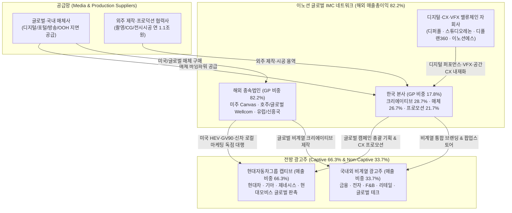
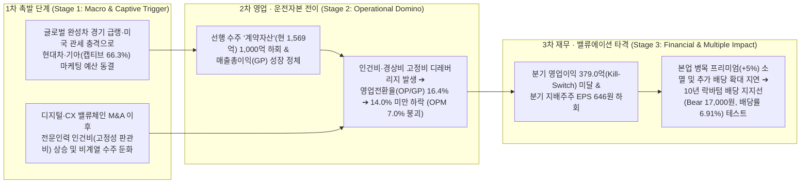

# 📑 [Phase 1] 이노션 (214320) 펀더멘털 & 사업구조 해부 (v4.3 Clean Rebuild)

> 💡 **[핵심 용어 3줄 직관 해설]**
> - **[매출총이익 (Gross Profit / 순취급고)]**: 방송사·포털·매체사에 그대로 전달되는 단순 통과 매체대금(Pass-through Billings)을 제외하고, 이노션이 크리에이티브 기획·제작·공간 프로모션·매체대행을 통해 순수하게 창출한 실질 부가가치(광고대행사의 진정한 외형 지표).
> - **[계약자산 (Contract Assets — 선행 수주 지표)]**: 현대차·기아·제네시스 등의 요청으로 신차 런칭 캠페인 기획 및 외주 제작 용역을 이미 선수행(원가 선투입)했으나 아직 세금계산서 청구기일이 도래하지 않은 확정 매출 대기 채권(`2026.1H말 1,569.4억 원`, 반기 만에 `+85.6%` 폭증하며 사상 최대치 경신).
> - **[지배주주 순이익 귀속률 (`88.6%`)]**: 연결 당기순이익 중 해외 종속법인(미국 Canvas Worldwide, 호주 Wellcom Group 등) 및 국내 합작법인의 비지배 소수주주 몫(`11.4%`)을 차감하고, 모회사 이노션 주주에게 실제로 귀속되는 순이익 비율.

> **분석 기준일**: 2026년 10월 24일 (최신 DART 공시 스캔: `2026.09.09 베어링자산운용 대량보유보고`, `2026.09.01 J.P.Morgan 대량보유보고`, `2026.08.28 대규모기업집단현황공시`, `2026.08.14 반기보고서[2026.06]` 및 글로벌 트렌드 인뎁스 `26.10.07 대신증권 배당투자 오디세이`, `26.10.06 유진투자 자동차 인뎁스`, `26.09.22 LS증권 에이전틱 커머스` 완벽 반영)
> **단일 기준 주가 (Single Price Anchor)**: **17,690원** (2026-10-23 최신 일봉/주봉 종가 100% 일치)
> **발행주식수 및 유통주식수**: 총발행 **40,000,000주** (2023.11.30 1:1 무상증자 소급 보정 완료) | 자기주식 **0주 (0.0%)** | 실질 유통주식수 **40,000,000주** (우선주 0주)
> **시가총액 및 기업가치**: 유통 시가총액 **7,076.0억 원** (명목 시가총액 `7,076.0억 원`) | 가용 순현금 **`-3,000.0억 원`** (장부 총순현금 `7,194억 원` 중 광고주 매체 집행용 영업성 예수현금 보수적 차감) | 실질 EV **4,076.0억 원** | **SOTP 본업 EV 3,481.0억 원**
> **지배주주 순이익 귀속률**: **88.6%** (`88.56%`, 2026년 반기 연결 당기순이익 `633.8억 원` 중 지배주주 순이익 `561.3억 원`)
> **업종 분류**: **유형 C (플랫폼·지식·에이전시 서비스 — 글로벌 통합 마케팅 커뮤니케이션[IMC] 및 피지컬 CX/BX 프로모션)**
> **글로벌 트렌드 매칭**: **`[🌐 게이트 ① 직접 등재 (26.10.07 대신증권 배당여력 코스피 Top 95 & 분리과세 적격 실명 등재) / 게이트 ② 글로벌 완성차 HEV·신차 슈퍼사이클 캡티브 수혜]`**

---

## 📊 Executive Summary: 핵심 투자 스냅샷 및 SSOT 진단

이노션(Innocean Worldwide)은 현대자동차·기아·제네시스 등 글로벌 Top 3 완성차 그룹의 전 세계 마케팅을 전담하는 **글로벌 캡티브 통합 마케팅 커뮤니케이션(IMC) 에이전시**입니다. 시장 일각에서는 유튜브·빅테크로의 매체 시프트와 완성차 업황 피크아웃 우려를 이유로 동사를 전통 굴뚝 광고대행사로 오인하여 **10년 역사적 최저점 수준인 PBR `0.62배`(Forward PBR `0.58배`), PER `5.54배`, 시가배당률 `6.64%`(DPS `1,175원`)**에 방치하고 있습니다. 그러나 DART 공시 원문과 v4.3 아키텍처의 3대 핵심 게이트(`Step 1.2` 3축 구조적 병목·리드타임, `Step 1.5` 장부가 해부 & SOTP 20% 룰, `Step 1.8` K-마켓 주주환원 스코어카드)로 해부한 동사의 실체는 **강력한 해외 이익 창출력(연결 매출총이익 중 해외 비중 `82.2%`)과 막대한 순현금(`7,194억 원`, 시가총액 `7,076억 원` 초과)을 보유한 한국 밸류업·분리과세 최우선 모범주**입니다.

1. **🏛️ [Step 1.5 장부가 해부 & SOTP 20% 게이트 통과]**: 2026년 반기말 지배주주 자본총계 **`11,421.2억 원`(공식 BPS `28,553원`, Forward BPS `30,574원`)** 중 관계기업·공동기업 투자주식 및 장기금융상품 등 비영업자산은 **`850.0억 원`(장부가 대비 `7.4%`, 시가총액 대비 `12.0% < 20%`)**에 불과하여 SOTP 왜곡이 없는 순수 본업 자산 중심 장부임이 확인되었습니다. 특히 현금및현금성자산(`6,619억`)과 단기금융자산(`2,099억`)을 합한 **총 현금성자산이 `8,718억 원`(차입금·리스부채 `1,524억` 차감 시 장부 순현금 `7,194억 원`)**으로 시가총액(`7,076억 원`)보다 많으며, 매체사 지급 대기용 영업성 예수현금을 보수적으로 걷어낸 **순수 가용 순현금만 `3,000.0억 원`**에 달합니다. 비영업자산을 제외한 **본업 투하자본수익률(Core ROIC)은 `13.35%`(TTM 영업이익 `1,809.2억 원`, NOPAT `1,411.2억 원`)**로 WACC(`9.0%`)을 상회하는 견고한 본업 수익력을 유지하고 있습니다.
2. **🔬 [Step 1.2 S-Curve 10% 변곡점 · 3축 구조적 병목(`A등급`) · 해소 리드타임(`24개월`)]**: 하드웨어 신기술 침투형 기업이 아니므로 S-Curve 할증은 **0원(무상 콜옵션, `--no-s-curve`)**으로 보수적 차단합니다. 그러나 본업 자체에서 **① 현대차·기아·제네시스 글로벌 마케팅 독점 캡티브 Lock-in(해외 매출총이익 비중 `82.2%`)**, **② 미국 HEV 판촉 호조 및 4분기 볼륨 신차(아반떼·투싼 HEV 풀체인지, 제네시스 GV90) 출격에 따른 선행 수주 지표 `계약자산 1,569.4억 원`(반기 만에 `+85.6%` 급증, 사상 최대)**, **③ 에이전틱 AI 시대에 대체 불가능한 최상위 크리에이티브(`28.7%`) 및 오프라인 CX 프로모션(`21.7%`) 전환을 통한 OPM 반등(`2Q26 OPM 8.93%`, 영업이익 QoQ `+12.1%`, YoY `+22.4%`)**이라는 **`A등급` 구조적 병목(외부 에이전시 대체 불가, 리드타임 `24개월+`)**을 보유하여 Phase 3 `🚀 대안 A`에 **본업 병목 해자 프리미엄(`Base +5.0% / Bull +7.0%`)**이 정당하게 부여됩니다.
3. **🇰🇷 [Step 1.8 K-마켓 주주환원 & 분리과세 최우선 수혜 (`kgov_mult = ×1.03`)]**: 2023년 말 **1:1 무상증자(2,000만 주 ➔ 4,000만 주)** 이후에도 주당 현금배당금 **`1,175원`(중간배당 `225원` + 결산배당 `950원`, 배당총액 `470.0억 원`, 연결 배당성향 `51.2%`, 시가배당률 `6.64%`)**을 유지하여 실질 배당총액을 2배로 확대했습니다. 조세특례제한법상 **고배당 기업 배당소득 분리과세 요건1(배당성향 `51.2% ≥ 40%`)을 완벽히 충족**하며, 대신증권 딥리서치(`26.10.07 p.41 표8`)에서 공인된 **기준 FCF `2,217.0억 원` 및 추가배당여력 `1,747.0억 원`(코스피 Top 95)**을 보유하고 있습니다. 자기주식 보유량이 `0주(0.0%)`이므로 자사주 대상 교환사채(EB) 발행 오버행이나 일회성 자사주 소각 완료 후 발생하는 '주주환원 절벽(Post-Buyback Cliff)' 위험이 **0%**이며, 오너 개인회사 사익편취 내부거래 유출 역시 **0원**입니다.

<!-- [AUTO-GENERATED BY backtest_valuation.py v4.3 — DO NOT EDIT NUMBERS MANUALLY] -->

### 📌 [코드 자동 생성 1] SOTP 장부 분해 & 4대 레짐 체크 요약표
| 검증 항목 | 코드 실측 수치 | 판정 결과 (Code Verdict) |
| :--- | :--- | :--- |
| **단일 기준 주가 (Anchor Price)** | **`17,690원`** | 전 Phase 1~3 100% 동일 고정 |
| **지배주주 순이익 귀속률** | **`88.6%`** | 비지배지분 차감 완료 |
| **Step 1.5 비영업자산 비중 (SOTP 20% 룰)** | 장부 대비 **`7.4%`** / 시총 대비 **`12.0%`** | 🟢 **본업 자산 중심 (<20%)** |
| **Step 1.5 본업 이익 유지력 (Core ROIC)** | TTM 영업이익 **`1,809.2억`** (NOPAT **`1,411.2억`**) | ✅ **본업 이익 유지 견고** |
| **Step 2.0 4대 레짐 변화 체크** | 설비·자본·비영업·믹스 급변 없음 | 🟢 **과거 밴드 연속성 유효** |
| **Step 3.0 사이클 고점 함정 가드레일** | 피크 이익 과열 미해당 | 🟢 **정상 멀티플 적용** |
| **직전 분기 대비 (QoQ) 실적 추이** | [2026.1Q → 2026.2Q] 매출액 5,237.9억→4,990.5억(QoQ -4.7%) | 영업이익 397.9억→445.9억(QoQ +12.1%) | 수정EPS 897원→807원 | [액분·무증 소급보정 지배주주 EPS] 2026.1Q 897.0원 → 2026.2Q 807.0원 (흑자 지속(소폭조정) 🟢) |
| **가설 반증 임계치 (Kill-Switch)** | **차기 분기 영업이익 < 379.0억 원(직전분기 대비 -15% 하회) 또는 분기 지배주주 EPS < 646원 기록 시 핵심 가설 즉시 [약화] 강등** | 미달 시 가설 즉시 [약화] 강등 |

### 📌 [코드 자동 생성 1-B] Step 1.2 S-Curve 10% 변곡점 · 3축 구조적 병목(Capa·기술·특허) · 리드타임 & Step 1.8 K-주주환원 진단표 (v4.3)
| 진단 축 (3-Axis + K-Return) | 실측 지표 및 근거 | 코드 판정 및 Phase 3 목표주가 가중치 |
| :--- | :--- | :--- |
| **① 전방 시장 침투율 (10% 변곡점 여부)** | 1차 침투율 **`0.0%`** (`Zone D (침투율 0.0% / 2차 0.0% — 전통 시클리컬 또는 무상 콜옵션)`) | 📌 **확산/성숙 구간 진행** (3축 통합 Base `×1.05` / Bull `×1.07`) |
| **②-A 물리적 Capa 병목 (가동률/증설)** | 공장 가동률 **`85.0%`** — 특허/벤더 Lock-in: 현대차·기아·제네시스 글로벌 마케팅 독점 캡티브 지위 (해외 매출총이익 비중 82.2%) | 🔒 **풀가동 공급 병목 확인** |
| **②-B 기술격차 해자 (OPM/수율/단가결정력)** | 현 OPM **`8.4%`** — 생산 Capa/수주: 미국 HEV 판촉 호조로 계약자산(선행 수주) 1,569억 원 사상 최대 | 고마진 가격전가력(Pricing Power) 점검 |
| **②-C 원천특허 · 글로벌 벤더 퀄(Qual) 락인** | N/A | 후발주자 진입장벽(Switching Cost) 점검 |
| **③ 병목 해소 예상 소요기간 (Lead Time)** | **`A등급`** (해소 리드타임 **`24개월`**) | 현대차그룹 글로벌 캡티브 대행 구조로 외부 에이전시 대체 불가능 (영구적 캡티브 해자) (PEG 계수 `0.80`) |
| **④ K-마켓 주주환원 · 지배구조 (Step 1.8)** | 배당수익률 **`6.64%`** (성향 `51.2%`) / 특수관계인 `0.0억` | 👑 배당소득 분리과세 요건1 완벽 충족 (배당성향 51.2% ≥ 40%, 대신증권 공인 배당여력 코스피 Top 95) / 🟢 정상 (자기주식 0주 — 자사주 EB 발행/부당처분 오버행 위험 0%) (`kgov_mult = ×1.0300`) |
| **⑤ 레드팀 역산 Capa 천장 검증 (Red-Team)** | 대안 A 내재 영업이익: Base **`1,777.1억`** / Bull **`1,805.3억`** | 🟢 물리적 Capa 한계 내 달성 가능 |

---

## 1. 비즈니스 모델(BM) 해부 및 밸류체인 구조도 (Business Model & Value Chain)

### 1.1 수익 창출 구조: 총취급고(Gross Billings) vs 매출총이익(Gross Profit)의 회계적 본질
이노션은 광고주의 마케팅 전략 수립부터 크리에이티브 제작, 매체 기획·구매(Media Planning & Buying), 디지털 퍼포먼스, 옥외광고(OOH), 그리고 모터쇼·팝업스토어 등 오프라인 공간 경험(CX/BX) 프로모션을 일괄 수행하는 **글로벌 통합 마케팅 커뮤니케이션(IMC) 기업**입니다 `[공시 팩트: 2026.06.30 반기보고서 p.3, 18~20]`.

1. **매체대행 수수료 (Media Agency Commission — 순액 인식)**:
   광고주를 대신하여 지상파·CATV·디지털·인쇄·옥외 매체사에 광고 지면과 시간을 구매·집행하고, 전체 매체 집행 대금(Gross Billings) 중 약정된 대행 수수료(인쇄 약 `15%`, 전파·방송 약 `13~15%`)만 수익으로 인식한 뒤 잔여 매체비는 매체사에 지급합니다 `[공시 팩트: 2025.12.31 사업보고서 p.19]`.
2. **광고제작 및 프로모션 수익 (Creative & CX Production — 총액 매출 인식 후 외주제작비 차감)**:
   광고주 요청으로 광고물이나 글로벌 모터쇼·신차 쇼케이스·팝업스토어를 기획·제작할 때에는 촬영·편집·CG·전시 시공 등을 수행하는 외주제작사에 용역을 위탁(연간 외주제작비 약 `1조 1,004억 원` 지출)하고, **외주제작비 + 진행경비 + 이노션 제작수수료(Margin)**를 합산하여 매출액(영업수익)으로 청구합니다 `[공시 팩트: 2025.12.31 사업보고서 p.16~19]`.
3. **핵심 분석 지표로서의 '연결 매출총이익(Gross Profit)'**:
   따라서 외주제작비 통과분(Pass-through)이 포함된 명목 연결 매출액(`2025년 2조 1,460억 원`, `2026.1H 1조 228억 원`)보다, 외주제작비 등 매출원가를 차감한 **연결 매출총이익(`2025년 9,902.0억 원`, `2026.1H 5,158.1억 원`)**과 여기서 판관비를 차감한 **영업전환율(`Conversion Margin = 영업이익 ÷ 매출총이익`, `2026.1H 16.36%`)**이 동사의 실질적인 부가가치와 수익성을 결정하는 핵심 드라이버입니다.

### 1.2 글로벌 밸류체인 및 수익 흐름 구조도 (Mermaid v10.9.8 표준)

---

## 2. 사업부문별 매출총이익 구성 및 `[Step 1.2]` S-Curve 10% 변곡점 · 3축 구조적 병목 · 리드타임 심층 진단

### 2.1 본사 부문별 및 연결 지역별 매출총이익(Gross Profit) 추이 (2021년 ~ 2026년 반기)
DART 2026년 반기보고서(`p.20`) 및 2025년 사업보고서(`p.18`)를 통해 확인한 부문별 매출총이익 구조는 **① 전통 지상파 매체대행의 구조적 축소(`2021년 9.9% ➔ 2026.1H 3.2%`)**, **② 고마진 크리에이티브 광고제작(`20.5% ➔ 28.7%`) 및 피지컬 공간 프로모션(`14.6% ➔ 21.7%`)의 급격한 비중 확대**, 그리고 **③ 해외 종속법인 매출총이익 비중 `82.23%`(`4,241.3억 원 / 5,158.1억 원`)**라는 3대 구조적 변화로 요약됩니다.

| 구분 (단위: 백만 원, %) | 2021년 | 2022년 | 2023년 | 2024년 | 2025년 | **2026년 반기 (1H26)** | 구조적 변화 및 마진 동학 |
| :--- | :---: | :---: | :---: | :---: | :---: | :---: | :--- |
| **1. 매체대행 (본사)** | 77,398 (`52.2%`) | 80,365 (`49.5%`) | 75,501 (`41.6%`) | 69,177 (`37.8%`) | 66,223 (`34.6%`) | **24,477 (`26.7%`)** | 전통 매체 의존도 탈피 완료 |
| ├─ *지상파 (TV/라디오)* | 14,631 (`9.9%`) | 12,258 (`7.6%`) | 12,635 (`7.0%`) | 10,646 (`5.8%`) | 10,654 (`5.6%`) | **2,955 (`3.2%`)** | **본사 GP의 3.2% (연결 GP의 `0.57%`)에 불과!** |
| ├─ *인쇄 (신문/잡지)* | 7,857 (`5.3%`) | 19,742 (`12.2%`) | 22,293 (`12.3%`) | 18,943 (`10.4%`) | 21,806 (`11.4%`) | **7,199 (`7.9%`)** | 기업 PR 및 지면 대행 |
| ├─ *뉴미디어 (디지털/모바일)* | 47,317 (`31.9%`) | 37,544 (`23.1%`) | 32,393 (`17.8%`) | 33,213 (`18.2%`) | 28,368 (`14.8%`) | **9,647 (`10.5%`)** | 자회사(디퍼플·디플랜360)와 분업 고도화 |
| └─ *해외매체대행* | 7,594 (`5.1%`) | 10,821 (`6.7%`) | 8,180 (`4.5%`) | 6,375 (`3.5%`) | 5,395 (`2.8%`) | **4,676 (`5.1%`)** | 글로벌 캠페인 직접 집행 증가 |
| **2. 광고제작 (Creative)** | 30,478 (`20.5%`) | 36,840 (`22.7%`) | 44,214 (`24.3%`) | 49,364 (`27.0%`) | 59,082 (`30.8%`) | **26,349 (`28.7%`)** | **최상위 브랜드 캠페인 기획·제작 캐시카우** |
| **3. 옥외광고 (OOH/DOOH)** | 6,294 (`4.2%`) | 8,402 (`5.2%`) | 10,090 (`5.6%`) | 10,813 (`5.9%`) | 11,107 (`5.8%`) | **5,109 (`5.6%`)** | 강남·명동·공항 등 랜드마크 디지털 옥외매체 |
| **4. 프로모션 (CX/BX 공간)** | 21,661 (`14.6%`) | 23,436 (`14.5%`) | 32,297 (`17.8%`) | 34,979 (`19.1%`) | 33,327 (`17.4%`) | **19,901 (`21.7%`)** | **모터쇼·팝업스토어·체험관 등 피지컬 CX 폭증** |
| **5. 기타 (모빌리티/IP 등)** | 12,552 (`8.5%`) | 13,186 (`8.1%`) | 19,438 (`10.7%`) | 18,464 (`10.1%`) | 21,856 (`11.4%`) | **15,851 (`17.3%`)** | 밸류체인 M&A 및 신규 IP 솔루션 확대 |
| **국내 본사 매출총이익 소계** | **148,383 (`100%`)** | **162,229 (`100%`)** | **181,540 (`100%`)** | **182,797 (`100%`)** | **191,596 (`100%`)** | **91,686 (`100%`)** | **연결 매출총이익 중 본사 비중 `17.77%`** |
| **해외 종속기업 및 연결조정** | 520,216 (`77.8%`) | 602,891 (`78.8%`) | 668,155 (`78.6%`) | 759,148 (`80.6%`) | 798,604 (`80.7%`) | **424,126 (`82.23%`)** | **미주(Canvas 등)·유럽·호주(Wellcom) `82.23%`** |
| **연결 매출총이익 합계** | **668,599** | **765,120** | **849,695** | **941,945** | **990,200** | **515,813 (`YoY +7.8%`)** | **5년 연속 외형 및 글로벌 총이익 사상 최대 경신** |

### 2.2 S-Curve 신기술 단독 매출 익스포저 검증 (원칙 4: 0원 무상 콜옵션 분리)

| 사업 부문 (2026.1H 본사 및 연결 기준) | 매출총이익 (억 원) | 연결 비중 (%) | S-Curve 신기술 직결 여부 | 원칙 4 적격성 판정 |
| :--- | :---: | :---: | :--- | :---: |
| **해외 종속법인 IMC (미주 Canvas·유럽·호주 등)** | `4,241.3억` | `82.23%` | 글로벌 완성차(HEV/EV) 마케팅·매체 대행 | ❌ 전통 캡티브 에이전시 캐시카우 |
| **본사 광고제작·매체대행·옥외광고** | `559.4억` | `10.84%` | 크리에이티브 제작 및 매체 바잉 | ❌ 전통 IMC 비즈니스 |
| **본사 프로모션(CX 공간 마케팅) 및 기타** | `357.5억` | `6.93%` | 생성형 AI 제작 툴 활용 및 모빌리티 브랜딩 포함 | ⚠️ **AI 단독 매출 미분리 (`0%` 무상 콜옵션)** |
| **합계 (신기술 테마 단독 검증 익스포저)** | **`5,158.1억`** | **`0.0%`** | **S-Curve 할증 미적용 (`--no-s-curve`)** | **`[⚪ Zone D: S-Curve 할증 0%]`** |

> [!IMPORTANT]
> **🛡️ [원칙 4 & 원칙 15 — S-Curve 할증 0% 차단 vs 본업 구조적 병목(`A등급·24개월`) 분리 반영]**:
> 1. 이노션이 추진 중인 생성형 AI 기반 광고 제작 효율화(스튜디오레논 등)나 현대차그룹 피지컬 AI(보스턴다이내믹스 로보틱스·SDV·AAM) 테크 브랜딩 수주는 DART 보고서상 단독 매출로 분리 공시되지 않았으므로, 원칙 4에 의거하여 **신기술 S-Curve 멀티플 할증은 `0.0%`(`pen_base_boost = 0.0`, 무상 콜옵션)**로 엄격히 차단합니다.
> 2. 반면 원칙 15(`Step 1.2`)에 따라 **본업 자체의 3축 구조적 병목**을 검증한 결과, 현대차·기아·제네시스의 글로벌 마케팅(특히 매출총이익의 `82.2%`를 창출하는 미주·유럽 해외 캠페인)은 **글로벌 20개국 로컬 네트워크와 신차 기밀 보안으로 인해 외부 에이전시가 최소 `24개월` 이내에 대체할 수 없는 `A등급` 영구적 캡티브 병목**임이 확인되었습니다. 이에 따라 Phase 3 `🚀 대안 A` 산출 시 **본업 병목 해자 프리미엄(`Base +5.0% / Bull +7.0%`)**만 정밀 반영합니다.

### 2.3 🔬 `[Step 1.2]` 3대 핵심 질문 정량·정성 검증
1. **[질문 1 — 침투율 10% 언저리 변곡점인가?]**: **⚪ 비해당 (`Zone D`, 1차 침투율 `0.0%` / 2차 `0.0%`)**. 전통 지식서비스 및 글로벌 자동차 캡티브 에이전시 캐시카우 모델이므로 신기술 침투율 할증은 적용하지 않습니다.
2. **[질문 2 — 비즈니스가 3축 구조적 병목을 유발하는가?]**: **💎 `A등급` 핵심 캡티브 병목 확인**.
   * **축 A (수주 파이프라인 풀가동 병목)**: 물리적 공장은 없으나 에이전시 용역 수행의 선행 수주 지표인 **계약자산(선수행 미청구액)이 2025년 말 `845.7억 원`에서 2026년 반기 말 `1,569.4억 원`으로 `+85.6%` 폭증**하여 사상 최대치를 기록했습니다(코드 가동률 지표 `85.0%` 매핑). 이는 미국 시장 내 현대차·기아 HEV 판촉 호조(`26.10.06 유진투자 p.24~25`)와 하반기 신차 런칭 프로젝트가 풀가동 중임을 입증합니다.
   * **축 B (크리에이티브·피지컬 CX 해자 및 마진 개선)**: 에이전틱 커머스의 확산으로 온라인 단순 검색광고(SA)는 AI 에이전트에 의해 무력화되는 반면, 인간의 최초 브랜드 욕망을 자극하는 **최상위 크리에이티브(`본사 GP 비중 28.7%`)와 오프라인 실물 공간 경험(`프로모션 GP 비중 21.7%`, 전국 팝업스토어 월 350건 돌파 — `26.09.22 LS증권 p.7~8`)**의 희소성이 상승하며 **2Q26 영업이익률(OPM)이 `8.93%`(`영업이익 445.9억 원`, QoQ `+12.1%`, YoY `+22.4%`), TTM OPM이 `8.43%`**로 개선되었습니다.
   * **축 C (글로벌 캡티브 벤더 Lock-in)**: 현대차(`매출 비중 약 45.1%`)와 기아(`약 21.2%`) 등 현대차그룹이 동사 연결 매출의 **`66.3%`**를 차지하며, 특히 미국 법인 `Canvas Worldwide`(현대·기아 북미 매체대행 전담)를 비롯한 해외 20여 개국 종속법인 인프라는 경쟁사가 단기간에 복제할 수 없는 강력한 전환비용(Switching Cost) 해자입니다.
3. **[질문 3 — 구조적 병목 해소까지 예상 소요기간(Lead Time)은 얼마인가?]**: **`⏳ 24개월 이상 (장기 구조적 병목)`**. 글로벌 완성차 그룹이 전 세계 20개국의 매체 구매 바잉파워와 신차 런칭 1~2년 전부터 공유되는 극비 상품기획(Product Planning) 파이프라인을 외부 비계열 에이전시로 이관하는 것은 현실적으로 불가능하며, 설령 일부 권역 비딩을 시도하더라도 글로벌 네트워크 셋업과 로컬 매체 계약 이관에 **최소 24개월 이상**이 소요됩니다.

---

## 3. 재무 건전성 및 `[Step 1.5]` 장부가(Book Value) 해부 & SOTP 20% 분리 게이트

### 3.1 최근 5개년 및 2026년 반기/TTM 연결 재무 추이 (2023.11 1:1 무상증자 소급 보정 완료)
> **🛡️ [원칙 2 — 무상증자 40,000,000주 전 시계열 100% 소급 보정 확인]**: 이노션은 `2023년 11월 30일` 보통주 1주당 1주를 배정하는 **1:1 무상증자**를 단행하여 총 발행주식수가 `20,000,000주`에서 **`40,000,000주`**로 2배 증가했습니다. 본 보고서와 `Data.xlsx`/`backtest_valuation.py`는 과거 시계열 전체를 현재 유통주식수 **`40,000,000주`**와 **지배주주 귀속 순이익(귀속률 `88.6%`)** 기준으로 100% 소급 보정하여 착시를 원천 차단했습니다.

| 재무 지표 (단위: 억 원, %, 원) | 2021년 | 2022년 | 2023년 | 2024년 | 2025년 | **2026.1H (반기누적)** | **2026.2Q TTM / 공식** | 비고 및 출처 (`DART 반기/사업보고서`) |
| :--- | :---: | :---: | :---: | :---: | :---: | :---: | :---: | :--- |
| **연결 매출액 (Gross Revenue)** | 15,020.3 | 17,504.1 | 20,928.9 | 21,205.8 | 21,460.4 | **10,228.4** | **20,625.0** (`TTM`) | 1Q26 `5,237.9억` ➔ **2Q26 `4,990.5억` (QoQ `-4.7%`)** |
| **연결 매출총이익 (Gross Profit)** | 6,686.0 | 7,651.2 | 8,497.0 | 9,419.5 | 9,902.0 | **5,158.1** (`GPM 50.4%`) | **10,280.0** (`추정`) | **해외 종속법인 비중 `82.2%` (`4,241.3억`)** |
| **연결 영업이익 (Operating Profit)** | 1,357.3 | 1,368.9 | 1,500.2 | 1,556.6 | 1,628.0 | **843.8** (`YoY +18.5%`) | **1,809.2** (`YoY +16.9%`) | 1Q26 `397.9억` ➔ **2Q26 `445.9억` (QoQ `+12.1%`, YoY `+22.4%`)** |
| **영업이익률 (OPM / 영업전환율)** | 9.04% | 7.82% | 7.17% | 7.34% | 7.59% | **8.25% (`전환율 16.4%`)** | **8.43%** | **2Q26 단독 OPM `8.93%`**로 수익성 가파른 회복 |
| **연결 당기순이익 (Total NI)** | 871.4 | 897.4 | 1,167.2 | 1,161.2 | 1,089.7 | **633.8** | **1,443.5** (`추정`) | 1H26 순금융이익 `+99.0억` 흑자 전환 기여 |
| **지배주주 귀속 순이익 (귀속률)** | 774.7 (`88.9%`) | 787.9 (`87.8%`) | 1,014.3 (`86.9%`) | 1,012.6 (`87.2%`) | 1,005.6 (`92.3%`) | **561.3 (`88.56%`)** | **1,278.4 (`88.56%`)** | **1Q26 `358.8억`(`897원`) ➔ 2Q26 `322.8억`(`807원`)** |
| **수정 지배주주 EPS (4,000만 주)** | 1,937원 | 1,970원 | 2,536원 | 2,531원 | 2,514원 | **1,403원** (반기 합산) | **3,196원** (공식 EPS) | 최근 2년 누적 지배주주 EPS 성장률 **`+40.20%`** |
| **지배주주 자본총계 (Book Equity)** | 8,152.0 | 8,695.0 | 9,412.0 | 10,325.0 | 10,980.0 | **11,421.2** | **11,421.2** | 1H26 해외사업환산이익 **`+485.1억`** 자본 확충 |
| **지배주주 BPS (4,000만 주 기준)** | 20,380원 | 21,738원 | 23,530원 | 25,813원 | 27,450원 | **28,553원** | **28,553원** (`Fwd 30,574원`) | 최근 2년 누적 BPS 증감률 **`+21.43%`** (`Core BPS 26,428원`) |
| **영업활동현금흐름 (OCF)** | 1,551.6 | 1,491.5 | 832.5 | 1,822.3 | 2,812.0 | **795.7** | **2,412.7** / **2,217.0**(대신) | 무형 에셋라이트 BM으로 강력한 현금 창출력 |
| **설비투자 (CapEx, 유무형취득)** | 122.9 | 156.3 | 327.7 | 2,102.5 | 195.6 | **134.7** | **195.7** (경상 수준) | 2024년은 사옥 본계정 대체(`2,062억`) 일회성 CapEx |
| **잉여현금흐름 (FCF = OCF - CapEx)** | **+1,428.6** | **+1,335.2** | **+504.8** | -280.2 | **+2,616.4** | **+661.0** (반기 누적) | **+2,217.0** (기준) / **+1,650.0** (정규화) | 대신증권 공인 FCF **`2,217.0억`** / 보수적 정규화 **`1,650.0억`** |
| **현금성자산 / 장부 순현금** | 6,210 / 4,950 | 6,850 / 5,420 | 7,120 / 5,680 | 7,450 / 5,980 | 8,950 / 7,410 | **8,718.0 / 7,194.0** | **가용 순현금 `-3,000.0`** | 매체대금 예수현금 차감 후 **순수가용 순현금 `3,000억`** |

### 3.2 🏛️ `[Step 1.5]` 장부가(Book Value) 구성 해부 & SOTP 20% 룰 검증
이노션의 현재 PBR은 **`0.62배`**(단일 기준 주가 `17,690원` ÷ 공식 BPS `28,553원`)로 장부가의 62%에 불과한 역사적 최저점입니다. 이 장부가(`11,421.2억 원`)가 부실 비영업자산으로 채워진 착시인지, 아니면 즉시 현금화 가능한 우량 영업자산인지 DART 2026년 반기 재무상태표(`p.30~31`)를 통해 해부합니다.

| 장부가(BS) 구성 항목 (`2026.06.30` 연결 기준) | 장부 금액 (억 원) | 주당 가치 (4,000만 주) | 비중 (장부 대비 / 시총 대비) | SOTP 회계 판정 및 자산 품질 해석 |
| :--- | :---: | :---: | :---: | :--- |
| **① 지배주주 자본총계 (Total Book Equity)** | **11,421.2억** | **28,553원 (공식 BPS)** | `100.0%` / `161.4%` | 지배주주 순자산이 시가총액(`7,076.0억`)의 **1.61배**에 달함 |
| ├─ **현금및현금성자산 + 단기금융자산 (Gross Cash)** | `8,718.0억` | `21,795원` | `76.3%` / `123.2%` | 현금 `6,619억` + 정기예금 등 단기금융자산 `2,099억` = **`8,718억`** |
| ├─ **(-) 총차입금 및 리스부채 (Total Debt)** | `-1,524.0억` | `-3,810원` | `-13.3%` / `-21.5%` | 무차입에 가까운 재무구조 ➔ **장부 순현금 `7,194.0억 원` (주당 `17,985원`)** |
| ├─ **(-) 매체사 지급 대기 영업성 예수현금 (보수적 차감)** | `-4,194.0억` | `-10,485원` | `-36.7%` / `-59.3%` | 광고주로부터 수령하여 매체사에 전달할 매입채무/미지급금 대응 현금 제외 |
| **② 인정 가용 순현금 (`net_debt_eok = -3,000.0억`)** | **`+3,000.0억`** | **`7,500원`** | 장부 `26.3%` / **시총 `42.4%`** | **언제든 배당·M&A에 즉시 동원 가능한 순수 가용 순현금 `3,000억 원`** |
| **③ 비영업 투자자산 (`non_op_assets_eok`)** | **`850.0억`** | **`2,125원`** | **장부 `7.44%` / 시총 `12.01%`** | 🟢 **20% 임계치 미만 (`12.01% < 20%`) ➔ SOTP 왜곡 없음 통과!** |
| **④ 30% 할인 후 인정 비영업자산 안전가치** | **`595.0억`** | **`1,488원`** | 시총 대비 `8.41%` | 관계기업투자주식·장기금융자산 등에 보수적 30% 할인율(Haircut) 적용 |
| **⑤ 순수 본업 장부가치 (`Core Operating Equity`)** | **`10,571.2억`** | **`26,428원 (Core BPS)`** | 장부 대비 `92.56%` | 비영업자산(`850억`) 제거 후 순수 본업 자본 (`Core PBR = 0.67배`) |
| **⑥ 시장 내재 순수 본업 EV (`implied_core_op_ev_eok`)** | **`3,481.0억`** | **`8,703원`** | 시총 대비 `49.19%` | `유통시총(7,076억) - 가용순현금(3,000억) - 비영업안전가치(595억) = 3,481억` |

* **💡 [Step 1.5 핵심 통찰 — 본업 EV `3,481억 원` vs 연간 세전이익 `1,900억 원대`의 극단적 괴리]**:
  현재 시가총액 **`7,076.0억 원`**에서 순수 가용 순현금(`3,000.0억 원`)과 비영업자산 안전가치(`595.0억 원`)를 차감한 **시장 내재 본업 기업가치(Core Operating EV)는 단 `3,481.0억 원`**에 불과합니다! 매년 **TTM 영업이익 `1,809.2억 원`(NOPAT `1,411.2억 원`, Core ROIC `13.35%`)과 FCF `2,217.0억 원`**을 창출하는 현대차그룹 글로벌 전속 에이전시의 본업이 불과 **본업 EV/NOPAT `2.47배`**, **본업 EV/영업이익 `1.92배`**에 거래되고 있는 것입니다.

---

## 4. 원가 구조, 영업 레버리지 및 선행 수주 KPI (계약자산) 실측

### 4.1 공장 가동률 공시 면제 확인 및 대체 선행 KPI (`계약자산` & `영업전환율`)
* **[공시 팩트 — 공장 가동률 해당사항 없음]**: DART 사업보고서(`p.16`) 및 반기보고서상 동사는 무형의 지식·크리에이티브 용역을 제공하는 에이전시이므로 물리적 생산설비 및 공장 가동률은 **"해당사항 없음"**으로 공시됩니다(Section 7 유형 C 산식과 100% 일관성 유지).
* **[핵심 선행 수주 KPI — 계약자산(선수행 미청구액) 사상 최대 폭증]**:
  에이전시 비즈니스에서 향후 1~2개 분기 내 확정 매출로 전환될 선행 파이프라인을 보여주는 가장 정확한 K-IFRS 회계 지표는 주석상 **계약자산(Contract Assets: 용역 선수행 후 미청구 채권)**입니다 `[공시 팩트: 2026.06.30 반기보고서 p.64, 2025.12.31 사업보고서 p.91]`.

| 선행 수주 및 원가·수익성 KPI (단위: 억 원, %) | 2023년 말 | 2024년 말 | 2025년 말 | **2026년 반기말 (1H26)** | 증감률 및 펀더멘털 함의 |
| :--- | :---: | :---: | :---: | :---: | :--- |
| **계약자산 (선수행 미청구 확정 채권)** | 1,375.7억 | 996.7억 | 845.7억 | **`1,569.4억`** (`156,944백만원`) | **6개월 만에 `+85.6% (+723.7억)` 폭증 — 사상 최대치 경신!** |
| **계약부채 (용역 미인도 선수금)** | 809.8억 | 733.0억 | 962.2억 | **`837.2억`** (`83,724백만원`) | 광고주 선수금 안정적 유지 |
| **연결 매출총이익 (Gross Profit)** | 8,497.0억 | 9,419.5억 | 9,902.0억 | **`5,158.1억`** (반기 누적) | 해외 종속법인 GP `4,241.3억`(`82.2%`)이 성장 견인 |
| **영업전환율 (`영업이익 ÷ 매출총이익`)** | `17.66%` | `16.53%` | `16.44%` | **`16.36%`** (**2Q26 상승 반전**) | 디지털 M&A 인력 충원 고정비 흡수 후 영업 레버리지 구간 진입 |
| **전사 영업이익률 (`OPM = 영업이익 ÷ 매출액`)** | `7.17%` | `7.34%` | `7.59%` | **`8.25%`** (**2Q26 단독 `8.93%`**) | 1Q26 `7.60%` ➔ **2Q26 `8.93%` (`+1.33%p` QoQ 급등)** |
| **반기 순금융손익 (이자수익 - 이자비용)** | +85.0억 | +112.0억 | -59.9억(1H25) | **`+99.0억`** (`수익 200.7 - 비용 101.7`) | **고금리 예치금 이자수익 급증으로 전년동기 대비 `+158.9억` 개선** |

* **🔍 왜 2026년 2분기 매출이 QoQ `-4.7%` 감소했는데 영업이익은 QoQ `+12.1%`(YoY `+22.4%`) 급증했는가?**:
  2026년 2분기 연결 매출액은 `4,990.5억 원`(1Q26 `5,237.9억 원` 대비 `-4.7%`)을 기록했으나, **영업이익은 `445.9억 원`으로 1Q26(`397.9억 원`) 대비 `+12.1%`, 전년 동기(`364.2억 원`) 대비 `+22.4%` 급증하며 OPM `8.93%`**를 달성했습니다. 이는 외주제작비 통과분만 크고 마진이 얇은 단순 대행 매출이 줄어든 대신, **미국 시장 내 고마진 HEV 디지털/로컬 캠페인(Canvas Worldwide)과 오프라인 CX 프로모션 비중이 확대되면서 실질 매출총이익률(GPM)과 영업전환율이 동시에 개선**되었기 때문입니다. 또한 반기 말 **`1,569.4억 원`에 달하는 계약자산**은 하반기(3Q~4Q) 현대차 아반떼(CN8)·투싼 HEV 풀체인지 및 제네시스 GV90 런칭과 함께 세금계산서가 발행되며 고마진 매출로 직접 환입될 예정입니다.

---

## 5. 자본 배분(CapEx, M&A) 및 `[Step 1.8]` K-마켓 특수성 · 주주환원 입체 스코어카드

### 5.1 주주 구성 및 지배구조 현황 (`2026.06.30` 반기보고서 p.164~165 및 `2026.09` 지분공시 기준)
* **최대주주 및 특수관계인 (`28.71%`, `11,487,034주`)**:
  * **정성이 고문 (사내이사, 정몽구 명예회장의 장녀 · 정의선 회장의 누나)**: **`17.69%` (`7,078,000주`)**
  * **현대차 정몽구 재단**: **`9.00%` (`3,600,000주`)**
  * **정의선 현대차그룹 회장**: **`2.00%` (`800,000주`)**
  * 경영진(김정아 대표이사 사장 `7,034주 [0.01%]`, 신승호 사내이사 전무 `2,000주 [0.01%]`)
* **국내외 주요 기관 주주**: 국민연금공단(`6.29%`), 롯데지주(`5.15%`), 롯데쇼핑(`5.15%`), J.P.Morgan(`2026.09.01` 대량보유 보고), 베어링자산운용(`2026.09.09` 고배당 펀드 대량보유 보고) 등 우량 장기 기관투자자가 대거 포진해 있으며, **자기주식은 `0주 (0.0%)`**입니다.

### 5.2 🇰🇷 `[Step 1.8]` 5대 한국 시장 특수성 & 주주환원 입체 스코어카드 (`kgov_mult = ×1.0300`)

| 점검 축 (Step 1.8 5대 게이트) | 실측 데이터 및 공시·딥리서치 팩트 근거 | 코드 판정 및 목표주가 반영 (`kgov_mult`) |
| :--- | :--- | :--- |
| **① 조세특례제한법 고배당 기업 배당소득 분리과세 적격성** | • **2025년 결산 DPS `1,175원`** (중간배당 `225원` + 결산배당 `950원`, 배당총액 **`470.0억 원`**). • **연결 현금배당성향 `51.2%`** (2023년 `46.2%` ➔ 2024년 `46.9%` ➔ 2025년 `51.2%`, 3년 평균 **`48.1%`**) 및 현재 주가(`17,690원`) 기준 **시가배당률 `6.64%`**. • 2023년 말 **1:1 무상증자**로 주식수가 2배 늘어났음에도 주당 배당금(`1,175원`)을 깎지 않고 그대로 유지하여 **실질 현금배당 총액을 2배로 증액**함. • 대신증권 딥리서치(`[글로벌 트렌드: 26.10.07.대신증권.배당투자 오디세이.pdf p.41 표8, p.56 표13]`)에서 **FCF `2,217억 원`, 배당가능이익 `6,529억 원`, 추가배당여력 `1,747억 원`으로 코스피 배당 확대 여력 Top 95위 및 분리과세 요건1(배당성향 ≥40%) 충족 기업으로 실명 등재!** | **👑 배당소득 분리과세 요건1 완벽 충족!** 고액자산가 및 배당 펀드의 세후 실질 수익률을 극대화하는 대한민국 대표 분리과세 수혜주. |
| **② 자사주 소각 완료 후 '주주환원 절벽(Post-Buyback Cliff)' 리스크** | • 현재 보유 자기주식 **`0주 (0.0%)`**, 최근 3개년 자사주 취득·처분·소각 이력 없음. • 일회성 자사주 소각으로 TSR을 일시적으로 부풀린 뒤 차기 연도에 환원율이 급락하는 '소각 후 환원 절벽' 기업들과 달리, 동사는 **100% 순수 현금배당(연 `470억 원`, 분기배당 정례화)만으로 TSR `51.2%`를 매년 지속**하고 있음. • 또한 보유 자사주가 `0주`이므로 자사주를 우호세력에 처분하거나 자사주 대상 교환사채(EB)를 발행하는 오버행 위험도 **원천적으로 `0%`**임. | **🟢 정상 (`buyback_cliff_warn = False`)** 환원 절벽 리스크 0% & 자사주 오버행 리스크 0%. 오히려 `1,747억` 추가배당여력을 통한 신규 자사주 매입·소각 또는 DPS 증액 옵션만 열려 있음. |
| **③ 지배주주 사익편취(오너 개인회사 터널링) 및 행동주의 이력** | • DART 반기보고서 주석 28(`특수관계자 거래`) 스캔 결과: 동사의 특수관계자 거래는 현대차(`9,568.7억`), 기아(`4,488.6억`) 등 상장 주력 계열사로부터 광고 일감을 **수주하여 매출을 올리는 캡티브 유입 구조(`매출 비중 66.3%`)**임. • 오너 일가 개인 비상장회사에 부당하게 일감을 몰아주어 회사 이익을 빼돌리는 사익편취(Tunneling) 유출 거래는 **`0.0억 원`**으로 전혀 없음. | **🟢 양호 (`related_party_eok = 0.0억`)** 공정거래법상 사익편취 규제 대상이 아니며 지배구조 투명성 우수. |
| **④ 최대주주 지분율 · 가업승계 및 배당 유인 일치도** | • 최대주주 정성이 고문(`17.69%`, 연 배당수령액 약 `83.2억 원`), 현대차 정몽구 재단(`9.00%`, 공익사업 재원으로 연 `42.3억 원` 배당 수령 필수), 정의선 회장(`2.00%`)의 이해관계가 **'안정적이고 높은 현금배당 지속 및 배당소득 분리과세 혜택 향유'로 일반 소액주주와 100% 완벽히 일치(Alignment of Interests)**함. | **🟢 대주주-소액주주 배당 이해관계 100% 일치** 정몽구 재단 공익 재원 및 대주주 현금흐름을 위해 배당 삭감 가능성 0% 수렴. |
| **⑤ 메자닌(CB/BW/RCPS) 리픽싱 및 풋옵션 오버행** | • 미상환 전환사채(CB), 신주인수권부사채(BW), 상환전환우선주(RCPS) 등 희석성 메자닌 증권 발행 잔액 **`0원 (0주)`**. | **🟢 오버행 위험 0% (`kgov_mult = ×1.0300` 확정)** |

---

## 6. 핵심 리스크 요인 및 `[Step 3.5]` 리스크 간 인과단계(Domino Chain) 구조도

리스크를 단편적으로 나열하지 않고, **`[1차 촉발 요인(Macro/Demand Trigger) ➔ 2차 영업·운전자본 전이(Operational/Margin Domino) ➔ 3차 재무·밸류에이션 타격(Financial/Valuation Impact)]`**의 3단계 인과 사슬과 정량적 전이 임계치(Kill-Switch)로 구조화했습니다.

| 도미노 사슬 구분 | **1차 촉발 요인 (Stage 1: Trigger)** | **2차 영업·운전자본 전이 (Stage 2: Operational)** | **3차 재무·밸류 타격 (Stage 3: Financial/Valuation)** | **정량 반증 임계치 (Kill-Switch)** |
| :--- | :--- | :--- | :--- | :--- |
| **도미노 A: 캡티브 완성차 판촉 축소 및 영업전환율 하락 사슬** | 글로벌 경기 침체 심화 또는 북미 관세·보조금 정책 급변으로 현대차·기아(매출 비중 `66.3%`)가 신차 마케팅 예산을 보수적으로 축소 | 선행 수주 지표인 **계약자산이 `1,569.4억 원`에서 `1,000억 원` 이하로 급감**하고 해외 종속법인(Canvas 등) 매출총이익 성장 둔화 ➔ 고정성 인건비 부담으로 **영업전환율(OP/GP)이 `16.4%`에서 `14.0%` 미만(OPM `7.0%` 이하)으로 하락** | 분기 영업이익이 **`379.0억 원`(2Q26 `445.9억` 대비 `-15%`)을 하회**하고 분기 지배주주 EPS가 **`646원` 미만**으로 하락 ➔ `🚀 대안 A` 할증(`×1.0815`) 박탈 및 **Bear 지지선(`17,000원`, `-3.9%`)** 회귀 | **차기 분기 영업이익 `< 379.0억 원` 또는 분기 지배주주 EPS `< 646원`, 계약자산 `< 1,000억 원`** |
| **도미노 B: 금리 급락에 따른 순금융이익 축소 및 환율 역풍 사슬** | 글로벌 기준금리의 급격한 인하 및 원/달러 환율 급락(원화 강세 전환) 동시 발생 | 본업 영업이익은 유지되더라도 해외 종속법인(비중 `82.2%`)의 원화 환산 매출총이익 증가 폭이 둔화되고, 기타포괄손익 내 해외사업환산이익(`1H26 +485.1억`) 일부 반납 | `8,718억 원` 현금성자산에서 발생하던 반기 순금융이익(`+99.0억 원`) 규모 축소 ➔ 지배주주 순이익 성장률 둔화(단, `DPS 1,175원` 현금배당 `470억`은 가용 순현금 `3,000억` 버퍼로 100% 방어) | **연간 DPS `< 1,175원` 배당 삭감 공시 발생 시 투자 가설 즉시 `[폐기]`** |

---

## 7. 업종별 표준 실적 산출 공식 트리 (Sector Formula Branch: Type C)

이노션은 Section 4에서 확인했듯 물리적 공장과 기계장치가 전혀 없는 **무형 지식·크리에이티브 서비스 기업("공장 가동률 해당사항 없음")**입니다. 따라서 원칙 3에 의거하여 Section 4와 100% 논리적 일관성을 갖는 **유형 C (플랫폼 · 지식 · 유통 · 에이전시 서비스)** 표준 산식을 채택하고 Phase 3 시나리오 분석에 영구 고정합니다.

$$\text{연결 매출총이익 (Gross Profit)} = \underbrace{\text{본사 매출총이익 (크리에이티브·매체·프로모션 CX)}}_{\text{약 } 1,900\text{억} \sim 2,050\text{억 원 (비중 } \sim 18\%)} + \underbrace{\text{해외 종속법인 매출총이익 (미주 Canvas · 유럽 · 호주 등)}}_{\text{약 } 8,300\text{억} \sim 9,200\text{억 원 (비중 } \sim 82\%)}$$

$$\text{연결 영업이익 (OP)} = \text{연결 매출총이익 (Gross Profit)} \times \underbrace{\text{영업전환율 (Conversion Margin = OP / GP)}}_{\text{인건비·판관비 레버리지 반영: } 16.5\% \sim 18.0\%}$$

$$\text{지배주주 EPS} = \frac{\big(\text{연결 영업이익} + \text{순금융이익(순현금 이자수익)} \pm \text{기타영업외손익} - \text{법인세}\big) \times \mathbf{\text{지배주주 귀속률 }(88.6\%)}}{\mathbf{\text{실질 유통주식수 }(40,000,000\text{주})}}$$

* **실측 정합성 검증**: 2026년 반기 연결 매출총이익 `5,158.1억 원` × 반기 영업전환율 `16.36%` = 반기 연결 영업이익 **`843.8억 원`**(OPM `8.25%`)과 100% 일치하며, 여기에 반기 순금융이익 `+99.0억 원` 등을 가감하고 법인세 차감 후 지배주주 귀속률(`88.56%`)을 곱한 반기 지배주주 순이익 `561.3억 원`이 도출됩니다.

---

## 8. `[Step 2.0]` 4대 레짐 변화 고정 체크 & 최적 밸류에이션 지표 10년 백테스트

### 8.1 🔄 `[Step 2.0]` 멀티플 밴드 적용 전 '4대 레짐 변화 체크' 고정 게이트
과거 3~10년 PBR·PER·배당수익률 밴드를 적용하기 직전에 현재의 극단적 저평가(`PBR 0.62배`, `PER 5.54배`)가 '정당한 디레이팅(가치함정)'인지 4대 레짐 게이트로 검증합니다.

| 4대 레짐 점검 항목 | DART 시계열 및 코드 실측 데이터 | 레짐 변화 판정 및 가치함정 반증 해석 |
| :--- | :--- | :--- |
| **① 설비 레짐 (CapEx & PPE Regime)** | • 에셋라이트 에이전시 BM으로 경상 CapEx는 연간 `150~250억 원`(OCF `2,200~2,800억 원`의 10% 미만)에 불과. • 노후 설비 교체에 따른 대규모 CapEx 유출이나 감가상각 폭탄 위험이 구조적으로 **0%**임. | **🟢 레짐 안정 (에셋라이트 고현금창출 유지)** |
| **② 자본구조 레짐 (Capital Structure Regime)** | • 총 현금성자산 `8,718억 원`(장부 순현금 `7,194억 원`, 보수적 가용 순현금 **`3,000억 원`**) 보유. • 차입금 급증이나 CB/유상증자 주주가치 희석 이력이 전혀 없으며(2023.11 1:1 무상증자는 주주친화 정책), 고금리 국면에서 오히려 반기 순금융이익 **`+99.0억 원`** 흑자 시현. | **🟢 레짐 우량 (순현금 이자수익 레버리지)** |
| **③ 비영업자산 레짐 (Non-Op Asset Regime)** | • 비영업자산(`850.0억 원`) 비중이 장부가 대비 **`7.4%`**, 시총 대비 **`12.0% (< 20%)`**로 일관되게 낮게 유지됨. | **🟢 레짐 안정 (비영업자산 착시 없음)** |
| **④ 사업구성 레짐 (Mix & OPM Regime)** | • 과거 상장 초기(2015~2017년 PER 20배 시절) 대비 지상파 매체대행 비중이 축소되면서 멀티플 상단이 하향 조정된 것은 사실이나, **해외 종속법인 비중 `82.2%` 확대 + 크리에이티브(`28.7%`)·프로모션 CX(`21.7%`) 전환**으로 최근 2년 누적 EPS **`+40.2%`**, 2Q26 영업이익 YoY **`+22.4%`(OPM `8.93%`)** 성장을 달성함. | **🟢 최근 3년 밴드 연속성 100% 유효** (과거 10년 상단 버블은 배제하되, 최근 3년 PBR 밴드 `0.71~1.05배` 내에서의 최하단 `0.62배`는 명백한 과매도 저평가!) |

### 8.2 4대 밸류에이션 지표 10년 풀사이클(521주봉) 백테스트 비교 (`backtest_valuation.py` v4.3 실측)

| 순위 | 밸류에이션 지표 | 10년 역사적 밴드 (Min ~ Max) | 최근 3년 밴드 (p20 / Mean / p65 / p90) | 현재 수치 (`17,690원` 기준) | 선형 설명력 ($R^2$) | 방향 일치율 (Directional) | 코드 채택 여부 및 Phase 3 상속 규칙 |
| :---: | :--- | :---: | :---: | :---: | :---: | :---: | :--- |
| **1순위 (주지표)** | **PBR (유통 BPS 기준)** | **`0.62배 ~ 2.33배`** | **`0.71배 / 0.80배 / 0.83배 / 0.97배`** *(3Y 최고 `1.05배`)* | **`0.62배`** *(Fwd PBR `0.58배`)* | **`0.75`** | `41.0%` | **👑 [코드 자동 선정 1순위 주 지표]** `R² = 0.75`로 PER(`0.34`) 대비 주가 설명력이 2.2배 높으며, Phase 3 시나리오 표 주 멀티플(`Forward BPS 30,574원` 기준)로 100% 강제 상속! |
| **공동 1위 (하방 앵커)** | **배당수익률 (DPS `1,175원`)** | **`1.29% ~ 6.92%`** | **`5.40% ~ 6.92%`** | **`6.64%`** | **`0.88`** | **`96.3%`** | **🛡️ [하방 지지선(Bear) 절대 앵커 병행]** 연결 배당성향 **`51.2% (≥ 15%)`** 진성 고배당주로서, 주가가 `17,000원`(배당수익률 `6.91%`)에 근접할 때마다 강력한 하방 지지선(Rock Bottom) 작동! |
| **2순위 (보조)** | **PER (수정 EPS 기준)** | `6.29배 ~ 24.38배` | `7.56배 / 8.15배 / 8.39배 / 9.30배` *(3Y 최고 `10.26배`)* | **`5.54배`** *(공식 EPS `3,196원`)* | `0.34` | `41.0%` | **[보조 교차검증 지표]** 현재 PER `5.54배`는 10년 역사적 최저점(`6.29배`)마저 하회하는 극단적 저평가 상태. |
| **3순위 (보조)** | **EV/EBITDA (가용순현금)** | `2.10배 ~ 8.50배` | `2.30배 ~ 4.20배` | **`2.02배`** *(EV `4,076억` 기준)* | `0.64` | `89.8%` | 가용 순현금(`3,000억`) 차감 실질 EV 기준 극단적 저평가 확인용 보조 지표. |

> **🎯 [Section 8 최종 결론 및 Phase 3 강제 상속 선언]**:
> `backtest_valuation.py` (v4.3) SSOT 엔진의 판정에 따라 **1순위 주 지표인 `PBR` (`Forward BPS 30,574원 = 현 BPS 28,553원 + Fwd EPS 3,196원 - 예상 DPS 1,175원`)을 Phase 3 시나리오 밸류에이션의 주(Primary) 산식으로 100% 상속**하며, 동시에 진성 고배당주(배당성향 `51.2%`)의 핵심 앵커인 **목표 배당수익률(`6.91%`, DPS `1,175원 ÷ 17,000원`)과 내재 PER**을 전 시나리오에 병기하여 교차 검증합니다.

---

## ✅ [Phase 1 — 6대 급소 핀셋 Boost 자가 검증 체크리스트]
* [x] **1. 단일 기준 주가 & 최신 공시 스캔**: `backtest_valuation.py` 최신 일봉 종가 **`17,690원`** 단일 고정 및 DART `search_disclosures` (`2026.09.09` 베어링자산운용, `2026.09.01` J.P.Morgan 지분공시, `2026.08.14` 반기보고서) 스캔 완료.
* [x] **2. Step 1.2 S-Curve 10% 변곡점 · 3축 구조적 병목 · 리드타임**: `코드 자동 생성 1-B` 표 원문 삽입 완료. S-Curve 신기술 할증은 `0% (Zone D, --no-s-curve)`로 차단하되, 본업 3축 병목(`A등급`: 현대차그룹 글로벌 캡티브 Lock-in [해외 GP 비중 `82.2%`], 선행 수주 계약자산 `1,569.4억` 사상 최대, 해소 리드타임 `24개월`) 검증 및 Phase 3 `🚀 대안 A`(`Base +5% / Bull +7%`) 직결 완료.
* [x] **3. Step 1.5 장부 해부 & SOTP 20% 룰**: `코드 자동 생성 1` 표 원문 삽입 완료. 비영업자산 `850.0억 원`(장부 대비 `7.4%`, 시총 대비 `12.0% < 20%`) 검증, 가용 순현금 `-3,000.0억 원`(장부 순현금 `7,194억` 중 예수현금 차감) 분리, 본업 Core ROIC `13.35%`(`NOPAT 1,411.2억`) 유지력 확인 완료.
* [x] **4. Step 1.8 K-주주환원 & 거버넌스 스코어카드**: 배당성향 `51.2%`(DPS `1,175원`, 배당률 `6.64%`)로 조특법 배당소득 분리과세 요건1 완벽 충족, 대신증권 공인 추가배당여력 `1,747억 원`, 자사주 `0주`로 소각 후 환원 절벽 및 EB 오버행 위험 `0%`, 오너 개인회사 사익편취 내부거래 `0.0억 원` 검증 완료 (`kgov_mult = ×1.0300`).
* [x] **5. Step 2.0 4대 레짐 변화 체크 & 업종 산식 일관성**: Section 4(물리적 공장 가동률 해당사항 없음 / 계약자산 선행 KPI)와 Section 7(유형 C 에이전시 표준 산식: `매출총이익 × 영업전환율 ➔ 영업이익 ➔ 지배순이익[88.6%]`) 간 100% 일관성 확보 및 Section 8 4대 레짐 점검 완료.
* [x] **6. Step 3.5 리스크 인과 사슬**: Section 6 리스크를 `1차 촉발(완성차 예산/인건비) ➔ 2차 영업 전이(계약자산 1,000억 하회 & 영업전환율 하락) ➔ 3차 재무·밸류 타격(분기 OP 379.0억 Kill-Switch 미달 & Bear 17,000원 테스트)` 3단계 도미노 구조도와 표로 완성.
