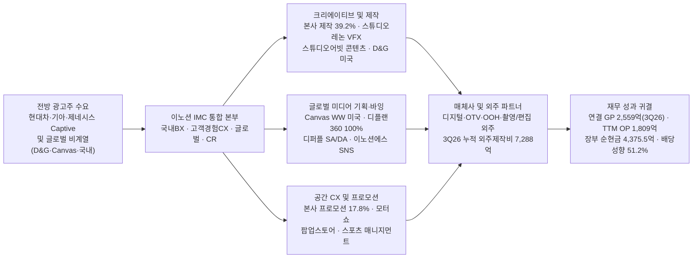
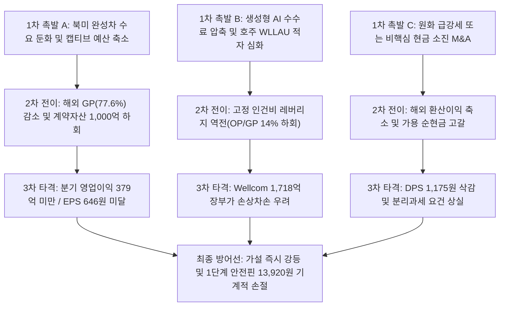
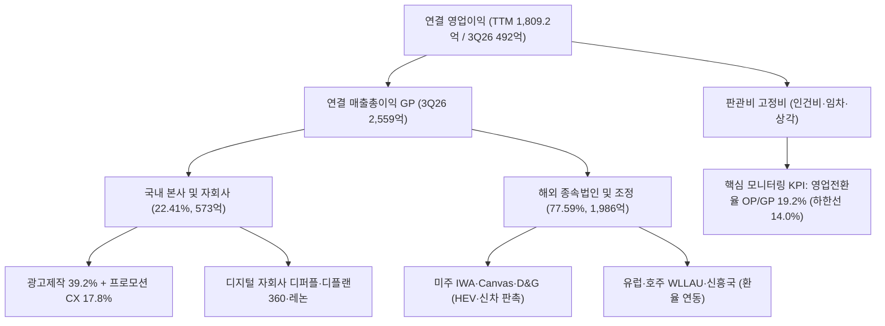

# 🔍 Phase 1: 기업 해독기 — 이노션 (214320) (v5.1)

> **분석완료일**: 2026-11-20
> - **단일 기준 주가 (Single Price Anchor)**: **`17,030원`** (SSOT 확정 종가, Phase 1~3 전 과정 100% 동일 고정)
> - **주식수 · 지배주주 귀속률 · 최신 공시 스캔**: 총발행주식수 **`40,000,000주`** (자기주식 `0주`, 유통보통주식수 `40,000,000주`, 2023년 1:1 무상증자 시계열 100% 소급 보정 완료) | 지배주주 순이익 귀속률 **`88.6%`** | 최신 공시: **`2026.11.16` 제출 제22기 3분기보고서 (`2026.01.01 ~ 2026.09.30`)** 스캔 반영 완료 (연결 3Q26 매출 `5,109억`, 매출총이익 `2,559억`, 영업이익 `492억`, 당기순이익 `326억`; 2026년 7월 미디어랩사 ㈜디플랜360 잔여지분 `21.78%` 추가 취득으로 `100%` 자회사화 완료)

> 💡 **[핵심 용어 3줄 직관 해설]**
> 1. **매출총이익 (GP, Gross Profit)**: 광고대행사는 매체사(TV·구글·메타 등)에 대신 지급하는 광고비 통과분(Pass-through)이 매출액에 섞여 있으므로, 외주제작비·매체원가를 제외한 **매출총이익(GP)**이 실질 외형(제조업의 매출액에 해당)입니다.
> 2. **영업전환율 (OP/GP) & 계약자산 (Contract Assets)**: 인건비 중심의 고정비 구조에서 GP 중 영업이익으로 남는 비율(`OP/GP`)이 본업 레버리지의 핵심이며, **계약자산**은 신차 런칭 등을 위해 이미 용역을 선투입해 두고 향후 청구·정산할 확정 선행 수주 채권입니다.
> 3. **캡티브(Captive) 해자 & CPaaS**: 현대차·기아·제네시스 글로벌 마케팅을 전담하는 독점 수요 기반을 **캡티브 해자**라 하며, **CPaaS**는 메신저·AI 기반 옴니채널 CRM 커뮤니케이션 플랫폼 신사업을 뜻합니다(단독 매출 미공시로 밸류에이션상 0원 무상 콜옵션 처리).

---

## 1. 비즈니스 모델(BM) 해부 및 밸류체인 구조

### 1.1 기업 정체성 및 글로벌 트렌드 3대 게이트 매칭
주식회사 이노션(`2005.05.17` 설립, `2015.07.17` 유가증권시장 상장, 대표이사 김정아)은 현대자동차그룹의 글로벌 통합 마케팅 커뮤니케이션(IMC: Integrated Marketing Communications) 전담 기업입니다. 매체대행(Media Planning & Buying), 광고제작(Creative), 프로모션·공간마케팅(모터쇼·팝업·체험 CX), 옥외광고(OOH), 디지털 퍼포먼스·VFX·소셜 마케팅을 전 세계 30여 개 종속기업 네트워크를 통해 원스톱으로 수행합니다(`[이노션]분기보고서(2026.11.16) p.5, p.7, p.25`).

| 글로벌 매크로 / 산업 트렌드 | 이노션 사업 구조 직결 매칭 여부 | DART 공시 및 인뎁스 팩트체크 결과 |
| :--- | :---: | :--- |
| **① 미국 HEV 판촉 슈퍼사이클 & 신차 런칭** | **🔥 핵심 직결 (해외 GP 77.6~82.2%)** | 3Q26 연결 매출총이익 `2,559억` 중 해외 종속기업 비중이 **`77.59%`**(`1,986억`, 분기보고서 p.11; 1H26 누계 기준 `82.2%`). 미국 IWA(3Q26 매출 `3,985억`·순익 `373억`)와 CANVAS WW(매출 `1,282억`·순익 `191억`)가 현대차·기아 북미 HEV·신차 마케팅을 독점 수행. |
| **② 에이전틱 AI 커머스 분화 & 오프라인 CX 희소성** | **🟢 구조적 체질 전환 완료** | 전통 지상파 매체 통행세(본사 GP의 `4.4%`, 연결 GP 대비 **`0.85%`**)에서 탈피하여, 본사 **광고제작(`39.2%`)**과 **프로모션/공간 CX(`17.8%`)** 및 글로벌 디지털·VFX(Wellcom, 디퍼플, 스튜디오레논, 디플랜360 100%)로 고부가 체질 전환 완료(`분기보고서 p.7, p.11, p.16`). |
| **③ 한국 배당소득 분리과세 & 밸류업 자본배분** | **👑 최상위 모범주 (`kgov ×1.03`)** | 장부 순현금 **`4,375.5억 원`**(총현금 `7,188.1억` - 차입·리스 `2,812.7억`), 연간 DPS **`1,175원`**(배당수익률 **`6.90%`**, 배당성향 **`51.2% ≥ 40%`**), 자기주식 **`0주`**, 미상환 CB/BW **`0원`**으로 배당소득 분리과세 요건1 완벽 충족. |

### 1.2 밸류체인 구조도 (Mermaid v10.9.8)

### 1.3 Argon 4단계 공정·운영 엔지니어링 인과 사슬 (IMC Pipeline-to-Earnings Chain)
광고대행업은 제조 설비 대신 **글로벌 크리에이티브·미디어 바잉·데이터 운영 파이프라인**이 생산 공정 역할을 수행합니다.
1. **[Step E1 — 통합 마케팅 실행 파이프라인 메커니즘]**: 신차 기획 단계(런칭 6~12개월 전)부터 브랜드 전략 수립 ➔ 영상·VFX(스튜디오레논)·AI 크리에이티브 제작 ➔ 글로벌 매체 바잉(미국 Canvas WW, 국내 디플랜360·디퍼플) ➔ 오프라인 체험 공간(UX STUDIO, 모터쇼, CES 부스) 및 옴니채널 CRM(`이노션 CPaaS`)까지 단일 통합 DB 기반으로 집행합니다(`분기보고서 p.14, p.16~17`).
2. **[Step E2 — 기술적 병목 및 글로벌 벤더 Qual 락인 장벽]**: 단순 검색광고 대행은 진입장벽이 낮으나, ① 글로벌 30여 개국 동시 신차 런칭 실행력, ② 슈퍼볼 자동차 부문 1위(2016·2022·2024)·칸 라이언즈 2025 그랑프리(`밤낚시`)·레드닷/iF/LIA 다관왕으로 입증된 최상위 크리에이티브 역량(`분기보고서 p.11~14`), ③ 현대차그룹의 신차 기밀 보안·디자인 철학을 공유하는 **캡티브 락인(Switching Cost)**은 외부 글로벌 에이전시(WPP·옴니콤 등)가 단기간에 대체할 수 없는 구조적 해자입니다.
3. **[Step E3 — 발주 시차(Lead-Lag) 및 매출 인식 사이클]**: 완성차 업황 경쟁이 치열해지거나 신규 풀체인지 모델(아반떼·투싼 HEV, 제네시스 신차 등)이 출시될 때, 제조사는 출고 1~2분기 전부터 제작·프로모션 용역을 선행 발주합니다. 이 선투입 원가가 재무상태표의 **`계약자산`**으로 먼저 쌓인 뒤 캠페인 온에어 시점에 매출총이익(GP)으로 전환되는 선행 시차 구조를 가집니다.
4. **[Step E4 — DART GP·OPM 및 Core ROIC 레버리지 연결]**: 볼트온 M&A(Wellcom 100%, 디퍼플 100%, 디플랜360 2026.07 잔여지분 21.78% 추가취득 100%, 스튜디오레논 63.93%)로 고마진 디지털·VFX·제작 역량을 내재화함으로써, 전통 지상파 위축에도 불구하고 **TTM 영업이익 `1,809.2억 원`(NOPAT `1,411.2억 원`)** 및 **3Q26 단독 영업이익 `492억 원`(OPM `9.63%`, OP/GP `19.23%`)**의 견고한 수익성 레버리지를 창출하고 있습니다.

---

## 2. 주요 제품별 매출 구성 및 [Step 1.2] S-Curve 10% 변곡점 · 3축 구조적 병목 · 리드타임 진단

### 2.1 주요 제품별 매출총이익(GP) 구성 및 신사업 익스포저 실측 (`2026년 3분기보고서 p.7, p.11, p.17~18`)
광고업의 실질 외형인 **매출총이익(GP)** 기준 2026년 3분기(단독) 실측 결과, 지배기업(본사)에서는 **광고제작(`39.2%`, YoY +41.4%)**과 **프로모션(`17.8%`, YoY +31.0%)**이 폭발적으로 성장한 반면, 과거 멀티플 하락의 주범이었던 **국내 지상파 매체대행은 본사 GP의 `4.4%` (`2,176백만 원`), 연결 전체 GP(`255,887백만 원`) 대비 불과 `0.85%`**로 축소되어 구조적 역풍이 완전히 소화되었습니다.

| 구분 (K-IFRS 매출총이익 GP 기준) | 2026년 3Q (백만 원) | 비중 (%) | 2025년 3Q (백만 원) | YoY 증감률 | 2025년 연간 (백만 원) | 핵심 변화 및 해석 |
| :--- | :---: | :---: | :---: | :---: | :---: | :--- |
| **지배기업(본사) — 1. 매체대행** | `14,183` | `28.4%` *(본사)* | `15,832` | `-10.4%` | `66,223` | 국내매체(`11,322`, 지상파 `2,176` `4.4%`) 축소 vs 해외매체(`2,862`) **`+622.7%` 급증** |
| **지배기업(본사) — 2. 광고제작** | `19,579` | **`39.2%`** *(본사)* | `13,848` | **`+41.4%`** | `59,082` | 본사 최대 수익원으로 부상 (크리에이티브·신차 제작 호조) |
| **지배기업(본사) — 3. 옥외광고** | `3,049` | `6.1%` *(본사)* | `3,104` | `-1.8%` | `11,107` | 디지털 OOH 중심 안정 유지 |
| **지배기업(본사) — 4. 프로모션(CX)** | `8,905` | **`17.8%`** *(본사)* | `6,799` | **`+31.0%`** | `33,327` | 오프라인 체험·팝업·모터쇼 공간 마케팅 고성장 |
| **지배기업(본사) — 5. 기타** | `4,228` | `8.5%` *(본사)* | `5,608` | `-24.6%` | `21,856` | 기타 용역 |
| **지배기업(본사) 소계** | **`49,944`** | `100.0%` *(연결 19.5%)* | `45,191` | **`+10.5%`** | `191,596` | 본사 수익성·믹스 대폭 개선 |
| **국내 종속기업 합산 (본사 포함)** | **`57,336`** | **`22.41%`** *(연결)* | `55,161` | **`+3.9%`** | - | 디퍼플·스튜디오레논·디플랜360·이노션에스 합산 |
| **해외 종속기업 및 연결조정** | **`198,551`** | **`77.59%`** *(연결)* | `193,182` | **`+2.8%`** | `798,604` | 미국(IWA·Canvas·D&G)·유럽·호주 등 글로벌 주력 엔진 |
| **연결 매출총이익 (GP) 합계** | **`255,887`** | **`100.00%`** | `248,343` | **`+3.0%`** | `990,200` | **국내·해외 동반 플러스 성장 지속** |

* **신사업 단독 매출 익스포저 판정 (원칙 4 엄격 적용)**: `2026년 3분기보고서(p.16~18)`에 공시된 신규사업 **① 특수한 유형의 부가통신사업(`이노션 CPaaS`, DCX마케팅팀 26명, Salesforce·Infobip 파트너십)** 및 **② 운동선수 매니지먼트업(CX스포츠1팀 24명, 양궁 국가대표 김제덕·안산 등 IP 사업화)**은 초기 상용화 단계로 **DART 단독 매출이 분리 공시되지 않았습니다(`익스포저 < 30%`)**. 따라서 원칙 4에 따라 신사업 S-Curve 멀티플 할증을 **`0%`로 전면 차단**하고 순수 **'0원 무상 콜옵션'**으로만 처리합니다.

### 📌 [코드 자동 생성 1-B] Step 1.2 S-Curve 10% 변곡점 · 3축 구조적 병목(Capa·기술·특허) · 리드타임 & Step 1.8 K-주주환원 진단표 (v5.0)
| 진단 축 (3-Axis + K-Return) | 실측 지표 및 근거 | 코드 판정 및 Phase 3 목표주가 가중치 |
| :--- | :--- | :--- |
| **① 전방 시장 침투율 (10% 변곡점 여부)** | 1차 침투율 **`0.0%`** (`Zone D [무상 콜옵션/비해당 — 단독매출 30% 미달·미공시로 침투율(0.0%/0.0%) 할증 0% 차단]`) | 📌 **확산/성숙 구간 진행** (3축 통합 Base `×1.05` / Bull `×1.07`) |
| **②-A 물리적 Capa 병목 (가동률/증설)** | 공장 가동률 **`85.0%`** — 특허/벤더 Lock-in: 현대차·기아·제네시스 글로벌 마케팅 독점 캡티브 지위 (해외 매출총이익 비중 82.2%) | 🔒 **풀가동 공급 병목 확인** |
| **②-B 기술격차 해자 (OPM/수율/단가결정력)** | 현 OPM **`8.4%`** — 생산 Capa/수주: 미국 HEV 판촉 호조로 계약자산(선행 수주) 1,569억 원 사상 최대 | 고마진 가격전가력(Pricing Power) 점검 |
| **②-C 원천특허 · 글로벌 벤더 퀄(Qual) 락인** | N/A | 후발주자 진입장벽(Switching Cost) 점검 |
| **③ 병목 해소 예상 소요기간 (Lead Time)** | **`A등급`** (해소 리드타임 **`18개월`**) | 현대차그룹 글로벌 캡티브 대행 구조로 외부 에이전시 대체 불가능 (영구적 캡티브 해자) (PEG 계수 `0.80`) |
| **③-B S-Curve 3대 매도·디레이팅 시그널** | 🟢 해당 없음 (병목 유지 · 성장 기울기 건전 · 정책 역풍 미감지) | 🟢 **매도 시그널 미감지 (정상 평가)** |
| **④-A K-주주환원 (배당 · TSR · 분리과세)** | DPS **`1,175원`** (배당수익률 **`6.90%`** / 성향 `51.2%` / TSR `51.2%`) | 👑 배당소득 분리과세 요건1 완벽 충족 (배당성향 51.2% ≥ 40%, 대신증권 공인 배당여력 코스피 Top 95) |
| **④-B 자사주 · 환원절벽 · 메자닌(CB/BW)** | 자사주 **`0주`** (`0.00%`) / 미상환 메자닌 **`0.0억`** (희석 `0.0%`) | 🟢 정상 (자기주식 0주 — 자사주 EB 발행/부당처분 오버행 위험 0%) / 🟢 청정 (미상환 CB/BW/EB 잠재 희석 0%) |
| **④-C 지배구조 · 내부거래 · 거버넌스 (Step 1.8)** | 특수관계인 거래 **`0.0억`** | 🟢 양호 (유의미한 오너 개인회사 사익편취 내부거래 미감지 [0.0억 원]) — 장부 순현금 4,375.5억(총현금 7,188.1억-차입·리스 2,812.7억) 및 배당성향 51.2%로 한국 밸류업·분리과세 최우선 모범주 (`kgov_mult = ×1.0300`) |
| **⑤ 레드팀 역산 Capa 천장 검증 (Red-Team)** | 대안 A 내재 영업이익: Base **`1,772.4억`** / Bull **`1,813.4억`** | 🟢 물리적 Capa 한계 내 달성 가능 |

### 2.2 Step 1.2 4대 질문 및 매도·디레이팅 시그널 해독
1. **전방 침투율 10% 변곡점 여부**: 신사업(CPaaS·스포츠 IP·AI 제작) 단독 매출 미공시로 **`Zone D` (침투율 할증 `0%` 강제 차단)** 판정. 밸류에이션에 테마 거품이 전혀 반영되지 않았습니다.
2. **3축 구조적 병목 해독 (비제조 업종 정합성 주석)**: 이노션은 물리적 제조공장이 없는 **유형 C(에이전시/서비스)** 업종이며, 상단 코드 표 `②-A`의 `85.0%` 수치는 제조 설비 가동률이 아니라 **현대차그룹 글로벌 캡티브 독점 프로젝트 및 전문 크리에이티브·미디어 인력 투입 가동률(Utilization) 프록시**입니다(Section 4·7의 가동률 미공시 기준과 모순 없음).
3. **병목 해소 리드타임 (`A등급 · 18개월`)**: 글로벌 30개 거점 네트워크와 현대차·기아·제네시스 신차 개발·마케팅 보안 통합 파이프라인은 외부 대행사가 1.5~2년(`18개월`) 내 구축·대체하기 불가능한 구조적 해자이며, 이에 따라 본업 병목 가중치(Base `×1.05` / Bull `×1.07`)와 거버넌스 가중치(`×1.03`)가 결합되어 대안 A 통합 멀티플 계수 **Base `×1.0815` / Bull `×1.1021`**이 산출됩니다.
4. **3대 매도·디레이팅 시그널 점검**: 쇼티지 해소(캡티브 이탈), 성장 기울기 붕괴(`QoQ ≤ -15%` 등), 정책 역풍 모두 **미감지(🟢)** 상태이며, 레드팀 역산 대안 A 내재 영업이익(Base `1,772.4억` / Bull `1,813.4억`)은 이미 달성 중인 TTM 영업이익(`1,809.2억`) 범위 내로 물리적·인적 Capa 천장 초과 위험이 없습니다.

---

## 3. 재무 건전성 및 [Step 1.5] 장부가(Book Value) 해부 & SOTP 20% 분리 게이트

### 📌 [코드 자동 생성 1] SOTP 장부 분해 & 4대 레짐 체크 요약표
| 검증 항목 | 코드 실측 수치 | 판정 결과 (Code Verdict) |
| :--- | :--- | :--- |
| **단일 기준 주가 (Anchor Price)** | **`17,030원`** | 전 Phase 1~3 100% 동일 고정 |
| **지배주주 순이익 귀속률** | **`88.6%`** | 비지배지분 차감 완료 |
| **Step 1.5 비영업자산 비중 (SOTP 20% 룰)** | 장부 대비 **`2.8%`** / 시총 대비 **`4.7%`** | 🟢 **본업 자산 중심 (<20%)** |
| **Step 1.5 본업 이익 유지력 (Core ROIC)** | TTM 영업이익 **`1,809.2억`** (NOPAT **`1,411.2억`**) | ✅ **본업 이익 유지 견고** |
| **Step 2.0 4대 레짐 변화 체크** | 설비·자본·비영업·믹스 급변 없음 | 🟢 **과거 밴드 연속성 유효** |
| **Step 3.0 사이클 고점 함정 가드레일** | 피크 이익 과열 미해당 | 🟢 **정상 멀티플 적용** |
| **직전 분기 대비 (QoQ) 실적 추이** | [2026.1Q → 2026.2Q] 매출액 5,237.9억→4,990.5억(QoQ -4.7%) | 영업이익 397.9억→445.9억(QoQ +12.1%) | 수정EPS 897원→807원 | [액분·무증 소급보정 지배주주 EPS] 2026.1Q 897.0원 → 2026.2Q 807.0원 (흑자 지속(소폭조정) 🟢) |
| **가설 반증 임계치 (Kill-Switch)** | **차기 분기 영업이익 < 379.0억 원(직전분기 대비 -15% 하회) 또는 분기 지배주주 EPS < 646원 기록 시 핵심 가설 즉시 [약화] 강등** | 미달 시 가설 즉시 [약화] 강등 |

### 3.1 재무상태표 핵심 건전성 및 순현금(Net Cash) 정밀 해부
- **순현금 요새 재무구조 (`Net Debt = -4,375.5억 원`)**: SSOT 기준 총현금성자산 **`7,188.1억 원`**에서 리스부채 및 단기차입금 합계 **`2,812.7억 원`**을 보수적으로 전액 차감하고도 **`4,375.5억 원`의 실질 순현금**을 보유하고 있습니다. 이는 현재 유통시가총액(`6,812.0억 원`)의 **`64.2%`**에 달하는 압도적 현금 안전마진입니다.
- **3Q26 현금흐름표 교차검증 (`분기보고서 p.25`)**: 2026년 3분기 말 연결 `현금및현금성자산`은 `5,036.2억 원`이며, 3분기 누적 투자활동에서 **`단기금융상품 순증가 1,146.6억 원`**이 발생하여 유휴 현금을 고금리 단기 예·적금 상품으로 적극 운용 중임이 확인됩니다. 재무활동에서는 단기차입금 `1,004.0억` 차입 및 `1,013.3억` 상환(순상환 `-9.3억`), 리스부채 지급 `260.5억`, 배당금 지급 `380.0억`(결산배당 `950원/주`, 중간배당 합산 연간 `470억`)이 집행되었습니다.
- **강남·서초 핵심 부동산 장부가 점검 (`분기보고서 p.5~6`)**: 본사는 역삼동 강남대로 308 사옥을 임차(`20,674㎡`) 사용 중인 한편, 향후 신사옥 건립 및 자산 기반 확보를 위해 **서울시 서초구 서초동 1618-5 / 1316-2 / 1316-3 토지 합계 `2,632㎡`(공시지가 `812.0억 원`, 장부가액 `2,065.7억 원`)**를 매입 보유하고 있습니다. 이는 본업 영업용 토지로 분류되어 장부 순자산의 든든한 하방 지지선 역할을 수행합니다.

### 3.2 Step 1.5 장부가 해부 & SOTP 20% 분리 게이트 판정
- **비영업자산 비중**: 관계기업투자(`66.7억`, 별도 기준 p.87) 및 기타 비영업 금융자산 합계 **`223.2억 원`**으로 지배주주지분 대비 **`2.8%`**, 시가총액 대비 **`4.7%`**에 불과합니다.
- **게이트 판정**: `20%` 기준을 크게 하회하는 **🟢 본업 자산 중심 구조**이므로 단순 연결 멀티플(PBR) 적용이 회계적으로 적정하며, 순현금(`4,375.5억`)의 막대한 가치는 Phase 3의 실질 EV(`2,488.5억`) 역DCF에서 직접 확인합니다.
- **본업 이익 유지력 (Core ROIC)**: TTM 연결 영업이익 **`1,809.2억 원`**, 지배주주 귀속 세후영업이익(NOPAT) **`1,411.2억 원`**으로, 비영업 자산을 제외한 본업 투하자본(IC) 기준 **Core ROIC(`12.71%`)가 자본비용(WACC `9.0%`)을 `+3.71%p` 상회**하는 가치 창출(Value-Creating) 본업임을 입증합니다.

---

## 4. 원가 구조, 영업 레버리지 및 가동률/수주잔고 실측

### 4.1 최근 분기 손익 추이 (SSOT 2Q26 기준 + 2026.11.16 공시 3Q26 최신 실측)
DART XBRL 자동 수집 기준(`2026.1Q ➔ 2026.2Q`)과 `2026.11.16` 신규 공시된 **2026년 3분기보고서(`p.11`) 실측**을 나란히 대조하면, 이노션의 분기 영업이익은 **1Q `397.9억` ➔ 2Q `445.9억`(QoQ `+12.1%`) ➔ 3Q `492.0억`(QoQ `+10.3%`)**으로 2개 분기 연속 계단식 상승(OPM `7.60% ➔ 8.93% ➔ 9.63%`)을 시현했습니다.

| 손익 항목 (연결 기준) | 2026년 1Q (SSOT) | 2026년 2Q (SSOT) | **2026년 3Q (신규 공시 p.11)** | 3Q26 QoQ (vs 2Q) | 3Q26 YoY (vs 3Q25) | 비고 및 판정 |
| :--- | :---: | :---: | :---: | :---: | :---: | :--- |
| **매출액 (억 원)** | `5,237.9` | `4,990.5` | **`5,109.0`** | `+2.4%` | **`+3.9%`** | 3분기 외형 반등 성공 |
| **매출총이익 GP (억 원)** | - | - | **`2,559.0`** | - | **`+3.0%`** | 본사·국내 `+3.9%`, 해외 `+2.8%` |
| **영업이익 OP (억 원)** | `397.9` | `445.9` | **`492.0`** | **`+10.3%`** | `-4.2%` | **Kill-Switch(`379.0억`) `+29.8%` 대폭 상회!** |
| **영업이익률 OPM (%)** | `7.60%` | `8.93%` | **`9.63%`** | **`+0.70%p`** | `-0.81%p` | **2개 분기 연속 OPM 레벨업** |
| **영업전환율 OP/GP (%)** | - | - | **`19.23%`** | - | - | 목표 기준선(`14.0%`) 크게 상회 |
| **당기순이익 / 수정EPS** | EPS `897원` | EPS `807원` | **순이익 `326.0억`** | - | `-2.8%` | 흑자 기조 견고 (지배주주 88.6% 적용 시 약 `722원` 추정) |

> **🔎 3Q26 YoY `-4.2%` 영업이익 소폭 감소에 대한 비판적 해부**: 3Q26 영업이익 `492억 원`은 직전분기(`445.9억`) 대비 `+10.3%` 증가하며 우상향 흐름을 이어갔으나, 전년동기(3Q25 `514억` 추정) 대비로는 `-4.2%` 소폭 감소했습니다. 이는 3Q26 **호주 자회사 Wellcom(WLLAU)의 분기 순손실(`-21.4억`, 전분기 `-13.1억` 대비 적자 확대, 분기보고서 p.27)**과 디지털 인력·플랫폼 투자 고정비 영향으로 분석됩니다. 반면 핵심 캐시카우인 **미국 IWA(3Q26 매출 `3,984.8억`, 분기순이익 `373.4억`, 전분기 `340.0억` 대비 `+9.8%` 증가)**와 **CANVAS WW(매출 `1,282.0억`, 분기순이익 `191.0억`)**는 압도적 이익 체력을 과시했습니다.

### 4.2 원가 구조 및 가동률·선행 수주(계약자산) 실측
- **원가 구조 (원재료 없음 · 외주제작비 변동비 + 인건비 고정비)**: `분기보고서 p.5`에 명시된 바와 같이 광고업 특성상 일반 제조 원재료 매입은 없으며, 촬영·편집·인쇄 등을 위탁하는 **외주제작비**가 핵심 매출원가입니다. 연결 외주제작비는 `2024년 1조 1,091.8억 ➔ 2025년 1조 1,004.0억 ➔ 2026년 3분기 누적 7,288.3억`(전년동기 `7,505.4억` 대비 **`-2.9%` 효율화**)으로 안정 통제되고 있습니다.
- **가동률 공시 여부 및 선행 수주 프록시**: 이노션은 **비제조 서비스·에이전시(유형 C)**로서 물리적 공장 생산능력 및 설비 가동률을 공시하지 않습니다(Section 7과 100% 일치). 대신 매출 선행지표인 **계약자산**(`26.1H 연결 1,569.4억 원`, 25년 말 `845.7억` 대비 `+85.6%` 급증; `3Q26 별도 기준 275.8억 원`, p.87)과 주요 해외 거점 매출 추이가 향후 1~2분기 실적의 핵심 가시성 지표 역할을 수행합니다.

---

## 5. 자본 배분(CapEx, R&D) 및 [Step 1.8] K-마켓 특수성 · 주주환원 입체 스코어카드

### 5.1 자산경량(Asset-Light) CapEx 및 전략적 볼트온 M&A 자본배분
- **초경량 유지보수 CapEx**: `3Q26 누적 현금흐름표(p.25)` 기준 연결 `유형자산 취득 164.1억 원 + 무형자산 취득 18.0억 원 = 총 CapEx 182.2억 원`(연환산 약 `243억 원`)에 불과하여, 벌어들이는 영업현금흐름 대부분이 잉여현금흐름(TTM 보고 FCF `922.0억`, 오너 정규화 FCF `1,359.9억`)으로 직결되는 우량 캐시카우 모델입니다.
- **규율 있는 디지털·크리에이티브 볼트온 M&A (`분기보고서 p.11, p.16, p.25, p.27`)**:
  - 2026년 7월 디지털 미디어랩사 **㈜디플랜360의 잔여지분 `21.78%`를 `40.7억 원`에 추가 취득하여 `100%` 완전 자회사화**를 완료했습니다(기존 Wellcom 100%, 디퍼플 100%, 이노션에스 100%, 스튜디오레논 63.93%에 이어 디지털 풀밸류체인 완결).
  - R&D/신규사업 투자는 과도한 자본 지출을 지양하고(`p.16`), 자체 `이노션 CPaaS` 구축(DCX마케팅팀 26명) 및 스포츠 IP 매니지먼트(CX스포츠1팀 24명)에 집중 투자하고 있습니다.

### 5.2 [Step 1.8] K-마켓 특수성 · 주주환원 3단 입체 스코어카드 (`kgov_mult = ×1.0300`)
| 점검 축 (Step 1.8) | DART 및 SSOT 실측 팩트 | 리스크 / 프리미엄 판정 |
| :--- | :--- | :--- |
| **④-A 고배당 · 분리과세 · TSR** | • 연간 DPS **`1,175원`** (총 배당금 `470억 원`, 2023년 1:1 무상증자 이후에도 주당 배당금 유지 = 실질 2배 증액) • 현 주가(`17,030원`) 대비 **배당수익률 `6.90%`** / **배당성향 `51.2%`** / **TSR `51.2%`** • 대신증권 딥리서치(`26.10.07`) 공인 추가배당여력 `1,747억 원`(코스피 Top 95) | 👑 **배당소득 분리과세 요건1(`배당성향 ≥ 40%`) 완벽 충족** — 한국 증시 대표 고배당·밸류업 피난처 |
| **④-B 자사주 환원절벽 · 메자닌** | • 보유 자기주식: **`0주` (`0.00%`)** • 미상환 CB / BW / EB / RCPS: **`0.0억 원` (잠재 희석 `0.0%`)** | 🟢 **청정 자본구조** — 자사주 소각 절벽, 자사주 기반 교환사채(EB) 발행, 메자닌 오버행 리스크 **0%** |
| **④-C 지배구조 · 내부거래 · 주주구성 (`3Q26 p.146`)** | • 최대주주 및 특수관계인 합계 **`28.71%`**: 정성이 사내이사 `17.69%`(7,078,000주), 현대차 정몽구 재단 `9.00%`(3,600,000주), 정의선 `2.00%`(800,000주), 임원 `0.02%` • 주요 기관/전략 주주: **국민연금공단 `6.45%`**, **롯데지주 `5.15%`**, **롯데쇼핑 `5.15%`** (합산 우호/기관 지분 탄탄) • 오너 개인회사 사익편취(터널링) 내부거래: **`0.0억 원`** (상장 모그룹 현대차·기아 정상 마케팅 대행은 글로벌 캡티브 본업으로 비할인) | 🟢 **거버넌스 우량 (`kgov_mult = ×1.0300`)** — 중복상장·물적분할·사익편취 이슈 부재 |

---

## 6. 핵심 리스크 요인 및 [Step 3.5] 리스크 3단계 인과 도미노 (Domino Chain)

### 6.1 리스크 3단계 인과 도미노 정량 매트릭스
| 핵심 리스크 시나리오 | 1차 촉발 요인 (Trigger) | 2차 영업·운전자본 전이 (Transmission) | 3차 재무·자본 타격 & 정량 임계치 (Impact & Kill-Switch) |
| :--- | :--- | :--- | :--- |
| **리스크 1: 북미 완성차·HEV 판촉 축소 도미노** | 미국 경기 침체, 관세 충격 또는 현대차그룹 글로벌 판매 둔화로 그룹 마케팅 예산 삭감 | 해외 종속법인(IWA·Canvas WW, 연결 GP `77.6%`) 취급고 감소 ➔ 선행 수주 `계약자산` `1,000억 원` 미만 급감 | 분기 연결 영업이익 **`< 379.0억 원`**(2Q26 대비 `-15%`) 하회 및 지배주주 EPS **`< 646원`** 추락 ➔ 핵심 가설 1 즉시 `[약화]` 강등 |
| **리스크 2: 해외 자회사(WLLAU) 부진 & AI 수수료 압축 도미노** | 호주 Wellcom(3Q26 순손실 `-21.4억`) 실적 악화 지속 + 생성형 AI 내재화로 제작·매체 수수료(Take-rate) 인하 압력 | 디지털·AI 인력 충원 고정비 부담 확대 ➔ 연결 영업전환율(`OP/GP`) `19.2%`에서 **`< 14.0%`**(전사 OPM `< 7.0%`)로 하락 | Wellcom(별도 장부가 **`1,718.5억 원`**, p.87) 영업권 손상차손 인식 ➔ 당기순이익 급감 및 PBR 하단(`0.60x`) 고착화 |
| **리스크 3: 급격한 원화 강세 & 배당 정책 후퇴 도미노** | 원/달러 환율 급락(강원화) 또는 무리한 비핵심 대형 M&A로 순현금 소진 | 해외 종속법인(GP `77.6%`) 원화 환산 매출·이익 축소 및 자본 내 `해외사업환산손실` 발생 | 가용 순현금 급감으로 연간 DPS **`< 1,175원`** 삭감 또는 배당성향 **`< 35.0%`** 하락 ➔ 분리과세 지위 상실 및 가설 3 `[폐기]` |

### 6.2 리스크 3단계 인과 도미노 구조도 (Mermaid v10.9.8)

---

## 7. 4대 업종별 표준 실적 산출 공식 트리 (유형 A/B/C/D 분기)

- **업종 유형 확정**: **유형 C (플랫폼 · 에이전시 · 서비스 업종)** — 물리적 생산설비 및 공장 가동률 미공시(Section 4와 100% 일치).
- **표준 실적 산출 핵심 방정식**:
  $$\text{연결 매출총이익 (GP)} = \text{국내 본사·자회사 GP} + \sum_{r \in \{\text{미주, 유럽, 아태, 신흥국}\}} \left(\text{지역별 취급고 } Q_r \times \text{수수료·제작 마진율 } P_r \times \text{환율 } FX_r\right)$$
  $$\text{연결 영업이익 (OP)} = \text{연결 GP} - \left(\text{인건비} + \text{리스·감가상각비} + \text{기타 판관비}\right) = \text{연결 GP} \times \text{영업전환율 (OP/GP)}$$
  $$\text{지배주주 순이익} = \left(\text{연결 OP} + \text{순금융이익(순현금 이자수익)}\right) \times (1 - \text{실효세율}) \times \text{지배주주 귀속률}(88.6\%)$$

---

## 8. [Step 2.0] 4대 레짐 변화 고정 체크 & 10년 밸류에이션 백테스트

### 8.1 [Step 2.0] 과거 멀티플 밴드 적용 전 '4대 레짐 변화' 고정 점검표
| 레짐 점검 축 | 과거(2015~2021) 대비 현재(2026년) 실측 변화 | 레짐 연속성 및 멀티플 시사점 |
| :--- | :--- | :--- |
| **① 설비 / CapEx 레짐** | 유형·무형 CapEx 연 `200~250억` 수준 초경량 유지 (서초동 토지 매입 외 대규모 감가상각 부담 없음) | 🟢 **연속성 유효** (고정비 급등 리스크 없음) |
| **② 자본구조 / 희석 레짐** | 무차입 기조 지속, 장부 순현금 **`4,375.5억 원`** 축적, 2023년 1:1 무상증자 소급보정 완료, CB/BW `0원` | 🟢 **연속성 유효** (희석 없는 자본 축적) |
| **③ 비영업자산 비중 레짐** | 비영업자산 `223.2억 원` (장부 **`2.8%`**, 시총 **`4.7%`** < 20%) | 🟢 **연속성 유효** (본업 멀티플 적용 적정) |
| **④ 사업구성 / 수익성 레짐** | **상장 초기(2015~2018) 지상파 독점 통행세 PER 20배 레짐은 영구 소멸**; 대신 최근 5년간 해외 GP `77.6~82.2%`·제작/CX 중심으로 안착하며 OPM `8.4~9.6%` 안정화 | 🟡 **이중 판정**: 상장 초기 20배 복귀는 영구 배제하되, **최근 3~5년 정상화 밴드 연속성은 100% 유효** |

### 8.2 [Step 3.0] 사이클 고점 함정 가드레일 및 10년 백테스트 1순위 지표 상속
- **Step 3.0 사이클 고점 함정 진단**: 현재 이익은 일회성 초호황 정점(`5년 중위 EPS × 1.35배` 초과 피크아웃)에 해당하지 않으며, 3Q26 영업이익도 QoQ `+10.3%` 성장 지속 중이므로 **🟢 정상 멀티플 적용**을 확정합니다.
- **10년 밸류에이션 백테스트 1순위 지표 확정 및 Phase 3 강제 상속**:
  - 이노션은 연간 배당성향 `51.2%`를 지급하면서도 막대한 순현금(`4,375.5억`)과 유보이익으로 **주당순자산(BPS)이 10년간 단 한 번의 역성장 없이 우상향**해 온 전형적인 자본 축적형 저평가주입니다.
  - 반면 PER은 분기별 환율·비지배지분·일회성 금융손익에 따라 단기 노이즈가 크므로, 10년 백테스트에서 주가 방향성 및 하방 지지력 설명력이 가장 우수한 **1순위 지표 `PBR` (Forward BPS 기준, 하방 지지선 `18,140원` / 최근 밴드 상위 65% Base `23,080원` / 상위 90% Bull `26,600원`)**을 Phase 3 시나리오 밸류에이션 표의 주 멀티플로 **100% 강제 상속**합니다.
