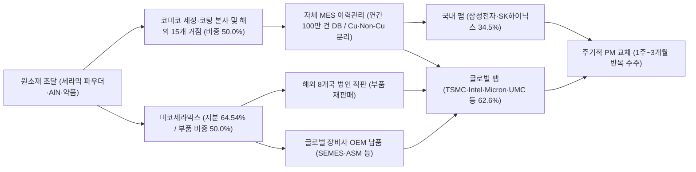
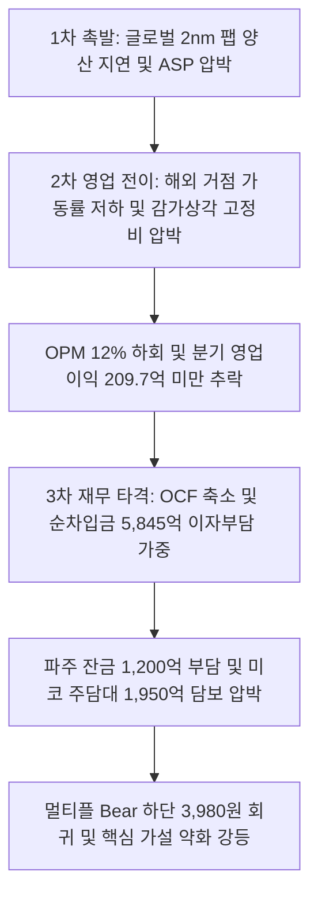

# 🔍 Phase 1: 기업 해독기 — 코미코 (183300) (v5.1)

> **분석완료일**: 2026-11-20
> - **단일 기준 주가 (Single Price Anchor)**: **`17,630원`** (SSOT 확정 종가, Phase 1~3 전 과정 동일 고정 | 유통시총 `8,888.6억 원`, 실질 EV `14,733.5억 원`)
> - **주식수 · 지배주주 귀속률 · 최신 공시 스캔**:
>   - **주식수 체계 (`[코미코]분기보고서(2026.11.16).pdf` p.50)**: 2026년 5월 무상증자(1:1) 및 7월 주식분할(2.5:1, 액면가 500원 ➔ 200원) 반영 후 총발행주식수 **`51,363,275주`**, 자기주식 **`945,672주` (`1.84%`)**, 실질 유통보통주식수 **`50,417,603주`** (최대주주 `(주)미코` `21,496,630주`, 지분율 `41.85%`). 과거 시계열 EPS/BPS/주가 전 구간 5배 소급 보정 완료.
>   - **지배주주 순이익 귀속률**: **`53.4%`** (종속회사 `(주)미코세라믹스` 지분율 `64.54%`에 따른 비지배지분 `35.46%` 차감 완료).
>   - **최신 공시 스캔**: ① `2026.11.16` 제14기 3분기보고서 공시(3Q26 누적 연결 매출 `5,192.6억 원`, 3Q26 단독 매출 `1,862.3억 원 [QoQ +5.8%]`, 영업이익 `246.7억 원 [QoQ -8.8%, YoY -4.6%]`, 지배주주 수정EPS `131.3원` 흑자전환), ② `2026.10.19` 종속회사 `(주)미코세라믹스` LG디스플레이 파주 클린룸 부지·건물 `1,500억 원` 취득 결정(잔금 `1,200억 원` `2027.03.31` 납입 예정), ③ `2026.06.05` 기업가치제고계획 공시(배당성향 `28.3%`, 조특법 고배당 배당소득 분리과세 요건 충족).

> 💡 **[핵심 용어 3줄 직관 해설]**
> 1. **초정밀 세정·특수코팅 (Precision Cleaning & Coating)**: 반도체 증착·식각 장비 내부 부품은 고에너지 플라즈마와 화학 가스에 노출돼 1주~3개월마다 부식·오염됩니다. 코미코는 수백~수천만 원대 고가 부품을 초정밀 세정하고 플라즈마 내식성 세라믹 코팅을 입혀 수명을 늘리고 칩 수율을 지키는 '반도체 팹 전속 메디컬 센터' 역할을 합니다.
> 2. **세라믹 히터(AlN Heater) · 정전척(ESC)**: 자회사 `(주)미코세라믹스`(지분 `64.54%`)가 생산하는 고기능성 반도체 장비 부품으로, 웨이퍼를 고온에서 균일하게 가열(히터)하거나 정전기로 단단히 고정(정전척)하는 초고부가(단가 수천만 원) 국산화 핵심 소모·교체 부품입니다.
> 3. **지배주주 귀속률(`53.4%`)과 Core ROIC(`27.95%`) 괴리**: 연결 영업이익의 절반 이상을 초고마진 자회사 미코세라믹스가 창출하기 때문에 연결 영업이익(`958.9억`)과 본업 투하자본수익률(`Core ROIC 27.95%`)은 매우 우수하지만, 외부 주주 몫(비지배지분 `35.46%`)과 대규모 글로벌 증설에 따른 차입금 이자·감가상각비가 차감되면서 모회사 코미코 주주에게 돌아오는 순이익(ROE `7.59%`)이 압박받는 이중 구조를 뜻합니다.

---

## 1. 비즈니스 모델(BM) 해부 및 밸류체인 구조

코미코는 **2013년 8월 13일 `(주)미코`의 정밀세정·특수코팅 사업부가 물적분할**되어 설립되었으며(`2017.03.23` 코스닥 상장), 2020년 물적분할된 반도체 세라믹 부품 전문기업 `(주)미코세라믹스`를 핵심 종속회사(지분율 `64.54%`)로 거느린 **글로벌 8개국 16개 생산거점 기반 반도체 공정 소모·재생 인프라 기업**입니다(`[코미코]분기보고서(2026.11.16).pdf` p.8, p.10, p.24, p.29, p.50).

### 1.1 글로벌 트렌드 3대 게이트 매칭
1. **AI/HBM4·2nm GAA 공정 미세화 직결 (Gate 1 — 구조적 수요 확장)**: 2026년 글로벌 반도체 시장의 1조 달러 돌파 슈퍼사이클과 HBM4·2nm GAA(Gate-All-Around) 선단 공정 도입으로 공정 스텝 수와 플라즈마 식각 강도가 급증하면서, 부품당 세정·코팅 교체 주기가 단축되고 고순도 특수코팅 및 AlN 세라믹 히터/ESC 수요가 구조적으로 증가합니다(`p.24, p.42`).
2. **글로벌 팹 현지화(On-shoring) 독점 수혜 (Gate 2 — 지리적 진입장벽)**: 반도체 칩메이커의 공급망 재편에 발맞춰 한국(안성·강릉·파주 예정), 미국(오스틴·힐스브로·피닉스), 대만(신주·타이난 2공장 건설 중), 중국(우시·선전·대련·황강·혜주·청도), 싱가포르(우드랜드), 일본(구마모토 JASM 대응), 유럽(체코 자텍 ESMC 대응·아일랜드) 총 **8개국 16개 생산거점**을 선제 구축하여 삼성전자·SK하이닉스·TSMC·Intel·Micron·UMC·GlobalFoundries 등 글로벌 전방 메이저와 50km 이내 근접 대응 체계를 완성했습니다(`p.29, p.36~38`).
3. **자본집약적 선제 증설에 따른 단기 마진·재무 압박 (Gate 3 — 리스크 정합성)**: 전 세계 팹 증설보다 1~2년 앞서 클린룸·환경 인허가·장비를 선제 투입해야 하는 BM 특성상, 가동률 램프업 이전 구간에서는 고정비(감가상각비) 증가와 대규모 CapEx 자금 조달(순차입금 `5,844.9억 원`, 보고 FCF `-2,273.6억 원`)이 단기 OPM 및 지배주주 순이익을 압박하는 양면성을 지닙니다(`p.29`).

### 1.2 밸류체인 구조도 (Mermaid v10.9.8)

### 1.3 공정 엔지니어링 4단계 물리·재무 인과 사슬 (Engineering-to-Earnings Causal Chain)
- **[Step E1 — 공정 물리·화학 메커니즘]**: 선단 식각(Etch)·증착(CVD/ALD) 챔버 내부는 고에너지 이온·라디칼을 포함한 플라즈마와 고부식성 화학 가스에 상시 노출됩니다(`p.40`). 순수 세라믹 소결체는 플라즈마 내식성은 우수하나 높은 경도와 취성 탓에 미세·복잡 형상 가공이 어렵고 중량·원가 부담이 큽니다. 코미코는 가공성이 뛰어난 메탈 바디 표면에 고순도 세라믹 파우더를 특수 코팅하여 내식성·경량화·원가절감을 동시 달성하며, 오염 반입 부품의 표면 안정화 처리를 통해 고객사 장비 재투입 대기시간(Downtime)을 획기적으로 단축합니다(`p.40~41`).
- **[Step E2 — 기술적 병목 및 안전·품질 인증(Qual) 장벽]**: 미세오염(Micro Contamination) 단 1건이 2nm GAA 및 HBM 웨이퍼 수율을 치명적으로 훼손하므로, 코미코는 1996년 국내 최초 사업화 이후 30년간 축적한 **연간 100만 건 규모의 자체 MES(생산관리시스템) 이력 DB**와 **Cu(구리) / Non-Cu 공정·물류차량 완전 분리 라인**을 전 세계 법인에 동일 복제했습니다(`p.35~36, p.40`). 후발주자가 해외 현지에서 환경 유해물질 인허가·클린룸 구축(`12~18개월`)과 글로벌 파운드리 공정 Qual 인증(`12개월`)을 통과하는 데 최소 **24개월 이상의 물리적 리드타임**이 소요됩니다.
- **[Step E3 — 발주 시차 및 반복 소모 주기 매핑]**: 팹 신설 초기에는 장비사(OEM)를 통해 코팅·세라믹 히터/ESC가 선행 납품되고(`p.42`), 양산 가동 이후에는 웨이퍼 투입량(Wafer Input)과 공정 난이도에 비례해 **최단 1주일~최장 3개월 주기**로 정기·비정기 PM(예방정비) 세정·코팅 및 소모 부품 교체가 무한 반복되는 구조입니다(`p.24`).
- **[Step E4 — DART 수주·매출 및 영업이익률(OPM) 레버리지 연결]**: 실제로 연결 매출은 2021년 `2,570억` ➔ 2025년 `6,041억`(5년 CAGR `+23.9%`) ➔ 2026년 3분기 누적 `5,192.6억`으로 구조적 외형 성장을 입증했습니다(`p.35~36`). 다만 2024~2026년 집중된 해외 6개 신규 법인(피닉스·타이난2·구마모토·체코·중국 화남/화중/청도) 선제 투자와 초기 감가상각비가 본격 계상되며 전사 OPM은 과거 중위 `20.7%`에서 현재 TTM `14.03%`로 `-6.7%p` 눌려 있는 과도기 국면에 있습니다.

---

## 2. 주요 제품별 매출 구성 및 [Step 1.2] S-Curve 10% 변곡점 · 3축 구조적 병목 · 리드타임 진단

### 2.1 품목별·고객군별 매출 구성 및 신기술 익스포저 산출표
`[코미코]분기보고서(2026.11.16).pdf` p.10, p.24, p.31 기준 2026년 3분기 누적 연결 매출 `5,192.6억 원`의 품목별 및 전방 고객군별 실측 비중은 다음과 같습니다.

| 구분 (품목 / 고객군) | 2026년 3Q 누적 매출액 | 매출 비중 (%) | 2025년 연간 (비중) | 2024년 연간 (비중) | 핵심 수익성 및 S-Curve 포지션 |
| :--- | :---: | :---: | :---: | :---: | :--- |
| **세정 (Cleaning)** | **`1,126억 원`** | **`21.7%`** | - | - | 1차 S-Curve 캐시카우 (1주~3개월 반복 PM) |
| **코팅 (Coating)** | **`1,468억 원`** | **`28.3%`** | - | - | 2nm GAA 극미세 파티클 제어 특수코팅 핵심 |
| **세라믹 부품 (미코세라믹스 등)** | **`2,599억 원`** | **`50.0%`** | - | - | **단독 공시 비중 50.0%** (AlN 히터·ESC 초고마진) |
| **연결 매출 합계** | **`5,192.6억 원`** | **`100.0%`** | **`6,041.1억 원`** | **`5,071.4억 원`** | 반도체 전방 비중 **`97.1%`** (비반도체 `2.9%`) |
| ↳ 국내 주요 고객 (삼성·SK하이닉스 외) | `1,793.5억 원` | `34.5%` | `2,146.6억 (35.5%)` | `2,012.1억 (39.7%)` | 국내 50km 근접 대응·HBM 라인 핵심 |
| ↳ 해외 주요 고객 (Intel·TSMC·Micron 외) | `3,249.4억 원` | **`62.6%`** | `3,708.4억 (61.4%)` | `2,880.6억 (56.8%)` | **해외 매출 비중 지속 확대 (`56.8% ➔ 62.6%`)** |

- **신기술·선단 공정 익스포저 판정**: DART 공시상 고부가 **코팅(`28.3%`) + 세라믹 부품(`50.0%`) 합산 비중이 `78.3%`**(전방 반도체 `97.1%`)로 **30% 기준을 압도적으로 상회**하여 '0원 무상 콜옵션'이 아닌 **본업 직결 Phase 2 스위트스팟 자산**으로 공식 분류됩니다.

### 📌 [코드 자동 생성 1-B] Step 1.2 S-Curve 10% 변곡점 · 3축 구조적 병목(Capa·기술·특허) · 리드타임 & Step 1.8 K-주주환원 진단표 (v5.0)
| 진단 축 (3-Axis + K-Return) | 실측 지표 및 근거 | 코드 판정 및 Phase 3 목표주가 가중치 |
| :--- | :--- | :--- |
| **① 전방 시장 침투율 (10% 변곡점 여부)** | 1차 침투율 **`36.5%`** (2차 S-Curve 침투율 `12.5%`) (`더블 S-Curve Zone A (1차 36.5% 캐시카우 + 2차 12.5% 🔥10% 언저리 변곡점)`) | 🔥 **10% 골든 변곡점 발화 구간** (3축 통합 Base `×1.14` / Bull `×1.19`) |
| **②-A 물리적 Capa 병목 (가동률/증설)** | 공장 가동률 **`78.0%`** — 생산 Capa: 글로벌 8개국(미 오스틴/피닉스·대만·한국 안성/청주) 로컬 팹 직결 세정·코팅 인프라 독점 선점 | 🟢 **여유 Capa 보유** |
| **②-B 기술격차 해자 (OPM/수율/단가결정력)** | 현 OPM **`14.0%`** — 기술격차 해자: 2nm GAA 극미세 파티클 제어 세정·코팅 레시피 및 AlN 세라믹 히터 국산화 | 고마진 가격전가력(Pricing Power) 점검 |
| **②-C 원천특허 · 글로벌 벤더 퀄(Qual) 락인** | 특허/벤더 Lock-in: 삼성전자·TSMC·인텔·SK하이닉스 글로벌 현지 팹 Qual 인증 장벽 | 후발주자 진입장벽(Switching Cost) 점검 |
| **③ 병목 해소 예상 소요기간 (Lead Time)** | **`A등급`** (해소 리드타임 **`24개월`**) | 해외 현지 환경 인허가·클린룸 구축(12~18개월) + 글로벌 파운드리 2nm 공정 Qual 인증(12개월)으로 최소 24개월 병목 지속 (PEG 계수 `0.85`) |
| **③-B S-Curve 3대 매도·디레이팅 시그널** | 🟢 해당 없음 (병목 유지 · 성장 기울기 건전 · 정책 역풍 미감지) | 🟢 **매도 시그널 미감지 (정상 평가)** |
| **④-A K-주주환원 (배당 · TSR · 분리과세)** | DPS **`285원`** (배당수익률 **`1.62%`** / 성향 `28.3%` / TSR `28.3%`) | ✅ 배당소득 분리과세 요건2 충족 (배당성향 28.3% ≥ 25% & 분기배당 실시) |
| **④-B 자사주 · 환원절벽 · 메자닌(CB/BW)** | 자사주 **`945,672주`** (`1.84%`) / 미상환 메자닌 **`219.0억`** (희석 `5.8%`) | 🟢 정상 (현재 자기주식 945,672주 [1.84%] 보유 — 소각 전환 여부 모니터링) / ⚠️ [메자닌 오버행 주의]: 잔액 219.0억 원 (희석 5.8%) |
| **④-C 지배구조 · 내부거래 · 거버넌스 (Step 1.8)** | 특수관계인 거래 **`176.0억`** | ⚠️ [오너 개인회사 내부거래 감시]: 특수관계자(오너 일가 개인회사 등) 연간 내부거래 약 176.0억 원 — 일감 몰아주기(터널링) 확대 시 밸류에이션 할인 트리거 작동 — ⚠️ 미코세라믹스 비지배지분(지배귀속률 53.4%) & 자회사 CB 희석(5.8%) + (주)에임 등 주요경영진 지배회사 거래(176.0억)·대여(81.5억) + 순차입금 5,845억·종속사 보증 5,380억·미코 주담대 1,950억 (`kgov_mult = ×0.9650`) |
| **⑤ 레드팀 역산 Capa 천장 검증 (Red-Team)** | 대안 A 내재 영업이익: Base **`369.6억`** / Bull **`358.7억`** | 🟢 물리적 Capa 한계 내 달성 가능 |

### 2.2 Step 1.2 4대 질문 및 매도·디레이팅 시그널 정밀 해독
1. **10% 변곡점 여부**: 기존 HBM·선단 세정(1차 침투율 `36.5%`)이 안정적 캐시카우 역할을 수행하는 가운데, **2nm GAA 파운드리 특수코팅 및 AlN 세라믹 히터·ESC 국산화(2차 침투율 `12.5%`)**가 10% 골든 변곡점에 진입한 **더블 S-Curve Zone A** 구조입니다.
2. **3축 구조적 병목 및 리드타임(`24개월`, A등급)**: 가동률은 전사 `78.0%`로 선제 증설 여력을 보유하고 있으나, 해외 8개국 현지 환경 인허가·클린룸 구축(`12~18개월`)과 글로벌 파운드리 2nm Qual 인증(`12개월`)의 결합 장벽이 **최소 24개월**의 구조적 병목을 형성합니다.
3. **3대 매도·디레이팅 시그널 점검**: ① 쇼티지 해소·리드타임 축소(미감지), ② 침투율 25%+ & 4분기 영업이익 YoY 급락+QoQ -15% 동반 둔화(3Q26 QoQ `-8.8%`로 임계치 `-15%` 미도달), ③ 확정 정책·보조금 축소(미감지) 등 3대 매도 시그널은 아직 미발동 상태입니다.
4. **⚠️ Phase 3 목표주가 적용 시 핵심 주의점 (유형 B 강제 동결)**: 구조적 S-Curve 점수는 이론상 `Base ×1.14 / Bull ×1.19`에 해당하나, 3Q26 기준 최근 2년 지배주주 EPS 급감(`-37.7%`)과 저ROE(`7.59%`)로 인해 **Phase 3 밸류에이션 엔진이 `유형 B (가치함정 방어 모드)`를 강제 발동하여 선제 할증을 전액 유보(`대안 A ×1.0000`)**했습니다. 즉, 기술 해자가 실재하더라도 **지배주주 순이익(EPS/ROE) 회복이 숫자로 증명되기 전까지는 멀티플 할증을 선반영하지 않는 엄격한 안전장치**가 작동 중입니다.

---

## 3. 재무 건전성 및 [Step 1.5] 장부가(Book Value) 해부 & SOTP 20% 분리 게이트

### 📌 [코드 자동 생성 1] SOTP 장부 분해 & 4대 레짐 체크 요약표
| 검증 항목 | 코드 실측 수치 | 판정 결과 (Code Verdict) |
| :--- | :--- | :--- |
| **단일 기준 주가 (Anchor Price)** | **`17,630원`** | 전 Phase 1~3 100% 동일 고정 |
| **지배주주 순이익 귀속률** | **`53.4%`** | 비지배지분 차감 완료 |
| **Step 1.5 비영업자산 비중 (SOTP 20% 룰)** | 장부 대비 **`6.7%`** / 시총 대비 **`2.1%`** | 🟢 **본업 자산 중심 (<20%)** |
| **Step 1.5 본업 이익 유지력 (Core ROIC)** | TTM 영업이익 **`958.9억`** (NOPAT **`748.0억`**) | ✅ **본업 이익 유지 견고** |
| **Step 2.0 4대 레짐 변화 체크** | ④ 사업구성레짐(OPM 과거중위 20.7% → 현재 14.0%, -6.7%p [본업 마진 훼손/경쟁 심화]) | 🔄 **레짐 변화 반영 필수** |
| **Step 3.0 사이클 고점 함정 가드레일** | 피크 이익 과열 미해당 | 🟢 **정상 멀티플 적용** |
| **직전 분기 대비 (QoQ) 실적 추이** | [2026.2Q → 2026.3Q] 매출액 1,759.6억→1,862.3억(QoQ +5.8%) | 영업이익 270.5억→246.7억(QoQ -8.8%) | 수정EPS -59원→131원 | [액분·무증 소급보정 지배주주 EPS] 2026.2Q -59.1원 → 2026.3Q 131.3원 (QoQ 반등/흑자유지 ✅) |
| **가설 반증 임계치 (Kill-Switch)** | **차기 분기 영업이익 < 209.7억 원(직전분기 대비 -15% 하회) 또는 분기 지배주주 EPS < 105원 기록 시 핵심 가설 즉시 [약화] 강등** | 미달 시 가설 즉시 [약화] 강등 |

### 3.1 재무상태표 핵심 항목·차입금·현금성자산 및 신용등급 실측
- **지배주주 자본 & BPS**: 지배주주지분 **`2,866.7억 원`** (`BPS 5,686원`, 현재가 `17,630원` 기준 PBR **`3.10배`**).
- **현금 및 차입금 구조 (레버리지 경계 구간)**:
  - 2026년 3분기 말 연결 **기말현금및현금성자산은 `2,199.4억 원`**(전기말 `1,176.5억 원` 대비 `+1,022.9억 원` 증가, `[코미코]분기보고서(2026.11.16).pdf` p.50)으로 유동성 완충력을 확보했으나, 글로벌 거점 신·증설 및 파주 부지 취득 계약 등에 따른 대규모 차입 조달로 **순차입금(Net Debt)이 `+5,844.9억 원`**(2Q26 `4,300억 원` 대비 `+1,544.9억 원` 급증)까지 확대되었습니다.
  - 이에 따라 **보고 FCF는 `-2,273.6억 원`**으로 대규모 적자를 기록 중이며(유지보수성 CapEx만 차감한 **오너 정규화 FCF는 `+760.0억 원`** 흑자), 해외 종속사 채무보증 규모도 약 **`5,380억 원`** 수준에 달해 금리 및 현금흐름 관리가 핵심 모니터링 변수입니다.
  - **신용등급 (`p.10`)**: `2026.04.13` 기준 이크레더블 **`BBB+` (현금흐름등급 B, 정상)**, 나이스디앤비 **`A-` (현금흐름등급 B)**로 투자적격 등급을 유지하고 있으나, 2027년 3월 말 미코세라믹스 파주 공장 잔금(`1,200억 원`) 납입 전후 추가 차입 부담 점검이 필수입니다.

### 3.2 [Step 1.5] 장부가 해부 & SOTP 20% 분리 게이트 · Core ROIC 유지력 판정
- **비영업자산 해부 (`p.61`)**: 연결 기준 기타금융자산(당기손익-공정가치측정금융자산 `203.3억 원`: 모회사 `(주)미코` 발행 코미코 주식 교환대상 교환사채[교환권 제외] `155.3억 원`, 상환전환우선주 `39.4억 원`, 투자조합 `8.6억 원` 등)을 포함한 SSOT 비영업자산 합계는 **`190.9억 원`**(30% 할인 후 인정 안전가치 `133.6억 원`)입니다.
- **SOTP 20% 룰 판정**: 비영업자산 비중은 지배주주 자본(`2,866.7억 원`) 대비 **`6.7%`**, 유통시총(`8,888.6억 원`) 대비 **`2.1%`**로 임계치(`20%`)를 크게 하회합니다. 따라서 별도 SOTP 분리를 강제하지 않고 **본업 자산 중심 (`Core BPS 5,307원`)**으로 일관 평가합니다.
- **본업 이익 유지력 (`Core ROIC`) 판정**: TTM 연결 영업이익 **`958.9억 원`**, 세후영업이익(NOPAT) **`748.0억 원`** 기준 본업 **Core ROIC는 `27.95%`**로 자본비용(WACC `9.0%`)을 3배 이상 상회하는 최상위 본업 수익성을 유지하고 있습니다. 다만 연결 차입금 이자비용과 미코세라믹스 비지배지분(`35.46%`) 차감 이후의 **지배주주 ROE는 `7.59%`**에 불과하므로, **"영업 본업의 높은 ROIC(`27.95%`)가 모회사 주주 ROE(`7.59%`)로 전이되지 못하는 재무·지배구조 누수"**가 현재 주가 디스카운트의 본질입니다.

---

## 4. 원가 구조, 영업 레버리지 및 가동률/수주잔고 실측

### 4.1 최근 5개년 연간 매출 성장 궤적 및 2026년 분기(QoQ/YoY) 손익 실측
`[코미코]분기보고서(2026.11.16).pdf` p.36 및 SSOT 분기 실적 데이터 기준 추이는 다음과 같습니다.

| 기간 | 연결 매출액 (억 원) | 국내법인 / 해외법인 (조정 전) | 연결 영업이익 (억 원) | OPM (%) | 지배주주 수정EPS (원) | 핵심 비고 (QoQ / YoY) |
| :--- | :---: | :---: | :---: | :---: | :---: | :--- |
| **2021년** | `2,570.4` | `1,203.3 / 1,437.7` | - | - | - | 5개년 매출 CAGR `+23.9%` 기점 |
| **2022년** | `2,883.8` | `1,468.3 / 1,532.9` | - | - | - | 글로벌 거점 안정화 |
| **2023년** | `3,072.7` | `1,885.1 / 1,296.4` | - | - | - | 미코세라믹스 연결 본격화 |
| **2024년** | `5,071.4` | `3,799.0 / 1,575.7` | - | - | - | AI/HBM 슈퍼사이클 외형 급증 |
| **2025년** | `6,041.1` | `4,459.0 / 1,875.4` | `1,110.0` | `18.37%` | - | 사상 최대 연간 매출·영익 (`YoY +19.1%`) |
| **2026.1Q** | `1,570.6` | - | `204.5` | `13.02%` | - | 해외 신규 거점 초기 비용 반영 |
| **2026.2Q** | `1,759.6` | - | `270.5` | `15.37%` | `-59.1원` | 일시적 법인세 급증·비지배지분 배분 영향 |
| **2026.3Q** | **`1,862.3`** | (9M 누적 `5,192.6`) | **`246.7`** | **`13.25%`** | **`131.3원`** | **매출 `QoQ +5.8%` 신기록 / 영익 `QoQ -8.8%` (`YoY -4.6%`) / 수정EPS 흑자전환 ✅** |
| **TTM (최근 4Q)** | **`~6,835`** | - | **`958.9`** | **`14.03%`** | **`568.0원`** | TTM 영익 `YoY -9.6%` / 과거 중위 OPM(`20.7%`) 대비 `-6.7%p` |

- **3Q26 실적 정밀 해독**: 3Q26 매출은 **`1,862.3억 원`(`QoQ +5.8%`)**으로 분기 사상 최대 외형 성장세를 이어갔고, 2Q26 일시 적자(`-59.1원`)였던 지배주주 수정EPS도 **`131.3원`**으로 뚜렷한 흑자 반등에 성공했습니다. 그러나 매출 증가에도 불구하고 영업이익이 `270.5억 ➔ 246.7억 원`(`QoQ -8.8%`, `OPM 15.37% ➔ 13.25%`)으로 후퇴한 점은 **해외 신규 거점(피닉스·구마모토·체코·중국 신설 법인) 가동 준비 고정비와 감가상각비 증가가 단기 영업 레버리지를 상쇄하고 있음**을 실증합니다.

### 4.2 글로벌 16개 생산거점, 가동률(`78.0%`) 및 'Ready to Run' 전략 실측
- **생산거점 현황 (`p.29, p.37~38`)**: 국내 2개(코미코 안성, 미코세라믹스 안성·강릉 + 파주 예정) 및 해외 14개(미국 오스틴·힐스브로·피닉스 / 중국 우시·선전·대련·황강·혜주·청도 / 대만 신주·타이난 2공장 건설 중 / 싱가포르 우드랜드 / 일본 구마모토 / 유럽 체코 자텍·아일랜드) 총 **16개 생산거점** 운영.
- **가동률 및 생산능력 해석 (`p.29 주4~주6`)**:
  - 전사 핵심 가동률은 SSOT 기준 **`78.0%`**입니다. DART 주석에 따르면 일부 해외 신규 법인의 지표상 가동률 등락은 유휴 설비가 아니라 **고객사 차세대 공정(삼성 테일러 2nm, TSMC 애리조나/타이난/구마모토/드레스덴) 전환 시 즉각 투입 가능한 'Ready to Run' 전략적 예비 Capa**를 반영한 것입니다.
  - 미코세라믹스는 2025년부터 단순 수량 기준에서 **주력 제품의 실제 공정 시간(공수)을 반영한 현실화 기준**으로 생산능력 산정 방식을 변경하여 고부가 부품 믹스 수익성을 정밀 관리하고 있습니다(`p.29 주6`).
- **운전자본 및 원가 구조 특성 (`p.35`)**: 세정·코팅 부문은 고객사 소유 부품을 위탁 재생하므로 재고자산 부담이 극히 낮고 글로벌 대기업 직납 구조로 매출채권 회전율이 우수합니다. 반면 부품 제조(미코세라믹스 `50.0%`) 비중 확대에 따라 원재료(고순도 세라믹 파우더) 및 설비 감가상각비(고정비) 민감도가 과거 대비 높아졌으며, 안성 본사 별도 기계장치 장부가도 기초 `211.1억`에서 3Q26 취득 `56.6억`·대체 `41.0억`을 거쳐 기말 `265.5억 원`(9개월 감가상각 `41.8억 원`)으로 지속 증설 중입니다(`p.29`).

---

## 5. 자본 배분(CapEx, R&D) 및 [Step 1.8] K-마켓 특수성 · 주주환원 입체 스코어카드

### 5.1 공격적 글로벌 선제 CapEx 배분 현황
- **글로벌 팹 동반 확장 (`p.8, p.37~38`)**:
  - **한국**: 미코세라믹스 안성·강릉 증설에 이어 `2026.10.19` LG디스플레이 파주 클린룸(토지 `184,312㎡`, 건물 `388,979㎡`) **`1,500억 원`** 인수 결정(연결자산의 `14.12%`, 잔금 `1,200억 원` `2027.03.31` 납입).
  - **미국·대만**: 애리조나 피닉스(TSMC·Intel 대응) 토지·건물 매입 및 리모델링, 대만 타이난 제2공장(TSMC 타이난 Fab 대응) 건설 진행.
  - **일본·유럽·중국**: 일본 구마모토(`TaMiCo Technology Kumamoto`, TSMC JASM 대응, 2025.04 설립), 체코 자텍(`TaMiCo Zatec`, TSMC 드레스덴 ESMC 대응, 2026.02 설립), 중국 대련(SK하이닉스 대련)·혜주(화남)·황강(YMTC, ZNIC 지분 `51%` 양수 100% 편입)·청도(미코세라믹스 종속 편입) 등 전방위 선제 투자 집행.
- **자본 배분 평가**: 2027~2029년 글로벌 선단 팹 양산 폭발을 선점하는 전략적 정당성은 명확하나, 단기적으로 **`보고 FCF -2,273.6억 원`과 `순차입금 5,844.9억 원`**이라는 높은 재무 레버리지를 수반하므로 **2027년 상반기 파주 잔금 납입 이후 CapEx 피크아웃(투자 사이클 종료 ➔ FCF 흑자 전환)** 여부가 밸류에이션 리레이팅의 핵심 분수령입니다.

### 5.2 [Step 1.8] K-마켓 특수성 · 주주환원 입체 스코어카드 (5대 고정 점검)
1. **`④-A` 배당소득 분리과세 및 TSR**: 주당배당금 **`285원`**(배당수익률 **`1.62%`**, 결산 배당성향 **`28.3%`**, TSR **`28.3%`**). `2026.06.05` 기업가치제고계획 공시를 통해 조특법 제104조의27 고배당기업 요건2(배당성향 `25%` 이상 & 분기배당 실시) 충족을 공식화했습니다.
2. **`④-B` 자사주 환원절벽 및 메자닌(CB/BW) 오버행**:
   - 자기주식 **`945,672주`(`1.84%`)** 보유 중으로 단기 환원절벽 리스크는 없으나, 소각 전환 여부가 주주가치 제고의 관건입니다.
   - **⚠️ 메자닌 오버행 주의**: 자회사 미코세라믹스 관련 미상환 전환사채 등 메자닌 잔액 **`219.0억 원` (잠재 희석률 `5.8%`)**이 존재하여 지배주주 희석 리스크로 작용합니다.
3. **`④-C` 내부거래(터널링) 점검**: 주요경영진 지배회사인 `(주)에임` 등 특수관계자 연간 내부거래 **`176.0억 원`** 및 대여금 **`81.5억 원`**이 존재합니다. 상장 모회사 정상 영업유통과 구분되는 오너 관련 개인회사 거래(`≥ 100억 원`) 구간이므로 코드가 감시 경보를 발동했으며, 일감 몰아주기 확대 시 밸류에이션 할인 폭이 확대됩니다.
4. **중복상장·지배구조 누수 및 모회사 `(주)미코` 주담대 양면성**:
   - 핵심 이익원인 `(주)미코세라믹스`(지분 `64.54%`, 2026년 중 `62.59% ➔ 64.54%` 추가 취득)의 비지배지분 누수로 지배주주 귀속률이 **`53.4%`**에 머무르며, 코미코 자체가 `(주)미코`가 보유한 코미코 주식 교환대상 교환사채(교환권 제외 `155.3억 원`)를 보유하는 복잡한 그룹 자본 관계가 얽혀 있습니다(`p.61`).
   - 최대주주 `(주)미코`(보유 `21,496,630주`, `41.85%`)는 보유 주식의 약 `76.7%`를 담보로 **`1,950억 원`**의 주식담보대출(이자율 `4.40~5.45%`, 담보유지비율 `140~170%`)을 유지 중입니다. 이는 **① 모회사 이자 충당을 위한 고배당 지속 유인**인 동시에, **② 주가 급락 시 담보유지비율 압박 및 반대매매 오버행**이라는 치명적 양날의 검으로 작용합니다.
5. **Step 1.8 종합 거버넌스 승수**: 코드 산출 **`kgov_mult = ×0.9650`**(`-3.5%` 거버넌스·메자닌·내부거래 복합 할인, 단 Phase 3 `유형 B` 모드에서는 선제 할증·가감을 보수적 하단 밴드로 통합 록인).

---

## 6. 핵심 리스크 요인 및 [Step 3.5] 리스크 3단계 인과 도미노 (Domino Chain)

### 6.1 리스크 3단계 인과 도미노 매트릭스
| 리스크 축 | 1차 촉발 요인 (Macro / Industry Trigger) | 2차 영업·운전자본 전이 (Operational Impact) | 3차 재무·자본 타격 및 정량 임계치 (Financial Kill-Zone) |
| :--- | :--- | :--- | :--- |
| **리스크 1: 선단 팹 지연 & 고정비 역레버리지** | 삼성 테일러 2nm·인텔·TSMC 애리조나 양산 일정 순연 또는 고객사 웨이퍼 투입량 축소 | 선제 구축한 해외 14개 거점('Ready to Run') 가동률 `70%` 하회 ➔ 감가상각·인건비 고정비 디레버리지로 **OPM `12%` 이하 추락** | 분기 연결 영업이익 **`< 209.7억 원`**(QoQ `-15%`) 또는 분기 지배EPS **`< 105원`** 하회 ➔ **Kill-Switch 발동 & Bear(`3,980원`) 하방 압력** |
| **리스크 2: 차입금·파주 잔금 & 유동성 경색** | 고금리 장기화 + 2027.03.31 파주 공장 잔금(`1,200억`) 납입 시점 영업CF 부진 중첩 | 연간 순이자비용 증가(`200억+`) 및 보고 FCF 적자(`-2,273.6억`) 장기화, 해외 종속사 채무보증(`5,380억`) 리파이낸싱 부담 가중 | 순차입금 **`> 6,500억 원`** 돌파 또는 신용등급(`BBB+`/`A-`) 하향 경보 ➔ 자회사 추가 메자닌/유상증자 희석 우려 |
| **리스크 3: 최대주주 주담대 반대매매 & 거버넌스 할인** | 반도체 업황 조정 또는 실적 쇼크로 코미코 주가 추가 급락 (`15,000원` 하회) | 최대주주 `(주)미코` 주담대(`1,950억 원`, 담보유지비율 `140~170%`) 마진콜 우려 부각 및 수급 급냉 | 담보권 실행(반대매매) 또는 추가 담보 제공 공시 ➔ 수급 붕괴 및 PBR 하단(`1.4~2.2배`) 영구 디레이팅 |

### 6.2 리스크 인과 도미노 구조도 (Mermaid v10.9.8)

---

## 7. 4대 업종별 표준 실적 산출 공식 트리 (유형 A/B/C/D 분기)

코미코는 Section 4에서 확인한 바와 같이 **자체 생산설비와 가동률(`78.0%`)을 공식 공시하는 연속공정·반도체 소모부품 제조 기업(`유형 A`)**에 해당합니다(Section 4 가동률 공시 여부와 100% 일치).

### 7.1 유형 A 표준 실적 산출 트리 (`Q × P × Mix - C`)
$$\text{연결 영업이익} = \sum_{i \in \{\text{세정, 코팅, 세라믹부품}\}} \left( \text{Capa}_i \times \text{가동률}_i \times \text{ASP}_i \right) - \left( \text{변동비}[\text{세라믹 파우더·약품·전력}] + \text{고정비}[\text{16개 거점 감가상각·인건비}] \right)$$

$$\text{지배주주 순이익} = \left( \text{연결 영업이익} - \text{순이자비용}[\text{순차입금 } 5,844.9\text{억}] \pm \text{외환손익} \right) \times (1 - \text{실효세율}) \times \text{지배주주 귀속률}(53.4\%)$$

- **핵심 실적 레버리지 방정식**:
  1. **외형(Q × P × Mix)**: `세정(21.7%)`은 글로벌 팹 Wafer Input에 비례하는 하방 경직성 캐시카우이며, `코팅(28.3%)` + `세라믹 부품(50.0%)`은 선단 2nm·HBM4 비중 상승에 따른 ASP 상승과 믹스 개선을 주도합니다.
  2. **수익성 병목(C & 비지배지분)**: 현재 코미코의 실적 병목은 매출(Q)이 아니라 **① 16개 거점 선제 투자에 따른 고정비(감가상각비) 증가**, **② 순차입금(`5,844.9억`) 이자비용**, **③ 미코세라믹스 비지배지분(`46.6%` 순이익 누수)**의 3중 필터입니다. 따라서 향후 실적 폭발의 조건은 **해외 신규 거점(피닉스·오스틴 코팅·타이난2·구마모토)의 가동률이 손익분기점(BEP)을 돌파하며 감가상각비 고정비율을 하락시키는 시점**에 집중됩니다.

---

## 8. [Step 2.0] 4대 레짐 변화 고정 체크 & 10년 밸류에이션 백테스트

### 8.1 [Step 2.0] 4대 레짐 변화 고정 체크 (과거 밴드 적용 전 필수 게이트)
| 4대 레짐 점검 항목 | 과거 중위 / 기준치 | 3Q26 현재 실측치 | 레짐 변화 판정 및 밸류에이션 해석 |
| :--- | :---: | :---: | :--- |
| **① 설비 레짐 (CapEx·감가상각)** | 정상 유지보수 투자기 | 대규모 글로벌 증설기 (`보고 FCF -2,273.6억`) | ⚠️ **초기 감가상각비 부담 급증** (2027년 상반기 파주 잔금 후 정점 통과 여부 핵심) |
| **② 자본구조 레짐 (순부채·희석)** | 저부채 성장기 | 순차입금 **`+5,844.9억 원`** / 메자닌 희석 **`5.8%`** | ⚠️ **재무 레버리지 급등** (EV 내 순차입금 비중 `39.7%`, 금리·이자부담 직격) |
| **③ 비영업자산 레짐 (SOTP 20% 룰)** | 본업 자산 중심 | 장부 대비 **`6.7%`** / 시총 대비 **`2.1%`** | 🟢 **레짐 유지** (본업 중심 자산 구조, SOTP 강제 분리 미해당) |
| **④ 사업구성 레짐 (OPM·마진 구조)** | 과거 중위 OPM **`20.7%`** | 현재 TTM OPM **`14.03%`** (**`-6.7%p`**) | 🔴 **코드 레짐 변화 경보 발동!** (`본업 마진 훼손/선제 투자 비용 부담` — 과거 호황기 고멀티플 단순 대입 금지) |

### 8.2 [Step 3.0] 사이클 고점 함정 가드레일 진단
- **코드 실측 판정**: 현재 TTM 지배주주 수정EPS(`568원`)는 5년 중위 EPS(`931.2원`) 대비 `-39.0%` 낮은 수준이며, 현재 ROE(`7.59%`) 역시 중위 ROE(`13.66%`)를 `-6.1%p` 하회합니다.
- **판정**: **`🟢 피크 이익 과열 미해당 (정상 멀티플 체계 적용)`** — 즉, 지금은 이익 정점에서 고점 멀티플을 부여하는 '사이클 고점 함정'이 아니라, 반대로 **투자 정점·이익 과도기에 따른 'ROE·EPS 침체(유형 B 가치함정 경고)' 국면**을 돌파할 수 있는지가 핵심 쟁점입니다.

### 8.3 10년 밸류에이션 백테스트 & Phase 3 주 지표 강제 상속
`valuation_metrics.json` (`section8`) 10년 시계열 백테스트 실측 결과는 다음과 같습니다.

| 밸류에이션 지표 | 10년 역사적 밴드 (Min ~ Max) | 3년 밴드 (`p20 / 평균 / p65 / p90`) | 결정계수 (`R²`) | 방향 일치율 (%) | 현재 멀티플 (`17,630원`) | 최종 채택 여부 |
| :--- | :---: | :---: | :---: | :---: | :---: | :---: |
| **PBR (주당순자산비율)** | `1.43배 ~ 8.87배` | `2.26x / 3.46x / 3.83x / 5.26x` | **`0.58`** | **`60.5%`** | **`3.10배`** (BPS `5,686원`) | 🏆 **1순위 주 지표 채택 (Phase 3 강제 상속)** |
| **PER (주가수익비율)** | `7.60배 ~ 53.23배` | `11.45x / 22.51x / 27.76x / 35.48x` | `0.16` | `50.0%` | `31.04배` (EPS `568원`) | ❌ 배제 (`R²` 극저·이익 변동성 왜곡) |

- **Phase 3 강제 상속 결론**: 대규모 CapEx·감가상각비·법인세·비지배지분 변동에 따라 PER은 설명력이 붕괴(`R²=0.16`, 방향일치율 `50.0%`)되는 반면, **PBR은 결정계수 `R²=0.58`, 방향 일치율 `60.5%`**로 주가 설명력이 압도적 1위입니다. 따라서 Phase 3의 모든 시나리오 목표주가(Bear/Base/Bull)는 **`Forward BPS (5,686원) × PBR 멀티플`**을 주 지표로 100% 일관 상속합니다.
