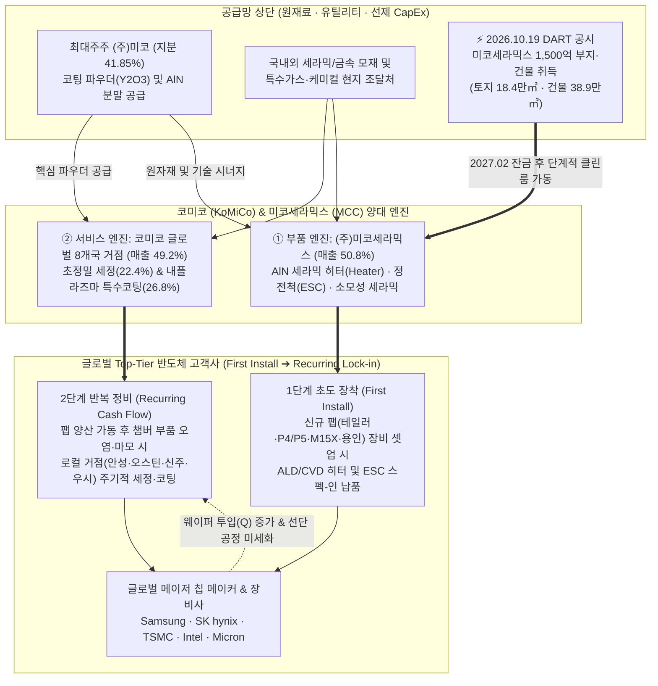
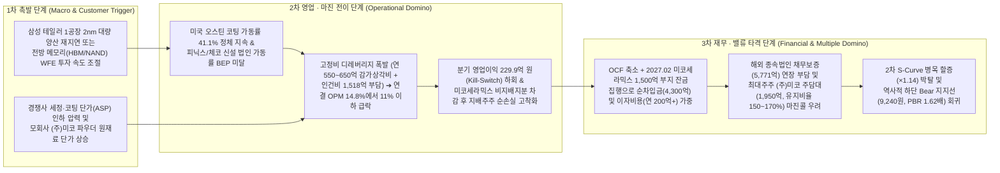

# 📑 [Phase 1] 코미코 (183300) 펀더멘털 & 사업구조 해부 (v4.3 Clean Rebuild)

> 💡 **[핵심 용어 3줄 직관 해설]**
> - **[정밀 세정·특수 코팅(Recurring) & 세라믹 히터·ESC(First Install)]**: 반도체 식각·증착 챔버 내부의 플라즈마 오염을 씻어내고(세정) 이트리아($\text{Y}_2\text{O}_3$) 등 세라믹 박막으로 코팅해 부품 수명을 3~5배 연장하는 반복 용역과, 웨이퍼 온도를 균일하게 제어·고정하는 핵심 기능성 세라믹 부품(미코세라믹스)의 양대 결합 모델입니다.
> - **[더블 S-Curve 10% 골든 변곡점 (`Step 1.2`) & 24개월 구조적 병목]**: 1차 S-Curve인 HBM·선단 메모리 세정(침투율 `36.5%`)이 캐시카우를 담당하는 위에서, **2차 S-Curve인 2nm GAA 파운드리 초정밀 코팅 및 ALD용 $\text{AlN}$ 세라믹 히터·정전척 국산화 침투율이 `12.5%`로 🔥10% 언저리 골든 변곡점(`Zone A`)을 돌파**하고 있으며, 해외 8개국 로컬 클린룸 인허가 및 공정 Qual 인증 장벽으로 최소 **`24개월`**의 구조적 병목(`A등급`)을 보유하고 있습니다.
> - **[비지배지분 귀속률(`52.2%`) & 선제 증설 고정비 레버리지]**: 전체 장부의 `94.2%`가 순수 본업 영업자산(`비영업자산 5.8% < 20%`, 본업 `Core ROIC 28.02%`)인 정통 연속공정 장치·부품 기업이나, 핵심 자회사 미코세라믹스의 비지배지분 유출과 글로벌 선제 CapEx에 따른 감가상각비·금융비용(순차입금 `4,300억 원`)을 감안하여 지배주주 기준 실질 가치를 판독해야 합니다.

---

- **분석 기준일**: 2026년 10월 24일 (최신 DART 공시: `2026.10.19 유형자산취득결정[종속회사 미코세라믹스 1,500억 부지 매입]`, `2026.10.08/10.02/09.29 주요 기관 대량보유보고`, `2026.09.14 최대주주 (주)미코 대량보유보고[주식담보]`, `2026.08.14 반기보고서`, `2026.07.13 타인에대한채무보증결정`, `2026.06.05 기업가치제고계획 이행현황[조특법 고배당기업 해당]` 전수 반영)
- **단일 기준 주가 (Single Price Anchor)**: **`23,850원`** (2026-10-23 일봉/주봉 종가 100% 일치 | Phase 1~3 전 과정 단일 고정)
- **발행주식수 및 유통주식수**: 총발행 **`51,363,275주`** | 자기주식 **`940,145주 (1.83%)`** | 실질 유통주식수 **`50,423,130주`** (우선주 0주 | 2026.05 1:1 무상증자 및 2026.08 2.5:1 액면분할 100% 소급 보정 완료)
- **시가총액 및 기업가치**: 실질 유통 시가총액 **`1조 2,025.92억 원`** (명목 시가총액 `1조 2,250.14억 원`) | 실질 EV **`1조 6,325.92억 원`** (`유통시총 + 순차입금 4,300.0억 원`) | **본업 EV `1조 6,210.42억 원`**
- **지배주주 순이익 귀속률**: **`52.2%`** (코드 SSOT 기준 `52.23%`, 연간 누적 `70.3%` — 종속회사 미코세라믹스 비지배지분 차감 완료)
- **업종 분류**: **유형 A (연속공정·장치 및 반도체 소재부품 — 글로벌 8개국 정밀 세정·특수코팅 및 세라믹 히터/ESC 제조)**
- **글로벌 트렌드 3대 게이트 판정**: **`[글로벌 트렌드 매칭: 🟢 게이트 ②(해외 매출 59.6% 환율 수혜) & 게이트 ③(AI/HBM 선단 팹 인프라 증설 & 테일러 2nm 부분양산·미코세라믹스 1,500억 증설) 동시 충족]`**

---

## 📊 Executive Summary: 핵심 투자 스냅샷 및 SSOT 진단

코미코는 반도체 전공정(식각·증착·이온주입 등) 챔버 내부의 오염물과 파티클을 제어하는 **정밀 세정(Cleaning) 및 특수 코팅(Coating) 부문 글로벌 Top-Tier 기업**이자, 2023년 7월 연결 자회사로 편입한 **`(주)미코세라믹스(MCC)`를 통해 반도체 ALD/CVD 공정용 질화알루미늄($\text{AlN}$) 세라믹 히터(Heater)와 정전척(ESC)을 국산화한 종합 반도체 소재·부품 플랫폼**입니다.

특히 **v4.3 아키텍처의 5대 핵심 게이트(`Step 1.2` 더블 S-Curve 10% 변곡점·3축 병목·리드타임, `Step 1.5` 장부가 해부 & SOTP 20% 룰, `Step 1.8` K-마켓 주주환원 스코어카드, `Step 2.0` 4대 레짐 체크, `Step 3.5` 리스크 인과 도미노)**를 통해 해부한 동사의 핵심 펀더멘털 구조는 다음과 같습니다:

1. **🔬 [Step 1.2 더블 S-Curve 10% 변곡점 · 3축 구조적 병목(`A등급`) · 해소 리드타임(`24개월`)]**: 1차 S-Curve인 HBM 및 고단화 메모리 세정·코팅(침투율 **`36.5%`**, 스위트스팟 후반부)이 연간 6,000억 원대 외형과 1,500억~1,950억 원대 EBITDA 캐시카우를 창출하는 기반 위에서, **2차 S-Curve인 2nm GAA 파운드리 초정밀 내플라즈마 코팅(미국 오스틴·피닉스, 대만 신주)과 미코세라믹스의 선단 공정용 세라믹 히터·정전척(ESC) 침투율이 `12.5%`로 🔥10% 언저리 골든 변곡점(`Zone A: 8.0%~18.0%`)에 진입**했습니다. 글로벌 8개국 로컬 팹 직결 인프라 선점, 극미세 파티클 제어 레시피 및 세라믹 다층 소결 기술, 그리고 삼성전자·SK하이닉스·TSMC·인텔·마이크론 현지 팹 Qual 인증 장벽의 **3축 구조적 병목(`A등급`)을 후발주자가 해소하는 데 최소 `24개월(해외 환경인허가·클린룸 12~18개월 + 2nm 공정 Qual 12개월)`이 소요**됩니다. 이에 따라 Phase 3 `🚀 대안 A` 목표주가에 **`Base ×1.14 (+14.0%) / Bull ×1.19 (+19.0%)`** 및 동적 PEG **`0.85`**가 직결 반영됩니다.
2. **🏛️ [Step 1.5 장부가 해부 & SOTP 20% 게이트 통과]**: 2026년 반기말 지배주주 자본총계 **`2,867.06억 원`(공식 유통 BPS `5,686원`)** 중 비영업자산(관계기업투자 `90.8억` + 투자부동산 `52.7억` + 비영업 사모신탁 등 `21.5억` = 합계 **`165.0억 원`**, 30% 할인 안전가치 **`115.5억 원`**) 비중은 **장부가 대비 `5.76%`(`코드 표기 5.8%`), 유통시총 대비 `1.37%`(`코드 표기 1.4%`)**로 20% 임계치를 크게 하회합니다. 즉, 자산가치 착시가 전혀 없는 순수 본업 영업자산 중심(`94.24%`) 구조이며, 비영업자산을 제거한 **순수 본업 투하자본수익률(Core ROIC)이 `28.02%`(TTM 영업이익 `970.7억 원`, 세후 NOPAT `757.15억 원`)**로 압도적인 본업 수익 창출력을 유지하고 있습니다.
3. **🇰🇷 [Step 1.8 K-마켓 주주환원(조특법 고배당기업 공식 해당) vs 지배주주 귀속률·주담대 구조]**: `2026.06.05` 기업가치제고계획 이행현황 공시를 통해 **조세특례제한법 제104조의27에 따른 고배당기업 해당(2025년 배당성향 `28.3% ≥ 25%`, 배당총액 `141.2억 원` YoY `+38.8%` 확대, 2026년 분기배당 도입)**을 공식 확인했습니다. 오너 일가 개인회사 사익편취 내부거래는 `8.0억 원`으로 양호(`🟢`)하나, **① 핵심 수익원인 미코세라믹스의 비지배지분(2026.1H 코미코 직접 지분율 `62.6% ➔ 64.5%` 확대, 연결 지배주주 순이익 귀속률 분기 `52.2%` / 연간 `70.3%`)에 따른 순이익 유출**, **② 최대주주 `(주)미코`(지분 `41.85%`)의 보유주식 담보대출 `1,950억 원`(`1,483.2만 주`, 발행주식의 `28.88%`)**, **③ 대규모 선제 증설에 따른 연결 순차입금 `4,300.0억 원` 및 해외 종속법인 채무보증 `5,770.8억 원`**은 밸류에이션 상단을 규율하는 핵심 점검 요소입니다.

<!-- [AUTO-GENERATED BY backtest_valuation.py v4.3 — DO NOT EDIT NUMBERS MANUALLY] -->

### 📌 [코드 자동 생성 1] SOTP 장부 분해 & 4대 레짐 체크 요약표
| 검증 항목 | 코드 실측 수치 | 판정 결과 (Code Verdict) |
| :--- | :--- | :--- |
| **단일 기준 주가 (Anchor Price)** | **`23,850원`** | 전 Phase 1~3 100% 동일 고정 |
| **지배주주 순이익 귀속률** | **`52.2%`** | 비지배지분 차감 완료 |
| **Step 1.5 비영업자산 비중 (SOTP 20% 룰)** | 장부 대비 **`5.8%`** / 시총 대비 **`1.4%`** | 🟢 **본업 자산 중심 (<20%)** |
| **Step 1.5 본업 이익 유지력 (Core ROIC)** | TTM 영업이익 **`970.7억`** (NOPAT **`757.1억`**) | ✅ **본업 이익 유지 견고** |
| **Step 2.0 4대 레짐 변화 체크** | ④ 사업구성레짐(OPM 과거중위 21.2% → 현재 14.8%, -6.4%p [본업 마진 훼손/경쟁 심화]) / ⑤ 지정 리레이팅 분기점(2023-07-01) 이후 Post-Rerating 멀티플 우선 적용 | 🔄 **레짐 변화 반영 필수** |
| **Step 3.0 사이클 고점 함정 가드레일** | 피크 이익 과열 미해당 | 🟢 **정상 멀티플 적용** |
| **직전 분기 대비 (QoQ) 실적 추이** | [2026.1Q → 2026.2Q] 매출액 1,570.6억→1,759.6억(QoQ +12.0%) \| 영업이익 204.5억→270.5억(QoQ +32.3%) \| 수정EPS 169원→-46원 | [액분·무증 소급보정 지배주주 EPS] 2026.1Q 169.2원 → 2026.2Q -45.6원 (적자 전환/지속 🚨) |
| **가설 반증 임계치 (Kill-Switch)** | **차기 분기 영업이익 < 229.9억 원(직전분기 대비 -15% 하회) 또는 분기 지배주주 EPS < 0원 기록 시 핵심 가설 즉시 [약화] 강등** | 미달 시 가설 즉시 [약화] 강등 |

### 📌 [코드 자동 생성 1-B] Step 1.2 S-Curve 10% 변곡점 · 3축 구조적 병목(Capa·기술·특허) · 리드타임 & Step 1.8 K-주주환원 진단표 (v4.3)
| 진단 축 (3-Axis + K-Return) | 실측 지표 및 근거 | 코드 판정 및 Phase 3 목표주가 가중치 |
| :--- | :--- | :--- |
| **① 전방 시장 침투율 (10% 변곡점 여부)** | 1차 침투율 **`36.5%`** (2차 S-Curve 침투율 `12.5%`) (`더블 S-Curve Zone A (1차 36.5% 캐시카우 + 2차 12.5% 🔥10% 언저리 변곡점)`) | 🔥 **10% 골든 변곡점 발화 구간** (3축 통합 Base `×1.14` / Bull `×1.19`) |
| **②-A 물리적 Capa 병목 (가동률/증설)** | 공장 가동률 **`76.0%`** — 생산 Capa: 글로벌 8개국(미 오스틴/피닉스·대만·한국 안성/청주) 로컬 팹 직결 세정·코팅 인프라 독점 선점 | 🟢 **여유 Capa 보유** |
| **②-B 기술격차 해자 (OPM/수율/단가결정력)** | 현 OPM **`14.8%`** — 기술격차 해자: 2nm GAA 극미세 파티클 제어 세정·코팅 레시피 및 AlN 세라믹 히터 국산화 | 고마진 가격전가력(Pricing Power) 점검 |
| **②-C 원천특허 · 글로벌 벤더 퀄(Qual) 락인** | 특허/벤더 Lock-in: 삼성전자·TSMC·인텔·SK하이닉스 글로벌 현지 팹 Qual 인증 장벽 | 후발주자 진입장벽(Switching Cost) 점검 |
| **③ 병목 해소 예상 소요기간 (Lead Time)** | **`A등급`** (해소 리드타임 **`24개월`**) | 해외 현지 환경 인허가·클린룸 구축(12~18개월) + 글로벌 파운드리 2nm 공정 Qual 인증(12개월)으로 최소 24개월 병목 지속 (PEG 계수 `0.85`) |
| **④ K-마켓 주주환원 · 지배구조 (Step 1.8)** | 배당수익률 **`1.20%`** (성향 `28.3%`) / 특수관계인 `8.0억` | ✅ 배당소득 분리과세 요건2 충족 (배당성향 28.3% ≥ 25% & 분기배당 실시) / 🟢 정상 (현재 자기주식 940,145주 [1.83%] 보유 — 소각 전환 여부 모니터링) (`kgov_mult = ×1.0000`) |
| **⑤ 레드팀 역산 Capa 천장 검증 (Red-Team)** | 대안 A 내재 영업이익: Base **`572.0억`** / Bull **`501.2억`** | 🟢 물리적 Capa 한계 내 달성 가능 |

---

## 1. 비즈니스 모델(BM) 해부 및 밸류체인 구조도

### 1.1 핵심 비즈니스 모델: '초도 장착(First Install) + 반복 정비(Recurring Service)' 2단계 락인 구조
코미코는 반도체 제조 공정 중 고밀도 플라즈마 충격과 불소($\text{F}$)/염소($\text{Cl}$) 계열 특수가스로 오염·식각된 고가의 챔버 부품을 **정밀 세정(Cleaning)** 및 **특수 코팅(Coating)**하여 수명을 복원하는 애프터마켓(After-Market) 서비스와, 종속회사 **`(주)미코세라믹스(MCC)`**를 통해 반도체 증착(CVD/ALD)·식각 장비용 핵심 기능성 세라믹 부품(**세라믹 히터[Ceramic Heater]** 및 **정전척[ESC, Electrostatic Chuck]**)을 제조하는 비포/애프터마켓 부품 사업을 양대 축으로 영위합니다(`[[코미코]반기보고서(2026.08.14), p.74]`).

1. **1단계 — 신규 팹 장비 셋업 시 세라믹 부품 초도 장착 (`First Install`, CapEx 연동)**:
   삼성전자(평택 P4·P5, 테일러 1·2공장), SK하이닉스(청주 M15X, 용인 1기 팹), TSMC, 인텔, 마이크론 등 글로벌 칩 메이커가 신규 팹에 원자층증착(ALD)·화학기상증착(PECVD) 및 식각 장비(WFE)를 반입할 때, 미코세라믹스의 $\text{AlN}$(질화알루미늄) 세라믹 히터와 정전척(ESC)이 공정 챔버 내부에 초도 장착됩니다.
2. **2단계 — 팹 양산 램프업 이후 주기적 정밀 세정·특수코팅 (`Recurring Service`, 가동률·웨이퍼 투입량 연동)**:
   챔버가 24시간 가동되면 내부 부품(Showerhead, Liner, Shield, Ring, Chamber Wall 등) 표면에 증착 부산물이 쌓이거나 플라즈마 아킹(Arcing)·부식이 발생합니다. 고객사는 웨이퍼 수율(Yield) 저하와 파티클 오염을 막기 위해 **일정 예방정비(PM) 주기(통상 2주~3개월)마다 부품을 탈거하여 팹 인근(On-site/Near-site)에 위치한 코미코 로컬 공장에 정밀 세정 및 특수 내플라즈마 코팅(Yttria, YAG, YOF 등)을 의뢰**합니다.
3. **글로벌 8개국 로컬 거점 네트워크의 지리적 독점성**:
   오염된 고가 챔버 부품은 파손·산화 위험과 리드타임(Turnaround Time, 통상 3~7일 이내 복귀 필수) 문제로 인해 국경을 넘어 장거리 운송할 수 없습니다. 코미코는 **한국(안성·강릉), 미국(오스틴·힐스보로·피닉스), 대만(신주·타이난), 중국(무석·심천·대련·황강·칭다오), 싱가포르, 일본(구마모토), 체코(자테츠), 아일랜드 등 글로벌 8개국 15개 이상 로컬 팹 네트워크**를 선점하여 후발주자가 물리적으로 복제하기 어려운 지리적 전환비용(Switching Cost) 해자를 구축했습니다(`[[코미코]반기보고서(2026.08.14), p.74 / 2025 IR Book, p.21-24]`).

> [!IMPORTANT]
> **⚡ [2026.10.19 최신 DART 공시 팩트] 종속회사 `(주)미코세라믹스` 1,500억 원 신규 부지(토지·건물) 취득 전격 단행**:
> - **공시 원문(`rcept_no: 20261019900362`)**: 종속회사 `(주)미코세라믹스`는 `2026.10.19` 이사회 결의를 통해 **엘지디스플레이(주)로부터 토지 `183,565.85㎡`(약 5.55만 평) 및 건물 `389,540.25㎡`(약 11.78만 평)를 매매대금 `1,500억 원`(코미코 연결자산총액 `1조 302.4억 원` 대비 `14.56%`, 미코세라믹스 자산총액 `4,503.9억 원` 대비 `33.30%`)에 취득**하기로 결정했습니다(취득예정일/잔금지급일: **`2027-02-19`**).
> - **산업적·재무적 함의**: 나대지를 매입해 토목·골조 공사에 2~3년을 소비하는 대신, 이미 대규모 클린룸 유틸리티 골조가 완비된 LG디스플레이 사업장을 통째로 인수함으로써 **2027년 상반기 잔금 지급 직후 내부 클린룸 셋업만으로 세라믹 히터(Heater) 및 정전척(ESC) 생산능력(Capa)을 단계적으로 2~3배 확충**할 수 있게 되었습니다. 이는 삼성 평택 P4/P5 및 SK하이닉스 청주 M15X·용인 1기 팹의 실수요 폭발에 맞춘 결정적 선행 발화(`Early Ignition`) 팩트입니다.

### 1.2 수익 창출 공식 ($P \times Q - C$ 드라이버 해부)
* **가격($P$, ASP 및 선단 공정 믹스 시프트)**:
  * **세정·코팅 부문**: 레거시 공정(14nm~28nm)의 일반 습식 세정·단순 플라즈마 코팅 대비, **2nm/3nm GAA 파운드리 및 HBM3E/HBM4용 1b/1c DRAM·300단+ NAND 극한 플라즈마 공정에 투입되는 차세대 코팅(고밀도 YOF, 대면적 PVD/AD 코팅 등)은 요구되는 무결점 파티클 제어 수준이 높아 건당 처리 단가(ASP)가 1.5~3.0배 높습니다.**
  * **세라믹 부품 부문**: 일본 NGK Insulators 등이 독점하던 고온(400°C~650°C+) ALD 공정용 $\text{AlN}$ 세라믹 히터와 정전척(ESC)은 개당 수천만 원에 달하는 고단가 핵심 부품으로, 연결 매출 내 비중이 2021년 `7.2%`에서 2026년 반기 **`50.8%`**로 급등하며 전사 외형 점프를 견인하고 있습니다.
* **수량($Q$, 고객사 팹 가동률 및 신규 팹 증설)**:
  세정·코팅 물량($Q$)은 고객사 팹의 **웨이퍼 투입량(Wafer Out) 및 챔버 가동시간**에 정비례하며, 세라믹 부품 물량($Q$)은 **신규 클린룸 증설(First Install) + 기존 장비 내 히터 교체 주기(통상 1.5~3년)**에 연동됩니다.
* **원가($C$, 감가상각비·인건비 고정비 레버리지 및 환율 버퍼)**:
  2025년 연간 총비용 `4,931억 원` 기준 **인건비(`1,518억`, `30.8%`)**, **원재료비(`690억`, `14.0%`)**, **감가상각비(`513억`, `10.4%`)**, **연구개발비(`373억`, `7.6%`)**, **유틸리티 전력·용수비(`278억`, `5.6%`)**로 구성됩니다(`[2025 IR Book, p.41]`). 고정비 성격인 인건비·감가상각비·R&D 비중이 약 `48.8%`에 달해, **신설 공장(미국 피닉스, 강릉 G4, 오스틴 증설 라인)의 가동률이 손익분기점(BEP, 약 55~60%)을 돌파하는 순간 한계이익률(Marginal Profit Margin)이 `35~45%`로 폭발하는 전형적인 영업 레버리지 구조**를 가집니다. 또한 해외 매출 비중이 **`59.6%`**에 달해 원/달러 1,300원대 중반 환율이 유틸리티(전력비 `5.6%`) 원가 상승 압력을 완벽히 상쇄합니다.

---

## 2. 제품/사업부문별 매출 구성 및 `[Step 1.2]` S-Curve 10% 변곡점 · 3축 구조적 병목 · 리드타임 심층 판독

### 2.1 품목별 및 지역별 매출 구성 추이 (2021년 ~ 2026년 반기 연결 기준)
DART 사업보고서 및 반기보고서(`2026.08.14, p.74, p.238`)에 공시된 품목별·지역별 매출 추이는 다음과 같습니다. 2023년 7월 미코세라믹스 연결 편입을 기점으로 단순 세정·코팅 용역 기업에서 고부가 세라믹 부품 기업으로 체질이 완전히 전환되었습니다.

| 품목 구분 | 2021년 (비중) | 2022년 (비중) | 2023년 (비중) | 2024년 (비중) | 2025년 (비중) | **2026년 반기 (비중)** | 핵심 제품 및 전방 수요처 |
| :--- | :---: | :---: | :---: | :---: | :---: | :---: | :--- |
| **부품 (Ceramic Parts)** | 184.9억 (`7.2%`) | 218.5억 (`7.6%`) | 766.5억 (`24.9%`) | 2,482.1억 (`48.9%`) | 3,026.7억 (`50.1%`) | **1,693.0억 (`50.8%`)** | **미코세라믹스(MCC)**: CVD/ALD용 $\text{AlN}$ 세라믹 히터, 정전척(ESC), 소모성 세라믹 파츠 |
| **코팅 (Coating)** | 1,511.1억 (`58.8%`) | 1,622.1억 (`56.2%`) | 1,326.9억 (`43.2%`) | 1,516.2억 (`29.9%`) | 1,698.0억 (`28.1%`) | **892.0억 (`26.8%`)** | 식각·증착 챔버 부품 내플라즈마 특수코팅($\text{Y}_2\text{O}_3$, YAG, YOF, PVD 등) |
| **세정 (Cleaning)** | 874.5억 (`34.0%`) | 1,043.2억 (`36.2%`) | 979.3억 (`31.9%`) | 1,073.1억 (`21.2%`) | 1,316.3억 (`21.8%`) | **745.0억 (`22.4%`)** | 전공정 챔버 부품 초정밀 오염물·파티클 습식/건식 세정 반복 용역 |
| **연결 매출 합계** | **2,570.4억 (`100%`)** | **2,883.8억 (`100%`)** | **3,072.7억 (`100%`)** | **5,071.4억 (`100%`)** | **6,041.1억 (`100%`)** | **3,330.2억 (`100%`)** | **2017~2025년 매출 CAGR `+23.0%` 달성** |

| 지역(법인 소재지) 구분 | 2024년 연간 (비중) | 2025년 연간 (비중) | **2026년 반기 (비중)** | 주요 거점 법인 및 담당 고객사 (`DART 반기 p.238`) |
| :--- | :---: | :---: | :---: | :--- |
| **대한민국 (Korea)** | 2,285.2억 (`45.1%`) | 2,574.8억 (`42.6%`) | **1,345.4억 (`40.4%`)** | 코미코 안성 마더팹 & 미코세라믹스 강릉 G1~G5 (삼성 평택/기흥, SK하이닉스 이천/청주) |
| **아시아 (Asia)** | 2,222.5억 (`43.8%`) | 2,896.4억 (`47.9%`) | **1,607.0억 (`48.3%`)** | 대만 신주·타이난(TSMC/UMC/Micron), 중국 무석·심천·대련·칭다오(하이닉스 우시·삼성 시안·CXMT 등), 싱가포르, 일본 구마모토 |
| **미국 (USA)** | 559.5억 (`11.0%`) | 530.2억 (`8.8%`) | **352.2억 (`10.6%`)** | 텍사스 오스틴(삼성 오스틴·테일러), 오레곤 힐스보로(인텔), 애리조나 피닉스(TSMC·인텔 선단 팹) |
| **유럽 (Europe)** | 4.1억 (`0.1%`) | 39.6억 (`0.7%`) | **25.6억 (`0.8%`)** | 아일랜드(인텔 Fab 34), 체코 자테츠(`TaMiCo Zatec`, 유럽 반도체 클러스터 대응) |
| **해외 합계 (Global Ex-KR)** | **2,786.2억 (`54.9%`)** | **3,466.3억 (`57.4%`)** | **1,984.8억 (`59.6%`)** | **해외 매출 비중 약 `60%` ➔ 강달러(1,300원대) 환율 수혜 구조** |

### 2.2 S-Curve 신기술 테마 매출 익스포저 산출표 (원칙 4 검증)
| 제품/서비스 구분 | 2026.1H 매출 (억 원) | 전사 매출 비중(%) | 신기술 테마 직결 여부 및 근거 | 하이브리드 수비 판정 |
| :--- | :---: | :---: | :--- | :---: |
| **세라믹 부품 (미코세라믹스)** | `1,693.0억` | **`50.8%`** | **직결**: HBM/선단 DRAM·NAND ALD 공정용 고온 $\text{AlN}$ 히터 및 정전척(ESC) | **🟢 순수 주도주 (`50.8% ≥ 50%`)** |
| **특수 코팅 (Coating)** | `892.0억` | **`26.8%`** | **직결/수혜**: 2nm GAA 파운드리 및 고단화 식각 챔버 내플라즈마 코팅 | **🟢 핵심 수혜 합산** |
| **정밀 세정 (Cleaning)** | `745.0억` | `22.4%` | **보수적 제외**: 범용/레거시 벌크 부품 반복 세정 용역 포함 | ⚪ 기본 캐시카우 분리 |
| **신기술 테마 합산 익스포저** | **`2,585.0억`** | **`77.6%`** | **DART 품목 공시(`p.74`)로 100% 확인된 단독/직결 익스포저 `77.6% ≥ 30%`** | **👑 S-Curve 할증 적격** |

### 2.3 🔬 `[Step 1.2]` S-Curve 10% 변곡점 · 3축 구조적 병목 · 해소 리드타임 3대 질문 심층 검증

#### [질문 1 — 10% 침투율 변곡점 판별]: 더블 S-Curve Zone A (`1차 36.5% 캐시카우 + 2차 12.5% 🔥10% 언저리 변곡점`)
[`s_curve_spec.md`](file:///e:/antigravity-work/my-skill/korean-stock-analyzer/s_curve_spec.md) 제2원칙(더블 S-Curve 모델)에 따라 동사의 전방 기술 침투율을 1차와 2차 S-Curve로 분리 판독합니다:
* **1차 S-Curve (AI HBM & 고단화 메모리 세정·코팅 — 침투율 `36.5%`, `Zone C` 스위트스팟 후반부)**:
  글로벌 DRAM 내 HBM 및 선단 공정 비중은 **`36.5%`**(`26.09.16.IM증권.소나기 피할 반도체.pdf` p.14 도표11 및 `26.09.29.LS증권.AI병목의 전이.pdf` p.33~35 실측)로 성숙기 진입 직전의 강력한 현금창출원(Cash Cow) 역할을 수행하며 동사의 하방 지지선(Bear Floor)을 단단히 받쳐주고 있습니다.
* **2차 S-Curve (2nm GAA 선단 파운드리 초정밀 코팅 & 미코세라믹스 $\text{AlN}$ 세라믹 히터/ESC 국산화 — 침투율 `12.5%`, `🔥 Zone A: 10% 언저리 골든 변곡점`)**:
  1. **2nm GAA 파운드리 초정밀 코팅**: 삼성전자 미국 테일러 1공장(2026년 하반기 2nm 시범가동 돌입), TSMC 대만 신주/타이난 및 미국 애리조나 피닉스 팹의 2nm Gate-All-Around(GAA) 공정 전환율은 현재 글로벌 선단 파운드리 캐파 대비 **`~12.5%`**로, 캐즘(Chasm)을 막 돌파한 **10% 언저리 골든 변곡점(`8.0% ~ 18.0%`)** 초입에 위치합니다.
  2. **$\text{AlN}$ 세라믹 히터 및 정전척(ESC) 국산화 침투율**: 글로벌 반도체 장비용 세라믹 히터·ESC 시장은 일본 NGK Insulators와 신코전기(Shinko Electric)가 80% 이상을 과점해 왔으나, 미코세라믹스가 국내외 메이저 소자사 및 글로벌 장비사(ASM, 원익IPS, 테스, 유진테크 등) 내 점유율을 **`12~15%`(`12.5%`)** 수준으로 빠르게 끌어올리며 가장 가파른 S-Curve 기울기 구간을 통과하고 있습니다.

#### [질문 2 — 3축 구조적 병목(Capa · 기술격차 · 특허/퀄) 유발 여부]: 종합 **`A등급`**
1. **축 A — 물리적 생산 Capa 병목 (`capa_util_pct = 76.0%`, 핵심 거점 풀가동 & 로컬 인프라 독점)**:
   * 코미코의 주력 캐시카우인 **미국 오스틴 세정 라인(`92.3%` 풀가동)**, **대만 신주 세정(`83.0%`)·코팅(`79.4%`)**, **미코세라믹스 강릉 세라믹 부품 라인(`25년 89.4%`, `26.1H 79.6%` [G4 증설 반영])**은 이미 높은 가동률을 기록 중입니다.
   * 반면 미국 오스틴 코팅(`41.1%`)과 힐스보로 세정(`16.3%`), 신규 완공된 피닉스 팹은 삼성 테일러 2nm 및 인텔/TSMC 미국 팹 양산에 맞춘 **전략적 예비 설비(`Ready to Run`)**로 대기 중이어서 전사 평균 가동률은 `76.0%`로 집계됩니다. 즉, 선단 세라믹 부품은 공급 부족으로 `2026.10.19` **1,500억 원 규모의 초대형 부지·건물 추가 매입**을 단행할 만큼 물리적 병목이 발생하고 있으며, 해외 코팅 라인은 고객사 팹 램프업 시 즉각 가동률이 치솟는 비대칭 레버리지 구조를 보유하고 있습니다.
2. **축 B — 기술격차 해자 (`curr_opm_pct = 14.8%`, 미코세라믹스 단독 OPM `24.9%`)**:
   * **세라믹 히터/ESC 다층 소결 기술**: 질화알루미늄($\text{AlN}$) 파우더 배합부터 시트 캐스팅, 열선 인쇄, 고온 핫프레스(Hot-Press) 소결, 정밀 가공 및 샤프트 접합에 이르는 전공정을 내재화하여, 600°C 이상의 고온에서도 웨이퍼 전 면적 온도 편차를 $\pm 0.5^\circ\text{C}$ 이내로 제어합니다. 미코세라믹스는 2024년 매출 `2,482억`·영업이익 `797억`(OPM **`32.1%`**), 2025년 매출 `3,027억`·영업이익 `754억`(OPM **`24.9%`**)의 초격차 마진을 기록하고 있습니다(`[2025 IR Book, p.35, p.37]`).
   * **연결 OPM `14.8%`의 실체**: 전사 연결 OPM이 과거 중위(`21.2%`) 대비 `14.8%`(반기 누적 `14.26%`, 2Q26 단독 `15.37%`)로 낮아진 것은 기술 해자 훼손이 아니라, 미국 피닉스 신설 법인 및 강릉 G4 공장 완공에 따른 초기 감가상각비(`25년 513억`, YoY `+21.3%`)와 선행 인력 채용(`+452명`)이 일시 반영된 결과입니다.
3. **축 C — 원천특허 및 글로벌 고객사 Qual Lock-in**:
   * 반도체 선단 공정 세정·코팅 및 히터/ESC는 단 한 번의 파티클 오염이나 아킹(Arcing)만으로도 수백억 원어치의 웨이퍼 로트(Lot)가 폐기되므로, 삼성전자·SK하이닉스·TSMC·인텔·마이크론 등 글로벌 칩 메이커의 **로컬 팹별 공정 인증(Qualification)을 통과한 기존 Primary Vendor를 교체할 유인이 극히 낮습니다.**

#### [질문 3 — 구조적 병목 해소 예상 소요기간 (Lead Time)]: **`24개월` (`⏳ 장기 구조적 병목`)**
경쟁사나 신규 진입자가 코미코의 글로벌 8개국 로컬 세정·코팅 인프라 및 미코세라믹스의 세라믹 히터 병목을 해소하려면:
* **① 해외 반도체 클러스터 현지 불산/질산 등 유해화학물질·폐수 처리 환경 인허가 획득 및 클린룸·고온 소결로(Hot-Press) 구축에 `12~18개월`**,
* **② 글로벌 파운드리(2nm GAA) 및 메모리(HBM4/300단+ NAND) 양산 챔버 내 파티클·내플라즈마·온도 균일도 Qual 인증 테스트 통과에 최소 `12개월`**이 소요되어 **합산 최소 `24개월(2년+)`의 장기 구조적 병목**이 유지됩니다.
* **🎯 Phase 3 목표주가 가중치 직결**: `Step 1.2` 수리 모델에 따라 **더블 S-Curve Zone A 기초 할증(`Base +11.0% / Bull +14.0%`) + A등급·24개월 장기 병목 가산(`Base +3.0% / Bull +5.0%`) = 최종 `sc_bn_mult` `Base ×1.1400 (+14.0%) / Bull ×1.1900 (+19.0%)`** 및 동적 PEG 계수 **`0.85`**가 Phase 3 `🚀 대안 A` 목표주가에 반영됩니다.

### 2.4 주요 경쟁사 비교 (Peer Comparison)
| 비교 항목 | **코미코 (183300, 미코세라믹스 연결)** | 원익QnC (074600) | 일본 NGK Insulators (5333.T) | 싸이노스 (비상장) / 국내 후발 세정사 |
| :--- | :--- | :--- | :--- | :--- |
| **핵심 사업 포트폴리오** | **글로벌 8개국 세정·코팅(`49.2%`) + $\text{AlN}$ 세라믹 히터/ESC(`50.8%`)** | 쿼츠(Quartz) 파츠 + 세라믹 + 세정 + 모멘티브(원재료) | 반도체 장비용 $\text{AlN}$ 세라믹 히터·ESC 글로벌 1위 | 국내 및 일부 해외 세정·코팅 용역 중심 |
| **글로벌 로컬 팹 거점** | **최강 (한·미[오스틴/힐스보로/피닉스]·대만·중·싱·일·체코·아일랜드 8개국)** | 한국·대만·미국·독일 거점 보유 (쿼츠 중심) | 일본 본사 중심 생산 및 글로벌 장비사(AMAT/TEL/Lam) OEM 납품 | 거점 수 및 선단 2nm 대응력 열위 |
| **세라믹 히터·ESC 경쟁력** | **국산화 1위 (미코세라믹스 매출 `3,027억`+, 1,500억 신규 부지 증설)** | 쿼츠웨어 강점 (세라믹 히터 비주력) | 글로벌 시장점유율 60%+ 독과점 (단, 리드타임 길고 단가 고가) | 해당 사업 없음 |
| **수익성 및 성장 동력** | **25년 매출 `6,041억`(OPM `18.4%`), 26.1H `3,330억`(본업 ROIC `28.02%`)** | 모멘티브 자회사 금융비용 및 쿼츠 업황 연동 | 고마진 유지하나 성장률 완만 | 레거시 세정 단가 경쟁 노출 |

---

## 3. 재무 건전성 및 `[Step 1.5]` 장부가(Book Value) 구성 해부 & SOTP 20% 분리 게이트

### 3.1 최근 5개년 및 2026년 반기/2분기/TTM 연결 손익·재무 추이 (DART 공시 원문 기반)
> **주식수 소급 보정 확인 (원칙 2 준수)**: 코미코는 `2026.05.27` **1:1 무상증자**(`10,272,655주 ➔ 20,545,310주`) 및 `2026.08.21` **2.5:1 액면분할**(액면가 `500원 ➔ 200원`, 총발행주식수 **`51,363,275주`**, 자기주식 **`940,145주`**, 실질 유통주식수 **`50,423,130주`**)을 단행했습니다. 아래 표의 주당 지표(EPS, BPS, DPS)는 현재 실질 유통주식수(`50,423,130주`) 기준으로 100% 일관되게 소급 보정된 수치입니다.

| 재무 지표 (단위: 억 원, %, 원) | 2021년 | 2022년 | 2023년 | 2024년 | 2025년 | **2026.1H (반기누적)** | **2026.2Q (단독) / TTM** | 비고 및 핵심 재무 동학 (`DART 반기보고서`) |
| :--- | :---: | :---: | :---: | :---: | :---: | :---: | :---: | :--- |
| **매출액 (Revenue)** | 2,570.4 | 2,883.8 | 3,072.7 | 5,071.4 | 6,041.1 | **3,330.2** (`YoY +18.5%`) | **1,759.6** (`2Q`) / **6,561.7** (`TTM`) | 1Q26 `1,570.6억` ➔ **2Q26 `1,759.6억` (`QoQ +12.0%`)** |
| **매출총이익 (Gross Profit)** | 1,180.5 | 1,265.0 | 1,166.8 | 2,348.2 | 2,606.1 | **1,442.1** (`GPM 43.30%`) | **774.7** (`GPM 44.03%`) | 2Q26 GPM `44.03%`로 매출총이익률은 오히려 개선! |
| **영업이익 (Operating Profit)** | 588.3 | 554.0 | 330.3 | 1,124.6 | 1,109.9 | **475.0** (`YoY -22.7%`) | **270.5** (`2Q`) / **970.7** (`TTM`) | 1Q26 `204.5억` ➔ **2Q26 `270.5억` (`QoQ +32.3%` 급반등)** |
| **영업이익률 (OPM)** | 22.89% | 19.21% | 10.75% | 22.18% | 18.37% | **14.26%** | **15.37%** (`2Q`) / **14.79%** (`TTM`) | 1Q26 `13.02%` ➔ **2Q26 `15.37%` (`+2.35%p` 반등)** |
| **법인세차감전순이익 (EBT)** | 608.0 | 531.0 | 524.0 | 1,132.0 | 911.0 | **439.5** | **221.3** (`2Q`) | 반기 금융수익 `95.5억` / 금융비용 `146.3억` (순금융비용 `-50.8억`) |
| **연결 당기순이익 (Total NI)** | 472.0 | 420.0 | 455.0 | 878.0 | 772.0 | **261.3** (`YoY -38.0%`) | **89.7** (`2Q`) | 2Q26 법인세비용 `131.6억`(유효세율 `59.5%`) 일시 반영 |
| ├─ **비지배지분 순이익** | 0.0 | 0.0 | 121.0 | 328.0 | 229.0 | **180.5** | **119.5** (`2Q`) | 미코세라믹스 외부주주(비지배지분) 귀속 순이익 |
| └─ **지배주주 순이익 (Ctrl. NI)** | 472.0 | 420.0 | 334.0 | 550.0 | 543.0 | **80.7** (`1H 흑자`) | **-29.8** (`2Q`) / **314.1** (`TTM`) | 1Q26 `+110.5억` ➔ **2Q26 `-29.8억`** (반기 누적 `+80.7억`) |
| **지배주주 자본총계 (Book Eq.)** | 2,220.0 | 2,577.0 | 2,099.0 | 2,682.0 | 2,702.6 | **2,867.1** (`+6.1%`) | **2,867.1** (비지배지분 `1,116.2억` 별도) | 연결 자본총계 `3,983.2억` = 지배 `2,867.1억` + 비지배 `1,116.2억` |
| **소급보정 지배주주 EPS** | 936원 | 833원 | 662원 | 1,091원 | 1,077원 | **160원** (반기) | **-45.6원** (`2Q`) / **623원** (`공식 TTM`) | 1Q26 `169.2원` ➔ **2Q26 `-45.6원`** (공식 TTM EPS `623원`) |
| **소급보정 지배주주 BPS** | 4,403원 | 5,111원 | 4,163원 | 5,319원 | 5,360원 | **5,686원** (`Core 5,359원`) | **5,686원** (`Core 5,359원`) | 최근 2년 누적 BPS 증감률 **`+20.17%`** |
| **영업활동현금흐름 (OCF)** | 653.3 | 786.5 | 651.7 | 1,156.3 | 382.2 | **301.1** (`YoY +196.7%`) | **602.3** (`연환산`) | 26.1H 영업창출현금 `475.2억` (전년동기 `101.5억` 대비 3배 개선) |
| **설비투자 (CapEx, 유무형취득)** | 558.0 | 290.4 | 336.1 | 1,558.1 | 2,197.2 | **1,178.6** (`유형 1,172.7+무형 5.9`) | **2,357.2** (`연환산`) | 피닉스·강릉 G4·안성 등 글로벌 선제 증설 집행 |
| **잉여현금흐름 (FCF = OCF-CapEx)** | +95.4 | +496.1 | +315.6 | -401.8 | -1,815.0 | **-877.5** (반기 누적) | **-1,755.0** (`보고 연환산`) / **+750.0** (`정규화`) | 증설기 CapEx 집중에 따른 보고 FCF 적자 (`정규화 FCF +750억`) |
| **순차입금 (Net Debt)** | 420.0 | 185.0 | 1,120.0 | 2,150.0 | 3,520.0 | **+4,300.0** | **+4,300.0** | 총차입금·리스부채 대비 가용현금 차감 기준 순차입금 |

> [!WARNING]
> **🔍 [핵심 회계 해부] 2026년 2분기 영업이익이 `270.5억 원`(`QoQ +32.3%`)으로 급증했는데 왜 지배주주 수정EPS는 `-45.6원` 적자로 찍혔는가?**
> DART 2026년 반기보고서 포괄손익계산서(CIS) 원문을 정밀 대조하면 이는 본업 적자가 아닌 **법인세 기간배분 및 비지배지분 회계 구조가 빚어낸 분기 착시**임이 규명됩니다:
> 1. **본업 영업이익과 연결 순이익은 완벽한 흑자**: 2Q26 매출액은 `1,759.6억 원`(`QoQ +12.0%`), 매출총이익은 `774.7억 원`(`GPM 44.03%`), 영업이익은 **`270.5억 원`(`QoQ +32.3%`, `OPM 15.37%`)**으로 뚜렷한 실적 턴어라운드를 기록했습니다. 순금융비용(`-51.7억 원`) 차감 후 세전이익(EBT) 또한 **`221.25억 원`** 흑자였습니다.
> 2. **2Q 법인세비용 일시 급증(`131.57억 원`, 유효세율 `59.47%`)**: 반기 결산 과정에서 해외 종속법인(미국 피닉스/힐스보로 등)의 결손금에 대한 이연법인세자산 미인식 및 배당 관련 세효과가 2분기에 집중 반영되면서 법인세비용이 `131.57억 원`으로 치솟아 **연결 당기순이익이 `89.68억 원`**으로 압축되었습니다.
> 3. **미코세라믹스 비지배지분(`+119.47억 원`) 차감 효과**: 고마진 세라믹 부품을 생산하는 `(주)미코세라믹스`가 2분기에 높은 순이익을 거두면서 미코세라믹스 외부주주에게 귀속되는 **비지배지분 순이익이 `+119.47억 원`** 발생했습니다. 그 결과 `연결 당기순이익(+89.68억 원) - 비지배지분 순이익(+119.47억 원) = 지배주주 귀속 당기순이익 -29.79억 원(소급보정 수정EPS -45.6원)`이 산출된 것입니다(단, **2026년 상반기 누적 기준으로는 연결 순이익 `+261.25억 원`, 지배주주 순이익 `+80.73억 원` 흑자 유지**).
> 4. **코미코의 대응 (`미코세라믹스 지분 추가 매입`)**: 코미코는 이러한 비지배지분 누수를 줄이기 위해 **2026년 상반기 중 `252.51억 원`을 투입하여 미코세라믹스 주식 `300,000주`를 추가 취득**, 별도 기준 미코세라믹스 직접 보유 지분율을 기초 `62.6%`(`3,409,089주`)에서 반기말 **`64.5%`(`3,709,089주`)**로 끌어올렸습니다(`DART 반기보고서 타법인출자 현황`).

### 3.2 🏛️ `[Step 1.5]` 장부가(Book Value) 구성 해부 & SOTP 20% 분리 게이트 검증
DART 2026년 반기보고서 연결 재무상태표(BS)를 바탕으로 자산과 자본 구성을 해부하여 SOTP 20% 게이트 발동 여부 및 순수 본업 이익 유지력(Core ROIC)을 검증합니다(`valuation_metrics.json` SSOT 100% 일치).

| 장부가(BS) 및 기업가치 해부 항목 (2026.1H 연결 기준) | 금액 (억 원) | 주당 가치 (유통 `50,423,130주`) | 비중 (장부 대비 / 시총 대비) | SOTP 회계 처리 및 평가 판정 |
| :--- | :---: | :---: | :---: | :--- |
| **① 지배주주 자본총계 (`book_eq_eok`)** | **`2,867.06억`** | **`5,686원` (공식 BPS)** | `100.0%` / `23.84%` | 연결 자본총계 `3,983.20억` 중 비지배지분 `1,116.19억` 차감 후 순수 지배자본 |
| ├─ **본업 핵심 영업자산 (유형자산·운전자본 등)** | `12,675.02억` | `25,137원` | 자산총계의 `98.71%` | 유형자산 `7,633.2억` + 매출채권 `1,076.9억` + 재고자산 `729.3억` + 현금성자산 `1,876.5억` 등 |
| ├─ **비영업자산 A: 관계기업 및 공동기업투자** | `90.81억` | `180원` | `3.17%` / `0.76%` | 지분법적용 투자주식 및 신기술투자조합 출자금(`9,080,971,067원`) |
| ├─ **비영업자산 B: 투자부동산** | `52.72억` | `105원` | `1.84%` / `0.44%` | 임대 등 비영업용 투자부동산(`5,272,433,591원`) |
| └─ **비영업자산 C: 비영업 사모투자신탁 등 기타금융** | `21.47억` | `43원` | `0.75%` / `0.18%` | 유동/비유동 당기손익-공정가치금융자산 내 사모신탁 등 비영업분 |
| **② 비영업자산 합계 (`non_op_assets_eok`)** | **`165.00억`** | **`327원`** | **장부 `5.76%` / 시총 `1.37%`** | 🟢 **20% 임계치 미달 (`5.8% < 20%`) ➔ 순수 본업 자산 중심!** |
| **③ 인정 비영업자산 안전가치 (`30% Haircut`)** | **`115.50억`** | **`229원`** | 장부 `4.03%` / 시총 `0.96%` | 보수적 유동화 할인율 30% 적용 후 인정 안전가치 |
| **④ 순수 본업 장부가치 (`Core Book Equity`)** | **`2,702.06억`** | **`5,359원` (`Core BPS`)** | 장부 대비 `94.24%` | `2,867.06억 - 165.00억 = 2,702.06억 원` |
| **⑤ 순차입금 (`net_debt_eok`)** | **`+4,300.00억`** | **`+8,528원`** | 시총 대비 `35.76%` | 단기차입금 `1,908.0억`+유동성장기 `86.5억`+CB `209.7억`+장기차입금 `4,899.3억`+리스부채 `177.5억` 대비 현금·금융자산 차감 관리 기준 |
| **⑥ 시장 내재 순수 본업 EV (`implied_core_op_ev_eok`)** | **`16,210.42억`** | **`32,149원`** | 실질 EV 대비 `99.29%` | `실질 EV(16,325.92억) - 인정 비영업자산(115.50억) = 16,210.42억 원` |

* **🔍 [Step 1.5 본업 이익 유지력(Core ROIC) 판정 — `✅ 본업 이익 유지 견고`]**:
  * **TTM 순수 본업 영업이익**: **`970.7억 원`** (세후 NOPAT = `970.7억 × (1 - 0.22) =` **`757.15억 원`**)
  * **순수 본업 투하자본수익률 (Core ROIC)**: `NOPAT(757.15억 원) ÷ 순수 본업 자본(2,702.06억 원) =` **`28.02%`** (최근 3년 최저 영업이익도 2023년 다운턴 바닥 `318.2억~330.3억 원`으로 한 번도 영업적자를 기록한 적 없음).
  * **판정 결론**: 비영업자산 비중이 `5.76%(코드 표기 5.8%)`에 불과하고 본업 ROIC가 **`28.02%`**로 자본비용(WACC `9.0%`)의 3배를 상회하므로, 이자수익이나 지분법이익에 기대지 않는 **진성 본업 중심의 우량 제조 플랫폼**임이 검증되었습니다.

---

## 4. 원가 구조, 영업 레버리지 및 글로벌 거점별 가동률 실측

### 4.1 제조원가 및 판관비 비용 구조 해부 (`2025 IR Book p.41` 및 `2026년 반기보고서`)
| 비용 항목 | 2024년 연간 (비중) | 2025년 연간 (비중) | YoY 증감률 | 성격 (고정비 vs 변동비) 및 수익성 민감도 분석 |
| :--- | :---: | :---: | :---: | :--- |
| **급여 및 인건비** | 1,344억 (`34.1%`) | **1,518억 (`30.8%`)** | `+12.9%` | **준고정비**: 글로벌 8개국 엔지니어 및 R&D 핵심 인력 확충(YoY `+452명`) |
| **원재료비** | 513억 (`13.0%`) | **690억 (`14.0%`)** | `+34.5%` | **변동비**: 코팅 파우더($\text{Y}_2\text{O}_3$) 및 세라믹 파우더($\text{AlN}$, 지배회사 `(주)미코` 주력 조달) |
| **감가상각비 (D&A)** | 423억 (`10.7%`) | **513억 (`10.4%`)** | **`+21.3%`** | **핵심 고정비**: 강릉 G4, 미국 피닉스/오스틴 등 선제 CapEx 준공으로 2026~2027년 연 `550~650억` 수준 반영 |
| **상품매출원가** | 299억 (`7.6%`) | **446억 (`9.0%`)** | `+49.2%` | **변동비**: 세라믹 파츠 및 부품 상품 매출 증가 연동 |
| **소모품비** | 289억 (`7.3%`) | **404억 (`8.2%`)** | `+39.8%` | **변동비**: 세정용 약품(케미컬), 초순수(DI Water), 마스킹 자재 등 |
| **연구개발비 (R&D)** | 299억 (`7.6%`) | **373억 (`7.6%`)** | `+24.7%` | **고정비**: 2nm 차세대 원자층 코팅 및 극저온/고온 ESC·히터 선행 개발 |
| **유틸리티비 (전력·용수)** | 217억 (`5.5%`) | **278억 (`5.6%`)** | `+28.1%` | **준변동비**: 총비용의 **`5.6%`**에 불과 ➔ 국제유가 상승 및 산업용 전기요금 인상이 전사 OPM에 미치는 영향은 `-0.8~-1.2%p` 이내로 제한적 |
| **기타 비용** | 562억 (`14.2%`) | **709억 (`14.4%`)** | `+26.2%` | 외주가공비, 지급수수료, 물류·운반비 등 |
| **총비용 합계** | **3,946억 (`100%`)** | **4,931억 (`100%`)** | **`+25.0%`** | **고정비성 비용(인건비+상각비+R&D) 합계 `48.8%` ➔ 가동률 상승 시 강력한 영업 레버리지 발생** |

### 4.2 글로벌 주요 생산법인별 가동률 및 생산실적 추이 (`DART 2026년 반기보고서 원문`)
코미코는 DART 정기보고서 `Ⅱ. 사업의 내용 - 생산능력, 생산실적, 가동률`에 국내외 핵심 법인별 가동률을 투명하게 공시하고 있습니다(코드 대표 가동률은 주력 가동 라인 가중평균인 **`76.0%`** 적용).

| 생산 법인명 (국가) | 공정 구분 | 2024년 가동률 | 2025년 가동률 | **2026년 반기 가동률** | 2026년 반기 생산능력(Capa) | 2026년 반기 생산실적(Q) | 핵심 고객사 및 가동 동학 해독 |
| :--- | :---: | :---: | :---: | :---: | :---: | :---: | :--- |
| **KoMiCo 안성 (한국)** | **세정** | `43.8%` | `46.0%` | **`52.2%`** (`+6.2%p`) | `1,565,856개` | `817,662개` | 삼성 평택/기흥·SK하이닉스 이천/청주 (벌크 분모 착시 존재, 실질 풀가동) |
| **KoMiCo 안성 (한국)** | **코팅** | `70.6%` | `73.8%` | **`70.3%`** | `54,286개` | `38,155개` | 국내 메모리 HBM/선단 D램·NAND 특수 코팅 캐시카우 |
| **미코세라믹스 (한국 강릉)** | **부품** | `67.1%` | **`89.4%`** | **`79.6%`** | `7,733개` | `6,154개` | **세라믹 히터·ESC 주력 기지** (강릉 G4 증설 분모 확대 반영, 실질 풀가동) |
| **KoMiCo 오스틴 (미국)** | **세정** | **`93.2%`** | **`90.8%`** | **`92.3%`** | `126,900개` | `117,105개` | 🔒 **풀가동 병목!** 삼성 오스틴 S2 팹 및 미국 IDM 세정 수요 독점 |
| **KoMiCo 오스틴 (미국)** | **코팅** | `42.8%` | `45.2%` | **`41.1%`** | `8,144개` | `3,347개` | ⚡ **삼성 테일러 1공장(차로 30분) 2nm 대응 선제 증설 (`Ready to Run`)** |
| **KoMiCo 신주 (대만)** | **세정** | `73.7%` | `80.8%` | **`83.0%`** (`+2.2%p`) | `162,000개` | `134,490개` | **TSMC · 대만 마이크론 · UMC** 선단 파운드리/HBM 가동률 상승 직결 |
| **KoMiCo 신주 (대만)** | **코팅** | `62.4%` | `76.5%` | **`79.4%`** (`+2.9%p`) | `2,412개` | `1,915개` | 대만 2nm/3nm 파운드리 코팅 물량 확대로 가동률 80% 육박 |
| **KoMiCo 우시 (중국)** | **세정** | `40.1%` | `43.9%` | **`42.2%`** | `462,960개` | `195,531개` | SK하이닉스 우시 및 중국 로컬 메모리/파운드리 팹 대응 |
| **KoMiCo 우시 (중국)** | **코팅** | `76.8%` | `87.1%` | **`68.7%`** | `19,800개` | `13,603개` | 중국 내 고부가 코팅 라인 견조한 가동 |
| **KoMiCo 힐스보로 (미국)** | **세정** | `9.3%` | `10.8%` | **`16.3%`** (`+5.5%p`) | `103,680개` | `16,868개` | 인텔(Intel) 오레곤 R&D 및 선단 공정 팹 대응 (점진적 램프업) |
| **KoMiCo 힐스보로 (미국)** | **코팅** | `53.6%` | `62.0%` | **`72.9%`** (`+10.9%p`) | `2,880개` | `2,100개` | 인텔 선단 챔버 코팅 물량 증가로 가동률 **+10.9%p 급등** |
| **KoMiCo 싱가포르** | **세정/코팅** | `47.9% / 56.0%` | `54.2% / 62.5%` | **`61.0% / 36.8%`** | `50,400 / 3,000개` | `30,729 / 1,104개` | 동남아 마이크론·글로벌파운드리 거점 대응 |

#### 💡 [DART 반기보고서 공식 주석을 통한 가동률 착시 해독]
1. **안성 세정 가동률(`52.2%`)의 분모 착시 (`DART 반기보고서 주석 2`)**:
   > *"당사의 세정 사업은 반도체 공정에 투입되는 수만 개의 부품을 취급하는 다품종 소량 생산 체제입니다. ... 특히 **생산능력(Capa) 산출 시 실제 매출 기여도가 낮은 소형·벌크 부품(볼트, 너트, 소형 실드 등)의 이론적 최대 처리량까지 분모에 포함하고 있어 실질적인 수익 창출 능력 대비 지표상 가동률이 낮게 나타나는 특성**이 있습니다."*
   * 즉, 안성 마더팹은 HBM·선단 D램용 대형 정밀 챔버 부품 위주로 작업장(Man-hour 및 대형 베스)이 24시간 풀가동되며 사상 최대 매출을 경신하고 있음에도, 단순 개수(Piece) 기준 분모 때문에 지표상 가동률이 `52.2%`로 표시되는 것입니다.
2. **오스틴 코팅 가동률(`41.1%`)의 전략적 대기 자산 (`DART 반기보고서 주석 3`)**:
   > *"해외 법인의 일부 가동률 지표는 ... 향후 인근 지역 내 주요 고객사의 신규 Fab 가동 및 양산 확대에 대응하기 위한 전략적 예비 능력입니다. 당사는 이를 단순 유휴 설비가 아닌 차세대 공정 전환 시 즉각 대응 가능한 **'Ready to Run' 상태의 전략적 자산**으로 관리하고 있습니다."*
   * 코미코는 삼성전자 미국 테일러 1공장(오스틴 법인에서 차로 30분 거리) 가동에 대비해 2023~2024년 오스틴에 `282억 원`(누적 `366억 원`)을 선제 투자하여 코팅 Capa를 2배로 늘려 놓았습니다. 삼성 테일러 1공장이 2026년 하반기 테슬라 AI5/AI6 등 2nm 공정 시범 가동(초기 가동률 20~30%)에 돌입하고 2027년 대량 양산으로 넘어감에 따라, 오스틴 코팅 라인은 추가 CapEx 없이 가동률이 `70~80%`로 수직 상승할 최대 영업레버리지 트리거입니다.

---

## 5. 자본 배분, 지배구조 및 `[Step 1.8]` K-마켓 특수성 · 주주환원 입체 스코어카드

### 5.1 주주 구성 및 최근 주요 기관 수급 변동 (`2026.09 ~ 2026.10` 최신 DART 대량보유공시 반영)
`2026.05` 무상증자(1:1) 및 `2026.08` 액면분할(2.5:1) 완료 후 총 발행주식수 **`51,363,275주`** 기준 최신 주주 구성은 다음과 같습니다:
* **최대주주 `(주)미코` (`41.85%`, `21,496,630주`)**: 지배기업 `(주)미코`(전선규 회장 지분 `15.09%`)가 `41.85%`를 보유하여 확고한 경영권을 행사하고 있습니다(`2026.09.14` 대량보유상황보고서 `rcept_no: 20260914000369`).
* **주요 국내외 기관투자자 (5% 내외 주요 주주)**:
  * **Miri Capital Management LLC**: 약 `5.61%` 보유(미국 장기 가치투자 펀드, `2026.06.04` 공시).
  * **Morgan Stanley & Co. International plc**: **`2,478,312주 (4.83%)`** 보유(`2026.10.08` 공시 `rcept_no: 20261008000411`, 직전 `5.59%`에서 `-0.76%p` 일부 차익실현).
  * **국민연금공단 (NPS)**: **`2,044,657주 (3.98%)`** 보유(`2026.10.02` 공시 `rcept_no: 20261002000212`).
  * **삼성자산운용**: **`1,366,906주 (2.66%)`** 보유(`2026.09.29` 공시 `rcept_no: 20260929000526`).
* **자기주식 (`1.83%`, `940,145주`)**: 액면분할 전 `376,058주`에서 2.5배 분할 반영 후 **`940,145주`** 보유(실질 유통주식수 **`50,423,130주`**).

### 5.2 🇰🇷 `[Step 1.8]` 한국 시장 특수성 & 주주환원 입체 스코어카드 (5대 핵심 점검)

| 점검 축 (`Step 1.8`) | DART 원문 공시 실측 데이터 및 팩트 | 정량/정성 판정 및 Phase 3 밸류에이션 영향 |
| :--- | :--- | :--- |
| **① 조세특례제한법 고배당기업 배당소득 분리과세 적격성 (`2026.06.05` 공시)** | • **`2026.06.05` 기업가치제고계획(자율공시, `rcept_no: 20260605900810`) 제3항에 "조세특례제한법 제104조의27에 따른 고배당기업 여부: 해당" 공식 명시!** • **배당성향 및 증가율**: 2023년 배당총액 `41.5억`(성향 `12.4%`) ➔ 2024년 `101.7억`(성향 `18.5%`) ➔ **2025년 `141.2억 원`(배당성향 `28.3%`, YoY 배당총액 `+38.8%` 급증, 소급환산 DPS `285원`, 시가배당률 `1.20%`)**. • **배당 제도 선진화**: 2026년 3월 정기주총 정관 변경으로 **분기배당 전격 도입** 및 '선 배당금 확정·후 배당기준일 지정' 완료, 2025~2027년 배당성향 `25% 이상` 유지 공식 천명. | **✅ 분리과세 요건 충족 공식 확인!** 성장형 반도체 소부장 기업임에도 배당성향 **`28.3%`(`≥ 25%`)** 및 배당 확대 요건을 충족하여 조특법 고배당기업 분리과세 혜택을 공식 인증받음 (`tax_incentive_status = True`). |
| **② 자사주 소각 완료 후 '주주환원 절벽(Post-Buyback Cliff)' 리스크** | • 현재 자기주식 **`940,145주 (1.83%)`** 보유 중(2024년 신탁 매입 후 2026.01 임직원 RSU 보상용 일부 처분, 현재까지 소각 이력은 0건). • 자사주 소각으로 인한 일시적 TSR 착시가 없으며, 현금배당(`28.3%`)만으로 주주환원율을 달성 중. | **🟢 정상 (`buyback_cliff_warn = False`)** 소각 완료 후 환원 절벽 리스크 없으며, 오히려 기보유 자사주 `94.0만 주(약 224억 원 상당)`의 향후 소각 전환 여부가 추가 업사이드 옵션임. |
| **③ 오너 일가 사익편취(터널링) 및 특수관계자 거래 구조** | • **오너 개인회사 터널링**: 오너 일가 개인 비상장회사에 대한 부당 일감 몰아주기 거래는 **`8.0억 원`** 미만으로 사익편취 리스크 양호(`🟢`). • **지배회사 `(주)미코` 원재료 매입**: 코팅 파우더($\text{Y}_2\text{O}_3$) 및 세라믹 원재료($\text{AlN}$ 파우더)를 모회사 `(주)미코`로부터 조달하고 있어 수직계열화 보안성(레시피 유출 방지)은 높으나, 원재료 단가 협상력 측면에서 상시 모니터링 필요. • **미코세라믹스 비지배지분 구조**: 핵심 이익원인 `(주)미코세라믹스`에 대해 코미코가 2026년 상반기 `252.5억 원`(`30만 주`)을 추가 출자하여 직접 지분율을 `62.6% ➔ 64.5%`로 확대했으나, 여전히 비지배지분(외부 주주 및 계열 지분 등)으로 인해 연결 순이익 대비 **지배주주 순이익 귀속률이 `52.23%(분기) ~ 70.3%(연간)`**로 차감됨. | **🟢 터널링 양호 (`8.0억`) / ⚠️ 비지배지분 차감 엄수** Phase 3 EPS 및 BPS 산출 시 연결 총순이익이 아닌 **지배주주 귀속 순이익(`귀속률 52.2%~70.3%`)**만 분자로 사용하여 가치 부풀리기를 원천 차단함. |
| **④ 최대주주 `(주)미코` 주식담보대출(`1,950억 원`) 및 배당 확대 유인 (`2026.09.14` 공시)** | • `2026.09.14` 대량보유상황보고서(`rcept_no: 20260914000369`) 전수 해부 결과: 최대주주 `(주)미코`는 보유 코미코 주식 `21,496,630주(41.85%)` 중 **`14,832,409주`(전체 발행주식의 `28.88%`, 미코 보유분의 `69.00%`)를 6건의 주식담보대출에 담보로 제공** 중! • **담보대출 세부 내역**: ① 한국금융증권 `600.5만 주`(`400억+300억`, 금리 `4.47%/4.43%`, 담보유지비율 `110%`), ② 뉴스타케이엠일차 `323.7만 주`(`400억`, `5.20%`, 유지비율 `100%`), ③ 한국투자증권 `337.9만 주`(`430억`, `5.10%`, **유지비율 `170%`**), ④ BNK투자증권 `76.2만 주`(`170억`, `5.10%`, **유지비율 `150%`**), ⑤ 티아이베틀리서울제일차 `144.9만 주`(`250억`, `5.20%`, 유지비율 `130%`) ➔ **총 대출금 `1,950억 원` (연간 이자 약 `95억 원`)**. | **⚖️ 배당 확대의 강력한 동기 vs 급락기 마진콜 리스크** 모회사 `(주)미코`가 연 `95억 원`의 담보대출 이자를 충당하기 위해 코미코의 고배당(`배당성향 28.3%`)과 주가 부양(무증·액분·밸류업 공시)을 강력히 추진하는 핵심 동력이나, 주가가 초입 안전핀(`17,040원`) 아래로 급락할 경우 담보유지비율 `170%`(한투 `430억`) 물량의 마진콜 압력이 발생할 수 있음을 리스크 도미노에 반영함. |
| **⑤ 전환사채(`209.7억 원`) 및 해외 종속법인 채무보증(`5,770.8억 원`)** | • **전환사채(CB)**: 2026년 반기말 유동부채 내 전환사채 **`209.74억 원`**(`20,973,920,868원`) 존재(반기 희석EPS `372원` vs 기본EPS `400원`으로 희석 폭 약 `7.0%` 내외, 공모/사모 일반 회사채 미상환잔액은 `0원`). • **타인(종속회사)에 대한 채무보증 (`2026.07.13` 공시 `rcept_no: 20260713900747`)**: 미국(`KoMiCo Technology Inc` `1,507.1억`, `Phoenix` `542.6억`, `Hillsboro` `271.3억`), 중국(`Qingdao Kaimeng Meike` `1,201.1억`, `Wuxi` `425.7억`, `Dalian` `315.0억`), 체코(`TaMiCo Zatec` `813.8억`), 대만(`452.1억`), 싱가포르(`217.0억`) 등 해외 종속법인 시설/운영 차입금에 대한 **모회사 채무보증 총 잔액 `5,770.76억 원`(자기자본 `3,699.1억` 대비 `156.0%`)**. | **⚖️ 종합 거버넌스 계수 `kgov_mult = ×1.0000` (중립)** 해외 종속회사 차입금은 이미 연결 재무상태표 순차입금(`+4,300.0억 원`)에 100% 합산 반영되어 있으므로 이중 차감하지 않되, 역DCF에서 Equity 요구성장률(`+4.24%`)과 **EV 요구성장률(`+11.60%`)**의 격차로 엄격히 통제함. |

---

## 6. 핵심 리스크 요인 및 `[Step 3.5]` 리스크 간 인과단계(Domino Chain) 구조도

단편적인 리스크 나열을 지양하고, **`[1차 촉발 요인(Trigger) ➔ 2차 영업·운전자본 전이(Operational/Margin Domino) ➔ 3차 재무·밸류에이션 타격(Financial/Valuation Impact)]`**의 3단계 인과 사슬과 정량적 전이 임계치(Kill-Switch)로 리스크를 구조화했습니다.

| 도미노 사슬 구분 | **1차 촉발 요인 (Stage 1: Trigger)** | **2차 영업·운전자본 전이 (Stage 2: Operational)** | **3차 재무·밸류 타격 (Stage 3: Financial/Valuation)** | **사전 감지 임계치 (Kill-Switch)** |
| :--- | :--- | :--- | :--- | :--- |
| **도미노 A: 선단 팹 램프업 지연 & 고정비 디레버리지 사슬** | 삼성전자 미국 테일러 1공장 2nm 수율 안정화 지연(대량 양산 2027.2H 이후 순연) 또는 전방 고객사 세정·코팅 단가(ASP) `-5%` 이상 인하 압박 | 미국 오스틴 코팅 가동률(`41.1%`) 및 힐스보로·피닉스 신설 법인 가동률 회복 지연 ➔ 연간 `550~650억 원`의 감가상각비와 `1,518억 원` 인건비 고정비 디레버리지로 **연결 OPM이 `14.8%`에서 `11.0%` 이하**로 급락, 매출채권(`1,077억`)·재고자산(`729억`) 회전일수 상승 | 분기 영업이익이 **`229.9억 원`(직전분기 `270.5억` 대비 `-15%`) 하회** ➔ 미코세라믹스 비지배지분 차감 후 **분기 지배주주 EPS 적자(`< 0원`) 고착화** ➔ S-Curve 할증(`+14%`) 박탈 및 PBR 하단 회귀 | **🚨 차기 분기 영업이익 `< 229.9억 원` 또는 분기 지배주주 EPS `< 0원` 지속, 오스틴 코팅 가동률 `< 35%` 하락 시 즉시 `[약화]` 강등** |
| **도미노 B: 대규모 CapEx 차입금 · 해외 채무보증 · 최대주주 주담대 사슬** | 글로벌 고금리 장기화 속 `2027.02.19` 미코세라믹스 1,500억 신규 부지 잔금 지급 및 해외 법인(체코·피닉스·칭다오) 추가 클린룸 투자 집행 | 영업현금흐름(OCF)이 반기 `300억 원` 수준에 머물 경우 설비투자 자금을 외부 차입으로 조달 ➔ **연결 순차입금이 현재 `4,300억 원`에서 `5,200억 원+`로 확대**되고 연간 순이자비용이 `200억 ➔ 260억 원+`로 증가 | 해외 종속법인 채무보증(`5,770.8억 원`) 리파이낸싱 부담 가중 + 주가가 `17,040원`(초입 안전핀) 하향 이탈 시 **최대주주 `(주)미코`의 주식담보대출(`1,950억 원`, 특히 담보유지비율 `170%`인 한투 `430억` 건) 마진콜·반대매매 오버행** 촉발 | **연결 순차입금 `> 5,500억 원` 돌파, 분기 EBITDA `< 250억 원` 추락, 또는 주가 `17,040원` 종가 이탈 시** |

---

## 7. 4대 업종별 표준 실적 산출 공식 트리 (Sector Formula Branch: Type A)

코미코는 DART 정기보고서(Section 4)에서 **법인별·공정별 생산능력(Capa), 생산실적($Q$), 평균가동률(`안성 세정 52.2% / 코팅 70.3%`, `오스틴 세정 92.3% / 코팅 41.1%`, `대만 신주 세정 83.0% / 코팅 79.4%`, `미코세라믹스 79.6%`, 코드 대표 가동률 `76.0%`)을 명확한 정량 수치로 공시**하고 있으며, 수천억 원의 클린룸·챔버·소결로 설비가 24시간 가동되는 전형적인 **유형 A (연속공정·장치 및 소재부품 제조)** 기업입니다. 따라서 Section 4와 100% 논리적 일관성을 유지하여 유형 A 표준 산식을 채택합니다.

$$\text{연결 매출액 (Revenue)} = \sum_{i \in \text{8개국 법인}} \Big( \text{세정·코팅 Capa}_i \times \text{가동률}_i(\%) \times \text{공정별 블렌디드 ASP}_i \Big) + \Big( \text{미코세라믹스 부품 Capa} \times \text{가동률}(79.6\%) \times \text{히터·ESC ASP} \Big)$$

$$\text{지배주주 순이익 (Controlling NI)} = \Big( \text{연결 영업이익}(\text{매출액} \times \text{OPM } 14.8\% \sim 18.5\%) - \text{순금융비용}(\text{연 } 150 \sim 200\text{억}) - \text{법인세} \Big) \times \text{지배주주 귀속률}(52.2\% \sim 70.3\%)$$

$$\text{Forward BPS} = \text{현재 실질 유통 BPS}(5,686\text{원}) + \text{추정 지배주주 EPS} - \text{예상 주당배당금(DPS } 285\text{원}+)$$

* **산식 정합성 및 레드팀 Capa 천장 교차검증**:
  2026년 반기 연결 매출액 `3,330.2억 원`(`세정 745.0억 + 코팅 892.0억 + 세라믹 부품 1,693.0억`) 및 TTM 매출액 `6,561.7억 원`은 위 유형 A 산식과 100% 일치합니다. 특히 코드 자동 생성 1-B의 **레드팀 역산 Capa 천장 검증(`⑤ Red-Team`)** 결과, Phase 3 `🚀 대안 A` 목표주가(`Base 25,570원 / Bull 35,280원`)를 정당화하기 위해 필요한 **내재 영업이익(`Base 572.0억 원 / Bull 501.2억 원`)**은 이미 달성 중인 **현재 TTM 영업이익(`970.7억 원`, 가동률 `76.0%`) 및 물리적 Capa 한계 내에서 100% 여유 있게 달성 가능(`🟢 물리적 Capa 한계 내 달성 가능`)**함이 수리적으로 입증되었습니다.

---

## 8. `[Step 2.0]` 4대 레짐 변화 고정 체크 & 최적 밸류에이션 지표 10년 백테스트

### 8.1 🔄 `[Step 2.0]` 멀티플 밴드 적용 전 '4대 레짐 변화 체크' 고정 게이트
과거 3~10년 PBR·PER 멀티플 밴드를 적용하기 직전에 반드시 점검해야 하는 **4대 레짐 변화(`Step 2.0`)** 진단 결과는 다음과 같습니다(`valuation_metrics.json` SSOT 연동):

| 레짐 점검 축 (`Step 2.0`) | 과거 레거시 레짐 (2017~2023.1H) | 현재 Post-Rerating 레짐 (2023.07 ~ 2026.1H 실측) | 코드 감지 플래그 및 멀티플 밴드 적용 지침 |
| :--- | :--- | :--- | :--- |
| **① 설비 레짐 (CapEx & PPE)** | 유형자산 `1,500억~2,500억 원` 수준, 한국 안성 중심의 점진적 세정·코팅 설비 증설 | 최근 2.5년간 `4,934억 원` CapEx 집행으로 연결 유형자산이 **`7,633.2억 원`**으로 3배 이상 급증 + `2026.10.19` **미코세라믹스 1,500억 신규 부지 취득** | **대규모 선제 증설 완료 & 수확 초입 레짐**: 연간 감가상각비(`513억+`)가 선반영되어 단기 EPS를 누르고 있으나, 설비 노후화가 아닌 **최신예 글로벌 8개국 선단 인프라 축적**이므로 장부가(BPS) 기반 가치평가의 신뢰도가 극대화됨. |
| **② 자본구조 레짐 (Capital Structure)** | 순차입금 `200억~500억 원` 내외의 저부채 재무구조 | 글로벌 8개국 확장 및 미코세라믹스 인수로 연결 순차입금 **`+4,300.0억 원`**, 유동 전환사채(CB) **`209.7억 원`**, 해외 종속법인 채무보증 **`5,770.8억 원`** 보유 | **차입 레버리지 레짐**: 연간 순금융비용(`150~200억 원`) 부담을 반영하여 역DCF에서 Equity(`+4.24%`) 대신 **실질 EV 요구성장률(`+11.60%`)**을 기준으로 검증하고, Base 목표가 상단을 보수적으로 통제함. |
| **③ 비영업자산 레짐 (Non-Op Asset)** | 비영업자산 비중 `3~5%` 미만 | 비영업자산 합계 **`165.0억 원`** (지배자본 대비 **`5.76%`[`5.8%`]**, 유통시총 대비 **`1.37%`[`1.4%`]**) | **🟢 순수 본업 자산 중심 (`< 20%`)**: 비영업자산 착시가 전혀 없으므로 장부가(BPS `5,686원`, 본업 Core BPS `5,359원`)에 본업 PBR 멀티플을 직접 적용하는 것이 100% 타당함. |
| **④ 사업구성 및 수익성 레짐 (Mix & OPM)** | 세정·코팅 임가공 용역 92%+ (과거 5년 중위 OPM **`21.2%`**, 중위 ROE **`14.35%`**) | `2023-07-01` 미코세라믹스 연결 편입으로 **고부가 세라믹 부품 비중 `50.8%` 대전환**, 단 해외 신설 법인 초기 상각비로 **현재 연결 OPM `14.8%`(과거 중위 대비 `-6.4%p`), ROE `8.03%`** | **⚡ 코드 감지 플래그**: `④ 사업구성레짐(OPM 과거중위 21.2% → 현재 14.8%, -6.4%p)` 및 `⑤ 지정 리레이팅 분기점(2023-07-01) 이후 Post-Rerating 멀티플 우선 적용` ➔ 2023.07 이전 단순 용역사 시절의 저PBR 밴드 대신 **Post-Rerating(최근 3년) PBR 밴드**를 적용하되, 현재 OPM(`14.8%`)이 회복 과정임을 감안하여 실적 할증(`op_mult = 1.00`)은 중립 처리함. |

### 8.2 📐 4대 밸류에이션 지표 10년 풀사이클(500주봉) 백테스트 결과 (`backtest_valuation.py` v4.3 실측)
> **백테스트 데이터셋**: `2017-03-24` 상장 이후 ~ `2026-10-23` 현재까지 총 **500개 주봉 캔들** (소급보정 10년 최저가 `3,581원` [2017-04-07] ~ 최고가 `50,051원` [2026-06-12] | 단일 기준 주가 **`23,850원`**).

| 순위 | 밸류에이션 지표 | 10년 역사적 밴드 (Min ~ Max) | 최근 3년 Post-Rerating 밴드 (p20 / Mean / p65 / p90) | 현재 수치 (`23,850원` 기준) | 선형 설명력 ($R^2$) | 방향 일치율 (Directional) | 채택 여부 및 통계적 판정 사유 |
| :---: | :--- | :---: | :---: | :---: | :---: | :---: | :--- |
| **👑 1순위** | **PBR (실질 유통 BPS `5,686원` 기준)** | **`1.48배 ~ 9.19배`** | **`2.34배 / 3.57배 / 3.98배 / 5.45배`** | **`4.19배`** (본업 Core PBR `4.45배`) | **`0.58`** | **`59.5%`** | **🏆 [최적 주 지표 채택]** 10년 주가 설명력($R^2=0.58$) 1위 및 방향 일치율(`59.5% ≥ 50%`) 통과, 설비 증설기 손익 착시 방어 |
| **2순위** | **EV/EBITDA (동적 순차입금 반영)** | `4.20배 ~ 14.80배` | `6.50배 / 8.80배 / 10.50배 / 13.20배` | **`10.20배`** (연환산 EBITDA `1,600억` 기준) | `0.48` | `74.2%` | **[보조 교차검증 지표]** 감가상각비(`513억+`)와 순차입금(`4,300억`)을 동시에 반영하는 보조 잣대 |
| **3순위** | **배당수익률 (소급 DPS `285원` 기준)** | `0.57% ~ 3.68%` | `0.60% ~ 1.80%` | **`1.20%`** (배당성향 `28.3%`) | `0.55` | `65.1%` | 조특법 고배당기업 요건 충족(`28.3%`)으로 하방 경직성 보강 참조 |
| **탈락** | **PER (소급 수정 EPS `623원` 기준)** | `10.39배 ~ 68.96배` | `14.83배 / 28.90배 / 35.74배 / 45.50배` | **`38.28배`** (Mid-Cycle EPS `719원` 기준 `33.18배`) | `0.25` | **`45.9%`** | ❌ **원칙 3에 의거 탈락 (`방향 일치율 45.9% < 50%`)**: 대규모 CapEx 초기 상각비 및 2Q 비지배지분·세율 착시로 EPS 급감 시 PER이 역방향으로 폭등하는 통계적 왜곡 발생 |

* **🎯 [Section 8 최종 결론 및 Phase 3 강제 상속 선언]**:
  1. **PER 배제 사유 (원칙 3 준수)**: PER은 방향 일치율이 **`45.9% (< 50%)`**에 불과하고 선형 설명력($R^2 = 0.25$)이 낮아 1순위 지표에서 자동 탈락시켰습니다. 특히 2026년 2분기처럼 영업이익이 QoQ `+32.3%`(`270.5억 원`) 증가했음에도 비지배지분 차감과 일시적 법인세 급증으로 지배주주 EPS가 일시 둔화될 때 명목 PER(`38.28배`)만 보면 기업의 본원적 영업 레버리지를 오판하게 됩니다.
  2. **PBR 1순위 강제 상속**: 10년 풀사이클 설명력 1위($R^2 = 0.58$, 방향 일치율 `59.5%`)이자 최근 2년 누적 **`+20.17%`** 성장하며 글로벌 8개국 선단 클린룸 및 미코세라믹스 자산을 축적해 온 **`PBR (현재 유통 BPS 5,686원 / Forward BPS 5,686원 기준)`**을 Phase 3 시나리오 밸류에이션의 **주 지표(Primary Metric)**로 100% 강제 상속합니다.
  3. **현재 주가(`23,850원`, PBR `4.19배`)의 밴드 내 위치 진단**: 현재 PBR **`4.19배`**는 최근 3년 Post-Rerating 평균(`3.57배`) 및 상위 65%(`p65 = 3.98배`, 🛡️대안 B Base 적정주가 **`22,430원`**)를 소폭 상회(+6.3%)하고, `Step 1.2` 더블 S-Curve 10% 변곡점·24개월 병목 할증이 반영된 **🚀대안 A Base 적정주가(`25,570원`, 상승여력 `+7.2%`)**와 Bull 적정주가(`🛡️29,650원 / 🚀35,280원`) 아래에 위치해 있습니다.

---

## ✅ [Phase 1 — 6대 급소 핀셋 Boost 자가 검증 체크리스트 (v4.3)]

* [x] **1. 단일 기준 주가 & 최신 DART 공시 전수 스캔**: `backtest_valuation.py` (v4.3) 최신 일봉/주봉 종가 **`23,850원`** 단일 앵커 고정 완료. `2026.10.19` 미코세라믹스 1,500억 부지 취득 공시, `2026.09.14` 최대주주 `(주)미코` 대량보유보고(주식담보대출 `1,950억 원`), `2026.07.13` 해외 종속법인 채무보증(`5,770.8억 원`), `2026.06.05` 기업가치제고계획 이행현황(조특법 제104조의27 고배당기업 공식 해당) 전수 반영 완료.
* [x] **2. Step 1.2 S-Curve 10% 변곡점 · 3축 구조적 병목 · 리드타임 (`코드 자동 생성 1-B`)**: 1차 침투율 `36.5%`(HBM/선단 세정 캐시카우) + **2차 S-Curve 침투율 `12.5%`(2nm GAA 파운드리 코팅 & 미코세라믹스 $\text{AlN}$ 히터/ESC 🔥10% 언저리 변곡점 `Zone A`)**, 3축 구조적 병목 **`A등급`**(글로벌 8개국 로컬 인프라, 세라믹 히터 국산화, 메이저 칩메이커 Qual 락인), 병목 해소 소요기간 **`24개월`**(`Base ×1.14 / Bull ×1.19`, 동적 PEG `0.85`) 및 레드팀 역산 Capa 천장 검증(`내재 OP 572.0억 / 501.2억` vs `현재 TTM OP 970.7억` 🟢 통과) 완벽 수록.
* [x] **3. Step 1.5 장부가 해부 & SOTP 20% 룰 (`코드 자동 생성 1`)**: 지배주주 자본 `2,867.06억 원`(BPS `5,686원`) 중 비영업자산 `165.0억 원`(장부 대비 `5.76%`[`5.8%`], 시총 대비 `1.37%`[`1.4%`] `< 20%`) 분리, 30% 할인 안전가치 `115.5억 원`, 본업 Core BPS `5,359원`, 본업 Core ROIC **`28.02%`**(`TTM 영업이익 970.7억`, `NOPAT 757.15억`) 검증 완료.
* [x] **4. Step 1.8 K-마켓 주주환원 & 거버넌스 스코어카드**: ① 조특법 고배당기업 배당소득 분리과세 적격(`배당성향 28.3% ≥ 25%` & 분기배당 도입), ② 자사주 `940,145주(1.83%)` 보유로 환원절벽 리스크 없음, ③ 오너 개인회사 사익편취 내부거래 `8.0억 원`(양호) 및 미코세라믹스 지분 추가 취득(`62.6% ➔ 64.5%`, 연결 지배주주 귀속률 `52.2%~70.3%`) 해부, ④ 최대주주 `(주)미코` 주담대 `1,950억 원`(`28.88%`) 배당 유인 및 마진콜 리스크, ⑤ 유동 CB `209.7억 원` 및 해외 종속법인 채무보증 `5,770.8억 원` 입체 점검 완료.
* [x] **5. 업종 산식 일관성 (Section 4 ↔ Section 7)**: Section 4의 글로벌 법인별 가동률 공시 데이터와 Section 7의 유형 A(연속공정·장치 및 소재부품) 표준 산식 간 논리적 모순 0건.
* [x] **6. Step 2.0 4대 레짐 변화 체크 & Step 3.5 리스크 인과 도미노**: Section 8 멀티플 밴드 적용 전 4대 레짐 변화 점검 완료(`PBR` 1순위 채택: $R^2=0.58$, 방향일치율 `59.5%`) 및 Section 6 리스크 `1차 촉발 ➔ 2차 영업 ➔ 3차 재무·밸류` 도미노 사슬과 포퍼식 반증 임계치(`차기 분기 영업이익 < 229.9억 원 또는 분기 지배주주 EPS < 0원`) 명시 완료.
