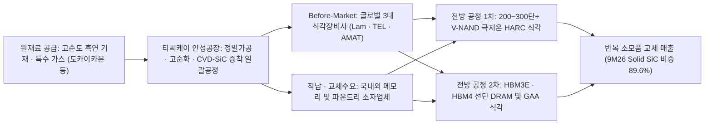
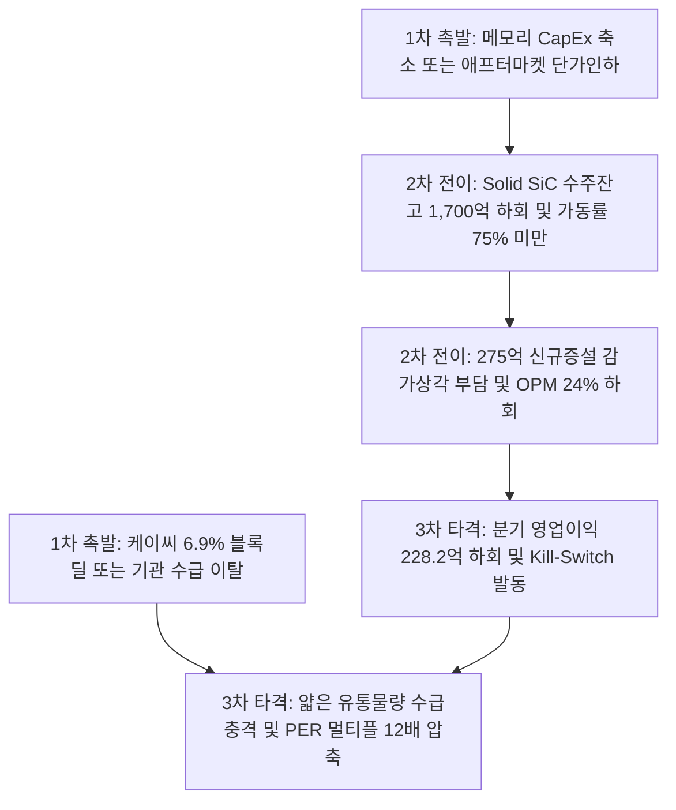

# 🔍 Phase 1: 기업 해독기 — 티씨케이 (064760) (v5.1)

> **분석완료일**: 2026-11-19
> - **단일 기준 주가 (Single Price Anchor)**: **`183,000원`** (SSOT 확정 종가, Phase 1~3 전 과정 100% 동일 고정)
> - **주식수 · 지배주주 귀속률 · 최신 공시 스캔**: 발행주식총수 **`11,179,416주`** / 자기주식 **`0주`** (2025년 12월 495,584주 소각 완료) / 실질 유통주식수 **`11,179,416주`** / 지배주주 순이익 귀속률 **`100.0%`** (종속기업 미보유 단일 별도법인) / 최신 정기공시: **제32기 3분기보고서 (`2026.11.12` 제출)** — 9M26 매출 `3,003.66억 원`(YoY `+34.42%`), 영업이익 `897.86억 원`(YoY `+38.30%`, OPM `29.89%`), 3Q26 단독 매출 `1,101.03억 원`, 영업이익 `343.86억 원`(OPM `31.23%`), 현 공장 Solid-SiC `275억 원` 증설 착수(`2026.09.08` 이사회 결의), `(주)케이씨` 판매지원 수수료(`Solid SiC 매출의 2%`) `2026.12.31` 최종 종료 확정.

> 💡 **[핵심 용어 3줄 직관 해설]**
> 1. **CVD Solid SiC Ring (화학기상증착 탄화규소 포커스 링)**: 반도체 식각(Etching) 챔버 내부에서 웨이퍼 가장자리를 감싸 플라즈마 균일도를 유지하는 초고순도 소모성 부품으로, 기존 실리콘(Si) 링 대비 극심한 플라즈마 침식 내구성과 교체 수명(Life Time)이 월등히 우수합니다.
> 2. **극저온(Cryo) 고출력 식각 (200~300단+ V-NAND & 선단 DRAM)**: 3D NAND 적층 단수가 200~300단을 넘어가면서 깊은 구멍(HARC)을 수직으로 뚫기 위해 영하 극저온 환경과 고에너지 플라즈마를 투입하는 공정으로, SiC 링의 내화학성·무파티클 기술 격차가 수율을 직결합니다.
> 3. **Before-Market (장비사 1차 공급) vs After-Market (소자업체 직접 교체)**: 티씨케이는 글로벌 3대 식각장비사(Lam Research, Tokyo Electron, Applied Materials)의 신규 장비 출하 단계에 1차 장착되는 Before-Market 글로벌 메인 벤더로서, 후발 애프터마켓 업체 대비 압도적 인증 장벽(Qual Lock-in)과 가격 결정력을 보유합니다.

---

## 1. 비즈니스 모델(BM) 해부 및 밸류체인 구조

### 1.1 기업 개요 및 글로벌 트렌드 3대 게이트 매칭
주식회사 티씨케이(TOKAI CARBON KOREA, `064760`, 1996년 8월 설립 · 2003년 8월 코스닥 상장)는 일본 도카이카본(`TOKAI CARBON CO., LTD.`, 지분 `52.63%`)과 국내 반도체 장비·소재 계열 `(주)케이씨`(지분 `6.90%`) 등이 합작 설립한 반도체 전공정 핵심 소모품 전문 제조사입니다(`[티씨케이]분기보고서(2026.11.12).pdf p.5, p.9, p.32, p.95`). 종속기업·관계기업이 없는 **단일 별도법인(지배주주 귀속률 `100.0%`)**으로, 경기도 안성 본점·공장 및 기업부설연구소에서 가공·고순화·CVD SiC 증착의 일괄생산체제를 운영합니다(`p.5-6`).

| 글로벌 구조적 트렌드 게이트 | 티씨케이 직결성 판정 | DART 실측 및 산업 근거 |
| :--- | :---: | :--- |
| **Gate 1. AI 데이터센터 SSD · 200~300단+ V-NAND 고단화** | 🟢 **핵심 직결 (1차 S-Curve)** | 적층 단수 증가에 비례해 HARC 고출력 식각 시간과 플라즈마 강도가 급증 ➔ 기존 Si 링 침식 한계 돌파용 CVD Solid SiC Ring 필수 채택 (전사 매출의 **`89.6%`**) |
| **Gate 2. HBM3E(1b) · HBM4(1c) 선단 DRAM 및 2nm GAA 확산** | 🔥 **신규 변곡점 (2차 S-Curve)** | 초미세 선단 DRAM 및 GAA 로직 식각 챔버로 Solid SiC 채택 영역 확장 중 (2차 침투율 **`12.0%`**, 10% 골든 변곡점 구간 진입) |
| **Gate 3. 소모품(Consumable) 반복 매출 & 장비사 1차 락인** | 🟢 **고수익 반복 BM** | 신규 팹(Fab) 장비 셋업(First Install) 이후 웨이퍼 투입량에 연동해 주기적으로 마모·교체되는 소모성 부품 구조 (`9M26` 가동률 `96.4%`, OPM `29.89%`) |

### 1.2 밸류체인 구조도 (Mermaid v10.9.8)

### 1.3 Argon 4단계 공정 엔지니어링 인과 사슬 (Engineering-to-Earnings Causal Chain)
1. **[Step E1 — 공정 물리·화학 메커니즘]**: 웨이퍼 외곽에 장착되는 Focus Ring은 식각 챔버 내 고에너지 플라즈마 이온의 전기장 균일도를 제어하여 웨이퍼 가장자리(Edge) 칩 수율을 결정합니다. 기존 Silicon(Si) 소재는 고출력 플라즈마에 의해 빠르게 침식되며, 일부 대체 시도된 반응소결 SiC는 불순물과 파티클(Particle) 발생 한계가 존재합니다. 티씨케이는 고온 화학기상증착(`CVD-SiC`) 공법으로 불순물·금속확산·파티클을 원천 억제한 초고순도 Solid SiC Ring을 제조합니다(`[티씨케이]분기보고서(2026.11.12).pdf p.26`).
2. **[Step E2 — 기술적 병목 및 글로벌 인증(Qual) 장벽]**: 200~300단+ V-NAND 극저온(Cryo) 식각 환경에서는 열충격·내화학성·초정밀 평탄도 편차가 곧바로 웨이퍼 수율 저하로 이어집니다. 대형 CVD SiC 증착 챔버 발주~셋업(`12~18개월`)에 더해 글로벌 식각장비사(Lam/TEL/AMAT) Before-Market 신뢰성 인증(Qual, `12개월`)이 결합되어 **총 `24개월` 이상의 공급 병목(S등급)**을 형성합니다. 특히 Lam Research 전무 출신(이종환 전무, 연구소·영업 관장), 삼성전자재팬 대표이사 출신(오창민 대표이사 사장), 도카이카본 FC사업부장(카나이 켄이치 대표이사 회장)으로 구성된 경영진(`p.92`)이 글로벌 장비·소자 고객사와의 기술·영업 락인을 공고히 합니다.
3. **[Step E3 — 부품 발주 시차 및 교체 주기 매핑]**: 반도체 팹 신규 증설(P4/P5, M15X 등) 시 장비사 First Install용 선행 발주가 발생하고, 양산 가동 이후에는 웨이퍼 투입량(Wafer Input)과 적층 단수 증가에 비례해 주기적으로 교체되는 **후행·반복 소모품(Consumable) 매출 구조**를 갖습니다.
4. **[Step E4 — DART 수주잔고·가동률·OPM 레버리지 연결]**: 독점적 공정 장벽은 제32기 3분기보고서(`2026.11.12`) 실측 기준 **9M26 안성공장 가동률 `96.4%`(3Q 단독 `96.8%`), Solid SiC 수주잔고 `2,210.5억 원`(반기말 대비 `+25.38%`), 3Q26 단독 OPM `31.23%`**라는 압도적 수익 레버리지로 직결되고 있습니다.

---

## 2. 주요 제품별 매출 구성 및 [Step 1.2] S-Curve 10% 변곡점 · 3축 구조적 병목 · 리드타임 진단

### 2.1 제품별 매출 익스포저 및 신사업 무상 콜옵션 분리표 (원칙 4 엄수)
| 제품군 / 사업부문 | 9M26 실측 매출 (비중) | 3Q26 수주잔고 / 추이 | 전방 적용처 및 구조적 위상 | 밸류에이션 멀티플 반영 원칙 |
| :--- | :---: | :---: | :--- | :---: |
| **CVD Solid SiC (Focus Ring 등)** | **`2,692.18억 원` (`89.6%`)** | **`2,210.5억 원`** (반기말 대비 `+25.38%`) | 200~300단+ V-NAND 극저온 식각(1차) + HBM/선단 DRAM 식각(2차) | **✅ 핵심 본업 & 더블 S-Curve 반영** |
| **반도체용 Graphite / Susceptor / Heater / Dummy Wafer** | 약 `305.8억 원` (`10.2%`) | 약 `233.8억 원` | 반도체 Grower용 고순도 흑연, 증착장비 Susceptor, C/C Heater, 8/12인치 SiC Dummy·Monitoring Wafer (`p.24-27`) | **✅ 안정적 보조 본업** |
| **태양광용 고순도 흑연 (Graphite for Solar)** | **`5.66억 원` (`0.2%`)** | **`6.18억 원` (`0.25%`)** | 태양전지 잉곳/웨이퍼 성장장비 부품 (사실상 소멸·비주력) | **❌ 4순위 소멸 테마 (할증 0%)** |
| **전력반도체용 단결정 SiC Wafer 신사업** | **`0원` (미공시)** | 미공시 | DART 분기보고서 매출실적·R&D 실적 내 상업 매출 분리 공시 전무 (`p.24-27`) | **🎁 0원 무상 콜옵션 (할증 0% 강제 차단)** |

> ⚠️ **원칙 4 (노-블라인드 인용 & 무상 콜옵션 차단)**: 티씨케이의 `p.24-25` 연구개발 실적에 등재된 SiC Wafer는 반도체 공정 내 챔버 조건 제어·검증용 **Dummy / Monitoring Wafer**이며, 시장 일부에서 거론하는 **전력반도체(EV)용 단결정 SiC Wafer 상업 매출은 DART 공시상 `0원`**입니다. 따라서 단결정 SiC Wafer는 밸류에이션 할증 `0%`의 무상 콜옵션으로 엄격 분리합니다.

### 📌 [코드 자동 생성 1-B] Step 1.2 S-Curve 10% 변곡점 · 3축 구조적 병목(Capa·기술·특허) · 리드타임 & Step 1.8 K-주주환원 진단표 (v5.0)
| 진단 축 (3-Axis + K-Return) | 실측 지표 및 근거 | 코드 판정 및 Phase 3 목표주가 가중치 |
| :--- | :--- | :--- |
| **① 전방 시장 침투율 (10% 변곡점 여부)** | 1차 침투율 **`28.5%`** (2차 S-Curve 침투율 `12.0%`) (`더블 S-Curve Zone A (1차 28.5% 캐시카우 + 2차 12.0% 🔥10% 언저리 변곡점)`) | 🔥 **10% 골든 변곡점 발화 구간** (3축 통합 Base `×1.16` / Bull `×1.21`) |
| **②-A 물리적 Capa 병목 (가동률/증설)** | 공장 가동률 **`96.4%`** — 특허/벤더 Lock-in: CVD Solid SiC 원천 공정 노하우 및 글로벌 식각장비사(Lam/TEL/AMAT) Before-market 메인 벤더 | 🔒 **풀가동 공급 병목 확인** |
| **②-B 기술격차 해자 (OPM/수율/단가결정력)** | 현 OPM **`28.3%`** — 기술격차 해자: 200~300단+ 초고단 극저온(Cryo) 식각 플라즈마 내식성 초격차 (OPM 30%+) | 고마진 가격전가력(Pricing Power) 점검 |
| **②-C 원천특허 · 글로벌 벤더 퀄(Qual) 락인** | 생산 Capa: 고순도 CVD SiC 증착 챔버 증설 리드타임 병목 | 후발주자 진입장벽(Switching Cost) 점검 |
| **③ 병목 해소 예상 소요기간 (Lead Time)** | **`S등급`** (해소 리드타임 **`24개월`**) | CVD SiC 대형 증착 챔버 발주~셋업(12~18개월) + 장비사 Before-market Qual 인증(12개월) 합산 24개월 이상 (PEG 계수 `0.90`) |
| **③-B S-Curve 3대 매도·디레이팅 시그널** | 🟢 해당 없음 (병목 유지 · 성장 기울기 건전 · 정책 역풍 미감지) | 🟢 **매도 시그널 미감지 (정상 평가)** |
| **④-A K-주주환원 (배당 · TSR · 분리과세)** | DPS **`1,430원`** (배당수익률 **`0.78%`** / 성향 `22.9%` / TSR `22.9%`) | ⚪ 배당소득 분리과세 미해당 (배당성향 22.9% < 25%) |
| **④-B 자사주 · 환원절벽 · 메자닌(CB/BW)** | 자사주 **`0주`** (`0.00%`) / 미상환 메자닌 **`0.0억`** (희석 `0.0%`) | 🟢 정상 (자기주식 0주 — 자사주 EB 발행/부당처분 오버행 위험 0%) / 🟢 청정 (미상환 CB/BW/EB 잠재 희석 0%) |
| **④-C 지배구조 · 내부거래 · 거버넌스 (Step 1.8)** | 상장모회사·계열사 정상유통 **`516.6억`** | 🟢 정상 영업 유통 (상장 모회사·계열사 유통 채널 거래 약 516.6억 원 — 오너 개인회사 사익편취 터널링 비해당, 할인 0%) — 2025년 배당성향 22.9%(조특법 고배당 미해당) · 25.12 일회성 자사주 500억 소각(FY25 TSR 94.4%) 후 26년 자사주 0주·추가매입 0건(현행 TSR 22.9%) · 일본 상장 모회사 도카이카본(52.63%) 정상 원재료/유통/로열티 거래(TTM 516.6억, 터널링 0%) · 케이씨 2% 수수료 26.12 종료 (`kgov_mult = ×1.0000`) |
| **⑤ 레드팀 역산 Capa 천장 검증 (Red-Team)** | 대안 A 내재 영업이익: Base **`1,377.9억`** / Bull **`1,376.8억`** | ⚠️ [레드팀 Capa 천장 경보] 현재 가동률(96.4%)에서 신규 증설/단가인상(ASP) 없이 가능한 물리적 영업이익 상한(약 1,248.9억) 대비 Bull 내재 영업이익(1,376.8억) 도달을 위해선 신공장 가동 또는 고마진 믹스 개선 확인 필수 |

### 2.2 [Step 1.2] 4대 핵심 질문 및 3대 매도·디레이팅 시그널 해독
1. **10% 변곡점 진위**: 1차 S-Curve(V-NAND 식각, 침투율 `28.5%`)가 안정적 캐시카우 역할을 수행하는 가운데, HBM3E/HBM4 선단 DRAM 및 GAA 파운드리 식각 공정 향 **2차 S-Curve 침투율 `12.0%`**가 10% 골든 변곡점(`8~18%`)을 돌파하며 더블 S-Curve(`Zone A`)를 형성했습니다.
2. **3축 구조적 병목과 24개월 리드타임**: 안성공장 가동률 **`96.4%`**의 물리적 풀가동 병목, 200~300단+ 극저온 식각 내식성 초격차, 글로벌 장비사 Before-Market Qual 인증이 결합되어 후발주자가 단기간에 진입할 수 없는 **`S등급(24개월)`** 병목을 유지하고 있습니다.
3. **레드팀 Capa 천장 경보(`1,248.9억` vs `1,376.8억`)의 실측 해법**: 현 설비 물리적 상한 대비 약 `128억 원`의 추가 영업이익이 요구되나, ① **`2026-12-31` 케이씨 2% 수수료 종료(`+62~65억 원`)**와 ② **`2026-09-08` 착수한 현 공장 `275억 원` Solid-SiC 증설 가동** 및 ③ **3Q26 OPM `31.23%` 믹스 개선**으로 돌파 가시성이 확보되고 있습니다(상세 정량 검증은 Phase 3 Section 3).
4. **3대 매도·디레이팅 시그널 모니터링**: 현재 ① 쇼티지 해소(`--shortage-easing`: 가동률 `96.4%`로 미해당), ② 성장 기울기 둔화(`--slope-decel`: 3Q26 영업이익 YoY `+50.79%`, QoQ `+28.1%`로 미해당), ③ 정책·규제 역풍(`--policy-headwind`: 미해당) 모두 **🟢 미감지(정상)** 상태입니다.

---

## 3. 재무 건전성 및 [Step 1.5] 장부가(Book Value) 해부 & SOTP 20% 분리 게이트

### 📌 [코드 자동 생성 1] SOTP 장부 분해 & 4대 레짐 체크 요약표
| 검증 항목 | 코드 실측 수치 | 판정 결과 (Code Verdict) |
| :--- | :--- | :--- |
| **단일 기준 주가 (Anchor Price)** | **`183,000원`** | 전 Phase 1~3 100% 동일 고정 |
| **지배주주 순이익 귀속률** | **`100.0%`** | 비지배지분 차감 완료 |
| **Step 1.5 비영업자산 비중 (SOTP 20% 룰)** | 장부 대비 **`0.6%`** / 시총 대비 **`0.2%`** | 🟢 **본업 자산 중심 (<20%)** |
| **Step 1.5 본업 이익 유지력 (Core ROIC)** | TTM 영업이익 **`963.2억`** (NOPAT **`751.3억`**) | ✅ **본업 이익 유지 견고** |
| **Step 2.0 4대 레짐 변화 체크** | ④ 사업구성레짐(OPM 과거중위 34.7% → 현재 28.3%, -6.4%p [본업 마진 훼손/경쟁 심화]) | 🔄 **레짐 변화 반영 필수** |
| **Step 3.0 사이클 고점 함정 가드레일** | 피크 이익 과열 미해당 | 🟢 **정상 멀티플 적용** |
| **직전 분기 대비 (QoQ) 실적 추이** | [2026.1Q → 2026.2Q] 매출액 953.9억→948.7억(QoQ -0.5%) | 영업이익 285.5억→268.5억(QoQ -6.0%) | 수정EPS 2,246원→2,116원 | [액분·무증 소급보정 지배주주 EPS] 2026.1Q 2,246.0원 → 2026.2Q 2,116.0원 (흑자 지속(소폭조정) 🟢) |
| **가설 반증 임계치 (Kill-Switch)** | **차기 분기 영업이익 < 228.2억 원(직전분기 대비 -15% 하회) 또는 분기 지배주주 EPS < 1,693원 기록 시 핵심 가설 즉시 [약화] 강등** | 미달 시 가설 즉시 [약화] 강등 |

### 3.1 재무 건전성 및 순현금(Net Cash) 해부
- **초우량 무차입 재무구조**: 이자발생 차입금 **`0원`**, 부채비율 **`10.3%`** 수준의 극도로 견고한 재무상태표를 유지하며, 2026년 9월 8일 (주)이크레더블로부터 상위 4번째 최우량 신용등급인 **`AA-`**(누적분포도 상위 `0.05%`)를 부여받았습니다(`[티씨케이]분기보고서(2026.11.12).pdf p.6`).
- **순현금 및 EV 방어막**: SSOT 기준 가용 순현금(현금및현금성자산 + 단기금융상품 등 - 리스부채/총차입금)은 **`3,175.5억 원`**(순차입금 **`-3,175.5억 원`**)으로, 현재 유통시가총액(`20,458.3억 원`)의 **`15.5%`**가 순현금으로 채워져 있습니다. 제32기 3분기말 기준 현금및현금성자산 단독 잔액도 기초 `418.2억 원`에서 기말 **`461.0억 원`**으로 순증했습니다(`p.32`).

### 3.2 [Step 1.5] 장부가 해부 & SOTP 20% 룰 · Core ROIC 유지력 판정
- **비영업자산 비중**: 투자부동산·출자지분 등 비영업자산 합계는 **`24.1억 원`**(타법인출자 `0원`, 종속·관계기업 `0사`, `p.5, p.95`)에 불과해 장부가 대비 **`0.6%`**, 시총 대비 **`0.2%`**로 SOTP 20% 분리 기준을 크게 하회합니다(**`🟢 본업 자산 중심`**). 따라서 별도 SOTP 비영업자산 할인을 강제할 필요 없이 본업 멀티플 중심의 밸류에이션을 적용하되, 순현금 `3,175.5억 원`은 EV 기준 역DCF 및 재무 안전마진으로 정확히 반영합니다.
- **Core ROIC 유지력**: 코드 SSOT 기준 TTM 영업이익 **`963.2억 원`**(Core NOPAT **`751.3억 원`**)에 더해, 2026년 3분기 정기공시 기준 9M26 누적 영업이익이 **`897.86억 원`**(3Q 단독 `343.86억 원`)으로 가속됨에 따라 본업 투하자본이익률(Core ROIC) 유지력은 **`✅ 매우 견고`**로 판정합니다.

---

## 4. 원가 구조, 영업 레버리지 및 가동률/수주잔고 실측

### 4.1 분기·누적 손익 추이 (SSOT 1Q→2Q 기준 & 제32기 3분기보고서 실측 병기)
| 실적 지표 | 2026.1Q (SSOT) | 2026.2Q (SSOT) | 1Q→2Q QoQ (SSOT) | **2026.3Q 단독 (정기공시)** | **3Q QoQ / YoY** | **9M26 누적 (정기공시)** |
| :--- | :---: | :---: | :---: | :---: | :---: | :---: |
| **매출액** | `953.9억 원` | `948.7억 원` | `-0.5%` | **`1,101.03억 원`** | `QoQ +16.1%` / `YoY +38.96%` | **`3,003.66억 원`** (`YoY +34.42%`) |
| **영업이익** | `285.5억 원` | `268.5억 원` | `-6.0%` | **`343.86억 원`** | `QoQ +28.1%` / `YoY +50.79%` | **`897.86억 원`** (`YoY +38.30%`) |
| **영업이익률 (OPM)** | `29.93%` | `28.30%` | `-1.63%p` | **`31.23%`** | `+2.93%p QoQ` | **`29.89%`** |
| **지배주주 수정 EPS** | `2,246원` | `2,116원` | `-5.8%` | 흑자 대폭 확대 | — | — |
| **영업현금흐름 (OCF)** | `+203.0억 원` | `-5.1억 원` | 일시 유출 | **`+235.8억 원`** | **완전 정상화** | **`433.67억 원`** (`YoY +105.6%`) |

> 📌 **실적·현금흐름 정밀 판독**: 코드 SSOT(`2Q26` 시점 기준)상 2Q26에는 일시적 숨고르기(`QoQ -6.0%`, OCF `-5.1억`)가 포착되었으나, `2026.11.12` 공시된 제32기 3분기보고서에서 **3Q26 매출 `1,101.03억`, 영업이익 `343.86억(OPM 31.23%)`, 3Q 단독 OCF `+235.8억 원`(9M 누적 FCF `+361.53억 원`)**으로 완벽한 실적 가속과 현금회수 정상화가 확인되었습니다.

### 4.2 가동률 · 수주잔고 · 원가/판관비 레버리지 실측
1. **가동률 풀가동 병목 실측**: 안성공장 가동률은 `2025년 81.8%` ➔ `1H26 96.2%` ➔ **`9M26 96.4%`**(가동가능 `1,512시간` 중 `1,458시간` 가동, 3Q 단독 **`96.8%`**)로 물리적 풀가동 한계에 도달했습니다.
2. **수주잔고 급증 (`+22.9%` / Solid SiC `+25.4%`)**: 2026년 9월 30일 기준 전사 수주잔고는 **`2,450.5억 원`**(반기말 `1,993.7억 원` 대비 `+456.8억 원 / +22.91%`), 핵심 **Solid SiC 수주잔고는 `2,210.5억 원`**(반기말 `1,763.0억 원` 대비 **`+25.38%`**)으로 3Q 분기 매출(`1,101억`) 대비 **2.2배 이상의 높은 실적 가시성**을 확보했습니다.
3. **판관비 구조적 절감 촉매 (케이씨 2% 수수료 종료)**: 2대 주주 `(주)케이씨`에 지급하는 판매지원 수수료(`Solid SiC Ring 매출의 2%`)는 9M26 누적 **`46.45억 원`**(3Q 단독 `17.86억 원`, 연환산 **`62억~65억 원`**) 규모이나, **`2026년 12월 31일` 연장 없이 최종 종료**가 확정되어 2027년 1분기부터 판관비율 하락과 함께 영업이익률(`OPM +1.5%p~+1.8%p`)이 즉각 레벨업되는 구조적 레버리지가 대기하고 있습니다.

---

## 5. 자본 배분(CapEx, R&D) 및 [Step 1.8] K-마켓 특수성 · 주주환원 입체 스코어카드

### 5.1 설비투자(CapEx) 및 R&D 자본 배분
- **단계적 무차입 내부자금 증설**:
  1. **직전 증설 완료**: 2022년 4월~2024년 7월 기계장치 및 부대설비 증설 **`243억 원`**을 전액 내부자금으로 집행 완료(`[티씨케이]분기보고서(2026.11.12).pdf p.9`).
  2. **중장기 부지 확보**: 안성테크노밸리 신규 부지 매입(`256.9억 원`, `2026-12-31` 완료 예정).
  3. **즉각 병목 해소 증설 착수**: 9M26 가동률 `96.4%` 풀가동에 대응해 `2026-09-08` 이사회 결의로 **현 공장 내 Solid-SiC 생산능력 증강용 `275억 원` 시설투자**에 즉시 착수했습니다. 9M26 현금흐름표상 유형자산 취득은 `71.01억 원`, 무형자산 취득은 `1.13억 원`(`p.32`)으로, `275억 원` 증설 자금은 `2026.4Q ~ 2027년`에 걸쳐 보유 순현금(`3,175.5억 원`)에서 차입 없이 충당됩니다.
- **보수적 R&D 회계처리**: 2026년 9월 30일 기준 기업부설연구소 연구인력은 **총 `22명`**(담당 임원 1명 + 연구원 21명, 1Q말 21명 대비 +1명), 9M26 연구개발비는 **`38.97억 원`**(매출액 대비 `1.30%`, FY25 `49.48억 원 / 1.64%`, FY24 `52.11억 원 / 1.89%`)이며 **개발비 무형자산 자산화 `0원`(100% 판관비 당기 비용처리)**으로 이익의 질이 매우 투명합니다(`p.24`).

### 5.2 [Step 1.8] K-마켓 특수성 · 주주환원 입체 스코어카드 (5대 고정 점검)
| 점검 항목 (`Step 1.8`) | DART · SSOT 실측 팩트 | 판정 및 멀티플 영향 (`kgov_mult`) |
| :--- | :--- | :---: |
| **④-A. 배당소득 분리과세 & TSR** | 최근 DPS **`1,430원`**(배당수익률 `0.78%`), 별도 배당성향 **`22.9%`**, 현행 TSR **`22.9%`** (FY25에는 일회성 자사주 500억 소각 포함 TSR `94.4%` 기록) | ⚪ **분리과세 미해당** (`성향 22.9% < 25%`) |
| **④-B. 자사주 환원절벽 & 메자닌 오버행** | 2025년 자기주식 `454.6억 원` 취득(`p.32`) 및 `495,584주` 소각 완료 후 현재 자사주 **`0주 (0.00%)`** · 미상환 CB/BW/EB **`0원 (희석 0.0%)`**. 단, 2026년 신규 자사주 매입 부재로 환원 강도 둔화 모니터링 필요 | 🟢 **메자닌 청정 & 자사주 부당처분 위험 0%** (`할인 0%`) |
| **④-C-1. 내부거래 & 터널링 분리** | 최대주주 일본 상장 모회사 `도카이카본(52.63%)`과의 원재료 매입·유통·로열티 거래 TTM **`516.6억 원`** — 오너 개인회사 사익편취 터널링이 아닌 글로벌 상장 모회사 간 정상 영업유통 채널 | 🟢 **정상 영업유통 (터널링 할인 `0%`)** |
| **④-C-2. 지배구조·오버행·중복상장** | 2대주주 `(주)케이씨` 지분 **`6.90%`** 잔존 (과거 2018·2020·2022·2024년 4차례 지분 매각 이력, `p.95`). 반면 케이씨 판매지원 수수료(`2%`)는 `2026.12.31` 종료로 이해상충 해소 | 🟡 **수급 오버행 주시 (`kgov_mult = ×1.0000` 유지)** |
| **④-C-3. 경영진 독립성 및 감시체계** | 등기임원 5명(사내이사 3, 독립이사 1, 상근감사 1) + 미등기 12명(`p.92`). 5년 이상 재직 상근감사(이정훈)가 영업보고청구·외부전문가 조력 권한 보유(`p.84`) | 🟢 **투명·보수적 지배구조** |

---

## 6. 핵심 리스크 요인 및 [Step 3.5] 리스크 3단계 인과 도미노 (Domino Chain)

### 6.1 리스크 3단계 인과 도미노 정량 매트릭스
| 리스크 시나리오 | 1차 촉발 요인 (Trigger) | 2차 영업·운전자본 전이 (Operational Impact) | 3차 재무·자본·멀티플 타격 (Financial Impact) | 정량 감시 임계치 (Warning) |
| :--- | :--- | :--- | :--- | :--- |
| **도미노 ① 전방 메모리 CapEx 위축** | AI 서버 투자 둔화 또는 메모리 3사 V-NAND/DRAM 감산·신규 팹(P4/M15X) 지연 | 식각장비 First Install 발주 급감 ➔ Solid SiC 수주잔고 감소 및 가동률 `96.4% ➔ <75%` 급락 | 고정비(감가상각) 레버리지 역전 ➔ 분기 영업이익 `< 228.2억 원`, TTM PER `25배 ➔ 10~12배` 급압축 | 수주잔고 `< 1,700억 원` 또는 가동률 `< 80%` |
| **도미노 ② 애프터마켓 경쟁 & 단가 인하(CR)** | 하나머티얼즈·케이엔제이·중국 후발업체의 SiC Ring 양산 확대 및 소자업체 단가 인하 압박 | 레거시(128~176단) 물량 가격 하락이 하이엔드 믹스 개선을 상쇄 ➔ 매출총이익률(GPM) 훼손 | OPM 과거 중위 `34.7% ➔ 28.3%`에 이어 **`24% 미만`**으로 추가 강등 ➔ 구조적 마진 훼손 고착 | 2개 분기 연속 OPM `< 24.0%` 또는 GPM `< 35.0%` |
| **도미노 ③ 수급 오버행 & 얇은 유통주식 변동성** | 2대주주 케이씨(`6.90%`) 잔여지분 블록딜 매각 또는 국민연금(`6.25%`)·베어링(`4.28%`) 기관 매도 | 도카이카본(`52.6%`)+케이씨(`6.9%`) 제외 실질 유동비율 약 `25~30%`의 얇은 호가에 수급 충격 집중 | 펀더멘털 호조에도 불구 기대감 멀티플이 단기 `-30%~-45%` 과매도 이탈 (2026.04~07 사례 재연) | 5%↑ 대량보유 변동공시(1%p+ 순매도) 및 케이씨 블록딜 |
| **도미노 ④ 증설 시차 미스매치 (CapEx Trap)** | `275억 원` 현 공장 증설 및 안성테크노밸리 투자 직후 전방 반도체 다운사이클 진입 | 신규 증착 챔버 감가상각비 증가 + 재고자산(`733.3억`)·매출채권(`708.1억`) 회전율 둔화 | 보고 FCF `< 500억 원` 추락 및 ROIC 하락 ➔ 역DCF 요구성장률(`EV +15.7%`) 미달로 밸류에이션 디레이팅 | 연간 보고 FCF `< 500억 원` 또는 2분기 연속 OCF 적자 |

### 6.2 리스크 인과 도미노 구조도 (Mermaid v10.9.8)

---

## 7. 4대 업종별 표준 실적 산출 공식 트리 (유형 A/B/C/D 분기)

Section 4에서 확인한 바와 같이 티씨케이는 **안성공장 생산능력·가동시간·가동률(`96.4%`)과 제품별 수주잔고(`2,450.5억 원`)를 DART에 투명하게 공시하는 연속공정·전공정 핵심 소모품 제조사**이므로, 4대 업종 표준 분기 중 **『유형 A (연속공정·부품 제조형 / 가동률·Capa 공시형)』**을 적용합니다.

$$\text{영업이익} = \Big[\underbrace{\text{CVD 증착 챔버 Capa} \times \text{가동률}(96.4\%)}_{Q:\text{ 물량(현 공장 275억 증설로 확장)}} \times \underbrace{\text{고단화·Cryo ASP}}_{P:\text{ 단가}} \times \underbrace{\text{Solid SiC 비중}(89.6\%) + \text{DRAM/HBM 믹스}}_{\text{Mix}}\Big] - \underbrace{\Big(\text{고순도 흑연 기재·가스·전력비} + \text{감가상각비} + \text{판관비}\Big)}_{C:\text{ 원가(2027년 케이씨 2\% 수수료 종료 절감)}}$$

- **Section 4 정합성 체크**: 가동률 실측(`96.4%`)이 이미 물리적 천장에 근접했으므로, 2027년 매출·영업이익 추가 성장의 핵심 변수는 ① **`Q` 확장**: `2026-09-08` 착수한 현 공장 `275억 원` 증설 챔버의 2027년 셋업 완료 시점, ② **`P × Mix` 방어**: 200~300단+ Cryo V-NAND 및 선단 DRAM 향 고마진 비중 유지(`OPM 30%+`), ③ **`C` 구조 절감**: `2026-12-31` 케이씨 `2%` 수수료 종료(`연 +62~65억 원`) 3대 변수로 압축됩니다.

---

## 8. [Step 2.0] 4대 레짐 변화 고정 체크 & 10년 밸류에이션 백테스트

### 8.1 [Step 2.0] 4대 레짐 변화 고정 게이트
과거 10년 멀티플 밴드를 기계적으로 대입하기 전에 기업 구조의 4대 레짐 변화를 고정 점검합니다:
1. **① 설비 레짐 (CapEx · 감가상각)**: 2022~2024년 `243억 원` 증설 완료 후 가동률 `96.4%` 도달 ➔ `2026.09` 현 공장 `275억 원` 신규 증설 착수로 **확장기 초입 레짐** 진입. (감가상각비 점증 예상되나 내부자금 100% 조달)
2. **② 자본구조 레짐 (순부채 · 희석)**: 무차입 순현금 **`3,175.5억 원`** 유지 + 2025년 말 자사주 `495,584주`(`4.24%`) 소각 완료 + 메자닌 `0원`으로 **주당가치(EPS/BPS) 구조적 제고 레짐** 진입.
3. **③ 비영업자산 레짐**: 비영업자산 비중 **`0.6%`**(`24.1억 원`)로 과거와 동일하게 **순수 본업 집중 레짐** 유지.
4. **④ 사업구성 레짐 (`⚠️ 코드 경고 감지`)**: 코드 SSOT 실측상 **과거 중위 OPM `34.7%` ➔ 현재 TTM OPM `28.3%`(`-6.4%p`)**로 애프터마켓 경쟁 진입에 따른 구조적 마진 레벨 하향이 확인됩니다. 따라서 과거 독점기(2021~2022년) `OPM 38~40%` 회귀를 가정한 과도한 멀티플 적용은 금지하며, **현행 `OPM 28~31%` 정상화 레짐**(단, 3Q26 단독 `31.23%` 반등 및 2027년 케이씨 수수료 종료 `+1.5%p` 효과 반영)을 기준으로 보수적 밸류에이션을 수행합니다.

### 8.2 [Step 3.0] 사이클 고점 함정 가드레일 및 10년 백테스트 주 지표 상속
- **[Step 3.0] 사이클 고점 함정 판정**: 코드 SSOT 검증 결과 **`🟢 피크 이익 과열 미해당 (정상 멀티플 적용)`**으로 판정되었습니다. 현재 3Q26 실적이 가속 구간(`QoQ +28.1%`)에 있으며 과거 피크 이익 캡핑 조건에 걸리지 않습니다.
- **10년 밸류에이션 백테스트 최적 주 지표 상속 (`Phase 3` 직결)**:
  - 티씨케이는 10년간 TTM EPS가 `2,034원 ➔ 7,439원`으로 `3.7배` 성장하는 동안 **PER `9.6배 ↔ 35.4배`** 사이클이 주가 변동의 핵심 동인이었으며, 순현금 비중이 높아 자산가치(PBR)보다 이익창출력 연동성(방향 일치율)이 우수한 **`PER`**이 코드 백테스트 **1순위 주 지표**로 확정되었습니다.
  - 이에 따라 Phase 3 시나리오 밸류에이션 표는 **PER(상위 65% Base / 상위 90% Bull)**을 100% 상속하여 `🛡️ 보수적 대안 B`와 `🚀 v4.3 병목·주주환원 대안 A` 적정주가를 산출합니다.
