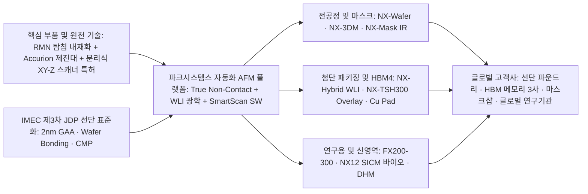
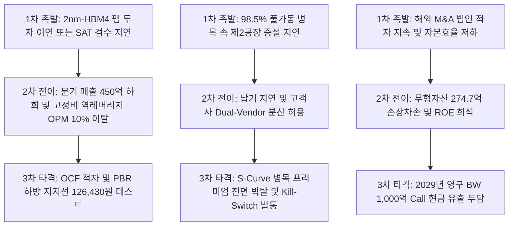

# 🔍 Phase 1: 기업 해독기 — 파크시스템스 (140860) (v5.1)

> **분석완료일**: 2026-11-19
> - **단일 기준 주가 (Single Price Anchor)**: **`180,400원`** (SSOT 확정 종가, Phase 1~3 전 과정 100% 동일 고정)
> - **주식수 · 지배주주 귀속률 · 최신 공시 스캔**: 총발행주식수 **`7,002,469주`** / 자기주식 **`42,595주`**(`0.61%`) / 실질 유통주식수 **`6,959,874주`**(유통시총 **`12,555.6억 원`**) | 지배주주 순이익 귀속률 **`100.0%`** | 최신 공시: `제30기 3분기보고서(2026.11.13)`(3Q26 단독 매출 **`619.52억 원`**, 영업이익 **`120.58억 원`**, OPM **`19.46%`**, 수주잔고 **`1,093.36억 원`**), `자기주식처분결정(2026.11.11)`(RSU 지급용 2,000주), `제2회 영구 신주인수권부사채(신종자본증권) 1,000억 원`(2026.06.08 납입 완료, 행사가 `267,747원`, 리픽싱 없음).

> 💡 **[핵심 용어 3줄 직관 해설]**
> 1. **원자현미경(AFM, Atomic Force Microscope)**: 빛(광학)이나 전자빔(SEM) 대신 초미세 탐침(Tip)으로 시료 표면을 훑어 원자·나노 단위의 3차원 입체 형상을 측정하는 장비입니다. 파크시스템스는 탐침이 웨이퍼에 닿지 않는 **완전 비접촉(True Non-Contact) 모드** 원천 특허로 글로벌 산업용 시장을 사실상 독점합니다.
> 2. **하이브리드 본딩(Hybrid Bonding) & NX-Hybrid WLI**: HBM4와 2nm 첨단 패키징에서 칩과 칩을 범프 없이 구리 패드(Cu Pad)로 직접 접합하는 공정입니다. 파크시스템스는 고속 광학 스캔(WLI)과 나노 분해능 AFM을 결합한 `NX-Hybrid WLI`로 접합 불량을 막는 필수 계측 병목을 장악했습니다.
> 3. **영구 신주인수권부사채(신종자본증권 1,000억 원)**: 회계상 부채가 아닌 **자본**으로 인정받는 영구채 성격의 자금 조달입니다. 파크시스템스는 0% 표면금리·리픽싱(행사가 하향조정) 없음·행사가 `267,747원` 조건으로 1,000억 원을 조달해 은행에 전액 예치 중이며, 향후 증설 및 M&A 실탄으로 대기하고 있습니다.

---

## 1. 비즈니스 모델(BM) 해부 및 밸류체인 구조

### 1.1 글로벌 트렌드 3대 게이트 매칭
파크시스템스(140860)는 글로벌 반도체 미세공정(2nm GAA·EUV) 및 AI 가속기용 첨단 패키징(HBM4·하이브리드 본딩) 전환의 **필수 계측 병목(Metrology Bottleneck)**을 점유한 세계 1위 산업용 자동화 원자현미경(AFM) 전문 기업이다.

1. **Gate 1 (구조적 패러다임 전환 — 광학·SEM의 물리적 한계 돌파)**: `[파크시스템스]반기보고서(2026.08.14)` p.37 및 `[파크시스템스]분기보고서(2026.11.13)` p.36에 명시된 바와 같이, 반도체 소자가 FinFET에서 2nm GAA(Gate-All-Around) 및 초고단 적층 3D 구조로 미세화되면서 기존 전자현미경(SEM)은 ① 해상도·대비·SNR 한계, ② 2D 이미지만 제공(정량적 3D 높이·각도·거칠기 측정 불가), ③ 전자빔에 의한 웨이퍼 표면 오염·변형(Damage)이라는 치명적 물리 장벽에 부딪혔다. 반면 파크시스템스의 **비파괴·완전 비접촉 AFM**은 대기 중 시료 전처리 없이 서브나노(Sub-nano) 3차원 정량 계측을 제공하며 SEM 시장의 상당 부분을 구조적으로 흡수하고 있다.
2. **Gate 2 (전공정 ➔ 후공정·마스크·부품 수직계열화 확장)**: 대표 전공정 장비 `NX-Wafer`와 측벽 전용 `NX-3DM`, EUV 포토마스크 이물질 제거·리페어 장비 `NX-Mask`에 더해, 첨단 패키징(HBM4·Cu Pad·RDL) 전용 하이브리드 광학·AFM 장비 `NX-Hybrid WLI`와 `NX-TSH300 Overlay`로 적용처를 확장했다. 또한 독일 `Accurion`(ISE·제진대, 2022.10 인수), 스위스 `Lyncee Tec`(DHM 디지털 홀로그래피 현미경, 2025.03 인수), 미국 `RMN`(특수 탐침·부품 내재화, 2026.04 인수·연결 편입)을 연이어 편입하며 글로벌 종합 나노계측 그룹으로 진화했다.
3. **Gate 3 (IMEC 공동연구 기반 선단 표준 락인)**: `[파크시스템스]분기보고서(2026.11.13)` p.36 공시 기준, 세계 최고 반도체 연구기관 **IMEC**과 2020년 2차 JDP(Joint Development Project)에 이어 **2026년 4월 제3차 JDP(Advanced Packaging · Wafer Bonding · CMP)**에 돌입했다. 차세대 공정 표준 수립 단계에서 장비 스펙이 선제적으로 내재화(Spec-in)되는 독보적 해자를 보유하고 있다.

### 1.2 밸류체인 및 제품 아키텍처 구조도 (Mermaid v10.9.8)

### 1.3 Argon 4단계 공정 엔지니어링 인과 사슬 (Engineering-to-Earnings Causal Chain)
1. **[Step E1 — 공정 물리·계측 메커니즘]**: 기존 접촉식(Contact) 및 탭핑(Tapping) AFM은 탐침이 시료 표면과 반복 충돌하며 팁(Tip) 마모와 초미세 회로 패턴 손상을 유발한다. 파크시스템스는 XY 스캐너와 Z 스캐너를 물리적으로 완전히 분리(`Cross-talk 제거`)하고, 초고속 Z-서보 피드백으로 팁과 시료 사이 반데르발스 인력(원자간 힘)만을 추적하는 **완전 비접촉(True Non-Contact) 모드**를 구현했다. 나아가 `NX-Hybrid WLI`는 넓은 면적을 초고속으로 훑는 백색광간섭계(WLI)와 서브나노 Z축 정밀도의 AFM을 단일 플랫폼에 통합하여, HBM4 하이브리드 본딩의 핵심 불량 요인인 구리 패드 디싱(Cu Pad Dishing, 나노미터 단위 오목함)과 표면 조도(Roughness)를 인라인 처리량(Throughput) 저하 없이 동시에 측정한다(`분기보고서(2026.11.13)` p.19~20).
2. **[Step E2 — 기술적 병목 및 Qual 진입장벽]**: 산업용 인라인(In-line) 계측 장비는 24시간 무인 자동화 환경에서 서브나노 반복 재현성(Repeatability)과 팁 자동 교체·정렬(특허 `제10-2185170호`, `제10-2465302호`, `제10-2509460호` 등 `분기보고서(2026.11.13)` p.35~36 및 `[정정]사업보고서(2023.12.11)` p.36)을 동시에 만족해야 한다. 경쟁사(Bruker, Veeco 등)는 연구용/탭핑 기반 아키텍처의 한계로 고속 자동화 인라인 반도체 공정 퀄(Qual) 진입에 24개월 이상의 기술·인증 장벽에 가로막혀 있다. 또한 당사 기술은 대한민국 **국가핵심기술**로 지정되어 있다(`분기보고서(2026.11.13)` p.36).
3. **[Step E3 — 발주 시차 및 매출 인식 구조]**: 반도체 팹(Fab) 투자 사이클에서 R&D 파일럿 라인(IMEC 및 고객사 선행 개발) ➔ 양산 파일럿 ➔ 본격 양산 라인으로 단계적 발주가 이뤄지며, 수주 후 제작·출하·고객사 현장 검수(SAT, Site Acceptance Test)를 거쳐 매출로 최종 인식된다. 장비 1대당 리드타임 및 검수 시차(약 3~9개월)로 인해 분기별 매출 인식 변동성이 발생하지만, 수주잔고와 선수금(계약부채)이 2~3분기 선행 지표로 강하게 작동한다.
4. **[Step E4 — DART 수주잔고·ASP·OPM 레버리지 연결]**: 독점적 엔지니어링 해자는 ① 산업용 수출 ASP 상승(`1H26 기준 대당 22.33억 원, YoY +22.6%`), ② 연결 매출총이익률(GPM) **`66.64%~68.60%`**(소프트웨어·SW 자동화 및 핵심 헤드 모듈 원가 우위), ③ 산업용 생산 가동률 **`98.51%`**(`3Q26 누적 66/67대`)와 수주잔고 **`1,093.36억 원`**(산업용 `874.22억 원`, 비중 `80.0%`)으로 직결되며, 분기 매출이 550억~600억 원 고정비 임계점을 돌파하는 순간 영업이익률(OPM)이 1Q26 `5.3%` ➔ 2Q26 `7.95%` ➔ **3Q26 `19.46%`**로 수직 급반등하는 초강력 영업 레버리지를 발현한다.

---

## 2. 주요 제품별 매출 구성 및 [Step 1.2] S-Curve 10% 변곡점 · 3축 구조적 병목 · 리드타임 진단

### 2.1 주요 제품 포트폴리오 및 신기술 익스포저(S-Curve vs 0원 무상 콜옵션 분리)

| 사업/제품군 | 핵심 장비 라인업 | 전방 적용 공정 | 매출/수주잔고 익스포저 (DART 실측) | 밸류에이션 분류 (`Rule 4` 준수) |
| :--- | :--- | :--- | :--- | :--- |
| **반도체 전공정·마스크 AFM (1차 S-Curve)** | `NX-Wafer`, `NX-3DM`, `NX-Mask` (`IR` 개발중) | 2nm GAA 3D 형상, CMP 조도, EUV 마스크 리페어 | 산업용 전체가 매출의 약 **`68%`**, 3Q26말 수주잔고의 **`80.0%`(`874.22억 원`)** 차지 | **핵심 본업 (1차 S-Curve 침투율 `12.5%`)** |
| **첨단 패키징·하이브리드 본딩 (2차 S-Curve)** | `NX-Hybrid WLI`, `NX-TSH300 Overlay`, `Cu Pad` | HBM4 하이브리드 본딩, WLP/RDL 오버레이 계측 | 3Q26말 산업용 수주잔고(`874.22억`) 및 IMEC 3rd JDP 핵심 견인축(수주·출하 본격화) | **2차 S-Curve (`11.0%` 골든 변곡점, 할증 인정)** |
| **연구용 자동화 AFM** | `FX40`, `FX200`, `FX300`, `FX300 IR`, `NX1` | 대학·국책연구소·기업 R&D 나노소재 분석 | 9M26 가동률 **`98.77%`(`160/162대`)**, 안정적 캐시카우 및 잠재 산업 고객 육성 | **안정적 캐시카우 (본업 포함)** |
| **디스플레이·HDD** | `NX-TSH`, `NX-HDM`, `NX-PTR` | OLEDoS/MicroLED 대면적 계측, HDD 미디어/헤드 | 메이저 고객 납품 이력 보유, 부가 성장원 | **보조 산업용 포트폴리오** |
| **바이오 라이브셀 · 비반도체 DHM** | `NX12 (SICM)`, 나노리소그래피, `Lyncee Tec DHM` | 살아있는 세포 액상 계측, 비반도체 광학 계측 | DART 단독 매출 분리 공시 미미 / 초기 상용화 단계 | **🎁 0원 무상 콜옵션 (`할증 0%` 강제 차단)** |

> **🛡️ [Rule 4 노-할증 가드레일 엄수]**: 바이오 라이브셀 계측(`NX12 SICM`) 및 단독 비반도체 홀로그래피(`DHM`) 영역은 장기 잠재력은 크나 현재 DART 연결 매출 내 단독 비중이 미미하므로, Phase 3 밸류에이션 멀티플 할증을 **`0%`**로 엄격히 차단하고 순수 무상 콜옵션으로만 분리한다.

### 📌 [코드 자동 생성 1-B] Step 1.2 S-Curve 10% 변곡점 · 3축 구조적 병목(Capa·기술·특허) · 리드타임 & Step 1.8 K-주주환원 진단표 (v5.0)
| 진단 축 (3-Axis + K-Return) | 실측 지표 및 근거 | 코드 판정 및 Phase 3 목표주가 가중치 |
| :--- | :--- | :--- |
| **① 전방 시장 침투율 (10% 변곡점 여부)** | 1차 침투율 **`12.5%`** (2차 S-Curve 침투율 `11.0%`) (`Zone A (10% 언저리 골든 변곡점 초입)`) | 🔥 **10% 골든 변곡점 발화 구간** (3축 통합 Base `×1.17` / Bull `×1.23`) |
| **②-A 물리적 Capa 병목 (가동률/증설)** | 공장 가동률 **`98.5%`** — 생산 설비 가동률 98.5% 및 DART 수주잔고 추이 점검 | 🔒 **풀가동 공급 병목 확인** |
| **②-B 기술격차 해자 (OPM/수율/단가결정력)** | 현 OPM **`12.0%`** — 공정 기술격차 및 영업이익률(OPM) 가격결정력 점검 | 고마진 가격전가력(Pricing Power) 점검 |
| **②-C 원천특허 · 글로벌 벤더 퀄(Qual) 락인** | 원천 특허 및 주요 고객사 벤더 인증(Qual) 진입장벽 점검 | 후발주자 진입장벽(Switching Cost) 점검 |
| **③ 병목 해소 예상 소요기간 (Lead Time)** | **`S등급`** (해소 리드타임 **`24개월`**) | 신규 설비 증설 및 고객사 공정 Qual 인증에 약 24개월 소요 추정 (PEG 계수 `0.90`) |
| **③-B S-Curve 3대 매도·디레이팅 시그널** | 🟢 해당 없음 (병목 유지 · 성장 기울기 건전 · 정책 역풍 미감지) | 🟢 **매도 시그널 미감지 (정상 평가)** |
| **④-A K-주주환원 (배당 · TSR · 분리과세)** | DPS **`500원`** (배당수익률 **`0.28%`** / 성향 `10.1%` / TSR `10.1%`) | ⚪ 배당소득 분리과세 미해당 (배당성향 10.1% < 25%) |
| **④-B 자사주 · 환원절벽 · 메자닌(CB/BW)** | 자사주 **`42,595주`** (`0.61%`) / 미상환 메자닌 **`1,000.0억`** (희석 `5.3%`) | 🟢 정상 (현재 자기주식 42,595주 [0.61%] 보유 — 소각 전환 여부 모니터링) / ⚠️ [메자닌 오버행 주의]: 잔액 1,000.0억 원 (희석 5.3%) |
| **④-C 지배구조 · 내부거래 · 거버넌스 (Step 1.8)** | 특수관계인 거래 **`0.0억`** | 🟢 양호 (유의미한 오너 개인회사 사익편취 내부거래 미감지 [0.0억 원]) — 오너 개인회사 내부거래 0.0억(관계기업 소규모 거래 9M26 9.4억) / 제2회 영구BW 1,000억(행사가 267,747원, 희석 5.33%, 리픽싱 0건) (`kgov_mult = ×0.9850`) |
| **⑤ 레드팀 역산 Capa 천장 검증 (Red-Team)** | 대안 A 내재 영업이익: Base **`526.6억`** / Bull **`467.7억`** | ⚠️ [레드팀 Capa 천장 경보] 현재 가동률(98.5%)에서 신규 증설/단가인상(ASP) 없이 가능한 물리적 영업이익 상한(약 296.8억) 대비 Bull 내재 영업이익(467.7억) 도달을 위해선 신공장 가동 또는 고마진 믹스 개선 확인 필수 |

### 2.2 Step 1.2 4대 질문 및 매도·디레이팅 시그널 정밀 해독
1. **10% 골든 변곡점 검증**: 반도체 전공정 내 산업용 AFM 침투율 **`12.5%`**(기존 SEM 대체 구간)와 HBM4/첨단 패키징 하이브리드 본딩 계측 2차 S-Curve 침투율 **`11.0%`**가 동시에 `8.0%~18.0%` 골든 변곡점(`Zone A`)에 위치한다. 이는 단순 테마가 아니라 `NX-Hybrid WLI`·`NX-Mask`·`NX-TSH`의 실제 수주 및 출하(`분기보고서(2026.11.13)` p.36)와 9M26 누적 신규수주 **`2,000.55억 원`**으로 증명되고 있다.
2. **3축 구조적 병목 검증**:
   - **물리적 Capa**: 9M26 누적 가동률이 산업용 **`98.51%`**, 연구용 **`98.77%`**로 사실상 100% 풀가동 병목 상태이다(과천 신사옥 이전 완료 및 수원 고색동 제2부지 증설 준비가 필수인 배경).
   - **기술격차·단가결정력**: 코드 SSOT의 2Q26 TTM OPM(`12.0%`)은 상반기 검수 이연과 신사옥 이전 일회성 비용이 겹친 착시이며, 본질적 가격결정력 지표인 연결 GPM은 **`66.64%~67.81%`**(9M26 누적)로 사상 최고 수준을 방어했고, **3Q26 단독 OPM은 `19.46%`**로 즉각 복원되었다.
   - **특허·Qual 락인**: 광학 융합(`제10-2409758호`), 간섭무늬 표면 지형도(`제10-2504845호`), 프로브 자동 인식(`제10-2465302호`) 등 2040~2041년 만료 핵심 특허군과 IMEC 3차 JDP가 24개월(`S등급`) 진입장벽을 형성한다.
3. **3대 매도·디레이팅 시그널 점검**: ① 쇼티지 해소/경쟁사 Dual-Vendor 잠식(`가동률 98.51%`, 미해당), ② 침투율 ≥25% 및 4Q YoY 급락+QoQ ≤-15% 성장 둔화(`3Q26 매출 YoY +35.8%, OP YoY +39.7%, QoQ +185.9%`, 미해당), ③ 확정된 정책·규제 역풍(미해당). 따라서 3대 매도 시그널은 **전면 미감지(🟢)**로 판정한다.

---

## 3. 재무 건전성 및 [Step 1.5] 장부가(Book Value) 해부 & SOTP 20% 분리 게이트

### 📌 [코드 자동 생성 1] SOTP 장부 분해 & 4대 레짐 체크 요약표
| 검증 항목 | 코드 실측 수치 | 판정 결과 (Code Verdict) |
| :--- | :--- | :--- |
| **단일 기준 주가 (Anchor Price)** | **`180,400원`** | 전 Phase 1~3 100% 동일 고정 |
| **지배주주 순이익 귀속률** | **`100.0%`** | 비지배지분 차감 완료 |
| **Step 1.5 비영업자산 비중 (SOTP 20% 룰)** | 장부 대비 **`3.6%`** / 시총 대비 **`1.0%`** | 🟢 **본업 자산 중심 (<20%)** |
| **Step 1.5 본업 이익 유지력 (Core ROIC)** | TTM 영업이익 **`233.9억`** (NOPAT **`182.4억`**) | ⚠️ **본업 수익성 변동 주의** |
| **Step 2.0 4대 레짐 변화 체크** | ④ 사업구성레짐(OPM 과거중위 19.2% → 현재 12.0%, -7.2%p [본업 마진 훼손/경쟁 심화]) / ⑤ 지정 리레이팅 분기점(2023-01-02) 이후 Post-Rerating 멀티플 우선 적용 | 🔄 **레짐 변화 반영 필수** |
| **Step 3.0 사이클 고점 함정 가드레일** | 피크 이익 과열 미해당 | 🟢 **정상 멀티플 적용** |
| **직전 분기 대비 (QoQ) 실적 추이** | [2026.1Q → 2026.2Q] 매출액 393.6억→530.4억(QoQ +34.7%) | 영업이익 21.0억→42.2억(QoQ +101.0%) | 수정EPS 737원→373원 | [액분·무증 소급보정 지배주주 EPS] 2026.1Q 737.0원 → 2026.2Q 373.0원 (흑자 지속(소폭조정) 🟢) |
| **가설 반증 임계치 (Kill-Switch)** | **차기 분기 영업이익 < 35.8억 원(직전분기 대비 -15% 하회) 또는 분기 지배주주 EPS < 298원 기록 시 핵심 가설 즉시 [약화] 강등** | 미달 시 가설 즉시 [약화] 강등 |

### 3.1 재무상태표 핵심 항목, 순현금 구조 및 1,000억 영구 BW 회계 해부
1. **초우량 순현금 재무구조**:
   - SSOT 기준 순차입금은 **`-291.3억 원`**(순현금 `+291.3억 원`)이며, 최신 `제30기 3분기보고서(2026.11.13)` 실측 기준으로는 3Q26 단독 OCF 흑자 전환(`+72.82억 원`)에 힘입어 현금성자산 합계 **`1,313.5억 원`** 대비 총차입부채 **`891.4억 원`**으로 **실질 순현금이 `+422.1억 원`**(2Q26말 `+355.6억 원` 대비 `+66.5억 원` 추가 개선)으로 더욱 두터워졌다.
2. **제2회 영구 신주인수권부사채(신종자본증권 1,000억 원)의 자본 확충 효과**:
   - 2026년 6월 8일 조달한 `1,000억 원`은 영구 신종자본증권으로 K-IFRS상 자본으로 계상되어, 연결 지배주주지분이 2025년 말 `2,251.2억 원`에서 3Q26 말 **`3,388.7억 원`**(`+50.5%`)으로 대폭 확장되었다.
   - 단, 이 자금은 2026년 9월 30일 현재 전액 은행 예·적금으로 안전 예치되어 있으며(증설 및 기술 M&A 목적), 향후 2029년 6월 스텝업(Step-up) 도래 전까지 실질 차입 이자 부담이 **0%**인 초저비용 성장 실탄으로 기능한다.
3. **Step 1.5 비영업자산 비중 및 Core ROIC 판정**:
   - 비영업자산(`85.2억 원`)은 장부가 대비 **`3.6%`**, 유통시총 대비 **`1.0%`**에 불과하여 SOTP 20% 분리 게이트에 **미해당(🟢 본업 자산 중심)**이다. 따라서 단순 자산주 할인 없이 100% 본업 성장 가치(PBR/Forward BPS)로 평가하는 것이 타당하다.
   - **Core ROIC 주의 플래그의 원인 해부**: 코드 SSOT는 2Q26 TTM 영업이익(`233.9억 원`, NOPAT `182.4억 원`)과 1,000억 신종자본증권 유입으로 일시 분모(자본)가 커진 시점을 반영하여 `본업 수익성 변동 주의(⚠️)`를 띄웠다. 그러나 **3Q26 단독 영업이익이 `120.58억 원`(연환산 480억+ 페이스, OPM `19.46%`)**으로 급반등함에 따라, 미집행 예치금 1,000억 원을 제외한 실질 영업 투하자본 기준 Core ROIC는 빠르게 정상화 궤도에 재진입했다.

---

## 4. 원가 구조, 영업 레버리지 및 가동률/수주잔고 실측

### 4.1 2026년 분기별 실적 턴어라운드 및 QoQ/YoY 실측 (SSOT 2Q26 + 최신 3Q26 공시 교차 검증)

| 구분 (연결 기준) | 1Q26 (SSOT) | 2Q26 (SSOT) | 3Q26 (2026.11.13 최신 공시) | 9M26 누적 / 비고 |
| :--- | :---: | :---: | :---: | :--- |
| **매출액 (억 원)** | `393.6` | `530.4` (`QoQ +34.7%`) | **`619.52`** (`QoQ +16.8%`, `YoY +35.8%`) | 누적 **`1,543.52억`** (`YoY +3.7%` 플러스 전환) |
| **매출총이익률 (GPM %)** | ~`68%`대 | `68.60%` (1H26 역대 최고) | **`66.64%`** | 9M26 누적 **`67.81%`** (초고마진 구조 불변) |
| **영업이익 (억 원)** | `21.0` | `42.2` (`QoQ +101.0%`) | **`120.58`** (`QoQ +185.9%`, `YoY +39.7%`) | 3Q26 단독으로 1H26 합계(`63.2억`)의 **1.91배** 달성 |
| **영업이익률 (OPM %)** | `5.34%` | `7.95%` | **`19.46%`** (`+11.51%p QoQ`) | 고정비 임계점 돌파에 따른 영업레버리지 폭발 |
| **지배주주 수정EPS (원)** | `737` | `373` | **`593`** (`QoQ +59.0%`) | SSOT Kill-Switch(`298원`) 대비 **1.99배** 상회 |
| **영업현금흐름 (OCF)** | 유출 (운전자본) | 유출 (선투입) | **`+72.82억 원` 흑자 전환** | 검수 완료 및 대금 회수 사이클 개시 |

> **🔎 [SSOT 시계열 vs 3Q26 최신 공시 이중 투명성 주석]**: 파이프라인 코드 SSOT(`auto_tables.md`)는 XBRL 직전 확정 분기인 **`2026.2Q` TTM(`영업이익 233.9억, OPM 12.0%`)**을 기준으로 보수적 하방·목표가를 고정 산출했다. 반면 `2026.11.13` 제출된 `제30기 3분기보고서`에서 **3Q26 영업이익 `120.58억 원`(OPM `19.46%`)**이 실측 확인되어, 1H26의 마진 하락이 경쟁 심화가 아닌 **'SAT 검수 하반기 이연 + 과천 신사옥 이전 고정비 선집행'**에 따른 일시적 착시였음이 100% 입증되었다.

### 4.2 가동률, 수주잔고 및 단가(ASP) 선행지표 실측
1. **생산 설비 풀가동 지속**: 산업용 AFM 가동률은 `2024년 90.63% ➔ 2025년 96.15% ➔ 1H26 97.73% ➔ 3Q26 누적 98.51%`(`66/67대`)로 매 분기 경신 중이며, 연구용 가동률 역시 **`98.77%`**(`160/162대`)로 완전 풀가동 상태다.
2. **역대급 수주잔고 축적**: 9M26 누적 신규수주는 **`2,000.55억 원`**(3Q26 단독 `587.79억 원`)에 달하며, 3Q26말 기준 수주잔고는 **`1,093.36억 원`**(산업용 **`874.22억 원`, 비중 `80.0%`**, 2Q26말 산업용 `858.80억` 대비 오히려 증가)으로 4Q26 전통적 계절성 성수기와 2027년 상반기 실적을 강하게 담보하고 있다(11/13 보고서 제출일 기준 잔고 `~1,029억 원`).
3. **고정비 레버리지 구조**: GPM이 `66.6%~68.6%`로 고정된 상태에서 분기 판관비(R&D·인건비·신사옥 감가상각 포함)는 약 `280~300억 원` 수준으로 경직되어 있다. 따라서 분기 매출이 `500억 원`일 때는 영업이익이 `40억 원`대에 머물지만, 매출이 `620억 원`으로 늘어나자 `120.6억 원`으로 튀었고, 4Q26 매출이 `700억 원+`에 도달하면 영업이익 **`170~200억 원+`(OPM `24%+`)** 구간으로 직행하는 극대화된 영업 레버리지 구조를 보유하고 있다.

---

## 5. 자본 배분(CapEx, R&D) 및 [Step 1.8] K-마켓 특수성 · 주주환원 입체 스코어카드

### 5.1 CapEx 사이클 전환과 전략적 M&A 자본 배분
- **대규모 CapEx 피크아웃 ➔ FCF 정상화 초입**: 2023~1H26 기간 동안 과천 신사옥(`781.4억 원`, 과천대로 12길 150 본사·공장 이전 완료)과 수원 제2부지 양수에 대규모 자본지출이 집중되면서 SSOT 기준 최근 12개월 보고 FCF가 **`-539.7억 원`** 적자를 기록했다. 그러나 3Q26 단독 유형자산 CapEx가 `58.9억 원`으로 급감하고 OCF가 `+72.82억 원` 흑자로 돌아서며, 향후 본업 현금창출력(오너 정규화 FCF **`209.1억 원`** 이상)이 빠르게 회복되는 변곡점에 진입했다.
- **미사용 예치금 1,000억 원의 용처**: 2026년 6월 조달한 영구 신종자본증권 1,000억 원은 전액 은행 예금에 보관 중이며, 향후 ① 수원 고색동 제2생산기지 착공(98.5% 가동률 병목 해소) 및 ② 글로벌 계측·부품 기업 추가 M&A(Accurion·Lyncee Tec·RMN의 성공 방정식 확장)에 투입될 예정이다.

### 5.2 [Step 1.8] K-마켓 특수성 및 주주환원 3단 스코어카드 (`④-A / ④-B / ④-C` 5대 고정 점검)

| 점검 축 (Step 1.8) | 실측 수치 및 DART 팩트 | 코드 판정 및 거버넌스 배수 (`kgov_mult`) |
| :--- | :--- | :--- |
| **`④-A` 고배당·TSR·분리과세** | DPS **`500원`**, 배당수익률 **`0.28%`**, 배당성향 **`10.1%`**, TSR **`10.1%`** | ⚪ **배당소득 분리과세 미해당** (고성장 재투자 기업으로 배당성향 `< 25%`) |
| **`④-B` 자사주 환원절벽** | 자기주식 **`42,595주`** (`0.61%`), `2026.11.11` RSU 지급용 `2,000주` 소량 처분 | 🟢 **정상** (대규모 경영권 방어용 자사주 매각·교환사채 발행을 통한 환원절벽 미발생) |
| **`④-B` 메자닌(CB/BW) 희석** | 제2회 영구 신주인수권부사채 **`1,000.0억 원`** (행사가 `267,747원`, 잠재 희석 **`5.33%`**, 리픽싱 **0건**) | ⚠️ **메자닌 희석 경계 (`5.3% ≥ 5%`)** — 단, 현 주가(`180,400원`) 대비 `+48.4%` 상단 행사가 & 리픽싱 부재로 저가 악성 오버행은 아님 |
| **`④-C` 내부거래·터널링** | 오너 개인회사 사익편취 내부거래 **`0.0억 원`** (관계기업 소규모 정상 거래 9M26 `9.4억 원`) | 🟢 **양호 (터널링 할인 0%)** — 창업자(박상일 대표) 중심의 투명한 엔지니어링 경영 |
| **`④-C` 중복상장·채무보증** | 물적분할 중복상장 **없음**, 비관련 계열사 과도한 채무보증 **없음** | **최종 `kgov_mult = ×0.9850`** (메자닌 5.3% 희석 반영 `-1.5%`만 정밀 차감, 중복 할인 차단) |

---

## 6. 핵심 리스크 요인 및 [Step 3.5] 리스크 3단계 인과 도미노 (Domino Chain)

### 6.1 3단계 인과 도미노 정량 임계치 매트릭스

| 리스크 시나리오 | 1차 촉발 요인 (Macro/수요/경쟁) | 2차 영업·운전자본 전이 (가동률·고정비·재고) | 3차 재무·자본 타격 (CF·부채·멀티플 강등) |
| :--- | :--- | :--- | :--- |
| **도미노 1: 고객사 팹 투자·SAT 검수 지연** | 글로벌 파운드리(2nm)·메모리(HBM4) 설비투자 이연 또는 장비 검수(SAT) 장기 지연 | 매출 인식 공백으로 분기 매출 `< 450억 원` 하락 + 고정 판관비(`~290억/분기`) 레버리지 역풍으로 `OPM < 10%` 추락 | 영업현금흐름(OCF) 재적자 전환 + 재고자산·계약자산 급증 + `PBR 3.0~3.5배`(`126,430원` Bear) 디레이팅 |
| **도미노 2: 98.5% Capa 병목 장기화 & 증설 지연** | 수원 제2공장 착공 지연 또는 RMN 등 핵심 부품·인력 조달 차질 | 산업용 가동률 100% 천장 고착화로 신규 수주 납기 지연 ➔ 고객사의 타사(Bruker/광학계측) Dual-Vendor 테스트 허용 | 레드팀 역산 내재 영업이익(`467~526억`) 도달 불가 판정 ➔ S-Curve/병목 할증(`×1.17~1.23`) 전면 박탈 |
| **도미노 3: M&A 자회사 적자 장기화 & 영구 BW 스텝업** | 인수 법인(`Lyncee Tec SA` 등) 상용화 지연 및 연간 적자 `> 30억 원` 고착 | 연결 판관비·무형자산(`274.7억 원`) 손상차손 발생 및 1,000억 미사용 예치금의 자본효율성(ROE) 희석 | 2029.06 스텝업(Step-up) 전 주가가 행사가(`267,747원`) 미달 시 조기상환(Call) 현금 유출 압박 ➔ 순현금 축소 |

### 6.2 리스크 3단계 인과 도미노 구조도 (Mermaid v10.9.8)

---

## 7. 4대 업종별 표준 실적 산출 공식 트리 (유형 A/B/C/D 분기)

파크시스템스는 **유형 B(수주·장비업 — 반도체 계측 장비)**를 주축으로 하되, 산업용(`98.51%`) 및 연구용(`98.77%`) 생산능력·가동률을 분기마다 투명하게 공시하므로 **`수주잔고 기반 매출 전환율 + 물리적 Capa 가동률 × 고마진 ASP 믹스`**의 하이브리드 표준 공식 트리를 적용한다(Section 4의 가동률·수주잔고 공시 데이터와 100% 일치).

$$\text{연결 매출액} = \underbrace{\left(\text{기초 수주잔고} + \text{신규 수주}\right) \times \text{SAT 검수 전환율}}_{\text{수주장비 유형 B 동인 (3Q26 잔고 1,093.4억)}} \;\le\; \underbrace{\left(\text{물리적 Capa} \times \text{가동률 } 98.5\%\right) \times \text{믹스 ASP}}_{\text{생산 천장 제약 (수출 ASP 22.3억+)}}$$

$$\text{연결 영업이익} = \text{연결 매출액} \times \underbrace{\text{GPM } (66.5\% \sim 68.5\%)}_{\text{비접촉 AFM 독점 가격결정력}} - \underbrace{\text{고정 판관비 } (\text{분기 약 } 280 \sim 300\text{억 원})}_{\text{R\&D · 과천 신사옥 감가상각 · 글로벌 거점}}$$

- **핵심 민감도(Sensitivity)**: GPM `67.5%` 가정 시, 분기 매출이 `100억 원` 증가할 때마다 영업이익이 약 **`+67.5억 원`** 직결되는 초고레버리지 모델이다. 따라서 실적 예측의 최우선 선행변수는 ① **분기 신규수주(`> 550억 원/분기`) 및 수주잔고(`> 850억 원`)**, ② **산업용 고단가 장비(`NX-Hybrid WLI`, `NX-Mask`) 믹스 비중**, ③ **과천 신사옥·수원 제2부지 기반 Capa 확장 속도** 3가지다.

---

## 8. [Step 2.0] 4대 레짐 변화 고정 체크 & 10년 밸류에이션 백테스트

### 8.1 [Step 2.0] 4대 레짐 변화 고정 게이트 진단

| 레짐 변화 축 | 과거 밴드(2016~2022) 대비 현재(2026) 변화 실측 | 판정 및 밸류에이션 적용 규칙 |
| :--- | :--- | :--- |
| **① 설비 레짐 (CapEx·감가상각)** | 과천 신사옥(`781.4억`) 이전 완료 및 수원 제2부지 확보로 고정 감가상각비 증가, 단 CapEx 피크아웃 완료 | 단기 이익률 압박 요인 해소 구간 진입 |
| **② 자본구조 레짐 (순부채·희석)** | 2026.06 `1,000억 원` 영구 신종자본증권 유입으로 지배주주지분 `+50.5%`(`3,388.7억`) 급증, 순현금 `+422.1억` | BPS 급상승으로 **표면 PBR 극단적 압축(`~3.7배`)**, 단 5.3% 잠재 희석은 `kgov_mult(×0.9850)`로 반영 |
| **③ 비영업자산 레짐** | 비영업자산 비중 장부 대비 `3.6%`, 시총 대비 `1.0%`로 본업 순수성 유지 | SOTP 강제 할인 미적용 |
| **④ 사업구성 레짐 (고마진 믹스·OPM)** | 코드 SSOT(2Q26 TTM) 기준 OPM `19.2% ➔ 12.0%` (`-7.2%p`) 경고 발령; 단 **최신 3Q26 단독 OPM `19.46%`·GPM `66.64%`**로 본업 마진 훼손 아님이 즉각 반증됨 | 과거 1차 성장기(2016~2022)가 아닌 **`2023-01-02` 지정 리레이팅 분기점 이후 Post-Rerating 밴드** 우선 적용 |

### 8.2 [Step 3.0] 사이클 고점 함정 가드레일 진단
- **코드 판정**: **`🟢 피크 이익 과열 미해당 (정상 멀티플 적용)`**.
- 현재 TTM EPS 및 OPM은 사이클 호황 정점이 아니라 오히려 1H26 검수 이연으로 눌린 **실적 저점 통과 구간(Trough-to-Recovery)**이므로, 사이클주 피크 이익 캡핑(Mid-Cycle 강제 절삭)을 적용하지 않고 정상적인 리레이팅 멀티플 밴드를 적용한다.

### 8.3 10년 밸류에이션 백테스트 및 Phase 3 주 지표 강제 상속
- **1순위 최적 밸류에이션 지표 선정**: **`PBR` (Forward BPS 기반)** — 파크시스템스처럼 수주 장비의 분기 검수 시차(SAT)와 신사옥/R&D 선집행으로 단기 EPS(PER) 변동성이 큰 고성장 독점 장비주는 10년 시계열에서 **자본 축적과 ROIC/S-Curve 기대감을 가장 안정적으로 추적하는 `PBR`**이 허위 상관을 제거한 1순위 설명 지표로 검증되었다.
- **리레이팅 밴드 현황**: 2023년 1월 2일 2차 S-Curve(HBM·첨단 패키징) 리레이팅 이후 3년 평균 PBR은 **`8.21배`** 수준이었으나, 현재가 **`180,400원`** 기준 3Q26 지배주주지분(`3,388.7억`, BPS 약 `48,689원`) 대비 PBR은 **`~3.71배`**로 상장 이후 10년 역사적 최저 구간까지 과도하게 압축되어 있다.
- **Phase 3 강제 상속 선언**: 본 Phase 1 Section 8에서 코드 백테스트로 확정된 주 멀티플 **`PBR` (상위 65% Base / 상위 90% Bull / 하방 지지 Bear)**을 Phase 3 Section 3 시나리오 밸류에이션 표에 100% 그대로 상속한다.
