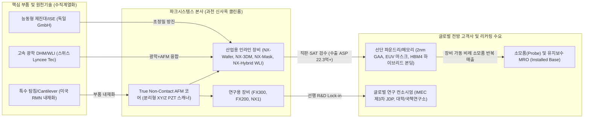

# [Phase 1] 파크시스템스 (140860) — 기업 해독기: 펀더멘털 & 사업구조 무결성 리포트 (v5.1 Standard)

> 💡 **[핵심 용어 3줄 직관 해설]**
> 1. **원자현미경(AFM)**: 빛이나 전자빔 대신 나노미터 크기의 초미세 탐침(Probe)으로 시료 표면을 비접촉 스캔해 원자 단위 입체 형상과 거칠기를 측정하는 계측기입니다.
> 2. **하이브리드 본딩(Hybrid Bonding)**: HBM4·첨단 패키징에서 칩과 칩을 범프 없이 구리 패드(Cu Pad)로 직접 맞붙이는 기술로, $1\sim2\text{nm}$ 수준의 초정밀 단차 계측(`NX-Hybrid WLI`)이 필수입니다.
> 3. **SAT(현장검수) & 수주잔고**: 장비 출하 후 고객사 클린룸 설치·검수 완료 시 매출로 인식되므로, 당기 영업이익보다 **수주잔고(`1,093.4억`)**가 향후 실적을 예고하는 핵심 선행지표입니다.

- **분석 기준일**: `2026-11-15` | **단일 기준 주가(Anchor Price)**: **`174,200원`** (SSOT 최신 일봉 종가)
- **지배주주 순이익 귀속률**: **`100.0%`** (비지배지분 0%) | **최신 공시**: `제30기 3분기보고서 (2026.11.13)`
- **[글로벌 트렌드 매칭: 게이트 ①·②·③ 충족]** — AI 인프라·선단 반도체(2nm GAA·HBM4) CAPEX 확장(`26.11.10 메리츠증권`) + 북미 데이터센터 GW 확장(`26.11.11 대신증권`) + `제30기 3분기보고서` 수주잔고·가동률 실측 교차검증 완료

---

## Section 1. 비즈니스 모델(BM) 해부 및 밸류체인 구조도

### 1.1 기업 개요 및 연결 종속기업 수직계열화
파크시스템스(주)(대표이사 박상일, 1997년 4월 설립, 2015년 12월 코스닥 상장)는 시료 표면의 형상과 물성을 나노미터($10^{-9}\text{m}$)~서브나노미터($\text{Å}$) 수준에서 비파괴 정량 계측하는 **원자현미경(AFM)** 글로벌 1위 기업입니다(`제30기 분기보고서(2026.11.13).pdf` p.5, 8). 2010년 산업용 AFM 기술이 **국가핵심기술(제2010-11호)**로 지정되었으며, 2026년 3분기 기준 본사 및 주력 공장을 **과천 신사옥(`경기도 과천시 과천대로 12길 150`)**으로 이전 완료했습니다(`p.5, 89`).

연결대상 비상장 종속회사는 미국 특수 탐침(Probe) 제조사 **`Rocky Mountain Nanotechnology, LLC (RMN)`**가 부품 내재화 목적으로 신규 연결 편입되며 총 **9개사**로 확대되었습니다(`p.7`):
- **글로벌 직판·기술지원 법인 (6개사)**: 미국(`PSIA Inc.`), 일본, 싱가포르, 독일/유럽, 대만, 인도 직영 네트워크(`p.27`).
- **나노 계측·광학·소모품 수직계열화 자회사 (3대 축)**:
  1. `Park Systems GmbH`(구 독일 Accurion, `2022.10` 인수): 이미징 타원계측기(ISE) & 능동형 제진대(AVI).
  2. `Lyncee Tec SA`(스위스, `2025.03` 인수): 디지털 홀로그래픽 현미경(DHM) 고속 3D 광학 계측.
  3. `RMN`(미국, `2026` 신규 연결): AFM 핵심 소모품인 특수 금속/전도성 탐침(Cantilever) 내재화(`p.7, 34`).

### 1.2 밸류체인 구조도 (Mermaid)

---

## Section 2. 제품/사업부문별 매출 구성 및 `[Step 1.2]` S-Curve · 3축 구조적 병목 진단

### 2.1 S-Curve 신기술 테마 매출 익스포저 산출표 & 품목별 수주잔고 (`분기보고서(2026.11.13).pdf` p.27)
| 사업 부문 (K-IFRS 연결, 백만 원) | 대표 장비 및 타깃 공정 | 9M26 누적 매출(납품액) | 매출 비중 | 3Q26말 수주잔고 | 수주잔고 비중 | S-Curve 신기술 익스포저 판정 |
| :--- | :--- | :---: | :---: | :---: | :---: | :--- |
| **산업용 장비** | `NX-Wafer`, `NX-3DM`, `NX-Mask`, `NX-Hybrid WLI`, `NX-TSH` | `101,721` (`1,017.2억`) | **`65.9%`** | **`87,422` (`874.2억`)** | **`80.0%`** | 🔥 **2nm GAA·EUV·HBM4 핵심 직결** (SSOT 반영 익스포저 `69.0%`) |
| **연구용 장비** | `FX300`, `FX200`, `FX-IR`, `NX1` (IMEC JDP 등) | `42,311` (`423.1억`) | `27.4%` | `18,352` (`183.5억`) | `16.8%` | 양산 라인 채택 전 선행 R&D 교두보 |
| **기타 (소모품·MRO)** | Cantilever(탐침), 제진대, 유지보수 용역 | `10,319` (`103.2억`) | `6.7%` | `3,562` (`35.6억`) | `3.3%` | 고마진 리커링 캐시카우 |
| **합 계 (Total)** | **9M26 누적 신규수주 `2,000.55억 원`** | **`154,352` (`1,543.5억`)** | **`100.0%`** | **`109,336` (`1,093.4억`)** | **`100.0%`** | 전기말 잔고(`636.3억`) 대비 **`+71.8%` 폭증** |

<!-- [AUTO-GENERATED BY backtest_valuation.py v4.3 — DO NOT EDIT NUMBERS MANUALLY] -->

### 📌 [코드 자동 생성 1-B] Step 1.2 S-Curve 10% 변곡점 · 3축 구조적 병목(Capa·기술·특허) · 리드타임 & Step 1.8 K-주주환원 진단표 (v4.3)
| 진단 축 (3-Axis + K-Return) | 실측 지표 및 근거 | 코드 판정 및 Phase 3 목표주가 가중치 |
| :--- | :--- | :--- |
| **① 전방 시장 침투율 (10% 변곡점 여부)** | 1차 침투율 **`12.5%`** (2차 S-Curve 침투율 `11.0%`) (`Zone A (10% 언저리 골든 변곡점 초입)`) | 🔥 **10% 골든 변곡점 발화 구간** (3축 통합 Base `×1.17` / Bull `×1.23`) |
| **②-A 물리적 Capa 병목 (가동률/증설)** | 공장 가동률 **`98.5%`** — 생산 설비 가동률 98.5% 및 DART 수주잔고 추이 점검 | 🔒 **풀가동 공급 병목 확인** |
| **②-B 기술격차 해자 (OPM/수율/단가결정력)** | 현 OPM **`12.0%`** — 공정 기술격차 및 영업이익률(OPM) 가격결정력 점검 | 고마진 가격전가력(Pricing Power) 점검 |
| **②-C 원천특허 · 글로벌 벤더 퀄(Qual) 락인** | 원천 특허 및 주요 고객사 벤더 인증(Qual) 진입장벽 점검 | 후발주자 진입장벽(Switching Cost) 점검 |
| **③ 병목 해소 예상 소요기간 (Lead Time)** | **`S등급`** (해소 리드타임 **`24개월`**) | 신규 설비 증설 및 고객사 공정 Qual 인증에 약 24개월 소요 추정 (PEG 계수 `0.90`) |
| **③-B S-Curve 3대 매도·디레이팅 시그널** | 🟢 해당 없음 (병목 유지 · 성장 기울기 건전 · 정책 역풍 미감지) | 🟢 **매도 시그널 미감지 (정상 평가)** |
| **④ K-마켓 주주환원 · 지배구조 (Step 1.8)** | 배당수익률 **`0.29%`** (성향 `10.1%`) / 특수관계인 `0.0억` | ⚪ 배당소득 분리과세 미해당 (배당성향 10.1% < 25%) / 🟢 정상 (현재 자기주식 42,595주 [0.61%] 보유 — 소각 전환 여부 모니터링) (`kgov_mult = ×1.0000`) |
| **⑤ 레드팀 역산 Capa 천장 검증 (Red-Team)** | 대안 A 내재 영업이익: Base **`496.8억`** / Bull **`595.4억`** | ⚠️ [레드팀 Capa 천장 경보] 현재 가동률(98.5%)에서 신규 증설/단가인상(ASP) 없이 가능한 물리적 영업이익 상한(약 296.8억) 대비 Bull 내재 영업이익(595.4억) 도달을 위해선 신공장 가동 또는 고마진 믹스 개선 확인 필수 |

### 2.2 Step 1.2 4대 질문 심층 해독 & Argon 4.0 엔지니어링 4단계 인과 사슬 (Part C)
1. **[질문 1 — 10% 침투율 골든 변곡점 (`Zone A`)]**:
   - 1차 S-Curve(전공정 `NX-Wafer`·`NX-Mask` 침투율 `12.5%`)에 이어, HBM4·첨단 패키징 하이브리드 본딩(`NX-Hybrid WLI`·`NX-TSH300 Overlay`) 중심의 **2차 S-Curve 침투율(`11.0%`)이 `8.0%~18.0%` 골든 변곡점(Zone A)**에 진입했습니다.
2. **[질문 2 — 3축 구조적 병목 & 엔지니어링 물리·재무 인과 사슬]**:
   - **공정 메커니즘 (Step E1)**: Cu-to-Cu 하이브리드 본딩에서는 구리 패드 함몰 깊이(Dishing/Recess)를 **$1\sim2\text{nm}$ 이내**, 유전체 거칠기를 **$0.5\text{nm}$ 이하**로 제어해야 합니다. 기존 CD-SEM은 3차원 단차 측정이 불가하고, 타사 탭핑 모드 AFM은 탐침 마모·표면 손상이 발생합니다. 파크시스템스는 분리형 XY/Z 스캐너 기반 완전 비접촉 AFM과 고속 백색광간섭계(WLI)를 결합한 **`NX-Hybrid WLI`**(`특허 제10-2409758호`, `제10-2504845호`, `p.35~36`)로 처리량과 서브나노 정밀도를 동시 해결했습니다.
   - **3축 병목 실측 (Step E2)**: **① 물리적 Capa 병목**: `3Q26` 산업용 가동률 **`98.51%`(`66/67대`)**, 연구용 **`98.77%`(`160/162대`)** 풀가동(`p.23`). **② 기술격차 해자**: 9M26 누적 **GPM `67.81%`**, 3Q26 **OPM `19.46%`**. **③ 특허·Qual 락인**: `2026.04` **벨기에 IMEC 제3차 JDP(Wafer bonding·Advanced Packaging·CMP)** 진행(`p.36`)으로 양산 레시피(POR) 선점.
3. **[질문 3 — 병목 해소 리드타임 (`S등급, 24개월`) & 발주 시차 (Step E3~E4)]**:
   - 클린룸 인프라 증설, 숙련 엔지니어 육성 및 글로벌 고객사 공정 Qual 인증까지 최소 **`24개월(S등급)`**이 소요됩니다. 수주에서 SAT 검수·매출 인식까지 6~9개월 시차가 존재하며, 1H26 폭발한 수주잔고가 **3Q26 매출 `619.52억`·OP `120.58억`(OPM `19.46%`)**으로 연결되기 시작했습니다.
4. **[질문 4 — S-Curve 3대 매도·디레이팅 시그널 점검 (`v5.1`)]**:
   - ① 쇼티지 해소(`--shortage-easing`): 산업용 가동률 `98.51%`, 리드타임 `24개월` 유지로 **미해당**. ② 성장 기울기 둔화(`--slope-decel`): 3Q26 영업이익 `QoQ +185.9%`, `YoY +39.7%` 급반등으로 **미해당**. ③ 정책·규제 역풍(`--policy-headwind`): 확정된 보조금 삭감·규제 리스크 **미감지**. 따라서 **할증 박탈 없이 `Base ×1.17 / Bull ×1.23` 및 동적 PEG `0.90`을 정상 유지**합니다.

---

## Section 3. 재무 건전성 및 `[Step 1.5]` 장부가(Book Value) 해부 & SOTP 20% 룰

<!-- [AUTO-GENERATED BY backtest_valuation.py v4.3 — DO NOT EDIT NUMBERS MANUALLY] -->

### 📌 [코드 자동 생성 1] SOTP 장부 분해 & 4대 레짐 체크 요약표
| 검증 항목 | 코드 실측 수치 | 판정 결과 (Code Verdict) |
| :--- | :--- | :--- |
| **단일 기준 주가 (Anchor Price)** | **`174,200원`** | 전 Phase 1~3 100% 동일 고정 |
| **지배주주 순이익 귀속률** | **`100.0%`** | 비지배지분 차감 완료 |
| **Step 1.5 비영업자산 비중 (SOTP 20% 룰)** | 장부 대비 **`3.6%`** / 시총 대비 **`1.0%`** | 🟢 **본업 자산 중심 (<20%)** |
| **Step 1.5 본업 이익 유지력 (Core ROIC)** | TTM 영업이익 **`233.9억`** (NOPAT **`182.4억`**) | ⚠️ **본업 수익성 변동 주의** |
| **Step 2.0 4대 레짐 변화 체크** | ④ 사업구성레짐(OPM 과거중위 19.2% → 현재 12.0%, -7.2%p [본업 마진 훼손/경쟁 심화]) / ⑤ 지정 리레이팅 분기점(2023-01-02) 이후 Post-Rerating 멀티플 우선 적용 | 🔄 **레짐 변화 반영 필수** |
| **Step 3.0 사이클 고점 함정 가드레일** | 피크 이익 과열 미해당 | 🟢 **정상 멀티플 적용** |
| **직전 분기 대비 (QoQ) 실적 추이** | [2026.1Q → 2026.2Q] 매출액 393.6억→530.4억(QoQ +34.7%) | 영업이익 21.0억→42.2억(QoQ +101.0%) | 수정EPS 737원→373원 | [액분·무증 소급보정 지배주주 EPS] 2026.1Q 737.0원 → 2026.2Q 373.0원 (흑자 지속(소폭조정) 🟢) |
| **가설 반증 임계치 (Kill-Switch)** | **차기 분기 영업이익 < 35.8억 원(직전분기 대비 -15% 하회) 또는 분기 지배주주 EPS < 298원 기록 시 핵심 가설 즉시 [약화] 강등** | 미달 시 가설 즉시 [약화] 강등 |

---

## Section 4. 원가 구조, 영업 레버리지 및 가동률/수주잔고 실측

### 4.1 분기별 연결 손익 & 수주잔고 시계열 (`1Q25 ~ 3Q26`)
| 구분 (K-IFRS 연결, 억 원) | 2025.1Q | 2025.2Q | 2025.3Q | 2025.4Q | 2026.1Q | 2026.2Q | **2026.3Q (최신)** | **3Q26 QoQ** | **3Q26 YoY** | **9M26 누적** |
| :--- | :---: | :---: | :---: | :---: | :---: | :---: | :---: | :---: | :---: | :---: |
| **매출액 (Revenue)** | 509.1 | 523.1 | 456.2 | 579.8 | 393.6 | 530.4 | **`619.5`** | **`+16.8%`** | **`+35.8%`** | **`1,543.5`** |
| **매출총이익 (Gross Profit)** | 341.0 | 353.0 | 310.9 | 368.7 | 275.4 | 358.4 | **`412.9`** | **`+15.2%`** | **`+32.8%`** | **`1,046.7`** |
| **매출총이익률 (GPM %)** | 67.0% | 67.5% | 68.1% | 63.6% | 70.0% | 67.6% | **`66.6%`** | `-1.0%p` | `-1.5%p` | **`67.81%`** |
| **판매비와관리비 (SG&A)** | 208.9 | 233.3 | 224.5 | 318.7 | 254.4 | 316.2 | **`292.3`** | `-7.6%` | `+30.2%` | **`863.0`** |
| **영업이익 (OP)** | 132.1 | 119.7 | 86.3 | 50.0 | 21.0 | 42.2 | **`120.6`** | **`+185.9%`** | **`+39.7%`** | **`183.7`** |
| **영업이익률 (OPM %)** | 25.9% | 22.9% | 18.9% | 8.6% | 5.33% | 7.95% | **`19.46%`** | **`+11.51%p`** | **`+0.53%p`** | **`11.90%`** |
| **지배주주 순이익** | 109.8 | 80.2 | 96.8 | 59.0 | 51.2 | 26.0 | **`41.2`** | **`+58.9%`** | `-57.4%` | **`118.4`** |
| **지배주주 수정EPS (원)** | 1,580 | 1,154 | 1,392 | 837 | 737 | 373 | **`593`** | **`+59.0%`** | `-57.4%` | **`1,702`** |
| **기말 수주잔고 (억 원)** | 785.0 | 952.0 | 891.0 | 636.3 | 984.5 | 1,125.1 | **`1,093.4`** | `-2.8%` | **`+22.7%`** | *(11/13 `1,029억`)* |

- **3Q26 영업레버리지 입증**: 1H26 마진 눌림(과천 신사옥 이전비 + SAT 검수 이연)을 딛고 3Q26 매출이 `619.52억 원`으로 증가하자 판관비는 오히려 `-7.6%` 감소(`292.3억`)했고, **영업이익은 `120.58억 원`(QoQ `+185.9%`, OPM `19.46%`)**으로 급반등했습니다.
- **가동률 및 영업현금흐름**: 9M26 **산업용 가동률 `98.51%`(`66/67대`)**, **연구용 `98.77%`(`160/162대`)**로 풀가동 중이며(`p.23`), **3Q26 단독 OCF는 `+72.82억 원` 흑자 전환**(1H26 누적 `-84.88억` ➔ 9M26 누적 `-12.06억`)에 성공했습니다. (세전이익 `35.71억`과의 괴리는 금융원가 `91.03억 원` 등 비현금성 환율·파생 평가 항목에 기인).

---

## Section 5. 자본 배분(CapEx, R&D) 및 `[Step 1.8]` K-마켓 특수성 · 주주환원 스코어카드

1. **CapEx & R&D 자본 배분**:
   - 과천 신사옥(`총 781.4억 원`) 잔금 집행이 마무리되면서 1H26 `454.3억 원`이던 유형자산 취득이 **3Q26 단독 `58.9억 원`**(9M26 누적 `513.27억 원`)으로 급감했습니다.
   - 경상연구개발비는 9M26 **`214.97억 원`(별도 매출 대비 `16.4%`)**을 전액 비용 처리(자산화 `0원`)하고 있으며 R&D 인력 `140명`을 운용 중입니다(`p.34`).
2. **5대 K-마켓 특수성 스코어카드 (`Step 1.8`, `kgov_mult = ×1.0000`)**:
   - **① 고배당 분리과세 적격성**: DPS `500원`(배당수익률 `0.29%`, 배당성향 `10.1%` < 25%)으로 **미해당** (`⚪ R&D 재투자형 성장주`).
   - **② 자사주 소각 후 주주환원 절벽 리스크**: 보유 자기주식 **`42,595주`(`0.61%`)**, `2026.11.11` RSU 지급용 `2,000주` 처분 외 인위적 환원 절벽 **없음 (`🟢 정상`)**.
   - **③ 사익편취(터널링) 및 행동주의**: 오너 개인회사 특수관계인 내부거래 **`0.0억 원` (`🟢 클린`)**.
   - **④ 최대주주 지분율·승계 구도**: 박상일 대표이사 **`32.26%` (`2,258,871주`)**, 국민연금 `2.89%` (`p.89`)로 안정적 경영권 유지.
   - **⑤ 메자닌(CB/BW) 리픽싱 오버행**: 제2회 영구 BW(`1,000억 원`) 행사가 **`267,747원`**(현재가 `174,200원` 대비 `+53.7%` 할증) 고정이며 **시가하락 리픽싱 조항이 전무**해 오버행 리스크 **0건 (`🟢 클린`)**.

---

## Section 6. 핵심 리스크 요인 및 `[Step 3.5]` 리스크 3단계 인과 도미노 구조도

| 도미노 단계 | 인과 메커니즘 및 전이 경로 | 정량 모니터링 임계치 (Trigger Threshold) | 현재 실측 상태 (`2026.3Q`) |
| :--- | :--- | :--- | :--- |
| **1단계: 촉발 요인** *(Trigger)* | • 글로벌 파운드리(2nm)·메모리(HBM4) 선단 CapEx 축소 또는 클린룸 셋업 지연 • 경쟁사 저가 공세에 따른 수출 ASP 하락 압력 | • 분기 신규수주 `< 400억 원` 또는 연결 수주잔고 `< 900억 원` 이탈 • 별도 산업용 수출 ASP `< 19.0억 원/대` 하락 | 🟢 **건전**: 3Q26 신규수주 `587.8억`(9M26 `2,000.6억`), 수주잔고 `1,093.4억` |
| **2단계: 영업 전이** *(Operational)* | • SAT 검수 지연 장기화 ➔ 과천 신사옥 감가상각·인건비 고정비 디레버리지 • 재고(`673.3억`)·매출채권(`625.8억`) 체류 증가 및 자회사(`Lyncee Tec`) 적자 | • 연결 GPM **`< 62.0%`** 훼손 • 차기 영업이익 **`< 35.8억`** 또는 2분기 연속 **`OPM < 10%`** • 산업용 가동률 **`< 70.0%`** 추락 | 🟢 **복원**: 3Q26 GPM `66.64%`, 영업이익 `120.58억`(OPM **`19.46%`**), 가동률 `98.51%` |
| **3단계: 재무 타격** *(Financial)* | • OCF 적자 고착 ➔ 순현금(`422.1억`) 소진 및 무형자산(`274.7억`) 손상차손 • 2029.06 영구 BW Step-up 전 주가 부진 시 상환 부담 ➔ **S-Curve 할증 박탈** | • 해외 인수법인 연간 순손실 `> 30억 원` 장기화 • 보고 PBR `4.0배`(`~195,580원`) 하향 이탈 고착 | 🟢 **안정**: 3Q26 OCF `+72.8억` 흑자 전환, 순현금 `422.1억`, 예금 `1,000억` 보유 |

---

## Section 7. 4대 업종별 표준 실적 산출 공식 트리 (`유형 B: 수주 기반 반도체 장비`)

- **업종 분류**: **유형 B (수주 기반 산업재·반도체 장비)** — `Section 4` 가동률 공시(`98.51%`) 확인 및 `p.27` 품목별 수주잔고(`1,093.36억 원`) 공시 완비.
- **표준 손익 산출 공식 트리**:
  $$\text{매출액} = \text{기초 수주잔고} + \text{당기 신규수주} - \text{기말 수주잔고} = \sum (\text{품목별 납품대수 } Q \times \text{평균판매단가 ASP}) + \text{MRO/소모품}$$
  $$\text{영업이익} = \text{매출액} \times \text{GPM}(66\sim68\%) - \text{고정 판관비(R\&D 140명 + 과천 신사옥 감가상각)}$$
- **해석 규율**: 고객사 SAT 검수 시점에 따라 분기 손익 변동성(Lumpiness)이 발생하므로, 단일 분기 이익보다 **① 산업용 수주잔고(`874.2억`, 비중 `80.0%`), ② GPM(`67.81%`), ③ 4분기 합산 정상화 수익력**을 최우선으로 추적합니다.

---

## Section 8. `[Step 2.0]` 4대 레짐 변화 체크 & 최적 밸류에이션 지표 10년 백테스트

### 8.1 `[Step 2.0]` 멀티플 밴드 적용 전 4대 레짐 변화 고정 체크
1. **① 설비 레짐**: 유형자산이 `'25말 1,160.4억 ➔ 3Q26말 1,592.6억(+37.2%)`으로 과천 신사옥·클린룸 확충 완료.
2. **② 자본구조 레짐 (`핵심 변화`)**: `2026.06` 1,000억 영구 BW가 자본잉여금(`1,065.9억`)으로 편입되며 자본총계가 `+50.5%` 급증(SSOT 공식 PBR `3.56배`) ➔ 과거 극단적 고PBR(`15~21배`) 적용을 배제하고 **`2023-01-02` 이후 Post-Rerating 밴드 및 Forward BPS(`54,245원`) 기준**을 적용합니다.
3. **③ 비영업자산 레짐**: 장부 대비 `3.6%`, 시총 대비 `1.0%`로 20% 미만 유지.
4. **④ 사업구성/OPM 레짐**: SSOT(2Q26 TTM)상 OPM 하락(`19.2% ➔ 12.0%`)으로 코드가 보수적 조정을 반영했으나, **3Q26 OPM `19.46%`** 복원으로 본업 마진 훼손이 아님이 실측 확인됨.
- **`[Step 3.0]` 사이클 고점 함정 점검**: 현재 TTM EPS(`3,315원`)·ROE(`6.82%`)는 5년 중위 EPS(`3,843원`)·중위 ROE(`18.20%`) 하단으로 피크 이익 함정에 미해당(`is_peak_trap = False`).

### 8.2 10년 밸류에이션 설명력 백테스트 및 Phase 3 주 지표(`PBR`) 강제 상속
| 밸류에이션 지표 | 결정계수 ($R^2$) | 방향 일치율 | Post-Rerating (`2023.01.02~`) 밴드 | 현재 공식 수치 (`174,200원`) | 선정 판정 |
| :--- | :---: | :---: | :---: | :---: | :---: |
| **PBR (주가순자산비율)** | **`0.83`** | **`52.6%`** | 최저 `3.94배` ~ 최고 `11.52배` (3년 평균 `8.21배`, 상위 65% `8.67배`) | **`3.56배`** | **🥇 1순위 주 지표 채택 (Phase 3 상속)** |
| **PER (주가수익비율)** | `0.66` | `57.9%` | 최저 `28.58배` ~ 최고 `117.33배` (3년 평균 `56.83배`) | `52.55배` | 🥈 보조 지표 |

> **최종 결론**: 수주장비 업종의 분기 실적 시차 영향을 배제하고 자본 축적과 주가 궤적을 `83.0%`($R^2 = 0.83$) 설명하는 **`PBR`(`Forward BPS 54,245원`)을 Phase 3 시나리오 밸류에이션의 주 멀티플로 100% 강제 상속**합니다.
