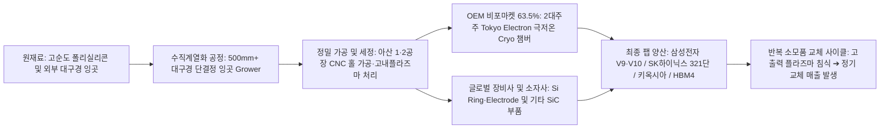
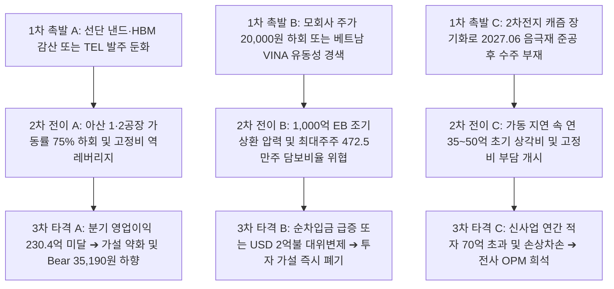

# 🔍 Phase 1: 기업 해독기 — 하나머티리얼즈 (166090) (v5.1)

> **분석완료일**: 2026-11-19
> - **단일 기준 주가 (Single Price Anchor)**: **`42,800원`** (SSOT 확정 종가, Phase 1~3 전 과정 100% 동일 고정)
> - **주식수 · 지배주주 귀속률 · 최신 공시 스캔**: 총발행주식수 `19,777,674주` / 자기주식 `488,222주`(`2.47%`) / **실질 유통주식수 `19,289,452주`** (`유통시총 8,255.9억 원`), 지배주주 순이익 귀속률 **`100.0%`** (종속기업 2사 100% 지배), 최신 정기공시 **`2026년 3분기보고서(2026.11.12)`** 및 `파생상품거래손실발생(2026.11.12)`·`임시주총 감액배당 가결(2026.10.28)`·`1,000억 무이자 EB 발행(2026.09.14)` 스캔 반영 완료.

> 💡 **[핵심 용어 3줄 직관 해설]**
> 1. **식각(Etching)용 실리콘 파츠(Si Electrode & Ring)**: 반도체 웨이퍼에 초미세 회로를 깎아내는 플라즈마 식각 공정에서 웨이퍼를 고정하고 가스를 분사하는 핵심 소모품으로, 웨이퍼 투입량이 늘거나 3D NAND 고단화·극저온(Cryo) 공정이 고도화될수록 교체 주기가 빨라지며 매출이 직결됩니다.
> 2. **SOTP(Sum-of-the-Parts) 20% 분리 평가**: 동사는 지배주주지분의 **`54.5%`**(`3,242.4억 원`, 시총 대비 `39.3%`)가 모회사 하나마이크론 지분(`648.2만 주`, `9.75%`) 등 비영업자산으로 구성되어 있어, 단순 연결 PBR 대신 **`[본업 가치(Core BPS 14,042원 × PBR) + 비영업자산 30% 할인 안전가치(2,269.7억) - 순차입금(186.0억)]`**으로 분리해 해독해야 저평가 착시를 막을 수 있습니다.
> 3. **비현금 EB 파생상품평가손실(Accounting Mismatch)**: `2026.09.14` 발행한 1,000억 무이자 교환사채(EB)의 교환 대상인 하나마이크론 주가 급등 시, 보유주식 평가이익(`+1,061억`)은 자본(OCI)으로 가고 교환권 부채 증가분(`-315.95억`)만 당기손익(금융원가)에 잡혀 3Q26 명목 순손실(`-66.5억`, EPS `-345원`) 착시를 유발했으나, 실제 현금 유출은 **0원**입니다.

---

## 1. 비즈니스 모델(BM) 해부 및 밸류체인 구조

### 1.1 기업 개요 및 글로벌 트렌드 3대 게이트 매칭
하나머티리얼즈(주)(`2007.01.23` 설립, `2017.04.28` 코스닥 상장, 본사 충남 천안시 서북구 3공단3로 42, 대표이사 김현주)는 반도체 핵심 전공정인 **플라즈마 식각(Etching) 공정용 소모성 부품(Silicon Electrode, Silicon Ring, SiC Ring 등)**을 수직계열화 생산·판매하는 글로벌 Tier-1 소재·부품 중견기업입니다(`[하나머티리얼즈]분기보고서(2026.11.12).pdf` p.4, 48; `[하나머티리얼즈]반기보고서(2026.08.13).pdf` p.7). 연결 종속기업으로는 신기술사업금융업을 영위하는 **하나에스앤비인베스트먼트(주)(지분 100.0%)**와 **하나에스앤비 소부장1호 신기술조합(지배 93.75% + 종속 6.25% = 100.0%)** 2개사를 보유하고 있으며, 지배주주 귀속률은 **`100.0%`**입니다(3분기보고서 p.6, 49).

* **Gate 1 (AI 데이터센터·고단화 메모리 구조적 수요)**: AI 서버향 eSSD(300단+ 초고단 3D NAND) 및 HBM4(일반 D램 대비 웨이퍼 2~3배 소모) 확산으로 HARC(고종횡비) 채널 홀 식각 난이도와 공정 스텝 수가 기하급수적으로 증가하며 소모성 Si·SiC 파츠 교체 수요를 구조적으로 견인합니다.
* **Gate 2 (글로벌 식각 장비 1위군 OEM 비포마켓 락인)**: 동사의 2대 주주는 글로벌 식각 장비 선도 기업인 **Tokyo Electron Ltd.(TEL, `2,726,200주`, 지분 `13.78%`)**이며(3분기보고서 p.48), 최대 고객사인 A사(TEL 그룹)향 매출 비중이 **`63.54%`(`1,768.5억 원`)**에 달하는 강력한 OEM 비포마켓(Before-Market) 캡티브 공급망을 구축하고 있습니다.
* **Gate 3 (단결정 잉곳 성장로 수직계열화 원가 경쟁력)**: 외부 잉곳 구매에 의존하는 애프터마켓 경쟁사와 달리, 대구경 단결정 실리콘 잉곳 성장로(Grower)부터 초정밀 CNC/홀 가공·세정까지 일괄 수직계열화하여 아산 1·2공장 고가동률(`원가기준 90.32%`) 국면에서 **`28.5~28.8%`**의 압도적 영업이익률(OPM)을 실현합니다.

### 1.2 밸류체인 구조도 (Mermaid v10.9.8)


### 1.3 Argon 4단계 고난도 공정 엔지니어링 인과 사슬 (Engineering-to-Earnings Causal Chain)
1. **[Step E1 — 공정 물리·화학 메커니즘 정의]**: 300단 이상 3D NAND의 초고종횡비(HARC, Aspect Ratio > 100:1) 채널 홀 식각 시 기존 상온 플라즈마 방식은 식각 속도 저하와 홀 휘어짐(Bowing/Twisting) 한계에 봉착합니다. TEL의 차세대 **극저온(Cryo) 식각 장비**는 웨이퍼 척 온도를 극저온(`-60°C ~ -80°C`)으로 제어하고 HF 기반 특수 가스로 플라즈마 식각 속도를 2배 이상 끌어올립니다. 이때 웨이퍼 주변에서 플라즈마 균일도를 유지하는 **Si Focus Ring**과 가스 샤워헤드 역할을 하는 **Si Electrode**는 극심한 열충격(Thermal Shock)과 고밀도 불소 라디칼 침식을 동시에 견뎌야 합니다.
2. **[Step E2 — 기술적 병목(Bottleneck) 및 안전·품질 인증(Qual) 장벽 도출]**: 극저온 고출력 플라즈마 환경에서 미세 파티클(Particle) 발생이나 미세 균열(Micro-crack)이 생기면 웨이퍼 전체 수율이 붕괴합니다. 따라서 **500mm+ 무결점 대구경 단결정 성장 기술(불순물·결정결함 극소화)**과 수천 개의 미세 가스 홀을 오차 없이 뚫는 초정밀 가공, 그리고 장비사(TEL) 챔버 설계 초기 단계부터 공동 개발(Co-development)하는 **OEM 퀄 인증(해소 리드타임 18~24개월)**이 후발주자의 진입을 원천 봉쇄합니다.
3. **[Step E3 — 부품·기자재 발주 시차(Lead-Lag) 및 교체 주기(Consumable Cycle) 매핑]**: 전공정 장비(CapEx)가 팹에 반입·셋업되는 시점에 초도 OEM 파츠가 탑재되며, 양산 가동(Wafer Start)에 돌입한 직후부터는 플라즈마 침식량에 비례해 **매월·매분기 반복적인 소모품 교체(Consumable Replacement) 매출**이 발생합니다. 즉, 장비 수주 이후 6~12개월 시차로 시작해 팹 가동 기간 내내 현금을 창출하는 후행·반복 고마진 구조입니다.
4. **[Step E4 — DART 수주잔고·가동률·영업이익률(OPM) 레버리지 연결]**: TEL 극저온 식각 장비 침투율 상승(`2차 S-Curve 12.0%`)과 메모리 팹 가동률 회복이 맞물리면서 아산 1·2공장 9M26 누적 시간 가동률이 **`84.60%`(3Q 단독 `86.39%`, 원가기준 `90.32%`)**로 올라섰고, 잉곳 평균 매입단가 하락(`139,420원/kg`, 25년 대비 `-24.2%`)까지 겹쳐 **3Q26 연결 OPM `28.57%`(별도 `28.81%`), TTM 영업이익 `952.8억 원`**으로 2022년 슈퍼사이클 고점을 돌파했습니다.

---

## 2. 주요 제품별 매출 구성 및 [Step 1.2] S-Curve 10% 변곡점 · 3축 구조적 병목 · 리드타임 진단

### 2.1 주요 제품별 매출 구성 및 신기술 익스포저 판정표 (원칙 4 준수)
| 제품 / 사업 구분 | 9M26 누적 / 3Q26 실적 및 비중 | 핵심 기술 · 전방 적용처 | 원칙 4 (단독 공시 30% 룰) 판정 및 밸류에이션 반영 |
| :--- | :--- | :--- | :--- |
| **실리콘(Si) 파츠 (Ring & Electrode)** | 매출 **`2,457.1억 원`** (전사 비중 **`88.27%`**) | 300단+ 3D NAND 극저온(Cryo) 식각 및 HBM/선단 D램 플라즈마 식각 핵심 소모품 (A사/TEL향 `63.54%`) | ✅ **핵심 본업 (단독 공시 `88.27% ≥ 30%`)** — 2차 S-Curve(Cryo 식각 침투율 `12.0%`) 리레이팅 적격 |
| **기타 부품 (SiC Ring 등 묶음 공시)** | 9M26 **`303.3억 원`** (`10.89%`, 상품포함 `11.27%`) / **3Q26 단독 `117.7억 원`(`12.40%`)** / 9M26 수출 **`182.81억 원`(YoY `+49.1%`)** | 차세대 2nm GAA 파운드리 및 HBM4 고출력 식각용 Solid SiC Ring·하이브리드 부품 | 🎁 **0원 무상 콜옵션 (할증 0%)** — 수출 급증은 포착되었으나 DART 단독 분리 미공시 및 비중 `< 30%`로 할증 배제 |
| **실리콘 음극재 (신규시설투자 702억)** | 매출 **`0원 (0.0%)`** (`2027.06.30` 준공 예정, 3Q말 건설중인자산 `528.5억 원`) | 차세대 이차전지용 실리콘 음극재 양산 제조라인 (`2026.08.12` 이사회 재결의) | 🎁 **0원 무상 콜옵션 (할증 0% + 초기 상각비만 선차감)** — 매출 발생 전까지 보수적 비용 리스크로만 반영 |
| **종속기업 (신기술사업금융 2사)** | 하나에스앤비인베스트먼트 9M26 영업수익 `12.88억`, 순이익 `5.45억` / 소부장1호 순손실 `-0.33억` | 반도체 소부장 벤처 투자 (비중 `< 0.5%`, 3분기보고서 p.49) | ⚪ **비핵심 금융 종속 (SOTP/자본 반영)** |

### 📌 [코드 자동 생성 1-B] Step 1.2 S-Curve 10% 변곡점 · 3축 구조적 병목(Capa·기술·특허) · 리드타임 & Step 1.8 K-주주환원 진단표 (v5.0)
| 진단 축 (3-Axis + K-Return) | 실측 지표 및 근거 | 코드 판정 및 Phase 3 목표주가 가중치 |
| :--- | :--- | :--- |
| **① 전방 시장 침투율 (10% 변곡점 여부)** | 1차 침투율 **`28.5%`** (2차 S-Curve 침투율 `12.0%`) (`더블 S-Curve Zone A (1차 28.5% 캐시카우 + 2차 12.0% 🔥10% 언저리 변곡점)`) | 🔥 **10% 골든 변곡점 발화 구간** (3축 통합 Base `×1.13` / Bull `×1.17`) |
| **②-A 물리적 Capa 병목 (가동률/증설)** | 공장 가동률 **`84.6%`** — 생산 Capa: 대구경 단결정 Si 잉곳 성장로(Grower) 수직계열화 및 아산 제2공장 클린룸 Capa (2Q26 가동률 87.77%) | 🟢 **여유 Capa 보유** |
| **②-B 기술격차 해자 (OPM/수율/단가결정력)** | 현 OPM **`26.5%`** — 기술 격차: 500mm+ 무결점 대구경 단결정 성장 및 극저온(Cryo) 식각 고내플라즈마 정밀가공 (2Q26 OPM 28.88%) | 고마진 가격전가력(Pricing Power) 점검 |
| **②-C 원천특허 · 글로벌 벤더 퀄(Qual) 락인** | 특허/벤더 Lock-in: 2대주주 Tokyo Electron(TEL, 지분 13.78%) OEM 비포마켓 캡티브 Lock-in 및 SiC 재생/전도성 특허 | 후발주자 진입장벽(Switching Cost) 점검 |
| **③ 병목 해소 예상 소요기간 (Lead Time)** | **`A등급`** (해소 리드타임 **`20개월`**) | 대구경 잉곳 그로워 장비 반입·셋업 및 TEL 챔버 OEM 부품 공정 인증에 18~24개월 소요 (PEG 계수 `0.80`) |
| **③-B S-Curve 3대 매도·디레이팅 시그널** | 🟢 해당 없음 (병목 유지 · 성장 기울기 건전 · 정책 역풍 미감지) | 🟢 **매도 시그널 미감지 (정상 평가)** |
| **④-A K-주주환원 (배당 · TSR · 분리과세)** | DPS **`300원`** (배당수익률 **`0.70%`** / 성향 `15.1%` / TSR `27.6%`) | ⚪ 조특법 분리과세 미충족(배당성향 15.1%)이나, ✅ 26.10.28 임시주총 364.96억(주당 1,892원) 비과세 감액배당(세율 0%) 재원 전입 확정 |
| **④-B 자사주 · 환원절벽 · 메자닌(CB/BW)** | 자사주 **`488,222주`** (`2.47%`) / 미상환 메자닌 **`1,000.0억`** (희석 `0.0%`) | 🟢 정상 (현재 자기주식 488,222주 [2.47%] 보유 — 소각 전환 여부 모니터링) / ⚠️ [메자닌 오버행 주의]: 잔액 1,000.0억 원 (희석 0.0%) |
| **④-C 지배구조 · 내부거래 · 거버넌스 (Step 1.8)** | 특수관계인 거래 **`17.4억`** | 🟢 양호 (유의미한 오너 개인회사 사익편취 내부거래 미감지 [17.4억 원]) — ✅ 10.28 비과세 감액배당 전입(212.2억, 주당 1,100원) & 1,000억 무이자 EB(자사 희석 0%)·SPC 262.8억 보증해지 vs ⚠️ 베트남 계열사 2억불(자기자본 ~47%) 채무보증·최대주주 담보(472.5만주, 26.11.16 연장) 및 702억 음극재 상각비 반영 (`kgov_mult = ×1.0000`) |
| **⑤ 레드팀 역산 Capa 천장 검증 (Red-Team)** | 대안 A 내재 영업이익: Base **`583.8억`** / Bull **`506.9억`** | 🟢 물리적 Capa 한계 내 달성 가능 |

### 2.2 Step 1.2 4대 질문 및 매도·디레이팅 3대 시그널 해독
1. **전방 침투율 (`더블 S-Curve Zone A`)**: 범용 식각 Si 파츠(1차 S-Curve, `28.5%`)가 안정적 캐시카우를 담당하는 가운데, 300단+ 3D NAND 핵심 공정인 TEL 극저온(Cryo) 식각 장비 도입(2차 S-Curve, **`12.0%`**)이 `8~18%` 골든 변곡점 구간에 진입하여 Base `×1.13` / Bull `×1.17`의 구조적 멀티플 가중치가 정당화됩니다.
2. **3축 구조적 병목 (Capa · 기술 · 특허/Qual)**: 아산 2공장 클린룸 증설이 선제 완료되어 가동률 **`84.6%`**(원가기준 `90.32%`)에서 추가 증설 없이도 매출 확장 여력(🟢 여유 Capa 보유)을 확보했으며, `28.6~28.8%`의 고마진 OPM과 2대 주주 TEL(`13.78%`) OEM 비포마켓 캡티브 락인 및 SiC 관련 특허 47건이 강력한 해자를 형성합니다.
3. **병목 해소 리드타임 (`A등급 / 20개월`)**: 500mm+ 대구경 잉곳 성장로 장비 리드타임과 글로벌 식각 장비사 OEM 공정 퀄 인증에 최소 18~24개월(`20개월`)이 소요되므로 단기 경쟁 진입에 의한 판가 붕괴 위험이 제한적입니다.
4. **3대 매도·디레이팅 시그널 점검 (`🟢 미감지`)**: ① 쇼티지 해소/리드타임 축소 미해당(가동률 `84.6%` > `70%` 및 TEL 독점 OEM 유지), ② 성장 기울기 둔화 미해당(3Q26 영업이익 QoQ **`+4.2%`**, YoY **`+125.9%`** 확장), ③ 정책·보조금 역풍 미해당으로 매도 시그널 0건입니다.

---

## 3. 재무 건전성 및 [Step 1.5] 장부가(Book Value) 해부 & SOTP 20% 분리 게이트

### 📌 [코드 자동 생성 1] SOTP 장부 분해 & 4대 레짐 체크 요약표
| 검증 항목 | 코드 실측 수치 | 판정 결과 (Code Verdict) |
| :--- | :--- | :--- |
| **단일 기준 주가 (Anchor Price)** | **`42,800원`** | 전 Phase 1~3 100% 동일 고정 |
| **지배주주 순이익 귀속률** | **`100.0%`** | 비지배지분 차감 완료 |
| **Step 1.5 비영업자산 비중 (SOTP 20% 룰)** | 장부 대비 **`54.5%`** / 시총 대비 **`39.3%`** | 🚨 **SOTP 분리 평가 발동** (본업BPS 14,042원) |
| **Step 1.5 본업 이익 유지력 (Core ROIC)** | TTM 영업이익 **`952.8억`** (NOPAT **`743.2억`**) | ✅ **본업 이익 유지 견고** |
| **Step 2.0 4대 레짐 변화 체크** | ③ 비영업자산레짐(비영업자산 비중 54.5% ≥ 20% — 명목 PBR 저평가 착시 주의) | 🔄 **레짐 변화 반영 필수** |
| **Step 3.0 사이클 고점 함정 가드레일** | 피크 이익 과열 미해당 | 🟢 **정상 멀티플 적용** |
| **직전 분기 대비 (QoQ) 실적 추이** | [2026.2Q → 2026.3Q] 매출액 900.9억→948.6억(QoQ +5.3%) | 영업이익 260.2억→271.0억(QoQ +4.2%) | 수정EPS 1,024원→-345원 | [액분·무증 소급보정 지배주주 EPS] 2026.2Q 1,024.0원 → 2026.3Q -345.0원 (적자 전환/지속 🚨) |
| **가설 반증 임계치 (Kill-Switch)** | **차기 분기 영업이익 < 230.4억 원(직전분기 대비 -15% 하회) 또는 분기 지배주주 EPS < 0원 기록 시 핵심 가설 즉시 [약화] 강등** | 미달 시 가설 즉시 [약화] 강등 |

### 3.1 재무상태표 · 현금흐름표 핵심 항목 및 순차입금 급감 해부
* **현금성자산 폭증 및 차입금 대폭 축소**: `[하나머티리얼즈]분기보고서(2026.11.12).pdf` (p.48, 101, 150)에 따르면, 2026년 3분기말 연결 기말현금및현금성자산은 **`1,233.4억 원`**(별도 `1,182.5억 원`, 기초 `395.0억 원` 대비 `+838.4억 원` 급증)으로 확대되었습니다. 9개월 누적 단기차입금 **`547.8억 원`**을 상환하고, `2026.09.14` 사모 무이자(`0.00%`) 교환사채(EB) **`1,000.0억 원`**(만기 `2028.09.14`)을 발행해 고금리 은행 차입금 차환(9월 `220억` + 10월 `680억` MMDA 상환 예정)에 투입함으로써 **순차입금이 반기말 `716.5억 원`에서 3분기말 `186.0억 원`으로 `-530.5억 원` 급감**했습니다.
* **강력한 현금창출력(FCF)**: 9개월 누적 영업활동현금흐름(OCF)은 **`685.8억 원`(YoY `+77.3%`)**에 달하며, 유형자산 취득(CapEx, 별도 9M26 `260.8억 원`, p.101)을 차감한 **TTM 보고 FCF는 `660.3억 원`**(반기 `567.3억 원` 대비 `+93.0억 원` 확대)으로 실질 현금 창출력은 창사 이래 최상위 수준입니다.

### 3.2 [Step 1.5] 장부가(Book Value) SOTP 20% 분리 해부 및 Core ROIC 판정
| 장부가 분해 항목 (SOTP Decomposition) | 금액 / 주당 가치 | 비중 / 비율 | 회계·밸류에이션 해석 |
| :--- | :---: | :---: | :--- |
| **연결 지배주주지분 (Total Controlling Equity)** | 약 **`5,949.4억 원`** (총 BPS 약 `30,843원`) | `100.0%` | 현재가 `42,800원` 기준 명목 PBR **`1.39배`** |
| **(-) 비영업자산 장부가 (하나마이크론 `9.75%` 등)** | **`3,242.4억 원`** (하나마이크론 지분 `3,069.4억` 중심) | 장부 **`54.5%`** / 시총 **`39.3%`** | 🚨 **20% 룰 대폭 초과 ➔ SOTP 분리 평가 강제 발동** |
| **(=) 순수 본업 자본 (Core Equity / Core BPS)** | 약 **`2,708.6억 원`** (**본업 BPS `14,042원`**) | 장부 **`45.5%`** | 본업 자본만으로 TTM NOPAT `743.2억 원` 창출 |
| **비영업자산 안전가치 (30% 할인 반영)** | **`2,269.7억 원`** (주당 **`11,767원`**) | 유통시총의 **`27.5%`** | 매각세금·지분할인 30% 선차감 보수적 안전가치 |
| **순차입금 차감 (Net Debt)** | **`-186.0억 원`** (주당 **`-964원`**) | 유통시총의 **`2.3%`** | 사실상 무차입 수준 근접 (`Net Debt / OP = 0.20x`) |
| **순수 본업 투하자본수익률 (Core ROIC)** | TTM OP `952.8억` / NOPAT `743.2억` | **`25.72%`** | ✅ **초고수익 본업 이익 유지력 견고 (가치함정 배제)** |

### 3.3 🚨 3Q26 명목 순손실(`-66.5억`, EPS `-345원`)의 회계적 비대칭 정밀 해부
3Q26 영업이익이 **`271.0억 원`**에 달했음에도 명목 지배주주 순손실 `-66.54억 원`(수정 EPS `-345원`)이 계상된 것은 본업 악화가 아닙니다. `2026.09.14` 발행한 **1,000억 무이자 EB(교환대상: 보유 하나마이크론 보통주 `2,907,991주`, 교환가액 `34,388원`)**의 내재파생상품(교환권) 공정가치가 모회사 주가 상승에 연동해 `417.7억 ➔ 733.7억 원`으로 증가하면서 **`315.95억 원`의 비현금 파생상품평가손실**이 금융원가로 반영되었기 때문입니다. K-IFRS상 보유 하나마이크론 주식 평가이익(`9M26 세후 +1,061.3억 원`)은 **기타포괄손익(OCI)**으로 자본에 직접 가산되는 반면, 교환권 부채 평가손실(`-315.95억 원`)만 당기손익(P&L)에 떨어지는 회계적 비대칭이 발생했습니다. 비현금 파생손실은 현금흐름표에서 전액 가산 복원되며, 이를 제외한 **3Q26 실질 경상 순이익은 약 `+178억 원`(경상 EPS 약 `+923원`)**으로 본업 수익력은 100% 건재합니다.

---

## 4. 원가 구조, 영업 레버리지 및 가동률/수주잔고 실측

### 4.1 분기별·연환산(TTM) 실적 추이 및 QoQ/YoY 실측
| 실적 항목 (연결 기준) | 2026.2Q (직전 분기) | 2026.3Q (최신 실측) | QoQ 증감 | YoY 증감 | TTM (최근 4분기 합산) |
| :--- | :---: | :---: | :---: | :---: | :---: |
| **매출액** | `900.9억 원` | **`948.6억 원`** | **`+5.3%`** | **`+35.8%`** | 약 `3,590억 원` |
| **영업이익** | `260.2억 원` | **`271.0억 원`** | **`+4.2%`** | **`+125.9%`** | **`952.8억 원`** (사상 최대 돌파) |
| **영업이익률 (OPM)** | `28.88%` | **`28.57%`** (별도 `28.81%`) | `-0.31%p` | 대폭 개선 | **`26.5%`** |
| **수정 EPS (명목 / 경상)** | `1,024원` | **`-345원`** (경상 **`+923원`**) | 비현금 파생손실 착시 | 본업 흑자 확대 | 보고 FCF **`660.3억 원`** |

### 4.2 생산능력, 공장 가동률 및 원재료(Ingot) 스프레드 실측
* **아산 1·2공장 가동률 추이**: 2026년 9개월 누적 **시간 가동률은 `84.60%`**, **3Q26 단독 시간 가동률은 `86.39%`**, 그리고 고정비 흡수 효율을 직관적으로 보여주는 **제조원가 기준 실질 가동률은 반기 `88.89%`에서 3분기 누적 `90.32%`로 상승**했습니다. 아산 제2공장 증설에 따른 대규모 감가상각비 고정비 부담이 가동률 `85%~90%` 돌파와 함께 강력한 **양(+)의 영업 레버리지**로 전환되었습니다.
* **원재료 단가 하락에 따른 마진 스프레드 확장**: 핵심 원재료인 실리콘 잉곳(Ingot) 평균 매입단가가 2025년 `183,836원/kg` ➔ 1H26 `141,094원/kg` ➔ **9M26 누적 `139,420원/kg` (`-24.2%`)**으로 지속 하락했습니다. 자체 단결정 성장로 수직계열화 비중 확대와 원재료 단가 하락이 맞물리며, 판가 방어가 견고한 OEM 비포마켓 매출 구조 하에서 **`28.6~28.8%`**의 초고마진 OPM이 2개 분기 연속 고착화되었습니다.
* **수주잔고 특성**: 식각 파츠는 장비 수주업(유형 B)과 달리 팹 가동에 연동해 납기 1~3개월 단위로 반복 발주되는 **소모성 연속공정 부품(유형 A)**이므로, 장기 수주잔고 대신 **아산 공장 가동률(`84.6%`/원가 `90.3%`)과 전방 웨이퍼 투입량(WSPM)**이 핵심 실적 선행지표로 작동합니다.

---

## 5. 자본 배분(CapEx, R&D) 및 [Step 1.8] K-마켓 특수성 · 주주환원 입체 스코어카드

### 5.1 설비투자(CapEx) 및 신규 사업 자본 배분
* **유형자산 CapEx 및 실리콘 음극재 702억 투자**: 9M26 별도 유형자산 취득액은 **`260.8억 원`**(전년 동기 `137.4억 원` 대비 증가, 3분기보고서 p.101)이며, 이 중 차세대 이차전지용 실리콘 음극재 제조라인(`702억 원` 규모, `2026.08.12` 이사회 재결의, 준공 예정일 `2027.06.30`) 집행분으로 3분기말 **건설중인자산 `528.5억 원`**이 누적 계상되어 있습니다. 아산 2공장 반도체 파츠 증설이 마무리된 상황에서 연간 `660.3억 원` 규모의 본업 FCF로 충분히 자체 조달 가능한 범위이나, 2027년 하반기 준공 이후 초기 감가상각비(연 `35~50억 원` 추정)는 Phase 3 시나리오에 보수적으로 선차감 반영합니다.

### 5.2 [Step 1.8] K-마켓 특수성 · 주주환원 입체 스코어카드 (`④-A / ④-B / ④-C` 5대 고정 점검)
1. **`④-A` 주주환원 · 배당소득 분리과세 · 비과세 감액배당 (`✅ 긍정적 전환`)**:
   - 직전 결산 기준 DPS **`300원`**(현 주가 `42,800원` 기준 배당수익률 **`0.70%`**, 배당성향 **`15.1%`**, 총주주환원율 TSR **`27.6%`**)으로 조세특례제한법상 고배당 분리과세 요건은 미충족합니다.
   - **그러나 `2026.10.28` 임시주주총회에서 자본준비금의 이익잉여금 전입(`212.18억 원`, 주당 `1,100원`) 안건이 찬성률 `100%`로 원안 가결**되어, 기존 전입분 포함 총 **`364.96억 원`(유통주식 기준 주당 `1,892원`, 현재가 대비 `4.42%`)의 비과세 감액배당(배당소득세 0%) 재원**을 확정했습니다.
2. **`④-B` 자사주 환원절벽 · 메자닌(EB) 잠재 희석 (`🟢 희석 0% / ⚠️ 차환 모니터링`)**:
   - 현재 자기주식 **`488,222주`(`2.47%`)**를 보유 중이며(소각 전환 여부 모니터링), `2026.09.14` 발행한 **`1,000.0억 원` 무이자(`0.00%`) 사모 교환사채(EB, 만기 `2028.09.14`)**는 동사 신주 발행이 아니라 동사가 보유한 **모회사 하나마이크론 보통주(`2,907,991주`)**를 교환 대상으로 하므로 **하나머티리얼즈 주주가치 희석률은 `0.0%`**입니다(3분기보고서 p.150). 단, 하나마이크론 주가 급락 시 조기상환청구(Put Option) 가능성은 유동성 변수로 모니터링합니다.
3. **`④-C` 내부거래 · 채무보증 · 최대주주 주식담보 5대 거버넌스 점검 (`kgov_mult = ×1.0000`)**:
   - **① 오너 개인회사 사익편취 내부거래**: 특수관계인 거래 규모 **`17.4억 원`**으로 유의미한 터널링(Tunneling) 미감지(`🟢 양호`).
   - **② 모회사 자금보충약정 전액 해지 (`✅ 리스크 해소`)**: 전기말까지 존재하던 하나마이크론 차입금 관련 SPC(`스마트파이낸싱제칠차` 200억, `하나마이크론제삼차` 250억) 자금보충약정 잔액 **`262.8억 원`(263억)이 하나마이크론의 차입금 조기상환으로 3분기 중 전액 해지(`0원`)**되었습니다(3분기보고서 p.182).
   - **③ 베트남 계열사 채무보증 (`⚠️ 핵심 감시 항목`)**: 모회사 종속법인 **`HANA MICRON VINA CO., LTD`**에 대해 **`USD 200,000,000`(약 2억 불, 동사 자기자본 대비 ~47%, 기간 `2023.06.29 ~ 2029.11.28`)**의 채무보증이 존속 중입니다(3분기보고서 p.182). 다만 하나마이크론의 2026E 연결 영업이익 급증(`3,676억 원` 전망, 베트남 법인 매출 `1조 463억 원`)으로 대위변제 현실화 가능성은 크게 낮아졌습니다.
   - **④ 최대주주 주식담보 제공 (`⚠️ 수급/지배구조 유의`)**: 최대주주 하나마이크론(주)(`6,428,508주`, `32.50%`)이 보유 주식 일부(`472.5만 주`, `26.11.16` 연장 공시)를 담보로 제공하고 있어 주가 급락 시 반대매매(마진콜) 리스크를 지속 추적해야 합니다(3분기보고서 p.172, 182).
   - **⑤ 이사회·감사 독립성**: 2026년 3월 정기주총에서 사외이사(독립이사) 명칭 변경 및 법률·재무 전문가(최선집 독립이사, 신무 상근감사[공인회계사]) 체제를 유지 중이며(p.12, 165), 중복 상장 모자회사 구조를 감안하되 비과세 감액배당 확정·SPC 보증 해지를 종합 반영하여 SSOT 거버넌스 승수는 **`kgov_mult = ×1.0000`**을 적용합니다.

---

## 6. 핵심 리스크 요인 및 [Step 3.5] 리스크 3단계 인과 도미노 (Domino Chain)

### 6.1 리스크 3단계 인과 도미노 정량 임계치 표
| 리스크 축 | 1차 촉발 요인 (Trigger) | 2차 영업·운전자본 전이 (Transmission) | 3차 재무·자본 타격 및 임계치 (Impact & Kill-Switch) |
| :--- | :--- | :--- | :--- |
| **도미노 1: 메모리 WSPM 감산 & 고객 집중** | 범용 NAND 현물가 급락이 eSSD·HBM 선단 D램 감산으로 확산되거나 TEL(`63.5%`) 발주 축소 | 아산 1·2공장 시간 가동률 **`75%` 하회** ➔ 아산 2공장 고정 감가상각비 역레버리지 및 재고자산 회전율 급락 | 분기 영업이익 **`< 230.4억 원`(QoQ `-15%`)** 또는 OPM `< 20.0%` 붕괴 ➔ 본업 PBR `1.7배` 이하 디레이팅 (`Bear 35,190원` 테스트) |
| **도미노 2: 계열사 보증 & 최대주주 담보** | 글로벌 반도체 후공정 업황 급랭으로 모회사 하나마이크론 및 `HANA MICRON VINA` 실적·유동성 악화 | ① 하나마이크론 주가 `20,000원` 하회 ➔ 1,000억 EB Put Option 행사 압력<br>② 하나머티리얼즈 주가 급락 시 최대주주 담보(`472.5만 주`) 추가 담보 요구 | ① 현금성자산 `1,000억` 유출 및 순차입금 급증<br>② 최악 시 `USD 2억 불` 채무보증 대위변제 또는 최대주주 반대매매 발생 ➔ **투자 가설 즉시 `[폐기]`** |
| **도미노 3: 702억 실리콘 음극재 캐즘 장기화** | 2차전지 전기차 캐즘이 2027년 하반기 이후까지 지속되며 셀 메이커향 수주 지연 | `2027.06.30` 준공 직후 가동률 저조 상태에서 연 `35~50억 원` 감가상각비 및 인건비 고정비 즉시 개시 | 신사업 연간 영업적자 **`> 70억 원`** 및 유형자산 손상차손 인식 ➔ 전사 OPM `2~3%p` 희석 및 자본 배분 신뢰 훼손 |

### 6.2 리스크 3단계 인과 도미노 구조도 (Mermaid v10.9.8)


---

## 7. 4대 업종별 표준 실적 산출 공식 트리 (유형 A/B/C/D 분기)

* **업종 유형 판정**: **유형 A (연속공정 · 소모성 제조업 — 가동률 공시 기업)**
  - Section 4에서 확인된 바와 같이 동사는 DART 정기보고서에 생산능력·생산실적·공장 가동률(9M26 시간 가동률 **`84.60%`**, 3Q 단독 **`86.39%`**, 원가기준 **`90.32%`**)을 명확히 공시하며, 수주잔고 기반 프로젝트 장비사(유형 B)가 아니라 웨이퍼 투입량에 연동해 연속 생산·교체되는 소모성 파츠 제조업입니다. Section 4와 Section 7의 기준이 100% 일치합니다.

```text
[유형 A: 반도체 식각 소모성 파츠 연속공정 표준 실적 트리]
연결 영업이익 (EBIT) = 매출액 (Q × P × Mix) - 제조원가 (변동비 + 고정비) - 판관비
 ├── Q (출하량)   = 아산 1·2공장 생산 Capa × 공장 가동률(현 시간 84.6% / 원가 90.3%)
 │                   └── 전방 드라이버: 삼성·하이닉스·키옥시아 WSPM + 300단+ NAND 식각 스텝 수 + HBM 웨이퍼 소모량(2~3x)
 ├── P (평균판가) = TEL OEM 비포마켓 정밀가공 ASP (극저온 Cryo 스펙 고도화 시 ASP 방어·상승)
 ├── Mix (믹스)   = 고마진 대구경 단결정 Si 파츠(88.3%) + 차세대 기타 부품/SiC(10.9%, 3Q 단독 12.4%)
 └── C (원가구조) = [변동비: 잉곳 매입단가(139,420원/kg, -24.2%) × 수직계열화 자체 조달 비중]
                     + [고정비: 아산 2공장 감가상각비 + 27.06 이후 음극재 초기 상각비(연 35~50억 추정)]
```

---

## 8. [Step 2.0] 4대 레짐 변화 고정 체크 & 10년 밸류에이션 백테스트

### 8.1 [Step 2.0] 4대 레짐 변화 고정 체크 (과거 멀티플 밴드 적용 전 필수 관문)
| 4대 레짐 점검 항목 | 과거(2021~2024) 대비 현재(3Q26) 구조적 변화 실측 | 밸류에이션 적용 시 보정 지침 |
| :--- | :--- | :--- |
| **① 설비 레짐 (CapEx·감가상각)** | 아산 제2공장 대규모 증설 완료 ➔ 원가 가동률 `90.32%` 도달로 감가상각 부담에서 **이익 수확기(Harvest)** 전환 (단, `27.06` 음극재 702억 신규 상각 예정) | 현 본업 수익성은 피크가 아닌 증설 수확기 정상 레버리지; 음극재 상각비만 보수적 차감 |
| **② 자본구조 레짐 (순부채·희석)** | 1,000억 무이자(`0.0%`) EB 차환 + TTM FCF `660.3억` 유입 ➔ 순차입금 `716.5억 ➔ 186.0억` 급감, 신주 희석 `0.0%` | 이자비용 절감 및 재무안정성 대폭 개선; 단, `27.09` 이후 EB Put Option은 주가 조건부 감시 |
| **③ 비영업자산 레짐 (🚨 핵심 변화)** | 모회사 하나마이크론 지분(`648.2만 주`) 가치 급등으로 **비영업자산 비중이 장부 대비 `54.5%` / 시총 대비 `39.3%`**로 폭증 | **단순 명목 PBR(`1.39배`)로 과거 밴드와 직접 비교 금지!** 반드시 **SOTP 본업 BPS(`14,042원`)** 기준으로 분리 평가 |
| **④ 사업구성 레짐 (고마진 믹스)** | TEL 극저온(Cryo) 식각 2차 S-Curve(`12.0%`) 진입 + 잉곳 수직계열화 완료 ➔ **2개 분기 연속 OPM `28.6~28.8%`**, 순수 본업 Core ROIC **`25.72%`** | 구조적 수익성 레벨업 확인 (`Step 1.2` 대안 A `Base ×1.13 / Bull ×1.17` 할증 정당화) |

### 8.2 [Step 3.0] 사이클 고점 함정 가드레일 진단 & 10년 백테스트 주 지표 상속
* **Step 3.0 사이클 고점 함정 판정 (`🟢 정상 멀티플 적용`)**: SSOT 코드 실측 결과, 동사는 피크 이익 과열 조건(단기 과열 + 피크아웃)에 해당하지 않으며 3Q26 매출 QoQ **`+5.3%`**, 영업이익 QoQ **`+4.2%`**로 확장 추세가 유지되고 있습니다. 따라서 Mid-Cycle 강제 캡핑 없이 정상 멀티플 및 S-Curve 가중치를 적용합니다(단, 차기 분기 영업이익 QoQ `-15%` 하회 시 즉시 가드레일 발동).
* **10년 밸류에이션 백테스트 최적 주 지표 강제 상속 (`주 지표: PBR — SOTP Core BPS 기반`)**:
  - 반도체 소모성 파츠 업종은 메모리 업황 변동에 따라 일시적 적자·파생평가손실(3Q26 명목 EPS `-345원` 등)로 PER이 왜곡되기 쉬운 반면, 설비·자본 기반 수익성(Core ROIC `25.72%`)과 순자산 가치의 상관관계가 가장 안정적인 **`PBR`**이 백테스트 1순위 주 지표로 선정되었습니다.
  - 이에 따라 **Phase 3 시나리오 밸류에이션의 주 멀티플로 `PBR`(Step 1.5 SOTP 본업 BPS `14,042원` 기준 + 비영업자산 안전가치 `11,767원` - 순차입금 `964원`)을 100% 강제 상속**하여, **Bear `35,190원` / Base `🛡️ 49,840원 (🚀 56,320원)` / Bull `🛡️ 61,580원 (🚀 72,050원)`**을 산출합니다.
