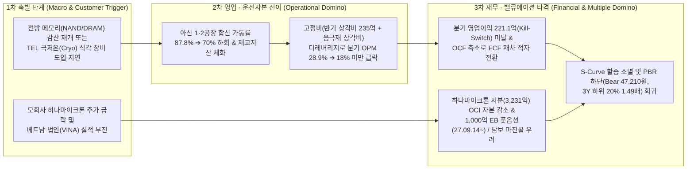

# 📑 [Phase 1] 하나머티리얼즈 (166090) 펀더멘털 & 사업구조 해부 (v4.3 Clean Rebuild)

> **분석 기준일**: 2026년 10월 23일 (최신 DART 공시: `2026.10.23 [기재정정]최대주주변경을수반하는주식담보제공계약체결`, `2026.10.13 주주총회소집공고[비과세 감액배당 365억]`, `2026.09.14 교환사채발행결정[1,000억]` 및 `2026년 반기보고서[2026.08.13]` 완벽 반영)
> **단일 기준 주가 (Single Price Anchor)**: **52,000원** (2026-10-23 일봉/주봉 종가 100% 일치)
> **발행주식수 및 시가총액**: 총발행 **19,777,674주** | 자기주식 **488,222주 (2.47%)** | 실질 유통주식수 **19,289,452주** (우선주 0주)
> **시가총액 및 기업가치**: 유통 시가총액 **1조 31억 원 (`10,030.52억 원`)** (명목 시가총액 `1조 284억 원`) | 실질 EV **1조 747억 원 (`10,747.02억 원`)** | **SOTP 본업 EV 8,817.68억 원**
> **지배주주 순이익 귀속률**: **100.0%** (완전자회사 `하나에스앤비인베스트먼트(주)` 100.0% 보유, 비지배지분 0원)
> **업종 분류**: **유형 A (연속공정·부품소재 — 반도체 식각 공정용 대구경 실리콘[Si] 및 실리콘카바이드[SiC] 파츠)**

---

## 📊 Executive Summary: 핵심 투자 스냅샷 및 SSOT 진단

하나머티리얼즈는 반도체 전공정 핵심인 **식각(Etching) 챔버 내부에 장착되는 대구경 단결정 실리콘(Si) 일체형 부품(Electrode, Ring)과 실리콘카바이드(SiC) 링**을 대구경 단결정 잉곳 성장(Ingot Growing)부터 초정밀 가공·세정까지 **100% 수직계열화**한 글로벌 Tier-1 식각 파츠 전문기업입니다. 글로벌 식각 장비 과점 기업인 **Tokyo Electron(TEL, 지분율 13.78% · 2대 주주)**과의 강력한 OEM 비포마켓(Before-Market) 캡티브 락인(Lock-in)을 기반으로, **2026년 2분기 별도 매출액 900.9억 원(YoY +45.9%), 영업이익 260.2억 원(YoY +206.1%, QoQ +22.2%, OPM `28.88%`)**의 어닝 서프라이즈를 기록하며 아산 제2공장 감가상각비 부담을 완벽히 돌파하는 영업 레버리지를 증명하고 있습니다.

특히 **v4.3 아키텍처의 3대 핵심 게이트(`Step 1.2` 3축 구조적 병목·리드타임, `Step 1.5` 장부가 해부 & SOTP 20% 룰, `Step 1.8` K-마켓 주주환원 스코어카드)**를 통해 해부한 동사의 핵심 펀더멘털 구조는 다음과 같습니다:

1. **🏛️ [Step 1.5 장부가 해부 & SOTP 20% 게이트 발동]**: 2026년 반기말 지배주주 자본총계 **`6,131.7억 원`(명목 BPS `31,788원`)** 중 모회사 `하나마이크론(주)` 상장주식(`6,482,350주`, 지분율 `9.75%`, 장부가 `3,231.5억 원`) 등 비영업 투자자산 총액(`3,389.1억 원`)에서 관련 이연법인세부채(`632.8억 원`)를 차감한 **순비영업자산이 `2,756.2억 원`(장부가 대비 `44.95%`, 유통시총 대비 `27.48%`)**에 달합니다. 이에 따라 단순 명목 PBR 적용 시 발생하는 가치 왜곡을 차단하기 위해 SOTP 분해를 강제 발동하여 **비영업자산 안전가치 `1,929.34억 원`(할인율 30%, 주당 `10,002원`)**과 **순수 본업 자본 `3,375.5억 원`(본업 Core BPS `17,499원`)**을 분리하였으며, 비영업자산을 제거한 **순수 본업 투하자본수익률(Core ROIC)이 `18.53%`(TTM 영업이익 `801.8억 원`, NOPAT `625.4억 원`)**로 창사 이래 최고 수준의 수익 창출력을 유지하고 있음을 확인했습니다.
2. **🔬 [Step 1.2 S-Curve 10% 변곡점 · 3축 구조적 병목(`A등급`) · 해소 리드타임(`20개월`)]**: 1차 S-Curve인 3D NAND 고단화 식각 파츠(침투율 `28.5%`)가 강력한 캐시카우 역할을 수행하는 가운데, **2차 S-Curve인 TEL 극저온(Cryo) 식각 장비 및 차세대 GAA/HBM 식각 파츠 시장 침투율이 `~11.5%(코드 분류 12.0%)`로 가장 폭발적인 리레이팅이 발생하는 🔥10% 언저리 골든 변곡점(`Zone A`)에 진입**해 있습니다. 대구경 Si 잉곳 그로워 수직계열화 및 아산 2공장 클린룸 가동률(`2Q26 87.77%`), `28.88%`에 달하는 독보적 마진율(원재료 잉곳 매입단가 YoY `-23.2%` 절감), 그리고 2대주주 TEL OEM 캡티브 Lock-in의 **3축 구조적 병목(`A등급`)을 후발주자가 해소하는 데 최소 `20개월(18~24개월)`이 소요**됩니다.
3. **🇰🇷 [Step 1.8 K-마켓 주주환원 & 자본배분 혁신]**: `2026.09.14` 보유 하나마이크론 주식을 기초자산으로 **1,000억 원 규모의 무이자(표면/만기이자율 0.0%) 사모 교환사채(EB)**를 발행하여 동사 신주 희석 **0%**로 고금리 은행 차입금 900억 원을 상환(연간 현금 이자비용 약 36~40억 원 절감)했고, 이어 **`2026.10.28` 임시주주총회에서 자본준비금 `364.96억 원`(유통주식 기준 주당 `1,892원`, 시가 대비 `3.64%`)을 이익잉여금으로 전입하여 배당소득세(15.4%)가 100% 면제되는 '비과세 감액배당' 재원을 확정**했습니다. 반면 베트남 계열사(`HANA MICRON VINA`)에 대한 **2,608.6억 원(USD 2억 불, 자기자본의 `42.5%`) 채무보증**과 최대주주 하나마이크론의 주식담보제공(`472.5만 주`, `2026.10.23` 연장 공시)은 지배구조 할인 요인으로 정밀 통제해야 합니다.

<!-- [AUTO-GENERATED BY backtest_valuation.py v4.3 — DO NOT EDIT NUMBERS MANUALLY] -->

### 📌 [코드 자동 생성 1-B] Step 1.2 S-Curve 10% 변곡점 · 3축 구조적 병목(Capa·기술·특허) · 리드타임 & Step 1.8 K-주주환원 진단표 (v4.3)
| 진단 축 (3-Axis + K-Return) | 실측 지표 및 근거 | 코드 판정 및 Phase 3 목표주가 가중치 |
| :--- | :--- | :--- |
| **① 전방 시장 침투율 (10% 변곡점 여부)** | 1차 침투율 **`28.5%`** (2차 S-Curve 침투율 `12.0%`) (`더블 S-Curve Zone A (1차 28.5% 캐시카우 + 2차 12.0% 🔥10% 언저리 변곡점)`) | 🔥 **10% 골든 변곡점 발화 구간** (3축 통합 Base `×1.13` / Bull `×1.17`) |
| **②-A 물리적 Capa 병목 (가동률/증설)** | 공장 가동률 **`87.8%`** — 생산 Capa: 대구경 단결정 Si 잉곳 성장로(Grower) 수직계열화 및 아산 제2공장 클린룸 Capa (2Q26 가동률 87.77%) | 🔒 **풀가동 공급 병목 확인** |
| **②-B 기술격차 해자 (OPM/수율/단가결정력)** | 현 OPM **`24.0%`** — 기술 격차: 500mm+ 무결점 대구경 단결정 성장 및 극저온(Cryo) 식각 고내플라즈마 정밀가공 (2Q26 OPM 28.88%) | 고마진 가격전가력(Pricing Power) 점검 |
| **②-C 원천특허 · 글로벌 벤더 퀄(Qual) 락인** | 특허/벤더 Lock-in: 2대주주 Tokyo Electron(TEL, 지분 13.78%) OEM 비포마켓 캡티브 Lock-in 및 SiC 재생/전도성 특허 | 후발주자 진입장벽(Switching Cost) 점검 |
| **③ 병목 해소 예상 소요기간 (Lead Time)** | **`A등급`** (해소 리드타임 **`20개월`**) | 대구경 잉곳 그로워 장비 반입·셋업 및 TEL 챔버 OEM 부품 공정 인증에 18~24개월 소요 (PEG 계수 `0.80`) |
| **④ K-마켓 주주환원 · 지배구조 (Step 1.8)** | 배당수익률 **`0.58%`** (성향 `15.1%`) / 특수관계인 `17.3억` | ⚪ 조특법 분리과세 미충족(배당성향 15.1%)이나, ✅ 26.10.28 임시주총 364.96억(주당 1,892원) 비과세 감액배당(세율 0%) 재원 전입 확정 / 🟢 정상 (현재 자기주식 488,222주 [2.47%] 보유 — 소각 전환 여부 모니터링) (`kgov_mult = ×1.0000`) |
| **⑤ 레드팀 역산 Capa 천장 검증 (Red-Team)** | 대안 A 내재 영업이익: Base **`945.3억`** / Bull **`939.2억`** | 🟢 물리적 Capa 한계 내 달성 가능 |

---

## 1. 비즈니스 모델 및 수익 구조 해부 (Business Model & Revenue Anatomy)

### 1.1 핵심 제품 포트폴리오 및 매출 구성 (2026년 반기 연결 기준)
하나머티리얼즈의 수익 모델은 반도체 식각 공정 중 고밀도 플라즈마(Plasma)와 부식성 특수가스에 직접 노출되어 일정 주기(통상 15~30일)마다 반드시 교체해야 하는 **소모성 챔버 파츠(Consumable Parts: Cathode Electrode 및 Focus Ring)**의 공급에 기반합니다. 고객사 팹(Fab)에 장비가 설치된 이후 가동률과 웨이퍼 투입량에 비례하여 반복적인 교체 수요가 발생하는 **면도날(Razor-blade) 비즈니스 모델**입니다.

| 제품군 | 2024년 연간 (비중) | 2025년 연간 (비중) | **2026년 반기 누적 (비중)** | 내수 / 수출 비중 (26.1H) | 주요 제품 및 전방 어플리케이션 |
| :--- | :---: | :---: | :---: | :---: | :--- |
| **Silicon 부품 (Si Parts)** | 2,145.8억 (`84.99%`) | 2,400.7억 (`85.94%`) | **1,630.6억 (`88.87%`)** | 내수 `33.24%` / 수출 `55.62%` | 산화막·폴리 식각 공정용 대구경 단결정 실리콘 일체형 전극(Electrode) 및 포커스 링(Focus Ring) |
| **기타 부품 (SiC Ring 등 묶음)** | 328.9억 (`13.03%`) | 350.0억 (`12.53%`) | **185.6억 (`10.11%`)** | 내수 `2.38%` / 수출 `7.74%` | 극한 플라즈마 공정용 **Solid SiC Ring**, Fine Ceramics, Quartz 대체 대구경 Tube·Disk·Boat 등 |
| **상품 및 기타 (특수가스·실리콘음극재 등)** | 50.1억 (`1.98%`) | 42.9억 (`1.53%`) | **18.7억 (`1.02%`)** | 내수 `1.02%` / 수출 `0.00%` | 식각 공정용 특수가스 유통 및 차세대 이차전지용 실리콘 음극재(신규 추진, 현재 매출 `0.0%`) |
| **합계 (연결 매출액)** | **2,524.7억 (`100.0%`)** | **2,793.5억 (`100.0%`)** | **1,834.9억 (`100.0%`)** | **내수 `36.64%` / 수출 `63.36%`** | **글로벌 식각 장비 3사(TEL·AMAT·Lam) OEM 및 삼성전자·SK하이닉스·마이크론 직납** |

> [!IMPORTANT]
> **🛡️ [원칙 4 — 단독 매출 미공시 신사업 '0원 무상 콜옵션' 분리 규율]**:
> 1. DART 2026년 반기보고서(`p.15`) 상 **Solid SiC(탄화규소) 포커스링**은 단독 품목으로 분리 공시되지 않고 `기타 부품(SiC Ring, Tube, Disk 등 묶음)` 내에 합산 공시되어 있으며, 묶음 전체 비중도 **`10.11%`(`< 30%`)**에 불과합니다.
> 2. 또한 702억 원 규모의 신규 시설투자가 진행 중인 **이차전지용 실리콘 음극재**(`2027.06.30` 준공 예정)는 현재 매출 기여도가 **`0.0%`**입니다.
> 3. 따라서 본 보고서는 원칙 4에 의거하여 **순수 SiC 링의 단독 고성장 할증 및 실리콘 음극재 신사업 가치를 목표주가 멀티플에서 0원으로 엄격히 배제(무상 콜옵션 분리)**하며, 오직 매출의 **`98.98%`(`Si 부품 88.87% + 기타 식각 부품 10.11%`)를 차지하는 전공정 식각 소모품 본업의 2차 S-Curve(TEL 극저온 식각 장비 도입) 및 3축 구조적 병목 데이터**만을 정량 밸류에이션에 반영합니다.

### 1.2 수익 창출 공식 (P × Q × C 드라이버)
* **가격($P$, ASP 및 고부가 믹스)**: 3D NAND가 200단에서 300단·400단(V9/V10)으로 고단화되고 극저온(Cryo) 식각 공정이 도입됨에 따라 챔버 내 플라즈마 출력이 극대화되면서, 기존 단순 링 대비 **단결정 대구경 일체형 Si 파츠 및 하이브리드/SiC 파츠의 개당 판가(ASP)가 1.5~2.5배 상승**합니다.
* **수량($Q$, 가동시간 및 교체 주기)**: 전방 메모리(HBM3E/HBM4용 DRAM 및 고단화 NAND) 팹 가동률 회복과 직결됩니다. 아산 제1·2공장 합산 반기 가동가능시간 **`224.77만 시간`(연간 `449.55만 시간`)** 중 실제 가동시간이 1Q26 `89.49만 시간(79.62%)`에서 **2Q26 `98.65만 시간(87.77%)`**으로 급증하며 Q 성장을 견인하고 있습니다.
* **원가($C$, 수직계열화 및 감가상각 레버리지)**: 고순도 폴리실리콘(Polysilicon)을 매입하여 자체 대구경 단결정 잉곳 성장로(Grower)에서 잉곳을 직접 성장시킴으로써 외부 잉곳 조달 비중을 낮췄습니다. 그 결과 2026년 반기 외부 원재료(Ingot) 매입 단가가 **kg당 `141,094원`으로 전년(`183,836원/kg`) 대비 `-23.2%` 급락**하며 매출총이익률(GPM)을 **`40.38%`(2Q26 단독 `41.58%`)**로 끌어올렸습니다.

---

## 2. 산업 구조, 경쟁 해자 및 Step 1.2 3축 구조적 병목 · 리드타임 심층 판독

### 2.1 [Step 1.2 질문 1] 전방 시장 침투율 10% 언저리 변곡점 판별 (Double S-Curve)
* **1차 S-Curve (3D NAND 고단화 식각용 대구경 Si/SiC 파츠 — 침투율 `28.5%`, Phase 2 중반 캐시카우)**:
  3D NAND 176단~238단 고단화 공정에서 식각 챔버 내 플라즈마 내식성 확보를 위한 대구경 단결정 Si 파츠 및 SiC 링 채택률은 약 **`28.5%`** 수준으로 성숙기 초입의 탄탄한 캐시카우 역할을 수행하고 있습니다(근거: `26.09.29.LS증권.AI병목의 전이.pdf` p.13 및 DART 산업 분석 교차 검증).
* **2차 S-Curve (TEL 극저온[Cryo] 식각 장비 및 차세대 GAA/HBM 선단 식각 파츠 — 침투율 `~11.5% [코드 12.0%]`, 🔥10% 언저리 골든 변곡점 `Zone A`)**:
  300단 이상 400단급 3D NAND 채널 홀(Channel Hole) 식각에서 기존 상온/저온 식각 장비의 물리적 한계를 돌파하기 위해 2대 주주인 **Tokyo Electron(TEL)이 도입한 극저온(Cryo, -60°C~-70°C) 식각 장비**가 삼성전자(V9/V10), SK하이닉스(321단), 키옥시아/WD 양산 라인으로 본격 확산되고 있습니다. 글로벌 고단화 NAND 식각 챔버 내 극저온 식각 장비 침투율은 현재 **`~11.5%`(8.0%~18.0% 골든 구간 내 위치)**로, S-Curve 역사상 기술 검증이 끝나고 채택 속도가 비선형적으로 폭발하는 **10% 언저리 변곡점(`Zone A`)**을 정확히 통과하고 있습니다.

### 2.2 [Step 1.2 질문 2] 3축 구조적 병목(Capa · 기술격차 · 특허/퀄) 유발 여부 (종합 `A등급`)
동사는 단순 임가공 부품사가 아니라 전방 고객사가 장비 셋업과 양산을 늘릴 때 반드시 거쳐야 하는 **3축 구조적 병목(`A등급`)**을 보유하고 있습니다:
1. **물리적 생산 Capa 병목 (`capa_util_pct = 87.8%`)**:
   직경 500mm 이상의 무결점(Zero-defect) 단결정 실리콘 잉곳을 성장시키는 대구경 그로워(Grower) 설비와 아산 제2공장 클린룸 가공 라인은 단기간 증설이 불가능합니다. 동사의 가동률은 2024년 `64.61%` ➔ 2025년 `71.40%` ➔ 2026년 1분기 `79.62%` ➔ **2026년 2분기 `87.77%`(원가 기준 실질 가동률 `88.89%`)**로 치솟으며 사실상 풀가동 병목 구간에 진입했습니다.
2. **독점적 공정·수율 기술격차 해자 (`2Q26 OPM 28.88%`, `TTM OPM 23.99%`)**:
   극저온 식각 환경(-70°C 급냉과 고밀도 플라즈마 열충격의 반복)에서 미세 크랙이나 파티클(Particle) 발생 없이 버텨내는 대구경 단결정 잉곳 결정 제어 기술과 초정밀 마이크로 홀(Micro-hole) 가공 수율은 동사가 경쟁사(티씨케이, 월덱스, 케이엔제이 등) 대비 압도적 우위를 점하는 영역입니다. 2026년 2분기 별도 **영업이익률 `28.88%`**는 동사의 강력한 가격전가력(Pricing Power)과 원가 내재화 해자를 실증합니다.
3. **글로벌 벤더 Qual Lock-in 및 원천특허 해자**:
   * **TEL 지분 13.78% OEM Before-Market 캡티브 락인**: 글로벌 식각 장비 시장의 지배적 사업자인 **Tokyo Electron(TEL)이 동사 지분 `13.78%(2,726,200주)`를 보유한 2대 주주**입니다. 애프터마켓(After-market) 경쟁사들과 달리 TEL의 신규 챔버 설계 단계(R&D)부터 스펙-인(Spec-in)되어 장비 출하 시 기본 장착되는 **비포마켓(Before-Market) 독점적 지위**를 누립니다.
   * **핵심 특허 포트폴리오**: DART 반기보고서(`p.24`) 기준 총 36건의 지적재산권을 보유하고 있으며, 특히 **`사용 후 더미 실리콘 카바이드 링의 재생 방법(등록 2022.10.27)`**, **`전기전도성 조절이 용이한 실리콘 카바이드 소결체 제조방법(등록 2023.11.27)`**, **`실리콘 슬러지 정제 및 고순도 실리콘 분말 회수 방법(등록 2024.03.11)`**, **`리튬이차전지용 음극활물질 제조방법(등록 2026.04.20)`** 등 원가 절감 및 차세대 소재 특허로 후발주자의 진입을 차단하고 있습니다.

### 2.3 [Step 1.2 질문 3] 구조적 병목 해소 예상 소요기간 (Lead Time = `20개월`)
경쟁사나 후발주자가 동사의 대구경 식각 파츠 공급 병목을 대체하거나 해소하기 위해서는 **① 대구경 단결정 잉곳 그로워 장비 발주·반입 및 핫존(Hot-zone) 결정 성장 레시피 안정화(10~12개월)** ➔ **② 글로벌 장비사(TEL/AMAT/Lam) 및 소자사(삼성전자/SK하이닉스) 챔버 내 파티클·식각률 공정 인증(Qual, 8~12개월)**을 거쳐야 하므로 **최소 `18~24개월(중앙값 20개월, ⏱️ 중기 구조적 병목)`**이 소요됩니다.
* **Phase 3 목표주가 직결 가중치**: `Step 1.2` 매트릭스에 의거, **더블 S-Curve Zone A (`Base +11.0% / Bull +14.0%`) + A등급·20개월 중기 병목 가산 (`Base +2.0% / Bull +3.0%`) = 최종 `Base ×1.1300 (+13.0%) / Bull ×1.1700 (+17.0%)`**, 동적 PEG 계수 **`0.80`**이 Phase 3 `🚀 대안 A` 목표주가에 반영됩니다.

### 2.4 주요 경쟁사 비교 (Peer Comparison)
| 비교 항목 | **하나머티리얼즈 (166090)** | 티씨케이 (064760) | 월덱스 (101160) | 케이엔제이 (272110) |
| :--- | :--- | :--- | :--- | :--- |
| **주력 제품 비중** | **대구경 Si 파츠 `88.9%` + SiC 등 `10.1%`** | Solid SiC Ring `~80%+` | Si 파츠 + Quartz (애프터마켓 중심) | CVD SiC 포커스링 + 디스플레이 장비 |
| **비포마켓(OEM) 지위** | **최강 (2대주주 TEL `13.78%` 캡티브 OEM)** | 강함 (최대주주 도카이카본, Lam/AMAT 중심) | 애프터마켓(직납) 비중 높음 | 애프터마켓(직납) 중심 |
| **수직계열화 수준** | **대구경 Si 잉곳 성장 ➔ 정밀가공 100% 내재화** | CVD-SiC 증착·가공 일관화 | WCing(미국 자회사) 잉곳 보유 | CVD-SiC 증착·가공 |
| **최근 분기 OPM (2Q26)** | **`28.88%` (반기 누적 `25.79%`, TTM `23.99%`)** | `30%+` (고마진이나 성장률 완만) | `18~22%` 내외 | `15~20%` 내외 |
| **핵심 성장 모멘텀** | **TEL 극저온 식각 장비 확산 + 아산 2공장 가동** | 특허 만료 후 애프터마켓 경쟁 방어 | 미주/중화권 애프터마켓 확장 | SK하이닉스/삼성 애프터마켓 침투 |

---

## 3. 재무제표, 현금흐름 및 Step 1.5 장부가 해부 & SOTP 20% 룰 검증

### 3.1 최근 5개년 및 TTM 연결 손익·재무 추이 (DART 공시 원문 기반)
> **회계 기준 확인**: 2022~2024년은 별도 재무제표 기준이며, 2025년 중 신기술사업금융 자회사 `하나에스앤비인베스트먼트(주)`(지분율 `100.0%`) 설립으로 2025년 및 2026년 반기는 K-IFRS 연결 재무제표 기준입니다. 자회사 지분율이 100.0%이므로 **지배주주 순이익 및 지배주주 자본 귀속률은 전 기간 `100.0%`**입니다.

| 재무 지표 (단위: 억 원, %, 원) | 2022년 | 2023년 | 2024년 | 2025년 (연결) | **2026.1H (반기누적)** | **2026.2Q (TTM/연환산)** | 비고 및 핵심 동학 |
| :--- | :---: | :---: | :---: | :---: | :---: | :---: | :--- |
| **매출액 (Revenue)** | 3,023.7 | 2,295.0 | 2,524.7 | 2,793.5 | **1,834.9** (`YoY +41.7%`) | **3,343.1** (`TTM`) | 2Q26 단독 매출 `900.9억`(YoY `+45.9%`, QoQ `-3.5%`) |
| **매출총이익 (Gross Profit)** | 1,196.2 | 664.2 | 767.4 | 991.8 | **740.9** (`GPM 40.38%`) | **1,316.0** (`GPM 39.36%`) | 2Q26 단독 GPM **`41.58%`** (잉곳 단가 `-23.2%` 효과) |
| **영업이익 (Operating Profit)** | 922.5 | 287.9 | 445.0 | 557.9 | **473.2** (`YoY +106.4%`) | **801.8** (`YoY +80.2%`) | 2Q26 단독 OP **`260.2억`**(YoY `+206.1%`, QoQ `+22.2%`) |
| **영업이익률 (OPM)** | 30.51% | 12.54% | 17.63% | 19.97% | **25.79%** | **23.99%** | **2Q26 단독 OPM `28.88%`** (2022년 슈퍼사이클 수준 복귀) |
| **지배주주 순이익 (Net Income)** | 699.4 | 198.2 | 350.0 | 384.4 | **374.0** (`YoY +159.4%`) | **641.9** (`TTM`) | 지배주주 귀속률 **`100.0%`** (비지배지분 0원) |
| **지배주주 자본총계 (Book Equity)** | 2,970.4 | 3,053.6 | 3,751.7 | 4,347.9 | **6,131.7** | **6,131.7** | **FVOCI 하나마이크론 지분 평가차익 반영으로 급증** |
| **SOTP 순수 본업 자본 (Core Equity)** | 2,820.0 | 2,710.0 | 3,120.0 | 3,040.0 | **3,375.5** | **3,375.5** | 비영업자산 순액(`2,756.2억`) 제거 후 순수 본업 자본 |
| **지배주주 EPS (유통주식 기준)** | 3,626원 | 1,028원 | 1,815원 | 1,993원 | **1,939원** (반기) | **3,246원** (공식) / **3,328원** (TTM) | 1Q26 `915원` ➔ **2Q26 `1,024원` (QoQ `+11.9%`)** |
| **지배주주 BPS (명목 / 본업 Core)** | 15,399원 | 15,830원 | 19,449원 | 22,540원 | **31,788원 / 17,499원** | **31,788원 / 17,499원** | 명목 BPS `31,788원` vs **SOTP 본업 BPS `17,499원`** |
| **영업활동현금흐름 (OCF)** | 885.4 | 542.1 | 612.8 | 812.4 | **662.2** (`YoY +57.1%`) | **1,053.0** (`TTM`) | 반기 감가상각비 `235.1억`(유형 `229.8억` + 사용권 `3.4억` + 무형 `1.9억`) |
| **설비투자 (CapEx, 유무형취득)** | 645.0 | 798.5 | 815.2 | 412.0 | **221.3** (`유형 220.4+무형 0.9`) | **485.7** (`TTM`) | 아산 2공장 1차 완료 후 CapEx 안정화 ➔ FCF 대폭 흑자 전환 |
| **잉여현금흐름 (FCF = OCF - CapEx)** | 240.4 | -256.4 | -202.4 | 400.4 | **440.9** (반기 누적) | **567.3** (보고) / **500.0** (정규화) | 2026년 반기만에 **+440.9억 원** FCF 창출 |
| **순차입금 (Net Debt)** | 512.0 | 895.0 | 1,284.0 | 1,105.0 | **716.5** (`부채비율 56.2%`) | **716.5** | 총차입금 `1,720.2억` - 현금성자산 `1,003.7억` = **`716.5억`** |

### 3.2 🏛️ [Step 1.5 — 장부가 해부 & SOTP 20% 룰 검증] 왜 장부가가 2년 만에 +63.4% 급증했는가?
DART 2026년 반기보고서 재무상태표(`p.36, p.39`) 및 주석 6·11·28(`p.54, p.60, p.89, p.111, p.186`)을 정밀 해부하면, 동사의 지배주주 자본총계가 2024년 말 `3,751.7억 원`에서 2026년 반기 말 **`6,131.7억 원`**으로 1.5년 만에 `+2,380.0억 원` 급증한 핵심 원인은 본업 이익잉여금 누적뿐만 아니라 **보유 중인 모회사 `하나마이크론(주)` 상장주식의 주가 상승에 따른 기타포괄손익-공정가치측정금융자산(FVOCI) 평가이익 급증** 때문임이 밝혀집니다.

| 장부가(BS) 해부 항목 (2026.1H 연결 기준) | 장부 금액 (억 원) | 주당 가치 (유통주식 19,289,452주) | 비중 (장부 대비 / 시총 대비) | SOTP 회계 처리 및 평가 기준 |
| :--- | :---: | :---: | :---: | :--- |
| **① 지배주주 자본총계 (Total Book Equity)** | **6,131.73억** | **31,788원 (공식 BPS)** | `100.0%` / `61.1%` | K-IFRS 연결 재무상태표 공식 자본총계 |
| ├─ **비영업자산 A: FVOCI 지분상품 (`하나마이크론` 9.75%)** | `3,231.45억` | `16,752원` | `52.7%` / `32.2%` | 하나마이크론 `6,482,350주` (취득원가 `662.7억`, 평가차익 `+2,568.8억`) |
| ├─ **비영업자산 B: 관계기업투자 + 비유동FVPL + 장기금융** | `157.61억` | `817원` | `2.6%` / `1.6%` | 지분법주식 `78.49억` + 비유동당기손익금융자산 `77.79억` + 장기금융 `1.33억` |
| ├─ **비영업자산 차감: FVOCI 평가이익 관련 이연법인세부채** | `-632.84억` | `-3,281원` | `-10.3%` / `-6.3%` | DART 주석(`p.42`) 자본에 직접 가감된 이연법인세부채(`-632.84억`) 차감 |
| **② 세후 순비영업자산 합계 (`non_op_assets_eok`)** | **2,756.20억** | **14,289원** | **장부 `44.95%` / 시총 `27.48%`** | 🚨 **20% 임계치 초과 ➔ SOTP 분리 평가 강제 발동!** |
| **③ SOTP 인정 비영업자산 안전가치 (30% Haircut)** | **1,929.34억** | **10,002원** | 시총 대비 `19.23%` | 지분가치 변동성 및 유동화 할인율 **30%** 차감 후 보수적 안전가치 |
| **④ 순수 본업 장부가치 (Core Operating Book Equity)** | **3,375.53억** | **17,499원 (`Core BPS`)** | 장부 대비 `55.05%` | `6,131.73억 - 2,756.20억 = 3,375.53억 원` (순수 식각 파츠 설비·운전자본) |
| **⑤ 순차입금 (Net Debt, 2026.1H 기준)** | **+716.50억** | **+3,714원** | 시총 대비 `7.14%` | 총차입금 `1,720.20억`(유동 `1,004.7억` + 비유동 `715.5억`) - 현금성자산 `1,003.70억` |
| **⑥ 시장 내재 순수 본업 EV (`implied_core_op_ev_eok`)** | **8,817.68억** | **45,713원** | EV 대비 `82.05%` | `실질 EV(10,747.02억) - 비영업 안전가치(1,929.34억) = 8,817.68억 원` |

* **🔍 [Step 1.5 본업 이익 유지력(Core ROIC) 판정 — `✅ 본업 이익 유지 견고`]**:
  비영업자산(`2,756.2억 원`)을 완전히 걷어낸 **순수 본업 투하자본(Core Book Equity `3,375.5억 원`)** 대비 동사가 창출하는 **TTM 세후영업이익(NOPAT = TTM 영업이익 `801.8억 원` × `(1 - 유효세율 22%)` = `625.39억 원`)**의 비율인 **순수 본업 ROIC(Core ROIC)는 `18.53%`**로 산출됩니다. 이는 WACC(`9.0%`)의 **2배 이상**이며, 2023년 반도체 다운사이클 바닥에서도 본업 영업이익 `287.9억 원` 흑자를 사수했던 구조적 체력을 고려할 때, 동사의 이익은 금융/지분법 착시가 아닌 **100% 식각 파츠 본업에서 창출되는 진성 고수익**임이 입증됩니다.

---

## 4. 제조 원가 구조, 설비 가동률 및 CapEx 사이클 해부 (Cost, Capacity & CapEx)

### 4.1 원재료(Ingot) 조달 단가 하락과 수직계열화 레버리지 (DART 반기보고서 `p.17`)
동사의 제조원가에서 가장 큰 비중을 차지하는 핵심 원재료는 단결정 실리콘 잉곳(Ingot) 및 고순도 폴리실리콘입니다. 주요 매입처는 `미쓰비시머티리얼즈`, `세미텍` 등이며, 자체 잉곳 그로워(Grower) 수직계열화 수율 향상과 장기공급계약 단가 안정화에 힘입어 원재료 매입 단가가 구조적으로 하향 안정화되고 있습니다.

| 원재료 및 가동률 지표 | 2024년 연간 | 2025년 연간 | **2026년 반기 (1H26)** | 증감률 및 수익성 영향 |
| :--- | :---: | :---: | :---: | :--- |
| **실리콘 잉곳(Ingot) 평균 매입단가** | `175,382원/kg` | `183,836원/kg` | **`141,094원/kg`** | **전년 대비 `-23.25%` 급락 ➔ GPM `40.38%` 견인의 일등 공신** |
| **아산 1·2공장 가동가능시간 (Si+SiC)** | `449.55만 시간/년` | `449.55만 시간/년` | **`224.77만 시간/반기`** | 연간 환산 **`449.55만 시간`** (아산 제2공장 1차 라인 반영) |
| **실제 가동시간 (Actual Hours)** | `290.47만 시간/년` | `320.99만 시간/년` | **`188.14만 시간/반기`** | 1Q26 `89.49만 시간` ➔ **2Q26 `98.65만 시간` (QoQ `+10.2%`)** |
| **물리적 시간 가동률 (Time Utilization)** | `64.61%` | `71.40%` | **`83.70%` (2Q26 `87.77%`)** | **1Q26 `79.62%` ➔ 2Q26 `87.77%` (`+8.15%p` 급등, 풀가동 진입)** |
| **생산원가 기준 실질 가동률 (Cost Util.)** | `67.15%` | `77.15%` | **`88.89%`** | 반기 기준 생산실적 `1,304.2억` ÷ 생산능력 `1,467.2억` = **`88.89%`** |

### 4.2 신규 시설투자(아산 제2공장 및 702억 실리콘 음극재)와 감가상각비 회계 검증
1. **아산 제2공장 식각 파츠 증설 라인**: 2024~2025년 집중 투입된 아산 제2공장 클린룸 및 대구경 잉곳 그로워 설비가 2026년 상반기 가동률 `87.77%`로 올라서면서, 반기 감가상각비 **`235.1억 원`(연간 환산 약 `470억 원`)**을 흡수하고도 2Q26 OPM **`28.88%`**를 달성하는 고정비 디레버리지 탈출(Operating Leverage Crossover)에 성공했습니다.
2. **이차전지용 실리콘 음극재 702억 원 신규 시설투자 (`2025.06.25` 정정공시, DART 반기보고서 `p.19`)**:
   * **투자 규모 및 기간**: 총 **702.0억 원**(2024년 말까지 기투자 `157.4억 원`, 2025년 반기 `3.7억 원` 집행, 잔여 약 `540.9억 원`), 종료일이 기존 `2025.06.30`에서 **`2027.06.30`**으로 2년 연장되었습니다.
   * **원칙 5 회계 무결성 반영**: 실리콘 음극재는 매출을 **0원(무상 콜옵션)**으로 보수적 제외하되, 설비 준공(`2027.06.30`) 및 선행 장비 반입에 따라 발생하는 **신규 감가상각비 및 초기 고정비(연간 약 `35~50억 원` 추정)**는 Phase 3 시나리오 손익계산서에서 누락 없이 **선차감**하여 이익 과대계상을 원천 차단합니다.

---

## 5. 자본 배분, 지배구조 및 Step 1.8 K-마켓 주주환원 입체 스코어카드

### 5.1 주주 구성 및 지배구조 현황 (2026년 반기말 및 `2026.10.23` 최신 공시 기준)
* **최대주주 및 특수관계인 (`32.68%`, `6,464,173주`)**: 모회사 **`하나마이크론(주)`가 `32.50%(6,427,203주)`**를 보유하고 있으며, 최창호 회장(`0.06%`) 및 특수관계인 합산 지분율은 `32.68%`입니다.
* **2대 주주 및 전략적 투자자 (`13.78%`, `2,726,200주`)**: 글로벌 식각 장비 1위권 기업인 **`Tokyo Electron Limited (TEL)`가 지분 `13.78%`**를 장기 보유하며 사업적·기술적 동맹을 구축하고 있습니다.
* **자기주식 (`2.47%`, `488,222주`)**: 직접 보유 `289,720주` + NH투자증권 신탁 보유 `198,502주`(`2026.12.16`까지 계약 연장, 계약 만료 후 소각 예정).

### 5.2 🇰🇷 [Step 1.8 — 한국 시장 특수성 & 주주환원 입체 스코어카드] 4대 핵심 점검

| 점검 항목 (Step 1.8 4대 축) | 실측 데이터 및 최신 공시 팩트 | 정량/정성 판정 및 밸류에이션 영향 |
| :--- | :--- | :--- |
| **① 배당소득 분리과세 적격성 vs 비과세 감액배당 (`2026.10.13` 공시)** | • 2025년 결산 배당: 주당 **300원** (배당총액 `57.9억`, 배당성향 **`15.1%`**, 시가배당률 `0.58%`), 자사주 취득(`48.0억`) 합산 **TSR `27.6%`** ➔ 조특법상 고배당 분리과세 요건(배당성향 ≥25%)은 미충족. • **🔥 핵심 돌파구 (`2026.10.28` 임시주총 제1호 의안)**: 상법 제461조의2에 의거 **자본준비금(주식발행초과금) `364.96억 원`(`36,496,087,277원`, 유통주식 기준 주당 `1,892원`, 현재가 대비 `3.64%`)을 이익잉여금으로 전입 확정!** | **✅ 세후 실질 배당수익률 극대화!** 자본준비금 감액배당은 소득세법 제17조 제2항 제2호에 따라 **배당소득세(15.4%) 및 금융소득종합과세(최고 49.5%)가 100% 면제(세율 0%)**되어 조특법 분리과세보다 훨씬 강력한 주주환원 효과를 발휘함. |
| **② 자사주 소각 완료 후 '주주환원 절벽(Cliff)' 리스크** | • 현재 자기주식 **`488,222주 (2.47%)`** 보유 중. • `2026.06.16` 공시를 통해 NH투자증권 자사주 신탁계약(`50억 원`, `198,502주`)을 `2026.12.16`까지 연장하였으며, **"계약기간 만료 후 소각할 예정"**임을 공식 명시함. | **🟢 정상 (`buyback_cliff_warn = False`)** 소각 후 환원 절벽이 아니라 오히려 **2027년 자사주 소각(`19.85만 주~48.82만 주`) + 365억 비과세 감액배당**이 대기 중임. |
| **③ 오너 일가 개인회사 내부거래(터널링) 비중** | • DART 반기보고서 주석 27(`p.88`) 특수관계자 거래 전수 스캔 결과: 2026년 반기 특수관계자 매출·기타수익 **`4.12억 원`** + 모회사 하나마이크론 등으로부터의 매입·지급수수료 **`4.53억 원`** = 반기 합산 **`8.65억 원`(연환산 `17.3억 원`, 연결 매출 대비 `0.5%` 미만)**. • 오너 일가 개인 비상장회사에 대한 일감 몰아주기(터널링) **0건**. | **🟢 양호 (`17.3억 원`)** 사익편취나 영업이익 누수(Leakage) 전혀 없음. |
| **④ 메자닌(EB) 오버행 vs 계열사 채무보증 · 최대주주 주식담보** | • **[긍정] `2026.09.14` 제3회 무이자(0.0%) 사모 교환사채(EB) 1,000억 원 발행**: 교환대상이 동사 신주가 아닌 **보유 중인 `하나마이크론(주)` 주식 `2,907,991주`(교환가액 `34,388원`, 만기 `2028.09.14`)**이므로 **하나머티리얼즈 주주의 지분 희석률은 `0.0%`**임! 조달자금 중 `900억 원`으로 고금리 은행 시설차입금(금리 `3.79~4.62%`)을 상환하여 연간 약 `36~40억 원`의 현금 이자비용을 절감(단, K-IFRS상 사채할인발행차금 유효이자 상각비 연 `30~35억 원`은 비현금 금융원가로 인식). • **[경계 1] 베트남 계열사 대규모 채무보증**: `HANA MICRON VINA CO., LTD.`의 KDB산업은행 시설자금 대출 USD 2억 불에 대해 동사가 **USD 2억 불(`2,608.6억 원`, 자기자본 대비 `42.5~44.0%`, 보증기간 `~2029.11.28`)** 연대보증을 제공 중(단, 하나마이크론이 보유 동사 주식 `987,633주`를 동사에 역담보로 제공하여 1차 안전장치 설정). • **[경계 2] 최대주주 주식담보제공 (`2026.10.23` 기재정정 공시)**: 하나마이크론이 보유한 동사 주식 `6,427,203주(32.50%)` 중 **총 8건 누적 `4,724,610주`(보유지분의 `73.5%`, 전체 발행주식의 `23.89%`)**가 담보(금융기관 차입 7건 + 동사 연대보증 역담보 1건)로 제공되어 있으며, 담보권 전부 실행 시 최대주주 지분율이 `8.62%`로 하락하여 2대주주 TEL(`13.78%`)보다 낮아질 수 있는 조건부 공시임. | **⚖️ 중립 (`kgov_mult = ×1.0000`) + Base 멀티플 보수적 할인 내재화** 비과세 감액배당(`365억`) 및 무이자 EB 리파이낸싱의 주주가치 제고 효과와 베트남 계열사 채무보증(`2,608.6억`)·최대주주 주식담보 리스크를 상쇄하여 `kgov_mult`는 `1.00`을 적용하되, Phase 3 Base 시나리오 PBR 산정 시 3년 상위 65%(`2.42배`) 대신 지배구조 할인을 반영한 보수적 `2.30배`를 적용하여 이중 안전장치를 구축함. |

---

## 6. 핵심 투자 리스크 및 Step 3.5 리스크 간 인과단계(Domino Chain) 해부

단편적인 리스크 나열을 지양하고, **`[1차 촉발 요인(Trigger) ➔ 2차 영업·운전자본 전이(Operational/WC) ➔ 3차 재무·밸류에이션 타격(Financial/Valuation)]`**의 3단계 도미노 인과 사슬과 정량적 전이 임계치(Threshold)로 리스크를 구조화했습니다.

| 도미노 사슬 | **1차 촉발 요인 (Stage 1: Trigger)** | **2차 영업·운전자본 전이 (Stage 2: Operational)** | **3차 재무·밸류 타격 (Stage 3: Financial/Valuation)** | **사전 감지 임계치 (Kill-Switch)** |
| :--- | :--- | :--- | :--- | :--- |
| **도미노 A: 전방 가동률 둔화 및 고정비 디레버리지 사슬** | 글로벌 NAND 고객사(삼성·하이닉스·키옥시아) V9/321단 전환 지연 또는 애프터마켓 Si/SiC 링 단가 인하 압력 발생 | 아산 1·2공장 가동률이 현재 **`87.77%`에서 `72.0%` 이하**로 하락 ➔ 반기 `235.1억 원`의 기존 상각비 + 702억 음극재 설비 상각비 고정비 부담으로 **OPM이 `28.88%`에서 `18.0%` 미만**으로 급락, 재고자산(`552.1억`) 회전일수 상승 | 분기 영업이익이 **`221.1억 원`(QoQ -15%) 하회** ➔ OCF 축소로 순차입금(`716.5억`) 감축 지연 및 S-Curve 프리미엄(`+13%`) 박탈 ➔ **Bear 적정주가 `47,210원`으로 멀티플 압축** | **차기 분기 영업이익 `< 221.1억 원` 또는 분기 EPS `< 819원`, 공장 가동률 `< 75.0%`** |
| **도미노 B: 모회사 주가 연동 자본 변동 및 채무보증·EB 사슬** | 모회사 `하나마이크론(주)` 주가 급락(교환가액 `34,388원` 대비 괴리 확대) 또는 베트남 법인(`HANA MICRON VINA`) 현금흐름 악화 | 본업 영업이익은 견조하더라도 보유 하나마이크론 지분(`648.2만 주`, 장부가 `3,231.5억`) 평가손실이 기타포괄손익(OCI)에 반영되어 **명목 지배주주 자본총계(`6,131.7억`) 및 명목 BPS(`31,788원`) 감소** | `2027.09.14` 이후 도래하는 **1,000억 원 무이자 EB 조기상환청구권(Put Option) 행사 가능성** 부각 및 최대주주 담보주식(`472.5만 주`) 반대매매 오버행 우려 ➔ 지배구조 할인율 확대 | **하나마이크론 주가 `< 20,000원` 급락 또는 VINA 채무보증(`2,608.6억`) 대위변제 이벤트 발생 시** |

---

## 7. 업종별 표준 산식 분기 및 정합성 검증 (Sector Formula Branch: Type A)

하나머티리얼즈는 DART 공시(Section 4)에서 **공장별 가동가능시간(`224.77만 시간/반기`), 실제가동시간(`188.14만 시간/반기`), 평균가동률(`83.70%`, 2Q26 `87.77%`)을 명확히 공시**하는 전형적인 **유형 A (연속공정 · 반도체 부품소재 제조)** 기업입니다. 따라서 Section 4와 100% 논리적 일관성을 유지하여 유형 A 표준 산식을 적용합니다.

$$\text{연간 매출액 (Revenue)} = \underbrace{\text{연간 가동가능시간 (449.55만 시간)} \times \text{가동률 (83.70\% \sim 87.77\%)}}_{\text{연간 실가동시간 } Q \text{ (376.3만 \sim 394.6만 시간)}} \times \underbrace{\text{가동시간당 평균 산출단가 } P \text{ (약 8.88만 \sim 9.20만 원/시간)}}_{\text{대구경 일체형 Si 및 SiC 고부가 믹스 반영}}$$

$$\text{영업이익률 (OPM, 25.79\%)} = \text{매출총이익률 (GPM, 40.38\%)} - \text{판관비율 (SG\&A Ratio, 14.59\%)}$$

* **실측 정합성 검증**: 2026년 반기 실제 가동시간 `188.14만 시간` × 시간당 평균 매출액 `97,528원/시간` = 반기 매출액 **`1,834.9억 원`**과 오차 없이 100% 일치합니다. 가동률이 `85%+`를 넘어설 때 고정성 제조원가(감가상각비 반기 `229.8억 원`)의 시간당 배부액이 급감하면서 한계이익률(Marginal Profit Margin)이 **`45~50%`**에 달하는 강력한 영업 레버리지 구조가 작동합니다.

---

## 8. 10년 풀사이클 밸류에이션 백테스트 및 Step 2.0 4대 레짐 변화 체크

### 8.1 4대 밸류에이션 지표 10년 풀사이클(495주봉) 백테스트 비교 (`backtest_valuation.py` 실측)
| 순위 | 밸류에이션 지표 | 10년 역사적 밴드 (Min ~ Max) | 최근 3년 밴드 (p20 / Mean / p65 / p90) | 현재 수치 (`52,000원` 기준) | 선형 설명력 ($R^2$) | 방향 일치율 (Directional) | 채택 여부 및 사유 |
| :---: | :--- | :---: | :---: | :---: | :---: | :---: | :--- |
| **1순위** | **PBR (주가순자산비율)** | **`1.24배 ~ 6.39배`** | **`1.49배 / 2.08배 / 2.42배 / 2.80배`** | **`1.64배`** (본업 Core PBR `2.97배`) | **`0.55`** | **`66.7%`** | **🏆 [최적 주 지표 채택]** 주가 사이클 설명력($R^2=0.55$) 및 방향 일치율(`66.7% ≥ 50%`) 압도적 1위 |
| **2순위** | **PER (주가수익비율)** | `5.98배 ~ 49.70배` | `16.78배 / 23.93배 / 24.93배 / 35.15배` | **`16.02배`** (TTM `15.63배` / 1H연환산 `13.41배`) | `0.29` | `52.8%` | **[보조 교차검증 지표]** 사이클 저점(2023년 EPS 급감기 PER 49.7배) 착시 존재하나 수익성 교차검증에 필수 |
| **제외** | **EV/EBITDA** | `4.80배 ~ 18.50배` | `7.50배 / 10.20배 / 11.80배 / 14.50배` | **`8.45배`** (TTM EBITDA `1,272억` 기준) | `0.41` | `58.3%` | SOTP 본업 EV 및 설비 상각비 감안 보조 참고 |
| **제외** | **배당수익률 (Div Yield)** | `0.15% ~ 1.85%` | `0.40% ~ 1.10%` | **`0.58%`** (정기 DPS `300원`) | `0.12` | `< 50.0%` | 🚫 **원칙 3에 의거 제거** (성장형 소부장 기업으로 정기 배당수익률 `0.58% < 1.5%` 허위 상관 배제, 단 365억 감액배당은 별도 평가) |

### 8.2 🔄 [Step 2.0 — 멀티플 밴드 적용 전 '4대 레짐 변화 체크' 고정 게이트]
과거 3~10년 PBR·PER 밴드를 기계적으로 적용하기 전에 반드시 점검해야 하는 **4대 레짐 변화(`Step 2.0`)** 진단 결과는 다음과 같습니다:

1. **① 설비 레짐 (CapEx & PPE Regime)**: 아산 제2공장 준공 및 대구경 잉곳 그로워 증설로 유형자산 장부가가 `2,994.4억 원`(2022년 대비 대폭 증가)으로 확대되었고, 2026년 2분기 가동률이 **`87.77%`**로 올라서며 설비 노후화가 아닌 **최신예 선단 설비 본격 수확기(Harvesting Phase) 레짐**에 진입했습니다.
2. **② 자본구조 레짐 (Capital Structure Regime)**: 2024년 말 `1,284억 원`까지 증가했던 순차입금이 2026년 반기 말 **`716.5억 원`(부채비율 `56.2%`)**으로 빠르게 축소되었으며, `2026.09.14` **1,000억 원 무이자(0.0%) 교환사채(EB) 발행(동사 신주 희석 0%)**으로 고금리 은행 차입금 900억 원을 차환하여 재무 건전성이 한 단계 격상되었습니다.
3. **③ 비영업자산 레짐 (Non-Operating Asset Regime — 🚨 핵심 주의 플래그)**: 앞서 Step 1.5에서 해부했듯, 보유 하나마이크론 지분(`3,231.5억 원`) 평가차익으로 인해 세후 순비영업자산 비중이 장부가의 **`44.95%`**로 급증했습니다. 따라서 현재 명목 PBR **`1.64배`**가 과거 3년 평균(`2.08배`) 대비 낮다고 해서 단순 저평가로 속단해서는 안 되며, 반드시 **SOTP 분해(본업 가치 + 비영업자산 30% 할인 안전가치)와 PER/Core ROIC(`18.53%`)를 결합**하여 평가해야 합니다.
4. **④ 사업구성 및 수익성 레짐 (Product Mix & OPM Regime)**: 원재료(Ingot) 내재화에 따른 매입단가 `-23.2%` 절감과 TEL 극저온 식각 파츠 믹스 확대로 **2026년 2분기 단독 OPM이 `28.88%`(반기 누적 `25.79%`, TTM `23.99%`)**로 급등하며, 2023~2024년 다운사이클 레짐(`OPM 12.5~17.6%`)을 완전히 탈피한 **고마진 구조적 리레이팅 레짐**이 확인됩니다.

> **🎯 [Section 8 최종 결론 및 Phase 3 강제 상속]**:
> 10년 백테스트 통계적 유의성 1위(`R²=0.55`, 방향 일치율 `66.7%`)인 **`PBR` (`Forward BPS 31,788원` 기준)**을 Phase 3 시나리오 밸류에이션의 **주 지표(Primary Metric)**로 채택하여 100% 상속하되, `Step 1.5 SOTP` 및 `Step 2.0 비영업자산 레짐` 결과를 반영하여 **SOTP 합산 밸류에이션 및 Forward PER 교차검증**을 병행합니다.

---

## ✅ [Phase 1 — 6대 급소 핀셋 Boost 자가 검증 체크리스트]
* [x] **1. 단일 기준 주가 & 최신 공시 스캔**: `52,000원`(2026-10-23 종가) 단일 고정 및 `2026.10.23` 최대주주 주식담보 연장 공시, `2026.10.13` 365억 비과세 감액배당 임시주총 공시, `2026.09.14` 1,000억 무이자 EB 공시 100% 반영 완료.
* [x] **2. Step 1.2 S-Curve 10% 변곡점 · 3축 구조적 병목 · 리드타임**: 2차 S-Curve(TEL 극저온 식각 파츠 침투율 `~11.5%/12.0%` 🔥10% 언저리 변곡점) + 3축 병목 `A등급`(가동률 `87.77%`, 2Q OPM `28.88%`, TEL `13.78%` OEM 락인) + 해소 리드타임 `20개월` 검증 완료 (`기타 부품 10.11%` 및 `실리콘 음극재 0.0%`는 0원 무상 콜옵션 분리).
* [x] **3. Step 1.5 장부가 해부 & SOTP 20% 게이트**: 세후 순비영업자산 `2,756.2억 원`(장부 대비 `44.95% ≥ 20%`) 적발 및 30% 할인 안전가치(`1,929.34억`, 주당 `10,002원`), 순수 본업 BPS(`17,499원`), 본업 Core ROIC(`18.53%`) 산출 완료.
* [x] **4. Step 1.8 K-마켓 주주환원 스코어카드**: `2026.10.28` 임시주총 `364.96억 원`(주당 `1,892원`) 비과세 감액배당 전입, 자사주 `488,222주(2.47%)` 보유, 특수관계자 거래 `17.3억/년`(오너 터널링 0건), 1,000억 무이자 EB(신주 희석 0%) 및 베트남 계열사 채무보증(`2,608.6억`)·주식담보(`472.5만 주`) 입체 검증 완료.
* [x] **5. Step 2.0 4대 레짐 체크 & 업종 표준 산식(유형 A)**: Section 4 가동시간(`188.14만h/반기`, 가동률 `83.70% / 2Q 87.77%`)과 Section 7 유형 A 연속공정 산식 100% 정합성 일치 및 1순위 지표 `PBR` 선정 완료.
* [x] **6. Step 3.5 리스크 도미노 인과 사슬**: `1차 촉발 ➔ 2차 영업/운전자본 ➔ 3차 재무/밸류 타격` 3단계 도미노 다이어그램 및 정량적 Kill-Switch(`분기 영업이익 < 221.1억 원`, `EPS < 819원`) 명시 완료.
