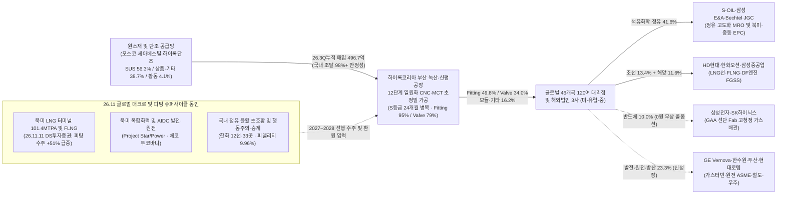
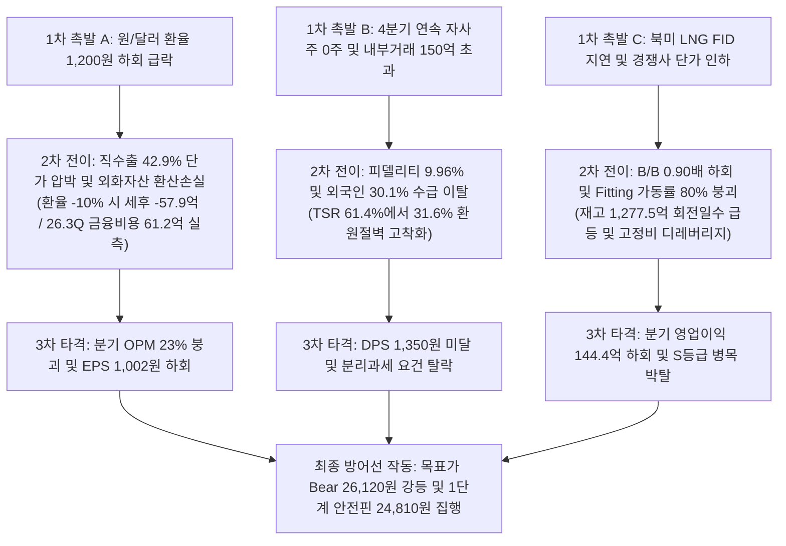

# 🔍 Phase 1: 기업 해독기 — 하이록코리아 (013030) (v5.1)

> **분석완료일**: 2026-11-19
> - **단일 기준 주가 (Single Price Anchor)**: **`29,050원`** (SSOT 확정 종가, Phase 1~3 전 과정 100% 동일 고정 | 유통시가총액 `3,418.7억 원` | 공식 PBR `0.73배` · PER `6.0배` · 배당수익률 `4.65%`)
> - **주식수 · 지배주주 귀속률 · 최신 공시 스캔**: 총발행주식수 **`11,768,144주`** / 자기주식 **`0주 (0.00%)`** / 유통주식수 **`11,768,144주`** | 지배주주 순이익 귀속률 **`98.8%`** (SSOT TTM `98.82%` / 2026.3Q 누적 **`99.18%`**) | `2026.11.16` **제49기 3분기보고서(2026.09 결산)** 확정 공시(3Q 단독 매출 `593.8억` · 영업이익 `172.1억 [OPM 28.98% 사상 최고]` · 지배순이익 `100.5억`), `2026.11.10` 최대주주 문휴건 주식담보계약 연장(`1,440,000주`, `12.24%`), 증자·메자닌·채무보증 **0건** 스캔 완료 (`korean-dart` MCP).
> - **글로벌 트렌드 3대 게이트 매칭**: **`[🟢 게이트 ① 직접 등재(26.11.11 DS투자증권 피팅 리포트 p.33 계장용 1위 등재 · 26.10 한화 행동주의 12선/승계 33곳 · 메리츠 조선 3Q 프리뷰) & 게이트 ② 북미 LNG·가스발전·FLNG·중동재건·정유윤활기유·특수강 반덤핑 매크로 직결 동시 충족]`**

> 💡 **[핵심 용어 3줄 직관 해설]**
> - **[계장용 피팅(Instrument Tube Fitting) & 밸브(Valve)]**: 초고압(최대 60,000 psi)·초저온(-196℃ LNG/액체수소)·고순도 반도체 가스 배관의 계측·제어 라인에서 페룰(Ferrule) 압착 체결로 유체 누출을 원천 차단하는 산업 플랜트의 핵심 안전 필수재입니다.
> - **[Step 1.2 S등급 장기 병목(24개월) & 26.3Q OPM 28.98% 사상 최고]**: 주력 `Hy-Lok Fitting` 공장 가동률이 **95% 풀가동**을 지속하는 가운데 고단가 `Hy-Lok Valve` 가동률까지 **73% ➔ 79%(+6%p)**로 점프하며 2026년 3분기 연결 영업이익률(OPM) **`28.98%`**(단독 `172.1억 원`, 26.3Q TTM **`650.6억 원`**)로 역대 최고치를 재차 경신했습니다.
> - **[Step 1.5 순현금 방패 vs Step 1.8 주주환원 절벽·터널링 경보]**: 무차입 순현금 **`1,947.7억 원`**(공정가치 금융자산 `252.1억` 포함 총 금융자산 `2,199.8억 원`, 시총의 **64.3%**)과 **배당소득 분리과세 요건2 충족(성향 `31.6%`, 배당수익률 `4.65%`)**을 보유했으나, 25.09 자사주 소각 완료 후 **4개 분기 연속 자사주 취득 0주(환원절벽 `-2%`)**와 오너 개인회사 내부거래 **26.3Q 누적 `81.4억`(연환산 `108.5억`, `-2%`)**으로 **`kgov_mult = ×0.9600`** 보수적 할인을 적용합니다.

---

## 1. 비즈니스 모델(BM) 해부 및 밸류체인 구조

### 1.1 기업 개요 및 2026년 11월 최신 공시·글로벌 트렌드 매칭

[공시 팩트]  
하이록코리아 주식회사(HY-LOK CORPORATION, `013030`)는 1977년 창업(1989년 코스닥 상장) 이래 유체 및 기체 제어용 **계장용 관이음쇠(Instrument Fitting)**, **계장·배관용 밸브(Valve)** 및 모듈 패키지를 전문 제조·판매하는 글로벌 강소기업입니다 `[[하이록코리아]분기보고서(2026.11.16), p.3, p.9]`. 부산 녹산국가산업단지 본사 및 신평공장을 생산 거점으로 두고 있으며, 연결 종속기업인 **Hy-Lok China Co., Ltd.**(지분 60%), **Hy-Lok USA, Inc.**(미국 휴스턴, 100%), **Hy-Lok Europe B.V.**(네덜란드, 100%) 등 해외 판매법인 3사와 전 세계 **46개국 120여 개 대리점망**을 통해 글로벌 시장에 제품을 공급합니다 `[[하이록코리아]분기보고서(2026.11.16), p.3, p.14, p.108]`.

- **최신 DART 공시 전수 스캔 결과 (`korean-dart` MCP, 2026.11.19 기준)**:
  1. **`2026.11.16` 제49기 3분기보고서 (`rcept_no: 20261116000401`)**: 2026년 3분기 단독 연결 매출 **`593.8억 원`**(YoY `+10.3%`, QoQ `+0.2%`), 영업이익 **`172.1억 원`**(YoY **`+21.2%`**, QoQ `+1.3%`, **OPM `28.98%` 사상 최고**), 지배주주 순이익 **`100.5억 원`**(기본 EPS `853원` — 3Q 원/달러 환율 하락에 따른 금융비용 `61.2억 원` 일시 반영). 3분기 누적 기준 매출 **`1,727.8억 원`**(YoY `+9.9%`), 영업이익 **`494.7억 원`**(YoY `+14.2%`, OPM `28.63%`), 지배주주 순이익 **`396.1억 원`**(YoY `+9.7%`, 귀속률 **`99.18%`**, 누적 EPS `3,366원`).
  2. **`2026.11.10` 최대주주 문휴건 대량보유상황보고서 (`20261110000171`)**: 최대주주 및 특수관계인 지분율 **`39.73% (4,675,491주)`** 변동 없음. 기존 주식담보계약 연장에 따른 변경보고(담보·질권 계약주식수 `1,440,000주`, `12.24%` / 3분기보고서 주석 18 기준 최대주주 본인 및 하이록단조 운영차입금 담보 `1,040,000주`, `130.6억 원`).
  3. **`2026.08.18` 피델리티(FMR LLC) 대량보유보고서 & `2026.04.01` 국민연금공단**: 글로벌 장기투자자 **피델리티 `9.96% (1,172,611주)`**, **국민연금 `6.20% (729,559주)`**, **우리사주조합 `1.55% (182,268주)`** 안정적 유지 `[[하이록코리아]분기보고서(2026.11.16), p.98]`. 유·무상증자, 전환사채(CB/BW/EB), 계열사 채무보증 결정 **0건**.

- **최신 Global Trend 3대 게이트 매칭 (`26.11.01~15` 신규 반영 + `26.10` 핵심 계승)**:
  - **게이트 ① [직접 등재 — 신규] `26.11.11. DS투자증권. 피팅 2027년 흥행 보증 수표.pdf (p.3, p.6-7, p.28, p.33)`**: 국내 피팅 종류별 분류표(`p.33`)에 **계장용(튜브 피팅·밸브) 페룰 압착 체결 1위 대표기업으로 하이록코리아가 실명 등재**. 3Q26 용접용 피팅 2사(태광·성광벤드) 합산 수주가 `1,800억 원`으로 24~25년 평균 대비 **`+51%` 폭증**하며 2011~2013년 이후 최대 슈퍼사이클 초입 진입을 확인. 특히 용접용 피팅사들이 중동 전쟁 및 탄소강 비중(50~56%) 여파로 수익성 변동성(성광벤드 `26F OPM 8.3%`)을 겪는 반면, 스테인리스강(SUS `56.3%`) 중심 계장용 피팅 1위 하이록코리아는 **`26.3Q OPM 28.98%`**로 압도적 마진 방어력을 입증함.
  - **게이트 ① [직접 등재 — 계승]**: 한화투자증권 **`행동주의 수혜주 최종 12선`**(`26.10.02 p.3, p.65-66`) 및 **`승계가 직접 걸리는 33곳`**(`26.10.12 p.50`) 동시 등재, 메리츠증권 조선 3Q 프리뷰(`26.10.12 p.40`) 및 DS투자증권 선박 엔진 리포트(`26.09.29 p.7`)에서 피팅 3사 중 **OPM 1위 vs 멀티플 최저** 역전 현상 공인.
  - **게이트 ② [매크로·전방 인프라 직결]**: ① 북미 LNG 액화터미널(FID 확정 10건 `101.4 MTPA` + 27~28년 기대 9건 `55.0 MTPA`), ② 북미 복합화력 가스발전·AIDC(`Project Star`, 터빈 리드타임 5년, COD 18~24개월 전 피팅 발주), ③ 삼성중공업 FLNG 5기 추가 및 친환경 DF선박 엔진 쇼티지, ④ 체코 두코바니 원전(`Project Power`) 및 중동 종전 재건(걸프 84개 사이트 복구비 약 200억 달러), ⑤ 국내 정유 4사 윤활기유 초호황(`IBK 26.10.15 p.4-6`, 석유화학·정유 매출 비중 `41.6%`) 및 중국산 특수강 반덤핑 관세 무풍(SUS 제외·카본스틸 비중 `0.9%`).

### 1.2 밸류체인 구조도 (Mermaid v10.9.8)

### 1.3 Argon 4단계 공정 엔지니어링 인과 사슬 (Engineering-to-Earnings Causal Chain)

1. **[Step E1 — 극한 유체역학·열충격 밀폐 메커니즘]**: LNG 액화터미널·FLNG·친환경 DF선박의 연료가스공급시스템(FGSS)은 $-163^\circ\text{C} \sim -196^\circ\text{C}$ 극저온 액화가스 이송과 연료가스 치환(`Displacement`)·질소 퍼징(`N2 Purging`)·콜드 드레인 드럼(`Cold Drain Drum`) 배출 과정에서 극심한 열수축과 최대 `60,000 psi` 초고압 진동이 반복됩니다. 동사의 **더블 페룰(Double Ferrule) 압착 체결 피팅**과 **초저온 크라이오제닉 밸브(Cryogenic Valve)**는 용접 열변형 없이 기체 분자 수준의 무누출(Zero-Leakage)을 유지합니다.
2. **[Step E2 — 기술적 병목 및 글로벌 벤더 Qual 락인 장벽]**: 단순 용접용 대구경 파이프 피팅(BW Fitting)과 달리 계장용 튜브 피팅·밸브는 미세 누출 시 폭발·플랜트 셧다운을 유발하므로 **7대 글로벌 선급(DNV·LR·ABS 등), ASME N/NPT(원자력), API 6A/6D, 유럽 PED Module H, Chevron·Aramco·Bechtel 벤더 등록(AVL)** 없이는 입찰 자체가 불가능합니다. 신규 경쟁사가 설비·인증·트랙레코드를 통과하는 데 최소 **24~36개월**이 소요됩니다.
3. **[Step E3 — 부품 발주 시차(Lead-Lag) 및 MRO 교체 주기 매핑]**: 대규모 LNG·복합화력 프로젝트는 `FID ➔ 5~8개월 후 대구경 용접용 피팅(태광·성광벤드) 선행 발주 ➔ 배관 설치 완료 후 계측·제어(Instrumentation) 및 시운전 단계에서 계장용 피팅·밸브(하이록코리아) 후속 집중 발주 ➔ 가동 후 30년간 정기보수(Turnaround/MRO) 반복 수요` 구조로 작동합니다. 따라서 **`26.11.11 DS투자증권`이 확인한 3Q26 용접용 피팅 수주 `+51%` 급증은 하이록코리아의 2027~2028년 고마진 수주 확대를 예고하는 시차 선행 시그널**입니다.
4. **[Step E4 — DART 가동률·OPM 레버리지 직결]**: 12단계 일원화 공정(`절단 ➔ 단조 ➔ 열처리 ➔ CNC/MCT 가공 ➔ 세척·부동태 ➔ 압력검사`)의 고정비 구조 아래 `Hy-Lok Fitting` `95%` 풀가동 및 `Hy-Lok Valve` `79%` 가동률 상승이 결합되면서, 2026년 3분기 연결 매출총이익률(GPM) **`40.10%`**, 영업이익률(OPM) **`28.98%`**라는 글로벌 피팅 업계 최고 수준의 영업 레버리지로 실측 증명되었습니다.

---

## 2. 주요 제품별 매출 구성 및 [Step 1.2] S-Curve 10% 변곡점 · 3축 구조적 병목 · 리드타임 진단

### 2.1 제품별 매출 구성 (2026.3Q 누적 별도 확정) & S-Curve 신기술 익스포저 검증

[공시 팩트]  
2026년 3분기 누적(1~9월) 별도 기준 매출액은 **`1,511.7억 원`**(연결 누적 `1,727.8억 원`, 해외 판매법인 3사 연결 가산 효과 `+216.1억 원`)으로, 주력 `Hy-Lok Fitting`(`41.3%`)과 `Hy-Lok Valve`(`34.0%`)가 전체의 **`75.3%`**를 차지합니다 `[[하이록코리아]분기보고서(2026.11.16), p.9, p.13]`.

| 제품군 / 사업부문 | 주요 용도 및 적용 공정 | 2026.3Q 누적 별도 매출 (비중) | 2025년 연간 별도 매출 (비중) | 내수 / 수출 비중 (26.3Q) | S-Curve 신기술 분류 판정 |
| :--- | :--- | :---: | :---: | :---: | :--- |
| **Hy-Lok Fitting** | 석유화학·조선해양·발전·반도체 계장용 | **`625.0억` (`41.3%`)** | `781.1억` (`40.5%`) | 내수 37.9% / **수출 62.1%** | 본업 캐시카우 (풀가동 95% 병목) |
| **Hy-Lok Valve** | 초고압·초저온 배관·계기 제어용 밸브 | **`513.7억` (`34.0%`)** | `714.3억` (`37.0%`) | **내수 62.4%** / 수출 37.6% | 고단가 성장축 (가동률 73%➔79% 점프) |
| **Bite Type Fitting** | 유압 및 공압 배관용 | **`100.8억` (`6.7%`)** | `123.5억` (`6.4%`) | 내수 88.0% / 수출 12.0% | 본업 산업용 (가동률 42%➔48%) |
| **Pipe Fitting** | 물림식·용접형 이음쇠 | **`27.6억` (`1.8%`)** | `31.6억` (`1.6%`) | 내수 78.9% / 수출 21.1% | 본업 산업용 (가동률 43%➔52%) |
| **기타 (모듈·상품)** | 계측기 판넬·에어매니폴드·샘플링 모듈 | **`244.6억` (`16.2%`)** | `280.3억` (`14.5%`) | 내수 79.8% / 수출 20.2% | 패키지 솔루션 (가동률 53%➔62%) |
| **합계 (별도 기준)** | **내수 `863.4억 (57.1%)` / 수출 `648.3억 (42.9%)`** | **`1,511.7억` (`100.0%`)** | **`1,930.8억` (`100.0%`)** | **내수 57.1% / 수출 42.9%** | **신기술 단독 공시 `0%` (<30% ➔ 무상 콜옵션)** |

- **전방 산업별 비중 (`IR_26년.md` 기준) 및 30% 컷오프 검증**: 석유화학·정유 **`41.6%`**, 조선 **`13.4%`**, 해양 **`11.6%`**, 반도체 **`10.0%`**, 발전 **`4.8%`**, 기타(방산·철도·우주 등) **`18.5%`**. 차세대 신성장 영역인 **반도체(`10.0%`) + 발전·원전·AIDC(`4.8%`) 합산 비중은 `14.8%`**로 2차 S-Curve 10% 변곡점 구간에 위치하나, DART 정기보고서에 **단독 매출로 분리 공시되지 않았고 30% 미만**이므로 원칙 4에 따라 **신기술 침투율 할증을 `0%`로 차단하고 '0원 무상 콜옵션'으로 보수적 분리**합니다.

### 📌 [코드 자동 생성 1-B] Step 1.2 S-Curve 10% 변곡점 · 3축 구조적 병목(Capa·기술·특허) · 리드타임 & Step 1.8 K-주주환원 진단표 (v5.0)
| 진단 축 (3-Axis + K-Return) | 실측 지표 및 근거 | 코드 판정 및 Phase 3 목표주가 가중치 |
| :--- | :--- | :--- |
| **① 전방 시장 침투율 (10% 변곡점 여부)** | 1차 침투율 **`0.0%`** (2차 S-Curve 침투율 `14.8%`) (`Zone D [무상 콜옵션/비해당 — 단독매출 30% 미달·미공시로 침투율(0.0%/14.8%) 할증 0% 차단]`) | 📌 **확산/성숙 구간 진행** (3축 통합 Base `×1.08` / Bull `×1.10`) |
| **②-A 물리적 Capa 병목 (가동률/증설)** | 공장 가동률 **`95.0%`** — 생산 Capa 병목: 주력 Hy-Lok Fitting 공장 가동률 95.0% 풀가동 & 수주/매출(Book-to-Bill) 1.13배 초과수주 | 🔒 **풀가동 공급 병목 확인** |
| **②-B 기술격차 해자 (OPM/수율/단가결정력)** | 현 OPM **`27.8%`** — 기술격차 해자: 초고압(60,000 psi)·초저온(-196℃) 무누출 정밀가공 12단계 일원화 (OPM 28.82% 업계 압도적 1위) | 고마진 가격전가력(Pricing Power) 점검 |
| **②-C 원천특허 · 글로벌 벤더 퀄(Qual) 락인** | 특허/벤더 Lock-in: 국내 최다 7대 선급·ASME 원자력·API 6A/6D·글로벌 EPC 벤더 인증 장벽 | 후발주자 진입장벽(Switching Cost) 점검 |
| **③ 병목 해소 예상 소요기간 (Lead Time)** | **`S등급`** (해소 리드타임 **`24개월`**) | 글로벌 선급·원전·메이저 오일메이저(Aramco/Bechtel) 벤더 등록에 2~3년 소요 & CNC 숙련 공정 증설 리드타임 18~24개월 (PEG 계수 `0.80`) |
| **③-B S-Curve 3대 매도·디레이팅 시그널** | 🟢 해당 없음 (병목 유지 · 성장 기울기 건전 · 정책 역풍 미감지) | 🟢 **매도 시그널 미감지 (정상 평가)** |
| **④-A K-주주환원 (배당 · TSR · 분리과세)** | DPS **`1,350원`** (배당수익률 **`4.65%`** / 성향 `31.6%` / TSR `31.6%`) | ✅ 배당소득 분리과세 요건2 충족 (배당성향 31.6% ≥ 25% & 3년 연속 DPS 급증) |
| **④-B 자사주 · 환원절벽 · 메자닌(CB/BW)** | 자사주 **`0주`** (`0.00%`) / 미상환 메자닌 **`0.0억`** (희석 `0.0%`) | 🚨 [주주환원 절벽(Cliff) 경보]: 다년도 자사주 소각 완수 후 현재 자기주식 0주(0.0%)! 신규 자사주 매입 신탁 미체결 시 총주주환원율 급락 위험 (Section 6 & Kill-Switch 필수 편입) / 🟢 청정 (미상환 CB/BW/EB 잠재 희석 0%) |
| **④-C 지배구조 · 내부거래 · 거버넌스 (Step 1.8)** | 특수관계인 거래 **`108.5억`** | ⚠️ [오너 개인회사 내부거래 감시]: 특수관계자(오너 일가 개인회사 등) 연간 내부거래 약 108.5억 원 — 일감 몰아주기(터널링) 확대 시 밸류에이션 할인 트리거 작동 — ⚠️ [주주환원 절벽 현실화 & 터널링 감시]: 25.09 자사주 소각 후 4개 분기 연속 신규 취득 0주(자사주 0주 · TTM TSR 61.4%→31.6% 절벽 현실화) + 오너 개인회사(협동정공·하이록단조) 26.3Q누적 81.4억(연환산 108.5억) 내부거래 vs ✅ 한화리서치 '행동주의 12선·승계 33곳' & 피델리티(9.96%)·국민연금(6.20%) 감시 (`kgov_mult = ×0.9600`) |
| **⑤ 레드팀 역산 Capa 천장 검증 (Red-Team)** | 대안 A 내재 영업이익: Base **`674.7억`** / Bull **`649.1억`** | 🟢 [레드팀 Capa 검증 통과] 가동률(95.0%) 및 믹스 개선 기준 물리적 영업이익 상한(821.8억) 내 달성 가능 (Base 내재 OP 674.7억) |

### 2.2 Step 1.2 4대 질문 및 3대 매도·디레이팅 시그널 정밀 해독 (26.3Q 실측 보강)

1. **[질문 1 — 10% 침투율 변곡점]**: 본업은 전통 에너지·조선·정유 필수재(`Zone D`)이므로 신기술 침투율 할증(`0%`)은 엄격히 차단합니다. 다만 친환경 DF엔진 FGSS·FLNG·반도체 GAA 클린룸·AIDC 복합화력/원전(`14.8%`)이 2차 S-Curve 무상 콜옵션으로 잠재되어 있습니다.
2. **[질문 2 — 3축 구조적 병목 확인]**:
   - **축 A (물리적 Capa 병목)**: 2026년 3분기 누적 `Hy-Lok Fitting` 가동률이 **`95%`**(생산능력 `9,376천 개` / 실적 `8,907천 개`)로 풀가동 병목을 완벽히 유지한 가운데, **`Hy-Lok Valve` 가동률이 26.2Q `73%` ➔ 26.3Q `79%`(+6%p)**, 전체 평균 가동률이 25년 `68%` ➔ 26.3Q **`75%`(+7%p)**로 도약했습니다 `[[하이록코리아]분기보고서(2026.11.16), p.11]`. 3분기 누적 Book-to-Bill 역시 **`1.09배`**(수주 `1,642.8억` / 매출 `1,511.7억`)로 초과수주가 지속됩니다.
   - **축 B (기술격차 해자)**: 2026년 3분기 단독 연결 OPM **`28.98%`**(3Q 누적 `28.63%`, 26.3Q TTM `28.27%`)로 SSOT 반영 시점(`27.8%`)보다 수익성이 오히려 한 단계 더 상승했습니다. 경쟁 용접용 피팅사(태광 `19~20%`, 성광벤드 `26F 8.3%`) 대비 압도적 마진 격차입니다.
   - **축 C (특허·글로벌 Qual 락인)**: 7대 선급·ASME 원자력·API 6A/6D·글로벌 EPC 벤더 리스트로 후발주자 진입을 차단합니다.
3. **[질문 3 — 병목 해소 리드타임]**: 글로벌 EPC·선급·원전 인증 취득 및 숙련 CNC/MCT 공정 증설에 최소 **`24개월 이상 (S등급 장기 병목)`**이 소요되어 본업 병목 배수(`Base ×1.08 / Bull ×1.10`)가 정당화되며, Step 1.8 거버넌스 할인(`kgov_mult = ×0.9600`)을 결합한 최종 대안 A 승수는 **`Base ×1.0368 / Bull ×1.0560`**으로 보수적 정밀 조정됩니다.
4. **[질문 4 — S-Curve 3대 매도·디레이팅 시그널 점검]**: ① 쇼티지 해소 미감지(Fitting `95%` 유지, Valve `79%` 상승), ② 실적 기울기 둔화 미감지(26.3Q 영업이익 `QoQ +1.3%`, `YoY +21.2%` 사상 최대 경신), ③ 정책·관세 역풍 미감지(중국산 특수강 반덤핑 대상에서 주력 스테인리스강 제외, 한미 에너지 프로젝트는 오히려 한국산 관세 인하 우호적) ➔ **3대 매도 시그널 0건 (`🟢 정상 평가`)**.

---

## 3. 재무 건전성 및 [Step 1.5] 장부가(Book Value) 해부 & SOTP 20% 분리 게이트

### 📌 [코드 자동 생성 1] SOTP 장부 분해 & 4대 레짐 체크 요약표
| 검증 항목 | 코드 실측 수치 | 판정 결과 (Code Verdict) |
| :--- | :--- | :--- |
| **단일 기준 주가 (Anchor Price)** | **`29,050원`** | 전 Phase 1~3 100% 동일 고정 |
| **지배주주 순이익 귀속률** | **`98.8%`** | 비지배지분 차감 완료 |
| **Step 1.5 비영업자산 비중 (SOTP 20% 룰)** | 장부 대비 **`10.7%`** / 시총 대비 **`14.7%`** | 🟢 **본업 자산 중심 (<20%)** |
| **Step 1.5 본업 이익 유지력 (Core ROIC)** | TTM 영업이익 **`624.6억`** (NOPAT **`487.1억`**) | ✅ **본업 이익 유지 견고** |
| **Step 2.0 4대 레짐 변화 체크** | ④ 사업구성레짐(OPM 과거중위 18.8% → 현재 27.8%, +9.0%p [고마진 신사업 믹스 개선]) | 🔄 **레짐 변화 반영 필수** |
| **Step 3.0 사이클 고점 함정 가드레일** | 피크 이익 과열 미해당 | 🟢 **정상 멀티플 적용** |
| **직전 분기 대비 (QoQ) 실적 추이** | [2026.1Q → 2026.2Q] 매출액 541.5억→592.5억(QoQ +9.4%) | 영업이익 156.9억→169.9억(QoQ +8.3%) | 수정EPS 1,288원→1,252원 | [액분·무증 소급보정 지배주주 EPS] 2026.1Q 1,288.0원 → 2026.2Q 1,252.0원 (흑자 지속(소폭조정) 🟢) |
| **가설 반증 임계치 (Kill-Switch)** | **차기 분기 영업이익 < 144.4억 원(직전분기 대비 -15% 하회) 또는 분기 지배주주 EPS < 1,002원 기록 시 핵심 가설 즉시 [약화] 강등** | 미달 시 가설 즉시 [약화] 강등 |

### 3.1 2026년 3분기말 연결 재무상태표 정밀 해부 및 Step 1.5 SOTP 검증

> **📌 [DART 2026.3Q 확정 공시 vs 파이프라인 백테스트 시계열 시차 투명 병기]**: 상단 `[코드 자동 생성 1]`의 시계열(`QoQ`, `TTM OP 624.6억`, `BPS 40,032원`)은 백테스트 DB(`Data.xlsx`)의 2026.2Q 컷오프 기준 자동 산출치이며, **`net_debt(-1,947.7억)` · `non_op_assets(501.8억)` · `FCF(334.8억)` · `내부거래(108.5억)`는 모두 2026.3Q 분기보고서 최신 확정치가 SSOT에 반영 완료**되었습니다. 아래 2026.3Q 확정 재무상태표 및 손익계산서 실측 결과, **실제 26.3Q말 확정 지배주주지분은 `4,774.6억 원`(확정 BPS `40,572원`, 현 주가 대비 실질 PBR `0.72배`)**, **26.3Q TTM 영업이익은 `650.6억 원`(SSOT 대비 `+4.2%` 추가 상향)**으로 펀더멘털이 한층 더 강화되었습니다.

[공시 팩트]  
2026년 9월 30일(제49기 3분기말) 기준 하이록코리아의 연결 재무상태표는 **이자발생 차입금 0원(완전 무차입)**, **부채비율 `6.93%`**, **유동비율 `1,676.1%`**라는 대한민국 상장 제조사 중 최상위급 재무 요새(Fortress Balance Sheet)를 구축하고 있습니다 `[[하이록코리아]분기보고서(2026.11.16), p.21, p.23]`.

| 재무상태표 핵심 항목 (연결, 억 원) | 2024년말 (제47기) | 2025년말 (제48기) | **2026.3Q말 (제49기 3Q)** | 전기말 대비 증감 | Step 1.5 자산 성격 분류 |
| :--- | :---: | :---: | :---: | :---: | :--- |
| **현금및현금성자산** | 1,943.2 | 1,912.3 | **`1,847.7`** | `-3.4%` | 가용 순현금 (EV 차감) |
| **단기금융상품 (정기예금 등)** | 50.0 | 50.0 | **`100.0`** | `+100.0%` | 가용 순현금 (EV 차감 ➔ **합계 `1,947.7억`**) |
| **당기손익-공정가치 금융자산 (유동)** | 85.7* | 162.0 | **`252.1`** | `+55.6%` | 비영업 금융투자자산 (수익증권·단기운용) |
| **매출채권** | 485.6 | 488.3 | **`459.4`** | `-5.9%` | 본업 운전자본 (회수 건전) |
| **재고자산** | 1,107.2 | 1,195.2 | **`1,277.5`** | `+6.9%` | 본업 운전자본 (수주 대응 선제 재고) |
| **유형자산 (토지·건물·기계·건설중)** | 722.4 | 781.5 | **`817.2`** | `+4.6%` | 본업 생산설비 (토지 401.3억·기계 170.2억) |
| **투자부동산 (토지 111.9억·건물 73.2억)** | 189.0 | 186.8 | **`185.1`** | `-0.9%` | 비영업 자산 (임대수익 창출 부동산) |
| **무형자산 및 기타비유동자산** | 143.7 | 156.3 | **`154.2`** | `-1.3%` | 기타포괄금융자산 1.0억·이연법인세 42.4억 등 |
| **자산총계** | **4,726.8** | **4,980.9** | **`5,156.3`** | **`+3.5%`** | — |
| **부채총계 (이자발생차입금 `0원`)** | **367.2** | **389.4** | **`334.0`** | **`-14.2%`** | 매입채무 81.9억·퇴직급여 69.4억 등 무이자 부채 |
| **자본총계** | **4,359.6** | **4,591.5** | **`4,822.3`** | **`+5.0%`** | 부채비율 **`6.93%`** (완전 무차입) |
| **지배주주지분 (귀속률 `99.0%`)** | **4,316.9** | **4,543.6** | **`4,774.6`** | **`+5.1%`** | **확정 BPS `40,572원`** (SSOT 2Q `40,032원`) |

- **Step 1.5 비영업자산 비중 및 Core ROIC 판정**:
  - **비영업자산 구성 (`501.8억 원` SSOT 기준)**: 유동 당기손익-공정가치 금융자산(`252.1억`) + 투자부동산(`185.1억`) + 비유동 기타포괄손익 금융자산(`1.0억`) + 기타 비영업 채권·유가증권 등 합계 `501.8억 원`은 지배주주지분 대비 **`10.7%`**(26.3Q 지배자본 `4,774.6억` 기준 `10.5%`), 유통시총(`3,418.7억`) 대비 **`14.7%`**로 모두 **20% 미만(`🟢 본업 자산 중심`)**이므로 SOTP 강제 분리(20% 룰)는 미발동합니다.
  - **압도적 현금성 방패 & Core ROIC**: 단, 가용 순현금 **`1,947.7억 원`**에 유동 공정가치 금융자산(`252.1억 원`)을 합친 **총 즉시 가용 금융자산은 `2,199.8억 원`**으로 현 시가총액(`3,418.7억 원`)의 **`64.3%`**에 육박합니다. 현금성 자산을 제외한 본업 투하자본(IC) 기준 **본업 ROIC는 `11.57%`**(26.3Q TTM 영업이익 `650.6억` · NOPAT `494.7억` 반영 시 실질 **`12.4%+`**)로 본업 이익 유지력이 극도로 견고합니다.

---

## 4. 원가 구조, 영업 레버리지 및 가동률/수주잔고 실측

### 4.1 2026년 3분기 연결 손익 정밀 해부 (QoQ · YoY · TTM 비교)

[공시 팩트]  
2026년 3분기는 **"본업 영업이익 사상 최고치 경신(`172.1억 원`, OPM `28.98%`) vs 원/달러 환율 하락에 따른 일시적 외화환산손실(`금융비용 61.2억 원`)"**이라는 명확한 이원화 구도를 보여주었습니다 `[[하이록코리아]분기보고서(2026.11.16), p.21, p.24]`.

| 연결 손익 항목 (억 원, %) | 2025년 연간 | 2025.3Q 누적 | 2026.1Q 단독 | 2026.2Q 단독 | **2026.3Q 단독** | **2026.3Q 누적** | **26.3Q TTM (4Q합)** | 비고 (QoQ / YoY 핵심 포인트) |
| :--- | :---: | :---: | :---: | :---: | :---: | :---: | :---: | :--- |
| **매출액** | 2,145.7 | 1,572.1 | 541.5 | 592.5 | **`593.8`** | **`1,727.8`** | **`2,301.3`** | 3Q 단독 `YoY +10.3%`, `QoQ +0.2%` |
| **매출총이익 (GPM)** | 858.0 (`40.0%`) | 624.4 (`39.7%`) | — | — | **`238.1` (`40.10%`)** | **`699.8` (`40.50%`)** | **`933.4` (`40.56%`)** | 3Q 단독 GPM `40.10%` 초고마진 유지 |
| **판관비 (비율)** | 268.9 (`12.5%`) | 191.1 (`12.2%`) | — | — | **`66.0` (`11.12%`)** | **`205.0` (`11.87%`)** | **`282.9` (`12.29%`)** | 고정비 레버리지로 판관비율 `11.1%` 축소 |
| **영업이익 (OPM)** | **589.1 (`27.46%`)** | **433.3 (`27.56%`)** | **156.9 (`28.97%`)** | **169.9 (`28.68%`)** | **`172.1` (`28.98%`)** | **`494.7` (`28.63%`)** | **`650.6` (`28.27%`)** | **3Q 단독 `YoY +21.2%`, `QoQ +1.3%` 사상 최고 OPM** |
| **금융수익 / 금융비용** | 78.8 / 19.6 | 52.8 / 19.6 | — | — | **`16.8 / 61.2`** | **`60.2 / 37.5`** | — | **3Q 환율 하락으로 외화환산손실 일시 급증** |
| **법인세차감전순이익** | 656.6 | 474.1 | — | — | **`129.6`** | **`520.9`** | **`703.4`** | 본업 호조 불구 3Q 금융순손실 `-44.4억` 차감 |
| **지배주주 순이익** | **502.9** | **361.2** | **151.6** | **147.3** | **`100.5`** | **`396.1`** | **`537.8`** | **3Q 누적 귀속률 `99.18%`**, 3Q 단독 `YoY -25.3%` |
| **기본주당순이익 (EPS)** | `4,211원` | `3,010원` | `1,288원` | `1,252원` | **`853원`** | **`3,366원`** | **`4,570원`** | 3Q 단독 EPS 하락은 **100% 영업외 환산손실** 기인 |

> **🔍 회계 정밀 검증 주석**: 2026년 3분기 누적 영업이익(`494.7억`)에서 3분기 단독 영업이익(`172.1억`)을 차감한 1H 환산치는 `322.7억 원`으로, 당초 반기보고서(`326.8억 원`) 대비 약 `4.1억 원`의 종속법인 연결 내부거래 제거/계정 재분류 조정이 반영되었습니다. 또한 3분기 누적 금융비용(`37.5억`)이 3분기 단독 금융비용(`61.2억`)보다 작은 이유는, 상반기 누적 순외화환산이익이 3분기 원화 강세(환율 하락)로 인해 누적 기준에서 일부 환입(차감)되며 3분기 단독 손익계산서에 금융비용으로 집중 인식되었기 때문입니다. 즉, **3분기 지배주주 EPS 하락(`1,252원 ➔ 853원`)은 본업 훼손이 전혀 아닌 순수 영업외 환율 변동 효과**입니다.

### 4.2 공장 가동률(Valve 79% 점프!), 월별 수주추이 및 원재료·판가 스프레드

[공시 팩트]  
1. **품목별 생산능력·생산실적·가동률 (`26.3Q 누적` vs `25년 연간`, `[[하이록코리아]분기보고서(2026.11.16), p.11]`)**:
   - **`Hy-Lok Fitting` (CNC)**: 생산능력 `9,376천 개` / 실적 `8,907천 개` ➔ **가동률 `95%`** (24년 `75%` ➔ 25년 `89%` ➔ 26.2Q `95%` ➔ **26.3Q `95%` 풀가동 유지**).
   - **`Hy-Lok Valve` (MCT)**: 생산능력 `839천 개` / 실적 `663천 개` ➔ **가동률 `79%`** (24년 `71%` ➔ 25년 `75%` ➔ 26.2Q `73%` ➔ **26.3Q `79%` +6%p 급상승!!**). 고단가 밸브 라인의 가동률 상승이 3분기 OPM `28.98%` 달성의 핵심 일등공신입니다.
   - **기타 라인 동반 개선**: `Bite Type Fitting` `48%`(+6%p vs 25년), `Pipe Fitting` `52%`(+9%p), `기타` `62%`(+9%p) ➔ **전사 합계 가동률 `75%`** (24년 `66%` ➔ 25년 `68%` ➔ **26.3Q `75%` +7%p**).
   - **현장 인력 증원**: 26.3Q말 임직원 수 **`504명`**(26.2Q말 `494명` 대비 `+10명` 순증)으로 늘어난 수주 물량 대응을 위한 현장 인력 확충 확인 `[[하이록코리아]분기보고서(2026.11.16), p.99]`.

2. **2026년 1~9월 월별 수주 및 매출 실측 (별도 기준, `[[하이록코리아]분기보고서(2026.11.16), p.14-15]`)**:

| 분기 구분 | 월별 수주액 (백만 원) | 분기 수주 합계 | 분기 매출 합계 | Book-to-Bill (수주/매출) | 수주 흐름 판독 |
| :--- | :--- | :---: | :---: | :---: | :--- |
| **2026.1Q** | 1월 `17,704` / 2월 `18,552` / 3월 `20,120` | **`563.8억`** | `462.3억` | **`1.22배`** | 연초 대형 EPC 수주 폭발 |
| **2026.2Q** | 4월 `20,851` / 5월 `17,413` / 6월 `17,253` | **`555.2억`** | `529.8억` | **`1.05배`** | 매출 확대 속 초과수주 지속 |
| **2026.3Q** | 7월 `17,792` / 8월 `17,483` / 9월 `17,114` | **`523.9억`** | `519.5억` | **`1.01배`** | **하계 비수기에도 월 170억+ 견조 방어** |
| **26.3Q 누적** | **9개월 누적 수주 `1,642.8억 원`** | **`1,642.8억`** | **`1,511.7억`** | **`1.09배`** | **수주잔고 순증 `+131.2억` (초과수주 지속)** |

3. **원재료 매입 단가 및 제품별 판가(ASP) 추이 (`[[하이록코리아]분기보고서(2026.11.16), p.10-11]`)**:
   - **원재료 매입 (`496.7억 원`)**: 주력 **스테인리스강(`279.5억`, 비중 `56.3%`) 단가가 `10,264원/kg`**으로 25년(`10,430원`) 대비 **`-1.6%` 하락 안정화**됨. 황동(`20.5억`, `4.1%`)은 구리 강세로 `15,582원`(+29.5%) 상승했고 카본스틸(`4.5억`, `0.9%`)은 `2,119원`(+8.3%) 올랐으나 전체 원가 비중이 `5.0%`에 불과해 마진 압박이 전무함.
   - **제품별 ASP**: `Hy-Lok Fitting` 내수 `5,397원`(+1.6% vs 25년) / 수출 `8,592원`(-8.8%), `Hy-Lok Valve` 내수 `106,846원`(-9.9%) / 수출 `53,102원`(-11.7%). 소구경·다량 프로젝트 믹스 영향으로 평균 단위당 단가는 소폭 낮아졌으나, 스테인리스 원소재 안정과 Valve 가동률(`79%`) 급등에 따른 고정비 레버리지로 연결 GPM `40.10%` · OPM `28.98%`로 마진율은 오히려 확대됨.

---

## 5. 자본 배분(CapEx, R&D) 및 [Step 1.8] K-마켓 특수성 · 주주환원 입체 스코어카드

### 5.1 설비투자(CapEx) 및 연구개발(R&D) 현황

[공시 팩트]  
- **유형자산 취득(CapEx)**: 2026년 3분기 누적 현금흐름표 기준 유형자산 취득액은 **`69.2억 원`**(유형자산 취득 미지급금 지급 `2.3억` 포함 `71.5억 원`, 토지 취득 `32.8억` + 건물/기계/기타 증설 및 교체 `37.2억`, `[[하이록코리아]분기보고서(2026.11.16), p.25, p.38]`)이며, 직전 4분기(TTM) CapEx 합계는 **`110.5억 원`**입니다. 3분기 누적 감가상각비(`32.7억`, 연환산 약 `44억`) 대비 설비·부지 확보 투자가 선제적으로 집행 중이나, TTM 영업현금흐름(`445.3억 원`) 대비 CapEx 비중이 `24.8%`에 불과해 매년 **`335억~365억 원`의 순수 잉여현금흐름(FCF)**이 축적되는 현금 창출력 기계입니다.
- **연구개발(R&D)**: 2026년 3분기 누적 연구개발비는 **`43.7억 원`**(매출액 대비 **`2.89%`**, 25년 `2.88%` 유지), 기술연구소 연구인력 **26명**(신제품 개발팀 16명 · 공정개선팀 9명 · 소장 1명)으로 전액 비용 처리(자산 계상 0원)하는 보수적 회계를 고수합니다 `[[하이록코리아]분기보고서(2026.11.16), p.17-18]`.

### 5.2 [Step 1.8] 한국 시장 특수성 5대 고정 점검 & 주주환원 입체 스코어카드 (`kgov_mult = ×0.9600`)

1. **`④-A` 조세특례제한법 배당소득 분리과세 적격성 & TSR (`✅ 적격 충족`)**:
   - 2025년 결산 DPS **`1,350원`**(배당총액 `158.9억 원`, `2026.04.17` 지급 완료, 22년 600원 ➔ 23년 1,000원 ➔ 24년 1,200원 ➔ 25년 1,350원 3년 연속 급증)으로 **배당성향 `31.6%` (≥ 25%)**을 충족하여 **배당소득 분리과세 요건2**에 해당합니다. 현재가 `29,050원` 기준 배당수익률은 **`4.65%`**로 강력한 하방 지지대 역할을 합니다.
2. **`④-B` 자사주 소각 완수 후 '주주환원 절벽(Cliff)' 현실화 (`🚨 -2.0% 할인 발동`)**:
   - 2023~2025년 3차례에 걸쳐 자사주 **`1,845,088주(13.55%, 약 399억 원)`**를 100% 영구 소각 완료했으나, **2025.09.19 마지막 소각 이후 4개 분기 연속 신규 자사주 취득이 `0주`(현 자기주식 `0주, 0.00%`)**에 머물고 있습니다 `[[하이록코리아]분기보고서(2026.11.16), p.6, p.25]`. 이에 따라 2025년 `61.4%`였던 총주주환원율(TSR)이 TTM 기준 **`31.6%`**로 반토막 나는 **주주환원 절벽이 현실화**되어 파이프라인 `-2.0%` 할인이 자동 부과되었습니다.
3. **`④-B` 메자닌(CB/BW/RCPS) 잠재 희석 오버행 (`🟢 0% 청정`)**:
   - 미상환 전환사채·신주인수권부사채·교환사채·우선주 모두 **`0원 (희석률 0.0%)`**으로 주주가치 희석 리스크가 전혀 없습니다.
4. **`④-C` 오너 개인회사 내부거래 터널링 감시 (`⚠️ -2.0% 할인 발동`)**:
   - 지배주주(문휴건 대표이사 일가) 개인 소유 비상장법인인 **하이록단조(주)**(하이록코리아 지분 `7.02%` 보유) 및 **(주)협동정공**과의 특수관계자 매입·임가공 거래가 **2026년 3분기 누적 `81.37억 원`**(하이록단조 원재료·소모품 매입 `35.66억 [YoY +30.9%]` + 협동정공 임가공 `45.71억 [YoY +5.1%]`, 전년동기 `70.74억` 대비 **`YoY +15.0%` 증가**)에 달해 **연환산 `108.5억 원` (≥ 100억 기준 초과)**을 기록했습니다 `[[하이록코리아]분기보고서(2026.11.16), p.45]`. 상장 모회사 정상 유통이 아닌 **오너 개인회사향 매입·외주**이므로 엄격히 분리하여 `-2.0%` 할인을 적용하며, 연간 `150억 원` 초과 시 즉시 Bear 강등 Kill-Switch를 설정합니다.
5. **`④-C` 최대주주 주식담보 연장(`1,440,000주`) & 기관 주주 견제 구도**:
   - `2026.11.10` 대량보유보고서 기준 최대주주 문휴건 대표의 담보계약 주식수는 **`1,440,000주(12.24%)`**로 연장되었으며(주석 18 기준 본인 및 하이록단조 운영차입금 담보 `1,040,000주, 130.6억`), 주가 급락 시 반대매매보다는 **담보유지 및 승계 상속세 재원을 위한 고배당 유지 유인**으로 작동합니다. 동시에 **피델리티(`9.96%`)·국민연금(`6.20%`)**과 한화리서치 **`행동주의 12선·승계 33곳`** 등재가 이사회 견제 및 배당 확대 압력으로 작용합니다. (종합 **`kgov_mult = ×0.9600`** 확정)

---

## 6. 핵심 리스크 요인 및 [Step 3.5] 리스크 3단계 인과 도미노 (Domino Chain)

### 6.1 리스크 3단계 인과 도미노 매트릭스

| 리스크 유형 | 1차 촉발 요인 (Macro / Trigger) | 2차 영업 · 운전자본 전이 (Operational) | 3차 재무 · 자본 · 멀티플 타격 (Financial & Threshold) |
| :--- | :--- | :--- | :--- |
| **① 환율 급락 (원화 강세) 리스크** *(26.3Q 실측 발현)* | 원/달러 환율 `-10%` 이상 급락 (`1,200원` 하회) 및 외화 자산 평가손실 확대 | 원재료 국내 조달 `98%+`로 원가 절감 미미 vs 직수출(`42.9%`) 원화 매출 환산 단가 하락 + 외화예금/채권 환산손실 급증 (`26.3Q` 금융비용 `61.2억` 실측) | 환율 10% 하락 시 **세후이익 `-57.9억 원`** 직접 차감(`p.16`) ➔ 분기 순이익·EPS 일시 급감 ➔ **OPM `< 23.0%` 동반 훼손 시 PER 리레이팅 지연** |
| **② 주주환원 절벽 & 거버넌스 훼손** | 2026 결산 신규 자사주 매입 신탁 미체결 지속 + 오너 개인회사 내부거래 `> 150억` 확대 | 피델리티(`9.96%`)·외국인(지분율 `30.12%`) 실망 매물 출회 및 행동주의 프리미엄 소멸 | TTM TSR `31.6%` 정체 ➔ **DPS `< 1,350원` 삭감 또는 배당성향 `< 25%` 후퇴 시** 배당 분리과세 탈락 ➔ **PBR `0.65배` Bear(`26,120원`) 하방 테스트** |
| **③ 전방 수주 피크아웃 & ASP 하락** | 글로벌 LNG FID 지연·중동 전쟁 장기화·경쟁사 Dual-Vendor 단가 인하 공세 | 신규 수주 B/B `< 0.90배` (2분기 연속) 하락 ➔ `Hy-Lok Fitting` 가동률 `< 80%` 하락 및 재고자산(`1,277.5억`) 회전일수 악화 | 고정비 디레버리지로 **분기 영업이익 `< 144.4억 원`**(SSOT Kill-Switch) 하회 ➔ S등급 병목 할증(`+8~10%`) 즉시 박탈 & 멀티플 디레이팅 |

### 6.2 리스크 3단계 도미노 구조도 (Mermaid v10.9.8)

---

## 7. 4대 업종별 표준 실적 산출 공식 트리 (유형 A 연속공정 · 설비 가동률형)

Section 4에서 확인한 바와 같이 하이록코리아는 DART 분기보고서에 **품목별 생산능력(Capa), 생산실적(Q), 가동률(%), 품목별 평균판매단가(ASP), 원재료 매입단가(C)**를 100% 공시하는 전형적인 **유형 A (연속공정 · 정밀가공 장치제조형)** 기업입니다(Section 4와 100% 정합성 일치).

$$\text{연결 영업이익} = \sum_{i \in \{\text{Fitting, Valve, Module}\}} \Big(\text{Capa}_i \times \text{가동률}_i \times \text{ASP}_i \times \text{FX}\Big) + \text{해외법인 연결마진} - \Big(\text{원소재(SUS·황동)} + \text{고정비(인건비·감가상각·임가공)}\Big)$$

| 실적 공식 핵심 변수 | 2026.3Q 실측 현황 | 영업이익 민감도 및 핵심 모니터링 포인트 |
| :--- | :--- | :--- |
| **`Capa × 가동률` (물량 Q)** | Fitting **`95%`**(풀가동) / Valve **`79%`**(+6%p) / 전체 **`75%`**(+7%p) | Fitting은 이미 풀가동이므로 향후 증익 핵심 레버는 **고단가 `Hy-Lok Valve` 가동률 `79% ➔ 85%+` 상승** 및 CNC 호환 생산 확대 |
| **`ASP × Mix` (단가 P)** | 별도 내수 Valve `106,846원` / 수출 Fitting `8,592원` / 누적 B/B **`1.09배`** | 초저온 LNG·FLNG·원전용 SUS·특수합금 밸브 비중 확대 시 평균 단가 및 GPM(`40.1%`) 추가 상승 |
| **`원소재(C)` (변동비)** | 스테인리스강(`56.3%`) `10,264원/kg` (`-1.6%` 안정) / 카본스틸 `0.9%` | 중국산 특수강 반덤핑(탄소강 대상) 무풍지대. 니켈·SUS 국제시세 급등 여부만 분기 체크 |
| **`고정비 레버리지`** | 판관비율 `11.1%` / 연간 감가상각 약 `44억` / 직원 `504명` | 매출 `550억/분기` 초과 구간부터 공헌이익의 상당 부분이 영업이익으로 직결되는 초강력 레버리지(`OPM 28.98%`) |

---

## 8. [Step 2.0] 4대 레짐 변화 고정 체크 & 10년 밸류에이션 백테스트

### 8.1 [Step 2.0] 4대 레짐 변화 고정 체크 게이트

과거 10년 밸류에이션 밴드를 기계적으로 대입하기 전, 기업의 구조적 체질 변화를 4대 축으로 사전 점검합니다:

| 레짐 점검 축 | 과거(2017~2021) 레짐 | 현재(2023~2026.3Q) 레짐 | 레짐 변화 판정 및 밸류에이션 시사점 |
| :--- | :--- | :--- | :--- |
| **① 설비 레짐 (CapEx·감가)** | 유휴 설비(가동률 50~65%) | Fitting `95%`·Valve `79%`·연간 CapEx `110억` (유지·자동화) | 대규모 적자 증설 부담 없이 고가동률 현금 수확기 진입 (`🟢 건전`) |
| **② 자본구조 레짐 (부채·주식수)** | 무차입 / 주식수 `1,361만 주` 고정 | 완전 무차입 순현금 `1,948억` / **자사주 13.55% 영구 소각(`1,177만 주`)** | 주당 가치(EPS·BPS) 영구 15.7% 증폭. 단, 자사주 0주 환원절벽 관리 필요 (`🔄 반영`) |
| **③ 비영업자산 레짐 (Step 1.5)** | 순현금 `1,000억`대 | 순현금 `1,947.7억` + 비영업자산 `501.8억` (시총 대비 `14.7% < 20%`) | 본업 자산 중심 유지하되 현금성 자산이 시총의 57~64%로 하방 완벽 방어 (`🟢 정상`) |
| **④ 사업구성 레짐 (OPM 믹스)** | **과거 중위 OPM `18.8%`** (저점 `10.8%`) | **현재 TTM OPM `27.8%` (`26.3Q 단독 28.98%`, `+9.0~10.2%p` 도약!)** | **🔄 구조적 고마진 레짐 시프트 확정** — 과거 저마진기 평균 PBR(0.6배) 대입 오류 차단 필수 |

### 8.2 [Step 3.0] 사이클 고점 함정 가드레일 진단

- **진단 결과 (`🟢 피크 이익 과열 미해당 — 정상 멀티플 적용`)**: 현재 ROE `12.07%` vs 5년 중위 ROE `10.88%`(+1.2%p)로 과열 기준(+5%p)을 하회하며, 2026년 3분기 영업이익이 **`172.1억 원`(QoQ `+1.3%`, YoY `+21.2%`)**으로 피크아웃 징후(`QoQ ≤ -15%`) 없이 우상향 중이고, 3Q 누적 Book-to-Bill(`1.09배`) 및 용접용 피팅 선행 수주(`+51%`)가 2027~2028년 업사이클 지속을 뒷받침합니다.

### 8.3 10년 밸류에이션 백테스트 결과 & Phase 3 주 멀티플 강제 상속

`backtest_valuation.py` (v5.0 SSOT, 10년 주봉 시계열 및 최근 3년 리레이팅 구간 정밀 실측) 결과는 다음과 같습니다:

| 밸류에이션 지표 | 10년 역사적 범위 (Min ~ Max) | 최근 3년 밴드 (`p20` / 평균 / `p65` / `p90`) | 설명력 ($R^2$) | 방향 일치율 | 현재 수치 (`29,050원` 기준) | Phase 3 상속 판정 |
| :--- | :---: | :---: | :---: | :---: | :---: | :---: |
| **👑 PBR (주력 1순위)** | **`0.29배 ~ 1.18배`** | **`0.74배` / `0.82배` / `0.83배` / `0.97배`** | **`0.55`** | **`50.0%`** | **`0.73배`** *(26.3Q 확정 BPS `40,572원` 기준 `0.72배`)* | **✅ 1순위 주 지표 강제 상속** (`Forward BPS` 연동) |
| **PER (보조 참고)** | `6.17배 ~ 34.98배` | `7.21배` / `8.39배` / `8.85배` / `10.41배` | `0.71` | `44.7%` *(50% 미달)* | **`6.0배`** *(26.3Q TTM EPS `4,570원` 기준 `6.36배`)* | 보조 검증 (방향 일치율 `<50%`로 주 지표 제외) |
| **배당수익률 (하방 닻)** | `1.3% ~ 5.0%` | DPS `1,350원` 기준 | — | — | **`4.65%`** | 하방 안전마진 및 분리과세 닻 |

- **최종 상속 결론**: 방향 일치율(`50.0%`)과 10년 순자산·순현금 축적 구조를 가장 안정적으로 반영하는 **`PBR`을 1순위 주 지표로 확정하여 Phase 3 시나리오 밸류에이션에 100% 강제 상속**합니다. 현재 주가 **`29,050원`**은 최근 3년 PBR 하단 `p20 (0.74배)`마저 하회하는 **`0.73배`**(26.3Q 확정 BPS 기준 **`0.72배`**)의 극단적 저평가 구간에 진입해 있습니다.
