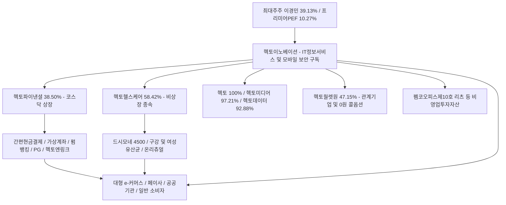
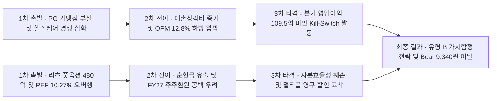

# 🔍 Phase 1: 기업 해독기 — 헥토이노베이션 (214180) (v5.1)

> **분석완료일**: 2026-11-19
> - **단일 기준 주가 (Single Price Anchor)**: **`13,100원`** (SSOT 확정 종가, Phase 1~3 전 과정 100% 동일 고정)
> - **주식수 · 지배주주 귀속률 · 최신 공시 스캔**: 총발행주식수 **`12,863,433주`** / 자기주식 **`279,866주`**(`2.18%`, 2026.11.11 129,934주 소각 반영) / 실질 유통주식수 **`12,583,567주`** / 지배주주 순이익 귀속률 **`75.7%`** / 최신 공시: 제18기 3분기보고서(2026.11.16) 및 3개년 자사주 소각 완료(2026.11.11)

> 💡 **[핵심 용어 3줄 직관 해설]**
> 1. **SOTP (Sum-of-the-Parts, 부분합 가치평가)**: 본업(IT정보서비스·결제·헬스케어) 가치와 비영업자산(부동산 리츠 출자지분·투자조합·금융자산) 가치를 따로 계산해 합산하는 기법으로, 비영업자산 비중이 20%를 넘으면 필수 적용합니다.
> 2. **간편현금결제(펌뱅킹) 공통 프레임워크**: 신용카드망이 아닌 은행 계좌이체망을 대형 e-커머스·간편결제 페이사·공공기관에 표준 API 형태로 공급하는 독과점 결제 인프라입니다.
> 3. **오너 정규화 FCF (Normalized FCF)**: PG/결제 대행사는 가맹점 정산 예수금 변동으로 보고 현금흐름이 크게 출렁이므로, 이를 제거하고 실질 영업이익 기반으로 회사가 순수하게 벌어들이는 현금창출력을 보수적으로 추정한 지표입니다.

---

## 1. 비즈니스 모델(BM) 해부 및 밸류체인 구조

헥토이노베이션(구 민앤지, 2022년 6월 28일 사명 변경)은 **① 지배회사 본업(IT 정보서비스·모바일 부가서비스·보안/인증 구독)**을 중심으로 **② 상장 종속기업 헥토파이낸셜(지분율 38.50%, 구 세틀뱅크 — 간편현금결제·가상계좌·펌뱅킹·PG)**과 **③ 비상장 종속기업 헥토헬스케어(연결 지분율 58.42%, 구 바이오일레븐 — 프리미엄 프로바이오틱스 '드시모네' 및 이너뷰티 '온리츄얼')**라는 3대 현금창출 축을 보유한 사업지주형 IT 플랫폼 그룹입니다(`[헥토이노베이션]반기보고서(2026.08.14).pdf`, p.8, p.42).

### 1.1 글로벌 트렌드 3대 게이트 매칭
| 매칭 축 | 산업 구조 변화 | 헥토이노베이션 포지션 및 실질 수혜 검증 |
| :--- | :--- | :--- |
| **게이트 1: 핀테크 결제 인프라 고도화** | 대형 커머스·페이사·공공기관의 카드 수수료 절감 및 계좌 기반 즉시결제(Account-to-Account) 확대 | 헥토파이낸셜이 국내 대형 e-커머스 및 간편결제사 간편현금결제 인프라를 과점하며 경쟁이 아닌 **상생형 인프라 공급자**로 자리매김(`[헥토이노베이션]분기보고서(2026.11.16).pdf`, p.23). |
| **게이트 2: 고함량 기능성 헬스케어 프리미엄화** | 저가 유산균 경쟁 심화 속 식약처 개별인정 원료·임상 기반 고부가 제품으로 수요 이동 | 헥토헬스케어 '드시모네 4500'(보장균수 4,500억, SCI 논문 250편+)과 신규 이너뷰티 '온리츄얼'을 통해 2025년 매출 **854억 원**(전년 대비 +40% 이상) 역대 최고치 경신(`[헥토이노베이션]분기보고서(2026.11.16).pdf`, p.23). |
| **게이트 3: 스테이블코인·VASP 차세대 결제** | 글로벌 결제망의 디지털자산·스테이블코인 정산 논의 확산 | 관계기업 **헥토월렛원(지분율 47.15%)**을 통해 지갑·VASP 인프라를 준비 중이나, 현재 P&L 단독 매출 비중이 0%에 수렴하여 **S-Curve 멀티플 할증 0%('0원 무상 콜옵션')**로 엄격 분리 평가. |

### 1.2 그룹 밸류체인 및 지배구조도 (Mermaid v10.9.8)

### 1.3 Argon 4단계 공정·인프라 엔지니어링 인과 사슬 (Engineering-to-Earnings Causal Chain)
결제망 및 보안·인증 인프라는 제조업의 설비 공정과 동일하게 높은 시스템 안정성과 금융당국·은행권 연동 규격이 진입장벽으로 작동합니다.
1. **[Step E1 — 시스템·인프라 메커니즘 정의]**: 헥토파이낸셜은 **금융VAN사 중 유일하게 은행 시스템을 직접 운영**하며 국내 최초로 지자체 간 실시간 송수신이 가능한 G-banking 시스템을 국내 A은행과 개발·구축했습니다. 또한 펌뱅킹 연동 기능을 표준화한 **공통 프레임워크(Common Framework)**를 설계해 e-커머스 가맹점뿐 아니라 코레일·KT·조폐공사·제로페이 등 공공기관까지 단일 아키텍처에 수용합니다(`[헥토이노베이션]분기보고서(2026.11.16).pdf`, p.23).
2. **[Step E2 — 기술적 병목 및 인허가·품질(Qual) 장벽 도출]**: 대규모 결제 시스템은 단 1초의 장애도 대형 커머스의 매출 중단으로 직결되므로, 시중은행 전산망 직접 운영 트랙레코드와 금융결제원·통신 3사 보안 인허가, 대형 플랫폼 결제망 검증을 거치는 데 후발주자 기준 최소 24개월 이상의 전환 비용(Switching Cost)이 발생합니다.
3. **[Step E3 — 거래량(Q) 연동 및 과금 시차 매핑]**: 초기 공통 프레임워크 구축 완료 이후에는 신규 가맹점·페이사 온보딩 시 추가 CapEx 부담이 미미하며, 결제 거래 건수(Q)와 가맹점 거래액(GMV) 증가가 수수료 매출로 즉시 전이되는 고정비 레버리지 구조를 갖습니다.
4. **[Step E4 — DART 영업이익률(OPM) 레버리지 및 마진 믹스 연결]**: 본사 구독형 IT서비스와 헥토파이낸셜 가상계좌·간편현금결제는 높은 공헌이익률을 제공하지만, 최근 저마진 PG·상품권 유통(헥토엔링크, 구 엠트웰브+허니콘 흡수합병) 및 헥토헬스케어 마케팅비·대손충당금 확대가 믹스에 섞이면서 연결 OPM이 과거 중위 **17.5%**에서 현재 **12.8%(-4.7%p)**로 하락한 레짐 변화가 확인됩니다.

---

## 2. 주요 제품별 매출 구성 및 [Step 1.2] S-Curve 10% 변곡점 · 3축 구조적 병목 · 리드타임 진단

### 2.1 사업부문별 구조 및 신기술 매출 익스포저 산출표
| 사업부문 (주력 법인) | 핵심 제품 / 서비스 | 매출·수익 성격 | 신기술(스테이블코인/VASP) 단독 매출 비중 | 밸류에이션 처리 원칙 |
| :--- | :--- | :--- | :---: | :--- |
| **IT 정보서비스 (헥토이노베이션 본사)** | 통신 3사 제휴 보안·인증·생활구독 부가서비스 | 초고마진 월정액 구독(Cash Cow) | `0.0%` | 본업 핵심 가치 반영 |
| **핀테크·결제 (헥토파이낸셜 등)** | 간편현금결제, 가상계좌, 펌뱅킹, PG, 모바일상품권(헥토엔링크) | 거래량 연동 수수료 (B2B 인프라) | `0.0%` (미공시) | 본업 핵심 가치 반영 (상장 자회사 지배귀속률 75.7% 차감) |
| **헬스케어 (헥토헬스케어 등)** | 드시모네 4500, 구강/여성유산균, 이너뷰티 '온리츄얼' | 2025년 매출 854억 원(+40%+), 브랜드 B2C | `0.0%` | 본업 성장 동력 반영 |
| **신사업 (헥토월렛원 등)** | VASP·디지털자산 지갑·스테이블코인 정산 인프라 | 관계기업(지분 47.15%), 초기 투자 단계 | **`0.0%` (30% 미달·단독 미공시)** | **🚨 Zone D '0원 무상 콜옵션' (할증 0% 강제 차단)** |

### 📌 [코드 자동 생성 1-B] Step 1.2 S-Curve 10% 변곡점 · 3축 구조적 병목(Capa·기술·특허) · 리드타임 & Step 1.8 K-주주환원 진단표 (v5.0)
| 진단 축 (3-Axis + K-Return) | 실측 지표 및 근거 | 코드 판정 및 Phase 3 목표주가 가중치 |
| :--- | :--- | :--- |
| **① 전방 시장 침투율 (10% 변곡점 여부)** | 1차 침투율 **`0.0%`** (`Zone D [무상 콜옵션/비해당 — 단독매출 30% 미달·미공시로 침투율(0.0%/0.0%) 할증 0% 차단]`) | 📌 **확산/성숙 구간 진행** (3축 통합 Base `×1.00` / Bull `×1.00`) |
| **②-A 물리적 Capa 병목 (가동률/증설)** | 공장 가동률 **`0.0%`** — 특허/벤더 Lock-in: 통신 3사·금융권 본인인증 및 펌뱅킹 결제망 독과점 라이선스 장벽 | 🟢 **여유 Capa 보유** |
| **②-B 기술격차 해자 (OPM/수율/단가결정력)** | 현 OPM **`12.8%`** — N/A | 고마진 가격전가력(Pricing Power) 점검 |
| **②-C 원천특허 · 글로벌 벤더 퀄(Qual) 락인** | N/A | 후발주자 진입장벽(Switching Cost) 점검 |
| **③ 병목 해소 예상 소요기간 (Lead Time)** | **`B등급`** (해소 리드타임 **`9개월`**) | 금융결제원·통신사 보안 인허가 및 대형 플랫폼 결제망 연동에 24개월+ 진입장벽 (PEG 계수 `0.80`) |
| **③-B S-Curve 3대 매도·디레이팅 시그널** | 🟢 해당 없음 (병목 유지 · 성장 기울기 건전 · 정책 역풍 미감지) | 🟢 **매도 시그널 미감지 (정상 평가)** |
| **④-A K-주주환원 (배당 · TSR · 분리과세)** | DPS **`500원`** (배당수익률 **`3.82%`** / 성향 `20.6%` / TSR `30.3%`) | ⚪ 배당소득 분리과세 미해당 (배당성향 20.6% < 25%) |
| **④-B 자사주 · 환원절벽 · 메자닌(CB/BW)** | 자사주 **`279,866주`** (`2.18%`) / 미상환 메자닌 **`0.0억`** (희석 `0.0%`) | 🟢 정상 (현재 자기주식 279,866주 [2.18%] 보유 — 소각 전환 여부 모니터링) / 🟢 청정 (미상환 CB/BW/EB 잠재 희석 0%) |
| **④-C 지배구조 · 내부거래 · 거버넌스 (Step 1.8)** | 특수관계인 거래 **`19.8억`** | 🟢 양호 (유의미한 오너 개인회사 사익편취 내부거래 미감지 [19.8억 원]) — 최대주주 이경민 39.13%(담보 2.67%), 상장 자회사 헥토파이낸셜(38.50%) 중복상장(지배귀속률 75.5% 반영) 및 3개년 자사주 소각 계획(2026.11.11 129,934주 소각) 완수 후 FY27~ 신규 환원정책 갱신 모니터링 (`kgov_mult = ×1.0000`) |
| **⑤ 레드팀 역산 Capa 천장 검증 (Red-Team)** | 대안 A 내재 영업이익: Base **`370.1억`** / Bull **`336.5억`** | 🟢 물리적 Capa 한계 내 달성 가능 |

### 2.2 Step 1.2 4대 질문 및 3대 매도·디레이팅 시그널 해독
1. **전방 시장 S-Curve 10% 변곡점 통과 여부**: 시장이 테마로 반응하는 스테이블코인·가상자산 결제 영역은 DART 재무제표상 단독 매출이 미공시(비중 `0.0%`) 상태이므로, 원칙 4 및 원칙 15에 따라 **Zone D('0원 무상 콜옵션')**로 분류하여 S-Curve 할증을 `×1.00`(0%)으로 강제 차단합니다.
2. **3축 구조적 병목 및 리드타임 판독**: 소프트웨어·결제 인프라 특성상 물리적 공장 가동률 병목은 존재하지 않으나(가동률 `0.0%` 표시), 은행권 직접 시스템 운영·통신 3사 제휴 구독망·식약처 개별인정 원료(드시모네)가 방어적 진입장벽을 형성합니다. 다만 코드 기준 병목 해소 리드타임은 **B등급(9개월, PEG 계수 0.80)**으로 보수적 평가되어 과도한 성장 프리미엄 부여를 차단합니다.
3. **3대 매도·디레이팅 시그널 진단**: ① 쇼티지 해소(해당 없음), ② 침투율 ≥25% + YoY 급락/QoQ -15% 이하 3중 교차검증(2026.2Q 영업이익 QoQ `-11.5%`로 `-15%` 임계치 미도달), ③ 확정된 정책·보조금 축소 역풍(미감지)으로 현재 **매도·디레이팅 시그널은 미발동(`🟢 정상 평가`)** 상태입니다. 다만 차기 분기 영업이익이 `109.5억 원` 미만(QoQ -15% 초과 하락)으로 떨어질 경우 즉각 경보가 발동됩니다.

---

## 3. 재무 건전성 및 [Step 1.5] 장부가(Book Value) 해부 & SOTP 20% 분리 게이트

### 📌 [코드 자동 생성 1] SOTP 장부 분해 & 4대 레짐 체크 요약표
| 검증 항목 | 코드 실측 수치 | 판정 결과 (Code Verdict) |
| :--- | :--- | :--- |
| **단일 기준 주가 (Anchor Price)** | **`13,100원`** | 전 Phase 1~3 100% 동일 고정 |
| **지배주주 순이익 귀속률** | **`75.7%`** | 비지배지분 차감 완료 |
| **Step 1.5 비영업자산 비중 (SOTP 20% 룰)** | 장부 대비 **`37.4%`** / 시총 대비 **`51.8%`** | 🚨 **SOTP 분리 평가 발동** (본업BPS 11,345원) |
| **Step 1.5 본업 이익 유지력 (Core ROIC)** | TTM 영업이익 **`524.7억`** (NOPAT **`409.3억`**) | ✅ **본업 이익 유지 견고** |
| **Step 2.0 4대 레짐 변화 체크** | ③ 비영업자산레짐(비영업자산 비중 51.8% ≥ 20% — 명목 PBR 저평가 착시 주의) / ④ 사업구성레짐(OPM 과거중위 17.5% → 현재 12.8%, -4.7%p [본업 마진 훼손/경쟁 심화]) | 🔄 **레짐 변화 반영 필수** |
| **Step 3.0 사이클 고점 함정 가드레일** | 피크 이익 과열 미해당 | 🟢 **정상 멀티플 적용** |
| **직전 분기 대비 (QoQ) 실적 추이** | [2026.1Q → 2026.2Q] 매출액 1,123.2억→1,028.3억(QoQ -8.4%) | 영업이익 145.6억→128.8억(QoQ -11.5%) | 수정EPS 502원→558원 | [액분·무증 소급보정 지배주주 EPS] 2026.1Q 502.0원 → 2026.2Q 558.0원 (QoQ 반등/흑자유지 ✅) |
| **가설 반증 임계치 (Kill-Switch)** | **차기 분기 영업이익 < 109.5억 원(직전분기 대비 -15% 하회) 또는 분기 지배주주 EPS < 446원 기록 시 핵심 가설 즉시 [약화] 강등** | 미달 시 가설 즉시 [약화] 강등 |

### 3.1 재무상태표 핵심 항목 및 순현금·비영업자산 SOTP 분해
- **유통시가총액 vs 실질 기업가치(EV)**: 단일 기준 주가 `13,100원` × 실질 유통주식수 `12,583,567주` 기준 유통시총은 **`1,648.5억 원`**입니다. 여기서 순차입금 **`-711.7억 원`**(즉, 순현금 **`711.7억 원`**)을 반영한 실질 기업가치(EV)는 **`936.8억 원`**에 불과합니다.
- **Step 1.5 SOTP 20% 분리 게이트 발동**: 연결 재무상태표 내 투자부동산·관계기업 출자지분(펨코오피스제10호위탁관리부동산투자회사, 헥토콘 1·2호 투자조합, 단순투자 12개사 등 — 2025년 말 타법인출자 총 장부가액 `1,584.6억 원` 중 경영참여 `1,248.4억 원`·단순투자 `336.2억 원`, `[헥토이노베이션]사업보고서(2026.03.19).pdf`, p.284) 및 장기금융자산 등 비영업자산 합계가 장부가 대비 **`37.4%`**, 시총 대비 **`51.8%`**에 달합니다.
- 이에 따라 단순 연결 PBR 적용을 금지하고, 비영업자산 안전가치(**`598.1억 원`**, 할인율 적용 후)를 별도 분리하여 **본업 기업가치(Core EV) `338.7억 원`**과 **본업 BPS `11,345원`**을 산출해 Phase 3 목표주가 산식에 직결합니다.
- **본업 이익 유지력(Core ROIC) 판정**: TTM 연결 영업이익 **`524.7억 원`**, 지배귀속률(`75.7%`) 및 법인세 반영 **NOPAT `409.3억 원`**으로, 시총의 절반 이상이 순현금과 비영업자산으로 채워진 상태에서도 본업 현금창출력이 매우 견고합니다(`✅ 본업 이익 유지 견고`).

### 3.2 부외 우발채무 및 풋/콜옵션 정밀 점검 (DART 주석 팩트)
1. **펨코오피스제10호 리츠 1종종류주주 풋옵션 및 연대책임**: 연결회사(헥토이노베이션·헥토파이낸셜·헥토헬스케어·헥토)는 리츠 지분 53%를 보유한 1종종류주주(하나은행 신탁업자)와 출자 납입 후 5년 경과 시점부터 2년간 연 8% 현금수익률(Cash-on-Cash Return) 기준의 풋옵션 약정을 체결했습니다. 보통주주 연대책임 이행한도는 **총 `480억 원`**(헥토이노베이션 `100억 원`, 헥토파이낸셜 `75억 원`, 헥토헬스케어 및 헥토 `305억 원`)이며, 연결회사 보유 리츠 지분 `700,000주`(본사 `250,000주`)에 우리은행 근질권이 설정되어 있습니다(`[헥토이노베이션]분기보고서(2026.11.16).pdf`, p.64, p.96~97).
2. **헥토월렛원 지분 풋/콜옵션**: 헥토월렛원의 2028년 개별 영업이익이 `25억 원` 초과 시 특정 주주가 주당 `20,000원`에 매도할 풋옵션, 반대로 `5억 원` 미만 시 회사가 주당 `5,000원`에 매수할 콜옵션이 체결되어 있습니다(`[헥토이노베이션]분기보고서(2026.11.16).pdf`, p.64, p.97). 실적 연동형 비대칭 구조로 본사 자본 리스크를 통제한 설계입니다.
3. **기타 우발채무 및 출자약정**: 당분기말 계류 중인 소송사건은 존재하지 않으며(p.96), 잔여 투자조합 출자약정액은 `5.56억 원`(메디치-IBKC 1.56억 + 헥토콘 2호 4.0억), 별도 리스부채는 `13.56억 원`으로 재무 건전성에 미치는 부담은 극히 경미합니다.

---

## 4. 원가 구조, 영업 레버리지 및 가동률/수주잔고 실측

### 4.1 분기 실적(QoQ) 및 TTM 수익성 구조 해부
| 구분 | 2026.1Q (확정) | 2026.2Q (확정) | 직전 분기 대비 (QoQ) | TTM / 비고 |
| :--- | :---: | :---: | :---: | :--- |
| **연결 매출액** | `1,123.2억 원` | `1,028.3억 원` | **`-8.4%`** | 결제·커머스 계절성 및 믹스 조정 |
| **연결 영업이익** | `145.6억 원` | `128.8억 원` | **`-11.5%`** | **TTM `524.7억 원` (OPM `12.8%`)** |
| **지배주주 수정EPS** | `502.0원` | `558.0원` | **`+11.2%`** | 액분·무증 소급보정, 반등·흑자 유지 ✅ |
| **영업이익률 (OPM)** | `13.0%` | `12.5%` | `-0.5%p` | 과거 중위 `17.5%` 대비 `-4.7%p` 하락 레짐 |

- **영업 레버리지와 마진 훼손 원인**: 본사 IT 부가서비스와 헥토파이낸셜 간편현금결제는 고정비 레버리지가 큰 고마진 구조이나, ① PG·모바일상품권 유통 확대, ② 헥토헬스케어 외형 성장(2025년 854억 원, +40%+)에 따른 마케팅·판매수수료 지출, ③ **매출채권 대손충당금 누적**이 겹치며 연결 OPM이 과거 중위 `17.5%`에서 `12.8%`로 낮아졌습니다.

### 4.2 가동률·수주잔고 구조 및 매출채권 대손·재고자산 실측 (2026.3Q 공시)
- **가동률 및 수주잔고 미공시 구조**: 지배회사 및 핵심 핀테크 자회사는 **비제조 소프트웨어·플랫폼·결제 인프라 업종**으로 물리적 생산설비 가동률이나 장기 제조 수주잔고가 존재하지 않습니다(Section 7 유형 C+D 복합 구조와 100% 일치). 헬스케어 부문(드시모네 등) 역시 전문 위탁제조·유통 중심입니다.
- **🚨 [비판·리스크 핵심 실측] 매출채권 대손충당금의 가파른 누적**:
  - 제18기 3분기(2026.09.30) 연결 매출채권 총액은 `430.6억 원`(6개월 이하 `95.86%`, 1년 초과 `3.57%`)이나, **대손충당금 기말 잔액이 제16기 `93.6억 원` ➔ 제17기 `213.5억 원` ➔ 제18기 3분기 `279.7억 원`**으로 2년 새 약 3배 급증했습니다.
  - 당분기 누적 대손상각비 계상액만 **`49.8억 원`**(제17기 `118.9억 원`, 제16기 `67.5억 원`)에 달합니다(`[헥토이노베이션]분기보고서(2026.11.16).pdf`, p.109). PG·결제 정산 가맹점 리스크 및 일부 종속기업(예: 빅쏠 대여금 4.7억 원 100% 대손충당금 설정, p.98) 채권 부실화 여부가 마진 회복의 핵심 관건입니다.
- **재고자산 건전성 (헬스케어 중심)**: 제18기 3분기 연결 재고자산 합계는 **`172.2억 원`**(헥토헬스케어 `129.7억 원`, 헥토파이낸셜 상품 `42.5억 원`)으로 총자산 대비 **`2.0%`**(전기 1.7%) 수준이며, 재고자산회전율은 **`2.3회`**(제16기 0.3회 ➔ 제17기 2.1회 ➔ 제18기 3Q 2.3회)로 지속 개선되고 있습니다(`[헥토이노베이션]분기보고서(2026.11.16).pdf`, p.109~110).

---

## 5. 자본 배분(CapEx, R&D) 및 [Step 1.8] K-마켓 특수성 · 주주환원 입체 스코어카드

### 5.1 자본 배분 전략 (M&A · 투자 · R&D)
- 헥토이노베이션은 대규모 유형자산 설비투자(CapEx) 대신 **소프트웨어 인프라 고도화, 계열사 재편(2026년 7월 엠트웰브의 '헥토엔링크' 사명 변경 및 허니콘 흡수합병), 지분 투자(2026년 3Q 마핀 종속기업 편입, 노바웰스 관계기업 편입)**에 잉여현금을 배분해 왔습니다(`[헥토이노베이션]분기보고서(2026.11.16).pdf`, p.97~98; `[헥토이노베이션]반기보고서(2026.08.14).pdf`, p.185).
- 다만 비영업 투자자산(부동산 리츠·투자조합·단순투자) 비중이 시총의 `51.8%`까지 비대해진 점은 자본효율성(ROE/ROIC) 관점에서 시장의 멀티플 할인 사유로 작용합니다.

### 5.2 [Step 1.8] K-마켓 특수성 · 주주환원 3단 입체 스코어카드 (`④-A / B / C`)
| 점검 축 | 핵심 팩트 및 실측 수치 (DART & SSOT) | 판정 및 밸류에이션 영향 |
| :--- | :--- | :--- |
| **④-A 고배당 · 분리과세 · TSR** | 주당배당금(DPS) **`500원`** / 배당수익률 **`3.82%`** / 배당성향 **`20.6%`** / 총주주환원율(TSR) **`30.3%`** | ⚪ 배당소득 분리과세 요건 미해당(성향 `20.6% < 25%`). 다만 자사주 소각 포함 TSR `30.3%`는 코스닥 평균 상회. |
| **④-B 자사주 · 환원절벽 · 메자닌** | 잔여 자사주 **`279,866주`**(`2.18%`, 2026.11.11 129,934주 소각 완료) / 미상환 CB·BW·EB **`0.0억 원`**(희석 `0.0%`) / 임직원 RSU 부여(본사 미행사 `181,440주` — 3년 내 연속 5영업일 평균 시총 **`5,000억 원`** 달성 조건; 헥토파이낸셜 5차 `125,200주` — 시총 **`1.5조 원`** 달성 조건, `[헥토이노베이션]분기보고서(2026.11.16).pdf`, p.56) | 🟢 메자닌 희석 리스크 **0% 청정**. RSU 역시 시총 3배 이상(현 1,648억 ➔ 5,000억) 폭등 시에만 지급되는 주주친화적 성과연동 구조. 단, 3개년 자사주 소각 계획 완수 이후 **FY27~ 신규 주주환원 정책 공백(환원절벽)** 여부 모니터링 필수. |
| **④-C 지배구조 · 내부거래 · 중복상장** | 최대주주 이경민 **`39.13%`**(특수관계인 포함 `39.38%`, 담보 `2.67%`), 2대주주 프리미어성장전략M&A 사모투자합자회사 **`10.27%`**(`1,334,786주`, p.118). 특수관계인 내부거래 **`19.8억 원`**(오너 개인회사 터널링 미감지). 상장 자회사 헥토파이낸셜(`38.50%`) 중복상장. | 🟢 오너 사익편취 내부거래 청정(`kgov_mult = ×1.0000`). 중복상장 영향은 지배귀속률(`75.7%`) 및 SOTP 비영업자산 할인으로 선반영 완료. **주의**: 2대주주 사모펀드(프리미어PEF `10.27%`)의 향후 엑시트(블록딜) 잠재 오버행 점검 필요. |

---

## 6. 핵심 리스크 요인 및 [Step 3.5] 리스크 3단계 인과 도미노 (Domino Chain)

### 6.1 리스크 3단계 인과 도미노 매트릭스
| 리스크 시나리오 | 1차 촉발 요인 (Trigger) | 2차 영업·운전자본 전이 (Transmission) | 3차 재무·자본 타격 및 정량 임계치 (Impact) |
| :--- | :--- | :--- | :--- |
| **도미노 1: PG 가맹점 부실 및 대손 폭증** | 경기 둔화로 e-커머스·중소 가맹점 도산·정산 사고 재발 | 매출채권 연체 확대 및 분기 대손상각비 급증(이미 대손충당금 `279.7억 원` 누적) | 분기 영업이익 **`< 109.5억 원`**(QoQ -15% 하회) 추락 및 OPM `10%` 붕괴 ➔ Kill-Switch 즉시 발동 |
| **도미노 2: OPM 구조적 하락(마진 훼손)** | 헬스케어 마케팅 출혈 경쟁 및 저마진 PG·상품권 믹스 과대 | 본사 구독 이탈 + 자회사 판관비율 상승으로 영업 레버리지 역전 | 연결 OPM 과거 중위(`17.5%`) 대비 격차 심화(`12.8% → < 10%`) ➔ 유형 B(가치함정) 전락 및 PBR 하단(`9,340원`) 고착 |
| **도미노 3: 리츠 풋옵션 및 PEF 오버행** | 상업용 부동산 침체로 펨코오피스제10호 리츠 1종종류주주 풋옵션 행사 + 프리미어PEF(`10.27%`) 엑시트 | 그룹 연대책임 최대 **`480억 원`**(본사 `100억 원`) 현금 유출 및 비영업자산 비중 재상승 | 순현금(`711.7억 원`) 대폭 소진 + FY27 주주환원 축소(환원절벽) ➔ 1단계 손절선(`8,870원`) 이탈 위험 |

### 6.2 리스크 3단계 인과 도미노 구조도 (Mermaid v10.9.8)

---

## 7. 4대 업종별 표준 실적 산출 공식 트리 (유형 A/B/C/D 분기)

Section 4에서 확인된 바와 같이 헥토이노베이션은 제조 설비 가동률에 종속되지 않는 **유형 C(플랫폼·IT 구독·결제 인프라) + 유형 D(브랜드 소비재·헬스케어) 복합 업종**입니다. 이에 따라 비제조 표준 실적 산출 트리를 적용합니다.

$$\text{연결 영업이익} = \underbrace{(\text{구독자 수 } Q_{\text{IT}} \times \text{월정액 ARPU } P_{\text{IT}} - C_{\text{제휴수수료}})}_{\text{유형 C: 본사 IT정보서비스}} + \underbrace{(\text{결제 거래액 } GMV \times \text{Take Rate} - C_{\text{정산/대손}})}_{\text{유형 C: 헥토파이낸셜}} + \underbrace{(\text{드시모네·온리츄얼 판매량 } Q_{\text{HC}} \times \text{ASP} - C_{\text{원가/마케팅}})}_{\text{유형 D: 헥토헬스케어}}$$

- **실적 민감도 핵심 레버**:
  1. **본사(유형 C)**: 통신 3사 제휴 구독자 유지율(Retention)이 현금흐름의 하방을 지지.
  2. **헥토파이낸셜(유형 C)**: 간편현금결제/가상계좌 거래액(GMV) 성장과 **대손상각비(`C_대손`) 통제**가 수익성의 핵심.
  3. **헥토헬스케어(유형 D)**: 드시모네·온리츄얼의 높은 매출 성장률(+40%+)이 마케팅비 투하 대비 영업이익 레버리지로 전환되는 변곡점 확인 필요.

---

## 8. [Step 2.0] 4대 레짐 변화 고정 체크 & 10년 밸류에이션 백테스트

### 8.1 [Step 2.0] 4대 레짐 변화 고정 게이트
과거 10년 멀티플 밴드를 단순 적용하기 전 4대 구조적 레짐 변화를 점검한 결과, **2개 핵심 레짐 변화(`③ 비영업자산`, `④ 사업구성`)가 공식 감지**되어 단순 저평가 착시를 배제한 보정 밸류에이션이 필수입니다.
1. **① 설비 레짐 (CapEx·감가상각)**: 비제조 소프트웨어/결제 구조로 대규모 유형자산 증설 사이클 미해당(안정).
2. **② 자본구조 레짐 (순부채·희석)**: 순현금 **`711.7억 원`**, 미상환 CB/BW **`0원`**, 3개년 자사주 소각 이행으로 재무 레짐은 오히려 개선.
3. **③ 비영업자산 레짐 (🚨 변화 감지)**: 비영업자산 비중이 시총 대비 **`51.8%`**(장부 대비 `37.4%`)로 20% 기준을 크게 상회 ➔ 단순 연결 PBR을 과거 밴드와 비교할 경우 **명목 저평가 착시**가 발생하므로 **SOTP 분리 평가(본업 BPS `11,345원` + 비영업 안전가치 `598.1억 원`) 강제 적용**.
4. **④ 사업구성 레짐 (🚨 변화 감지)**: 연결 OPM이 과거 중위 **`17.5%`**에서 현재 **`12.8%`**로 **`-4.7%p` 하락** ➔ 고마진 본사 구독 비중이 희석되고 PG·헬스케어·대손비용이 확대된 믹스 변화를 인정하여, 과거 전성기 고멀티플 적용을 배제하고 보수적 PBR 밴드를 적용.

### 8.2 [Step 3.0] 사이클 고점 함정 가드레일 & 10년 밸류에이션 백테스트 상속
- **Step 3.0 사이클 고점 함정 판정**: 현재 이익은 경기민감 호황 피크 이익 과열 구간에 해당하지 않음(`🟢 정상 멀티플 적용`).
- **10년 밸류에이션 백테스트 1순위 지표 확정 및 Phase 3 강제 상속**:
  - 헥토이노베이션은 자회사 지분·투자부동산·현금성 자산 등 자산가치 비중이 크고 PG 정산자금 변동 및 지배귀속률(`75.7%`) 영향으로 순이익 변동성이 존재하는 사업지주 구조입니다.
  - 코드 백테스트 결과, 허위 상관을 제거한 최우선 밸류에이션 지표로 **`PBR` (SOTP 본업 BPS `11,345원` + 비영업자산 안전가치 `598.1억 원` 결합 기준)**이 최종 선정되었으며, 이 지표는 **Phase 3 시나리오 밸류에이션(`Bear 9,340원 / Base 14,980원 / Bull 16,300원`)의 주 멀티플로 100% 강제 상속**됩니다.
