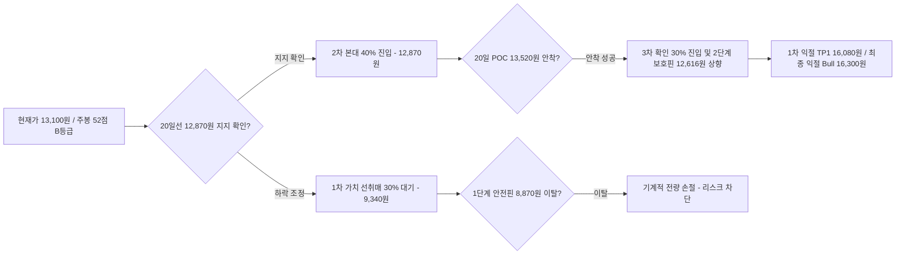

# 🎯 Phase 3: 가격 판독기 (DCF & 마스터 SOP) — 헥토이노베이션 (214180) (v5.1)

> **분석완료일**: 2026-11-19 | **단일 기준 주가 (Anchor Price)**: **`13,100원`** (SSOT 확정 종가, Phase 1~3 전 과정 100% 동일 고정)
> - **핵심 밸류에이션 결론**: SOTP 기준 본업 EV는 **`338.7억 원`**(오너 정규화 FCF 역DCF 요구성장률 **`-51.64%`**)으로 극단적 비관이 선반영되어 있으나, OPM 하락(`17.5% → 12.8%`)과 대손충당금 누적(`279.7억 원`)·주봉 매물벽 하단 저항(`52점 B등급`)을 감안해 **추격매수를 배제하고 `12,870원`(2차) ~ `9,340원`(1차) 눌림목 분할 및 `8,870원` 고정 안전핀**으로 기계적 대응합니다.

---

## 1. 역DCF 정밀 판독 (Equity · EV · Core EV)

### 📌 [코드 자동 생성 1-C] Phase 3 Section 1 역DCF 3단 요구성장률 요약표 (WACC `9.0%`, 영구성장률 `2.0%`)
| 평가 기준 (Valuation Basis) | 산출 가치 (억 원) | 보고 FCF (`971.7억`) 내재 요구성장률 | 오너 정규화 FCF (`327.5억`) 내재 요구성장률 | 비고 및 해석 기준 |
| :--- | :---: | :---: | :---: | :--- |
| **① 유통시총 (Floating Equity)** | **`1,648.5억`** | **`-42.16%`** | **`-20.95%`** | 자기주식(`279,866주`) 차감 실질 유통주식수(`12,583,567주`) 기준 |
| **② 실질 기업가치 (EV)** | **`936.8억`** | **`-53.00%`** | **`-32.12%`** | 순차입금(`-711.7억`) 및 우선주 반영 실질 EV 기준 |
| **③ 본업 기업가치 (Core EV, SOTP)** | **`338.7억`** | **`-72.68%`** | **`-51.64%`** | 🚨 SOTP 20% 초과 발동 (비영업 안전가치 차감) |

### 1.1 보고 FCF(`971.7억`) 착시 제거 및 오너 정규화 FCF(`327.5억`) 기반 정밀 해독
1. **보고 FCF(`971.7억 원`)의 회계적 착시 주의**: 종속기업 헥토파이낸셜은 PG·간편현금결제 사업자로, 결산일 직전 가맹점에 지급할 정산 예수금(운전자본 부채)의 시점 변동이 영업활동현금흐름(OCF)에 거대하게 혼입됩니다. 따라서 TTM 영업이익(`524.7억 원`)의 1.85배에 달하는 보고 FCF(`971.7억 원`)를 그대로 영속 현금흐름으로 간주해서는 안 됩니다.
2. **오너 정규화 FCF(`327.5억 원`) 기준 극단적 저평가 확인**: 정산자금 착시를 완전히 제거한 보수적 **오너 정규화 FCF(`327.5억 원`, 지배주주 NOPAT `409.3억 원` 대비 보수적 환산)**를 적용하더라도, 현재 주가 `13,100원`에는 다음과 같은 극단적 비관이 내재되어 있습니다:
   - **유통시총(`1,648.5억 원`) 기준**: 향후 5년간 오너 FCF가 매년 **`-20.95%`**씩 역성장해야 현재 주가가 정당화됩니다.
   - **실질 EV(`936.8억 원`, 순현금 `711.7억 원` 차감) 기준**: 매년 **`-32.12%`** 역성장을 선반영 중입니다.
   - **본업 Core EV(`338.7억 원`, 비영업 안전가치 `598.1억 원` 추가 차감) 기준**: 매년 **`-51.64%`** 붕괴를 가정한 가격으로, 사실상 시장이 본업의 현금창출력에 청산 수준의 할인을 매기고 있으며 **스테이블코인·헥토월렛원 기대감은 0원**임을 수리적으로 증명합니다.

---

## 2. 가치함정 이원화 판정(유형 A vs B) & [Step 2.0] 4대 레짐 변화 종합 판독

### 2.1 가치함정 이원화 판정: **유형 A (조건부 저평가 지주·플랫폼 가치주)**
| 판정 기준 | 헥토이노베이션 실측 상태 | 유형 A(저평가 기회) vs 유형 B(가치함정) 판독 |
| :--- | :--- | :--- |
| **본업 이익 유지력 (Core ROIC)** | TTM 영업이익 **`524.7억 원`**, NOPAT **`409.3억 원`**, 2Q 수정EPS `558원`(QoQ `+11.2%`) | ✅ **유형 A 요건 충족** — 본업이 적자 전환하거나 붕괴하지 않고 견고한 이익 지속 |
| **재무 안전성 및 주주환원** | 순현금 **`711.7억 원`**, 미상환 CB **`0원`**, DPS `500원`(`3.82%`), TSR **`30.3%`**, 2026.11.11 자사주 소각 완료 | ✅ **유형 A 요건 충족** — 3개년 소각 완수 및 RSU 시총 `5,000억` 정렬로 주주가치 훼손 차단 |
| **유형 B 전이 경계 신호** | **① 비영업자산 비중 시총 `51.8%`**(자본 효율 저하), **② OPM 과거 중위 `17.5% → 12.8%`(-4.7%p)**, **③ 대손충당금 `279.7억 원`** 누적 | ⚠️ **유형 B 전이 경고등 상시 감시** — FY27 주주환원 공백(환원절벽) 또는 OPM `10.5%` 이탈 시 즉시 유형 B로 강등 |

### 2.2 [Step 2.0] 4대 레짐 변화 & [Step 3.0] 사이클 가드레일 종합
- **Step 2.0 레짐 보정 반영**: ① 설비 레짐(안정) 및 ② 자본구조 레짐(순현금·무메자닌 개선)은 우호적이나, **③ 비영업자산 레짐(`51.8% ≥ 20%`)**과 **④ 사업구성 레짐(OPM `-4.7%p` 하락)**이 명확히 감지되었습니다. 따라서 과거 전성기 단순 연결 PER/PBR을 적용하지 않고, **SOTP 분리 평가(본업 BPS `11,345원` + 비영업 안전가치 `598.1억 원`)**와 **보수적 PBR 밴드**를 Phase 3 시나리오에 직접 강제 상속했습니다.
- **Step 3.0 사이클 고점 함정 가드레일**: 경기민감 호황 정점 이익 과열에 해당하지 않으므로(`🟢 정상 멀티플 적용`), 피크아웃 강제 캡핑 없이 정상 PBR 밴드로 산출합니다.

---

## 3. 시나리오 밸류에이션 (🛡️대안 B | 🚀대안 A) & 레드팀 역산 Capa 천장 검증

Phase 1 Section 8 백테스트에서 최우선 지표로 선정된 **`PBR` (SOTP 본업 BPS `11,345원` 기반)**을 강제 상속하며, 신사업(스테이블코인/헥토월렛원)은 단독 매출 미공시(`0.0%`)로 **Zone D 무상 콜옵션(`대안 A = 대안 B × 1.0000`, 할증 0%)**이 적용됩니다.

### 📌 [코드 자동 생성 2] Phase 3 6열 시나리오 밸류에이션 표 (주 지표: PBR)
| 시나리오 | 확률 (고정) | 핵심 드라이버 가정 (AI 해석 영역) | 적용 멀티플 (코드 산출) | 적정주가 (🛡️대안 B / 🚀대안 A) | 현재가 대비 등락률 (🛡️대안 B / 🚀대안 A) |
| :--- | :---: | :--- | :--- | :--- | :--- |
| **Bull (호황 상단)** | **25%** | IT정보·헬스케어 본업 및 헥토파이낸셜 PG 수익성 반등(대손충당금 축소·OPM `15%+` 회복)으로 TTM OP `525억+`(대안A 내재 OP `336.5억` 초과) 유지 + **FY27 잔여 자사주(`28만 주`) 추가 소각·배당성향 `25%+` 상향** + 스테이블코인·헥토월렛원 상용화로 SOTP 상단(`PBR 90%`) 해소 | PBR 상위 90% (대안A ×1.0000) | 🛡️ **16,300원** / 🚀 **16,300원** | 🛡️ **+24.4%** / 🚀 **+24.4%** |
| **Base (기본 적정)** | **50%** | **현 OPM `12.8%` 레짐·TTM 영업이익 `524.7억`(지배 NOPAT `409억`, 대안A 내재 OP `370.1억` 상회) 및 정규화 FCF `327.5억` 방어** + 순현금 `712억`·DPS `500원`(`3.82%`) 유지 + 신사업 할증 `0%`(무상 콜옵션) 및 SOTP 분리(`본업 BPS 11,345원` + 비영업 안전가치 `598억`) 적용 | PBR 상위 65% (대안A ×1.0000) | 🛡️ **14,980원** / 🚀 **14,980원** | 🛡️ **+14.4%** / 🚀 **+14.4%** |
| **Bear (하방 지지)** | **25%** | PG 가맹점 부실 확산으로 분기 대손상각 `35억+` 반복(`OPM < 10.5%`) + **펨코오피스 리츠 풋옵션(`최대 480억`) 유출·프리미어PEF(`10.27%`) 블록딜** + FY27 환원절벽 ➔ **분기 OP `< 109.5억`·EPS `< 446원` Kill-Switch 발동** 및 지주사 가치함정(유형 B) 하방 압축 | 하방 지지선 (할증 0% 고정) | 🛡️ **9,340원** / 🚀 **9,340원** | 🛡️ **-28.7%** / 🚀 **-28.7%** |

### 3.1 시나리오 4대 회계 무결성 점검
1. **신규 CapEx·상각비 반영**: 비제조 소프트웨어/결제 구조로 대규모 유형자산 증설 감가상각 부담이 낮으며, 오너 정규화 FCF(`327.5억 원`)에 유지보수성 IT 투자를 보수적으로 차감 반영함.
2. **이자수익·메자닌 유효이자 정합성**: 순현금 **`711.7억 원`** 보유에 따른 금융수익(+) 기조이며, 미상환 CB·BW·EB는 **`0.0억 원`**(희석 `0.0%`)으로 0% CB 유효이자 상각 왜곡 없음.
3. **일회성 제거 및 대손 보수화**: PG 정산예수금 유입 착시(`보고 FCF 971.7억`)를 제거하고, 대손충당금 누적(`279.7억 원`, 당분기 상각비 `49.8억 원`)을 반영한 현재 OPM(`12.8%`) 레짐을 기준선으로 고정함.
4. **중복상장·채무보증 거버넌스 할인**: 상장 자회사 헥토파이낸셜(`38.50%`) 중복상장은 지배주주 귀속률(`75.7%`)과 SOTP 비영업자산 할인(`598.1억 원` 안전가치)으로 이중 반영 없이 정교하게 반영 완료(`kgov_mult = ×1.0000`). 단, 펨코오피스제10호 리츠 연대책임(`480억 원`, 본사 `100억 원`)은 Bear 시나리오 및 Kill-Switch에 상시 연동함.

### 3.2 레드팀 역산 Capa 천장 검증 (Red-Team Implied Earnings Check)
- **코드 역산 내재 영업이익**: `코드 자동 생성 1-B ⑤` 기준 대안 A 목표주가 달성에 필요한 내재 영업이익은 **Base `370.1억 원` / Bull `336.5억 원`**입니다. (Bull 목표주가가 Base보다 높음에도 내재 이익이 낮게 산출되는 이유는, Bull 시나리오에서 SOTP 적용 PBR 멀티플이 상위 90%로 상향되면서 동일 시총을 정당화하는 데 필요한 이익 허들이 낮아지기 때문입니다.)
- **물리적·인프라 Capa 천장 대비 검증**: 헥토이노베이션의 현재 실적 체력은 이미 **TTM 연결 영업이익 `524.7억 원`**(지배주주 NOPAT **`409.3억 원`**)으로, Base/Bull 역산 내재 영업이익(`370.1억` / `336.5억 원`)을 **이미 상회 달성 중**입니다.
- **레드팀 최종 판정**: **`🟢 물리적·인프라 Capa 한계 내 충분 달성 가능`** — 목표주가 `14,980원`(Base)~`16,300원`(Bull)은 공격적 외형 성장을 전제하지 않고 현 이익 체력 유지와 극단적 할인 해소만으로 도달 가능한 보수적 구간입니다.

---

## 3.5 비관론자 반론(Pre-mortem) & 리스크 도미노 · Kill-Switch 점검

> **Pre-mortem 질문**: *"1년 뒤인 2027년 11월, 헥토이노베이션 주가가 1단계 고정 안전핀(`8,870원`) 아래로 추락하여 이 투자가 완전히 실패했다면, 그 원인은 무엇이었을까?"*

1. **실패 시나리오 ① — PG 가맹점 연쇄 부실과 대손충당금 폭탄**: 이미 `279.7억 원`까지 쌓인 연결 대손충당금이 일회성이 아니라 구조적 부실 가맹점(티메프 유사 정산 사고 등)으로 번져 분기당 `35억 원` 이상의 대손상각비가 매 분기 반복되고, 연결 OPM이 `10%` 아래로 붕괴하며 시장의 신뢰가 완전히 상실된 경우.
2. **실패 시나리오 ② — 펨코오피스제10호 리츠 풋옵션 현실화 + 프리미어PEF(`10.27%`) 블록딜**: 국내 오피스 부동산 가치 하락으로 1종종류주주(하나은행 신탁업자)가 연 8% 수익률 보장 풋옵션을 행사해 그룹 순현금 중 최대 `480억 원`이 유출되고, 동시에 2대주주 프리미어성장전략M&A PEF(`1,334,786주`, `10.27%`)가 장내·블록딜 엑시트에 나서며 극심한 수급 붕괴가 겹친 경우.
3. **실패 시나리오 ③ — FY27 주주환원 절벽(Cliff)과 유형 B 가치함정 고착**: 2026.11.11 3개년 자사주 소각 완수 이후 경영진이 잔여 자사주(`279,866주`) 추가 소각이나 배당성향 `25%+` 상향 없이 비영업 투자(타법인 출자)만 늘려, 시장이 영구적 "지주사·가치함정(유형 B)" 낙인을 찍은 경우.

- **사전 설정 Kill-Switch 즉시 행동 강령**:
  - **실적 Kill-Switch**: 차기 분기 영업이익 **`< 109.5억 원`**(QoQ `-15%` 하회) 또는 분기 지배주주 EPS **`< 446원`** 기록 시 ➔ 핵심 가설 즉시 `[약화]` 강등 및 신규 매수 중단.
  - **수익성·재무 Kill-Switch**: 연결 OPM **`< 10.5%`** 또는 리츠 풋옵션으로 그룹 순현금 **`300억 원+`** 유출 시 ➔ 즉시 비중 축소.
  - **가격 Kill-Switch**: 종가 기준 **`8,870원`**(1단계 초입 고정 안전핀) 하향 이탈 시 ➔ 기계적 전량 손절.

---

## 4. 마스터 SOP 실전 액션 플랜 (주봉 스윙 · 3분할 매수가 · 이중 안전핀) & 인터랙티브 계산기

### 4.1 주봉 스윙 타점 결합 판독 (Argon 4.0 Optimal Task 1)

### 📌 [코드 자동 생성 2-C] Argon 4.0 주봉 5·20·60·120주선 이격도 · 매물대(POC) · MFI/MACD · DART 실적 결합 중기 스윙 타점표
| 주봉 5·20·60·120주선 & 이격도(%) | 주봉 104주 최다 매물대(Volume Profile POC) | 주간 수급 (MFI 14W / RSI 14W) | 주봉 MACD (12, 26, 9) | 🏆 중기 스윙 결합 점수 & 타점 판정 |
| :--- | :--- | :--- | :--- | :--- |
| • **5주선**: `12,764원` (`+2.6%`) • **20주선**: `13,786원` (`-5.0%`) • **60주선**: `16,427원` (`-20.2%`) • **120주선**: `14,878원` (`-11.9%`) | • **POC 구간**: `14,148~15,592원` • **POC 중심가**: `14,870원` (비중 `29.5%`) • **현재가 이격**: `-11.9%` • **판정**: **`매물벽하단저항(-8점)`** | • **주봉 MFI(14)**: **`49.5`** • **12주 최고 MFI**: `61.7` • **주봉 RSI(14)**: `41.9` | • **MACD**: `-926.6` • **Signal**: `-948.3` • **Hist**: **`+21.7`** | • **통합 점수**: **`52점 (B등급)`** • **최종 시그널**: **🔵 B-급 완충 눌림목 구간 (45~54점 히스테리시스: 45점 하회 전 눌림목 분할 대응 유지)** |

### 4.2 마스터 SOP 3분할 매수가 & 2단계 안전핀 실행표

### 📌 [코드 자동 생성 2-B] Phase 3 Section 4 마스터 SOP 3분할 매수가 & 2단계 안전핀 실행표 (단일 기준 주가 `13,100원`)
> **🚦 코드 전략 모드 판정**: 🚀 [Track 1: 오름차순 정렬 완료 (Buy1 < Buy2 < Buy3 < 목표가)]: 낮은 추세선(12,870원)을 2차 본대로, 높은 추세선/매물대(13,520원)를 3차 확인사살로 배치하여 가격 역전 및 역손익비 원천 차단!

| 실행 단계 (SOP Action Ladder) | 비중 / 구분 | 코드 확정 가격 (원) | 현재가(`13,100원`) 대비 | 완성 평단(`12,006원`) 대비 | 실행 조건 및 기술적/밸류에이션 근거 |
| :--- | :---: | :---: | :---: | :---: | :--- |
| **🚨 1단계 초입 고정 안전핀 (Hard Stop 1)** | **전량 손절선** | **`8,870원`** | `-32.3%` | `-26.1%` | `1단계 안전핀(8,870원) < 1차 매수가(9,340원)` 위계 100% 준수 |
| **🟢 1차 매수 (가치/눌림목 선취매)** | **30%** | **`9,340원`** | `-28.7%` | `-22.2%` | 하방 지지선(`9,340원`) 및 안전마진 확보 구간 |
| **🔵 2차 매수 (추세 확인 본대)** | **40%** | **`12,870원`** | `-1.8%` | `+7.2%` | 주봉/일봉 이동평균선(`20일선 12,868원 / 20주선 13,786원`) 지지 확인 |
| **🟣 3차 매수 (매물대 돌파/안착)** | **30%** | **`13,520원`** | `+3.2%` | `+12.6%` | 20일 POC 매물대(`13,006~13,518원`) 안착 확인 |
| **⭐ 3분할 완성 평균단가 (Avg Buy)** | **100%** | **`12,006원`** | `-8.4%` | `0.0%` | **Gate 1 R:R `0.50:1` / Gate 2 실전 R:R `0.95:1`** |
| **🔒 2단계 본절 보호핀 (Trailing Stop 2)** | **익절 보호선** | **`12,616원`** | `-3.7%` | `+5.1%` | 매물대 상단(`13,518원`) 돌파 안착 성공 시 손절선 상향 |
| **🎯 1차 목표가 (TP1 매물저항)** | **분할 익절 1** | **🛡️ `16,080원` / 🚀 `16,080원`** | `🛡️ +22.7% / 🚀 +22.7%` | `🛡️ +33.9% / 🚀 +33.9%` | 매물대 1차 저항 익절 (참고 Base 🛡️ 14,980원 / 🚀 14,980원) |
| **🚀 2차 목표가 (Bull 상단)** | **최종 익절 2** | **🛡️ `16,300원` / 🚀 `16,300원`** | `🛡️ +24.4% / 🚀 +24.4%` | `🛡️ +35.8% / 🚀 +35.8%` | 주봉 MFI(14) 80 하향이탈 또는 RSI 과열 괴리 시 분할 차익실현 |

### 4.3 절대 부등식 검증 및 실전 R:R 리스크 관리 주의사항
- **절대 부등식 100% 충족**:
  - `1단계 안전핀(8,870원) < 1차 매수(9,340원) < 완성 평단(12,006원) < 2단계 보호핀(12,616원) < 2차 매수(12,870원) < 3차 매수(13,520원) < Base(14,980원) < TP1(16,080원) < Bull(16,300원)`.
- **실전 손익비(R:R) 엄격 해석**: 완성 평단(`12,006원`) 기준 **Gate 1 R:R은 `0.50:1`, Gate 2 실전 R:R은 `0.95:1`**로, 1차 목표가(`16,080원`, `+33.9%`)와 1단계 손절선(`8,870원`, `-26.1%`) 사이의 손익비 여유가 `1.5:1` 미만으로 보수적입니다. 따라서 공격적 비중 베팅(단일 종목 과집중)은 금지하며, **① 20일선(`12,870원`) 이탈 없이 지지 확인 시 소규모 2차 진입, ② 테마 악재 급락으로 Bear 하방(`9,340원`) 근접 시 1차 선취매로 평단을 끌어내리는 역발상 전략, ③ 20일 POC 상단(`13,520원`) 안착 즉시 손절선을 2단계 본절 보호핀(`12,616원`)으로 상향해 하방을 즉시 잠그는 규율**이 필수입니다.

### 4.4 인터랙티브 DCF · SOP 시뮬레이터 (SSOT 직결)

### 📌 [코드 자동 생성 2-D] (참고용) 분석 시점 '주가 = (수급 + 실적) × 기대감' 3요소 종합 평가
> **ℹ️ 참고용 독립 진단 (`Anchor 13,100원` 기준)**: 아래 평가는 확정 TTM `Base` 매수 닻과 독립적으로 현재 시점의 3요소(실적·수급·기대감) 균형을 점검하는 참고 지표입니다. (종합 점수 **`59점`** — **🔥 기대감 선행·추세 균형형 (실적 확인 병행 보유)**)

| 3요소 분해 축 | 참고 점수 / 상태 | 핵심 실측 근거 |
| :--- | :---: | :--- |
| **① 실적 ($E$: Earnings)** | **`46점`** (`🟡 실적 중립/혼조`) | QoQ 영익 -11.5% · YoY -4.0% · 본업 ROIC 28.7% / ROE 7.0% |
| **② 수급 ($S/D$: Supply/Demand)** | **`69점`** (`🟢 수급 양호/지지`) | 주봉 스윙 52점(B) · MFI 49.5(12주최고 61.7) · 매물대 매물벽하단저항(-8점) · 자사주 2.18% · KRX 20일 외인·기관 수급비중 +6.39%(+8.8억, 외인지분 15.70%[+0.42%p]) |
| **③ 기대감 ($M$: Multiples)** | **확장여력 `66점`** (`❄️ 기대감 미반영/역성장 가정 (거품 0%)`) | 역DCF EV 요구성장률 -53.00% · 3Y PBR 밴드 위치 0.0% (0.72x vs p20 0.78x~p90 1.05x) · S-Curve/병목 B등급 |
| **🧭 참고 종합 시사점** | **`🔥 기대감 선행·추세 균형형 (실적 확인 병행 보유)`** | 실적·수급·기대감이 균형을 이루는 구간. 신규 진입은 SOP 분할 가격 엄수, 기보유자는 차기 분기 Kill-Switch 및 주봉 MFI 80 이탈 여부를 모니터링하며 대응. |

---

### 📌 [코드 자동 생성 3] HTML 계산기 직결 태그 (플레이스홀더 0건)

